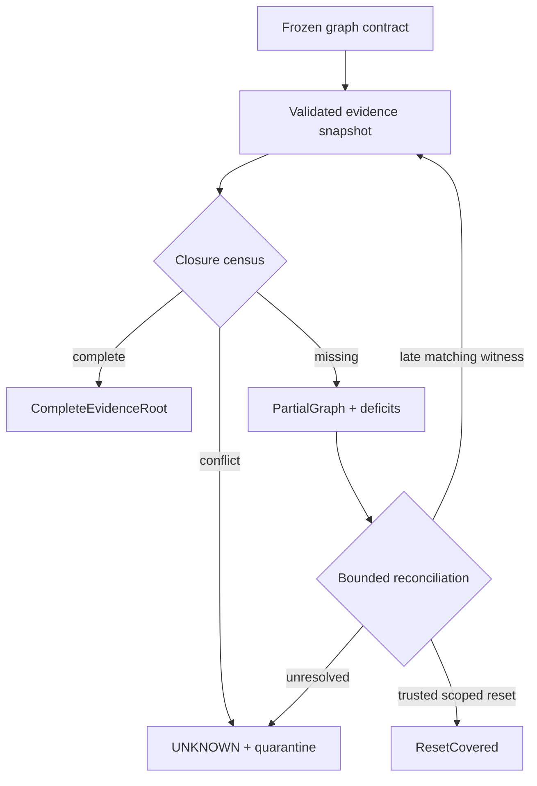
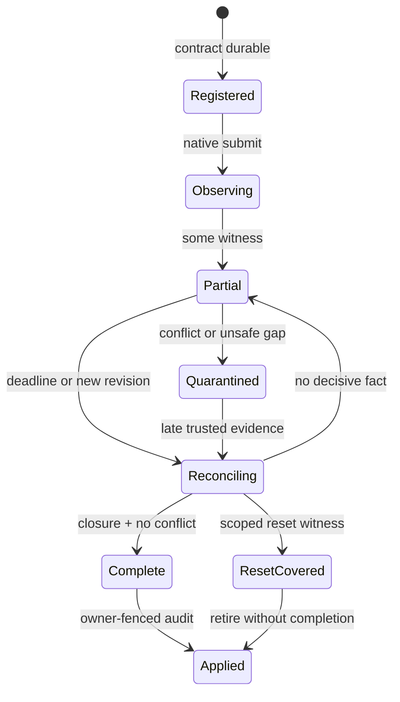

> 源码基线：pto-isa [`418de18d`](https://github.com/hw-native-sys/pto-isa/commit/418de18dde8fa33773dc5c384fdfe5506463b628)，合入于 2026-10-09；同步 PR 为 [#342](https://github.com/hw-native-sys/pto-isa/pull/342)，trace 直接关联 [#328](https://github.com/hw-native-sys/pto-isa/pull/328)。本文严格区分**当前代码/规范事实**、**本次测试事实**与**建议恢复协议**；`PartialGraph`、`MissingWitness`、`ReconciliationRecord` 尚不存在于仓库。

## 本篇在 PTO 课程路线中的位置

第 61 章建立了跨 backend 证据图：先以 `CorrelationId` 锁定 operation/attempt/generation，再把 CPU_SIM trace、A2/A3 event 与 A5 semaphore 映射成 typed causal edge。本章只回答下一步：**required graph 已冻结，但只收到一部分 witness 时，系统能知道什么、不能知道什么，以及怎样补证而不把未知误写成成功。**

课程位置：

`typed causal graph → partial-graph census → missing/conflicting witness → owner-fenced reconciliation → complete / reset-covered / quarantine`

## 前置知识

- `InstructionTraceRecord.sequence_id` 是 worker-local program order；地址、序号与文件尾都不是跨 worker completion。
- A2/A3 mode2 的一次 C→V signal 广播给 AIV0/AIV1；V→C 的一次 wait 要消费两个 lane 的 credit。
- A5 `InitImpl` 对 `CrossCoreId` 和 `CrossCoreId+16` 分别 signal；wait 只阻塞指定 pipeline。
- event/semaphore ID 会跨 run 复用。只有 operation、attempt、owner epoch、execution domain 与 workspace generation 都匹配，witness 才能进入同一张图。
- completion closure 与 reuse authority 是两件事：前者产生可信 evidence root，后者还需当前 owner 以 expected revision 原子提交状态与 audit。

## 今日两个核心问题

1. “少一条边”究竟是动作未发生、证据迟到、采集器丢记录，还是旧 attempt 的 witness 被错误过滤？
2. reconciliation 怎样允许迟到证据补齐，又不让 timeout、重复 signal、wrong-generation 或 reset 调用冒充 completion？

## PTO 全栈中的位置

上游是 submit 前冻结的 topology contract 与 native action；中间层持久化 immutable evidence、计算缺口并执行受 owner/revision 约束的补证；下游才是 transition audit、quarantine release 与 workspace reuse。



这里有一条最重要的第一性原理边界：**没有 witness，只能证明“当前证据集不够”，不能证明动作没有发生。** backend action 可能已经改变 payload 或同步状态，而 adapter 在 envelope 持久化前崩溃；因此 timeout 是一次控制事件，不是物理世界的反证。

## 概念和精确语义

### 1. 先把“不完整”分型

建议将 graph census 输出为结构化 deficit，而不是一个 `bool complete`：

| 类型 | 判定 | 安全含义 |
| --- | --- | --- |
| `MISSING_NODE` | required participant 没有任何可信 envelope | 动作可能未发生，也可能发生后丢证据 |
| `MISSING_EDGE` | 两端节点存在，但 required causal link 未被证明 | 不能推出 happens-before 或 visibility |
| `PENDING_PARTICIPANT` | backend 聚合 witness 只覆盖 participant 子集 | 不能扩大成 whole-cluster terminal |
| `CONFLICTING_WITNESS` | 同 evidence ID/ordinal 出现不同 digest、role 或 generation | 至少一份事实不可信，必须隔离 |
| `UNKNOWN_SCHEMA` | reader 无法解释 envelope 版本或 scope | 不能按旧规则乐观降级 |

设冻结契约为 `G_req=(V_req,E_req)`，经身份、schema、digest 与 scope 校验后的观测图为 `G_obs=(V_obs,E_obs)`：

```text
missing_nodes = V_req - V_obs
missing_edges = E_req - E_obs
complete = missing_nodes=∅ ∧ missing_edges=∅ ∧ conflicts=∅
```

注意 `G_obs` 不是“所有收到的日志”。wrong-attempt、wrong-generation、未知 schema 和 scope widening 的 envelope 必须进入 reject/conflict 集，不能通过集合并集补洞。

### 2. `PartialGraph` 是可重放快照，不是可变真相

下面是**建议对象**：

```text
PartialGraph = {
  correlation_id,
  contract_hash,
  snapshot_revision,
  accepted_evidence_ids,
  missing_nodes,
  missing_edges,
  conflicts,
  last_progress_revision
}
```

输入是 CPU 内存中的 immutable envelope snapshot；输出不含 Tile payload，只含 identity、digest、deficit 与 revision。它由 joiner 持有，backend adapter 只能追加 evidence，不能直接把 graph 标成 complete。相同 contract 与 evidence set 必须得到相同 canonical bytes/evidence root，才能支持 crash 后重放。

前置条件是 registry 已在 submit 前持久化 contract；后置条件只是产生 `COMPLETE/PARTIAL/CONFLICT` verdict。失败方式包括 torn registry、contract hash 不符、相同 ordinal 的不同 producer、旧 owner 写入和 reader 不认识 schema；这些都返回 `UNKNOWN/CONFLICT`，不释放 backing。

### 3. missing witness 不是 negative witness

如果 adapter 明确记录了“native submit 被拒绝且没有 side effect”，它可以提供一种受签名/事务保护的 `NOT_SUBMITTED` terminal；但普通日志缺失、future timeout、进程退出或 trace 文件没有某行都达不到这个证明强度。尤其是 action 后、append 前 crash，会产生 `MAY_HAVE_APPLIED`。

因此三值语义比二值更合适：

- `COMPLETE`：required node/edge 全部闭合且无冲突；
- `NOT_APPLIED`：只有 backend 提供强 negative witness 时成立；
- `UNKNOWN`：其余缺失、冲突、超时与不可解释状态。

`UNKNOWN` 不是实现失败，而是系统诚实保留信息边界。

### 4. reconciliation 只能做四类动作

建议 owner 在 `(owner_epoch, expected_revision)` fence 下执行：

1. **重新读取**：按 revision 读取新增 envelope，重新验证整张图；notify 只提示 recheck。
2. **native query**：若 backend 能按 operation-key/generation 查询 terminal，adapter 追加新的 immutable witness；query 结果本身也要有 scope 与 digest。
3. **可信 scoped reset**：reset witness 必须覆盖 execution domain、workspace generation 与所有可能未终止 participant。它只证明“旧动作不再能触碰待复用资源”，不会伪造 computation completion。
4. **持续 quarantine**：无法 query、reset scope 不足、冲突未解或 deadline 到达时，保留 backing 与 recovery debt。

deadline 只决定何时停止等待并进入 query/reset/quarantine，不改变事实 verdict。重新 submit 是新 `attempt_id`；旧 attempt 的迟到证据只能减少旧债务，不能完成新 attempt。

## 真实文件、类型、API 与指令逐段解读

### CPU_SIM：局部 trace 能暴露洞，却不能解释洞

[`include/pto/cpu/trace.hpp`](https://github.com/hw-native-sys/pto-isa/blob/418de18dde8fa33773dc5c384fdfe5506463b628/include/pto/cpu/trace.hpp) 的 `InstructionTraceRecord` 保存 `block_idx/subblock_id/sequence_id/opcode`、输入/输出 Tile 的 address、shape、layout、dtype；`InstructionTraceState` 是 thread-local，并以自己的 mutex 保护 records 与 `next_sequence_id`。因此同一 worker 的 `sequence=4:TLOAD → 5:TADD → 6:TSTORE` 可以确认 program order。

但记录没有 operation/attempt/generation，也没有跨 worker edge。若 worker 3 缺 `sequence=6`，可能是 `TSTORE` 未执行，也可能是记录 append 前 crash。当前 trace API 不提供 negative witness，所以 reconciliation 不能从“文件短一行”推导 `NOT_APPLIED`。

### A2/A3：reduce wait 是聚合事实，缺 lane 必须显式展开

[`include/pto/npu/a2a3/TSync.hpp`](https://github.com/hw-native-sys/pto-isa/blob/418de18dde8fa33773dc5c384fdfe5506463b628/include/pto/npu/a2a3/TSync.hpp) 把特定 `TMOV_A2V` 与 `TMOV_V2M/TEXTRACT_V2M` 组合标为 `IsCrossCore`，要求手工 `CrossCoreId`；`InitImpl` 调 `ffts_cross_core_sync(...mode2...)`，`WaitImpl` 调 `wait_flag_dev`。[`set_cross_core`](https://github.com/hw-native-sys/pto-isa/blob/418de18dde8fa33773dc5c384fdfe5506463b628/docs/isa/scalar/ops/pipeline-sync/set-cross-core.md) 与 [`wait_flag_dev`](https://github.com/hw-native-sys/pto-isa/blob/418de18dde8fa33773dc5c384fdfe5506463b628/docs/isa/scalar/ops/pipeline-sync/wait-flag-dev.md) 规定 broadcast/reduce 语义。

这要求 adapter 把一次 physical wait 展开为 `AIV0_done→join` 与 `AIV1_done→join` 两条 logical edge，并记录 participant set。若只看见 AIV0 signal 而 Cube wait 尚未返回，状态是 `PENDING_PARTICIPANT(AIV1)`；不能因为 event ID 正确就生成 join terminal。

### A5：两份 signal 的 scope 本来就不同

[`include/pto/npu/a5/TSync.hpp`](https://github.com/hw-native-sys/pto-isa/blob/418de18dde8fa33773dc5c384fdfe5506463b628/include/pto/npu/a5/TSync.hpp) 的 cross-core `InitImpl` 对 `CrossCoreId` 与 `CrossCoreId+16` 各调用 `set_intra_block`；`WaitImpl` 调 `wait_intra_block(Base::srcPipe, CrossCoreId)`。规范 [`set_intra_block`](https://github.com/hw-native-sys/pto-isa/blob/418de18dde8fa33773dc5c384fdfe5506463b628/docs/isa/scalar/ops/pipeline-sync/set-intra-block.md) 和 [`wait_intra_core`](https://github.com/hw-native-sys/pto-isa/blob/418de18dde8fa33773dc5c384fdfe5506463b628/docs/isa/scalar/ops/pipeline-sync/wait-intra-core.md) 进一步限定 per-subblock、per-pipe scope。

所以 sem3 与 sem19 不是同一 witness 的两个写法。若 sem3 对应 AIV0 已完成而 sem19 缺失，joiner 必须保留 `AIV1` deficit；`PIPE_V` 的 wait 也不能自动证明 `PIPE_MTE3` 或 whole-device terminal。

### 公共 event verifier 的边界

[`include/pto/common/event.hpp`](https://github.com/hw-native-sys/pto-isa/blob/418de18dde8fa33773dc5c384fdfe5506463b628/include/pto/common/event.hpp) 的 `EventIdCounter` 在 CPU_SIM/CostModel 下会检测“ID 仍 occupied，可能漏了 `Wait()`”，并在有限池中轮转；`EventBase` 约束 Record/Wait 的类型和 pipe pair。这能抓住单次执行中的 API 生命周期错误，却不持久化 attempt/generation，也不能在进程崩溃后解释某个 ID 的历史。因此 reconciliation registry 补的是 temporal identity 和 durable evidence，不是复制现有静态检查。

## 对象与状态生命周期



`Registered` 的 contract 由 launch owner 创建；native adapter 追加 envelope；joiner 生成 immutable `PartialGraph`；recovery owner 决定 query/reset/quarantine 并原子提交 reconciliation record；allocator 只消费已 `Applied` 的资源状态。`Complete` 与 `ResetCovered` 都可解除物理复用风险，但业务含义不同：前者可以提交计算结果，后者通常只能丢弃 attempt 并重新计算。

## 端到端调用链或证据链

1. runtime 登记 `op7/attempt2/owner42/domainD/workspace_gen9`，冻结 required nodes/edges 与 backend profile；
2. native submit 后，adapter 把 trace/event/semaphore observation 包装成 envelope；
3. joiner 过滤 wrong identity/schema/digest，按 A2/A3 或 A5 topology 展开 logical edge；
4. census 计算 missing node/edge/participant 与 conflict，持久化 `PartialGraph@revision107`；
5. owner 到达 deadline 后先 reload revision，再执行可用 native query；若新 witness 到达则重建图；
6. closure 成立时生成 canonical evidence root；若只能得到覆盖 generation9 的 reset witness，则以 `ResetCovered` 退休 attempt；否则 backing 保持 quarantine；
7. 当前 owner 以 expected revision 原子提交 canonical state、`ReconciliationRecord` 与 debt 差量，之后 allocator 才能复用。

## 具体 shape、Tile 和状态演算

设 payload 为 `16×16xf32`、ND layout、Vec Tile，单 Tile `16×16×4=1024 B`；double buffer 两槽共 2048 B。required graph 有四条边：

```text
e0: ready → AIV0
e1: ready → AIV1
e2: AIV0_done → join
e3: AIV1_done → join
```

在 A2/A3 上，event3 的一次 broadcast 可同时证明 `e0/e1`；随后只收到 AIV0 credit，观测集是 `{e0,e1,e2}`，所以 `missing_edges={e3}`。即使 deadline 已过，2048 B backing 仍不能复用。若同一 `attempt2/gen9` 的 AIV1 witness 迟到且 digest/ordinal 合法，revision108 重算后 closure 成立；若 witness 属于 attempt1，它只能处理 attempt1 的债。

在 A5 上，sem3 与 sem19 分别覆盖 AIV0/AIV1。只收到 sem3 时，deficit 同样是 `e3`，但 native locator 和 query/reset scope 与 A2/A3 不同。若 adapter 只拿到覆盖 AIV0 的 reset，仍不能释放共享 2048 B；只有 reset scope 同时覆盖两 subblock、相关 pipeline 与 generation9，才能以 `ResetCovered` 退休旧 attempt。随后重试必须登记 attempt3，不能沿用 event/semaphore 历史。

CPU_SIM 若四个 worker 中一个 trace 只到 `TADD`，census 可以定位缺少该 worker 的 `TSTORE` witness，却不能判断 store 是否影响过外部 memory。除非 launch wrapper 提供可信 completion/query/reset，否则结果仍是 `UNKNOWN`。

## 为什么这样设计及替代方案

| 设计 | 延迟/吞吐 | 资源 | 正确性 | 维护成本 |
| --- | --- | --- | --- | --- |
| 超时即失败并复用 | 延迟最低 | 最省 quarantine | action-after-log-gap 会造成 late write/use-after-reuse | 表面低，事故成本高 |
| 最佳努力日志拼接 | 平时开销小 | 中等 | timestamp/ID reuse 会误连边 | heuristic 随 backend 演化 |
| 全设备 reset 后一律重试 | 恢复简单但 stall 大 | 释放快 | scope 足够时安全，丢失可保留结果 | 运行代价大 |
| typed partial graph + bounded reconciliation | 多一次 registry/query | 需要 metadata 与 quarantine | 缺失/冲突 fail closed，可重放、可审计 | schema/adapter 较复杂 |

建议方案不承诺零额外延迟；它把“是否值得 query、何时 reset、隔离多少资源”变成显式策略，同时不改变 correctness predicate。若未来真机能提供带 generation 的原子 terminal query，reconciliation 可更快；但在该能力被证实前，不应假设它存在。

## 访存、计算、流水、并行和硬件约束

`PartialGraph` 元数据不搬运 1024 B payload，只保存 identity/digest/edge，正常数据路径开销主要来自 envelope append 与 hash。A2/A3 的 mode2 压缩 physical signal 数，但 `wait_flag_dev` 会阻塞整个 SU；A5 的两份 1:1 signal 元数据更多，却能只阻塞指定 pipe。哪种 wall time 更优取决于真实 overlap 与 adapter/query 开销，公开头文件不能给出周期结论。

reconciliation 也不能无限重试吞噬 recovery reserve：每次 query/reset 都应预占受保护资源、记录 ticket 与 revision；长期无进展应转 quarantine 并计入 recovery debt。另一方面，固定短 timeout 会制造大量假 partial；阈值必须由 witness 延迟、adapter 丢失率、query service time 和 quarantine residency 的观测分布校准，而不是由本文拍常数。

## 测试证据与未覆盖风险

本次在 `418de18d` 干净快照上执行：

- `python3 tests/run_cpu.py -t ffts`：构建通过，`ffts` **317 ms PASS**。[`ffts/main.cpp`](https://github.com/hw-native-sys/pto-isa/blob/418de18dde8fa33773dc5c384fdfe5506463b628/tests/cpu/st/testcase/ffts/main.cpp) 覆盖 repeated broadcast credit、每 lane 一份 credit 的 reduce join、device/group 隔离、run boundary reset、3000 轮跨动态库数据可见性，以及非法 mode/event/context。
- `python3 tests/run_cpu.py -t ttrace --trace-mode`：构建通过，`ttrace` **46 ms PASS**。[`ttrace/main.cpp`](https://github.com/hw-native-sys/pto-isa/blob/418de18dde8fa33773dc5c384fdfe5506463b628/tests/cpu/st/testcase/ttrace/main.cpp) 覆盖 operand/shape/layout/dtype、runtime switch、2 block×2 subblock、多 worker 连续局部序号与两次 launch 的独立 trace 导出。

这些测试证明 current simulator 的 mode2 credit 和 trace export 行为，不证明：A5 repeated/late/wrong-sem；adapter crash 位于 native action 与 envelope append 之间；same-ID/different-payload；wrong-generation；partial graph crash replay；query/reset scope；evidence-root canonical encoding；owner/revision CAS；真机 terminal 与 CPU_SIM 的 differential verdict。以上均保留为知识债。

## 与前后章节的连接

向前，本章消费第 60 章的 `TransitionAudit` 与第 61 章的 correlation/causal closure：audit 不能引用“某个缺边日志”，只能引用 complete evidence root、scoped reset witness 或明确 quarantine 结果。向后，partial graph 会自然引出一个更窄的问题：多个 reconciler、迟到 witness 与 owner failover 并发时，怎样保证只有一个 revision 接纳 closure，且旧 owner 不能释放 backing。

## 本篇结论、知识债、三个理解检查问题和下一章

结论只有三条：

1. 缺失 witness 是知识缺口，不是动作未发生的证明；timeout 触发策略，不改变事实。
2. reconciliation 必须重放完整 identity/schema/topology/digest closure；late witness 只属于原 attempt，scoped reset 只证明安全退休、不证明计算完成。
3. allocator 不能直接消费 trace/event；只有当前 owner 以 expected revision 提交的 `Complete` 或覆盖充分的 `ResetCovered` 才能解除对应 generation 的 quarantine。

仍欠：真实 `PartialGraph/MissingWitness/ReconciliationRecord` schema、register-before-submit 事务、canonical encoding、native query/reset adapter、A5 fault tests、crash failpoint、owner-fenced CAS、retention/redaction 与 A2/A3/A5 真机 differential Golden。

理解检查：

1. 为什么 A2/A3 event3 的 AIV0 credit 已到、deadline 已过，仍不能把 AIV1 的边标成 `NOT_APPLIED`？
2. A5 sem3 已完成而 sem19 缺失时，为什么只 reset `PIPE_V/AIV0` 仍不能释放共享 double buffer？
3. `Complete` 与 `ResetCovered` 都可能允许复用 backing，为什么只有前者通常允许提交计算结果？

下一章：**两个 Reconciler 同时补同一张图怎么办——Owner Fence、Revision CAS 与 Late-witness Linearization。**

## 课程账本增量

- 新增 `PartialGraph` census：区分 missing node/edge/participant、conflict 与 unknown schema。
- 新增三值事实边界：缺记录与 timeout 均为 `UNKNOWN`；只有强 negative witness 才能证明 `NOT_APPLIED`。
- 新增 bounded reconciliation：reload → native query → scoped reset → quarantine；每一步都受 owner epoch 与 revision fence。
- 新增资源规则：`Complete` 与 `ResetCovered` 的业务含义分离，allocator 只消费已原子 applied 的 canonical state。
- 测试事实：`ffts` 317 ms PASS；`ttrace --trace-mode` 46 ms PASS；建议协议和 A5/fault path 尚未由现有测试覆盖。
