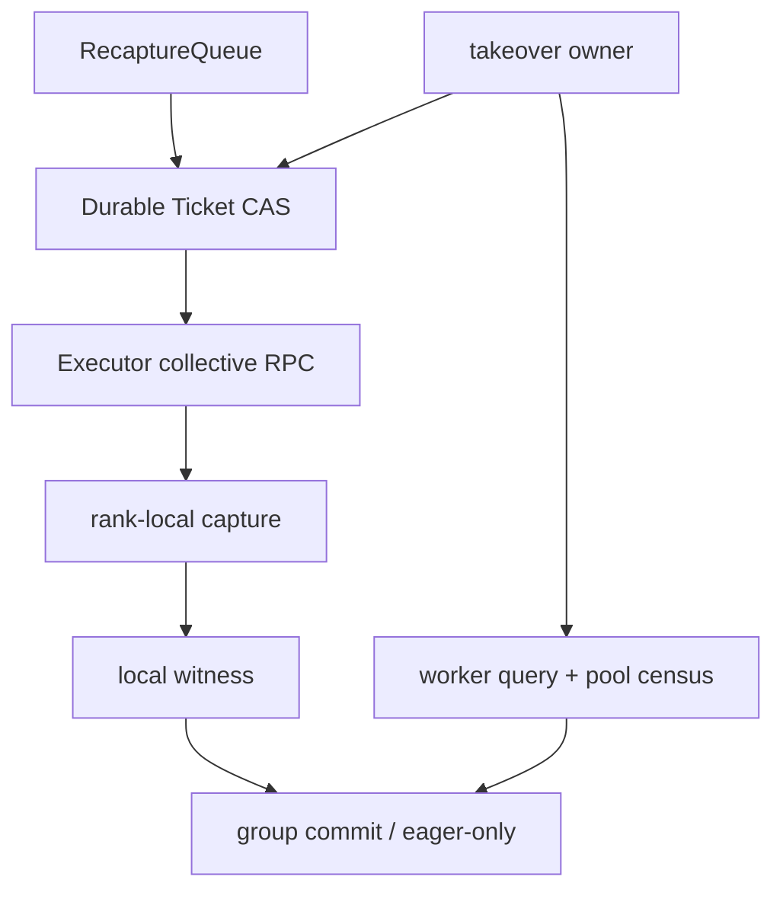
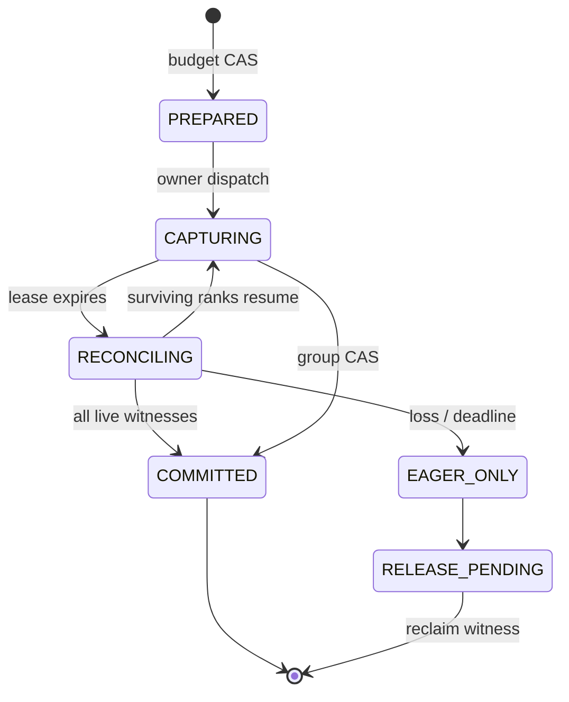

> 源码基线：vLLM [`276fbcff`](https://github.com/vllm-project/vllm/commit/276fbcff2717bd934cfa37c8a2e4c391f3e7237b)。本文严格区分三类内容：**当前 `main` 代码事实**、**测试/PR 证据**与**建议协议**。当前 vLLM 没有运行期 `RecaptureQueue`、durable reservation 或 takeover；这些名词描述的是由现有 capture/pool 生命周期推导出的恢复设计。

## 本篇在课程路线中的位置

第 52 章已经回答“有限 headroom 先抓哪个 key”：候选按窗口净收益/条件边际显存排队，并用 hysteresis 抑制 capture storm。但排序之后还有一个事务问题：K8 获得 12 MiB reservation，rank 0 已 capture，队列 owner 却在 group commit 前崩溃。新 owner 既不能盲目重抓，也不能仅因 lease 超时就把 12 MiB 加回预算。

本章只解决这一个边界：

`utility winner → durable reservation → rank-local capture → owner crash → fenced reconciliation → commit 或 safe release`

## 前置知识回顾

- CUDA Graph replay 的正确性依赖 capture 时的地址和运行模式；dispatcher key 只说明 shape/mode 可匹配，不证明 graph 仍存活。
- 多 rank key 只有在 expected rank set 全部就绪后才可发布；单 rank 的成功不能变成局部 replay。
- shared pool 的成本是条件边际峰值，逻辑 budget 与设备上实际占用不是同一个事实源。
- graph 不可用时走 eager 是正确性兜底，因此恢复可以 fail closed，而不必为追求优化强行猜测。

## 本篇要回答的核心问题

1. 当前 vLLM 中 graph 对象、地址证据和 pool 分别由谁持有？owner 崩溃后哪些状态会消失？
2. reservation ticket 要持久化哪些字段，才能让接管者安全地继续、放弃或隔离？
3. 怎样区分“账上额度没释放”“GPU 上仍有 graph/pool 占用”和“capture 是否完成未知”三类 leak？

## 组件在全局架构中的位置

当前启动时由 `EngineCore` 经 `Executor.collective_rpc()` 让 workers 并行 warmup/capture；建议的 durable owner 位于 collective RPC 之前，而 rank-local graph 仍只归 worker 进程所有。



硬边界是：durable store 可以保存意图、epoch 与 witness 摘要，却不能保存可 replay 的 `cudaGraphExec_t`。若 worker 进程死亡，记录中的 `LOCAL_DONE` 不能让新进程复活旧 graph；它最多帮助判断需要 recapture 还是隔离。

## 完整调用链

当前代码链如下：

1. [`EngineCore.__init__`](https://github.com/vllm-project/vllm/blob/276fbcff2717bd934cfa37c8a2e4c391f3e7237b/vllm/v1/engine/core.py#L109-L176) 完成 KV 初始化后调用 `model_executor.compile_or_warm_up_model()`。
2. [`Executor.compile_or_warm_up_model`](https://github.com/vllm-project/vllm/blob/276fbcff2717bd934cfa37c8a2e4c391f3e7237b/vllm/v1/executor/abstract.py#L135-L153) 对所有 workers 执行 `collective_rpc("compile_or_warm_up_model")`，并取各 rank compilation time 的最大值。
3. [`GPUWorker.compile_or_warm_up_model`](https://github.com/vllm-project/vllm/blob/276fbcff2717bd934cfa37c8a2e4c391f3e7237b/vllm/v1/worker/gpu_worker.py#L873-L943) 先 warmup kernels，再在 capture context 中调用 `model_runner.capture_model()`。
4. [`GPUModelRunner.capture_model`](https://github.com/vllm-project/vllm/blob/276fbcff2717bd934cfa37c8a2e4c391f3e7237b/vllm/v1/worker/gpu_model_runner.py#L6719-L6833) 清缓存、读取 `get_capture_descs()`、逐 mode/descriptor 调用 `_capture_cudagraphs()`，最后记录实际 graph memory。
5. `_warmup_and_capture()` 先以 `CUDAGraphMode.NONE` 做 warmup，再以目标 mode 运行 `_dummy_run()`；[`CUDAGraphWrapper.__call__`](https://github.com/vllm-project/vllm/blob/276fbcff2717bd934cfa37c8a2e4c391f3e7237b/vllm/compilation/cuda_graph.py#L218-L353) 创建 `CUDAGraphEntry`、记录 tensor 地址、在 shared pool 捕获并保存 `cudagraph` 与弱引用 output。

这条链是进程内对象修改加一次集体 RPC，不是跨故障域的事务。当前启动 capture 任一异常会向上抛出；没有 durable ticket 让另一个 owner 在原步骤上续跑。

## 关键类型、字段和状态生命周期

### 当前对象：`CUDAGraphEntry`

`CUDAGraphEntry` 包含 `batch_descriptor`、`cudagraph`、`output` 和调试用 `input_addresses`。wrapper 在 capture **之前**先把空 entry 放进 `concrete_cudagraph_entries`；捕获成功后才写入 output 和 graph。replay 时，debug 模式会再次读取参数的 `data_ptr()` 并要求地址完全相同。`clear_graphs()` 只是清空字典；worker 进程退出则 Python graph handle、地址表和其本地状态一起消失。

这给出三条当前代码不变量：

- `entry exists` 不等于 capture 完成，必须检查 live graph；
- durable 元数据不能替代进程内 graph handle；
- dispatcher key 是“允许选择”的控制面，wrapper entry 才是“可以 replay”的本地数据面。

### 建议对象：`ReservationTicket`

```text
ReservationTicket = {
  ticket_id, descriptor, graph_generation,
  census_revision, score_revision,
  owner_epoch, lease_deadline, expected_ranks,
  charge_bytes_by_rank, failure_reserve_bytes,
  state, local_witnesses, terminal_reason
}
```

状态建议为：



注意 `lease_deadline` 只转移协调权，不释放显存。真正释放 reservation 的门是 `RELEASE_PENDING` 收到与 ticket generation/census revision 匹配的 reclaim witness。

## 逐函数源码解读

### `collective_rpc()`：有并行 fan-out，没有 durable group commit

Executor 能拿到每个 worker 的返回值，并用 max 汇总时间；这适合启动阶段的同步初始化。它没有 per-key `ticket_id`、owner epoch、rank-local final 或迟到回复 fence。因此建议协议不能把“一次 RPC 返回”误当成可恢复 commit log，而要让每个 rank 的结果携带 `(ticket_id, owner_epoch, generation, descriptor, live_handle_digest)`。

### `CUDAGraphWrapper.__call__()`：本地 capture 的 commit 点很晚

空 entry 在 `torch.cuda.graph(...)` 之前创建；只有 runnable 完成、output 转为弱引用、`entry.cudagraph` 赋值后才算本地成功。若 owner 在 RPC 外层崩溃但 worker 仍活着，接管者可以查询这个 entry；若 worker 在 capture 中崩溃，则不能从 durable `CAPTURING` 推断任何物理终态。

### `profile_cudagraph_memory()`：清掉对象不等于 pool 可安全复用

当前 profiler 把 profiling capture 导向 throwaway pool，在 `finally` 中清理所有 wrappers、恢复 pool、清 dispatcher keys 和 profiling KV。已合入 [`e6cc0899`](https://github.com/vllm-project/vllm/commit/e6cc0899b6e29ad613efae572eb98e0d776afe4d) / [PR #53682](https://github.com/vllm-project/vllm/pull/53682) 的直接原因是：profiling graph 若落进 persistent global pool，丢弃它们会把 pool `use_count` 推到 0，下一次真实 capture 触发 allocator assertion。

这是本章最重要的现成证据：资源恢复不能只看 Python dict 或账本 bytes；pool 的引用关系、stream 与 allocator 状态也属于回收证明。

## 具体示例与 shape/状态演算

教学例子：TP=2，候选 K8=`BatchDescriptor(num_tokens=8, num_reqs=8, uniform=True)`；每 rank 的代表性持久输入为 `input_ids int32[8]`、`positions int64[8]`、`slot_mapping int64[8]`，都在 CUDA device。generation=43，census revision=17，条件边际 charge 为 `{rank0: 12 MiB, rank1: 12 MiB}`。

1. owner epoch 6 以 CAS 写入 `PREPARED`，两个 rank 各扣 12 MiB 逻辑 budget。
2. rank 0 capture 完成，保存本地 graph 和地址摘要，写 `LOCAL_DONE`；rank 1 尚未完成。
3. owner 崩溃，lease 到期。新 owner 不能立刻退回 24 MiB，因为 rank 0 的 shared pool 仍可能占用 12 MiB。
4. 新 owner CAS `owner_epoch: 6→7`，先冻结 epoch 6 的迟到 publish，再向 expected ranks 查询。
5. 若 rank 0 原 worker 存活且返回 generation=43、entry graph 非空、地址/descriptor 匹配，witness 可复用；rank 1 继续 capture。两者都成功后以 epoch 7 做 group CAS，dispatcher 才能暴露 K8。
6. 若 rank 0 worker 已死亡，则其 handle 不存在。ticket 进入 `EAGER_ONLY`；只有 process/context reset 与 revision=17 之后的新 pool census 证明旧占用不再计入，两个 reservation 才释放。所有请求在此期间继续 eager。

预算式不是 `free += expired_ticket.bytes`，而是：

`admissible[r] = physical_capacity[r] - committed[r] - unreconciled_reserved[r] - failure_reserve[r]`

`unreconciled_reserved` 必须覆盖 `PREPARED/CAPTURING/RECONCILING/RELEASE_PENDING`，直到物理证据闭环。

## 为什么这样设计及替代方案

| 方案 | 恢复速度 | 正确性风险 | 维护成本 |
| --- | --- | --- | --- |
| 进程内计数器 | 最低开销 | owner crash 后额度丢失或重复扣减 | 低，但不能跨故障 |
| ticket TTL 到期自动释放 | 快 | capture 仍活着时超卖；旧 owner 可能迟到 publish | 中 |
| durable ticket + lease + fenced reconciliation | 存活 worker 可续跑；死亡 worker fail closed | 需要 durable CAS、查询协议和 census | 高，但边界可测试 |

第一性原理上，TTL 只能判断“原 owner 不再可信”，不能证明“GPU 资源已释放”。因此 lease 解决 authority，generation/epoch fence 解决 stale actor，reclaim witness 才解决 capacity；三个概念不能合并成一个超时。

## 性能、并发、正确性与边界条件

- **延迟**：durable write 不应进入每次 replay 热路径，只发生在 candidate admission、local final 和 terminal transition；正常请求仍走现有 dispatcher/wrapper。
- **吞吐**：takeover 期间 key 走 eager，牺牲少量 launch efficiency，换取不发生 partial-rank replay 和 pool oversubscription。
- **显存**：按 rank 保存 charge vector，group admission 由最紧 rank 决定；不能把 TP 总和平均到各卡。
- **并发**：每个 ticket 的 terminal CAS 必须幂等；epoch 6 的迟到 `LOCAL_DONE` 可以用于诊断，但不能改变 epoch 7 的状态。
- **graphability**：ticket 不进入 captured model inputs，也不改变 tensor shape；它只控制何时允许某个 `BatchDescriptor` 出现在 dispatcher 可见集合。
- **失败边界**：coordinator 死而 workers 活，可查询续跑；worker 死则 handle 丢失；查询超时属于 `ACTION_UNKNOWN`，保持 reservation/隔离，而不是乐观释放。

## 测试证据与未覆盖风险

当前 [`test_cudagraph_dispatch.py`](https://github.com/vllm-project/vllm/blob/276fbcff2717bd934cfa37c8a2e4c391f3e7237b/tests/v1/cudagraph/test_cudagraph_dispatch.py#L266-L390) 的 GPU 测试验证 capture 后 entry 含非空 graph、replay 确实调用 `cudagraph.replay()`，结果与 eager 一致；另一个测试在全局禁止 capture 后让 unseen key 触发 `RuntimeError`。这些测试证明本地 entry 的 capture/replay 边界，不证明跨 owner 恢复。

[`test_gpu_model_runner_v2_cudagraph_profiling.py`](https://github.com/vllm-project/vllm/blob/276fbcff2717bd934cfa37c8a2e4c391f3e7237b/tests/v1/worker/test_gpu_model_runner_v2_cudagraph_profiling.py#L120-L330) 直接验证 capture 异常仍 teardown、profiling counter 恢复、wrapper 指向 throwaway pool、profiling graphs 被清理；GPU case还检查 throwaway pool 的物理内存能释放。PR #53682 报告在 B200/DeepSeek-V4-Flash TP2+EP 上复现旧 assertion，并验证修复后初始化成功。

本章未重跑 GPU 测试。仍缺的关键 Golden 是：在 `PREPARED`、rank0 capture 后、all-rank done 前、group CAS 前、commit 后五个边界杀 owner；分别覆盖 coordinator-only crash 与 worker crash；验证 stale epoch ack、双 owner、查询超时、OOM、reset、pool revision 漂移；最终断言“同一 ticket 最多一次 commit、budget 不超卖、无法证明释放时只 eager”。当前开放 [PR #59160](https://github.com/vllm-project/vllm/pull/59160) 讨论 sleep/elastic-EP 的 graph pool release/recapture 和 live reference 拒绝释放，但它不是当前 `main` 的 durable ticket 实现。

## 与前后章节的连接

第 47–52 章形成 `generation → group final → deadline → orphan reclaim → census → utility queue`；本章补上队列 owner 崩溃时的事务闭环：

`utility reservation → epoch-fenced capture → takeover query → reclaim witness → budget reuse`

下一章将继续处理 ticket 的证据格式：怎样让 `PoolCensus`、worker live-handle query 与 durable ledger 三方给出可审计的一致快照，并在查询超时或观测不一致时生成 quarantine 而非错误释放。

## 本篇结论、知识债、三个理解检查问题和下一章

结论：reservation 不是普通计数器，而是跨 durable control plane 与 process-local GPU resource 的条件承诺。owner lease 到期只允许接管；只有 fenced worker query 加新 census 才允许 commit 或释放。当前 vLLM 的 worker-local `CUDAGraphEntry`、collective RPC、shared pool 与 throwaway profiling 修复，恰好说明为什么“日志说完成”和“显存确实可复用”必须分开验证。

知识债：真实 ticket/WAL schema、durable CAS backend、worker query API、live-handle digest、pool revision 定义、V1/V2/encoder/speculator owner 统一、TP/PP expected-rank 变化、context reset witness、fragmentation 与外部 launcher crash Golden。

三个理解检查问题：

1. 为什么 `lease_deadline` 到期能转移 owner，却不能直接释放 reservation？
2. coordinator 进程死亡和持有 `CUDAGraphEntry` 的 worker 死亡，恢复动作为什么不同？
3. `clear_graphs()` 已清空 Python dict 时，为什么仍必须查看 pool census/allocator witness？

下一章：**账、Handle 和 Pool 对不上时信谁——Tri-source Reconciliation、Quarantine 与 Auditable Reclaim。**

## 课程账本增量

- 章节：53；源码基线 `276fbcff`。
- 新覆盖：`EngineCore → Executor.compile_or_warm_up_model → collective_rpc → GPUWorker/GPUModelRunner capture → CUDAGraphWrapper/CUDAGraphEntry`；profiling throwaway pool 与错误 teardown。
- 新确认不变量：durable 记录不能复活 process-local graph；lease 只转移 authority；ticket 释放必须等待 generation/revision-bound reclaim witness；dispatcher 可见性晚于 all-rank local success。
- 直接证据：wrapper capture/replay 与 unseen-key 禁捕测试；V2 profiling error teardown、pool redirect/restore/free 测试；已合入 PR #53682 的 persistent-pool `use_count` 修复。
- 建议协议：durable reservation、owner epoch/lease、rank-local witness、takeover query、`RELEASE_PENDING` 与 fail-closed eager。
- 下一章：tri-source reconciliation、quarantine 和 auditable reclaim。
