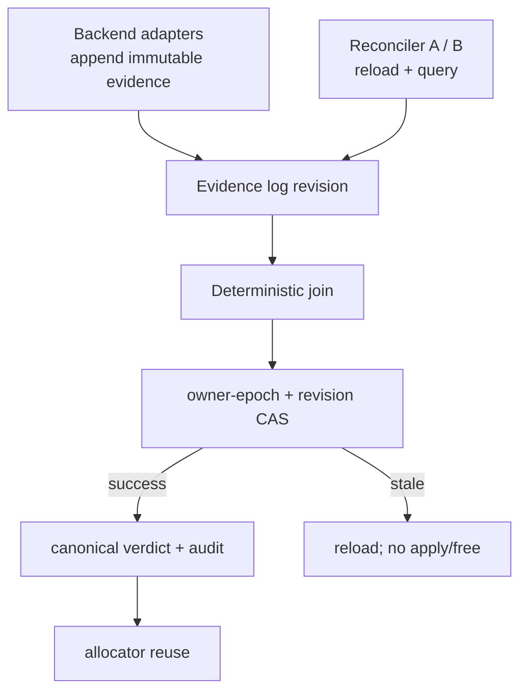
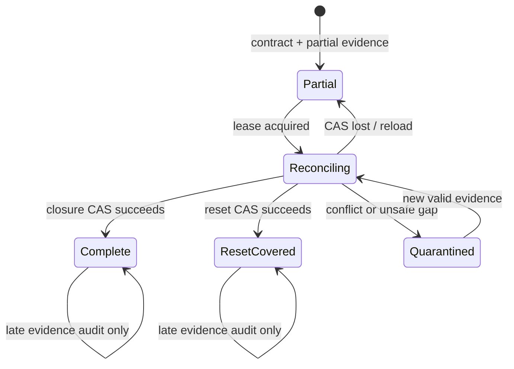

> 源码基线：pto-isa [`418de18d`](https://github.com/hw-native-sys/pto-isa/commit/418de18dde8fa33773dc5c384fdfe5506463b628)，为本文研究时默认分支最新提交。本文严格区分**当前代码/规范事实**、**本次测试事实**与**建议恢复协议**；`ReconcileLease`、durable revision CAS 和 late-witness linearization 尚不存在于仓库。

## 本篇在 PTO 课程路线中的位置

第 62 章已经定义 partial evidence graph 的安全处理：缺 node、edge 或 participant 只产生 `UNKNOWN`，owner 依次 reload、native query、可信 scoped reset，仍无法闭合就 quarantine。今天只追问一个并发问题：owner A 正在 query，lease 到期后 owner B 接管并 reset；此时 A 的 query 返回，或者原始 witness 迟到。谁有权把图标成 `Complete`，谁有权解除 2 KiB backing？

课程位置：

`PartialGraph → concurrent reconcilers → owner fence → revision CAS → late-witness linearization → one terminal state`

## 前置知识

- evidence envelope 是 immutable fact；同 identity、同 digest 的重复提交可以幂等去重。
- `Complete` 证明 computation closure，`ResetCovered` 只证明旧 generation 不再触碰 backing，二者业务语义不同。
- owner lease 到期只撤销旧 owner 的**提交与释放权限**，不能让已经下发的 query/reset 自动取消。
- A2/A3 event ID、A5 semaphore ID、CPU_SIM `sequence_id` 都会在不同执行中复用，必须连同 operation、attempt 与 workspace generation 判断。

## 今日核心问题

1. 为什么 lease、mutex 或单独的 revision 都不足以阻止两个 reconciler 同时提交？
2. late witness 应在什么位置线性化，才能既不丢有效证据，也不让 stale owner 改写 terminal state？

## PTO 全栈中的位置

上游 adapter 可并发追加 immutable evidence；joiner 可并发计算 candidate verdict。真正必须单写的是会改变 authority、业务结果或资源所有权的 apply/free transaction。



这里不能用“先到者赢”的网络时间。线性化点必须是 durable store 中可全序观察的事件：evidence 的 immutable append，或 canonical state 的成功 CAS。

## 概念和精确语义

### 1. 三个不能混用的序号

| 序号 | 所在层 | 当前代码载体 | 能证明 | 不能证明 |
| --- | --- | --- | --- | --- |
| instruction sequence | 单 worker trace | `InstructionTraceState.next_sequence_id` | 当前 trace state 内 program order | 跨 worker/launch/崩溃顺序 |
| FIFO commit order | 当前 CPU TPipe | `SharedState.next_commit_seq/commit_seq[]` | 当前进程内 slot 发布次序 | durable recovery revision |
| recovery revision | 建议控制面 | durable canonical record | 对同一 graph state 的全序修改 | native action 完成，除非附带 evidence |

第一个和第二个序号都可能 reset 为零或一。它们不是“精度较低的 revision”，而是作用域完全不同的身份。

### 2. owner fence 与 revision CAS 缺一不可

建议的 canonical key 至少是：

```text
GraphKey = (operation_id, attempt_id, execution_domain, workspace_generation)
CanonicalState = {
  owner_epoch,
  revision,
  contract_hash,
  verdict,              // PARTIAL | COMPLETE | RESET_COVERED | QUARANTINED
  evidence_root,
  missing_set,
  quarantine_scope,
  terminal_action_id
}
```

apply 的前置条件是同一个事务同时满足：

```text
stored.owner_epoch == lease.owner_epoch
stored.revision    == candidate.base_revision
candidate.contract_hash == stored.contract_hash
candidate.evidence_root == hash(snapshot_at_base_revision)
```

成功后写入 `revision+1`、新 verdict、audit 和资源差量。owner fence 阻止 lease 已过期的 A；revision CAS 阻止同一 owner 的两个并发 worker都基于旧快照成功。只有 epoch 没有 revision，会丢失更新；只有 revision 没有 epoch，stale owner 仍可能在碰巧读到新 revision 后执行不再被授权的物理动作。

### 3. evidence append 不应被 owner 独占

最小设计不是“只有 owner 能写一切”。backend adapter 或旧 query 的返回值只要通过 identity、schema、digest 与 scope 校验，就可以按 evidence ID 幂等追加；否则 owner 切换窗口会白白丢失真实事实。

但 append 只改变 evidence-log revision，不直接释放资源。joiner 对指定 revision 的 immutable snapshot 确定性求闭包，当前 owner 再以 CAS 应用。这样既允许 late witness 补债，也不会让产生它的 stale reconciler获得 authority。

### 4. late witness 的线性化规则

建议按以下规则处理：

- 同 `evidence_id + digest`：幂等 duplicate；不重复生成 edge。
- 同 `evidence_id`、不同 digest/role/scope：`CONFLICT`；owner 只能 quarantine，不能任选一份。
- 同 attempt/generation 的迟到 matching witness：在 durable append 时线性化；下一次 join 可消费。
- 旧 attempt 或旧 workspace generation：只能归档到原 debt，不能闭合新 attempt。
- terminal `COMPLETE` 后的相容 witness：可补审计，不能重新提交业务结果。
- terminal `RESET_COVERED` 后的 computation witness：保存为 late fact，但不能把已 reset 的 attempt 改回成功；新的业务结果必须来自新 attempt。

最后一条非常重要：evidence 是事实，terminal state 是已作出的资源/业务决策。允许事实追加，不等于允许 terminal state 回滚。

## 真实文件、类型、API 或指令逐段解读

### `TPush.hpp`：局部 CAS 只解决一次初始化

[`include/pto/cpu/TPush.hpp`](https://github.com/hw-native-sys/pto-isa/blob/418de18dde8fa33773dc5c384fdfe5506463b628/include/pto/cpu/TPush.hpp) 的 `SharedStateStorage.init_state` 是 `std::atomic<uint32_t>`，`EnsureSharedStateInitialized()` 用 `compare_exchange_strong(0→1)` 选出唯一构造者，再以 release/acquire 发布 `PSTATE_INITIALIZED`。这是货真价实的线性化点，但范围只是**当前地址空间内该静态 storage 的初始化**。

`SharedState` 随后用 `mutex + condition_variable` 保护 slot、`occupied`、borrow 计数和 `commit_seq`。生产者/消费者在同一进程中可以得到一致 FIFO；`reset_for_cpu_sim()` 又会把 `commit_seq[]` 清零、`next_commit_seq` 设回 1 并 `notify_all()`。因此它不能给跨 owner、跨进程 reconciliation 提供 fencing token。

当前实现给出的启发是机制层面的：**把一次状态转移集中到单个 compare-and-swap 点，并用 acquire/release 让随后读取者看到完整对象。** durable store 需要复制这个不变量，而不是直接复用这个变量。

### `trace.hpp`：mutex 保证容器一致，不产生全局因果

[`include/pto/cpu/trace.hpp`](https://github.com/hw-native-sys/pto-isa/blob/418de18dde8fa33773dc5c384fdfe5506463b628/include/pto/cpu/trace.hpp) 的 `InstructionTraceState` 是 thread-local，保存 `next_sequence_id`、records 和 mutex。`ReserveInstructionTraceSequenceId()` 与 `AppendInstructionTraceRecord()` 都在 scoped lock 下修改状态，`CopyInstructionTraceRecords()` 也在同一锁下复制。

这确保某个 worker 的 vector 不撕裂，却不建立 worker A 与 B 的全序。reconciler 不能比较 `worker0 sequence=6` 与 `worker1 sequence=5` 来选 winner，也不能用 trace 文件的 append 顺序替代 recovery revision。

### `event.hpp`：有限 event ID 是生命周期检查，不是 temporal identity

[`include/pto/common/event.hpp`](https://github.com/hw-native-sys/pto-isa/blob/418de18dde8fa33773dc5c384fdfe5506463b628/include/pto/common/event.hpp) 的 `EventIdCounter` 在 CPU_SIM/CostModel 下以 occupied mask 检查“Record 后漏 Wait”，并在有限 ID 池内轮转。它能抓单次执行中的同步 API 错误，却会 reset/reuse；两个 reconciler 看到相同 event3，仍必须先检查 operation/attempt/generation。

### A2/A3 与 A5：native witness 可以迟到，scope 不会自动扩大

[`A2/A3 TSync.hpp`](https://github.com/hw-native-sys/pto-isa/blob/418de18dde8fa33773dc5c384fdfe5506463b628/include/pto/npu/a2a3/TSync.hpp) 的 mode2 signal/wait表达 broadcast/reduce；[`A5 TSync.hpp`](https://github.com/hw-native-sys/pto-isa/blob/418de18dde8fa33773dc5c384fdfe5506463b628/include/pto/npu/a5/TSync.hpp) 对 `CrossCoreId` 与 `CrossCoreId+16` 分别 signal，并按 pipe wait。query 返回的 event3 或 sem19 即使在 owner 换代后才到，也仍可证明原 native edge；但它没有当前 owner 权，更不能从一个 subblock/pipe scope 扩大成 whole-workspace terminal。

## 对象、Evidence Graph 与 CAS 状态生命周期



生命周期中有四类 owner：

1. registry owner 在 native submit 前冻结 contract；
2. adapter 持有 observation，只能 append immutable envelope；
3. reconciler 持 `ReconcileLease`，可 query/reset并提出 candidate；
4. allocator 只消费 canonical terminal state 与资源差量。

lease 超时后，第 3 类 authority 转移；前两类已经产生的事实仍可到达。allocator 绝不能消费某个 reconciler 的内存变量或 RPC 返回值。

## 端到端调用链或证据链

建议的并发链如下：

1. `op7/attempt2/domainD/workspace_gen9` 注册 required graph，并持久化 `PARTIAL@r107/owner42`；
2. reconciler A 取得 epoch42 lease，读取 r107，发出 native query `Q8`；
3. A 停顿且 lease 过期；reconciler B 以 CAS 把 owner推进到 epoch43，完整 reload；
4. B 可继续 query，或在 scope 足够时发起 reset `R9`；所有动作携带 epoch/action ID；
5. `Q8` 的 witness 迟到。adapter 验证它仍属于 attempt2/gen9 后追加 evidence，产生 evidence revision r108；A 无权 apply；
6. B 读取 r108、重建 closure；若 graph 完整，以 `(epoch43, expected r108)` CAS 成 `COMPLETE@r109`；
7. 若 B 已先以可信 reset提交 `RESET_COVERED@r109`，迟到 Q8 只进入 audit，不重开 attempt；
8. allocator 看到 canonical terminal + matching resource delta 后，才解除 gen9 的 backing quarantine。

## 具体 shape、Tile 和状态演算

继续使用可手算的例子：`16×16xf32` ND Tile，每 Tile 1024 B；双槽容量 2048 B。required graph 有四条边，其中缺 `AIV1_done→join`；A2/A3 使用 event3，A5 的两个 subblock witness 是 sem3/sem19。

初始：

```text
r107, owner_epoch=42, verdict=PARTIAL
accepted={AIV0/sem3}
missing={AIV1/sem19 -> join}
quarantine=2048 B backing
```

并发时序一：

- A@42 发 `Q8`，B@43 接管；
- sem19 witness 以同 attempt/gen 追加为 r108；
- A 尝试 `CAS(epoch42, r107)`：owner fence 失败；
- B 基于 r108 得到四边 closure，`CAS(epoch43, r108→r109 COMPLETE)` 成功；
- 2048 B 只释放一次。

并发时序二：

- B 的 reset 覆盖 domainD/gen9 全部 participant，并成功提交 `RESET_COVERED@r108`；
- 随后 sem19 才到。它是可信历史事实，却不能把已丢弃的 attempt2 改成成功；
- backing 可按 reset witness 复用，业务计算必须以 attempt3 重跑。

若同一 evidence ID 又到一份不同 digest 的 sem19，则不是“最后写入赢”，而是 conflict；即使四条边数量看似齐全，仍须 `QUARANTINED`。

## 为什么这样设计及替代方案

**全局 mutex** 是最简单替代：所有 reconciliation 在一个进程里串行。它对本地测试足够，但进程崩溃会丢锁和内存状态，不能阻止网络分区后的旧 owner。

**只有 lease** 能减少并发，却不能消除 stale action：A 的 lease 到期后，已发出的 query/reset仍可能返回或生效。若 A 可以凭旧快照 apply，就会与 B 双重释放。

**只有 revision CAS** 防止同 revision 双写，却未回答谁有权下发 destructive reset；stale owner 只要重新读取新 revision，仍可能越权。因此必须把 epoch 与 revision 放入同一个 compare 条件。

**把 evidence set 做成 CRDT union** 对 same-ID/same-digest 的 immutable observation 很合适，可减少写冲突；但 reset、业务 commit 和 allocator free 不可交换，也非天然幂等，仍需要 owner-fenced CAS。最终方案因此是“多写者事实层 + 单写者状态层”，而不是把所有东西都锁住。

代价是 durable store、schema 与 audit 更复杂，恢复路径多一次 reload/CAS；收益是不会丢 late evidence、不会让 stale owner释放资源，也不会把 terminal attempt重新打开。正常 Tile load/compute/store 和 graphability 完全不受影响，开销只在控制面故障路径。

## 访存、计算、流水、并行和硬件约束

- evidence record 只保存 identity、digest、scope 与 causal link，不复制 Tile payload；控制面字节量与图节点/边数相关，而非 Tile 数据量。
- deterministic join 的计算量约为 `O(|V|+|E|)`；必须固定 canonical ordering，否则相同 evidence set 会产生不同 root。
- native query/reset 可以与新 evidence append 并行，但 destructive action 必须有 `action_id + owner_epoch + target generation`，重试前先查 durable result。
- A2/A3 的聚合 mode2 credit 必须展开 participant；A5 sem3/19 必须保持 subblock/pipe scope。CAS 只序列化控制面，不修复 backend topology 解释错误。
- timeout 只触发 takeover/reload，不能制造 `NOT_APPLIED`。具体 lease 时长必须由 store p99、backend query/reset p99 与恢复 SLO 测量校准，本文不虚构固定秒数。
- store 不可达时保持旧 canonical state与 quarantine；不能为了恢复可用性绕过 CAS直接 free。

## 测试证据与未覆盖风险

本次在 `418de18d` 上重新执行：

- `python3 tests/run_cpu.py -t ffts`：Release 构建通过，[`ffts`](https://github.com/hw-native-sys/pto-isa/blob/418de18dde8fa33773dc5c384fdfe5506463b628/tests/cpu/st/testcase/ffts/main.cpp) 216 ms PASS。测试用 `std::async` 运行 producer 与两个 lane consumer，包含 wait-before-signal、lane 隔离、reset、非法输入，以及 3000 轮 visibility。它证明进程内 mode2 credit/数据可见性，不证明 durable owner fence。
- `python3 tests/run_cpu.py -t ttrace --trace-mode`：Release 构建通过，[`ttrace`](https://github.com/hw-native-sys/pto-isa/blob/418de18dde8fa33773dc5c384fdfe5506463b628/tests/cpu/st/testcase/ttrace/main.cpp) 11 ms PASS。它验证 opcode、Tile address/shape、多输出、2 block×2 subblock 的 worker-local连续 sequence、独立 launch JSONL 与 runtime enable/disable；不建立跨 worker global order。

当前没有以下直接测试：两个 owner 同时 CAS、lease-expiry 后 stale reset 返回、same-ID/different-digest conflict、late witness 在 `Complete/ResetCovered` 前后到达、store partition、CAS 成功而 notify 丢失、allocator 重复 free，以及 A5 真机 sem3/19 fault injection。现有 `init_state` CAS、mutex 与 event occupied mask 不能替代这些 Golden。

仓库最新 [PR #342](https://github.com/hw-native-sys/pto-isa/pull/342) 是 GitCode 同步合入；直接相关 trace 修复仍来自已合入 [PR #328](https://github.com/hw-native-sys/pto-isa/pull/328)。开放的 [PR #343](https://github.com/hw-native-sys/pto-isa/pull/343) 仅是后续同步计划，不作为本文当前代码事实。

## 与前后章节的连接

第 61 章构造 cross-backend evidence graph，第 62 章处理缺边；本章给“谁能补、谁能 apply”加上线性化边界。下一章应进入 side effect 的最后难点：CAS 已提交但 allocator free 失败，或 free 已发生但 audit 未落盘时，怎样以 idempotency key 和 compensation record 避免 double-free 与容量账漂移。

## 本篇结论、知识债、三个理解检查问题和下一章

结论：**immutable evidence 可以多写者追加；canonical verdict、reset 与 free 必须由当前 owner在同一个 `owner_epoch + expected_revision` CAS 下单写。late witness 在 durable append 时成为事实，但只有成功 CAS 才改变资源/业务状态；terminal attempt 不因迟到事实重新开放。**

知识债：真实 `ReconcileLease/CanonicalState` schema、linearizable store、epoch/revision 原子 CAS、action idempotency、canonical evidence root、adapter signature、lease 校准、conflict resolution、allocator consume protocol，以及 partition/stale-owner/late-witness/A5 真机 Golden。

理解检查：

1. 为什么 `init_state.compare_exchange_strong` 是线性化点，却不能直接充当 recovery CAS？
2. 为什么允许 stale query 的 witness 追加，却禁止 stale reconciler apply？
3. `RESET_COVERED` 后收到完整 computation witness，为什么不能把同一 attempt 改回 `Complete`？

下一章：**CAS 成了，Free 失败怎么办——Idempotent Apply、Compensation Record 与 Capacity Ledger Repair。**

## 课程账本增量

- 新覆盖：`TPush.hpp` 的 initialization CAS、`SharedState.mutex/cv/commit_seq`；`trace.hpp` 的 thread-local state/sequence；`event.hpp` 的有限 event lifecycle；A2/A3 mode2 与 A5 per-subblock witness。
- 新不变量：事实层允许 immutable multi-writer append；状态/side-effect 层必须以 `owner_epoch + revision` 双 fence 单写；late witness 不跨 attempt/generation，不重新打开 terminal state。
- 实测：`ffts` 216 ms PASS；`ttrace --trace-mode` 11 ms PASS。
- 下一步：解决 canonical CAS 与 allocator side effect 之间的失败原子性。
