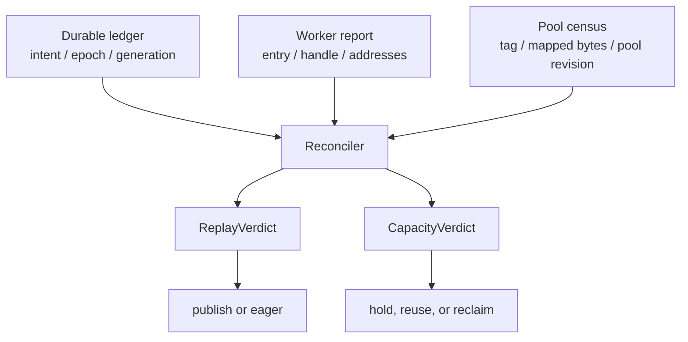
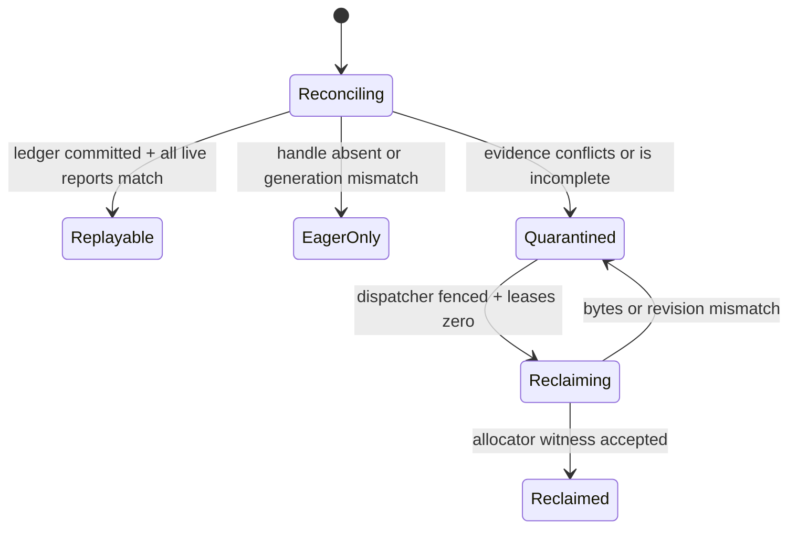

> 源码基线：vLLM [`cc9b0f09`](https://github.com/vllm-project/vllm/commit/cc9b0f097d49abfa6fc94d1d773dca1cc2b9619c)。本文严格区分**当前代码事实**、**测试/PR 事实**与**建议协议**。当前 `main` 没有 durable graph ledger、运行期 tri-source reconciler 或 auditable reclaim record；这些是从已合入的 graph/pool 生命周期推导出的故障恢复设计。

## 本篇在课程路线中的位置

第 53 章解决了 owner 崩溃后的 authority：lease 到期只允许新 owner 接管，不能凭一张旧 `LOCAL_DONE` 复活 worker-local graph，也不能立即把 reservation 返还预算。接下来真正棘手的是：新 owner 查询后，账本说 `COMMITTED`，worker 却没有 handle；或者 handle 还在，pool census 又显示未映射。到底信谁？

本章只解决这一个边界：

`durable ticket → live-handle report → pool census → two verdicts → quarantine / replay / reclaim`

## 前置知识回顾

- graph key 是 `BatchDescriptor` 与 runtime mode 的匹配契约，不等于设备上存在可 replay 的 `cudaGraphExec_t`。
- `CUDAGraphEntry`、capture tensors 和 shared pool 是进程内对象；worker attempt 死亡会切断这种所有权。
- 删除 entry 与物理显存返还不是同一事件。shared pool 可继续为其他 graph 保留或复用 segment。
- eager 路径是正确性兜底；因此“不确定”时可以拒绝 replay，而不能猜测。

## 本篇要回答的核心问题

1. ledger、live handle 与 pool census 各能证明什么，不能证明什么？
2. 为什么 replay 安全与 budget 可复用必须是两个独立 verdict？
3. 三者冲突时如何 quarantine，并以可审计证据完成 reclaim？

## 组件在全局架构中的位置

当前代码已有三块事实，但没有把它们做成跨进程协议：`CudagraphDispatcher` 持有可选择的 key；每个 `CUDAGraphWrapper` 持有本进程的 entry/handle；sleep-mode 的 `CuMemAllocator` 持有 allocation handle、tag 与映射状态。durable ledger 是本课程建议添加的控制面，而不是现有类。

关键点不是“三票多数决定”。三种证据回答的是不同问题，不能相互代替：ledger 授权，handle 证明本 attempt 能执行，pool census 证明容量状态。

## 完整调用链

以一次请求命中 CUDA Graph 为起点，当前调用链是：

1. [`CudagraphDispatcher.dispatch`](https://github.com/vllm-project/vllm/blob/cc9b0f097d49abfa6fc94d1d773dca1cc2b9619c/vllm/v1/cudagraph_dispatcher.py) 根据 `num_tokens`、uniform decode、LoRA 与 allowed modes 生成 `BatchDescriptor`，只在预初始化的 key 集合中命中；否则返回 `CUDAGraphMode.NONE`。
2. forward context 把 mode/key 传给 [`CUDAGraphWrapper.__call__`](https://github.com/vllm-project/vllm/blob/cc9b0f097d49abfa6fc94d1d773dca1cc2b9619c/vllm/compilation/cuda_graph.py)。wrapper 明确“blindly trust”它们：entry 不存在就创建并 capture，存在则 replay；debug 模式还比较本次 tensor `data_ptr()` 与 capture 时的 `input_addresses`。
3. capture 经 [`capture_pool`](https://github.com/vllm-project/vllm/blob/cc9b0f097d49abfa6fc94d1d773dca1cc2b9619c/vllm/compilation/cudagraph_pool.py) 进入 global pool；启用 cuMem graph pool 时，分配被标记为 `cudagraph`，NCCL graph allocator 也指向同一 pool。
4. sleep 时 [`CuMemBackend.suspend`](https://github.com/vllm-project/vllm/blob/cc9b0f097d49abfa6fc94d1d773dca1cc2b9619c/vllm/device_allocator/sleep_mode_backend.py) 让 allocator offload `runtime`、`cudagraph`，level 1 还包括 `weights`；[`CuMemAllocator.sleep`](https://github.com/vllm-project/vllm/blob/cc9b0f097d49abfa6fc94d1d773dca1cc2b9619c/vllm/device_allocator/cumem.py) 对每个 allocation 保存 handle、执行 `unmap_and_release()` 并置 `is_asleep=True`。wake 则在同一 VA remap 并恢复内容。
5. 当前清理入口 [`CUDAGraphWrapper.clear_all_graphs`](https://github.com/vllm-project/vllm/blob/cc9b0f097d49abfa6fc94d1d773dca1cc2b9619c/vllm/compilation/cuda_graph.py) 只遍历进程内 weak set 并清空 entry dict；它不是跨 attempt 的回收证明。

因此 coordinator 在故障后仅看 dispatcher key 会误把“可选”当“可用”；仅看 allocator 总量又会把“handle 已不存在”误当“容量已归还”。

## 关键类型、字段和状态生命周期

### 当前代码事实

| 证据 | 当前载体 | 能证明 | 不能证明 |
| --- | --- | --- | --- |
| dispatch intent | `cudagraph_keys[mode]` | 某 key 可被 mode 匹配 | graph handle 仍存活、地址仍合法 |
| live handle | `CUDAGraphEntry.cudagraph`、`input_addresses` | 当前进程 entry 有 handle；debug 下地址一致 | 其他 rank 已就绪、pool 可返还 |
| allocation state | `pointer_to_data[ptr] = AllocationData(handle, tag, ..., is_asleep)` | 本进程登记过 allocation；测试辅助函数可精确求 mapped bytes | 某个 key 独占多少 shared-pool bytes |
| device capacity | `torch.accelerator.get_memory_info()` | 设备全局 free/total 的瞬时值 | 哪个进程、pool 或 key 导致变化 |

注意 [`CuMemAllocator.get_current_usage`](https://github.com/vllm-project/vllm/blob/cc9b0f097d49abfa6fc94d1d773dca1cc2b9619c/vllm/device_allocator/cumem.py) 累加所有已登记 handle 的大小，包括 `is_asleep`；它是逻辑 allocation 总量，不是 mapped bytes。直接测试为此另写 `mapped_usage()`，只加总 `not is_asleep` 的 handle。

### 建议协议

建议持久化 `GraphLedgerRecord(key, mode, generation, owner_epoch, expected_ranks, state, reservation_bytes, pool_revision)`；worker 回报 `LiveGraphReport(worker_attempt, context_generation, key, handle_present, address_digest, replay_leases)`；allocator adapter 回报 `PoolCensus(worker_attempt, pool_id, revision, registered_bytes, mapped_bytes, reusable_bytes, device_free)`。

三者都必须绑定 `worker_attempt + context_generation + pool_revision`。缺字段不是 `false`，而是 `UNKNOWN`；旧 epoch 的迟到报告只能进入审计日志。

## 逐函数源码解读

### `CudagraphDispatcher.dispatch`：路由表不是健康表

dispatcher 的 key 集合是路由选择的 source of truth：FULL 先精确匹配；PIECEWISE 放松成 `num_reqs=None, uniform=False`；没有匹配则安全回退 NONE。它没有读取 wrapper 的 `concrete_cudagraph_entries`，也没有跨 rank health。故障恢复若继续保留 key，必须在 dispatcher 前增加 generation-fenced gate；否则 stale key 会把请求送进不存在或未完成的 graph。

### `CUDAGraphWrapper.__call__`：live evidence 的边界

wrapper 的 entry 生命周期是 `dict miss → 创建空 entry → capture → 写入 weakref output/handle/address list → replay → clear dict`。这个证据很强但很窄：只有产生它的 process、CUDA context 和地址布局仍有效才成立。worker 重启后，即使 durable ledger 仍有相同 Python key，也必须视为新 attempt、重新 capture。

### `CuMemAllocator.sleep/wake_up`：unmapped 不等于 retired

sleep 保存 allocation handle，解除物理映射后把 `is_asleep` 置真；wake 用同一 handle remap。此时 `mapped_bytes=0` 可以证明物理页暂时释放，却不能证明 graph 已永久退休：VA、CPU backup 与恢复意图仍在。反过来，`is_asleep=False` 也只说明映射存在，不说明哪个 `BatchDescriptor` 持有它。

### `clear_all_graphs` 与 profiling teardown：逻辑清理还需 pool witness

`clear_all_graphs()` 清空 entry 引用。profiling 路径之所以使用 throwaway pool，是因为仅删除 graph 而错误复用 persistent pool，曾触发 c10 pool `use_count` 断言；已合入 [PR #53682](https://github.com/vllm-project/vllm/pull/53682) 让 profiling 期间新对象统一绑定 throwaway pool，并在 teardown 丢弃。这是“先隔离 ownership domain，再谈回收”的直接工程证据。

## 具体示例与 shape/状态演算

沿用 TP=2、K8 的教学例：两个 rank 都为 `BatchDescriptor(num_tokens=8)`，每 rank reservation 12 MiB；shared pool 当前 segment 96 MiB，revision 17。ledger 是 `COMMITTED, generation=43, epoch=7`。

worker 0 回报：attempt `w0-a9`、entry/handle 存在、地址 digest 匹配、replay lease=2、mapped graph bytes 96 MiB。worker 1 已重启为 `w1-a4`：dispatcher 仍有 K8，但没有 generation 43 entry；allocator 登记 96 MiB graph handle，当前 `is_asleep=True`，mapped bytes 为 0。

逐步判定：

1. ledger 只证明 generation 43 曾被发布，不能覆盖 worker 1 attempt 已变化的事实。
2. all-rank replay 条件失败，`ReplayVerdict=EAGER_ONLY`；先 fence K8，使新请求走 eager。不能只让 rank 0 replay。
3. worker 0 尚有两条 replay lease，不能 clear；worker 1 的 unmapped allocation 仍可被 wake，不能把其 12 MiB reservation立刻返还。
4. 进入 `QUARANTINED`，冻结新的 K8 capture；等待 rank 0 lease 清零，清除 generation 43 entry，并对 worker 1 执行显式 discard/retire 或 context reset。
5. 新 census revision 18 显示旧 generation 无 live handle；两 rank allocator witness 均完成。此时 `CapacityVerdict` 仍不应机械返回 24 MiB：96 MiB shared segment 若仍被 K16 使用，结果只能是 `REUSED_IN_POOL`，可用于同 pool capture，但 device free 增量仍可能为 0。
6. 只有 ledger terminal CAS、handle retirement 与相同 revision 的 pool witness 都落盘，才生成 `ReclaimRecord`。若随后 recapture K8，使用 generation 44 的新 reservation，不能复用旧 ticket。

这说明两个 verdict 相互独立：`replay=false, capacity=reusable-in-pool` 合法；`replay=true, capacity=unknown` 也可能暂时合法，但禁止新的占用型 capture。

## 为什么这样设计及替代方案

最简单替代是以 ledger 为准：超时就删 ticket、返额度。延迟低、实现省事，但 worker 可能仍在 replay 或 pool 仍持有 segment，产生 overcommit 与 use-after-retire 风险。

第二个替代是以 `device_free` 为准：显存涨了就认为回收完成。它无需侵入 wrapper，却混入其他进程、allocator cache 和异步释放，无法审计到 key/generation；并发下会把无关 free 当自己的 reclaim。

三源协议成本是更多 RPC、状态和维护面，但把正确性与容量明确拆开：handle 报告保护 replay，pool witness 保护 admission，ledger CAS 保护并发 authority。它不会增加稳态 CUDA Graph 的 shape，graphability 不变；额外延迟只发生在异常恢复。吞吐代价是 quarantine 期间走 eager，换来不重放 stale graph、不重复计费和不过量 capture。

## 性能、并发、正确性与边界条件

- **并发**：先 fence dispatcher，再等待 `replay_leases==0`；否则 clear 与正在 replay 的线程竞态。
- **跨 rank**：`ReplayVerdict` 是 group property。任何 expected rank attempt/generation 不一致，整组 eager。
- **显存**：账面 reservation、registered bytes、mapped bytes、pool reusable bytes、device free 必须分栏；不可相减成单一 `used`。
- **sleep**：backend 能力需进入 fingerprint。当前 `CuMemBackend.preserves_communicators=True`，但 `SleepModeBackend` 还定义了 `preserves_compiled_artifacts`、`preserves_graphs_with_communicators` 与 `supports_durable_storage`；不能把某后端能力推广给所有后端。
- **失败方式**：worker query timeout、context reset、pool revision 前进、allocator backend 更换、expected rank set 变化均使证据失效；默认结果是 quarantine + eager。
- **维护成本**：adapter 应从现有 wrapper/allocator 导出只读 snapshot，不让 coordinator直接遍历私有 dict；schema 版本与 unknown-field 语义需前向兼容。

## 测试证据与未覆盖风险

直接测试给出三组不变量：

1. [`test_capture_and_replay`](https://github.com/vllm-project/vllm/blob/cc9b0f097d49abfa6fc94d1d773dca1cc2b9619c/tests/v1/cudagraph/test_cudagraph_dispatch.py) 用 `BatchDescriptor(num_tokens=10)` 验证首次调用创建非空 graph entry，第二次确实调用 `replay()`，输出与 eager 一致；mode mismatch/NONE 不创建 entry。这证明 live handle 与 dispatcher mode 的本地契约。
2. [`test_gpu_model_runner_v2_cudagraph_profiling.py`](https://github.com/vllm-project/vllm/blob/cc9b0f097d49abfa6fc94d1d773dca1cc2b9619c/tests/v1/worker/test_gpu_model_runner_v2_cudagraph_profiling.py) 验证 capture 抛错仍执行 teardown、profiling graph 被清掉、wrapper pool 临时指向 throwaway 后恢复、throwaway pool 被释放。它验证异常清理顺序，但不产生跨进程 reclaim certificate。
3. [`test_sleep_cudagraph_pool`](https://github.com/vllm-project/vllm/blob/cc9b0f097d49abfa6fc94d1d773dca1cc2b9619c/tests/basic_correctness/memory/sleep_mode/test_sleep_mode.py) 覆盖 FULL/PIECEWISE、breakable、TP=1/2 和 offload 开关；sleep level 1/2 后分阶段 wake，输出保持一致。[`test_cumem.py`](https://github.com/vllm-project/vllm/blob/cc9b0f097d49abfa6fc94d1d773dca1cc2b9619c/tests/basic_correctness/memory/cumem/test_cumem.py) 明确 device-wide memory delta 有干扰，而 process-local `mapped_usage()` 精确，并验证 selective wake 会恢复非 deferrable tag。

这些是仓库测试事实，不等于本章建议协议已经实现。未覆盖风险包括：coordinator/worker 在每个持久化边界崩溃、stale report 延迟到达、TP 仅部分 rank reset、sleep 与 retire 并发、同 pool 多 key 的条件边际归因、allocator crash 后 census 重建，以及普通 caching allocator 与 cuMem 后端口径统一。本章未在当前环境重跑需要 GPU 的测试。

截至本基线，近期已合入 [PR #61046](https://github.com/vllm-project/vllm/pull/61046) 扩展的是 level-2 sleep 的 draft-private weight 保留；它声明不增加 graph recapture，并不能替代 graph reconciliation。这里仅把它作为“sleep 正在扩展更多所有权状态”的当前变化证据。

## 与前后章节的连接

前两章分别建立了 recapture 的经济排序和 owner 崩溃后的 fenced takeover；本章给 takeover 补齐证据裁决。下一章应继续解决 quarantine 的运行时治理：隔离项不能无限积累，需要 deadline、分级 reset、容量水位和故障域升级，但仍要避免把 device reset 当作默认回收 API。

## 本篇结论、知识债、三个理解检查问题和下一章

结论只有三句：**ledger 决定谁有权改变状态，live handle 决定谁能 replay，pool census 决定容量是否可复用；三者不是多数投票。replay 与 capacity 必须分别裁决。冲突先 quarantine，只有 generation-bound 的 terminal CAS、lease drain、handle retirement 和 allocator witness 齐全，才允许 auditable reclaim。**

知识债：真实 snapshot/RPC schema、dispatcher generation gate、replay lease、pool revision、per-key 条件边际归因、backend-neutral census、WAL/审计保留期、quarantine deadline，以及 crash/sleep/reset 交叉 Golden。

理解检查：

1. 为什么 `dispatcher` 命中 K8 不能证明 K8 仍可 replay？
2. `is_asleep=True` 且 mapped bytes 为 0 时，为什么仍不能宣布永久 reclaim？
3. shared pool 中删除 K8 后 device free 不变，什么证据足以让 K8 reservation 结束？

下一章：**Quarantine 不能无限长——Deadline、Escalation 与最小故障域 Reset。**

## 课程账本增量

- 新覆盖：`CudagraphDispatcher.dispatch`、`CUDAGraphEntry/CUDAGraphWrapper`、`capture_pool`、`SleepModeBackend/CuMemBackend`、`CuMemAllocator.sleep/wake_up/get_current_usage` 及三组直接测试。
- 新不变量：authority、replayability 与 reclaimability 是三种不同证明责任；恢复输出必须拆成 `ReplayVerdict` 和 `CapacityVerdict`。
- 建议协议：generation-fenced `GraphLedgerRecord`、`LiveGraphReport`、`PoolCensus`、`ReclaimRecord`，以及 conflict-first quarantine。
- 下一步：为 quarantine 建立 deadline、升级阶梯和最小影响面的 reset 策略。
