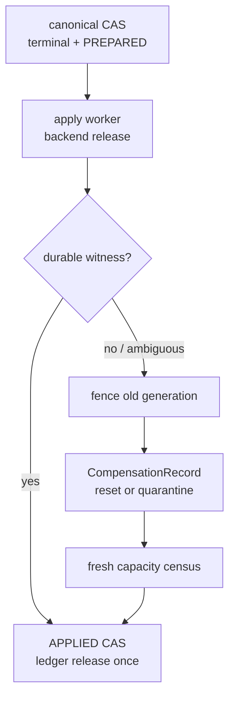
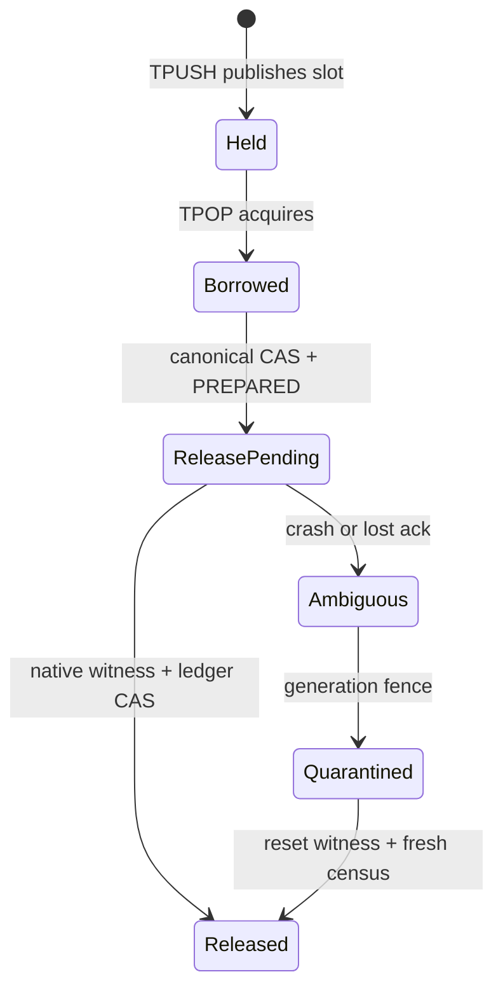

> 源码基线：pto-isa [`6a50f62b`](https://github.com/hw-native-sys/pto-isa/commit/6a50f62b0695d7c2ae9a46a8f7ca70ca7a29780e)，即本文研究时默认分支最新提交，由 [PR #343](https://github.com/hw-native-sys/pto-isa/pull/343) 合入。本文严格区分**当前代码/规范事实**、**当前测试事实**与**建议恢复协议**；durable `ApplyRecord`、`CompensationRecord` 和 `CapacityLedger` 尚不存在于仓库。

## 本篇在 PTO 课程路线中的位置

第 63 章把 partial-graph recovery 收紧为两层线性化：backend adapter 追加 immutable evidence，当前 owner 再以 `owner_epoch + expected_revision` CAS 提交 canonical verdict。今天继续追问 CAS 之后的窄缝：`COMPLETE@r109` 已经 durable，进程在真正释放 FIFO slot 后、写回成功标记前崩溃。新 owner 到底应重试 `TFREE`、回滚 r109，还是把容量直接记回 free？

课程位置：

`owner-fenced canonical CAS → side-effect apply → ambiguous crash → compensation → capacity repair`

## 前置知识

- canonical verdict 是业务/恢复事实；FIFO slot、workspace backing 与 allocator free list 是外部资源状态，二者不是一个原子对象。
- `Complete` 证明计算证据闭合；`ResetCovered` 证明旧 generation 不会继续触碰资源。二者都不自动证明某次 release 已执行。
- TPipe 的 release 是 ownership credit，不等于 `aclrtFree` 或任意 HBM 释放。credit 多发一次，producer 可能过早复用仍被 consumer 借用的槽。
- timeout、RPC 失败或 worker 消失只能产生 `UNKNOWN`，不能区分“动作未发生”与“动作已发生但 ack 丢失”。

## 今日核心问题

1. 为什么 `CAS success + blind TFREE retry` 不能得到 exactly-once release？
2. 如何让 canonical state、side effect 和 capacity ledger 在崩溃后重新收敛，又不假装它们能共享一个硬件事务？

## PTO 全栈中的位置

上游 joiner 产出 terminal verdict；recovery owner 负责把 verdict 变成 backend action；allocator 只消费已被证据确认的容量变化。三个角色必须通过 durable record 解耦。



关键点不是把硬件动作塞进数据库事务，而是保证：事务先留下可恢复意图；容量只在 witness 之后返还；无法判定时先隔离旧 generation，再用新 census 修复账本。

## 概念和精确语义

### 1. `TFREE` 精确释放什么

[`TFREE_zh.md`](https://github.com/hw-native-sys/pto-isa/blob/6a50f62b0695d7c2ae9a46a8f7ca70ca7a29780e/docs/isa/TFREE_zh.md) 将操作定义为释放 TPipe FIFO entry space。它的语义随 operand/backend 改变：

| 路径 | 当前事实 | release 发生点 | 盲重试风险 |
| --- | --- | --- | --- |
| A2/A3 TileData | `TPOP` 内完成 free-space notification；`TFREE(Pipe&)` 为 API 对称 no-op | [`a2a3/TPop.hpp`](https://github.com/hw-native-sys/pto-isa/blob/6a50f62b0695d7c2ae9a46a8f7ca70ca7a29780e/include/pto/npu/a2a3/TPop.hpp) | 不能由 no-op 推出重放整个 `TPOP` 安全 |
| A2/A3 GlobalData | `TPOP` 返回 slot view，`TFREE(Pipe&, GlobalData&)` 释放 | [`a2a3/TFree.hpp`](https://github.com/hw-native-sys/pto-isa/blob/6a50f62b0695d7c2ae9a46a8f7ca70ca7a29780e/include/pto/npu/a2a3/TFree.hpp) | 重复 notification 会破坏 credit 守恒 |
| A5 TileData / GlobalData | `TPOP` 与显式 `TFREE` 共同受 `shouldNotifyFree` 节流；显式 free 会发 intra-block signal | [`a5/TPop.hpp`](https://github.com/hw-native-sys/pto-isa/blob/6a50f62b0695d7c2ae9a46a8f7ca70ca7a29780e/include/pto/npu/a5/TPop.hpp)、[`a5/TFree.hpp`](https://github.com/hw-native-sys/pto-isa/blob/6a50f62b0695d7c2ae9a46a8f7ca70ca7a29780e/include/pto/npu/a5/TFree.hpp) | 同一 signal 重发可能多返还一个 credit |
| CPU_SIM TileData | 每次 `TFREE` 取 consumer 最老 outstanding pop；最后一个 consumer 才清 slot | [`cpu/TPop.hpp`](https://github.com/hw-native-sys/pto-isa/blob/6a50f62b0695d7c2ae9a46a8f7ca70ca7a29780e/include/pto/cpu/TPop.hpp) | 进程内 FIFO pairing 不是 durable 幂等键 |

共同的 `TFREE` wrapper 先等待 `WaitEvents`，再 dispatch backend-specific `TFREE_IMPL`，最后返回空 `RecordEvent`；它没有 `action_id`、generation 或 durable receipt，见 [`pto_instr.hpp`](https://github.com/hw-native-sys/pto-isa/blob/6a50f62b0695d7c2ae9a46a8f7ca70ca7a29780e/include/pto/common/pto_instr.hpp)。因此当前 ISA 接口提供“合法程序中的一次 release”，不提供“跨 crash 可幂等重放的 release”。

把接口契约展开后，`TFREE` 的前置、后置与非法组合更清楚：

| 维度 | TileData overload | GlobalData overload |
| --- | --- | --- |
| operand | `Pipe&`；释放对象由该 endpoint 最老 outstanding pop 隐式确定 | `Pipe& + GlobalData&`；descriptor 指向刚刚 pop 的 slot view |
| shape / dtype / layout | 不重新解释 payload；必须与先前 `TPOP` 的 Tile 借用相配，split 决定 lane/视图 | descriptor 保留 slot 的 shape/stride/layout，free 结束其访问资格 |
| memory location | Vec/Mat 等本地 Tile 是 consumer 视图；A2/A3 TileData payload ring 位于 GM，A5 可走本地同步路径 | `GlobalData` 明确描述 GM slot，free 后 descriptor 不再拥有该 slot 的读写资格 |
| 前置条件 | 同 endpoint 已有尚未 free 的 matched pop；wait events 已满足；direction 与 split 对得上 | 同一 pipe 上的 `TPOP(GlobalData)` 已成功，entry 尚未释放 |
| 后置条件 | 对应借用结束；达到 `SyncPeriod` 时发送/消费 free credit；最后 consumer 才允许 slot reuse | entry 返回 producer 可用集合；旧 descriptor 不应再访问 |
| 非法/未定义组合 | 未 pop 先 free、重复 free、wrong direction、wrong split、旧 generation endpoint | 释放别的 pipe/slot 的 descriptor、free 后继续读写、跨 generation 复用 descriptor |

当前 C++ 模板与测试依赖调用方守约；它们没有把所有非法组合都转成 runtime error。尤其不能把“某 backend 的实现目前为 no-op”误读成任意调用都合法：A2/A3 TileData 的合法 release 已在 `TPOP` 发生，no-op 只是统一 API 表面。

`WaitEvents` 只约束本次指令前的 pipeline happens-before。如果进程在 native signal 后丢失 ack，旧 event 已完成也不能说明 durable control plane 是否记账；反过来，durable `ApplyRecord` 已存在也不能代替 device-side wait。二者分别属于设备依赖域和恢复事务域。

### 2. 三类记录各自回答什么

建议控制面至少保存：

```text
ApplyRecord {
  action_id, graph_key, owner_epoch, expected_revision,
  workspace_generation, direction, slot_epoch, release_ordinal,
  state: PREPARED | INFLIGHT | APPLIED | UNKNOWN,
  witness_digest, backend_token
}

CapacityEntry {
  resource_key, capacity_delta, apply_action_id,
  state: HELD | RELEASE_PENDING | RELEASED | REPAIR_PENDING
}

CompensationRecord {
  failed_action_id, observed_state, fenced_generation,
  neutralizing_action, census_root, resolution
}
```

`ApplyRecord` 回答“哪一个副作用仍需闭合”；`CapacityEntry` 回答“这份 credit 当前能否再分配”；`CompensationRecord` 回答“原动作不可判定或不可逆时，系统用什么新动作使旧作用域失效”。补偿不是反向发送一次 signal——硬件 credit 通常没有安全的 inverse。它更接近 fence generation、scoped reset、quarantine，再以新 census 建立事实。

### 3. 幂等键不能只用 operation ID

同一 operation 可有多个 attempt，同一 workspace 地址也可跨 generation 复用，同一个 direction 内还可能连续释放多个 slot。最小键应覆盖：

`action_id = H(operation_id, attempt_id, workspace_generation, direction, slot_epoch, release_ordinal)`

`owner_epoch` 决定“谁现在有权 apply”，却不应改变动作身份：owner 42 崩溃后 owner 43 接管，仍要识别为同一个 release，而不是生成第二个动作。

## 真实文件、类型、API 或指令逐段解读

### A2/A3：release 与 `TPOP` 折叠

[`a2a3/TPop.hpp`](https://github.com/hw-native-sys/pto-isa/blob/6a50f62b0695d7c2ae9a46a8f7ca70ca7a29780e/include/pto/npu/a2a3/TPop.hpp) 在 pop 后计算 `isFree = getFreeStatus && shouldNotifyFree(tileIndex)`，调用 `pipe.cons.free()`，再递增 index。[`a2a3/TFree.hpp`](https://github.com/hw-native-sys/pto-isa/blob/6a50f62b0695d7c2ae9a46a8f7ca70ca7a29780e/include/pto/npu/a2a3/TFree.hpp) 对 TileData 则为空。这里的结论不是“A2/A3 天然幂等”，而是 release 的 apply 边界落在 `TPOP` 内；恢复层必须记录实际提交的 native action，不能机械寻找一个名为 `TFREE` 的调用。

`SyncPeriod` 还会稀疏化 free notification。代码中的 pending-credit 计算明确防止构造/析构后留下旧 flag，或等待永远不会产生的 notification。credit 是计数协议，不是可任意重放的状态赋值。

### A5：显式 signal 是不可重复副作用

[`a5/TFree.hpp`](https://github.com/hw-native-sys/pto-isa/blob/6a50f62b0695d7c2ae9a46a8f7ca70ca7a29780e/include/pto/npu/a5/TFree.hpp) 根据前一个 tile index、direction 与 split 发 `set_intra_block`；不同 lane 可能对应不同 flag。该接口没有“如果 slot epoch 仍匹配才 free”的 compare-and-release。于是“调用返回丢失”后再调用一次，无法从 ISA 层证明安全。

### CPU_SIM：可观察状态多，不等于有 durable receipt

[`cpu/TPush.hpp`](https://github.com/hw-native-sys/pto-isa/blob/6a50f62b0695d7c2ae9a46a8f7ca70ca7a29780e/include/pto/cpu/TPush.hpp) 的 `SharedState` 维护 `commit_seq`、`remaining_consumers`、`slot_busy` 与 `occupied`。consumer 保存 pending slot/direction；[`cpu/TPop.hpp`](https://github.com/hw-native-sys/pto-isa/blob/6a50f62b0695d7c2ae9a46a8f7ca70ca7a29780e/include/pto/cpu/TPop.hpp) 的 `free()` 消费最老 outstanding item，最后一个 consumer 到达才清理 slot 并 `notify_all`。

这套状态非常适合 census，却都在进程内。进程崩溃后，不能拿“理论上应该 `occupied--`”替代设备或 runtime 的 fresh witness。

还要注意 CPU_SIM 的“最老 outstanding pop”是一条顺序语义：`pendingSlots` 与 `pendingDirections` 同步出队，`remaining_consumers` 归零后才清 `commit_seq`、`slot_busy`、方向标记并递减 `occupied`。这解释了测试为何可以先连续 pop 两次、再连续 free 两次，却不能凭此构造“第三次 free 也没关系”的结论。第三次调用没有对应 borrow，已经离开合法状态机；即使某次实现碰巧阻塞、访问空 pending queue 或沿旧 direction 继续，恢复协议也不能依赖未规定行为。

## 对象、Tile、Buffer 与记录生命周期



Tile payload 从 publish 到最后一个 consumer free 期间由 slot 承载；`ApplyRecord` 从 canonical CAS 创建，到 native witness 后归档；`CapacityEntry` 在整个 ambiguous 窗口仍保持 `HELD/RELEASE_PENDING`。只有最后一步把 slot 重新加入可分配集合。

## 端到端调用链或指令链

建议流程是 transactional outbox，而不是跨数据库与设备的“两阶段提交幻觉”：

1. 当前 owner 在一个 durable transaction 中提交 terminal canonical state、`ApplyRecord(PREPARED)` 和 `CapacityEntry(RELEASE_PENDING)`；容量尚未返还。
2. apply worker 读取 outbox，以 `action_id` 调用 backend adapter。若 backend 支持条件式 token，传入 generation/slot epoch；当前 PTO `TFREE` 没有该 token。
3. adapter 写入 native witness 或可验证 receipt。worker 在动作前崩溃可安全重试；动作后、receipt 前崩溃进入 `UNKNOWN`。
4. 有强 witness 时，CAS `ApplyRecord→APPLIED`，并以相同 `action_id` 将 capacity entry 只释放一次。
5. 没有强 witness且动作不可安全重试时，先 fence 旧 generation，再执行 scoped reset/quarantine；写 `CompensationRecord`，用 fresh census 修复 ledger。

后两步仍需 `owner_epoch + expected_revision`：幂等键防重复动作，owner fence 防无权动作，revision CAS 防并发 lost update，三者作用不同。

所谓 strong witness 必须与动作作用域同样精确。只看到 worker 退出、函数返回、event ID 被复用、某个方向 `occupied` 下降，均不足以证明 `slot0@epoch17` 已释放；至少要绑定 operation/attempt、workspace generation、direction、slot epoch 和 release ordinal。若 backend 只能给出“整个 generation 已 reset”的证据，那么补偿只能把该 generation 整体标为 `ResetCovered`，不能伪造 per-slot `APPLIED` receipt。ledger repair 可以基于整代 census 重新建立 free 集合，但 audit 必须保留这种证据粒度差异。

恢复决策可以压缩成四种输入：

| 观察结果 | 是否重试原 action | canonical state | ledger |
| --- | --- | --- | --- |
| 明确证明 action 未开始 | 可以，沿用同一 `action_id` | 保持 terminal | `RELEASE_PENDING` |
| 明确 receipt 证明已完成 | 不重试 | 保持 terminal | 幂等转 `RELEASED` |
| backend 提供原子 `release_if_epoch` | 可以条件重试；already-released 也返回同一结果 | 保持 terminal | receipt 后 `RELEASED` |
| 只有 timeout/断连/进程死亡 | 不盲重试 | 保持 terminal，标记 apply unknown | 保持占用，进入 fence/compensation |

这里绝不能因为最后一行代价高，就把 timeout 当作“未执行”。分布式系统的两位将军问题不会因作用对象只是一个 FIFO credit 而消失。安全协议只能缩小 unknown 的作用域、提供可查询 receipt，或用 generation reset 把旧动作的未来影响切断；不能从通信失败推出物理事实。

批量 credit 也不能把多个 release 压成一个无身份计数。A2/A3 与 A5 的 `shouldNotifyFree` 按 `SyncPeriod` 稀疏通知，物理一次 signal 可能代表多个逻辑 slot 已按序归还。建议 adapter 维护 `native_batch_id → [action_id...]` 映射：只有 batch 对应的全部前置 pop 顺序被证明，才可一次 finalize 多个 capacity entry；部分 witness 时继续保留整批 `UNKNOWN`，或由支持细粒度 query 的 backend 拆分，不能按“收到一个 signal 就任选一个 slot 释放”。

## 具体 shape、Tile 和状态演算

取 `16×16xf32` Tile，大小 `16×16×4 = 1024 B`。设 `DIR_BOTH`，C2V/V2C 各 `SlotNum=2`，逻辑 transport capacity 为：

`2 directions × 2 slots × 1024 B = 4096 B`

现在跟踪 C2V 的 `slot0@epoch17`：

| 时刻 | durable canonical/apply | native slot | ledger 可分配容量 |
| --- | --- | --- | --- |
| t0 | `PARTIAL@r108` | borrowed by attempt2 | 3072 B |
| t1 | owner42 CAS `COMPLETE@r109`；A17=`PREPARED` | still borrowed | 3072 B |
| t2 | A5 已发 release signal | 实际可能已 free | 仍为 3072 B |
| t3 | worker 在 ack 前崩溃；A17=`UNKNOWN` | 未知 | 仍为 3072 B |
| t4 | owner43 fence generation9、scoped reset | generation9 不可再执行 | 仍为 3072 B |
| t5 | fresh census 证明 slot0 属于新 epoch 且未被旧 consumer持有 | free | ledger CAS 到 4096 B |

如果 t3 直接再发 `TFREE`，可能产生第二个 credit，使 producer 在真正 consumer 完成前覆盖 slot。若 t3 直接把 1024 B 加回 ledger，则可能在第一次 release 根本未发生时 over-admit。保守地暂扣 1024 B 会短暂损失吞吐，但不会把不确定性扩散成内存破坏。

## 为什么这样设计及替代方案

| 方案 | 优点 | 致命边界 |
| --- | --- | --- |
| canonical CAS 后 fire-and-forget，并立即记容量 free | 延迟最低 | action 未发生时 overcommit；ack 丢失时又可能重复 free |
| free 失败就回滚 terminal canonical state | 状态看似一致 | 外部 signal 不可回滚；还会让已证明的 `Complete` 被 I/O 错误改写 |
| 永远不重试、永久 quarantine | 最保守 | 容量泄漏，长期吞吐下降 |
| outbox + witness + compensation/census | 可恢复、审计清楚、ledger exactly-once | 多一次 durable write；ambiguous path 需要 reset/fence，恢复更慢 |

从第一性约束看，terminal fact 必须单调，non-idempotent side effect 不能盲重放，unknown resource 不能重新分配。transactional outbox 是满足三条约束的最小结构；它不是为了追求形式复杂度。

回滚 terminal state 尤其危险。假设 r109 已经对外发布 `Complete`，下游可能已提交业务结果；free 失败只说明资源回收尚未闭合，不推翻计算证据。若把 canonical state 改回 `Partial`，新 reconciler 可能重复计算并产生第二份业务结果，而第一次 native free 又可能稍后到达。正确拆分是：业务 verdict 保持 `Complete`，资源子状态进入 `RELEASE_PENDING/UNKNOWN`，admission 暂扣相关容量。这样延迟与吞吐受到局部影响，正确性不会跨层扩散。

## 访存、计算、流水、并行和硬件约束

- **访存与容量**：`TFREE` 不搬运 Tile payload，但它决定 backing 何时可被下一次 `TPUSH` 覆盖。ledger 的度量应是 slot/byte credit，不是设备总 free HBM。
- **流水**：保守保留 `RELEASE_PENDING` 会缩小有效 FIFO depth，严重时 producer stall；这是把不确定性局部化的成本。
- **并行**：多个 apply worker 可处理不同 `action_id`；同一 action 只能有一个当前 owner 发起 non-idempotent native call。批量 free 仍要保留每个 release ordinal。
- **backend 差异**：A2/A3 TileData 的 release 随 `TPOP`，A5 可显式 `TFREE`，CPU_SIM 有精确 pending queue。portable protocol 必须建模 native release point，不能假定同名函数等价。
- **维护成本**：若未来 backend 提供 `release_if_epoch(slot, generation)` 与 queryable receipt，ambiguous 分支可从 reset/quarantine 降级为安全重试；在此之前不能虚构这种能力。

还有一个容易混淆的资源层次：本例的 4096 B 是四个逻辑 slot 的 transport backing，不等于 allocator 可以把其中任意 1024 B 立刻退回系统 HBM。若真实 allocation 粒度是整块 4096 B，per-slot ledger 只控制 TPipe 内部 admission；只有四个 slot 全部闭合且 allocation owner/lifetime 也结束，外层 allocator 才能释放整块。把 slot credit 与物理 allocation free 合成一个布尔位，会同时造成内部过度隔离或外层过早回收。

## 测试证据与未覆盖风险

当前 [`tpushpop/main.cpp`](https://github.com/hw-native-sys/pto-isa/blob/6a50f62b0695d7c2ae9a46a8f7ca70ca7a29780e/tests/cpu/st/testcase/tpushpop/main.cpp) 提供三组直接证据：

1. `dir_both_overlapping_c2v_pops_free_in_order` 连续 pop 两个 Tile、再连续 free，随后断言 `occupied=0`、`popped_not_freed=0`、两个 slot 不 busy 且 `remaining_consumers=0`，并再次 push/pop 验证复用。
2. `c2v_split_delayed_free_releases_each_popped_slot` 让两个 lane 各 outstanding 两个 half Tile，延迟四次 matched `TFREE` 后断言 lane debt 和 slot busy 全部归零。
3. `dir_both_full_capacity_and_delayed_free` 每轮填满 C2V/V2C 各两个 slot，先完成四次 pop、后做四次 free，八轮后两向 `occupied` 均为零。

这些测试证明**合法配对、delayed free、split lane 与两向满容量**下 CPU_SIM 的 FIFO 守恒；它们没有注入“native free 已发生但 ack 丢失”，也没有 duplicate `TFREE`、进程 crash、owner takeover、durable outbox 或 ledger repair。本文未在非对应最新 commit 的本地 checkout 上冒充重跑结果。

另一个覆盖缺口是测试把调用次数本身当作正确输入：两个 outstanding pop 后恰好两个 free，四个跨方向 borrow 后恰好四个 free。它验证实现遵守协议时能回到零，却没有验证实现会拒绝协议外的第五次 free，也没有把每次 free 对应到可审计的 slot epoch。恢复测试必须从“次数相等”升级为“身份、方向、代际与顺序都匹配”，否则一次旧代迟到 free 仍可能在总计数上看起来平衡。

本次基线 [PR #343](https://github.com/hw-native-sys/pto-isa/pull/343) 还让 [`tests/run_st.sh`](https://github.com/hw-native-sys/pto-isa/blob/6a50f62b0695d7c2ae9a46a8f7ca70ca7a29780e/tests/run_st.sh) 聚合单例失败并在结尾返回非零，提升了批量测试可见性；这不是 side-effect recovery 的实现证据。

建议补充的最小负向矩阵：

- action 前 crash：outbox 重放只执行一次；
- action 后 receipt 前 crash：无 queryable receipt 时进入 generation fence，不盲重试；
- same `action_id`/same payload：finalize 幂等；same ID/different payload：conflict + quarantine；
- stale owner 在 takeover 后返回：可追加 witness，不得 apply 或释放 ledger；
- duplicate free、wrong direction、wrong slot epoch：必须拒绝或触发 bounded quarantine；
- reset 后 fresh census 与旧 ledger 不一致：只允许由 repair transaction 调整，且记录差量根。

## 与前后章节的连接

上一章解决“谁能提交 terminal state”；本章解决“terminal state 怎样安全落到外部资源”。两者合起来才是完整线性化：canonical CAS 不等于 side effect 完成，side effect 返回也不等于 capacity ledger 已更新。下一章应继续补最后一个洞：reset/query 本身也可能 timeout，如何定义 bounded quarantine、orphan action GC 与长期容量回收。

## 本篇结论、知识债与下一章

结论：

1. PTO `TFREE` 是 backend-specific FIFO credit release，不是天然幂等的内存释放；A2/A3 TileData 甚至把 release 折叠在 `TPOP`。
2. canonical CAS、native apply 与 capacity release 是三个线性化点。最小安全桥梁是 durable outbox、强 witness 和 action-keyed ledger finalize。
3. ambiguous non-idempotent action 不能 blind retry，也不能凭意图返还容量；必须 fence 旧 generation，以 reset/quarantine + fresh census 形成补偿事实。

知识债：

- 当前仓库没有 durable `ApplyRecord/CompensationRecord/CapacityLedger`、queryable release receipt 或 `release_if_epoch`。
- 仍缺 duplicate/ack-loss/crash/takeover/wrong-generation 的 CPU_SIM fault API 与 A2/A3/A5 真机 Golden。
- `SyncPeriod` 批量 credit 与 per-release `action_id` 的聚合映射、reset 的最小硬件 scope、census schema 和 ledger reconciliation transaction 尚未实现。

三个理解检查问题：

1. 为什么 A2/A3 TileData 的 `TFREE` 是 no-op，仍不能把 `TPOP` 当作可安全重放的幂等动作？
2. owner epoch、action ID 与 revision CAS 分别阻止哪一种错误，为什么不能互相替代？
3. 4096 B 逻辑容量中有一个 1024 B slot 的 release 状态为 `UNKNOWN` 时，为什么 ledger 必须暂时只暴露 3072 B？

下一章：**Compensation 也失败怎么办——Bounded Quarantine、Orphan Action GC 与长期容量回收。**

## 课程账本增量

- 源码基线：pto-isa [`6a50f62b`](https://github.com/hw-native-sys/pto-isa/commit/6a50f62b0695d7c2ae9a46a8f7ca70ca7a29780e)，合入 [PR #343](https://github.com/hw-native-sys/pto-isa/pull/343)。
- 新覆盖文件与符号：`TFREE_zh.md`、common `TFREE` wrapper、A2/A3 与 A5 `TPop/TFree.hpp`、CPU_SIM `SharedState/Consumer::free`、`tpushpop` delayed-free/full-capacity tests、`run_st.sh` failure aggregation。
- 新确认不变量：`TFREE` 归还 credit 而非任意 HBM；A2/A3 TileData release 在 `TPOP`，A5 explicit signal 非自幂等；canonical CAS、native receipt 与 capacity ledger release 必须分离；`UNKNOWN` slot 不可分配；补偿以 fence/reset/census 中和旧 generation，而非发送“反向 signal”。
- 建议对象（非当前实现）：generation-bound `ApplyRecord`、`CompensationRecord`、action-keyed `CapacityEntry`、queryable native receipt 与 repair transaction。
- 具体演算：`16×16xf32`、1024 B/Tile、`DIR_BOTH` 两向各两槽共 4096 B；C2V `slot0@epoch17` 在 action 后 ack 前 crash，ledger 保持 3072 B，generation fence + reset witness + fresh census 后只释放一次。
- 测试事实：直接审计当前 `tpushpop` 的 overlapping pop/free、split delayed-free 与 DIR_BOTH full-capacity tests；它们覆盖正常 credit 守恒，不覆盖 duplicate、ack loss、crash、owner takeover 或 durable repair。本章未把旧 checkout 的运行结果冒充当前基线。
- 下一章：**Compensation 也失败怎么办——Bounded Quarantine、Orphan Action GC 与长期容量回收。**

