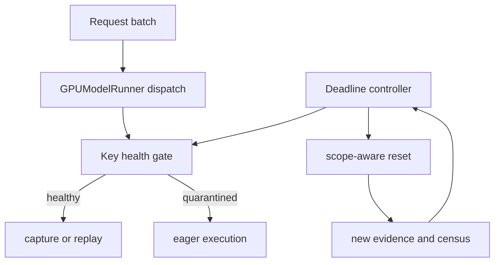
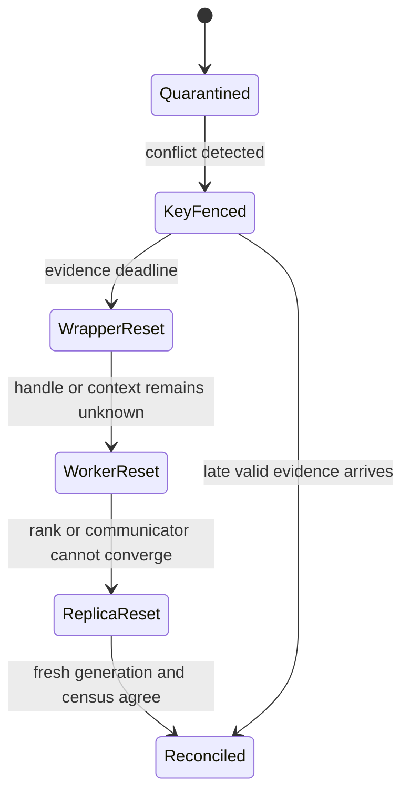

> 源码基线：vLLM [`f47792af`](https://github.com/vllm-project/vllm/commit/f47792af7fba76eb8e8f6a564b35cfad316d39f2)。它相对起草基线 `98f72111` 只新增 ROCm MLA/DCP prefill 与 dummy weight dtype-aware 初始化相关改动，本文引用的 CUDA Graph dispatcher、wrapper、cuMem、GPUWorker、EngineCore 与测试文件均未变化。本文严格区分**当前代码事实**、**测试/PR 事实**与**建议协议**。当前 `main` 有 eager fallback、进程内 graph 清理、sleep/discard 和整实例 shutdown，但没有跨进程 `QuarantineRecord`、deadline controller 或按故障域自动升级的 reset ladder。

## 本篇在课程路线中的位置

第 54 章建立了三源对账：ledger 证明 authority，worker-local handle 证明 replayability，pool census 证明 reclaimability；证据冲突时先 quarantine。可如果冲突永远没有新证据，隔离项会占着 reservation，graph key 永远走 eager，最终把正确性问题变成容量与可用性问题。

本章只解决一个问题：**quarantine 何时停止等待、升级到哪一层，以及如何证明升级没有越过最小故障域。**

## 前置知识回顾

- `BatchDescriptor` 命中只说明 dispatcher 允许使用某种 CUDA Graph mode，不证明当前 worker 的 handle 仍可 replay。
- `CUDAGraphEntry` 和 graph pool 都是进程内资源；删除 entry、解除物理映射和返还 admission budget 是三个不同事件。
- eager 路径是 CUDA Graph 异常时的正确性兜底；只要模型状态仍健康，隔离一个 key 不必停止整个服务。
- deadline 是控制面决定“不能再等”的时刻，不是设备资源已安全释放的证据。

## 本篇要回答的核心问题

1. quarantine 应该有哪几类 deadline，超时后能做什么、不能做什么？
2. 如何从 key fence 逐级升级到 wrapper、worker、replica，而不是一上来重启整个 engine？
3. 什么证据允许结束 quarantine；reset 成功为什么仍不等于旧 reservation 可返还？

## 组件在全局架构中的位置

当前数据面从 `GPUModelRunner.execute_model` 进入 dispatcher，随后把 mode 与 `BatchDescriptor` 写入 forward context，wrapper 决定 eager、capture 或 replay。恢复面则散落在 wrapper、allocator、worker 与 `EngineCore`；它们不是一套统一事务。



图中的 `Key health gate`、`Deadline controller` 和 `scope-aware reset` 是建议协议；`dispatch → forward context → wrapper` 与 eager fallback 是当前代码事实。

## 完整调用链

以 K8 被隔离后仍有请求到达为例：

1. [`GPUModelRunner`](https://github.com/vllm-project/vllm/blob/f47792af7fba76eb8e8f6a564b35cfad316d39f2/vllm/v1/worker/gpu_model_runner.py) 根据本步 `num_tokens`、uniform decode、LoRA 和 encoder 输出调用 `cudagraph_dispatcher.dispatch(...)`；已有 `force_eager` 分支会把 `valid_modes` 限制为 `{NONE}`。
2. [`CudagraphDispatcher.dispatch`](https://github.com/vllm-project/vllm/blob/f47792af7fba76eb8e8f6a564b35cfad316d39f2/vllm/v1/cudagraph_dispatcher.py) 若未初始化、mode 为 NONE、超出 capture 上限或 key 不匹配，就返回 `CUDAGraphMode.NONE`；否则 FULL 精确匹配，PIECEWISE 使用放松后的 descriptor。
3. `set_forward_context(...)` 携带 mode/key 进入模型。到了 [`CUDAGraphWrapper.__call__`](https://github.com/vllm-project/vllm/blob/f47792af7fba76eb8e8f6a564b35cfad316d39f2/vllm/compilation/cuda_graph.py)，NONE 或 mode mismatch 直接执行 `runnable`；命中则创建 entry 并 capture，或调用现有 handle replay。
4. 若证据迟迟不齐，建议的 controller 先保持 K8 eager，再按故障域升级：清本进程 entry、按 tag discard、重建 worker CUDA context，最后才重启 TP replica/engine。
5. 当前最宽清理入口是 [`EngineCore.shutdown`](https://github.com/vllm-project/vllm/blob/f47792af7fba76eb8e8f6a564b35cfad316d39f2/vllm/v1/engine/core.py)：依次关闭 model executor 和 scheduler，撤销 `gc.freeze()`，清分布式环境与缓存。它是实例 teardown，不是 K8 专用回收 API。

## 关键类型、字段和状态生命周期

### 当前代码事实：四种操作的真实作用域

| 操作 | 当前入口 | 真实作用域 | 不足 |
| --- | --- | --- | --- |
| eager fallback | `dispatch → NONE` / `force_eager` | 当前 forward/batch | 没有持久的 per-key health 状态 |
| entry clear | `CUDAGraphWrapper.clear_graphs/clear_all_graphs`、breakable 对应方法 | 本进程一个 wrapper 或所有 weak-set wrapper | 只清 Python entry；不是物理显存 witness |
| tag discard | `GPUWorker.discard → CuMemBackend.discard → CuMemAllocator.discard` | 本 worker allocator 中给定 tag 的**全部 mapped allocations** | `cudagraph` 是 tag，不是 K8；已 sleep 且有 backup 时不会改原策略 |
| engine teardown | `EngineCore.shutdown` | executor、scheduler、分布式状态和进程缓存 | 故障域最大，影响所有请求与 warm state |

[`CuMemAllocator.discard`](https://github.com/vllm-project/vllm/blob/f47792af7fba76eb8e8f6a564b35cfad316d39f2/vllm/device_allocator/cumem.py) 会同步 allocation 所在设备、`unmap_and_release(handle)` 并置 `is_asleep=True`；后续 `wake_up()` 又会 remap 非 deferrable tag。它证明“当前映射被解除”，不自动证明“旧 graph generation 永久退休”。

### 建议协议：`QuarantineRecord`

```text
QuarantineRecord(
  key, mode, generation, expected_ranks,
  first_conflict_at, last_evidence_at,
  service_state, evidence_state, capacity_state,
  current_scope, attempts, next_deadline, reason
)
```

`service_state` 与 `capacity_state` 必须分开。K8 可以 `EAGER_ONLY` 而继续服务，同时容量仍为 `HELD/UNKNOWN`。每次升级都写 `ResetAttempt(scope, trigger, started_at, finished_at, post_reset_revision, result)`；旧 attempt 的迟到报告只能记审计日志，不能把状态倒退。

deadline 也不是一个字段解决全部问题。最少要区分三种预算，并分别说明到期后的合法动作：

| deadline | 输入 | 到期只允许做什么 | 不能推出什么 |
| --- | --- | --- | --- |
| evidence freshness | 最后可信 snapshot/reply 的时间与 revision | 重查 worker、pool、lease；把 evidence 标成 stale | handle 已死亡或显存已释放 |
| capacity exhaustion | 当前 headroom、仍占用 reservation、增长/回收速率 | 冻结新 capture、收紧 admission、扩大 reclaim scope | 某个 key 独占了观察到的 pool bytes |
| service degradation | eager P99/goodput 与业务 SLO | fail over、重建 replica、最终 fail-stop | 单个 worker reset 一定足够 |

建议的 controller 输入必须是 `(QuarantineRecord, fresh snapshots, capacity census, service metrics, now)`，输出是带 expected revision 的 `Wait | Query | Drain | Reset(scope) | FailStop` 决策。它不直接操作 CUDA object；当前 owner 先以 CAS 提交 `ResetAttempt`，执行器才动作，完成后另一次 CAS 写 witness。这样两个 timer tick 不会同时清理同一 generation，stale owner 也不能在新 worker 启动后继续 discard。

每一级 reset 都有明确前置、后置和失败方式：

- **KEY_FENCE** 前置是 key/mode/generation 可精确识别；后置只是新请求走 eager、旧 replay lease 开始 drain。若 key 无法归因到具体 wrapper，不能伪称 key retirement。
- **WRAPPER_RESET** 前置是该 wrapper 的 lease 已归零；后置是 entry table 清空。Python 引用消失不证明 shared pool 物理 bytes 已返还。
- **POOL/WORKER_RESET** 前置是所有相关 rank 停止新 replay，且 scope 真实记录为 tag、pool 或 worker；后置需要新 context/allocator census。若 driver 调用超时，作用域必须继续上升。
- **REPLICA_RESET** 前置是 communicator、地址或 rank generation 无法局部恢复；后置是 expected rank set 在同一新 generation 重新握手。缺任一 rank 都不得接收 collective graph 流量。

非法的捷径包括：lease 非零时删除 entry；只因 deadline 到期就把 reservation 记为 free；把 `discard("cudagraph")` 记录成 per-key reclaim；单 rank CUDA context 更新后沿用旧 collective handle；以及让旧 reset attempt 的迟到成功回调覆盖新 generation。



任一箭头都只改变“采取什么动作”。只有 fresh generation、lease drain、handle retirement 与 allocator witness 同时满足，才允许 `Reconciled` 后返还预算。

## 逐函数源码解读

### `CudagraphDispatcher.dispatch`：最便宜的隔离阀

dispatcher 已把 NONE 设计成一等返回值；没有匹配 graph 时不是抛错，而是返回原始 `BatchDescriptor(num_tokens)`。这让 per-key quarantine 有可行的数据面：health gate 可把 K8 的 `valid_modes` 收缩到 `{NONE}`，其他 key 保持 replay。当前 dispatcher 的 key set 被称为 valid graph 的 source of truth，但它没有 generation、健康状态或 deadline，因此 gate 必须放在 dispatch 之前或成为其显式输入。

### `clear_all_graphs`：逻辑 retirement，作用域仍太宽

普通与 breakable wrapper 都用进程内 `WeakSet` 枚举实例；单个 `clear_graphs()` 分别清空 `concrete_cudagraph_entries` 或 `entries`。若 controller 能定位具体 wrapper/key，理想的 L1 应是 `retire(key, generation)`；当前公开方法只能清整个 wrapper，`clear_all_graphs()` 更会抹掉该进程所有 wrapper 的 warm graph。它比 worker reset 小，但并非真正的 key 级 reset。

### `CuMemBackend.discard`：物理 unmap，但不是 per-key reclaim

[`CuMemBackend`](https://github.com/vllm-project/vllm/blob/f47792af7fba76eb8e8f6a564b35cfad316d39f2/vllm/device_allocator/sleep_mode_backend.py) 的 `suspend` 对 `runtime`、`cudagraph` 做 CPU backup，level 1 再包含 weights；`discard(tags)` 则不做 backup，并把 backend 状态置为 `SUSPENDED`。能力方法声明它保留 communicator。这里能安全得出的结论只对当前 CuMem backend 成立；抽象基类默认 `preserves_communicators=False`，第三方 backend 不能照抄。

更关键的是，allocator 的 tag 粒度大于 graph key：`discard(("cudagraph",))` 可能影响 K8、K16 和包含 collective 的 graph。若没有 pool/key 归属表，它应属于 worker 级或 graph-pool 级升级，不应伪装成 K8 精确回收。

`discard` 的输入是 tag 集合，输出只通过日志报告 discarded bytes；函数本身不返回 generation-bound receipt。它遍历 `pointer_to_data`，已 asleep 的 allocation 被跳过，若它还有 CPU backup 只设置 policy conflict warning；活跃 allocation 则先同步对应 accelerator，再 unmap/release 并标记 asleep。并发前提因此很强：调用方必须先阻止仍会触碰这些地址的 graph replay。否则 allocator 完成 unmap 并不代表上层执行安全，反而可能把证据冲突变成 use-after-unmap。

### `GPUWorker.sleep/wake_up` 与 `EngineCore.shutdown`：reset 的外边界

`GPUWorker.sleep` 同步设备、记录 free bytes、调用 backend suspend；ROCm 最多等待 5 秒让 free-memory 观测不再倒退，并断言 sleep 后显存没有增加。这里的 5 秒是平台内存观测实现细节，**不是 quarantine 的通用 deadline**。`wake_up` 恢复 backend、可选 communicator 与 level-2 保存的参数/buffer。

若 CUDA context 或 rank 状态已不可相信，进程内 sleep/clear 已不够。当前 fatal path 最终在 `run_engine_core` 的 `finally` 中调用 `engine_core.shutdown()`；它没有本章建议的自动 scope ladder。未合入的 [PR #54553](https://github.com/vllm-project/vllm/pull/54553) 提议给 fatal-error shutdown 加 60 秒上限并在超时后 `os._exit(1)`，恰好说明“故障检测成功”仍可能卡在 teardown；本文只把它作为 PR 规划事实，不当作当前实现。

截至本文基线，该 PR 仍为 open、未合入，而且它针对的是 XPU TP=2 在 driver reset 后 worker/queue teardown 卡死的终局：限定 fatal-error path，在 deadline 后强制进程退出并依赖外部 supervisor 重启。它不提供 CUDA Graph key quarantine、pool attribution 或 worker 内恢复，因此只能作为“最外层 fail-stop 也要有界”的直接证据，不能替代本章的细粒度阶梯。

## 具体示例与 shape/状态演算

沿用 TP=2、K8：每 rank 旧 generation 43 reservation 为 12 MiB，共 24 MiB；shared graph pool 每 rank已有 96 MiB segment。rank 0 仍报告 2 条 replay lease，rank 1 已换 worker attempt，旧 handle 不可见。新请求每步恰有 8 tokens。

教学用控制面预算如下（不是 vLLM 默认常量）：证据刷新预算 2 秒；若 quarantine 导致 eager 后容量增长速率估算为 4 MiB/s，而 admission headroom 只有 20 MiB，则容量耗尽估计为 5 秒；服务 SLO 允许 8 秒降级。下一次升级应满足：

$$
D_{next} \le \min(D_{evidence}, D_{capacity}, D_{service}) = \min(2, 5, 8)\text{s}=2\text{s}
$$

这 2 秒的含义是“2 秒后不得继续原地等待”，不是“2 秒后旧 lease 自动消失”。状态演算：

1. `t=0`：K8 group verdict 变为 `EAGER_ONLY`，冻结 generation 43 新 replay/recapture；K8 请求走 eager，K16 不受影响。旧 reservation 24 MiB 仍记账。
2. `t=2s`：rank 0 lease 仍为 2，不能清 handle；controller 只可重发 drain/query，并记录一次 L0 超时。若强删 entry，会与 in-flight replay 竞态。
3. `t=3s`：lease 降为 0。先用 terminal CAS fence generation 43，再对两个 rank 清对应 wrapper。由于当前 API 没有 per-key clear，实际实现若调用 `clear_graphs()`，必须把 scope 记为 `WRAPPER`，不能写 `KEY`。
4. 新 census 仍显示 `cudagraph` mapped 96 MiB，且无法证明哪部分属于 K8。若 headroom 逼近阈值，升级到 `discard(("cudagraph",))` 会释放该 tag 的 mapped allocations，但会牺牲 K16 warm graph；服务继续 eager。
5. 若 rank 1 discard/query 超时或 context generation 不一致，升级到 worker process/context reset。TP rank 集合必须重新握手；任一 rank communicator 身份不确定时，最小安全域上升为整个 TP replica，而不是单 rank 恢复后立即接流量。
6. 只有新 attempt 上所有 rank 报告 generation 44、旧 lease 为 0，且同一 pool revision 的 census 证明旧映射已释放或明确成为 shared-pool reusable，才结束旧 24 MiB charge。device free 没增长时也可能是 `REUSED_IN_POOL`，但不能声称物理返还。

## 为什么这样设计及替代方案

**固定超时后直接 free** 最省状态，却把时间当成所有权证明；慢 worker、延迟 report 或在途 replay 会造成 use-after-retire 与 admission overcommit，错误不可接受。

**一有冲突就重启整个 engine** 容易获得干净进程，却让所有请求失败，丢失 KV cache、compiled artifact 和 graph warmup；恢复延迟、吞吐和显存重建成本都最大。它适合 CUDA context/communicator 完整性未知的终局，不应是第一步。

**证据驱动的作用域阶梯** 增加 ledger、timer、snapshot 与测试维护成本，但把错误半径压到最小：先 key eager，后 wrapper retirement，再 allocator/worker，最后 replica/engine。稳态 shape 与 graphability 不变；异常期牺牲 K8 吞吐和延迟，换取其他 key 的并发与正确性。升级阈值不应硬编码成一个“神奇秒数”，而应由证据新鲜度、容量耗尽时间和服务降级预算共同决定。

## 性能、并发、正确性与边界条件

- **正确性**：deadline 不产生 reclaim proof；没有 fresh witness 时结果仍是 `UNKNOWN`，只能扩大 reset scope。
- **并发**：顺序必须是 fence new replay → drain leases → retire handle → allocator action → census；倒序会与正在 replay 的 stream 竞态。
- **跨 rank**：FULL/PIECEWISE 是否可 replay 是 group property。单 rank context reset 会使 collective handle 或地址契约失配，必须重新验证 expected rank set。
- **容量**：deadline 计算用的是 reservation/headroom 与趋势，不是瞬时 `device_free`。shared pool 使 per-key 条件边际成本可能为零或不可归因。
- **可用性**：eager fallback 能隔离 graph 故障；但若模型权重、KV 状态或 communicator 也不可信，不能继续服务，应直接升级 replica fail-stop。
- **幂等性**：每个 reset attempt 绑定 generation、worker attempt 与 scope；重复 `clear`/`discard` 可接受，旧 attempt 完成回调不能覆盖新状态。

最小故障域的判据不是“最便宜”，而是**最小且足以恢复全部不变量**：只坏 key 健康表时是 key；无法精确定位 entry 时是 wrapper；CUDA context 失真时是 worker；collective/rank 共识失真时是 TP replica；控制面与 scheduler 状态也不可信时才是 engine。

## 测试证据与未覆盖风险

直接测试支持三段当前行为：

1. [`test_dispatcher` 与 `test_capture_and_replay`](https://github.com/vllm-project/vllm/blob/f47792af7fba76eb8e8f6a564b35cfad316d39f2/tests/v1/cudagraph/test_cudagraph_dispatch.py) 用 capture sizes `[1,8]` 检查 FULL/PIECEWISE/NONE 选择；wrapper 测试用 shape `(1,10)`、`BatchDescriptor(num_tokens=10)` 验证首次 capture、第二次 `replay()`，输出与 eager 一致。mode mismatch/NONE 不创建 entry。这证明 eager gate 的数据面成立，未覆盖持久 per-key quarantine。
2. [`test_gpu_model_runner_v2_cudagraph_profiling.py`](https://github.com/vllm-project/vllm/blob/f47792af7fba76eb8e8f6a564b35cfad316d39f2/tests/v1/worker/test_gpu_model_runner_v2_cudagraph_profiling.py) 验证 capture 抛错仍执行 teardown、普通与 breakable graph 都被清、wrapper 临时切到 throwaway pool 后恢复，并有 CUDA 子进程测试要求 teardown 前释放 64 MiB profiling allocation。它验证清理顺序，不证明 key 级归属或跨 worker reset。
3. [`test_discard_tags` 与 `test_cudagraph_pool_sleep`](https://github.com/vllm-project/vllm/blob/f47792af7fba76eb8e8f6a564b35cfad316d39f2/tests/basic_correctness/memory/cumem/test_cumem.py) 分别用 `weights[1024,1024]`、`kv_cache[512,512]` 验证只 discard KV 后 weights 仍可用，以及 graph pool 在 sleep level 1/2 后原址恢复；[`test_sleep_cudagraph_pool`](https://github.com/vllm-project/vllm/blob/f47792af7fba76eb8e8f6a564b35cfad316d39f2/tests/basic_correctness/memory/sleep_mode/test_sleep_mode.py) 覆盖 FULL、PIECEWISE、breakable、TP=1/2 和分阶段 wake，前后生成文本一致。

当前缺口正是本章协议：没有 fake-clock deadline 测试、deadline 与迟到 witness 竞态、per-key→wrapper scope 证明、discard 后其他 key 降级范围、单 rank reset 的 TP barrier、reset 过程二次崩溃、连续升级幂等性、容量水位触发，以及 shutdown 卡住后的 supervisor restart Golden。本环境没有 GPU，本文没有声称重跑这些 GPU 测试。

## 与前后章节的连接

第 53 章解决 fenced takeover，第 54 章解决三源证据裁决；本章把 `QUARANTINED` 从静态状态改成有时限、可审计、按作用域升级的恢复流程。下一章应补 recovery control plane 的最后一块：reset 后如何做 **warmup admission、canary replay 与 rollback**，避免新 generation 一次性承接全部流量。

## 本篇结论、知识债、三个理解检查问题和下一章

结论：**deadline 只终止等待，不证明资源已释放；升级动作必须从 key eager 开始，按 wrapper、allocator/worker、TP replica、engine 扩大；每次 reset 后仍要用 fresh generation、lease、handle 与 pool witness 重新对账。** 最小故障域是能恢复所有被破坏不变量的最小作用域，而不是最小的 API 名称。

知识债：真实 `QuarantineRecord` schema、dispatcher generation/health gate、per-key `retire`、replay lease、pool-to-key attribution、fake-clock timer wheel、capacity trend estimator、worker/replica reset API、supervisor 契约，以及 crash×sleep×collective 的系统测试。

理解检查：

1. 为什么 evidence deadline 到期后可以升级 reset，却不能把 `CapacityVerdict` 改成 `RECLAIMED`？
2. `discard(("cudagraph",))` 为什么通常不是 K8 的 key 级 reset？
3. 单个 TP rank 已重建 CUDA context 时，为什么最小安全故障域可能上升为整个 TP replica？

下一章：**Reset 后不能立刻全量接流——Warmup Admission、Canary Replay 与自动 Rollback。**

## 课程账本增量

- 新覆盖：`CudagraphDispatcher.dispatch`/`force_eager`、`CUDAGraphWrapper` 与 breakable graph 清理、`CuMemBackend/CuMemAllocator.discard`、`GPUWorker.sleep/wake_up/discard`、`EngineCore.shutdown`。
- 新不变量：deadline 不是 reclaim witness；reset scope 必须真实记录；跨 rank graph/communicator 完整性使故障域可能从 worker 上升为 TP replica。
- 建议协议：`QuarantineRecord`、`ResetAttempt`、三类 deadline 与 `KEY → WRAPPER → WORKER → REPLICA → ENGINE` 升级阶梯。
- 下一步：为新 generation 建立 warmup admission、canary replay、证据采样与 rollback 闭环。
