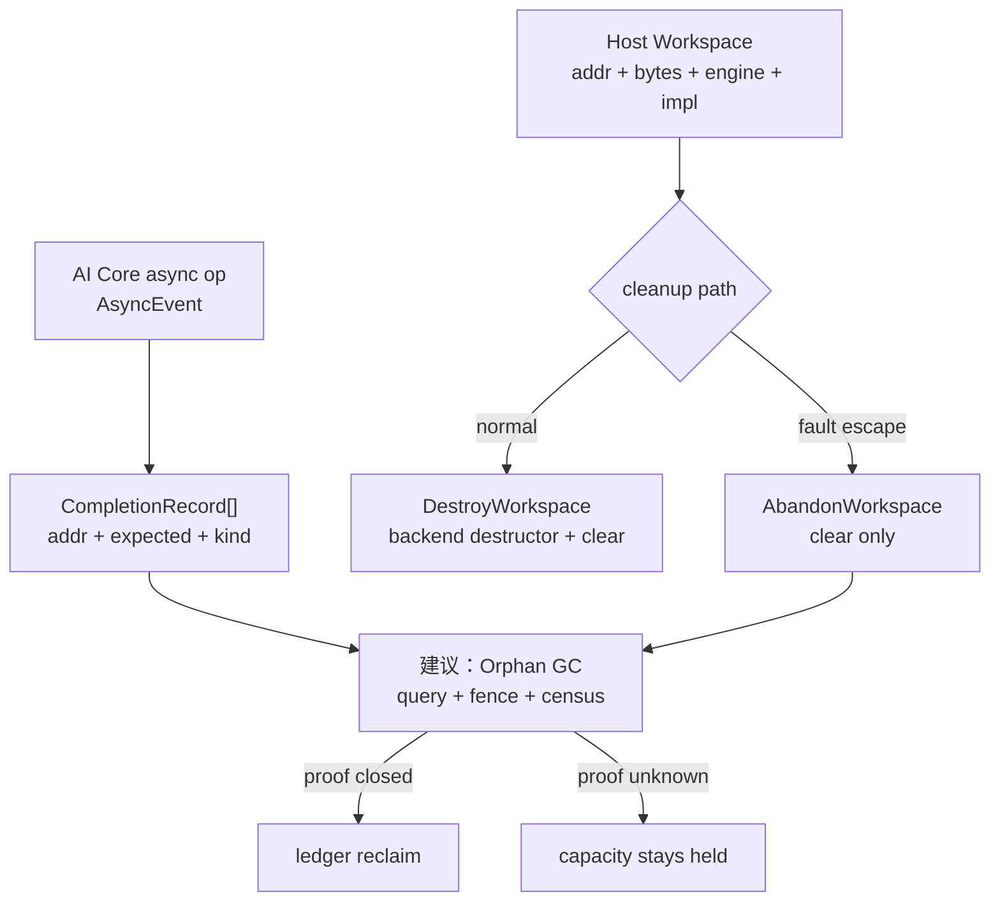
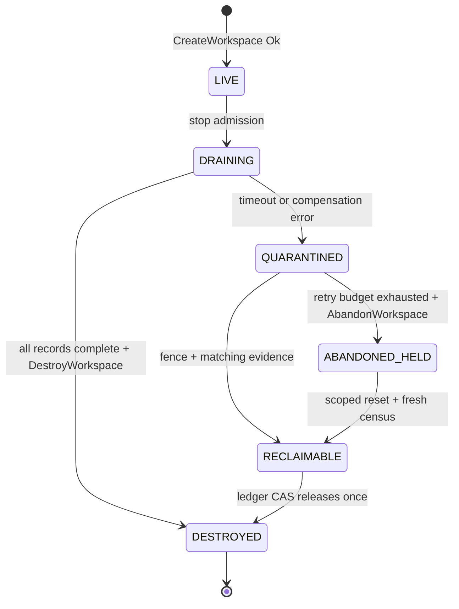

> 源码基线：pto-isa [`fc62c8f8`](https://github.com/hw-native-sys/pto-isa/commit/fc62c8f8d1555803695ccb5296a72639454d2922)，即本文研究时默认分支最新提交；核心接口来自已合入提交 [`e6334fbd`](https://github.com/hw-native-sys/pto-isa/commit/e6334fbd6c5d6bfdf550201bbdb81a71831a99af)。本文严格区分**当前代码事实**、**提交记录中的测试事实**与**建议恢复协议**；`QuarantineEntry`、`OrphanAction`、GC/ledger repair 尚未存在于仓库。

## 本篇在 PTO 课程路线中的位置

第 64 章已经把 terminal canonical CAS、native release 与 capacity ledger repair 拆成三个线性化点。今天继续处理最坏但现实的尾部：compensation 连续失败，进程必须结束，底层 workspace 或 FIFO credit 仍可能被旧 DMA 触碰。此时“多等一会儿”不能生成安全证明，“超时后强制 free”更可能把恢复问题升级为 use-after-free。

课程位置是：

`ambiguous apply → compensation retry → bounded quarantine → orphan GC → evidence/reset-covered reclaim`

## 前置知识

- timeout 只证明当前观察窗口内没有收到成功回执，不证明动作未发生。
- `TFREE` 返还的是 FIFO slot/credit；workspace manager 的析构可能进一步 `aclrtFree` 整块设备内存。二者粒度不同。
- terminal verdict 不因 cleanup 失败而回滚；恢复只能收敛外部资源状态。
- owner epoch 防止旧 owner 继续提交，但不能让已提交到设备队列的旧 DMA 消失。

## 今日两个紧密关联的核心问题

1. PTO 当前有哪些“可销毁、可放弃、可查询”的真实原语？它们分别证明什么，不能证明什么？
2. 当补偿也失败时，怎样让 quarantine 有界、让 orphan GC 最终推进，同时绝不把未知资源误记为 free？

## PTO 全栈中的位置

上游 kernel 通过 `AsyncEvent` 描述异步传输；host/runtime 持有 `Workspace`；恢复控制面应把 completion evidence 转成 capacity verdict。当前仓库已经给出前两层原语，但没有 durable orphan store 或 GC policy。



## 概念和精确语义

### 1. `Destroy` 与 `Abandon` 不是两个名字相近的 free

当前 [`workspace.hpp`](https://github.com/hw-native-sys/pto-isa/blob/fc62c8f8d1555803695ccb5296a72639454d2922/include/pto/comm/workspace.hpp) 定义 caller-owned POD：

```cpp
struct Workspace {
    void* addr;
    uint64_t bytes;
    DmaEngine engine;
    void* impl;
};
```

`CreateWorkspace` 要求 `out != nullptr` 且 `addr/impl` 都为空；成功后 backend manager 由 `impl` 持有，`addr/bytes` 指向设备 workspace。`DestroyWorkspace` 按 `engine` 删除具体 manager，再把整个 POD 清零；对 null 或已清空对象再次调用仍会清零，因此 caller 视角是幂等的。

`AbandonWorkspace` 只有一行 `ClearWorkspace(ws)`：它不 delete manager，也不触发 manager 对设备 workspace 的释放。**代码事实**是 host 句柄被遗忘；底层 manager 与 native allocation 被有意泄漏。它适合 destructor 可能卡死或错误路径必须退出的 fault escape，但绝不是 `released=true` 的证据。

### 2. completion record 是判定材料，不是自动回收事务

[`comm_types.hpp`](https://github.com/hw-native-sys/pto-isa/blob/fc62c8f8d1555803695ccb5296a72639454d2922/include/pto/comm/comm_types.hpp) 的 `AsyncCompletionRecord` 是 24 B standard-layout 对象：`addr`、`expected`、`kind`。`CompletionRecordCount` 对空 event 返回 0；非空 event 无法完整解析时返回 `UINT32_MAX`，consumer 必须把它当错误，不能当“没有待完成记录”。`CompletionRecordAt` 失败则返回 `addr == nullptr`。

三类 predicate 是：

| `kind` | 完成条件 | 关键边界 |
| --- | --- | --- |
| `SDMA_POST_DONE` | `*(uint64_t*)addr >= expected` | event 覆盖的每条 queue 都要满足 |
| `URMA_CQE_DW0` | owner bit 匹配且 status/substatus 为 0 | multi-jetty 必须枚举全部 jetty |
| `RDMA_HNS1825_CQE` | owner 匹配且 opcode 合法 | NIC-specific CQE 语义不可由 consumer 重推 |

这里导出的只是“某次异步动作的 native completion witness”。它没有 owner epoch、workspace generation、capacity entry 或 allocation extent，因此单独读到完成仍不能证明眼前这块地址尚属于同一对象。

### 3. “有界”约束执行成本，不篡改资源事实

Bounded quarantine 常被误解成“隔离最多保存 N 秒”。这对内存安全是危险的：到期不是新证据。真正需要设上限的是前台恢复线程占用、单轮 poll 次数、并发 query 数、每个 orphan 的重试频率、持久化元数据大小，以及一次 GC 可消耗的 reset 配额。达到上限后，状态从“近端积极补偿”转成“后台 orphan held”，而不是从 `UNKNOWN` 转成 `FREE`。

因此这里存在两个时间尺度。毫秒到秒级的近端 quarantine 尽量完成无损恢复，保护在线延迟；分钟甚至跨进程的 orphan retention 保留仍有可能被旧设备动作访问的 backing。前者可以超时，后者只能由证据关闭。若系统无法长期保存底层 manager，`AbandonWorkspace` 允许进程卸下不可安全析构的控制对象，但 capacity ledger 仍必须保留债务，直到更大作用域的 reset/census 接管。

### 4. “孤儿动作”不是“孤儿地址”

只记录 `addr + bytes` 无法恢复：allocator 可能把相同数值地址分给下一代对象，SDMA 的 `postId` 又只在对应 workspace/queue 记录域内有意义。可靠主键应是 `action_id`，并携带产生动作时的 `owner_epoch + workspace_generation + allocation_id`。completion records 是 action 的证据附件，而不是对象身份。

GC 还必须区分三种结果：`COMPLETED` 表示全部 predicate 闭合；`RESET_COVERED` 表示旧 generation 已被可信 reset 包含，业务结果通常要丢弃，但 backing 可进入 census；`UNKNOWN` 表示两条证明链都不闭合，只能继续 held。把 query error、空地址或部分 jetty 完成映射成 `COMPLETED`，都会把“缺证据”误写成“肯定安全”。

## 真实文件、类型、API 逐段解读

1. [`workspace.hpp`](https://github.com/hw-native-sys/pto-isa/blob/fc62c8f8d1555803695ccb5296a72639454d2922/include/pto/comm/workspace.hpp)：统一 SDMA/URMA/RDMA 的 create/destroy/abandon；`WorkspaceStatus` 区分 `InvalidArgument`、`Unsupported` 与 `EngineFailure`。
2. [`async_event_impl.hpp`](https://github.com/hw-native-sys/pto-isa/blob/fc62c8f8d1555803695ccb5296a72639454d2922/include/pto/comm/async_common/async_event_impl.hpp)：SDMA 从 event handle 解出 `postId + queueCount`，为每条 queue 返回一个 record；URMA multi-jetty 先逐项验证，避免只等第一 slice 就退休。
3. [`sdma_async_detail_post.hpp`](https://github.com/hw-native-sys/pto-isa/blob/fc62c8f8d1555803695ccb5296a72639454d2922/include/pto/comm/async/sdma/sdma_async_detail_post.hpp)：session build 从 workspace 恢复 persistent `nextPostId`；每次 post 又把新值写回。源码明确说明 kernel 没有可靠 teardown 点，所以不能等 session 结束再保存。

SDMA handle 的低 58 bit 是 `postId`，高 6 bit 是 `queueCount`。`SdmaTestEvent` 构造 queue mask，逐 queue 检查 `postDoneId >= postId`。因此 `postId=101, queueCount=2` 的 event 是合取，不是任一 queue 完成即可。

## 对象、Workspace 与 Orphan 生命周期

当前真实生命周期到 `Destroy/Abandon` 为止；下图虚线语义对应本文建议的 durable 控制面。



建议的 `OrphanAction` 至少持久化 `action_id`、`owner_epoch`、`workspace_generation`、`engine`、`addr/bytes`、全部 completion records 的不可变快照、capacity entries、retry state 与 reset scope。地址只能用于在仍持有 allocation lease 时查询；一旦 `AbandonWorkspace` 丢掉 `impl`，GC 不能凭裸地址事后 delete，更不能把地址重建成伪 manager。

状态转移必须由单调 CAS 驱动：只有当前 GC lease holder 能把 `QUARANTINED` 推到 `RECLAIMABLE`；迟到 worker 可以追加经过校验的 evidence，却不能直接改 ledger。若两个 GC 同时读到 completion，一个成功提交 `action_id` 对应的 repair，另一个因 revision 不匹配重载后只能确认已完成。这样 duplicate query 是无害的，duplicate capacity credit 被 CAS 拒绝。

## 端到端调用链或指令链

真实执行链是：`CreateWorkspace` → `BuildAsyncSession` → `TPUT_ASYNC/TGET_ASYNC` → backend `Post` → `AsyncEvent` → `CompletionRecordCount/At` 或 `Wait/Test` → 正常 `DestroyWorkspace`。故障扩展链应是：停止新 admission → freeze orphan metadata → generation/owner fence → 有界查询与补偿 → 成功则 destroy+ledger CAS；失败则 `AbandonWorkspace`，capacity 保持 held，等待 scoped reset 与 fresh census。

GC 的安全条件可写成：

$$
reclaim = sameGeneration \land ownerFenced \land
\left(allRecordsSatisfied \lor resetCovered\right) \land freshCensus
$$

deadline、重试次数、`AbandonWorkspace` 都不在这个公式里；它们只决定何时停止消耗恢复线程，不产生资源安全事实。

建议 GC 每轮执行以下最小步骤：

```text
claim(action_id, expected_revision, gc_lease)
freeze current generation and allocation lease
records = snapshot_or_validate_completion_records()
if records are complete and every predicate succeeds:
    append(COMPLETED evidence)
else if a trusted reset certificate covers the generation:
    append(RESET_COVERED evidence)
else:
    update retry/backoff; keep capacity HELD; yield
fresh = census(all capacity entries touched by action_id)
CAS(state, expected_revision,
    orphan -> RECLAIMABLE,
    capacity RELEASE_PENDING -> FREE exactly once)
```

`snapshot_or_validate` 不能无限期持有旧的裸指针。理想实现要么在 abandonment 前把 backend-defined record 描述复制到 durable store，并让 workspace allocation lease 延长到 GC 完成；要么把 query 委托给仍拥有 native handle 的守护进程。两者都做不到时，只能走 reset-covered 分支。

## 具体 shape、Tile 和状态演算

沿用上一章 `16×16xf32` Tile：每 Tile 1024 B；`DIR_BOTH` 两向各 2 槽，总 credit footprint 为 4096 B。假设 C2V 的 `slot0@epoch17` 对应 SDMA event `(postId=101, queueCount=2)`：

1. canonical verdict 已提交，ledger 将该 1024 B 标为 `RELEASE_PENDING`，可用容量仍为 3072 B。
2. GC 导出两个 record：`R0=(addr0,101,SDMA_POST_DONE)`、`R1=(addr1,101,SDMA_POST_DONE)`。
3. 第一次读到 `[103,99]`。虽然 queue0 已越过 101，`allRecordsSatisfied=false`；不得 destroy，更不得把可用容量改成 4096 B。
4. 下一轮读到 `[103,101]`。若 `epoch17` 已被 fence、workspace generation 仍匹配，并完成 fresh census，则 ledger 以 `action_id` 做一次 CAS：`RELEASE_PENDING→FREE`，可用容量才回到 4096 B。
5. 若 record 无法解析（count=`UINT32_MAX`）、地址 lease 丢失或补偿超过预算，调用 `AbandonWorkspace` 只让本进程退出阻塞路径；容量仍是 3072 B。之后只有覆盖该 workspace generation 的 device/session reset 加 fresh census 才能返还 1024 B。

这个例子同时说明为什么 quarantine 必须有界但 capacity hold 可以长寿：线程、重试 QPS 和元数据必须有上限；未证明安全的物理容量不能因 wall-clock 到期而释放。

再看一个并发反例：GC-A 读完 `[103,101]` 后暂停，GC-B 获得新 lease 并执行 reset/census，随后把 action 置为 `RESET_COVERED@r52`。GC-A 恢复时即便手中的 completion 值为真，也只能追加 audit；其 `owner_epoch/expected_revision` 已旧，不能再次返还 1024 B。这里 completion predicate 解决“动作做完没有”，revision CAS 解决“谁有权把结论变成容量”，两者缺一不可。

还要把 workspace backing 与 FIFO credit 分开核算。假设上述 1024 B slot 位于一个 64 MiB SDMA workspace：两条 queue 完成只证明该 action 不再使用对应 slot，不必然证明整个 64 MiB 中没有其他 event；反过来，reset 覆盖整个 workspace generation 可以允许回收整块 backing，却不能凭空证明业务 action 成功。ledger 因而至少有两层 entry：细粒度 `slot_credit` 记录 producer 可否重用位置，粗粒度 `allocation_backing` 记录 manager/native allocation 可否析构。只有所有引用该 backing 的 action 都 terminal，粗粒度计数才归零。

这种分层也决定 fresh census 的内容。它不能只读 allocator free bytes，还要列出 allocation ID、generation、live session、未决 event 集合、已放弃 manager 数和 ledger revision。若 census 发现设备仍占有 allocation，而控制面已经把 slot 标成 free，必须立即把对应 generation 提升到 quarantine，并阻止同地址新分配；若 ledger 仍 held 而设备证明整代已 reset，则 repair 可以安全地少返一次或补返一次。census 的价值是把两个独立事实源重新对账，而不是选择相信其中较乐观的一份。

最后，`AbandonWorkspace` 的“泄漏”必须可观测。建议 metric 同时报告 abandoned object 数、held bytes、最老年龄、按 engine 分布、等待的 reset scope 与最近 stable reason。只报进程 RSS 或设备剩余显存会掩盖归属关系，无法判断容量是正常模型驻留、仍在飞行的 DMA，还是已失去 manager 的 orphan。达到 hard limit 后应 fail closed 拒绝普通 admission，并保留 recovery/reset 所需的独立 reserve；否则系统可能为了回收 64 MiB，先因没有日志或临时 workspace 而无法执行回收。

## 为什么这样设计及替代方案

**方案 A：无限重试 compensation。** 好处是逻辑简单；坏处是坏设备或失联 peer 会永久占据 recovery worker，并通过 head-of-line blocking 拖死健康请求。

**方案 B：TTL 到期强制 free。** 表面上容量恢复最快，实际上把延迟的 DMA/CQE 与地址复用叠成 ABA/use-after-free；吞吐数字好看但正确性不可接受。

**方案 C：进程退出前一律 device reset。** 证据最强，但 reset scope 大，会扩大 tail latency 和 blast radius，也可能破坏其他 tenant/session。

**建议方案：bounded quarantine + orphan GC。** 近端路径只做固定次数/固定 wall budget 的 query/compensation，超限后释放 recovery worker；orphan 元数据持久化并按容量压力、年龄和 reset 机会调度。它把“计算资源有界”和“安全证明不可超时”同时满足。维护成本更高，但状态、证据和 capacity 责任清晰。

调度上也不应只按年龄 FIFO。一个占用 8 GiB、已具备完整 record 的 orphan，回收收益远高于占用 4 KiB、需要整卡 reset 的 orphan；但纯按字节收益又会饿死小对象。可采用“年龄下界 + 可回收字节收益 + reset 亲和性”的分层队列：先保证最老可运行任务最终获得查询预算，再在同一年龄窗内优先释放更多容量。被缺失 peer/reset 前置条件阻塞的任务不应占住 active worker，只保留 durable ticket。

## 访存、计算、流水、并行和硬件约束

completion polling 是小量标量读，但多 queue/multi-jetty 必须全覆盖；过密轮询会制造 GM/CQE cache traffic，过疏则拉长容量驻留。GC 应批量读取、指数退避并按 engine 隔离，不能在 AI Core 热路径上做 durable I/O。`nextPostId` 持久化避免 session rebuild 把相邻任务重新编号；`>=` 允许单调 record 覆盖旧 event，但 58-bit 上限达到时 post 明确失败，不能 wrap。

容量上限也应按向量核算，而不是只看 bytes：至少包括 held device bytes、orphan metadata bytes、可用 query slots、reset 并发数和 repair-log reserve。普通 admission 必须为失败扩张预留空间，否则“为了恢复容量而生成的新 WAL/快照”会先把控制面写满。若 orphan 产生速率长期大于安全关闭速率，watermark 只能延缓耗尽，最终必须降载、扩大 reset 隔离域或修复 backend completion 可观测性。

**硬件映射推断：** `postDone`/CQE 很可能对应 DMA queue 或 NIC completion ring 的设备可见记录；公开代码足以证明 predicate 和 queue/jetty 粒度，不足以确认具体 cache-coherence、doorbell 微架构或 reset 覆盖范围，因此这些必须由 backend 文档和真机 trace 校准。

## 测试证据与未覆盖风险

**当前源码可见测试事实：** [`tput_async_notify_kernel.cpp`](https://github.com/hw-native-sys/pto-isa/blob/fc62c8f8d1555803695ccb5296a72639454d2922/tests/npu/a2a3/comm/st/testcase/tput_async_notify/tput_async_notify_kernel.cpp) 的 ring-reuse case 连发 65 次 notify；interleaved case 用 2 次 notify、间隔 127 次普通 post，让第二次使用 `postId=130` 并复用 slot 2。测试断言 `nextPostId` 精确、event 有效、`Wait` 成功、signal/payload/guard 正确，验证正常运行下 post ID 单调、payload ring 不被过早覆盖。

**提交记录中的验证事实：** [`e6334fbd`](https://github.com/hw-native-sys/pto-isa/commit/e6334fbd6c5d6bfdf550201bbdb81a71831a99af) 描述 header 编译测试通过、URMA 2-rank 6 个 case 通过（含大消息 slicing），并明确 SDMA 跨芯片 runtime 未在该环境执行。所述 `tests/tools/test_comm_workspace_header.sh` 与 URMA 路径未出现在当前 commit 的改动文件中，本文不把它们冒充已逐行审计的仓内测试。

**覆盖缺口：** 没有 direct test 证明 `AbandonWorkspace` 后 allocation 必须保持 ledger-held；没有 crash-at-every-boundary、count sentinel、partial multi-record、owner takeover、reset scope 或 fresh-census test；现有 host tests仍多直接构造 backend manager，尚未系统验证统一 facade 的 double destroy、invalid reuse 与 abandon leak contract。

最小 fault matrix 应把崩溃点放在：创建 workspace 后、post 前、post 后 record 导出前、部分 record 满足后、全部满足后 evidence 落盘前、evidence 后 ledger CAS 前、CAS 后 ack 前，以及 `AbandonWorkspace` 前后。每个点都要重启两次验证：旧 generation 永不复用；同一 `action_id` 最多返还一次；无法解析的非空 event 永不被当作已完成。再用 queueCount=2 的 `[101,100]→[101,101]` 与 URMA 多 jetty 的“首 slice 先完成”制造 partial completion，才能直接覆盖本文核心不变量。

测试 oracle 也要避免只比较最终 payload。建议同时采集四份结果：业务数据是否正确、completion records 是否逐项满足、workspace generation 是否仍被 lease、capacity ledger 的可用字节是否只变化一次。故障 case 即使最终张量值正确，只要 ledger 多返了 credit 也必须失败；反之，ledger 保守少返但记录了可继续修复的 orphan，应判为安全但不完整，而不是功能失败。这样才能把数据正确性、资源安全性与系统可用性分开定位。

性能测试则应报告 quarantine 驻留时间分位数、每轮查询读流量、GC worker 占用、reset 次数与被长期 held 的字节，而不能只报正常路径带宽。若 completion record 导出让正常 post 增加固定开销，需要用关闭导出或仅在 recovery 注册时启用的对照；若 poll 造成 CQE cache 抖动，也应与 event `Wait/Test` 的现有路径分别测量，避免把控制面收益混进设备数据面结论。

## 与前后章节的连接

上一章解决“apply 回执丢了怎么办”；本章解决“连 compensation 都推进不了怎么办”，并利用最新源码把 completion witness 与 workspace escape hatch 接入协议。下一章继续收紧 reuse：即使 GC 声称已经回收，怎样用 epoch tombstone、reuse fence 和 ABA 防护证明旧 completion 不会命中新对象。

## 本篇结论、知识债、三个理解检查问题和下一章

结论：`DestroyWorkspace` 是正常回收，`AbandonWorkspace` 是停止持有句柄并接受泄漏；completion records 提供 backend-native 完成证据，但缺少 generation/capacity 身份。安全的长期回收必须让 quarantine 的执行成本有界，让 capacity 的释放只由 fence + 完整 evidence/reset + fresh census 驱动。

知识债：durable `OrphanAction` schema、completion record snapshot/lease 规则、GC fairness 与 backoff、reset coverage certificate、fresh census adapter、capacity CAS、统一 workspace facade 的 fault-injection/真机 Golden。

理解检查：

1. 为什么 `AbandonWorkspace` 返回后，`Workspace{}` 不能作为 capacity 已回收的证明？
2. SDMA 两条 queue 的 record 分别为 103 和 99、expected 为 101 时，为什么不能释放？
3. bounded quarantine 限制的应是哪些资源，为什么不能给“安全证明”本身设置 TTL？

下一章：**GC 说已经收回，如何证明不会误收——Epoch Tombstone、Reuse Fence 与 ABA 防护。**

## 课程账本增量

- 新增当前代码事实：统一 `Workspace` facade、幂等 `DestroyWorkspace`、clear-only `AbandonWorkspace`、三类 `AsyncCompletionRecord` 与 SDMA persistent `nextPostId`。
- 新确认不变量：abandon 不等于 reclaim；非空 event 解析错误不能当空事件；multi-queue/multi-jetty completion 必须全称闭合；deadline 只能停止重试，不能释放未知容量。
- 新增建议对象：generation-bound `OrphanAction`、bounded quarantine budget、reset coverage certificate、fresh census 与 action-keyed ledger CAS。
- 新测试结论：当前 normal-path 测试覆盖 post ID/ring reuse/Wait 与 payload；crash、abandon、orphan GC 和容量修复仍未覆盖。

