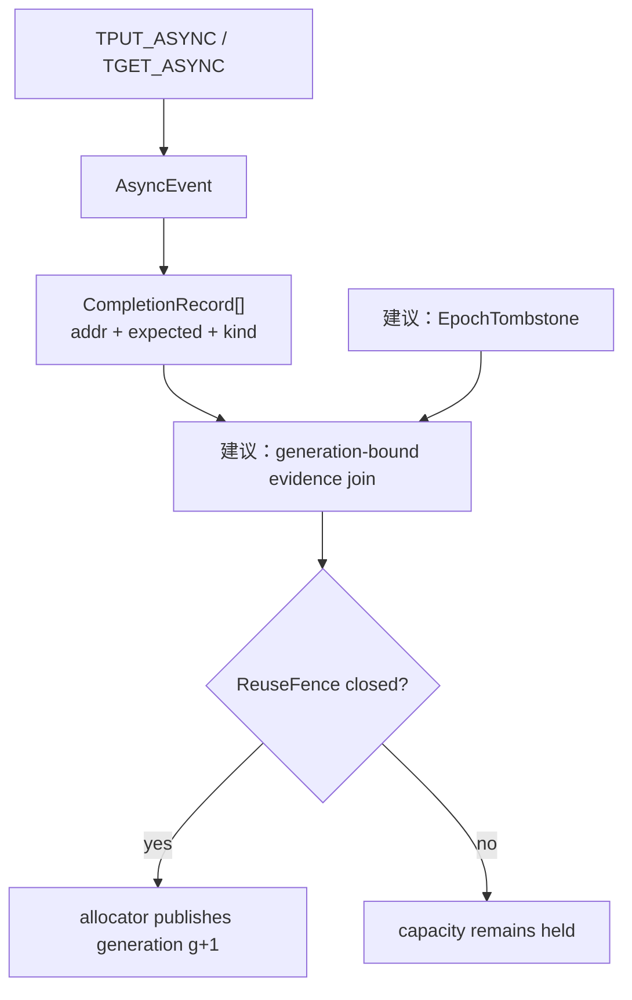
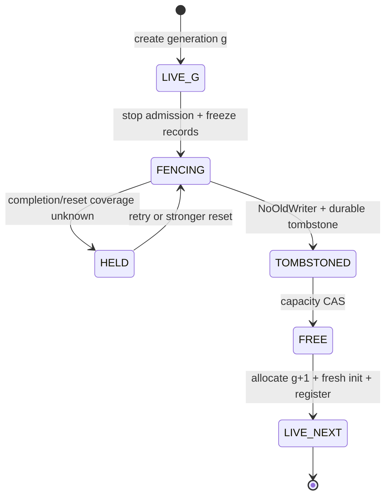

> 源码基线：pto-isa [`fc62c8f8`](https://github.com/hw-native-sys/pto-isa/commit/fc62c8f8d1555803695ccb5296a72639454d2922)，即本文研究时默认分支最新提交；completion/workspace 接口来自已合入提交 [`e6334fbd`](https://github.com/hw-native-sys/pto-isa/commit/e6334fbd6c5d6bfdf550201bbdb81a71831a99af)。本文严格区分**当前代码/规范事实**、**当前测试事实**和**建议恢复协议**；`EpochTombstone`、`ReuseFence`、generation-bound evidence envelope 尚未存在于仓库。

## 本篇在 PTO 课程路线中的位置

第 65 章证明了：补偿失败时可以停止前台重试并 `AbandonWorkspace`，但不能因此返还 capacity；只有完整 completion evidence，或覆盖旧 generation 的 scoped reset 加 fresh census，才能让 orphan 进入 reclaim。今天追问 reclaim 后最容易漏掉的一步：allocator 若很快把相同设备地址交给新对象，旧 completion 或旧 evidence 能否“借尸还魂”，把新对象误判为完成？

课程位置是：

`orphan reclaim proof → epoch tombstone → physical reuse fence → fresh generation publish → late witness rejection`

## 前置知识

- `AsyncCompletionRecord{addr, expected, kind}` 描述 backend-native predicate，不包含 allocation generation。
- SDMA 完成条件是逐 queue 的 `*(uint64_t*)addr >= expected`；event 的全部 queue 都满足才算完成。
- owner epoch 阻止旧 worker提交状态，但不能阻止已经入队的 DMA 写设备内存。
- 地址相等只说明虚拟地址数值相同，不说明 allocator ownership、注册关系或设备写者属于同一代。

## 今日两个紧密关联的核心问题

1. PTO 已经怎样阻止同一 live workspace 内的 `postId`/64-slot ring 过早复用？这个保证为什么跨不过 workspace 的销毁与同址重分配？
2. 安全复用为什么必须同时有 `EpochTombstone` 和 `ReuseFence`，两者的提交顺序、所有权与失败方式分别是什么？

## PTO 全栈中的位置

上游 kernel 产生 `AsyncEvent`；backend 把它解析成 completion record；恢复控制面把 native record 绑定到 logical operation/allocation generation；allocator 最后才消费 `REUSABLE` verdict。当前 PTO 提供前两层，后两层仍是本文提出的控制面契约。

## 概念和精确语义

### 1. ABA 有两种，不只是“ID 撞号”

**逻辑 evidence ABA**：旧 generation 的 poll 结果、RPC 回执或恢复日志迟到；因为它只携带相同 `addr/postId`，joiner 把它接到新 generation。`EpochTombstone` 解决这一类：记录 `(allocation_id, retired_generation, terminal_reason, evidence_root, reuse_fence_id)`，任何 `generation <= retired_generation` 的晚到证据只能补旧代 audit，不能改变新代状态。

**物理 write ABA**：旧 DMA/NIC 操作本身仍可能写同一 completion 地址。此时即使控制面知道新 generation，裸 record 中也没有 generation 位；旧写入会真实污染新对象。只有 `ReuseFence`——旧队列已完整完成，或可信 reset 已覆盖所有旧写者与注册关系——才能消灭这一类。tombstone 不能隔空取消设备队列。

因此最小条件不是“有 epoch 就安全”，而是：

$$
ReuseSafe(A,g+1)=Tombstone(A,g) \land NoOldWriter(A,g) \land FreshInit(A,g+1) \land RegisteredBeforeSubmit(g+1)
$$

其中 `A` 是 allocation identity，不只是地址。`NoOldWriter` 是物理事实；其余三项是控制面可验证事实。任一项为 false/unknown，地址都不能进入 free list。

### 2. 当前代码已有的保护边界

[`sdma_async_detail_basic.hpp`](https://github.com/hw-native-sys/pto-isa/blob/fc62c8f8d1555803695ccb5296a72639454d2922/include/pto/comm/async/sdma/sdma_async_detail_basic.hpp) 把 SDMA handle 的高 6 bit 用作 `queueCount`，低 58 bit 用作 `postId`。[`sdma_async_detail_post.hpp`](https://github.com/hw-native-sys/pto-isa/blob/fc62c8f8d1555803695ccb5296a72639454d2922/include/pto/comm/async/sdma/sdma_async_detail_post.hpp) 在每次 post 前检查 58-bit 空间，耗尽就失败而不 wrap；flag payload ring 深度是 64，复用 slot 前先等待 `postId-64` 对应的旧使用者。

更关键的是 `nextPostId` 被存入 workspace 的 per-queue record 区。新 session 从该地址恢复计数，post 后又由 `PersistSqTails` 写回；源码注释直接说明，若 session 重建从 0 开始，会给相邻 task 重复 `postId` 并跳过 slot-reuse 检查。这个修复建立了 **live workspace 内** 的单调序列。

但源码也写明 fresh workspace 因分配时清零而读到 0；[`workspace.hpp`](https://github.com/hw-native-sys/pto-isa/blob/fc62c8f8d1555803695ccb5296a72639454d2922/include/pto/comm/workspace.hpp) 的 `Workspace` 也只有 `addr/bytes/engine/impl`，没有 generation。于是“同址的新 allocation”会重新从 post ID 空间起点开始。当前代码没有 durable tombstone，也没有让 completion record 携带 epoch；它依赖规范要求：workspace/session/scratch 必须活到事件完成，并在重建 session 或复用 queue 前完成早先 event。

## 真实文件、类型、API 或指令逐段解读

1. [`comm_types.hpp`](https://github.com/hw-native-sys/pto-isa/blob/fc62c8f8d1555803695ccb5296a72639454d2922/include/pto/comm/comm_types.hpp)：`AsyncCompletionRecord` 固定为 24 B，字段是 `addr/expected/kind`；非空 event 解析失败返回 `UINT32_MAX` sentinel，而不是 0 records。这个 ABI 能让非 AICore consumer 判定 completion，却没有时间身份。
2. [`async_event_impl.hpp`](https://github.com/hw-native-sys/pto-isa/blob/fc62c8f8d1555803695ccb5296a72639454d2922/include/pto/comm/async_common/async_event_impl.hpp)：SDMA 从 handle 解出 `postId+queueCount` 并逐 queue 导出 record；URMA multi-jetty 必须逐 jetty 导出，RDMA 使用自己的 CQE predicate。API 返回 record view，不转移 workspace ownership。
3. [`sdma_async_detail_basic.hpp`](https://github.com/hw-native-sys/pto-isa/blob/fc62c8f8d1555803695ccb5296a72639454d2922/include/pto/comm/async/sdma/sdma_async_detail_basic.hpp)：`GetNextPostIdAddr(postDoneBase, queueNum)` 的注释要求给定 workspace/channel group 的整个生命周期内 `queueNum` 固定；这说明 record 地址的解释依赖 workspace layout，而非地址本身自描述。
4. [`TPUT_ASYNC_NOTIFY.md`](https://github.com/hw-native-sys/pto-isa/blob/fc62c8f8d1555803695ccb5296a72639454d2922/docs/isa/comm/TPUT_ASYNC_NOTIFY.md)：规范要求使用同一 session 等待 event；早先 event 完成后才能重建 session/复用 backend queue，并保持 session、workspace、scratch 活到所有 event 完成。它给出了 normal-path 前置条件，但没有 crash 后 allocator 如何证明 reuse 的协议。

关键接口的契约可压缩成下表。前三行是当前代码事实，最后一行是建议补齐的 runtime 边界：

| 接口/动作 | 输入与位置 | 输出、所有权和后置条件 | 失败方式 |
| --- | --- | --- | --- |
| `CreateWorkspace` | host 传 `DmaEngine`、engine-specific request 与空 `Workspace*` | caller 持有 POD；`impl` 持有 backend manager，`addr/bytes` 指向 GM workspace | null/非空输出为 `InvalidArgument`；未编入或不支持为 `Unsupported`；初始化失败为 `EngineFailure` |
| SDMA `BuildAsyncSession` | GM workspace、UB `scratchTile`（至少 8 B，常用 256 B）、固定 `queueNum/channelGroup` | session 借用 workspace/scratch；恢复 persistent `nextPostId`，成功才令 `valid=true` | 地址/layout/config 非法返回 false；session 不可由多个 execution flow 并发提交 |
| `CompletionRecordCount/At` | 与 event 同 engine、同 session；record 地址位于 GM/CQE 区 | 返回 borrowed record view；consumer 只读 predicate，不取得 allocation/free 权 | 非空 event 解析失败为 sentinel/null record；部分 record 成功仍不能整体完成 |
| 建议 `PublishGeneration` | durable allocation identity、fresh-init proof、record binding、current owner/revision | registry 成为 g+1 的唯一权威；成功后才开放 submit | tombstone 缺失、fence scope 不全、revision 冲突或地址越界均 fail closed |

这里的并发假设很重要：`AsyncSession` 不是共享队列锁，规范要求 A2/A3 并发 AIV 使用不同 Channel Group，URMA 同 peer/QP 的提交要串行化。恢复控制面也不能在普通 submit 仍开放时建立 `NoOldWriter`；必须先冻结 admission，等 in-flight participant 集合固定后再做 drain/reset。否则 fence 查询和新 submit 可交错，得到“查询时为空、提交后又有旧代工作”的伪证明。

## 对象、record 与 tombstone 生命周期

建议让 allocation registry，而不是 `Workspace` POD，持有权威 generation。提交顺序必须是 retire-before-reuse：先 fence 旧写者，再原子落 tombstone，最后才返还 allocator；新代必须先注册 identity/record binding，再允许 submit。

线性化点有三个：`NoOldWriter` 证据落盘、tombstone CAS、allocator capacity CAS。若进程在前两者之间崩溃，重启后保守地重新 query/reset；若 tombstone 已提交而 capacity CAS 未提交，可按同一 `reclaim_action_id` 幂等补做；若 capacity 已返还但新 generation 尚未发布，地址仍是 free，旧 evidence 因 tombstone 被拒绝。绝不能先 free 再补 tombstone，因为这个窗口允许新对象暴露而旧证据仍可命中。

`EpochTombstone` 至少需要 `allocation_id`、`retired_generation`、地址范围、backend domain/session、terminal evidence root、`reuse_fence_id`、reset/completion coverage 与 `reclaim_action_id`。新 allocation 必须获得严格不同的 generation；地址重用不重用 identity。generation 若可能 wrap，比较就不再安全，应使用 durable 64/128-bit 单调空间或随机唯一 allocation ID，并在任何仍存活 tombstone 的窗口内禁止回绕。

逐个看 crash window，可以检验这个顺序是否真的可重放：

| 崩溃位置 | 重启后的唯一安全动作 | 不能做的事 |
| --- | --- | --- |
| freeze 后、fence 证据前 | 重新枚举 participant，并再次 drain/query/reset；capacity 仍 held | 依据“上次正在 reset”推断 reset 已完成 |
| fence 证据后、tombstone 前 | 校验 certificate 的 scope、generation、digest，再幂等补 tombstone | 只凭设备当前安静删除旧 generation |
| tombstone 后、capacity CAS 前 | 用同一 `reclaim_action_id` 补 ledger；重复 CAS 只读到已应用 | 新建另一个 release action 重复返还 bytes |
| capacity CAS 后、g+1 register 前 | 地址仍是 free；分配者必须创建新 identity并 fresh-init | 把旧 `Workspace` POD 或 record snapshot交给新请求 |
| g+1 register 后、submit 前 | 可丢弃空 generation，或沿同一 registry entry继续 submit | 回滚 tombstone、恢复 g 的提交权限 |

这张表还揭示了持久化边界：fence certificate 必须能在重启后验证，而不是一枚进程内布尔值；tombstone 与 ledger 不一定要放在同一存储系统，但必须共享 action identity，并能证明“最多返还一次”。若存储分区导致二者无法核对，正确结果是地址不可分配，而不是为了可用性猜测它已经 free。

## 端到端调用链或指令链

当前正常链是：`CreateWorkspace` → `BuildAsyncSession` → `TPUT_ASYNC_NOTIFY` → `ReserveSdmaPostEvent` → post/`PersistSqTails` → `AsyncEvent` → `CompletionRecordCount/At` 或 `Wait/Test` → 所有 event 完成 → `DestroyWorkspace`。

故障恢复链建议扩展为：freeze `(allocation_id,g)` → 快照 required records/participants → drain 或 scoped reset → 持久化 `NoOldWriter` certificate → CAS `EpochTombstone(g)` → action-keyed capacity release → allocator 分配 `(allocation_id',g+1)` → 清零并校验 record region → register completion binding → 允许新 submit。晚到的旧软件 witness 在 generation check 处被审计化；旧设备写入则应在 `NoOldWriter` 之前被 drain/reset 消灭。

所有权也必须分离：backend adapter 只产生 native evidence；recovery owner 以 owner epoch/revision 提交 tombstone；allocator 只消费 canonical `REUSABLE`；普通 request 无权因 timeout、地址空闲或单条 record 满足而推进 generation。

## 具体 shape、Tile 和状态演算

取规范中等价的小 payload：`GlobalTensor<float>` 的逻辑 shape 为 `16×16`、ND contiguous，共 `16×16×4=1024 B`；SDMA scratch 使用 `Tile<Vec,uint8_t,1,256>`，位于 UB；payload 源/目标和 completion records 位于 GM。设 `queueNum=2`，旧 allocation `alloc-9/g7` 的 workspace record 区虚拟地址从 `0x8000_0000` 开始（地址仅用于演算），最后一个 event 是 `postId=130`。

1. g7 的两个 record 分别要求 `q0>=130`、`q1>=130`；当前读数 `[130,129]`，所以仍是 `UNKNOWN`。
2. 错误实现把 timeout 当完成，free g7，并把同一地址清零后分给 `alloc-10/g8`。fresh workspace 的 `nextPostId=0`，g8 首个 event 期望 `postId=1`。
3. g7 的 q1 晚到，将同一物理 record 写成 130。g8 若只执行裸 predicate，会看到 `[q0>=1,q1>=1]`，把旧 DMA 的写入误当作新 event 完成；这不是哈希碰撞，而是 `>=` 单调计数在同址重置后的代际污染。
4. 正确协议不会进入第 2 步：`[130,129]` 不能生成 `NoOldWriter(g7)`，地址继续 held。只有 q1 达到 130，或覆盖两条 queue/g7 的可信 reset 完成后，才能写 tombstone、返还 capacity。
5. g8 注册后，若旧 g7 的软件 poll 回执才到，envelope 的 `generation=7` 小于当前 8，只补 g7 audit；它不能关闭 g8。若设备仍能在 g8 后写入，则说明 reuse fence 伪造或 scope 不完整，系统必须 fail closed，而不是靠 epoch 字段“过滤内存写”。

这个例子也解释了为什么只把 `postId` 扩成 128 bit 不够：它能降低逻辑撞号，但无法阻止旧 writer 触碰已重用地址。反过来，只做 reset 而不留 tombstone，也会让 reset 前发出的迟到软件 evidence 重开旧状态。

## 为什么这样设计及替代方案

**方案 A：地址永不复用，直到进程/设备重启。** 正确性最容易说明，但长期 orphan 会把 GM 变成单调泄漏，碎片和 admission failure 无界；吞吐最终归零。

**方案 B：只给每个 record 加 epoch。** 若所有 backend 完成写都能原子携带并校验 epoch，它可以同时解决两类 ABA；但当前 SDMA/URMA/RDMA native record ABI 不含统一 epoch，改硬件/CQE 布局、跨 backend 适配和兼容成本很高。把 epoch 只放 host metadata 则只能挡逻辑 witness，挡不住物理 late write。

**方案 C：每次复用前整卡 reset。** 物理证明强、实现简单，但 blast radius、P99 延迟、并发损失和多 tenant 维护成本最高；应优先使用覆盖精确 queue/session/registration domain 的 fence，只有 scope 无法证明时扩大 reset。

**建议方案：tombstone + scoped reuse fence。** hot path 只多一次 register-before-submit 的 metadata 写；恢复路径承担 durable CAS、query/reset 与审计。对 CUDA Graph/ACL Graph 一类 replay，generation 和 record binding 应在图外的稳定控制对象中管理，图内保持地址/shape 稳定；若同一图允许跨 generation replay，必须在每次 replay 前验证 lease，不能把 capture 时地址当永久所有权。维护成本较高，但逻辑身份、物理静默和容量所有权三件事不再互相冒充。

## 访存、计算、流水、并行和硬件约束

这一路径不是算力瓶颈：1024 B payload 的数据面仍由 DMA 处理，新增工作主要是 control-plane record append/CAS 与少量 completion polling。性能目标应是最小化正常提交的固定 metadata 开销，并把昂贵 reset 留在 recovery path。判断优化是否值得，应分别测 submit latency、poll GM/CQE 流量、quarantine held-bytes、reset 次数与 P99 admission delay，而不是只比较 kernel bandwidth。

容量准入仍服从物理预算，而不是 tombstone 数量：`live bytes + held old-generation bytes + recovery temporary + fragmentation <= usable GM`。tombstone 本身通常在 host/durable store，只能解释 held bytes 为何尚未可用，不能把它们从设备预算里扣掉。优化 gate 应以“scoped fence 能提前释放多少 GM、代价是多少 reset/查询延迟”为准；若没有真机分布，就保留公式和测量项，不虚构统一阈值。

并发正确性要求同一 allocation generation 只有一个 recovery owner 能发布 tombstone，但多个 adapter 可以追加不可变 evidence。同 ID/同 digest 可幂等去重；同 ID/不同 digest、wrong generation、record 地址越界、部分 queue/jetty、unknown schema 都必须保持 `UNKNOWN`。tombstone 不能按固定 TTL 删除：删除条件必须来自所有旧 witness consumer 已越过 watermark，且旧 writer domain 已有不可撤销 fence；否则 TTL 只是把低概率 ABA 延后。

**硬件映射推断：** 公开源码足以确认 SDMA 的 post-done 单调比较、64-slot payload ring、URMA/RDMA 的 CQE 类型差异；不足以确认设备 MMU、CQE cache coherence、reset 的真实覆盖域和 MR 注销后晚到写的硬件行为。因此 `NoOldWriter` 的 fence scope 必须由 backend/runtime 文档与真机 fault trace 校准，不能由本文从头文件臆测。

## 测试证据与未覆盖风险

**当前源码可见测试事实：** [`tput_async_notify_kernel.cpp`](https://github.com/hw-native-sys/pto-isa/blob/fc62c8f8d1555803695ccb5296a72639454d2922/tests/npu/a2a3/comm/st/testcase/tput_async_notify/tput_async_notify_kernel.cpp) 的 ring-reuse case 连发 65 次 notify；interleaved case 先发 `postId=2`，插入 127 次普通 post，再以 `postId=130` 复用 operand slot 2。[`main.cpp`](https://github.com/hw-native-sys/pto-isa/blob/fc62c8f8d1555803695ccb5296a72639454d2922/tests/npu/a2a3/comm/st/testcase/tput_async_notify/main.cpp) 将其作为 2-rank、`queueNum=4` 的测试入口。它验证 live workspace 中 post ID 单调、64-slot reuse 前等待旧使用者、最终 payload/signal/guard 正确。

**提交记录中的测试事实：** [`e6334fbd`](https://github.com/hw-native-sys/pto-isa/commit/e6334fbd6c5d6bfdf550201bbdb81a71831a99af) 报告 workspace header 编译通过、URMA 2-rank 6 个 case 通过，并明确 SDMA 跨 chip runtime 当时只编译、未运行。本文不把提交描述中的结果扩写为当前环境重新执行的实验。

**这些测试没有证明什么：** 它们没有 destroy/reallocate-same-VA、fresh `nextPostId=0` 后旧 completion 写入、wrong-generation evidence、reset scope、tombstone/free crash window或 epoch wrap。也没有 direct test 让一条 queue 在旧 allocation 释放后才完成。因此它们证明的是 session/workspace 合法生命周期内的 ring reuse，不是跨 allocation 的 ABA 安全。

最小新增 fault matrix 应固定 allocator 复用同一 VA，在 `NoOldWriter` 落盘前后、tombstone CAS 前后、capacity CAS 前后、g8 register 前后逐点 crash；再注入 g7 的 delayed q1 write 与 delayed software witness。oracle 同时检查：g8 业务 payload、record generation binding、旧证据 audit 归属、allocator 可用字节，以及每个 `reclaim_action_id` 最多 credit 一次。若无法让真实设备确定性地产生 late write，至少需要 backend simulator/mock CQE page 加 deterministic gate，并以真机 reset-scope test补齐物理结论。

## 与前后章节的连接

上一章解决“orphan 何时可长期回收”；本章补上“回收后怎样防止旧世界复活”。两章共同给出完整的 reuse 条件：第 65 章收集 terminal evidence/reset+census，本章把它固化成 tombstone 和物理 fence，再允许新 generation。下一章将研究 tombstone 何时可以安全压缩：completion watermark、reset certificate 与 consumer lease 如何共同决定 safe cutoff。

## 本篇结论、知识债、三个理解检查问题和下一章

结论：PTO 的 persistent `nextPostId` 和 58-bit non-wrapping handle 已经保护同一 live workspace 内的 session/ring 复用；它们不等价于跨 allocation generation 的身份。`EpochTombstone` 防旧软件证据，`ReuseFence` 消灭旧设备写者；必须先 fence、再 tombstone、再返还 capacity、最后注册新代，才能关闭 ABA。

知识债：durable allocation/generation registry、`EpochTombstone/ReuseFenceCertificate` schema、backend-specific drain/reset/MR fence、register-before-submit 事务、same-VA fault allocator、late-write simulator、generation wrap policy、consumer watermark 与 tombstone compaction，以及 SDMA/URMA/RDMA 真机 crash differential Golden。

理解检查：

1. 为什么给 `AsyncCompletionRecord` 外包一层 generation，仍不能单独阻止旧 DMA 写坏同址的新 record？
2. fresh workspace 的 g8 event 期望 `postId=1` 时，为什么 g7 晚到的 `postDone=130` 会形成更危险的假阳性？
3. 为什么安全顺序必须是 `NoOldWriter → tombstone → capacity release → g+1 register`，而不能先 free 后补 tombstone？

下一章：**Tombstone 什么时候可以删除——Completion Watermark、Reset Certificate 与 Safe Compaction。**

## 课程账本增量

- 新增当前代码事实：SDMA event handle 使用 58-bit `postId` + 6-bit `queueCount`，ID 空间耗尽 fail closed；`nextPostId` 在 live workspace 内持久化，fresh workspace 重新从零状态开始。
- 新确认不变量：逻辑 evidence ABA 与物理 late-write ABA 必须分治；tombstone 不替代物理 fence，reset/drain 也不替代 generation-bound evidence；reuse 顺序必须 retire-before-reuse。
- 新增建议对象：`EpochTombstone`、`ReuseFenceCertificate`、generation-bound evidence envelope、allocation registry 与 action-keyed capacity CAS。
- 新测试结论：现有 65-post/`postId=130` 回归覆盖 live-workspace ring reuse，不覆盖 destroy/reallocate-same-VA、late writer、wrong generation 或 tombstone crash window。
