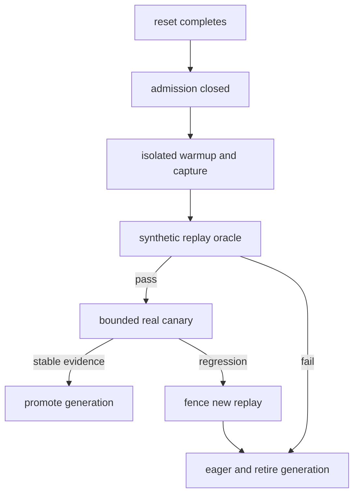
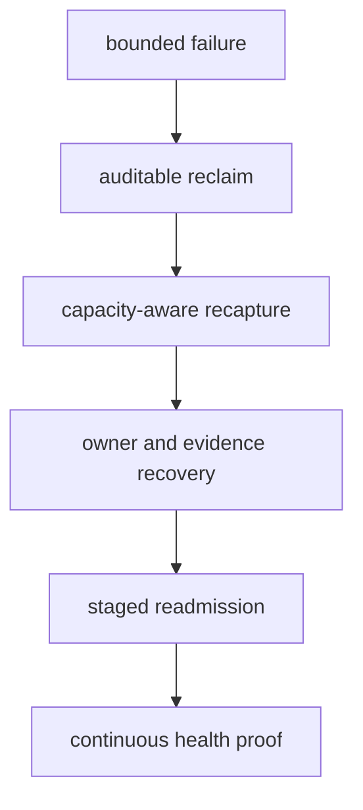

> 源码基线：vLLM [`8530aed2`](https://github.com/vllm-project/vllm/commit/8530aed2b78a19eb00e242031c22bb78d615eea2)，为本文研究时默认分支最新提交；该提交删除 Medusa/MLP speculator 支持，与本文链路无直接关系。直接相关的最新已合入证据是 2026-10-14 的 [PR #61496](https://github.com/vllm-project/vllm/pull/61496) / [`9b5c6707`](https://github.com/vllm-project/vllm/commit/9b5c6707a3064db25e1045c1c47674b1885da54c)：MRV2 的 DCP FULL graph 曾在“成功 capture”后回放出错误结果。本文严格区分**当前代码事实**、**测试/实验事实**与**建议协议**。当前实现有启动期 compile、kernel warmup、CUDA Graph capture、workspace lock 和 eager fallback，但没有 reset 后按 generation 灰度放量的 `WarmupAdmission`、语义 canary controller 或自动 rollback 状态机。

## 本篇在课程路线中的位置

第 55 章把冲突 graph 从永久 quarantine 推进到有 deadline、按故障域升级的 reset。reset 只回答“旧 generation 怎样停止”，并没有回答“新 generation 何时值得信任”。如果重建完成就让所有 K8 请求 replay，一次坏 capture、错误 workspace 地址或 TP rank 不一致会立刻扩大到全部流量。

本章只解决一个问题：**新 CUDA Graph generation 如何从不可接流，经过隔离 warmup、synthetic replay、有限真实 canary，最后 promotion；任何证据恶化时又怎样回到 eager，而不是复活旧 graph。**

## 前置知识回顾

- `capture_model()` 成功返回只说明 capture 调用完成并测得 graph memory，不证明真实请求输出正确。
- `CUDAGraphMode.NONE` 是现成的正确性兜底；它可以在 graph 恢复期间继续执行模型。
- graph、workspace、KV 地址、TP rank 集合和 generation 必须共同成立；只检查 Python entry 不够。
- rollback 只能阻止后续 replay。已经可能写坏 KV 的请求不能靠切回 eager 自动恢复，必须失败、重放或从可信 checkpoint 继续。

## 本篇要回答的核心问题

1. 当前启动期 warmup/capture 已经保证了什么，在线 reset 后还缺什么？
2. synthetic replay 与真实 canary 分别验证哪类不变量，为什么不能相互替代？
3. promotion 与 rollback 应依据哪些可测证据，而不是固定睡眠或拍脑袋流量百分比？

## 组件在全局架构中的位置

当前启动屏障在 [`EngineCore._initialize_kv_caches`](https://github.com/vllm-project/vllm/blob/8530aed2b78a19eb00e242031c22bb78d615eea2/vllm/v1/engine/core.py) 内：KV cache 初始化后，`Executor.compile_or_warm_up_model()` 通过 `collective_rpc` 在所有 worker 上执行 [`GPUWorker.compile_or_warm_up_model`](https://github.com/vllm-project/vllm/blob/8530aed2b78a19eb00e242031c22bb78d615eea2/vllm/v1/worker/gpu_worker.py)。compile-only size 先 dummy run，随后 kernel/JIT warmup，再 capture graph；完成后才启用 JIT monitor、freeze GC 与 GPU sync check。启动尚未接流，天然形成 admission barrier；在线 reset 没有这层屏障。初始化后，dispatcher 依据 batch descriptor 与已捕获集合选 eager 或 graph，没有 generation health gate。



图中从 `admission closed` 到 promotion 的控制面是建议协议；当前代码只有启动期 B/C 的近似过程，以及数据面的 eager/graph 二选一。

## 完整调用链

1. `EngineCore` 先调用 `model_executor.initialize_from_config(kv_cache_configs)`，再调用 executor 的 `compile_or_warm_up_model()`；elastic EP scale-up 的特殊启动路径会跳过后者。
2. [`Executor.compile_or_warm_up_model`](https://github.com/vllm-project/vllm/blob/8530aed2b78a19eb00e242031c22bb78d615eea2/vllm/v1/executor/abstract.py) 对所有 worker 发同步 RPC，并取各 rank 编译时间的最大值，因为 ranks 并行编译，最慢者决定屏障结束。
3. `GPUWorker._compile_or_warm_up_model` 从 `compile_sizes` 去掉已由 graph capture 覆盖的 size，并保证每个 compile range 至少被一次 warmup 命中；之后 `kernel_warmup(self)`，MRV2 再按配置执行 `warmup_kernels(...)`。源码明确警告：capture 后 workspace resize 会释放 graph 指向的静态 buffer。
4. 非 `enforce_eager` 时，worker 进入 capture profiler context 并调用 model runner 的 `capture_model()`。MRV2 在 encoder/decoder/speculator capture 后计算显存差，真实 capture 才 `lock_workspace()`；`profile_only=True` 不锁，因为后续 warmup 仍可能扩容 workspace。
5. 运行时 MRV1 的 [`CudagraphDispatcher.dispatch`](https://github.com/vllm-project/vllm/blob/8530aed2b78a19eb00e242031c22bb78d615eea2/vllm/v1/cudagraph_dispatcher.py) 在 key 不存在、超出最大 size 或 mode 不允许时返回 `CUDAGraphMode.NONE`；命中时 `CUDAGraphWrapper` 捕获或 `entry.cudagraph.replay()`。当前没有“仅允许 canary request”的中间态。

## 关键类型、字段和状态生命周期

当前两条 runner 路径的容器不同但边界一致：MRV1 的 `CUDAGraphWrapper` 以 `BatchDescriptor` 索引 `CUDAGraphEntry(cudagraph, output, input_addresses)`；MRV2 的 `CudaGraphManager` 持有 descriptor→graph 映射和进程内“已捕获”状态。前者在 debug 模式校验 replay 时 tensor 地址与 capture 相同，后者在 `dispatch_cg_and_sync_dp` 前准备固定 input buffers。它们都只表达进程内 handle 与可匹配 shape，不能表达跨 reset generation、canary quota、健康窗口或 rollback 原因。

建议增加控制面记录，仍不让请求直接持有它：

```text
WarmupAdmission(
  key, generation, expected_ranks, state,
  capture_revision, workspace_generation,
  synthetic_verdict, canary_budget, canary_inflight,
  error_budget, memory_witness, service_window,
  promoted_at, rollback_reason
)
```

`state` 至少包含 `CLOSED → WARMING → SYNTHETIC_OK → CANARY → PROMOTED`，任一非终态都可转 `ROLLBACK_PENDING → EAGER_ONLY → RETIRED`。状态只授权 routing；graph 是否存在、KV 是否可信、pool 是否可复用仍由各自 witness 证明。

准入控制器需要同时消费四类证据，不能把它们压成一个 `healthy: bool`：

| 证据 | 当前可观测量 | 证明什么 | 不能证明什么 |
| --- | --- | --- | --- |
| capture | `graphs[desc]`、`_graphs_captured`、capture exception | 指定进程完成 graph 建立 | 输出正确、所有 rank 同代 |
| address/capacity | workspace generation、pool revision、fresh memory census | graph 指向的地址仍有效且有故障余量 | replay 的模型语义正确 |
| synthetic correctness | eager/graph digest、finite check、KV guard | 固定输入下 replay 与 oracle 一致 | 真实并发、长尾或生产数据分布 |
| real canary | request result、device error、P99/goodput、rank health | 小故障半径内的生产行为 | 未来 workload 永远不漂移 |

建议的 `admit_canary(key, generation, request)` 输入包括 immutable descriptor、当前 generation/revision、expected rank set、剩余错误预算和请求 checkpoint 能力；输出是 `EAGER | CANARY_GRAPH | REJECT`，而不是直接返回 graph handle。handle 仍归 worker-local manager 所有，请求只获得一次 generation-bound replay lease。前置条件是 synthetic verdict、memory witness 和 rank handshake 都为 current；后置条件是 `canary_inflight` 原子增加，完成或失败时恰好减少一次。revision 不匹配、预算耗尽、没有 checkpoint 且请求包含不可逆副作用，或任一 rank 不能签发同代 lease，都必须拒绝 graph。

promotion 接口同样需要窄语义：它只把 `(key, generation)` 加入 production routing set，并冻结本轮 canary counters；不会移动 graph、重建 KV，也不会释放旧 reservation。rollback 则先从 routing set 删除 generation，再等待已签发 lease 完成，随后生成 retire 请求。把这三件事拆开，是为了避免“路由已经关闭”被错误解释为“设备对象已经安全释放”。

最新反例来自已合入 [PR #61496](https://github.com/vllm-project/vllm/pull/61496)。在 MRV2、GQA、DCP、FULL graph 组合下，旧 dummy batch 的 `seq_lens == query_lens`，host 侧因此判定“没有 context attention”并把 skip 分支烘进 graph；真实 replay 即使拥有 KV context 也不会重新做 host 分支判断。PR 报告 Qwen3-235B、TP=8/DCP=2 的 needle retrieval 从 0/9 恢复到 9/9，并在 [`set_dcp_capture_context`](https://github.com/vllm-project/vllm/blob/8530aed2b78a19eb00e242031c22bb78d615eea2/vllm/v1/worker/gpu/cudagraph_utils.py) 中给 FULL capture 注入 `cp_size * cp_interleave` 个 context tokens。**这是代码与 PR 实验事实：capture 无异常、地址稳定、workspace 已锁，仍可能语义错误。**因此 canary 不能只检查“能 replay”；它必须覆盖会影响 host specialization 的 metadata 与 KV side effect。

## 逐函数源码解读

### `_compile_or_warm_up_model`：顺序本身就是地址契约

先 kernel/JIT warmup、后 graph capture，不是风格选择，而是 graph 固定地址约束。capture 完后才对 V1 sampler 做最大 shape dummy run，也是因为 `capture_model` 内部 `empty_cache()` 可能清掉预分配 buffer。函数最后重新设 seed、激活 JIT monitor 与 GPU sync check，说明“warmup 完成”还包含把初始化期副作用关回生产态。

但它只在 worker startup 路径运行。reset 后若局部重建一个 graph manager，当前没有同等的在线 admission barrier，也没有把新 manager 与旧流量并存的 generation registry。

### `CudaGraphManager.capture/dispatch`：capture 完成即全量可见

每个 descriptor 的 eager warmup可以触发 attention backend 的 lazy metadata 初始化；capture 时重新创建 forward closure，避免复用被 warmup 改写的状态。可 `_graphs_captured=True` 是所有 descriptor 完成后的单一开关，`dispatch` 对兼容请求一视同仁。它适合启动期“服务尚未开放”，不适合 reset 后“服务仍在 eager、只想让少量请求试新 graph”的场景。

### `run_fullgraph`：replay 前同步不是正确性 oracle

`run_fullgraph` 会先同步 offloader 的前一轮 onload，再调用 `graph.replay()`，防止 eager→FULL 切换时 copy stream 覆盖静态 buffer。这解决 stream ordering，不验证输出、KV side effect 或跨 rank generation。replay 没抛异常也不能直接 promotion。

从第一性原理看，promotion 必须满足的目标不是“多跑几轮没报错”，而是三个结果同时成立：新 graph 的输入/输出地址契约未变；一次 replay 的语义与可信 eager oracle 一致；即便下一次 replay 立刻失败，系统仍有足够显存、错误预算和请求恢复路径把影响限制住。前两项约束正确性，第三项约束可恢复性。缺少第三项时，即使 canary 全部成功，也可能在全量放开后的第一次 workspace resize 或 rank reset 中失控。

## 具体示例与 shape/状态演算

沿用 TP=2 的 K8，旧 generation 43 已退休，新 generation 44 准备重建。descriptor 为 FULL decode：`num_reqs=8`、`num_tokens=8`、每请求 query length=1。MRV2 [`InputBuffers`](https://github.com/vllm-project/vllm/blob/8530aed2b78a19eb00e242031c22bb78d615eea2/vllm/v1/worker/gpu/input_batch.py) 中参与准备的主要 device buffer 为：`input_ids[8]: int32`、`positions[8]: int64`、`is_padding[8]: bool`、`query_start_loc[9]: int32`、`seq_lens[8]: int32`，均位于各 rank accelerator device；KV/block table 仍由 runner 持有。

假设每 rank fresh headroom 64 MiB，generation 44 capture 峰值增量实测 12 MiB，隔离 canary 的额外峰值 8 MiB，故障保留量 20 MiB。准入先检查：

$$
H_{fresh}=64 \ge M_{capture\ peak}+M_{canary\ peak}+M_{failure\ reserve}=12+8+20=40\text{ MiB}
$$

这些数值只是演算，不是 vLLM 默认阈值。状态推进如下：

1. `CLOSED`：所有真实 K8 请求继续 eager；generation 44 不进入 dispatcher 的 production key set。
2. `WARMING`：两个 rank 用隔离 request/KV slot 与稳定 workspace 执行 eager warmup、capture；EPLB statistics 保持原值。任一 rank失败则两端 generation 44 一起 retire。
3. `SYNTHETIC_OK`：固定输入分别跑 eager oracle 与 graph replay，校验有限值、shape、选定 logits/top-k digest、KV guard region、rank handshake 和 memory census。若此例同时启用 DCP，令 `cp_size=2, cp_interleave=1`，FULL capture 的 8 个 dummy requests 每个都必须呈现 `context_len=2`；否则会重现 #61496 的错误 specialization。两条路径必须用独立 KV slot，或在 eager 后恢复同一份 snapshot，再执行 graph，测试数据不得写真实请求 KV。
4. `CANARY`：教学策略规定错误预算最多暴露 2 个请求，detector 最迟 2 个 scheduler step 决策，因此每 step 最多接纳 1 个 K8 canary：`rate × detection_window ≤ error_budget`。请求只走 graph 一次，不能同时 shadow eager；成功观察延迟、device error、输出/KV guard 与 pool 变化。
5. 两个 step 后全部 witness 仍为 current，才原子把 generation 44 标为 `PROMOTED`。promotion 扩大 routing 权限，不返还旧 generation 43 的账；旧账已在上一章的 reclaim witness 中独立闭合。
6. 若第一个 canary 触发 CUDA error、digest/guard 不符或 rank generation 分叉，先 fence generation 44 新 replay，等待其 replay lease 归零，再转 `EAGER_ONLY` 并 retire。已执行 canary 若 KV 可信度未知，必须失败或从请求 checkpoint 重放，不能无条件继续 eager。

这里的 digest 也要控制边界。对 deterministic synthetic 输入，可以比较完整小张量或固定 top-k/logits slice；对含随机 sampling、浮点非确定性或跨设备 reduction 的路径，应先固定 RNG 与算法，再使用与模型精度契约一致的 tolerance。只比较最终 token 会漏掉大面积 logits 偏差，只要求 bitwise 相等又可能把合法的 FP16/BF16 舍入差异当成失败。digest 的字段、dtype、归一化与 tolerance 必须进入版本化 oracle schema，不能由不同 rank 临时解释。

## 为什么这样设计及替代方案

**capture 成功后立即全量开放** 最简单、吞吐恢复最快，却把一次验证不足扩散到全部兼容请求，且当前 capture 返回值只含显存差，不含输出 verdict。

**永远保持 eager** 正确性风险最低，却永久放弃 graph 收益，也无法验证重建能力。

**对每个真实请求同时跑 eager shadow 与 graph** 看似证据最强，实际会翻倍计算，并可能重复写 KV、更新 RNG 或触发 collective，不能作为通用方案。

**隔离 synthetic + 有界真实 canary** 增加 generation registry、路由 gate、checkpoint/失败语义与观测维护成本，但将验证职责拆开：synthetic 负责可重复的功能与地址 guard，真实 canary 负责生产 shape、并发和性能。流量上限由错误预算与检测窗口推导，而不是固定百分比。

## 性能、并发、正确性与边界条件

- **显存**：admission 使用 fresh headroom 与 capture/canary 峰值，不使用 reset 前的 census；shared pool 的 reusable bytes 与 device-free 仍须分开。
- **并发**：promotion/rollback 用 `(generation, expected_revision)` CAS；旧 controller 的迟到成功不能重新开放已 retire generation。
- **TP/PP**：canary 是 group decision。所有 expected rank 必须同 generation，且 collective 路径一致；单 rank成功无意义。
- **graphability**：canary 不改变 descriptor shape/dtype/address；若为了观测插入新 tensor 或 host sync，必须重新评估 capture contract。
- **延迟**：判断 promotion 应比较 canary 的服务时间、queueing 和 P99/goodput，而不只看 kernel replay 时间。
- **回滚**：无异常不等于输出正确；有异常也不保证请求未产生 side effect。request checkpoint 或明确失败语义是自动 rollback 的前置条件。

## 测试证据与未覆盖风险

1. [`test_capture_and_replay`](https://github.com/vllm-project/vllm/blob/8530aed2b78a19eb00e242031c22bb78d615eea2/tests/v1/cudagraph/test_cudagraph_dispatch.py) 对 `SimpleMLP` 和 `BatchDescriptor(num_tokens=10)` 先 eager warmup，再 capture、replay，并以 `torch.testing.assert_close` 比较 eager/replay 输出；它证明单进程静态输入下的最小语义 oracle，不覆盖 KV、TP collective 或 generation routing。
2. 同文件 `test_capture_replay_bypass_logic` 用 capture sizes `[1,2]` 验证两个 key 各自 capture→replay、size 3 未命中时 eager bypass，以及全局禁捕后强抓 unseen key 必须抛错。它证明 fail-closed 原语可用，但没有 canary quota 或 rollback 状态。
3. [`test_capture_model_locks_workspace_after_capture`](https://github.com/vllm-project/vllm/blob/8530aed2b78a19eb00e242031c22bb78d615eea2/tests/v1/worker/test_gpu_model_runner_v2.py) 验证真实 capture 恰好锁一次 workspace；无 graph 和 `profile_only=True` 都不锁。输入是最小 fake runner，验证的是 lock 时机，不验证锁后的地址在 reset/recapture 中保持有效。
4. 新增的 [`test_dcp_full_capture_has_kv_context`](https://github.com/vllm-project/vllm/blob/8530aed2b78a19eb00e242031c22bb78d615eea2/tests/v1/cudagraph/test_cudagraph_manager.py) 固定 `num_tokens=num_reqs=8`、`cp_size=2`、`cp_interleave=1`、block size 16；FULL 期望所有 request 的 `context_len=2`，非 FULL 期望 0。它精确覆盖 host specialization 的输入不变量，但没有端到端执行 attention graph；PR 也明确 DBO 路径缺少 DeepEP E2E 覆盖，接近 `max_model_len` 时 dummy context 被 clamp 为 0 仍是边界风险。

这些测试没有覆盖：reset 后 generation 44 的 dark warmup、synthetic→real canary 转换、KV/RNG/request-slot 全副作用隔离、canary replay 中途 rank 崩溃、promotion/rollback CAS 竞争、已部分写 KV 的请求恢复，以及自动回到 eager 后再重试的 GPU Golden。本环境未重跑 GPU 测试，因此本文不把代码阅读等同于新实验结果。

## 与前后章节的连接

第 55 章负责停止并回收旧 generation；本章负责限制新 generation 的信任扩散。两者通过 generation-bound lease 和 fresh census 相接，但 reclaim 与 promotion 是两笔独立事务。下一章进入长期运行：如何让已 promotion 的 graph 接受持续健康采样，并在 workload、driver、workspace 或模型状态变化时触发再验证。

## 本篇结论、知识债、三个理解检查问题和下一章

结论：**reset/capture 成功不是流量准入证据。安全恢复必须先保持 eager，隔离 warmup 的调度与状态副作用，再用 synthetic oracle 验证确定性不变量，用受错误预算约束的真实 canary 验证生产行为；rollback 只能撤销后续 routing，不能抹掉已经发生的 KV side effect。**

知识债：真实 `WarmupAdmission` schema、generation-aware dispatcher、隔离 KV/request slot、可比较的 logits/KV digest、canary routing quota、request checkpoint、TP group CAS、side-effect census、GPU fault injection 与 promotion/rollback Golden。

理解检查：

1. 为什么 `capture_model()` 返回显存占用且不抛错，仍不足以 promotion？
2. 为什么真实请求不能普遍采用 eager 与 graph 双跑作为 shadow canary？
3. canary rollback 后，什么条件下请求可以 eager 重放，什么条件下必须直接失败？

下一章：**Promotion 后怎样持续证明健康——Sentinel Sampling、Drift Detection 与 Revalidation Trigger。**

## 第八次知识图谱回顾（第 50–56 章）

这七章把“graph capture 能否成功”扩展成了一条完整的异常期资源与信任链：第 50 章用 absolute deadline 终结跨 rank 等待；第 51 章把 entry 删除与 pool/物理回收分开；第 52 章在 shared pool 上按 conditional marginal cost 排 recapture；第 53–55 章补上 durable reservation、owner takeover、tri-source reconciliation、quarantine deadline 和最小 reset 域；本章再规定新 generation 只能逐级恢复信任。



知识地图的核心边界已经稳定：ledger 决定 authority，live handle 决定 replayability，pool/allocator census 决定 reclaimability，warmup/canary evidence 决定 admissibility；任何一个 verdict 都不能越级代替另一个。后续路线因此从“异常后恢复”转向“正常运行中持续证明健康”，再进入 serving 侧如何消费这些状态。

## 课程账本增量

- 新覆盖：`EngineCore._initialize_kv_caches`、`Executor.compile_or_warm_up_model`、`GPUWorker._compile_or_warm_up_model`、MRV1 `CUDAGraphWrapper.__call__`、MRV2 `capture_model/dispatch_cg_and_sync_dp`、`set_dcp_capture_context` 与 workspace-lock tests。
- 新不变量：warmup 必须隔离 production side effect；capture success、synthetic correctness、real-traffic health 与旧 generation reclaim 是四类证据；rollback 不撤销已发生 side effect。
- 建议协议：`WarmupAdmission`、`CLOSED → WARMING → SYNTHETIC_OK → CANARY → PROMOTED` 与 generation-bound rollback。
- 七章回顾：第 50–56 章已串起 `bounded failure → reclaim evidence → capacity-aware recapture → owner/evidence recovery → staged readmission`；四类 verdict 分别约束 authority、replayability、reclaimability 与 admissibility。
- 下一步：为 promotion 后 graph 建立低开销 sentinel、drift signal 和可审计 revalidation trigger。
