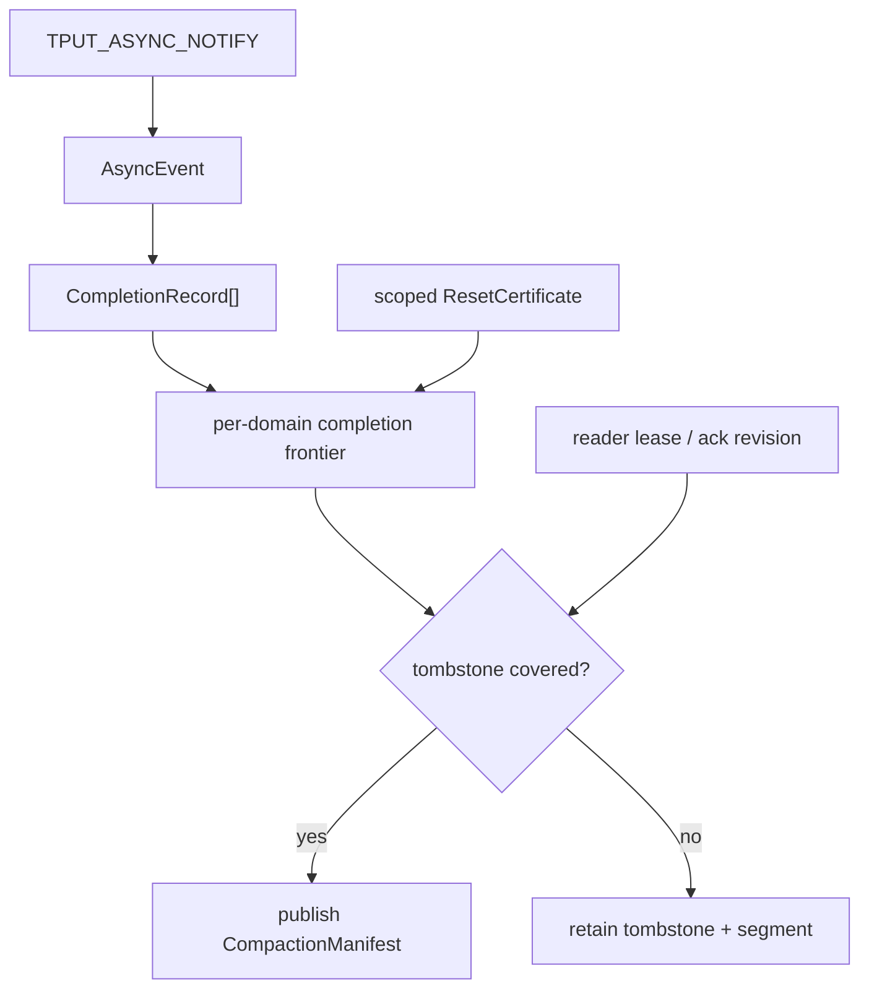
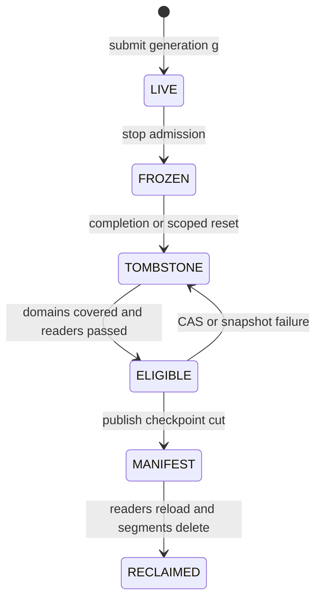

> 源码基线：pto-isa [`cbca1e9b`](https://github.com/hw-native-sys/pto-isa/commit/cbca1e9b9775c6aedeb49647a4c5e023b8658f88)，即本文研究时默认分支最新提交；它由已合入 [PR #347](https://github.com/hw-native-sys/pto-isa/pull/347) 同步。相对上一章的 `fc62c8f8`，本章直接引用的 comm 文件没有变化。统一 workspace/completion 接口来自已合入提交 [`e6334fbd`](https://github.com/hw-native-sys/pto-isa/commit/e6334fbd6c5d6bfdf550201bbdb81a71831a99af)。本文严格区分**当前代码/规范事实**、**测试事实**、**建议恢复协议**和**硬件推断**；`CompletionWatermark`、`ResetCertificate`、`CompactionManifest` 尚未存在于仓库。

## 本篇在 PTO 课程路线中的位置

第 66 章得到 `NoOldWriter → EpochTombstone → capacity release → fresh generation register`：tombstone 拒绝旧 generation 的软件证据，reuse fence 排除旧设备 writer。这个顺序保证“新对象不会被旧世界复活”，却留下长期问题：退休 generation 越来越多，tombstone 和 evidence log 是否只能无限增长？

本章只回答一个边界清晰的问题：**在不重新打开 ABA 窗口的前提下，何时可以把一条 tombstone 从在线索引中删除？**答案不是“保存 N 天”，而是同时证明 producer 已越过旧动作、所有 evidence consumer 已越过旧记录，并把这些事实吸收到一个可恢复的 compaction checkpoint。

## 前置知识

- `AsyncCompletionRecord{addr, expected, kind}` 是 borrowed native predicate，不携带 allocation generation。
- SDMA event 的每条 queue record 判定为 `*(uint64_t*)addr >= postId`；一次 event 的全部 record 都满足才完成。
- URMA multi-jetty post 每个 jetty 有独立 CQE；raw owner bit 会随 CQ ring lap 翻转，不能当全局递增整数。
- tombstone 已提交只说明 retired generation 不再合法；它能否删除，还取决于是否仍有旧 reader、旧 snapshot 或未被 checkpoint 吸收的 late evidence。

## 今日 1–2 个核心问题

1. PTO 当前 completion 原语能提供怎样的 **producer frontier**？为什么 SDMA queue、URMA `(peer, jetty)` 必须分别维护，不能压成一个全局 watermark？
2. 正常 completion 不可得时，什么样的 `ResetCertificate` 才能替代它；随后 tombstone、reader lease 和 log segment 应按什么顺序 compaction？

## PTO 全栈中的位置

上游 `TPUT_ASYNC_NOTIFY` 产生 event；backend 把 event 分解为 native records；建议的 recovery adapter 把同代、同 domain 的完成事实推进为 frontier。tombstone compactor 不直接轮询设备，而是消费已验证的 frontier/reset certificate 与 reader lease，发布新 manifest 后才回收旧 segment。

## 概念和精确语义

### 1. Completion watermark 不是“读到的最大值”

建议把某 completion domain `d` 的 watermark 定义为：**已经按 generation 校验、连续闭合，并持久化摄取的最大 logical sequence**，记作 `W_complete[d]`。它不是瞬时 record 值，也不是某个 poller 内存里的最大值。若 sequence 1、2、4 有证据而 3 缺失，frontier 只能是 2；否则 compactor 会越过洞。

SDMA 文档明确同一 session/backend queue 按提交顺序完成，等待最后 event 可覆盖该 queue 更早操作；源码又为 event 导出每条 queue 的 `postDone >= postId` record。因此对 retired generation `g`，若它在 q0、q1 的最后提交都是 130，则正常路径要求：

$$W_{complete}[g,q0] \ge 130 \land W_{complete}[g,q1] \ge 130$$

URMA 不同：[`GetUrmaCompletionRecordAt`](https://github.com/hw-native-sys/pto-isa/blob/cbca1e9b9775c6aedeb49647a4c5e023b8658f88/include/pto/comm/async/urma/urma_async_intrin.hpp) 用 `targetCqe` 定位 ring slot，再根据 lap 计算 owner bit。这里 frontier 的坐标应是 generation-bound logical `targetCqe`，key 是 `(workspace, peer, jetty)`；不能取 raw owner bit 的 `max`。不同 peer/QP 又独立完成，规范要求分别等待最后 event。

还要分开 **device completion frontier** 与 **consumer frontier**。前者证明设备不会再产生旧动作；后者 `W_reader[c]` 表示 reader `c` 已持久化确认处理到 registry revision。设备完成不代表某个落后的审计/恢复 reader 已停止用旧快照解释 evidence。

### 2. Reset certificate 是替代证明，不是超时回执

若 q1 的 record 永远不可读，可信 scoped reset 可以替代 `W_complete[g,q1]`，但证书至少要绑定：`workspace/allocation identity`、`generation`、engine、Channel Group 或 `(peer,QP/jetty)` 集合、MR/地址范围、freeze 后的 participant census、reset epoch、结果与 evidence digest。证书还必须证明 freeze 后没有新 submit，并且 reset 覆盖所有可能触碰该 backing 的 writer。

当前 [`TPUT_ASYNC_NOTIFY.md`](https://github.com/hw-native-sys/pto-isa/blob/cbca1e9b9775c6aedeb49647a4c5e023b8658f88/docs/isa/comm/TPUT_ASYNC_NOTIFY.md) 只给出 normal-path 生命周期要求：重建 session/复用 backend queue 前先完成旧 event；URMA 释放资源前还要同步所有相关 host stream，并在外部 communicator 场景停止其他使用者、释放 Channel/MR。它没有返回上述 durable certificate。因此“调用了 `Reset`”“超时后设备看起来安静”都不是当前代码可验证的删除依据。

### 3. 可删除条件

设 tombstone `t` 记录 generation `g`、创建 revision `r_t`、每个 domain 的 `maxIssued[d]` 和 fence digest。建议的最小判定为：

$$
Compactable(t)=Terminal(t) \land
\forall d,\big(W_{complete}[d]\ge maxIssued[d]\ \lor\ ResetCovers(t,d)\big)
\land ReadersPassed(r_t) \land SnapshotAbsorbed(t)
$$

`ReadersPassed(r_t)` 指所有仍有 lease 的 reader 都确认 `ack_revision >= r_t`；失联 reader不能靠 wall-clock 直接忽略，必须先撤销其 lease/访问 generation，并使它重新接入时强制加载新 manifest。`SnapshotAbsorbed(t)` 指新 checkpoint 已记录“allocation 的 generation ≤g 永久 retired”、frontier/reset digest 和尚未闭合的债务；否则删除 log 后，重启无法重建拒绝旧 evidence 的规则。

这也说明为什么不能把 `min(W_complete, W_reader)` 当成一个数字：两者坐标空间不同。前者按 queue/CQ logical sequence，后者按 durable registry revision；正确关系是合取，而不是求最小值。

### 4. 在线 tombstone 与 checkpoint 摘要的所有权不同

在线 tombstone 是高分辨率拒绝表：它保留旧 generation、地址范围、backend domain、`maxIssued`、fence/evidence digest 和 reclaim action，便于把一条迟到证据精确归入旧 audit。checkpoint 中的 `retired_through` 是低分辨率单调摘要：它只需保证 `generation <= g` 永远不能重新成为 live，却未必保留每次 retire 的全部诊断细节。compaction 的本质不是“忘掉退休”，而是把拒绝规则从多条细记录折叠成一条不可逆摘要。

这两个对象也不能由同一类 worker随意修改。evidence adapter 只能追加事实；recovery owner 根据当前 `owner_epoch + revision` 创建 tombstone；checkpoint owner读取一个冻结 revision并发布 manifest；allocator只读 `retired_through` 和当前 live generation。若 compactor读取 r219 后，recovery owner又在 r220 创建 g8 tombstone，compactor仍以旧快照发布覆盖式 checkpoint，就可能丢掉 r220。故 manifest CAS 必须验证输入 revision，失败后重新 census，而不能把新旧 tombstone集合做未经校验的覆盖写。

reader lease 解决的是“谁还可能按旧 manifest 解释记录”。一个 reader ack r219 只说明它已经看见该 revision，不代表它永远不会退回 r218；启动入口必须只指向当前 manifest，lease token还要绑定 manifest generation。被撤销的 reader若恢复，只能重新获取 token和快照，不能继续提交旧 cursor。这样 `ReadersPassed` 才是可执行的访问控制事实，而不是进程健康猜测。

## 真实文件、类型、API 或指令逐段解读

1. [`comm_types.hpp`](https://github.com/hw-native-sys/pto-isa/blob/cbca1e9b9775c6aedeb49647a4c5e023b8658f88/include/pto/comm/comm_types.hpp) 固定 24 B `AsyncCompletionRecord`，`kind` 定义 `SDMA_POST_DONE`、`URMA_CQE_DW0`、`RDMA_HNS1825_CQE`。但当前 [`async_event_impl.hpp`](https://github.com/hw-native-sys/pto-isa/blob/cbca1e9b9775c6aedeb49647a4c5e023b8658f88/include/pto/comm/async_common/async_event_impl.hpp) 的 record 导出分支只实现 SDMA 和条件编译的 URMA；RDMA 会落入 default error。不能因为 enum 已有取值就声称 RDMA 导出链已经闭合。非空 event 无法完整解析时，`CompletionRecordCount` 必须返回 `UINT32_MAX` sentinel；unknown 不可被当成空 event。
2. [`async_event_impl.hpp`](https://github.com/hw-native-sys/pto-isa/blob/cbca1e9b9775c6aedeb49647a4c5e023b8658f88/include/pto/comm/async_common/async_event_impl.hpp) 对 SDMA 从 handle 解出 `postId + queueCount`，按 queue 导出 record；对 URMA multi-jetty，先验证每个 slice，再返回 `urmaJettyCount`。首个 slice 完成绝不等于整次 post 完成。
3. [`sdma_async_detail_post.hpp`](https://github.com/hw-native-sys/pto-isa/blob/cbca1e9b9775c6aedeb49647a4c5e023b8658f88/include/pto/comm/async/sdma/sdma_async_detail_post.hpp) 的 `ReserveSdmaPostEvent` 分配严格递增 `postId`，`FinishSdmaPost` 依次发布 payload、flag SQE、持久化 SQ tail/`nextPostId` 并 ring doorbell。`CheckPostDoneIds` 逐 queue 比较；这给出了构建 per-queue frontier 的原料，但没有 durable recovery watermark。
4. [`workspace.hpp`](https://github.com/hw-native-sys/pto-isa/blob/cbca1e9b9775c6aedeb49647a4c5e023b8658f88/include/pto/comm/workspace.hpp) 的 `DestroyWorkspace` 删除 backend manager 后清空 POD，`AbandonWorkspace` 只清空 POD。两者都没有 tombstone/reader/compaction API；不能把 POD 清空解释为历史已经可删除。

关键接口边界如下。前三行是当前事实，最后两行是建议协议：

| 接口/对象 | 输入、位置与所有权 | 后置条件 | 失败方式 |
| --- | --- | --- | --- |
| `CompletionRecordCount/At` | 同 engine、同 issuing session；record 位于 GM/CQE；caller 只借用 view | 返回完整 record 集，或显式 error/null | engine/session/handle/任一 slice 无法解析即 fail closed |
| SDMA `postDone` | GM 中逐 queue 64 B stride record；expected 是 58-bit `postId` | `>= expected` 只证明该 live domain 的有序完成 | queueCount/layout/generation 不匹配会误解释地址 |
| URMA CQE record | GM CQ ring；由 `targetCqe`、depth、lap 定位 owner | 每个 jetty slice 独立闭合 | depth 非 2 次幂、少于 128、地址溢出或 slice 缺失返回失败 |
| 建议 `AdvanceCompletionFrontier` | generation-bound evidence，当前 owner/revision | 连续前缀才 durable advance | 洞、冲突、wrong generation、unknown schema 均不推进 |
| 建议 `PublishCompactionManifest` | tombstone set、frontier/reset digest、reader lease census | 新 manifest 成为唯一启动入口 | CAS/写盘失败保留旧 manifest 和旧 segments |

## 对象/Tile/Buffer/IR 生命周期

这里追踪的真实数据对象仍是 `16×16xf32` ND payload：1024 B，源/目标在 GM；SDMA scratch 是 UB 中 256 B `Tile<Vec,uint8_t,...>`。它产生 `AsyncEvent`，再产生每 queue 的 borrowed completion record。建议控制面在 submit 前把 event 绑定到 `(allocation_id,g,domain,maxIssued)`；adapter ingest 后推进 frontier；retire 时生成 tombstone；compactor把 tombstone吸收到 checkpoint，最后删除旧 log segment。

注意 `RECLAIMED` 只删除历史表示，不让 generation `g` 重新合法。新 manifest 必须保留单调摘要，例如 `retired_through[allocation_id] >= g`。若只把 tombstone 文件 unlink，却不在 checkpoint 中保留这个摘要，旧 evidence 在重启后又可能失去拒绝依据。

## 端到端调用链或指令链

当前数据面链为：`BuildAsyncSession` → `TPUT_ASYNC_NOTIFY` → `BeginSdmaPost` → `ReserveSdmaPostEvent` → payload/signal/postDone SQE → `PersistSqTails` → `AsyncEvent` → `CompletionRecordCount/At` 或 `Wait/Test`。

建议控制面链为：register `(allocation,g,domain)` → ingest 全部 native records → 连续推进 `W_complete[d]` → freeze generation → 用 completion frontier 或 scoped reset 生成 `NoOldWriter` → tombstone CAS → 维护 reader lease/ack → 构造 checkpoint + `CompactionManifest` → 原子 publish manifest → 新 reader 只从新 manifest启动 → 幂等删除旧 segments。

crash-safe 顺序必须是 **先发布摘要，再删原始证据**：prepare checkpoint 时崩溃，旧 manifest 仍引用旧 segment；manifest CAS 后、segment 删除前崩溃，只多占空间；若反过来先删 segment、后发布 manifest，中间 crash 会让 recovery 同时失去 tombstone 和替代摘要，这是不可恢复的安全缺口。

逐个检查 crash window，可以把恢复动作写得更具体：

| 崩溃位置 | 重启后可验证状态 | 唯一安全动作 |
| --- | --- | --- |
| frontier evidence 已写、frontier CAS 前 | 原 evidence 仍在，watermark 未推进 | 从旧 frontier重放连续前缀；不得跳洞 |
| checkpoint 写完、manifest CAS 前 | 新 checkpoint 是未引用 orphan | 继续使用旧 manifest；校验后重试或回收 orphan |
| manifest CAS 后、reader ack 前 | 新启动入口有效，旧 reader可能仍持 segment | 保留旧 segment，fence/等待 reader lease |
| 全部 reader ack 后、delete 中途 | retired 摘要已生效，部分 segment仍在 | 按 segment ID 幂等继续删除 |
| delete 完成、GC receipt 前 | segment缺失但 manifest仍证明其可删 | 重建 receipt；不能回滚 `retired_through` |

这里有两个线性化点：manifest CAS 决定 recovery 从哪份状态启动；每个 reader lease 的 revoke/ack 决定旧 segment何时不再被合法访问。物理文件删除只是幂等清理，不承担 generation 状态转移。把 delete 当线性化点，会在“文件已删但状态提交未知”时重新制造第 64 章讨论过的 ambiguous apply。

## 具体 shape、Tile 和状态演算

设 `alloc-9/g7` 使用 SDMA `queueNum=2`，payload 为 `16×16xf32=1024 B`，UB scratch 256 B；同一 generation 的最后 event 是 `postId=130`。tombstone 在 registry revision 219 创建。两个 evidence reader 为 recovery `c0` 与 audit `c1`。

1. 当前设备证据是 `postDone=[130,129]`，所以 `W_complete[q0]=130`、`W_complete[q1]=129`。虽然 q0 已覆盖到最后 event，q1 仍差 1；producer 条件失败。
2. reader ack 为 `W_reader[c0]=220`、`W_reader[c1]=218`。即使 q1 随后达到 130，c1 仍可能用 revision 218 的 snapshot 接收旧 witness；consumer 条件也失败，tombstone必须保留。
3. 正常路径中，q1 record 达到 130，adapter 校验 generation/连续前缀后持久化 `W_complete[q1]=130`；c1 处理 revision 219 并 ack 221。此时所有 domain 和 reader 都越过 tombstone。
4. 异常路径中，q1 永远不可读，但一个 certificate 精确覆盖 `alloc-9/g7 + channelGroup + q0/q1 + record range`，并证明 freeze 后无 submit。它可替代 q1 watermark；若证书只覆盖 q0 或未覆盖共享 MR，则仍是 `UNKNOWN`。
5. compactor生成 checkpoint `retired_through[alloc-9]=7`，包含 q0/q1 frontier、reset digest、未决 debt 集，原子发布 manifest 300。读者加载 manifest 300 后，旧 tombstone segment 才可删除。

此处没有把两个 queue 的值求平均，也没有因为 `130-129=1` 很小而放松正确性。洞的大小只影响 recovery 延迟，不改变 reuse/compaction 判定。

## 为什么这样设计及替代方案

**替代 A：按 TTL 删除。** 元数据成本最低，但 TTL 与 queue drain、reader lag、网络分区没有逻辑关系；它只能改变 ABA 发生概率，不能形成证明。

**替代 B：tombstone 永不删除。** 正确性简单，却让索引、启动 replay 和 durable storage 随 retire rate 线性增长。若退休速率为 `λ_t`、安全 frontier 推进速率为 `μ_c`，长期 `λ_t >= μ_c` 时 backlog 必然发散；正确动作是减载或修复停滞 domain，而不是缩短 TTL。

**替代 C：每次整卡 reset 后清空全部 tombstone。** reset 对物理 writer 的证明最强，但不能自动证明所有软件 reader 已换 snapshot；同时 blast radius、P99、并发损失最大。即便采用整卡 reset，仍需要 manifest/reader lease 处理逻辑 evidence。

**建议：per-domain frontier + scoped reset fallback + reader-aware manifest。** 正常 hot path 只追加 generation-bound evidence/ack；昂贵 reset 与 compaction 留在 recovery/background path。它避免全局同步一个所有 backend 共用的假 watermark，也能把未停滞 domain 的历史先压缩。代价是 schema、lease、CAS 和后台 GC 更复杂，但每项都有明确故障语义。

## 访存、计算、流水、并行和硬件约束

该机制主要受控制面 I/O 和同步限制，不是计算瓶颈。数据面仍传 1024 B payload；新增成本来自 record polling、durable evidence append、frontier CAS、checkpoint 临时空间与 reader ack。应分别测 `poll bytes/s`、frontier lag、reader lag、tombstone bytes、checkpoint peak bytes、reset 次数和 P99 admission delay，不能拿 kernel bandwidth替代端到端证据。

容量式应同时包含数据面和恢复峰值：`live GM + held generation + recovery temp + fragmentation <= usable GM`，以及 `active log + checkpoint temp + unlinked-but-reader-pinned segments <= durable budget`。compaction 会短时同时保留旧 segment 与新 checkpoint，若没有预留 peak space，ENOSPC 可能让系统永久卡在“可以 compact、无法 publish”。阈值应由真实 retire/ack/compaction 分布标定，本文不虚构统一百分比。

并发上允许多个 adapter 追加不可变 evidence，但只有当前 owner 能以 expected revision 推进 frontier或发布 manifest。reader lease 到期只是控制面事件：只有访问 token 被 fencing、旧进程不能继续读取/写回，才可从 active reader 集删除。对 graph replay，稳定地址也不等于稳定 generation；每次 replay 仍要绑定当前 lease，capture 不能把 tombstone cutoff 固化成永久事实。

**硬件映射推断：** 源码足以确认 SDMA per-queue 单调比较、URMA per-jetty ring/lap predicate和 queue/session顺序规范；不足以确认 MMU/MR 撤销、CQ cache coherence与 reset 的真实覆盖域。因此 certificate 的字段是建议协议，覆盖范围必须由 backend 文档、device trace 与 delayed-write fault injection 校准。

## 测试证据与未覆盖风险

**当前测试事实：** [`tput_async_notify_kernel.cpp`](https://github.com/hw-native-sys/pto-isa/blob/cbca1e9b9775c6aedeb49647a4c5e023b8658f88/tests/npu/a2a3/comm/st/testcase/tput_async_notify/tput_async_notify_kernel.cpp) 有两项最直接回归：65 次 notify 迫使 64-slot ring 复用；interleaved case 先得到 `postId=2`，插入 127 次 ordinary post，再得到 `postId=130`。[`main.cpp`](https://github.com/hw-native-sys/pto-isa/blob/cbca1e9b9775c6aedeb49647a4c5e023b8658f88/tests/npu/a2a3/comm/st/testcase/tput_async_notify/main.cpp) 用 2 rank、`queueNum=4` 注册这些 case。它们验证 live workspace 内 `nextPostId` 单调、slot reuse、最终 Wait/signal/payload/guard，不验证跨 generation compaction。

**提交记录中的实验事实：** [`e6334fbd`](https://github.com/hw-native-sys/pto-isa/commit/e6334fbd6c5d6bfdf550201bbdb81a71831a99af) 报告 workspace header compile 和 URMA 2-rank 6 case 通过，同时明确 SDMA runtime 因环境限制只编译未运行。当前源码搜索没有发现直接调用 `CompletionRecordCount/At` 的测试。本文没有把提交描述扩写为本次重新执行的真机结果。

**最新代码差异事实：** [PR #347](https://github.com/hw-native-sys/pto-isa/pull/347) 从 `fc62c8f8` 同步到 `cbca1e9b`，改动集中于 A5 deferred `TFREE`、reduce/transpose 与文档/打包；本章引用的 `include/pto/comm`、comm 规范和 notify 测试没有变化。因此本章沿用既有 completion 结论，但把源码链接固定到新基线。

仍缺四类直接测试：① q0=130、q1=129 的洞不得推进 aggregate frontier；② URMA CQ wrap 时 raw owner bit相同但 logical `targetCqe` 不同，不能误合并；③ partial reset certificate、wrong generation、wrong MR 必须拒绝；④ manifest publish 前后逐点 crash，加 stale reader、ENOSPC、重复 segment delete，重启后都保持 `retired_through` 单调且旧 evidence不能复活。真机还需 SDMA/URMA/RDMA delayed-write 与 reset-scope differential Golden。

## 与前后章节的连接

上一章回答“如何先建立 tombstone，防止旧 completion 借同址复活”；本章回答“何时可把 tombstone 压缩成更小的单调摘要”。两者合起来形成完整生命周期：`fence old writer → retire generation → reject late evidence → advance producer/consumer frontier → checkpoint absorb → delete history`。下一章将专门研究 compaction 自己的 crash atomicity：snapshot、manifest 与 log segment 的 cutover 怎样在 torn write、ENOSPC 和重复 GC 下可恢复。

## 本篇结论、知识债、三个理解检查问题和下一章

结论：tombstone 的寿命由证明 frontier 决定，不由时间决定。SDMA 必须逐 queue，URMA 必须逐 `(peer,jetty)` 维护 generation-bound logical frontier；completion 不可得时，只能由覆盖完整 writer domain 的 durable reset certificate替代。所有 reader越过 tombstone revision，且新 checkpoint已吸收 retired summary 后，才可先 publish manifest、再删旧 segment。

知识债：durable frontier/tombstone/manifest schema、backend reset certificate、reader lease fencing、logical CQ sequence adapter、RDMA completion record 导出链、atomic checkpoint publish、ENOSPC reserve、segment GC、same-VA delayed writer、stale reader 与 SDMA/URMA/RDMA 真机 Golden。

理解检查：

1. 为什么 SDMA 的 `postDone=130` 可以参与单调 frontier，而 URMA raw owner bit 不能直接取 `max`？
2. q0/q1 都完成后，为什么一个停在旧 registry revision 的 audit reader仍会阻止 tombstone 删除？
3. 为什么 crash-safe compaction 必须先发布包含 `retired_through` 的 manifest，再删除旧 tombstone segment？

下一章：**Compaction 崩溃怎么恢复——Snapshot Manifest、Log Segment 与 Atomic Cutover。**

## 课程账本增量

- 新增当前代码事实：SDMA completion 是逐 queue 的 monotonic `postDone>=postId`；URMA multi-jetty 是逐 CQ slot/lap 的 owner predicate，不能共享一个 raw scalar watermark。
- 新确认不变量：tombstone 可压缩要求 producer domain 全覆盖、所有 active reader越过创建 revision、checkpoint吸收 retired summary；三者是不同坐标空间的合取。
- 新增建议对象：generation-bound `CompletionWatermark`、scoped `ResetCertificate`、reader lease/ack、`CompactionManifest` 与 `retired_through` 摘要。
- 新测试结论：现有 65-post/`postId=130` 回归只覆盖 live workspace ring reuse；尚无 `CompletionRecordCount/At`、watermark 洞、CQ wrap、partial reset 或 crash-safe segment GC 的直接回归。
