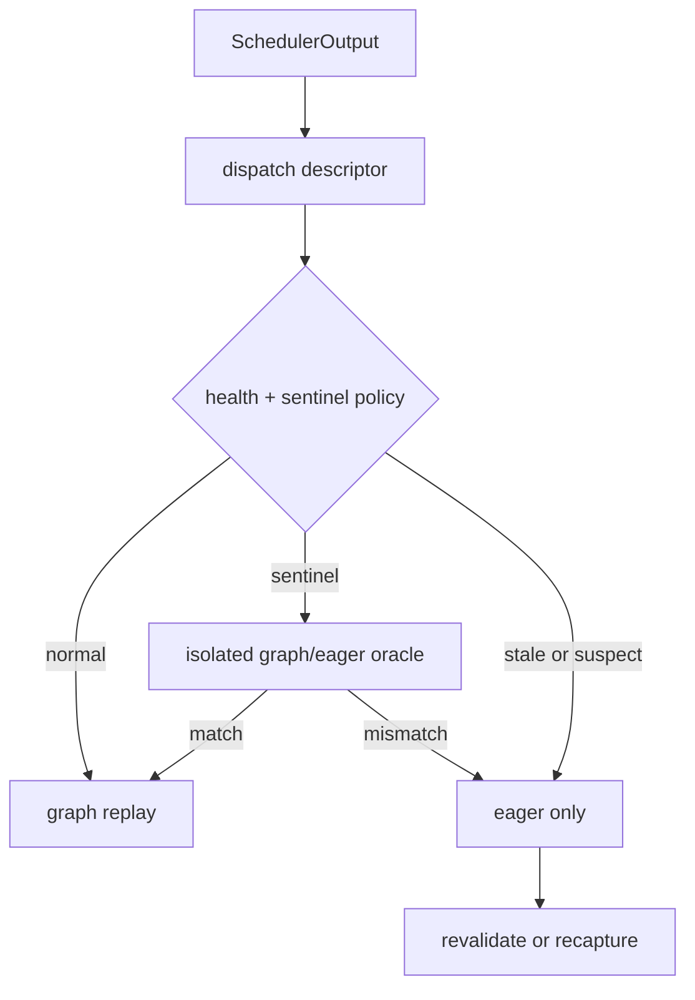
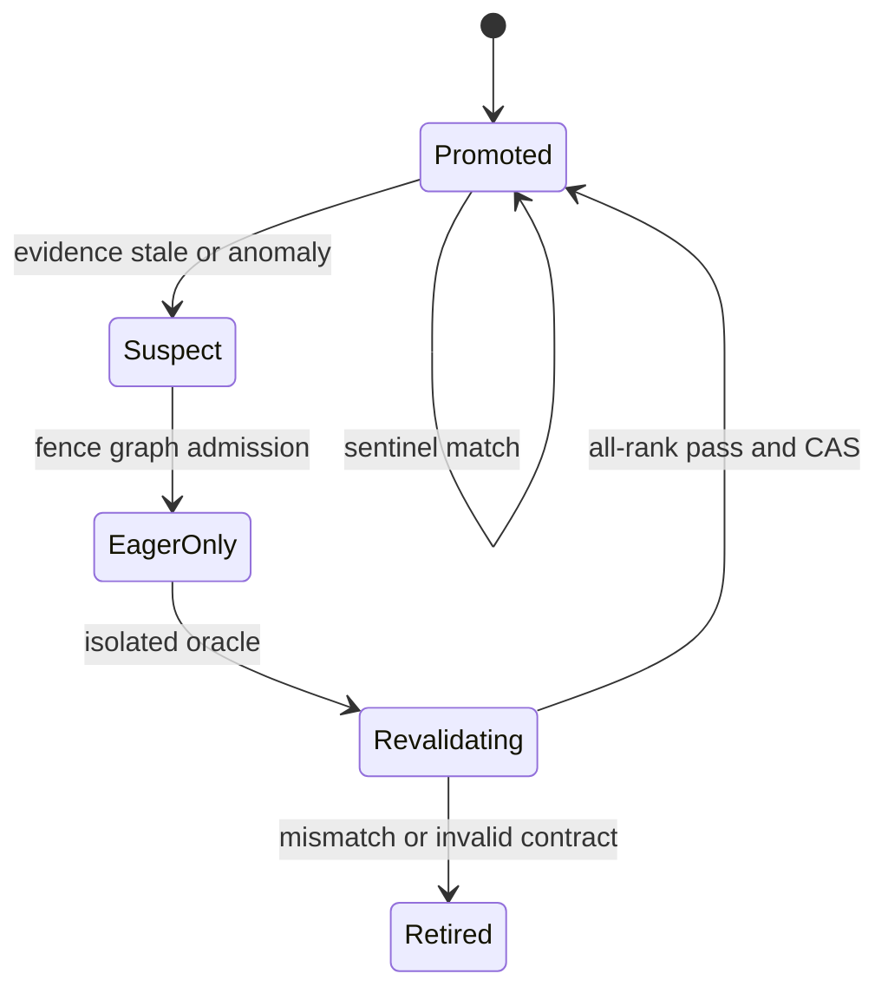

> 源码基线：vLLM [`a956a812`](https://github.com/vllm-project/vllm/commit/a956a8126e6bd184cb0a6b8f7318fe4717675c2f)，为研究时默认分支最新提交；该提交与前几项最新变更集中在 MoE/DeepGEMM，并未加入本文提出的 graph health controller。直接相关的已合入反例仍是 2026-10-14 的 [PR #61496](https://github.com/vllm-project/vllm/pull/61496)：FULL graph 可以 capture、replay 且不抛异常，却因为 capture-time host specialization 忽略真实 KV context 而产生错误结果。本文把**当前代码事实**、**测试/PR 事实**和**建议协议**分开；`SentinelPolicy`、`GraphHealthRecord`、drift detector 与 revalidation 状态机均不是当前 vLLM API。

## 本篇在课程路线中的位置

第 56 章解决 fresh generation 如何经过 isolated warmup、synthetic oracle 和 bounded canary 才能 promotion。可是 promotion 只证明“在当时的代码、模型、拓扑、descriptor 与样本集合上，证据足够”，不是永久许可证。服务继续运行后，worker generation、weight version、LoRA 集合、attention/backend 路径、workspace 地址、输入 metadata 分布都可能变化；静默偏差又不会触发 CUDA error。

本章只回答一个问题：**已 promotion 的 graph 怎样以可控成本持续证明健康，并在证据过期或输出漂移时，先停止扩大故障半径，再重验？**

## 前置知识回顾

- graph 正确性依赖固定 shape、稳定地址、capturable 操作以及 capture 时与 replay 时一致的 host-side specialization。
- `CUDAGraphMode.NONE` 是当前已有的 eager fallback；它可以承接 graph 被撤销后的新 step。
- eager/graph oracle 若共享同一 KV slot、RNG 或请求状态，第二次执行读到的状态已被第一次修改，比较本身就不可信。
- promotion 扩大 routing 权，不会给 graph 增加 generation、健康期限或输出证明。

## 本篇要回答的核心问题

1. 当前 replay 路径能观测命中、padding、地址和异常，为什么仍发现不了 silent drift？
2. sentinel 应抽什么、比较什么、由谁持有结论，才不会把验证成本或副作用带进热路径？
3. 哪些变化只能记录，哪些变化必须立即 demote 并 revalidate？

## 组件在全局架构中的位置

当前 [`EngineCore.step`](https://github.com/vllm-project/vllm/blob/a956a8126e6bd184cb0a6b8f7318fe4717675c2f/vllm/v1/engine/core.py) 执行 `Scheduler.schedule → Executor.execute_model → GPUWorker.execute_model`。MRV2 runner 在 [`dispatch_cg_and_sync_dp`](https://github.com/vllm-project/vllm/blob/a956a8126e6bd184cb0a6b8f7318fe4717675c2f/vllm/v1/worker/gpu/model_runner.py) 后准备 `InputBatch`、block tables 与 attention metadata；FULL 命中则直接调用 [`CudaGraphManager.run_fullgraph`](https://github.com/vllm-project/vllm/blob/a956a8126e6bd184cb0a6b8f7318fe4717675c2f/vllm/v1/worker/gpu/cudagraph_utils.py)，否则走 PIECEWISE 或 eager。采样发生在后续 `sample_tokens()`。

建议把 health gate 放在 descriptor 已解析、真实输入尚未产生不可逆 KV/RNG 副作用的位置；detector 在 captured graph 外运行，不能把“是否抽检”的 host 分支烘进 graph。



## 完整调用链

1. `EngineCore.step()` 调度请求并让 executor 非阻塞执行；worker 把 `SchedulerOutput` 交给 `GPUModelRunner.execute_model()`。
2. runner 计算 `num_reqs/num_tokens/uniform_token_count/num_active_loras/max_query_len`，manager 的 `dispatch()` 从预计算 candidate 中选择 `BatchExecutionDescriptor`；没有兼容 graph 就返回 `CUDAGraphMode.NONE`。
3. runner 将 token、position、block table 与 metadata 写入固定 `InputBuffers`。FULL 路径调用 `kv_connector.pre_forward()` 后 replay；PIECEWISE/eager 路径在 `ForwardContext` 中调用模型。
4. `ModelCudaGraphManager.run_fullgraph()` 先同步 offloader，再 `graphs[desc].replay()`，返回 persistent `hidden_states[:desc.num_tokens]`；runner 将该 view 放进 `ExecuteModelState`，随后 `sample_tokens()` 消费并清空 step state。
5. 当前 [`CUDAGraphStat/CUDAGraphLogging`](https://github.com/vllm-project/vllm/blob/a956a8126e6bd184cb0a6b8f7318fe4717675c2f/vllm/compilation/cuda_graph.py) 可按 interval 统计 unpadded/padded tokens、padding 数、runtime mode 与 count；`CUDAGraphWrapper` debug 模式还能检查 replay tensor 地址。但二者都不比较 graph 与 eager 输出，也没有 promotion revision、health age 或 revalidation verdict。

建议链在第 2 步后增加 `decide(key, generation, fingerprints)`：正常请求继续 replay；被选中的 sentinel 使用隔离 request/KV slot 和固定 RNG，分别执行 graph 与 eager，比较 oracle 后 CAS 更新健康记录。任何 mismatch 都先从 production routing set 移除该 generation，再异步 drain/retire/revalidate；不是先“多看几次”再决定。

## 关键类型、字段和状态生命周期

当前真实对象是 `BatchExecutionDescriptor → graphs[desc] → persistent hidden_states`：descriptor 由 manager 创建并作为字典 key；graph handle、pool 与 persistent output buffer 由 worker-local manager 长期持有；每个 step 只产生切片 view，由 `ExecuteModelState` 持有到 sampling 完成。请求不拥有 graph，manager 生命周期结束前 graph 可被不同请求复用。

建议控制对象也必须与这一所有权边界一致：

```text
GraphHealthRecord(
  key, graph_generation, promotion_revision,
  code/model/backend/config/topology_fingerprint,
  state, last_oracle_schema, last_passed_at,
  replay_count, sampled_count, coverage_buckets,
  mismatch_reason, expected_ranks, record_revision
)
```

它由 control plane 持有，worker 只报告 generation-bound observation；request 只拿一次 replay lease。`PROMOTED` 不是终态，而是可撤销 capability：



前置条件是 record 的 graph generation、fingerprints 与 expected ranks 全部 current；后置条件是 observation 只能更新同 revision 记录。旧 sentinel 的迟到 `PASS` 不能复活已 demote generation。

这里还要区分 **drift、anomaly 和 failure**。drift 是“先前证明所绑定的世界已经变了”，例如 model revision、backend 或 topology fingerprint 改变；它不等于结果已经错，却使旧 PASS 失去授权力。anomaly 是延迟、NaN、device error 或 rank 报告异常，只能说明值得怀疑。failure 则是同一 oracle schema 下 graph/eager 明确不一致。三者若压成 `healthy: bool`，控制器就容易犯两种相反错误：把 latency spike 当成语义错误频繁 recapture，或把 fingerprint 变化当普通告警继续 replay。

| 信号 | 能直接证明什么 | 建议动作 | 仍缺的证据 |
| --- | --- | --- | --- |
| input/workspace 地址或 generation 改变 | graph 执行契约已失效 | 立即 fence，通常 recapture | 新地址上的语义与容量 |
| code/model/backend/config/topology fingerprint 改变 | 旧 oracle provenance 过期 | eager + revalidate；是否 recapture 由地址/specialization 决定 | 新 revision 的 eager/graph 一致性 |
| CUDA error、rank timeout、NaN | 本次执行不可信或完成性未知 | group-wide demote，进入故障诊断 | 根因、side effect 范围、设备终态 |
| latency/goodput 异常 | 性能分布偏离 | 标记 `SUSPECT`，增加诊断采样 | 语义是否错误 |
| graph/eager output mismatch | 当前 generation 语义失败 | 立即 demote，隔离请求并重验/retire | 历史受影响窗口 |
| sentinel age/coverage debt | 某些 key/metadata 长期无新证据 | 提高抽样优先级；超过明确安全期限才降级 | 未采样区间是否真的错误 |

表中的“立即”指在控制面先阻止**新的** replay lease，不意味着强行销毁正在执行的 CUDA work。强杀 handle 可能扩大 context 故障；正确顺序仍是 fence、确定 in-flight completion、评估已写 KV 的请求、再 retire。相反，只有 coverage debt 时也不应假装发现了错误：若服务策略允许证据有最大年龄，超期降 eager 是风险预算选择，不是源码已经证明 graph 失效。

## 逐函数源码解读

### `CudaGraphManager.dispatch`：兼容 shape，不等于健康

`dispatch()` 只在 `_graphs_captured`、token 数大于 0、candidate key 存在且 `_is_compatible()` 成立时返回 graph descriptor，否则返回 NONE。它验证形状/模式兼容性，却没有 graph generation、promotion revision 或 semantic health。V1 [`CudagraphDispatcher`](https://github.com/vllm-project/vllm/blob/a956a8126e6bd184cb0a6b8f7318fe4717675c2f/vllm/v1/cudagraph_dispatcher.py) 甚至明确说 keys 是 dispatch 的 source of truth，wrapper 会 blind trust；这正是 health gate 应在 dispatcher/manager 前后显式存在的原因。

### `run_fullgraph`：replay 成功只是执行证据

它断言 mode 与 graph key 存在，同步 offloader 后 replay。这个同步解决 copy stream ordering，不验证 hidden states、KV side effect、模型 revision 或跨 rank 同代。`ModelCudaGraphManager` 返回 persistent buffer 的切片，所以 oracle 比较必须在下一个 replay 覆盖它之前复制或消费；仅保存 view 会把“旧结果”悄悄变成新结果。

### `CUDAGraphLogging`：有 coverage denominator，没有 correctness numerator

当前统计已能回答某种 `(unpadded, padded, mode)` 出现多少次，可作为抽样分层与成本估计的 denominator；它不能回答命中 graph 的结果是否正确。建议在独立 telemetry 中增加按 `(generation, descriptor, metadata bucket)` 的 sampled/pass/mismatch/last-pass-age，而不是把 correctness 塞进现有日志表并误当同步控制面。

从第一性原理看，持续准入只需要守住三个不可约条件：执行契约仍有效，语义 oracle 仍代表当前运行环境，失败时 eager 路径与显存余量仍可用。对应显存约束是：

$$
M_{weights}+M_{KV}+M_{graph}+M_{workspace}+M_{sentinel\ temp}+M_{fragmentation}\le M_{usable}
$$

抽样频率不是越高越好。若每次 shadow 成本为 $C_s$、抽样概率为 $p$、控制开销为 $C_c$，平均额外成本近似 $pC_s+C_c$；它必须小于 graph 带来的收益并满足错误预算。仓库没有通用的 $p$，不能凭空给默认百分比。

## 具体示例与 shape/状态演算

设 TP=2，FULL graph key K8，generation 44 已 promotion。每 step 有 8 个 decode request、各 1 token：`input_ids[8]: int32`、`positions[8]: int64`，模型 hidden size 为 4096，因此最后 PP rank 的 graph output 是 `hidden_states[8,4096]: bf16`，约 64 KiB；采样后的 logits 若 vocab=32,000，则 `[8,32000]: bf16` 约 500 KiB。shape、dtype 与数字只用于演算，不是 vLLM 固定配置。

策略为“按 descriptor 和关键 metadata bucket 分层，预算驱动”，不规定固定概率。某次 K8 命中触发 sentinel：

1. controller snapshot `(K8, gen44, promotion_rev=7, model_rev=12, backend=FA3, TP=2)`，申请两个 rank 同代 lease；任一字段不符就直接 eager。
2. 用隔离 KV blocks 构造 8 个 one-token decode，其中 4 个有 context、4 个零 context；固定 RNG。先从同一输入 checkpoint 跑 graph，立即复制 `hidden_states[8,4096]`；恢复 checkpoint 后以 `CUDAGraphMode.NONE` 跑 eager。不能让两个路径顺序写同一真实 KV。
3. oracle 校验 shape/dtype、finite、与 backend parity contract 一致的 `rtol/atol`，再比较 logits/top-k。只比最终 token 会漏掉 logits 漂移；强求 BF16 bitwise 相等又会放大合法舍入差。
4. 假设 rank 0 的 request 3 超出 tolerance，而 rank 1 未报告异常。group verdict 仍为 mismatch：CAS `PROMOTED → SUSPECT`，先让 K8 后续请求走 eager，再 drain gen44 lease。不能用“1/2 rank 多数票”继续 replay collective graph。
5. gen44 进入 isolated revalidation。若同样 mismatch，retire/recapture；若原因只是 oracle schema 变更，也必须以新 revision 完整通过所有 expected ranks 才能重新 promotion。sentinel 发现前已返回的输出无法撤销，只能按 incident 范围追踪、失败或从可信 checkpoint 重放。

oracle 的比较边界也决定诊断能力。hidden states 最接近 graph 输出，能较早定位 replay 偏差，但跨 PP rank 收集成本高；logits 已包含 `lm_head`，更贴近用户语义，却可能放大正常浮点差异；最终 token 成本最低，但大量 logits 偏差仍可能碰巧得到同一 argmax。实践上应选择“当前路径中最早、可稳定复制且有明确数值契约”的张量，并同时保存 descriptor、metadata bucket、dtype、tolerance 与权重版本。这样 mismatch 才是可复现证据，而不是脱离上下文的一条告警。

## 为什么这样设计及替代方案

**promotion 后不再验证** 开销为零，却把一次性证据误当永久事实；#61496 已证明“无异常 replay”不足以发现语义错误。

**每次 replay 都同步双跑 eager** 证据最强，却近似翻倍计算、workspace 与 KV 写入，并把 p99 延迟和 graph 收益一起抹掉。

**只看 CUDA error、延迟和 NaN** 很便宜，能发现 crash、hang 与明显数值坏值，但发现不了看似有限、延迟正常的错误 logits。

**分层 sentinel + 事件触发强制重验** 把稳定期成本限制为抽样，把 model/backend/topology/address 等 contract 变化当作立即失效事件。代价是需要 isolation、版本化 oracle、TP group verdict、coverage telemetry 与 false-positive 治理；这是用控制面复杂度换更小故障半径。

## 性能、并发、正确性与边界条件

- **抽样单位**：按 descriptor、LoRA count、query/context regime、attention backend 与 parallel topology 分层；全局随机抽样会饿死冷 key。
- **同步/异步**：background synthetic sentinel 只保护未来请求；若 sampled production response 必须被保护，就要同步 gate，承担额外延迟。异步发现无法修复已经返回的错误。
- **副作用**：KV、Mamba state、RNG、connector 与 collective 都要隔离或可恢复。无法证明可回滚的真实请求不得双跑。
- **并发**：demotion 先 fence 新 lease，已有 replay 完成后再 retire；`record_revision` CAS 阻止迟到 PASS 覆盖新故障。
- **分布式**：TP/PP graph health 是 group verdict；任一 expected rank mismatch、超时或 generation 分叉都降 eager。
- **graphability**：选择 sentinel、复制 oracle tensor和比较结果放在 capture 外；热 graph 内不增加 data-dependent host sync。
- **触发器**：worker/context generation、graph/pool/workspace revision、model/weight version、LoRA capture case、attention/backend、编译配置、parallel topology 或 oracle schema 变化都令旧证据 stale；CUDA error、address assertion、latency/NaN 异常先标 `SUSPECT`；直接 output mismatch 则立即 demote。哪些事件需要 recapture、哪些只需 revalidate，应由实际地址与 specialization contract 判定。

## 测试证据与未覆盖风险

1. [`test_capture_and_replay`](https://github.com/vllm-project/vllm/blob/a956a8126e6bd184cb0a6b8f7318fe4717675c2f/tests/v1/cudagraph/test_cudagraph_dispatch.py) 用 `SimpleMLP`、`BatchDescriptor(num_tokens=10)` 完成 warmup→capture→replay，并以 `torch.testing.assert_close` 比较 eager/replay。这证明最小 oracle 可行，但只执行一次，未覆盖 promotion 后漂移。
2. 同文件 `test_capture_replay_bypass_logic` 对 capture sizes `[1,2]` 验证两个 key capture/replay、size 3 eager bypass，以及禁止 capture 后 unseen key 失败；它证明 fail-closed 原语存在，没有 health revision 或 sentinel policy。
3. [`test_dcp_full_capture_has_kv_context`](https://github.com/vllm-project/vllm/blob/a956a8126e6bd184cb0a6b8f7318fe4717675c2f/tests/v1/cudagraph/test_cudagraph_manager.py) 以 8 requests、DCP2、block size16 验证 FULL capture 的 context length 为2、非 FULL 为0。对应 PR #61496 报告 Qwen3-235B TP8/DCP2 needle 由 0/9 恢复到9/9；这是 capture metadata 不变量与外部实验，不是持续在线 detector。
4. 当前 metrics 只记录 mode/padding/count，debug 地址检查也仅在地址变化时断言。测试没有覆盖：promotion 后注入 silent output drift、oracle tensor view 被下次 replay 覆盖、KV/RNG isolation、TP rank 分歧、迟到 PASS CAS、weight/backend fingerprint 变化、冷 key coverage、tolerance false positive 与 sentinel 预算挤压生产 SLO。

本环境未重跑 GPU/多卡测试，因此以上“测试事实”来自源码与已合入 PR，不等于新增实验结果。

## 与前后章节的连接

第 56 章给 graph 第一次 production capability；本章让 capability 带过期条件、持续证据与可撤销状态。下一章将 health verdict 接到 serving readiness：局部 key demotion 时服务可以继续 ready，但 graph/eager 比例、revalidation backlog、错误预算和容量余量怎样决定 degraded、not-ready 或 fail-stop。

## 本篇结论、知识债、三个理解检查问题和下一章

结论：**promotion 证明的是某个 generation 在某组 fingerprints 与 oracle schema 下“曾经通过”，不是未来永远正确。持续健康需要按 graph key 和 metadata regime 分层抽检；直接 mismatch 或契约变化先撤销 graph admission，再重验。被抽中的双跑必须隔离所有副作用，TP/PP 以 group verdict 决策，迟到 PASS 不得复活旧 generation。**

知识债：真实 `GraphHealthRecord/SentinelPolicy` schema、可复制的 hidden/logits oracle、KV/Mamba/RNG/connector snapshot、per-key coverage telemetry、TP group CAS、同步与异步 sentinel 两种 SLO、fingerprint 枚举、tolerance calibration、false-positive budget、revalidation queue 和 GPU fault-injection Golden。

理解检查：

1. 为什么现有 `_graphs_captured`、descriptor compatible、地址相同和 replay 无异常加起来，仍不能证明输出语义正确？
2. 为什么 production request 不能简单地“graph 跑一次、eager 再跑一次”后比较 token？
3. rank 0 sentinel mismatch、rank 1 pass 时，为什么 group 必须先 demote，而不能多数投票或等下一轮？

下一章：**Graph 局部降级时服务还算 Ready 吗——Serving Readiness、Degraded Capacity 与 Revalidation Backlog。**

## 课程账本增量

- 第 57 章完成 `promotion → ongoing sentinel → drift verdict → eager fence → revalidation/retire`。
- 新增事实边界：当前 dispatch/metrics 能证明 key compatibility 与使用分布，不能证明 replay correctness；persistent output view 必须在下次 replay 前复制或消费。
- 新增协议边界：health evidence 绑定 graph generation、fingerprints、oracle schema、expected ranks 与 record revision；sampled PASS 只刷新同 revision 证据，mismatch 立即撤销 routing capability。
- 新增未覆盖测试：post-promotion drift、side-effect isolation、rank disagreement、stale PASS、cold-key coverage、tolerance 与 SLO budget。

