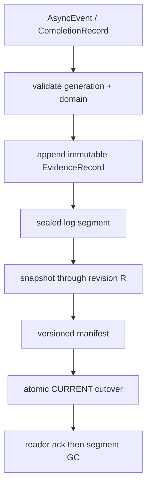
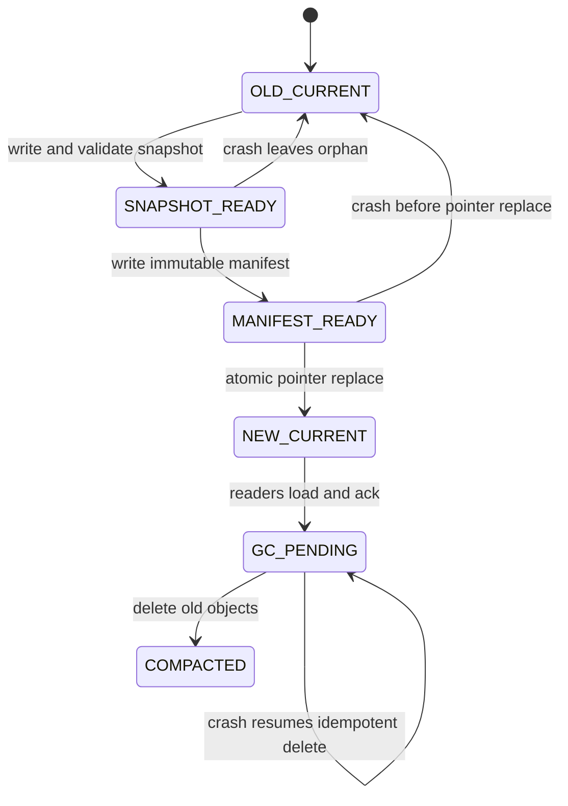

> 源码基线：pto-isa [`cbca1e9b`](https://github.com/hw-native-sys/pto-isa/commit/cbca1e9b9775c6aedeb49647a4c5e023b8658f88)，即研究时默认分支最新提交，由已合入 [PR #347](https://github.com/hw-native-sys/pto-isa/pull/347) 同步。本文直接引用的 completion/workspace 文件与引入统一门面和 completion record 的 [`e6334fbd`](https://github.com/hw-native-sys/pto-isa/commit/e6334fbd6c5d6bfdf550201bbdb81a71831a99af) blob 一致。仓库当前没有 `SnapshotManifest`、WAL、segment GC 或 `fsync` 实现；本文严格区分**当前代码/规范事实**、**提交测试事实**、**建议的 Host 恢复协议**和**硬件推断**。

## 本篇在 PTO 课程路线中的位置

[上一章]() 得出 tombstone 可压缩的三个条件：producer domain 已由 completion frontier/reset 覆盖，所有 active reader 越过 tombstone revision，checkpoint 已吸收 `retired_through` 与未决债务。条件满足后还剩一个危险窗口：新 snapshot 写了一半、manifest 刚切换，或者旧 segment 只删了一部分时进程崩溃，重启到底信哪一份？

本章只回答这个问题：**怎样让每次 compaction 在任意 crash point 后，都只能恢复到旧的完整状态或新的完整状态，而不能拼出半新半旧状态？**

## 前置知识

- `AsyncCompletionRecord{addr, expected, kind}` 是 24 B borrowed view；`addr` 指向 GM/CQE，不是跨 workspace/restart 的稳定身份。
- SDMA `postDone >= postId` 必须逐 queue 成立；URMA multi-jetty 必须逐 `(peer, jetty)` 验证。
- tombstone 是拒绝旧 generation evidence 的在线记录；checkpoint 中的 `retired_through` 是更紧凑、不可逆的拒绝摘要。
- manifest publish 之后才能删除旧 segment；但“publish”必须有明确线性化点和持久化顺序。

## 今日 1–2 个核心问题

1. current PTO completion 原语能提供哪些事实，哪些字段不能直接写入 durable log？
2. snapshot、immutable log segment、versioned manifest 与 `CURRENT` 指针应如何切换，才能覆盖 torn write、并发 append、reader lag 与重复 GC？

## PTO 全栈中的位置

数据面由 PTO ISA 生成 `AsyncEvent`，Host consumer 把 native predicate 转成 generation-bound evidence；建议的 durable layer 再把 evidence 追加到 segment。Compactor 不触碰 Tile payload，只在 revision 边界构造 snapshot、发布 manifest，最后回收已被 snapshot 覆盖的旧 segment。



前两步由当前 completion API 提供输入，但 `EvidenceRecord` 之后都是建议协议。它应位于消费 PTO 的 Host/runtime 层，而不是假装 ISA 头文件已经实现持久化数据库。

## 概念和精确语义

### 1. GM 中的 persistent counter 不等于 crash-durable log

[`PersistSqTails`](https://github.com/hw-native-sys/pto-isa/blob/cbca1e9b9775c6aedeb49647a4c5e023b8658f88/include/pto/comm/async/sdma/sdma_async_detail_post.hpp) 每次 post 都把 SQ head/tail 和 `nextPostId` 写回 workspace。注释给出的目的，是 kernel 没有可靠 teardown 点时，让下一次 session rebuild 不会从 0 复用 post ID。它证明的是**同一 live workspace 内跨 session 的设备状态连续性**，不证明 Host 进程崩溃、电源故障或 backing 重新分配后仍可恢复。

因此 durable record 不能只落盘当前的 `addr`。最小稳定身份应包含：

```text
record_id, revision, allocation_id, workspace_generation,
engine, completion_domain(queue or peer/jetty), logical_sequence,
predicate_kind, expected, owner_epoch, evidence_digest
```

运行期 adapter 可以用这些字段重新关联当前合法的 GM view；重启后若 allocation/generation 不存在，记录只能用于 audit/recovery，不能重新解引用旧地址。

### 2. snapshot 是状态折叠，不是日志副本

建议 snapshot `N` 声明 `covered_through_revision=R`，保存截至 R 的 canonical state：live generations、`retired_through`、per-domain completion/reset 摘要、capacity ledger、未完成 apply/compensation debt 与 reader fencing state。它必须带 schema version、owner epoch、内容 digest 和构建来源 manifest。

segment 则保存不可变事实。每条记录有稳定 `record_id/revision`，允许 crash recovery 幂等重放；revision 缺口必须 fail closed。重复记录可以依靠 ID 去重，缺失记录不能靠后一个较大的 revision 猜出来。

### 3. atomic cutover 的唯一权威是 `CURRENT`

建议使用 immutable `snapshot-N`、immutable `manifest-M`，再由很小的 `CURRENT` 指向 manifest。Compactor 先取得 owner fence，在 revision `R` 旋转 segment：旧 segment seal，新 segment 从 `R+1` 接受 append；在线 producer 不必等待完整 snapshot 序列化。

对 POSIX-like store，最小顺序是：

1. 写 `snapshot-N.tmp`，完成内容与 checksum，sync file；rename 为 immutable `snapshot-N`，sync parent directory。
2. 写 `manifest-M.tmp`，引用 snapshot digest、`covered_through=R`、`replay_from=R+1`、保留 segment IDs 与前一 manifest；sync、rename、sync directory。
3. 写并 sync `CURRENT.tmp`，atomic rename 为 `CURRENT`，再 sync directory。**这一步是 cutover 线性化点。**
4. reader 加载 `CURRENT → manifest → snapshot`，校验 digest 与无 gap 的 replay range；发布 manifest epoch ack。
5. 只有旧 reader 被 ack/revoke fence 覆盖后，才幂等删除旧 snapshot/segments，并再次持久化目录变更。

对象存储没有 POSIX rename 假设时，前两类对象仍保持 immutable，`CURRENT` 改为带 expected generation/ETag 的 conditional put。两种实现共享的是“先完整创建被引用对象，再 CAS 唯一指针”，不是某个特定文件 API。

### 4. 任意 crash 点的恢复规则



重启只读取 `CURRENT` 指向的 manifest，不扫描“时间戳最新”的文件。pointer 仍旧时，新 snapshot/manifest 都只是 orphan，可校验后回收；pointer 已新时，被引用对象必须已经 durable，旧 segment 多留一份只是空间泄漏。若新 manifest checksum 错、snapshot 缺失或 replay 有 gap，应进入 quarantine/fail closed，不能偷偷选择目录中看起来更新的文件拼接。

恢复加载器可以按以下顺序实现。第一步读取并校验 `CURRENT` 自身的 generation、长度和 checksum；第二步读取它唯一指向的 manifest，并验证 manifest 的 owner epoch 不小于 snapshot 构建时的 epoch；第三步按 digest 打开 snapshot，恢复 canonical state；第四步从 `replay_from` 开始按 manifest 给定的 segment ID 顺序重放，而不是按目录排序；第五步检查每条 revision 是否连续、每个 `record_id` 的重复内容是否完全相同；最后才把恢复出的 allocation/capacity 状态暴露给 admission。任一步得到 `UNKNOWN`，都应保留旧 backing 和容量债务，不得为了快速启动而把未知记录跳过。

需要特别拒绝四种非法组合。其一，snapshot 宣称覆盖到 R=220，manifest 却从 222 开始重放，revision221 无解释地丢失；其二，segment 同时出现两个 revision221 且 payload digest 不同，这不是可去重的 duplicate，而是 split-brain writer；其三，manifest 的 owner epoch 比 snapshot 旧，说明 stale compactor 把新 owner 的状态折回；其四，`retired_through[alloc-9]=7`，replay 却试图重新注册 g7。前三种必须 fail closed，第四种还应产生明确的 stale-generation audit 记录。

建议接口边界如下；这些类型不是当前仓库 API：

| 建议接口 | 输入与所有权 | 成功后置条件 | 失败语义 |
| --- | --- | --- | --- |
| `AppendEvidence` | caller 提交 immutable logical record；store 分配 revision | record 与 revision 已 durable，可幂等重放 | 返回 unknown 时不得推进 canonical state |
| `SealSegment(R)` | 当前 compactor owner 持 owner epoch | ≤R 不再追加，R+1 进入新 segment | stale owner/CAS 失败后重新 census |
| `BuildSnapshot(R)` | 只读 frozen canonical view | digest 覆盖状态与所有未决 debt | ENOSPC/checksum 失败保留旧 manifest |
| `PublishCurrent(M)` | expected old manifest generation | 新启动入口只指向完整对象 | compare-and-swap 失败不得覆盖胜者 |
| `DeleteRetiredObjects` | 已发布 manifest 与 reader fence receipt | 只删除不再被合法 reader 引用的对象 | 重复调用幂等；失败只形成空间债务 |

这张表把所有权分成三层：evidence writer 只能追加事实，canonical owner 只推进 revision，compactor 只发布从某个已确认 revision 导出的压缩视图。把三者合成一个“后台线程”在单进程 demo 中可工作，但协议仍应保留这些权限边界；否则 takeover 后的 stale thread 可以同时伪造 evidence、覆盖 state 并删除恢复材料。

逐点看 crash 结果更直观：

| 崩溃位置 | `CURRENT` 可见值 | 重启选择 | 遗留物与处理 |
| --- | --- | --- | --- |
| snapshot tmp 写到一半 | 299 | manifest299 | 删除或续写 tmp，不能解析为 snapshot |
| snapshot17 完成、manifest300 未完成 | 299 | manifest299 | snapshot17 是 orphan，等待 sweeper |
| manifest300 完成、pointer 未切 | 299 | manifest299 | manifest300 与 snapshot17 都非权威 |
| pointer 已切、reader 未 ack | 300 | manifest300 | 保留旧对象，继续 fence/等待 reader |
| 删除 S0–S5 到一半 | 300 | manifest300 | 按 object ID 幂等继续 GC |

由此可见，安全协议故意把 crash 后果压缩为两类：尚未切换时产生可回收 orphan；已经切换后产生可重试的空间泄漏。任何会让 crash 产生“新 pointer 指向未完成对象”或“旧 pointer 引用的对象已被删除”的顺序，都不满足 atomic cutover。

把恢复正确性写成不变量，可以避免把“文件都在”误当成“状态连续”。设 manifest `m` 的 snapshot 覆盖到 `R_m`，其第一条待 replay revision 为 `F_m`，合法条件至少是 `F_m = R_m + 1`，并且从 `F_m` 到 durable log tail 的每个 canonical revision 都可由一条有效记录或显式的 no-op/aborted revision 解释。snapshot 中每个 allocation 的 live generation 与 `retired_through` 不得重叠；capacity ledger 的 available、held、released 三类额度之和必须等于同一 manifest 中的总容量。只有这些语义检查都通过，checksum 才有意义：checksum 能证明字节没被意外改变，却不能证明两份各自完整的文件来自同一个 cut。

reader fencing 也不是“等所有进程回复”这么简单。每个 reader token 应绑定 manifest epoch、owner epoch 和访问范围；reader ack 表示它已停止使用旧 snapshot/segment，并且之后提交的 cursor/evidence 必须携带新 epoch。超时 reader 只有在访问令牌被撤销、旧进程无法继续读写后，才能从 active set 移除。否则 compactor即使收到多数 ack，也可能删除一个慢 reader仍在分页读取的 segment。这里需要的是全称闭合，而不是多数派投票，因为单个合法旧 reader就足以制造 use-after-delete 或把旧 revision重新提交给新状态。

同理，orphan sweeper 不能用文件年龄直接删除。它必须先从当前 manifest 沿 `prev_manifest` 或保留引用建立 reachable set，再只删除既不可达、又不属于任何进行中 owner lease 的对象。若 compactor在写 snapshot17 时崩溃，新 owner接管后可能选择校验并复用该 immutable snapshot，也可能重建；sweeper只有在 owner lease/attempt 已结束且 snapshot未被新 manifest引用时才能回收。这样 GC 与 compaction 解耦，重复删除只影响空间，不影响恢复语义。

## 真实文件、类型、API 或指令逐段解读

1. [`comm_types.hpp`](https://github.com/hw-native-sys/pto-isa/blob/cbca1e9b9775c6aedeb49647a4c5e023b8658f88/include/pto/comm/comm_types.hpp) 固定 `AsyncCompletionRecord` 为 24 B，字段只有 GM 地址、expected 和 predicate kind。`kCompletionRecordCountError=UINT32_MAX` 明确区分“空 event”与“非空但无法完整解析”。这适合作为 runtime probe，不足以充当 durable identity。
2. [`async_event_impl.hpp`](https://github.com/hw-native-sys/pto-isa/blob/cbca1e9b9775c6aedeb49647a4c5e023b8658f88/include/pto/comm/async_common/async_event_impl.hpp) 对 SDMA 解码 `postId+queueCount`，对 URMA 先验证所有 jetty slice，再返回 record count；当前导出分支只有 SDMA 与条件编译 URMA，其他 engine 返回 error。Compactor 必须先把完整 native record 集转成 logical evidence，不能只持有 `At(0)`。
3. [`workspace.hpp`](https://github.com/hw-native-sys/pto-isa/blob/cbca1e9b9775c6aedeb49647a4c5e023b8658f88/include/pto/comm/workspace.hpp) 的 `DestroyWorkspace` 删除 backend manager 后清空 POD；`AbandonWorkspace` 只清空 POD。两者都没有 snapshot、WAL 或 recovery callback，所以“POD 已清零”不能成为 manifest 已吸收历史的证据。
4. [`TPUT_ASYNC_NOTIFY_zh.md`](https://github.com/hw-native-sys/pto-isa/blob/cbca1e9b9775c6aedeb49647a4c5e023b8658f88/docs/isa/comm/TPUT_ASYNC_NOTIFY_zh.md) 要求 session、workspace、scratch 覆盖 event 完成；重建 session/复用 queue 前完成全部旧 event，URMA 释放前还要等待各 peer/QP 并同步 Host stream。这是数据面 lifetime contract，不是 crash recovery transaction。

仓库树搜索只有 ISA capability 的 `manifest.yaml`，没有 `CompactionManifest`、`SnapshotManifest`、journal/WAL 或持久化 `fsync` 实现；文件名含 `fsync` 的搜索结果实际是变量名片段，不是文件同步调用。这是“尚未实现”的直接边界，而不是对隐藏 runtime 的推断。

## 对象/Tile/Buffer/IR 生命周期

真实对象从 `16×16xf32` ND payload 开始：1024 B，源/目标位于 GM，SDMA scratch 位于 UB。`TPUT_ASYNC_NOTIFY` 发布 payload、signal 与 `AsyncEvent`；consumer 在 workspace/session 仍有效时导出每 queue record。到这里都是当前事实。

建议 Host 生命周期随后是：borrowed record 被验证并复制为 `EvidenceRecord` → append 到 active segment → segment rotate/seal → snapshot 吸收截至 R 的 canonical state → manifest 引用 snapshot 与 R 之后 segments → `CURRENT` 切换 → reader ack → 旧 segment 删除。borrowed `addr` 在 adapter 完成复制后即不再由 durable layer 所有；segment/snapshot 是 immutable object，只有 `CURRENT` 的 owner/CAS 决定权威版本。

## 端到端调用链或指令链

当前数据面链：`TPUT_ASYNC_NOTIFY → BeginSdmaPost → ReserveSdmaPostEvent → payload/signal/postDone SQE → PersistSqTails → AsyncEvent → CompletionRecordCount/At or Wait/Test`。

建议恢复链：validate `(allocation,generation,domain)` → append evidence at revision → advance canonical frontier/tombstone → seal segment at R → build/verify snapshot through R → publish immutable manifest → CAS/rename `CURRENT` → reader reload+ack → idempotent old-segment GC。

这里有三个不同线性化点：evidence append 让事实可重放；canonical revision CAS 决定状态；`CURRENT` replace 决定启动入口。文件 unlink 只是可重试清理，不能承担 generation retire 或 capacity release。

## 具体 shape、Tile 和状态演算

继续使用 `alloc-9/g7`：`16×16xf32=1024 B`，UB scratch 256 B，SDMA `queueNum=2`，最后 event 的 `maxIssued=[130,130]`。q0/q1 completion 都到 130，revision 219 已提交 tombstone，revision 220 已提交 action-keyed capacity release receipt。

1. 旧 segment `S5` 覆盖 revisions 181–220。Compactor 以 owner epoch 12 在 R=220 seal `S5`，并让 `S6` 从 221 接收新 append。
2. 构造 `snapshot-17`：记录 `retired_through[alloc-9]=7`、两 queue frontier=130、capacity receipt 和未决 debt；digest 校验通过。与此同时，g8 的 register/evidence 可以写入 S6，不与 snapshot 混在半个 revision 中。
3. `manifest-300` 声明 `snapshot=snapshot-17`、`covered_through=220`、`replay_from=221`、`segments=[S6,...]`。若发现 S6 第一条是 222 且没有 221 的合法空洞说明，恢复必须停止。
4. `CURRENT` 从 manifest299 原子切到 300。此刻新 reader从 snapshot17 起步并重放 S6；旧 reader仍可暂时持有 S5，因此 S5 还不能删。
5. reader ack 都达到 manifest300，或其旧 lease 已被访问控制 fence 后，GC 删除 S0–S5。删除到 S3 时崩溃，重启仍从 manifest300恢复；S4/S5只是可再次删除的垃圾，不参与状态选择。

若 crash 发生在 snapshot17 完成、`CURRENT` 切换前，恢复仍信 manifest299，snapshot17是 orphan；若发生在 `CURRENT=300` 之后，snapshot17和 S6已先 durable，恢复新状态。协议没有“CURRENT 新、snapshot 缺一半”的合法窗口。

## 为什么这样设计及替代方案

**替代 A：原地覆盖一个 snapshot 文件。** 文件最少，但 crash 可能留下 header 新、body 旧；校验只能发现损坏，无法自动获得完整旧版本。

**替代 B：启动时扫描最新时间戳。** 无需 `CURRENT`，却会把未发布的 orphan snapshot 误当权威；wall clock 也不提供 owner fence 或 revision 全序。

**替代 C：stop-the-world，暂停所有 append 后复制。** 这是低频、低规模场景的最小可行方案，推理简单；代价是 compaction 时间直接进入 admission/P99。segment rotation 把暂停缩到 seal/R 边界，复杂度换来在线性。

**建议：immutable objects + 单一原子指针。** 每个复杂组件都对应硬约束：immutable snapshot 抵抗 torn overwrite，segment rotation 隔离并发 append，digest/gap check 防静默拼接，reader lease 防过早 delete，owner epoch/CAS 防 stale compactor。若业务能接受全停机恢复，segment rotation 和 reader lease 可以暂缓；不能删掉的是“先完整对象、后唯一指针”的顺序。

## 访存、计算、流水、并行和硬件约束

数据面仍搬运 1024 B payload，本章新增成本在 Host durable I/O、checksum、snapshot 序列化和双份空间，不在 Tile compute。应分别测 evidence append P99、segment rotation pause、snapshot bytes/s、replay time、reader lag 与 GC reclaim rate；不能用 SDMA 带宽替代恢复路径指标。

设备容量仍满足 `live GM + held generation + recovery temp + fragmentation <= usable GM`。持久层另有峰值约束：

$$D_{segments}+D_{snapshot\_tmp}+D_{reader\_pinned}+D_{gc\_slack}\le D_{usable}$$

manifest-first 会短时保留旧 segment、新 snapshot 和新 segment；没有 peak reserve 时，ENOSPC 可让系统卡在“逻辑可 compact、物理无法 publish”。snapshot cadence 应由最大可接受 replay 时间、evidence 速率、write amplification 和空间水位测量决定，不能虚构通用分钟数或百分比。

**硬件映射推断：** 公开代码足以确认 SDMA GM counter、逐 queue completion、URMA per-jetty predicate与 session/workspace约束；不足以确认掉电持久性、Host/Device cache flush、MR revoke和 reset 后写入可见性。因此本文的 file/object-store协议是 Host 控制面建议，不能被解读为 NPU GM 自带事务日志。

## 测试证据与未覆盖风险

**当前测试事实：** [`tput_async_notify/main.cpp`](https://github.com/hw-native-sys/pto-isa/blob/cbca1e9b9775c6aedeb49647a4c5e023b8658f88/tests/npu/a2a3/comm/st/testcase/tput_async_notify/main.cpp) 注册 2-rank、queue4 的 Set、payload consume、AtomicAdd、65-post ring reuse、interleaved reuse、non-zero group 和并发 AIV 用例。[`tput_async_notify_kernel.cpp`](https://github.com/hw-native-sys/pto-isa/blob/cbca1e9b9775c6aedeb49647a4c5e023b8658f88/tests/npu/a2a3/comm/st/testcase/tput_async_notify/tput_async_notify_kernel.cpp) 的 interleaved case 明确从 postId2 经 127 次 ordinary post 到 postId130，验证 live workspace 的 slot reuse 保护。

**提交记录事实：** [`e6334fbd`](https://github.com/hw-native-sys/pto-isa/commit/e6334fbd6c5d6bfdf550201bbdb81a71831a99af) 报告 workspace header compile、URMA 2-rank 6 cases 通过，并说明 SDMA runtime 当时仅编译。当前代码搜索中，`CompletionRecordCount` 只出现于声明/实现，没有 direct consumer test；也没有 snapshot/manifest/segment crash test。本文未重新运行 NPU 真机测试。

最小新增 test matrix 应逐点 kill：snapshot tmp 写中、snapshot rename 后、manifest 写中、`CURRENT` replace 前后、reader ack 前、每次 segment unlink 后；每次重启都检查 `retired_through` 单调、revision 无 gap、capacity receipt 不重复、g7 evidence 不得复活、g8/S6 不丢失。还需 wrong checksum、truncated record、duplicate record、stale owner、ENOSPC、stale reader 与同址 late device write fault injection。

## 与前后章节的连接

上一章定义“哪些事实满足后 tombstone 可被 snapshot 吸收”；本章定义“吸收动作如何成为 crash-safe 的启动入口”。两章闭合了 `completion/reset → tombstone → snapshot → manifest → segment GC`。下一章研究当 retire/evidence 产生速度长期超过 compaction 时，怎样用 cadence、backpressure 和空间 reserve 防止恢复日志反过来拖垮在线服务。

## 本篇结论、知识债、三个理解检查问题和下一章

结论：crash-safe compaction 不能依赖最新时间戳或原地覆盖。必须先在 revision R 旋转 segment，完整写入并校验 immutable snapshot/manifest，最后用 `CURRENT` 的原子 replace/CAS 作为唯一 cutover；reader ack/fence 后才删除旧对象。任一异常只能留下 orphan 或多占空间，不能造成权威状态缺口。

知识债：durable record/schema、stable operation identity、owner-fenced segment rotation、snapshot builder、digest/gap verifier、POSIX/object-store adapter、reader lease fencing、ENOSPC reserve、orphan sweeper、idempotent GC 与逐 crash-point fault harness。

理解检查：

1. 为什么 `PersistSqTails` 的“persistent”不能直接等价为进程崩溃后的 durable recovery？
2. 为什么 snapshot17 已写完但 `CURRENT` 仍指向 manifest299 时，恢复不能选择 snapshot17？
3. `CURRENT=300` 后删除 S5 中途崩溃，为什么是空间泄漏而不是状态丢失？

下一章：**Compaction 跟不上 retire 速率怎么办——Checkpoint Cadence、Write Amplification 与 Backpressure。**

## 课程账本增量

- 新增当前事实：`AsyncCompletionRecord` 是 runtime borrowed GM/CQE view；`PersistSqTails` 保护 live workspace/session 连续性，仓库没有 durable snapshot/WAL/manifest/GC 实现。
- 新确认不变量：snapshot 覆盖 revision R 后只能重放 R+1 起的无 gap segment；发布顺序是 immutable snapshot → immutable manifest → atomic `CURRENT` → reader ack → idempotent delete。
- 新增建议对象：generation-bound `EvidenceRecord`、sealed segment、canonical snapshot、versioned manifest、`CURRENT` pointer 与 orphan sweeper。
- 新测试结论：当前 notify 测试覆盖数据面 ring reuse 与并发，不覆盖 completion consumer、torn write、pointer cutover、reader lag、ENOSPC 或 segment GC crash。
