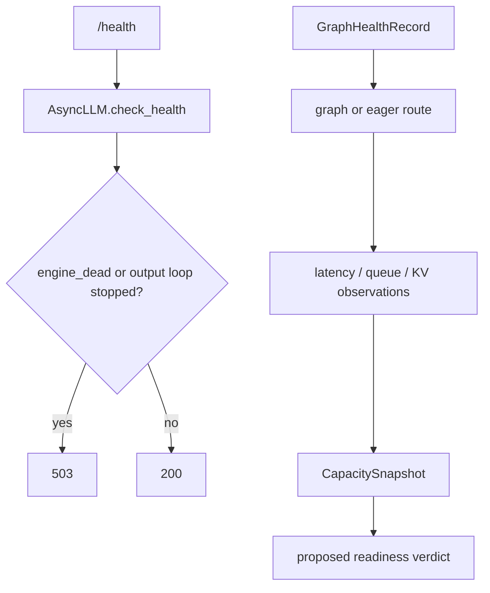
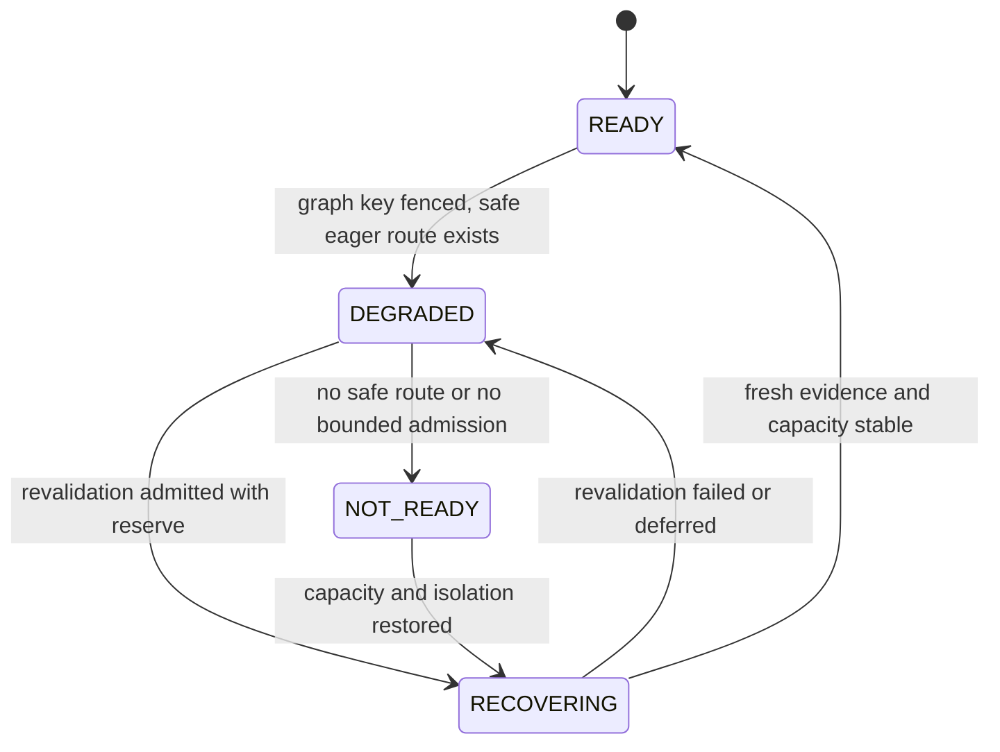

> 源码基线：vLLM [`f019e3e1`](https://github.com/vllm-project/vllm/commit/f019e3e1055424075b440dfe40198d5d45e1dfe1)，即研究时默认分支最新提交；该提交的 ROCm fusion 与本文链路无直接关系。本文严格区分**当前代码事实**、**测试/PR 事实**与**建议控制协议**。`GraphHealthRecord`、`CapacitySnapshot`、`RevalidationJob` 和三态 readiness 尚不是 vLLM 现有类型。

## 本篇在课程路线中的位置

第 57 章把 CUDA Graph promotion 改写成可撤销 capability：sentinel mismatch 后，受影响 key 先停止 replay，流量回到 eager，再隔离 revalidate。本章沿这条因果链只回答一个问题：**某个 graph key 降级，但 eager 仍能正确执行时，实例应该继续接流、降权，还是立即摘除？**

课程位置是：`graph health → execution route → measured capacity → admission/readiness → revalidation`。它位于 CUDA Graph 正确性与 Serving 故障诊断的接缝，不讨论新的 graph 捕获算法。

## 前置知识回顾

- `CudagraphDispatcher.dispatch` 在 key 不匹配或 mode 被禁止时可返回 `CUDAGraphMode.NONE`；这是现成的 eager 路由能力。
- graph promotion 证明只对绑定的 generation/fingerprint/key 有效；局部失效不等于整个 EngineCore 已死亡。
- `Scheduler` 的 `running`、`waiting`、KV usage 是负载结果；它们不是 graph 语义健康证明。
- revalidation 需要 GPU 时间、临时显存和隔离状态。它是恢复工作，也会与在线请求竞争容量。

## 本篇要回答的核心问题

1. 当前 `/health` 的 200/503 究竟证明什么，为什么它不足以表达“仍正确、但吞吐下降”？
2. 若 K8 从 graph 降到 eager，如何从 correctness route、有效容量和 revalidation backlog 推导 `READY / DEGRADED / NOT_READY`，而不是拍一个固定阈值？

## 组件在全局架构中的位置

当前代码有两条相邻但未闭环的链。控制面 `/health` 只查询 `AsyncLLM.errored`；数据面请求则经过 admission、Scheduler、ModelRunner 的 graph/eager 分流，最后把队列、KV 与 graph 使用统计送进 metrics。缺口正是：后者的降级证据没有变成前者可消费的容量 verdict。

上半段是当前实现；下半段是本章建议补齐的控制环。两者不能混写成“vLLM 已支持 degraded readiness”。

## 完整调用链

健康链很短：[`health.py`](https://github.com/vllm-project/vllm/blob/f019e3e1055424075b440dfe40198d5d45e1dfe1/vllm/entrypoints/serve/instrumentator/health.py) 的 `GET /health` 取得 `EngineClient`，调用 `check_health()`；[`AsyncLLM.check_health`](https://github.com/vllm-project/vllm/blob/f019e3e1055424075b440dfe40198d5d45e1dfe1/vllm/v1/engine/async_llm.py) 只在 `self.errored` 时抛 `EngineDeadError`。`errored` 的定义是 `engine_core.resources.engine_dead or not self.is_running`。HTTP 层只捕获该异常并返回 503，否则 200。

请求链则是：Serving handler 先检查 engine fatal state，再调用 [`AsyncLLM.check_admission`](https://github.com/vllm-project/vllm/blob/f019e3e1055424075b440dfe40198d5d45e1dfe1/vllm/v1/engine/async_llm.py)；请求进入 EngineCore/Scheduler，受 `max_num_active_reqs`、token budget 与 KV 分配约束；ModelRunner 选择 graph、piecewise graph 或 eager；结果回到 scheduler/output processor。每个调度 step 可由 [`Scheduler.make_stats`](https://github.com/vllm-project/vllm/blob/f019e3e1055424075b440dfe40198d5d45e1dfe1/vllm/v1/core/sched/scheduler.py) 形成 `SchedulerStats`。

值得注意的是，[`Executor.check_health`](https://github.com/vllm-project/vllm/blob/f019e3e1055424075b440dfe40198d5d45e1dfe1/vllm/v1/executor/abstract.py) 虽定义“异常表示 unhealthy”，但 [`UniProcExecutor`](https://github.com/vllm-project/vllm/blob/f019e3e1055424075b440dfe40198d5d45e1dfe1/vllm/v1/executor/uniproc_executor.py) 与 [`WorkerBase`](https://github.com/vllm-project/vllm/blob/f019e3e1055424075b440dfe40198d5d45e1dfe1/vllm/v1/worker/worker_base.py) 的默认实现都直接返回。公网 `/health` 也没有逐次探测某个 graph key 的 replay 语义。

## 关键类型、字段和状态生命周期

当前真实对象有三类：

| 对象 | 创建/持有 | 变化与消费 | 释放/复用 |
| --- | --- | --- | --- |
| `Scheduler.running/waiting/deferred_waiting` | `Scheduler` 持有请求引用 | `schedule()` 在 active/token/KV 约束下迁移；`make_stats()` 汇总 | 请求 finish/abort 后移除，KV 另行释放 |
| `SchedulerStats` | 每个启用日志的 step 构造 | 携带 running、waiting、skipped、KV usage、可选 `cudagraph_stats` | logger 消费后为短生命周期 snapshot |
| `CUDAGraphMode`/`BatchDescriptor` | dispatcher 按本 step shape 选择 | exact key 可 replay；invalid/unmatched mode 可回 `NONE` | 下一 step 重新 dispatch；capture handle 生命周期独立 |

建议新增的对象生命周期是：sentinel 让 `GraphHealthRecord(K8)` 从 `PROMOTED` 变为 `EAGER_ONLY`；router 立即停止 K8 replay；观测窗口形成 `CapacitySnapshot`；readiness controller 产出 verdict 并调整 admission/LB 权重；同时 `RevalidationJob(K8,generation)` 入队，成功后 promotion，失败则 retire。job 完成或取消才从 backlog 删除，不能因为已经 eager fallback 就忘掉这笔债。

## 逐函数源码解读

`health()` 的精确后置条件只是：“本次调用未观察到 `EngineDeadError`”。render-only server 甚至没有 engine，也直接 200。它没有 shape/dtype/device 输入，不拥有模型状态，不等待一次推理完成，更不承诺 TTFT/TPOT。

`AsyncLLM.check_admission(n)` 是现有最接近容量保护的入口。`max_num_queued_reqs` 近似限制 unfinished requests，`max_num_queued_tokens` 限制仍在 prefill 的 prompt tokens；超限返回 HTTP 503，注释明确期望 LB/SDK 去别的实例重试。但这些上限是配置值与前端近似计数，不会在 K8 改走 eager 时自动缩小。

`Scheduler` 把 `max_num_running_reqs` 设为 `max_num_seqs`，`max_num_active_reqs` 若未显式配置则等于前者；waiting request 在 active count 达限时停止准入。这保证槽位上限，不保证某种 graph/eager mix 下的 SLO 容量。

`Scheduler.make_stats()` 填入 `num_running_reqs`、非 deferred waiting、skipped waiting、`kv_cache_usage` 与可选 `cudagraph_stats`。[`test_metrics.py`](https://github.com/vllm-project/vllm/blob/f019e3e1055424075b440dfe40198d5d45e1dfe1/tests/entrypoints/serve/instrumentator/test_metrics.py) 也固定检查 `vllm:num_requests_running`、`waiting`、`waiting_by_reason` 和 `kv_cache_usage_perc`。这些足以构造容量信号，却没有 `graph_health_state`、`effective_capacity` 或 `revalidation_backlog`。

## 具体示例与 shape/状态演算

下面是教学演算，不是 vLLM 默认 benchmark。一个 replica 捕获 K1/K8/K16；K8 表示 8 个 one-token decode request，`hidden_states[8,4096]`、`bf16`、device CUDA，裸 payload 约 `8×4096×2 = 64 KiB`。流量 mix 为 K1 60%、K8 30%、K16 10%。同硬件、同 batching 条件下，测得 graph service time 分别为 2/4/7 ms；K8 eager 是 10 ms。

baseline 加权时间：

$$T_g=0.6\times2+0.3\times4+0.1\times7=3.1\text{ ms}$$

K8 fenced 后：

$$T_d=0.6\times2+0.3\times10+0.1\times7=4.9\text{ ms}$$

在其余条件近似不变时，归一化安全容量约为 `3.1/4.9 ≈ 63%`。这不是绝对 QPS，因为真实连续 batching 会改变 batch composition；它只说明“输出仍正确”与“仍可承受原负载”是两个命题。

此时若原 admission 仍允许 128 unfinished requests，而过去负载已接近 graph baseline，waiting/TTFT 会持续上升。正确动作是把实例标成 `DEGRADED`，以测得的混合路径 goodput 调低 admission 或 LB 权重，同时保留 eager 服务。只有在无安全 eager route、显存 reserve 不足以容纳 eager+在线状态，或限流后仍无法给出有界 SLO 时，才进入 `NOT_READY`。

revalidation backlog 不能只计 job 数。K8 的一次重验和 K16 的一次重验，GPU 时间、隔离 KV、workspace 峰值都可能不同。建议至少记录 `(estimated_gpu_ms, temp_bytes, age, key_traffic_share, generation)`；调度约束是：

$$live\_bytes+revalidation\_temp+failure\_reserve\le usable\_bytes$$

以及 `revalidation_gpu_budget` 不得让在线 goodput 跌破已经公布的 degraded capacity。阈值必须由本机测量与 SLO 标定，本文不虚构统一百分比。

## 为什么这样设计及替代方案

**替代 A：任一 key 降级就让 `/health` 返回 503。** 正确性保守，但把仍可 eager 服务的 63% 容量全部丢掉；多 replica 同时 drift 时还可能触发摘流风暴。

**替代 B：只要 eager 正确就永远 200，容量不变。** API 最简单，却把排队爆炸推给用户；queue limit 仍按静态配置，LB 也看不见实例权重变化。

**建议：保留 liveness，新增 capacity-aware readiness。** `/health` 继续回答 fatal；另一个内部 verdict 暴露 `READY/DEGRADED/NOT_READY + reason + capacity_revision`。`DEGRADED` 不必摘流，而是降权并收紧 admission；状态切换要有最小证据窗口与 hysteresis，避免 graph/eager 抖动。按第一性原理，判定顺序必须是：先确认每类请求都有正确路径，再确认容量与恢复 reserve，最后才谈利用率优化。

## 性能、并发、正确性与边界条件

正确性不变量是：被 admission 接受的 request class 必须存在 generation-valid 的 graph route 或 eager route；collective 各 rank 必须对 mode/generation 达成一致。容量不变量是：公布的可接流量不能超过在当前 route mix 下、满足 TTFT/TPOT 的实测 safe capacity。恢复不变量是：revalidation 只能使用预留资源，不能为修 graph 健康而挤爆在线 eager 路径。

并发上，health transition、capacity snapshot 与 admission config 需要同一 `capacity_revision` 或 CAS；否则 controller 可能根据旧 K8 graph 数据放大流量，而 router 已切 eager。短暂 queue spike 不应直接 `NOT_READY`；应先通过 rejection/weight 调节确认能否稳定。反之，低 queue 也不能证明健康：没有流量时，坏 graph key 与 stalled revalidation 都可能被隐藏。

[PR #60398](https://github.com/vllm-project/vllm/pull/60398) 提供了很好的边界证据：idle DP rank 可卡在 `execute_dummy_batch` collective，EngineCore 进程仍活着，所以 `/health` 继续 200。已合入修复给该 RPC 加 `VLLM_EXECUTE_MODEL_TIMEOUT_SECONDS`，让超时进入 fatal path。它修复的是“无法前进却未死亡”的 liveness 漏洞，不是 degraded capacity 协议。

## 测试证据与未覆盖风险

**当前测试事实：** [`test_async_llm.py::test_check_health`](https://github.com/vllm-project/vllm/blob/f019e3e1055424075b440dfe40198d5d45e1dfe1/tests/v1/engine/test_async_llm.py) 验证 healthy 不抛异常、mock `errored=True` 抛 `EngineDeadError`、恢复 mock 后再次健康；[`test_basic.py`](https://github.com/vllm-project/vllm/blob/f019e3e1055424075b440dfe40198d5d45e1dfe1/tests/entrypoints/serve/instrumentator/test_basic.py) 只验证 `/health` 为 200。[`test_cudagraph_dispatch.py`](https://github.com/vllm-project/vllm/blob/f019e3e1055424075b440dfe40198d5d45e1dfe1/tests/v1/cudagraph/test_cudagraph_dispatch.py) 以 capture sizes `[1,8]` 证明未匹配 size15 返回 `CUDAGraphMode.NONE`，以及 invalid FULL 可退到 PIECEWISE/NONE。PR #60398 的参数化测试验证 stalled model RPC 超时，而非无限等待。

**覆盖缺口：** 没有测试把某个 promoted key fenced 后的 eager 正确性、Scheduler queue 变化、readiness 降级与 admission 收紧串成 E2E；没有测试 capacity revision 的竞态、LB 降权、hysteresis、revalidation GPU/显存 reserve、backlog aging、TP/PP rank 分歧或多实例同时降级。本章未重跑 GPU 测试，PR 中的“6 passed”只作为 PR 作者报告，不冒充本次执行结果。

## 与前后章节的连接

上一章回答“何时撤销某个 graph key 的 replay 权”；本章回答“撤销后实例是否还能接流，以及接多少”。两章合起来把 semantic health 与 service capacity 分开。下一章将继续沿恢复队列推进：**多个失效 key 如何在有限 GPU/显存预算下排序——Revalidation Scheduling、Priority Aging 与 Recovery Budget。**

## 本篇结论、知识债、三个理解检查问题和下一章

结论：当前 `/health=200` 只代表没有观测到 engine fatal，不代表所有 CUDA Graph key 健康，更不代表仍具原吞吐。局部 key 有安全 eager 路径时，实例通常应保持可服务但进入 `DEGRADED`；控制面必须用实测 mixed-route goodput、queue/SLO 与恢复 reserve 调整 admission/LB。无安全路径或无法给出有界 admission 时才 `NOT_READY`。

知识债：graph-health→route 的真实 schema、capacity estimator、per-key traffic share、动态 queue cap/LB weight、capacity revision/CAS、hysteresis、revalidation cost model、GPU/显存 reserve 与多 rank/multi-replica fault-injection E2E。

理解检查：

1. K8 graph 被 fence、eager 输出正确时，为什么 `/health` 可以继续 200，而容量 verdict 应改变？
2. 为什么 `num_requests_waiting=0` 既不能证明 graph 健康，也不能单独证明 full capacity？
3. revalidation queue 为什么应按 GPU 时间和临时显存计债，而不能只按 job 数？

下一章：**Revalidation Scheduling、Priority Aging 与 Recovery Budget。**

## 课程账本增量

- 新增当前事实：HTTP `/health` 只消费 `AsyncLLM.errored`；静态 admission 上限与 `SchedulerStats` 尚未消费 graph semantic health。
- 新确认不变量：liveness、semantic readiness、SLO capacity 与 recovery reserve 是四个不同判定；eager fallback 保 correctness 不自动保 throughput。
- 新增建议对象：`CapacitySnapshot`、`ReadinessVerdict`、`RevalidationJob` 与 `capacity_revision`；三态 readiness 是建议协议，不是当前 API。
- 新测试结论：现有 health/dispatcher/metrics/timeout 测试分别覆盖 fatal、eager fallback、负载统计和 stuck-RPC liveness，没有覆盖局部 graph 降级后的端到端容量控制。
