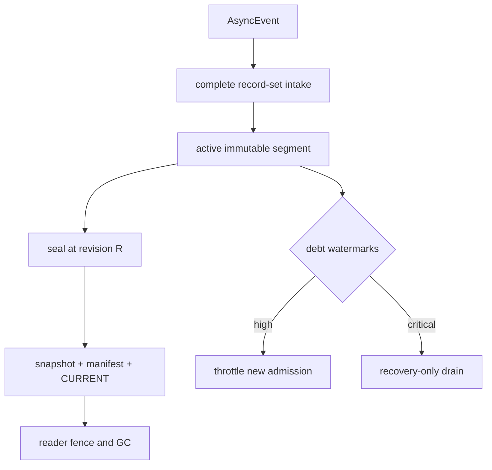
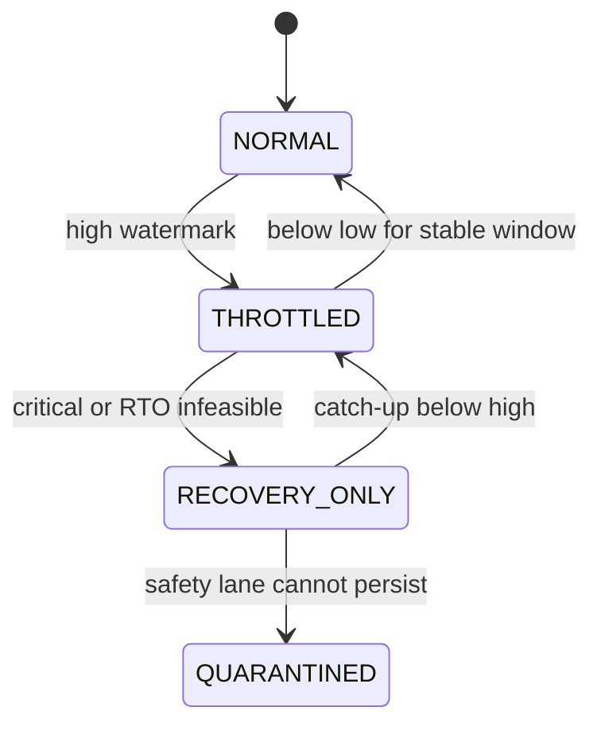

> 源码基线：pto-isa [`cbca1e9b`](https://github.com/hw-native-sys/pto-isa/commit/cbca1e9b9775c6aedeb49647a4c5e023b8658f88)，即研究时默认分支最新提交，由已合入 [PR #347](https://github.com/hw-native-sys/pto-isa/pull/347) 同步。本文直接引用的 completion/workspace/notify 文件相对上一章未变化。仓库当前没有 checkpoint scheduler、durable compactor、write-amplification 统计或 backpressure controller；本文严格区分**当前代码/规范事实**、**测试/提交事实**、**教学演算**与**建议的 Host 恢复协议**。

## 本篇在 PTO 课程路线中的位置

[上一章]() 已证明 crash-safe cutover 的顺序：在 revision `R` seal segment，先完整发布 immutable snapshot 与 versioned manifest，再原子切换 `CURRENT`，最后等 reader ack/fence 后删除旧对象。

这个协议保证“每次压缩都正确”，却没有保证“压缩永远追得上”。若 retire/evidence 进入日志的长期速率高于 compactor 的有效处理速率，继续缩短 checkpoint 周期只会重复写 snapshot；若把周期拉长，重启 replay 和 pinned segment 又会无界增长。本章只研究这一处边界：**怎样从恢复时间、空间和写放大预算推导 cadence；没有可行 cadence 时，backpressure 应阻止什么、绝不能阻止什么？**

## 前置知识

- `AsyncCompletionRecord{addr, expected, kind}` 是 24 B borrowed runtime view，不是 durable record。
- SDMA event 可能导出多个 per-queue record；URMA 可能导出多个 per-jetty record，必须完整合取。
- snapshot 覆盖到 revision `R`，新 segment 从 `R+1` 连续重放；`CURRENT` 是启动入口的唯一线性化点。
- `AbandonWorkspace` 只清空 facade，不证明 native allocation、late writer 或 capacity debt 已消失。

## 今日 1–2 个核心问题

1. checkpoint cadence 怎样同时满足 replay RTO、持久层峰值空间和最大允许 write amplification，而不是拍一个固定时间？
2. 当输入速率长期超过 compaction 能力时，如何施加不丢 completion evidence、不误释放 workspace 的分级 backpressure？

## PTO 全栈中的位置

PTO ISA 数据面继续产生 `AsyncEvent`；Host adapter 把完整 native record-set 归一化为 generation-bound evidence。cadence controller 位于 durable evidence store 与 admission/recovery control plane 之间：它可以限制新工作进入、提高 compaction 份额或进入 recovery-only，但不能反向阻塞已经在途的 completion 摄取。

图中前两步消费当前 API；`EvidenceRecord`、segment、controller 与水位均是建议协议。这个层次不改变 Tile 的 shape/layout/location，也不把 Host 存储压力伪装成某条 ISA barrier。

## 概念和精确语义

### 1. cadence 是一个可行区间，不是常数

设 canonical evidence 平均到达速率为 `λ` records/s，每条 durable record 的平均编码大小为 `b` bytes，snapshot 大小为 `S` bytes，checkpoint 间隔为 `C` 秒。先忽略很小的 manifest，单周期逻辑日志字节为 `λbC`，持久层最少写入 `λbC + S`。相对于只追加逻辑 evidence 的写放大为：

$$WA(C)=\frac{\lambda b C+S}{\lambda b C}=1+\frac{S}{\lambda b C}$$

因此 write-amplification 上限 `WA_max` 给 cadence 一个**下界**：

$$C \ge \frac{S}{\lambda b(WA_{max}-1)}$$

但恢复 RTO 给它上界。若 snapshot 加载、校验等固定时间为 `T_base`，replay 吞吐为 `\mu_r` records/s，则最坏 replay 时间近似为 `T_base+λC/μ_r`：

$$C \le \frac{(RTO-T_{base})\mu_r}{\lambda}$$

持久层峰值空间再给一个上界。设 `D_fixed` 包含 live snapshot、构建中的 snapshot、reader pinned objects、GC slack 和 emergency reserve：

$$C \le \frac{D_{usable}-D_{fixed}}{\lambda b}$$

真正合法的 cadence 位于“写放大下界”和两个上界的交集。若下界大于上界，系统不是“参数没调好”，而是当前 snapshot 体积、输入率、replay 吞吐、RTO 与磁盘预算不可同时满足；必须减小 snapshot、提高 compactor/replay 能力、扩容或施加 backpressure。

### 2. backlog 动力学决定是否能追平

令 `Q(t)` 为尚未被安全 snapshot/GC 吸收的 canonical bytes，`λ_b` 为必须保留的输入 bytes/s，`μ_c` 为 compactor 的有效吸收 bytes/s：

$$Q(t+\Delta)=\max(0,Q(t)+(\lambda_b-\mu_c)\Delta)$$

当 `λ_b < μ_c`，水位上升可能只是一次 burst，controller 可提高 compaction 份额后追平；当长期 `λ_b ≥ μ_c`，无论把 checkpoint 设为 10 秒还是 60 秒，积压都不会收敛。cadence 只改变每次工作的粒度，不能创造处理能力。

建议 controller 维护三类不同债务：`uncheckpointed_bytes` 决定 replay；`pinned_bytes` 由慢 reader/旧 manifest 决定空间；`unreclaimed_capacity_bytes` 由未闭合 generation/workspace 决定设备容量。三者不能合成一个“queue length”：前两者是 Host durable storage，第三者可能是 GM/UB/native manager 所有权。

### 3. backpressure 必须保留 safety lane

当前 [`CompletionRecordCount/At`](https://github.com/hw-native-sys/pto-isa/blob/cbca1e9b9775c6aedeb49647a4c5e023b8658f88/include/pto/comm/async_common/async_event_impl.hpp) 把 SDMA/URMA event 解成完整 record-set；非空 event 解析失败以 `kCompletionRecordCountError` 或空地址表示错误。controller 不能因日志高水位就丢弃后续 queue/jetty record，否则原本可闭合的 operation 会永久变成 `UNKNOWN`。

因此应分离：

- **不可阻塞安全摄取**：已提交 operation 的 completion/reset witness、capacity receipt、owner/lease fence；必要时使用预留 emergency segment。
- **可抑制新债务**：新 workspace/session admission、会产生大量新 evidence 的普通任务、非关键重试。
- **可降级派生工作**：可重算索引、重复 audit projection、metrics export；只能延迟或从 canonical record 重建，不能删 canonical evidence。

`PersistSqTails` 每次 post 写回 live workspace 的 queue tail 与 `nextPostId`，保障同一 workspace 内 session rebuild 的 post ID 连续性；它不是 Host durable store，也不能在 Host 日志拥塞时关闭。正确的压力传播方向是 durable layer → admission，绝不是让已经 post 的设备工作失去 completion intake。

## 真实文件、类型、API 或指令逐段解读

1. [`comm_types.hpp`](https://github.com/hw-native-sys/pto-isa/blob/cbca1e9b9775c6aedeb49647a4c5e023b8658f88/include/pto/comm/comm_types.hpp) 把 `AsyncCompletionRecord` 固定为 24 B，只含 borrowed GM/CQE address、`expected` 和 `kind`。本文演算的 durable record 大小不能拿 24 B 代替，因为还必须编码 allocation、generation、domain、revision、owner epoch、digest 等稳定身份。
2. [`async_event_impl.hpp`](https://github.com/hw-native-sys/pto-isa/blob/cbca1e9b9775c6aedeb49647a4c5e023b8658f88/include/pto/comm/async_common/async_event_impl.hpp) 对 SDMA 以 `queueCount` 枚举，对 URMA 以 jetty slice 枚举；record-set 是 operation 的原子证据边界。backpressure 不得只写 `At(0)` 后丢掉其余成员。
3. [`sdma_async_detail_post.hpp`](https://github.com/hw-native-sys/pto-isa/blob/cbca1e9b9775c6aedeb49647a4c5e023b8658f88/include/pto/comm/async/sdma/sdma_async_detail_post.hpp) 中 `ReserveSdmaPostEvent` 分配 post ID，`PersistSqTails` 保存 runtime state，`CheckPostDoneIds` 逐 queue 检查完成。它们能产生 compactor 的上游事实，但没有 checkpoint cadence 或 Host storage backpressure。
4. [`workspace.hpp`](https://github.com/hw-native-sys/pto-isa/blob/cbca1e9b9775c6aedeb49647a4c5e023b8658f88/include/pto/comm/workspace.hpp) 区分 `DestroyWorkspace` 与 clear-only `AbandonWorkspace`。在 critical 水位下调用 `AbandonWorkspace` 不能算作“释放容量”；unknown backing 仍须 quarantine，并继续占 `unreclaimed_capacity_bytes`。

## 对象/Tile/Buffer/IR 生命周期

以 `16×16xf32` ND payload 为例：Tile 语义 payload 为 1024 B，位于 GM；SDMA scratch 位于 UB。`TPUT_ASYNC_NOTIFY` 创建 event，workspace/session 必须活到 event 完成。Host 在该生命周期内读取所有 queue record，把 borrowed pointer 复制、验证并归一化成 immutable `EvidenceRecord`；从这里开始，durable layer 不再拥有或解引用原 pointer。

记录追加到 active segment 后，其状态依次是 `UNSEEN_BY_SNAPSHOT → SEALED≤R → ABSORBED_BY_SNAPSHOT → REFERENCED_BY_CURRENT → GC_ELIGIBLE`。进入 backpressure 只延迟 seal/build/GC 或阻止**新** workspace admission，不允许把已经 durable 的 record 改写，也不允许让未 durable 的 completion 从内存队列静默过期。

`THROTTLED` 与 `RECOVERY_ONLY` 必须使用低/高水位和稳定窗口避免抖动；若连预留 safety lane 都无法 durable append，则应 quarantine/fail closed，而不是继续运行并声称稍后补日志。

## 端到端调用链或指令链

当前数据面链仍是：`TPUT_ASYNC_NOTIFY → BeginSdmaPost → ReserveSdmaPostEvent → payload/signal/postDone SQE → PersistSqTails → AsyncEvent → CompletionRecordCount/At or Wait/Test`。

建议控制链为：完整 record-set → generation/domain validation → canonical append → 更新 `λ/Q/pinned/capacity` census → cadence feasibility check → seal/build/publish → reader fence/GC。若水位越界，则以同一 revision 发布 `AdmissionVerdict`：先停止产生新普通债务，再保证 safety intake 与 compactor reserve，必要时进入 recovery-only；降级解除必须由 fresh census 和低水位稳定窗口证明。

## 具体 shape、Tile 和状态演算

以下数字只用于演算，不是 pto-isa benchmark。假设每秒完成 2000 个 logical operations；每个归一化 durable record 平均 256 B，则 `λb=500 KiB/s`。canonical snapshot 为 16 MiB，replay 能处理 20,000 records/s，固定启动/校验耗时 2 s，RTO 为 8 s，允许 `WA_max=2.0`。

- 写放大给下界：`C ≥ 16 MiB / (0.5 MiB/s × 1)=32 s`。
- replay 给上界：`C ≤ (8-2)×20000/2000=60 s`。
- 若 durable store 在扣除双 snapshot、reader pin、GC slack 与 reserve 后只剩 24 MiB，则空间上界为 `24/0.5=48 s`。

因此合法区间是 `[32 s,48 s]`。选 `C=40 s` 时，一个周期追加 20 MiB log，再写 16 MiB snapshot，`WA=(20+16)/20=1.8×`；最坏 replay 为 80,000 records，约 4 s，加固定 2 s 共 6 s，仍在 RTO 内。

若错误地每 10 s checkpoint，log 只有 5 MiB，却反复写 16 MiB snapshot，`WA=4.2×`；若每 60 s checkpoint，`WA≈1.53×`，但空间需要 30 MiB，超过 24 MiB headroom。cadence 不能只优化写放大或只优化 replay。

现在制造持续过载：compactor 有效吸收能力只有 400 KiB/s，而 canonical 输入为 500 KiB/s，积压每分钟增加约 5.86 MiB。调整 `C` 不会改变 `λ_b-μ_c=100 KiB/s`。controller 应先进入 `THROTTLED`，拒绝会创建新 workspace 的普通 admission，同时继续摄取在途 event；若测得 throttling 后输入降到 250 KiB/s，净排水 150 KiB/s，20 MiB backlog 约需 137 s 才能追平。只有 fresh census 连续落到 low watermark，才能恢复 NORMAL。

再看 `queueNum=2` 的单个 operation：q0 先到 `postDone=130`，q1 尚为 129。即使 critical pressure，也不能把 q0 写入后把 operation 当 terminal、释放 1024 B payload；必须保留 partial record-set 与 capacity debt，等 q1 到 130 或获得覆盖两条 queue 的 reset certificate。空间紧张不改变 completion 合取语义。

## 为什么这样设计及替代方案

**替代 A：固定每 N 秒 checkpoint。** 实现最简单，但无法适应 evidence burst、snapshot 变大、reader lag 或 replay 吞吐变化；同一个 N 在低负载浪费写入，在高负载又违反 RTO。

**替代 B：只看 segment 大小。** 可控制单次文件大小，却忽略 snapshot write amplification、pinned old segments 和每条 record 的 replay CPU；不同 record mix 下同样字节数可能有不同恢复成本。

**替代 C：日志满了就丢最旧 evidence。** 空间立刻下降，却可能删掉尚未被 snapshot 吸收的 tombstone、capacity receipt 或 completion witness，直接破坏 ABA 防护与 exactly-once release。

**建议：约束求交 + 分级背压。** cadence 只在 RTO、空间和 WA 三者可行交集内选择；水位同时观察 uncheckpointed、reader-pinned 与 unreclaimed capacity。无法收敛时，先抑制新债务、保留 safety lane，再进入 recovery-only。每个组件都对应一个硬约束；如果部署允许 stop-the-world 且数据量很小，可用同步 checkpoint 简化，但仍不能丢 canonical completion/reset evidence。

## 访存、计算、流水、并行和硬件约束

本章不会改变 1024 B Tile 的 SDMA payload，也不对 NPU pipe 增加 barrier。新增成本在 Host 侧：canonical append、checksum、snapshot 序列化、replay CPU、storage bandwidth 和双版本峰值。应分别测 `λ` 的分位数、record bytes、compactor/replay throughput、snapshot bytes、reader lag、fsync/conditional-put P99、GC reclaim rate 与 capacity debt；不能用设备 DMA 带宽推算这些指标。

并行上，evidence writer 继续 append 新 segment，compactor只读 seal 到 R 的不可变前缀，reader按 `CURRENT` epoch加载。backpressure controller 读取的 census 必须绑定 revision；若它基于旧的 `Q` 发放新 admission，CAS 应失败并重新评估。owner lease 过期只撤销发布/删除权限，不会取消已经提交的 snapshot I/O 或 device operation。

**硬件映射推断：** 公开材料能确认 GM `postDone`、post ID、queue/jetty completion 和 workspace lifetime；不能确认掉电持久性、cache flush、MR revoke 与 reset 的物理覆盖域。本文 cadence/backpressure 是 Host recovery control-plane 设计，不是 Ascend 硬件已有的 checkpoint engine。

## 测试证据与未覆盖风险

**当前测试事实：** [`tput_async_notify_kernel.cpp`](https://github.com/hw-native-sys/pto-isa/blob/cbca1e9b9775c6aedeb49647a4c5e023b8658f88/tests/npu/a2a3/comm/st/testcase/tput_async_notify/tput_async_notify_kernel.cpp) 的 interleaved case 从 notify `postId=2` 出发，插入 127 次 ordinary post 后得到 `postId=130`，覆盖 64-slot operand reuse；`main.cpp` 还注册 2-rank、queue4 的 Set、payload consume、AtomicAdd、65-post reuse、non-zero group 与并发 AIV 用例。这些测试证明 live workspace 的 post/slot 行为，不证明 Host compactor 能承受 burst。

**提交事实：** 引入统一 workspace/completion facade 的 [`e6334fbd`](https://github.com/hw-native-sys/pto-isa/commit/e6334fbd6c5d6bfdf550201bbdb81a71831a99af) 报告 workspace header compile 与 URMA 2-rank 6 cases，SDMA runtime 当时仅编译。当前仓库没有 `CheckpointCadence`、write-amplification/backlog metric、safety-lane reserve 或 backpressure fault test；本章没有重跑 NPU 真机。

最小新增测试需要 fake clock 和可控 store：改变 `λ`、snapshot size、replay/compaction throughput，验证可行区间为空时不会伪造 cadence；注入 ENOSPC、fsync latency、stale census、reader pin、GC failure 与 controller crash，断言 canonical revision 无 gap、在途 completion 仍可进入 emergency segment、新 admission 被拒绝、capacity 不提前返还。还应覆盖低水位 hysteresis，证明短暂下降不会频繁 NORMAL/THROTTLED 抖动。

未覆盖风险包括 durable schema 膨胀、record mix 导致的非线性 replay、snapshot builder 与在线 canonical CAS 竞争、object-store 限流、emergency reserve 被 audit 占满、partial queue/jetty record 长驻，以及 Host backpressure 与设备在途队列之间的最大延迟。

## 与前后章节的连接

上一章给出一次 compaction 的 crash-safe原子切换；本章给出连续运行时 compaction 的稳定条件：只有 `λ<μ` 且 cadence 可行区间非空，系统才可能在不违反 RTO/空间/写放大的前提下长期运行。下一章将研究进入 THROTTLED/RECOVERY_ONLY 后如何证明已经追平，并以 catch-up watermark、capacity debt closure 与 hysteresis 安全恢复普通 admission。

## 本篇结论、知识债、三个理解检查问题和下一章

结论：checkpoint cadence 必须由 write-amplification 下界与 replay/space 上界求交；当 `λ_b≥μ_c` 时，调 cadence 无法消灭积压，必须向新 admission 传播 backpressure，同时为已提交 operation 的 completion/reset evidence 保留不可阻塞 safety lane。空间压力永远不能授权丢 evidence、把 partial record-set 当 terminal，或把 `AbandonWorkspace` 当资源已释放。

知识债：真实 durable record 大小与 mix、snapshot/replay/compaction benchmark、revision-bound census、三类 debt schema、emergency segment、admission verdict、owner-fenced mode transition、reader-pinned attribution、ENOSPC/object-store adapter，以及 burst×stale-reader×partial-completion 真机/故障 Golden。

理解检查：

1. 为什么缩短 checkpoint 周期会降低 replay 长度，却可能显著提高 write amplification？
2. 当 canonical 输入长期为 500 KiB/s、compactor 只能吸收 400 KiB/s 时，为什么任何固定 cadence 都不能让 backlog 收敛？
3. critical storage pressure 下，为什么可以拒绝新 workspace admission，却不能停止已提交 operation 的 completion record 摄取？

下一章：**Backpressure 后如何安全恢复：Catch-up Watermark、Debt Closure 与 Hysteresis Release。**

## 课程账本增量

- 新增当前事实：`AsyncCompletionRecord` 的 24 B runtime view 不能充当 durable-size 估计；`CompletionRecordCount/At` 的完整 record-set 与 `AbandonWorkspace` 的 clear-only 语义在压力下仍不变。
- 新确认不变量：cadence 必须同时满足 WA 下界、RTO/空间上界；`λ_b≥μ_c` 时调周期不能恢复稳定；已提交 operation 的 safety evidence intake 不得被 backpressure 阻塞。
- 新增建议对象：revision-bound `CompactionCensus`、三维 debt watermarks、emergency segment、`NORMAL/THROTTLED/RECOVERY_ONLY/QUARANTINED` 状态机与 admission verdict；均非当前实现。
- 新测试结论：现有 notify tests 覆盖 post ID、slot reuse 与并发数据面，不覆盖 checkpoint cadence、积压收敛、write amplification、ENOSPC、safety-lane reserve 或 hysteresis。
