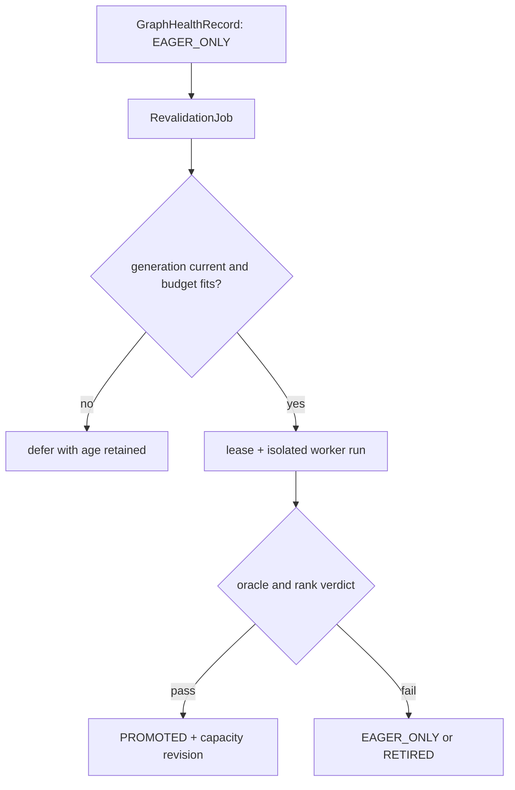

> 源码基线：vLLM [`9c778e9f`](https://github.com/vllm-project/vllm/commit/9c778e9ff8d0c78a241d7f530c441c2dc1d67533)，即研究时默认分支最新提交；该提交修复 EPLB/NIXL buffer copy 等待，与本文主路径无直接关系。本文严格区分**当前代码事实**、**测试/commit 事实**、**Issue/RFC 规划**与**建议协议**。`RevalidationJob`、`RecoveryBudget`、aging deadline 和 recovery lane 尚不是 vLLM 现有实现。

## 本篇在课程路线中的位置

上一篇回答了 graph key 降级后实例为何仍可通过 eager 保持正确，却只能按较低容量接流。本篇把 `revalidation backlog` 展开：当 K1、K8、K16 同时失去 replay 权，**谁先恢复、一次允许花多少 GPU 时间和临时显存、低收益 key 如何避免永久饥饿？**

课程位置是：`EAGER_ONLY keys → immutable recovery jobs → eligibility/budget → priority aging → isolated revalidation → capacity revision`。这是一章调度语义，不讨论新的 capture kernel。

上一篇：[Graph 局部降级时服务还算 Ready 吗]()。

## 前置知识回顾

- graph/eager 是执行路径；`PROMOTED/EAGER_ONLY` 是建议的 semantic-health 状态，不能由 queue length 推断。
- eager fallback 保障 correctness，不保证原 graph goodput。
- revalidation 会做隔离 warmup、graph/eager oracle、有限 canary；它消耗 GPU 时间、capture workspace、临时 KV 和 collective slot。
- online admission 与 recovery admission 共用同一张卡。恢复得太慢会长期降容，恢复得太激进会进一步恶化 TTFT/TPOT。

## 本篇要回答的核心问题

1. vLLM 当前 `priority` 调度究竟排序什么，为什么不能直接把 graph recovery job 塞进 `waiting`？
2. 如何同时保证在线 SLO、显存安全和 recovery 最终有进展，并用 aging 消除纯 benefit/cost 排序造成的 starvation？

## 组件在全局架构中的位置

当前 `Scheduler` 只接收推理 `Request`。建议的 revalidation controller 位于 graph-health 控制面：读取 immutable job 与容量快照，授予短租约后让 worker 在隔离资源上执行；成功或失败再以 generation-bound CAS 更新 graph health。它不能直接修改 `Scheduler.running`，也不能把一次 capture 伪装成 token 请求。

## 完整调用链

当前请求链从 [`Request`](https://github.com/vllm-project/vllm/blob/9c778e9ff8d0c78a241d7f530c441c2dc1d67533/vllm/v1/request.py) 的 `priority`、`arrival_time` 开始。`Scheduler.__init__` 读取 `SchedulerConfig.policy`，通过 [`create_request_queue`](https://github.com/vllm-project/vllm/blob/9c778e9ff8d0c78a241d7f530c441c2dc1d67533/vllm/v1/core/sched/request_queue.py) 建立 `FCFSRequestQueue` 或 `PriorityRequestQueue`。`schedule()` 先处理 running，再从 `kv_holding_waiting` 或 `waiting` 的队首检查 active slots、token/input budget、LoRA 和 KV allocation；成功后把同一个 `Request` 移到 `running`，扣减 budget，形成 `SchedulerOutput`。

优先级还作用于抢占：KV allocation 失败时，[`Scheduler.schedule`](https://github.com/vllm-project/vllm/blob/9c778e9ff8d0c78a241d7f530c441c2dc1d67533/vllm/v1/core/sched/scheduler.py) 对 `running` 取 `max(priority, arrival_time)`，即抢占数值优先级最差、同级最晚到达的请求。已合入 [`4d341ca8`](https://github.com/vllm-project/vllm/commit/4d341ca829d7fbad351b3a5a17d1405e63dc5bf2) 还说明 mutation 很敏感：删除 victim 后若不修正 `req_index`，后继请求会被静默跳过。

建议链则是：sentinel/controller 创建 `RevalidationJob(key,generation,cost,created_at)`；planner 读取同一 revision 的在线容量、GPU 时间和显存快照；eligible job 进入 mandatory-deadline 或 utility queue；winner 获取有限 `RecoveryLease`；worker 执行隔离 revalidation；结果只在 generation、fingerprint、expected ranks 都匹配时提交，并触发新的 `capacity_revision`。

## 关键类型、字段和状态生命周期

| 对象 | 当前/建议 | 所有权与生命周期 | 关键约束 |
| --- | --- | --- | --- |
| `Request(priority, arrival_time)` | 当前 | Scheduler registry/queue 持有；finish/abort 后移除 | 小整数优先；arrival 仅同级破平局 |
| `PriorityRequestQueue` | 当前 | heap 持有 `Request` 引用 | comparator 在入堆后不能随时间变化 |
| `RevalidationJob` | 建议 | controller 持久持有 immutable record | 绑定 key、generation、fingerprint、cost revision |
| `RecoveryLease` | 建议 | 单 worker/TP group 短期持有 | 到期只阻止新阶段，不能证明设备副作用已停止 |
| `RecoveryBudget` | 建议 | 每个观测窗口生成快照 | GPU 时间与临时显存分别守恒，不折成一个虚假单位 |

job 从 `QUEUED` 经资格检查进入 `LEASED/RUNNING`；在线负载突升可在尚未开始新阶段前撤销 lease 并回 `QUEUED`，age 不清零。generation 变化则进入 `STALE`，绝不能拿旧 PASS 恢复新 handle。worker 拥有 scratch、隔离 KV 与 persistent output 的复制品；controller 只持引用和 verdict，不跨 replay 保存会被覆盖的 tensor view。

建议接口必须把所有权和失败语义写进类型，而不只是一个 `run(job)`：

| 接口 | 输入与前置条件 | 输出/后置条件 | 失败方式 |
| --- | --- | --- | --- |
| `enqueue_revalidation` | immutable graph key、generation、触发 evidence | 幂等创建或返回已有 job id | 同 key/generation 但 fingerprint 冲突时 fail closed |
| `plan_window` | 同 revision 的 load、capacity、cost snapshots | 排序后的候选与未花费预算 | snapshot stale 时不发 lease |
| `acquire_recovery_lease` | expected ranks、阶段 cost upper bound | generation-bound、带 expiry 的唯一执行权 | CAS 冲突或预算不足则 defer |
| `commit_revalidation` | all-rank final、oracle digest、实际成本 | 原子更新 health 与 capacity revision | stale/partial/timeout 保持 eager |

这里的 cost upper bound 不是记账提示，而是 admission 前置条件。执行中发现某阶段超预算时，只能在下一个安全边界停止；已经提交给 device 的 kernel、collective 或 copy 不会因 host lease 被撤销而消失。

## 逐函数源码解读

[`Request.__lt__`](https://github.com/vllm-project/vllm/blob/9c778e9ff8d0c78a241d7f530c441c2dc1d67533/vllm/v1/request.py) 的顺序是 `(priority, arrival_time, request_id, id)`，数值越小越先。这里没有 `now-arrival_time`，因此不同 priority 间没有 aging：只要 priority 0 持续到达，priority 5 可以无限等待。

[`PriorityRequestQueue`](https://github.com/vllm-project/vllm/blob/9c778e9ff8d0c78a241d7f530c441c2dc1d67533/vllm/v1/core/sched/request_queue.py) 使用 `heapq`。若把“有效优先级”写成随当前时间变化的 comparator，已有 heap 不会自动重排，还可能破坏比较的一致性。因此 aging 应在 scheduling boundary 把到期 job 提升到独立 mandatory bucket，或显式重建有界候选窗口，而不是偷偷改 `Request.__lt__`。

[`SchedulerConfig`](https://github.com/vllm-project/vllm/blob/9c778e9ff8d0c78a241d7f530c441c2dc1d67533/vllm/config/scheduler.py) 的 `max_num_batched_tokens`、`max_num_scheduled_tokens`、`max_num_seqs/max_num_active_seqs` 都是推理批次约束。capture/oracle 的成本不是“多少输出 token”，把 recovery job 包成假请求会绕乱 KV ownership、preemption、metrics 和 finish 语义。正确复用点是调度原则和统计，不是 `Request` 状态机。

`Scheduler.schedule()` 的 waiting loop 还揭示了“资格”和“次序”的区别。它先从 `kv_holding_waiting` 取请求，只有该队列空才看普通 `waiting`；随后检查 active slot、input/token budget、blocked state、LoRA、prefix hit 与 KV allocation。队首顺序高不等于必然入场，资源检查仍可让它 skip/defer。revalidation 也应如此：deadline job 可以压过 utility job，却仍不能绕过 generation 或内存检查。

另一个细节是 `deferred_waiting`：当前代码把本轮因异步依赖或资源条件跳过的请求记入 set，step 结束后再归队，metrics 会从 waiting 中区分 deferred。恢复调度也需要明确的 defer reason，例如 `ONLINE_SLO`、`TEMP_MEMORY`、`STALE_GENERATION`、`RANK_NOT_READY`。否则 backlog 只有数量，没有“为什么不前进”，controller 无法区分正常等待与死锁。

### 建议的两阶段决策

第一阶段只做 hard eligibility：检查 job generation/fingerprint 是否仍 current、所有 rank 是否可参加、隔离 KV/RNG/connector 是否可建立、预计峰值是否落入预算。第二阶段才排序：

1. 已到 deadline 的 eligible job 进入 mandatory bucket，按 deadline、created_at、job id 确定性排序；
2. 其余 job 在有界候选窗口内按可恢复 goodput / GPU cost 排序；
3. 同等收益优先较小 temporary peak，再以 age 和 job id 破平局；
4. 每发一个 lease 都重新扣减本窗口 GPU 与显存预算，不沿用“第一名可行所以后面也可行”的假设。

这样做没有把不同单位粗暴相加。utility 只在已经满足两张硬预算的候选间比较；age 负责长期公平；job id 负责可重放的确定性。

## 具体示例与 shape/状态演算

以下是教学参数，不是默认 benchmark。单个 1 秒窗口测得在线工作需要 760 ms，SLO/failure reserve 留 120 ms，所以本窗 recovery GPU budget 为 `1000-760-120=120 ms`。可用显存 headroom 64 MiB，failure reserve 24 MiB，所以 recovery 临时峰值上限为 40 MiB。

三个 job 都是 TP=2 collective revalidation：K1、K8、K16 分别代表 1/8/16 个 one-token decode；hidden size 4096、BF16 时输入 payload 约 8/64/128 KiB。估计成本如下：

| job | graph→eager 的加权损失 | GPU cost | temp peak | age/deadline |
| --- | ---: | ---: | ---: | ---: |
| K8/g44 | 1.8 ms | 40 ms | 12 MiB | 4/60 s |
| K1/g44 | 0.6 ms | 15 ms | 4 MiB | 10/60 s |
| K16/g44 | 0.8 ms | 90 ms | 20 MiB | 55/60 s |

第一窗口没有 job 到 deadline，utility 约为 `recoverable weighted loss / GPU cost`：K8=0.045，K1=0.040，K16≈0.009。先跑 K8，余 80 ms；K16 放不下，故再跑 K1，余 65 ms。第二窗口 K16 age 超过 60 秒，进入 mandatory bucket；它仍须通过 generation、rank、90 ms 和 20 MiB 可行性检查，通过后优先执行。这样 age 改变的是“必须服务的集合”，不是在 heap 内持续漂移的比较键。

两个预算都必须成立：

$$G_{online}+G_{revalidation}+G_{safety}\le G_{window}$$

$$M_{live}+M_{revalidation\ peak}+M_{failure}\le M_{usable}$$

若第二窗口在线工作涨到 820 ms，则可用 recovery 只剩 60 ms，K16 即使到期也不能强行启动。controller 应降低 admission/LB 权重以制造安全窗口，或继续 defer 并升级 readiness；deadline 授予“获得服务决策”的权利，不授予突破物理预算的权利。

再看一个并发边界：planner 在 revision 71 读取 760 ms online load，准备给 K16 发 90 ms lease；此时 routing controller 因另一 key 失败把实例容量从 63% 下调到 48%，产生 revision 72。如果 lease CAS 仍以 71 提交，必须失败并重新规划。否则恢复工作会按旧余量与新增 eager 流量并发，正是 control plane 自己制造的超载。

## 为什么这样设计及替代方案

**替代 A：纯 benefit/cost 最大化。** 它恢复容量最快，但冷 key 或昂贵 K16 可能永久饥饿；长期保留 eager 路径还会让 graph pool、监控和运维债持续增长。

**替代 B：严格 FCFS。** 公平、简单，却可能先花 90 ms 修低流量 K16，让高流量 K8 继续拖低实例容量；恢复期间的 goodput 更差。

**替代 C：把 recovery 当高优先级 `Request`。** 可复用现有 heap，却把没有用户 token/KV 生命周期的工作塞进 correctness-critical 状态机，并允许它按 KV pressure 抢占在线请求，维护和故障面最大。

**建议：独立 recovery lane，hard eligibility + aging deadline + bounded utility。** 它复用 Scheduler 的“先守资源、再排序”思想，却独立计 GPU/显存预算。在线 SLO 是硬约束；utility 决定常态效率；aging 只在有界等待后升级服务权。RFC [#51608](https://github.com/vllm-project/vllm/issues/51608) 也把动态 QueueSort、waiting time 和 bounded candidate window列为规划方向，但这是 Issue/RFC，不是已合入实现。

## 性能、并发、正确性与边界条件

正确性上，job 只有在 graph 仍为同一 generation/fingerprint、TP/PP expected ranks 一致、隔离 KV/RNG/connector state 完整时才 eligible。排序永远不能覆盖这些条件。并发上，queue snapshot、budget、lease 与 final CAS 必须携带 revision；负载突增后旧 budget lease 不得开始下一阶段，迟到 PASS 也不能覆盖新一代 `EAGER_ONLY`。

性能上，恢复收益应以混合流量下减少的 service time 或提升的 SLO goodput衡量，而非“key 越大越重要”。GPU cost 要包含 capture、warmup、双跑 oracle、collective 和同步；显存要计 live online、capture peak、隔离 KV、persistent outputs 与失败 reserve。估计低了会挤压在线流量，估计高了会导致恢复停滞，因此必须回填 estimated/actual cost 并按硬件、backend、descriptor 分桶。

调度 CPU 成本也不能忽略。当前 heap 入队/出队是对数复杂度，若每 step 扫描整个 graph backlog、探测 allocator 或发 RPC，会把恢复控制面变成新的 host gap。建议只在固定控制周期或 health/capacity revision 变化时重排，并限制候选窗口；设备成本与 allocator witness 由异步采样缓存提供，但 snapshot 必须带 revision 和采集时间。缓存太旧时宁可 defer，不能把过期 headroom 当成可用显存。

graphability 上，revalidation 本身可以 capture，但 controller 的 heap、deadline 和 CAS 留在 host control plane；不要为了“全图化”把跨 job 的动态策略塞入 device graph。失败方式包括 worker crash、部分 rank PASS、lease timeout、persistent output view 被下一次 replay 覆盖、online spike 中途取消和 stale generation。任何不完整结果都保持 eager，不以多数票 promotion。

维护成本上，独立 lane 多一套 schema、metrics 和 lease，但它把实验性恢复策略隔离在 correctness-critical Scheduler 之外。未来若 RFC #51608 的插件框架落地，也只能复用 bounded candidate、read-only feature 和 deterministic tie-break 等抽象；graph capture 的设备副作用、all-rank commit 与显存 reservation 仍应由专门 recovery adapter 管理。

## 测试证据与未覆盖风险

**当前测试事实：** [`test_priority_scheduling_basic_ordering`](https://github.com/vllm-project/vllm/blob/9c778e9ff8d0c78a241d7f530c441c2dc1d67533/tests/v1/core/test_scheduler.py) 验证优先级 `[2,0,1]` 排成 `[0,1,2]`；arrival-time test 验证同 priority 的 FCFS；preemption test 用 block size 16、6 blocks（1 个 null，5 个可用），证明 priority 5 的 `lo1` 被抢占而 priority 0 的 `hi1` 保留。随机 blast test 在 standard/preemption 两组配置、prefix cache 开关和 speculative tokens `{None,1,5}` 下跑 20,000 个 step，检查 SchedulerOutput 集合与 token 合计等不变量。

**commit 事实：** [`4d341ca8`](https://github.com/vllm-project/vllm/commit/4d341ca829d7fbad351b3a5a17d1405e63dc5bf2) 的 A/B/C 用例覆盖 priority victim 删除后的 cursor 修正，防止 C 被静默跳过。这说明 queue mutation 与 running cursor 必须作为一个事务审查。

**未覆盖：** 现有测试没有持续注入更高优先级请求来断言低优先级最大等待时间；blast test 只在 `waiting` 为空时补请求，不能制造稳定饥饿流。也没有 `RevalidationJob`、两维 recovery budget、deadline promotion、online spike 撤租、cost estimate 回填、partial-rank verdict 或 recovery/serving SLO 联合 E2E。本章没有重跑 GPU 测试，只报告仓库测试代码和已合入 commit 的证据。

最小新增测试应使用 fake clock，而不是 `sleep`：先放入一个昂贵、低收益 K16 job，再在每个窗口注入更高 utility 的 K8 job，证明 K16 在 deadline 前可被绕过、到期后在预算可行的第一个窗口取得 lease；同时把 online revision 在 CAS 前推进一代，断言旧 planner 结果被拒绝。故障注入还要覆盖 rank0 PASS/rank1 timeout、lease 到期但 CUDA event 未完成、实际显存峰值超过估计，以及 controller 重启后 age、已花预算和 job identity 不丢失。

这类测试验证的是“有界等待且不超卖”，不能只断言最终所有 job 都完成；否则一次无限期空闲后的集中恢复也会误报为公平。

## 与前后章节的连接

上一篇把 graph health 转换为 degraded capacity 和 recovery backlog；本篇把 backlog 变成有所有权、预算和公平性的可执行队列。下一篇继续追踪已启动的 job：**revalidation 执行到一半在线流量突增时，哪些阶段可安全抢占，哪些设备副作用必须 checkpoint、drain 或重做。**

## 本篇结论、知识债、三个理解检查问题和下一章

结论：vLLM 当前 priority heap 能表达显式用户优先级和 KV-pressure victim selection，但没有跨 priority aging，也不适合作为 graph recovery queue。最小充分设计是独立 recovery lane：hard eligibility 保正确性，GPU/显存双预算保在线服务，utility 提升恢复效率，deadline bucket 保证最终进展；deadline 不能突破物理预算。

知识债：真实 `RevalidationJob/RecoveryLease/RecoveryBudget` schema、per-key traffic/cost estimator、动态 admission 联动、TP/PP lease、可抢占阶段、cost feedback、deadline/hysteresis 校准，以及 online-load×worker-crash×partial-rank 的 fault-injection E2E。

理解检查：

1. 为什么把 aging 写进 heap comparator 会破坏现有 heap 的排序假设？
2. K16 到达 deadline 但本窗口只剩 60 ms，而估计需要 90 ms，为什么不能强行启动？
3. 为什么 recovery GPU time 与 temporary bytes 必须分别守恒，不能合成一个不带单位的 priority score？

下一章：**Revalidation 执行到一半在线流量突增怎么办——Preemptible Recovery、Checkpoint 与 Safe Resume。**

## 课程账本增量

- 新增当前事实：V1 `priority` 使用静态 `(priority, arrival_time, request_id)` heap ordering；跨 priority 没有 aging，KV 压力下 victim 为 `(priority, arrival_time)` 最大的 running request。
- 新确认不变量：revalidation 排序不能越过 generation/rank/隔离状态 eligibility；online、recovery、safety GPU 时间和 live、temporary、failure 显存必须分别守恒。
- 新增建议对象：`RevalidationJob`、`RecoveryLease`、`RecoveryBudget`、mandatory-deadline bucket 与 capacity-revision CAS；均非当前实现。
- 新测试结论：现有 deterministic/random priority tests 覆盖顺序、preemption 和结构一致性，但不覆盖 starvation、aging、恢复预算或 serving SLO 干扰。
