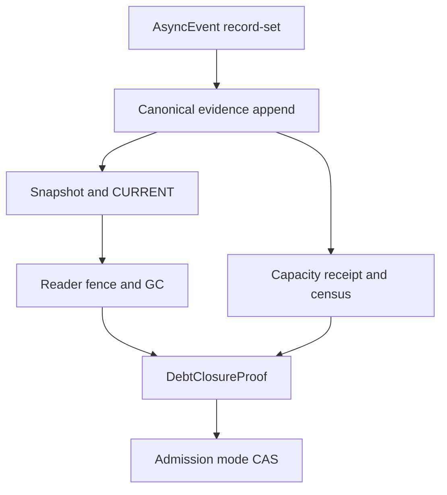
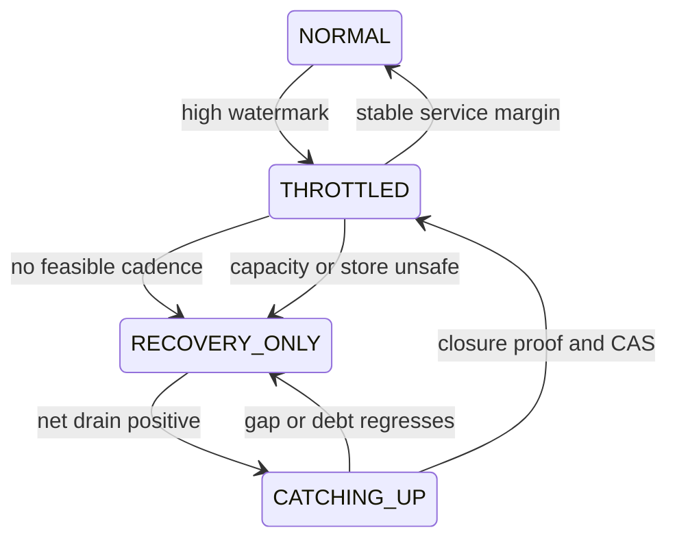

> 源码基线：pto-isa [`cbca1e9b`](https://github.com/hw-native-sys/pto-isa/commit/cbca1e9b9775c6aedeb49647a4c5e023b8658f88)，即研究时默认分支最新提交，由已合入 [PR #347](https://github.com/hw-native-sys/pto-isa/pull/347) 同步；本文直接引用的 completion、workspace、notify 规范与测试相对上一章未变化。统一 workspace/completion facade 来自已合入 [`e6334fbd`](https://github.com/hw-native-sys/pto-isa/commit/e6334fbd6c5d6bfdf550201bbdb81a71831a99af)。仓库当前没有 durable compactor、debt-closure controller 或 hysteresis release 实现；本文严格区分**当前代码/测试事实**、**教学演算**和**建议的 Host 恢复协议**。

## 本篇在 PTO 课程路线中的位置

[上一章]() 证明：当 canonical evidence 输入率 `λ_b` 长期不低于 compactor 吸收率 `μ_c`，调 checkpoint 周期无法让 backlog 收敛；系统必须限制新 admission，但继续接收已经提交 operation 的 completion/reset evidence。

今天只回答 backpressure 的反问题：进入 `RECOVERY_ONLY` 后，看到 backlog 降低，什么时候可以重新接流？答案不是“queue length 低于一个百分比”，而是四份可验证事实的合取：**canonical evidence 已连续追平、snapshot/manifest 已吸收、reader pin 已消除、device capacity receipt 已落账**。然后还要证明恢复后的新输入率不会再次超过处理能力。

课程位置是：`RECOVERY_ONLY → catch-up proof → debt closure → THROTTLED ramp → NORMAL`。

## 前置知识

- `AsyncCompletionRecord{addr, expected, kind}` 是 24 B runtime view；`addr` 是 borrowed pointer，不是 durable identity。
- SDMA event 可包含多个 per-queue record，URMA event 可包含多个 per-jetty record；必须完整合取。
- snapshot 覆盖到 revision `R`，新 segment 从 `R+1` 连续重放；原子 `CURRENT` 决定 canonical manifest。
- `AbandonWorkspace` 只清空 facade，不能证明 backend manager、native allocation 或 late writer 已消失。
- backpressure 必须保留 safety lane，让 completion、reset certificate 和 capacity receipt 继续进入 durable store。

## 今日两个核心问题

1. “已经追平”如何定义？为什么单个 backlog watermark 不能同时证明 durable storage、reader 与 device capacity 三类债务都闭合？
2. 如何从处理能力、检测窗口、snapshot 峰值和恢复 RTO 推导解除条件，并用 revision-bound hysteresis 防止 `NORMAL ↔ RECOVERY_ONLY` 抖动？

## PTO 全栈中的位置

当前 PTO 数据面只负责产生 event 和 native completion predicate。建议的 recovery controller 位于 Host durable evidence store 与 admission owner 之间：它读取 canonical revisions、reader lease、capacity ledger 和 fresh census，发布带 `pressure_epoch` 的 mode transition。它不改变 Tile 的 shape/layout/location，也不向设备伪造 barrier。

上图只有 `AsyncEvent`、record 导出和 workspace ownership 是当前仓库事实；其余对象是建议协议。

## 概念和精确语义

### 1. catch-up 不是“取最大的 completion”

设 durable store 为每个 canonical fact 分配连续 revision。建议至少维护：

- `R_append`：已 durable append、且没有 revision gap 的最大连续前缀；
- `R_snapshot`：当前 `CURRENT` manifest 的 snapshot 已吸收的最大 revision；
- `R_reader`：所有 active reader 已 ack，或已被 generation-fence 强制 reload 的最小 revision；
- `PendingCapacity`：已 terminal 但尚未完成 capacity CAS/fresh census 的 generation 集合。

前三者只有在共享 canonical revision 坐标时才能计算：

$$R_{catch}=\min(R_{append},R_{snapshot},R_{reader})$$

但 `PendingCapacity` 不能粗暴塞进这个 `min`：不同 allocation 可以乱序完成，某个旧 generation 仍占 1 MiB，并不阻止另一个 allocation 的新 evidence append。正确判据是：目标 pressure epoch 的所有 capacity action，要么在 `R_catch` 前有 owner-fenced receipt 并被 fresh census 验证，要么继续留在 pending set。也就是说，**watermark 证明连续前缀，pending set 证明非前缀债务**。

### 2. 三类 debt 必须分别闭合

沿用上一章的三维债务：

| 债务 | 产生原因 | 闭合证据 | 不能替代它的观测 |
| --- | --- | --- | --- |
| `U` uncheckpointed bytes | canonical append 尚未被 snapshot 吸收 | versioned manifest + `CURRENT` 覆盖到 revision | segment 文件变小、内存 queue 为空 |
| `P` reader-pinned bytes | reader 仍持有旧 manifest/segment | revision-bound ack，或先 fence token 再强制 reload | lease 超时、reader 进程暂时无响应 |
| `C` unreclaimed capacity | completion/reset 已知但 capacity apply 未闭合 | generation-bound receipt + ledger CAS + fresh backend census | `AbandonWorkspace`、Host pointer 清空、GM used bytes 下降 |

`RECOVERY_ONLY` 的退出不是要求三者永远为零，而是：所有 correctness-critical gap 与当前 generation 的 `C` 必须闭合；`U/P` 降到由 RTO、空间和下一档 admission 共同推导的安全低水位，并且仍在下降或稳定。

### 3. low watermark 必须从预算反推

令下一档 admission 下 evidence 输入率为 `λ_next` bytes/s，恢复检测窗口为 `T_detect`，snapshot/cutover 峰值为 `S_peak`，不可挪用 emergency reserve 为 `D_emergency`，当前 durable free space 为 `D_free`。解除 recovery-only 前至少满足：

$$D_{free}\ge S_{peak}+D_{emergency}+\lambda_{next}T_{detect}+U$$

replay RTO 又给 `U` 一个上界。若 replay 吞吐为 `μ_r` bytes/s、固定恢复耗时为 `T_base`：

$$U\le(RTO-T_{base})\mu_r$$

因此 low watermark 不是固定 30%：

$$U_{low}\le\min((RTO-T_{base})\mu_r,\ D_{free}-S_{peak}-D_{emergency}-\lambda_{next}T_{detect})$$

此外必须有 `λ_next < μ_c`，并为测得的 burst/P99 抖动留出 margin。若下一档恢复流量后 `λ_next ≥ μ_c`，即使当前 `U=0`，它也会立刻重新积压，不能 release。

## 真实文件、类型与 API 逐段解读

### `AsyncEvent::CompletionRecordCount/At`

[`comm_types.hpp`](https://github.com/hw-native-sys/pto-isa/blob/cbca1e9b9775c6aedeb49647a4c5e023b8658f88/include/pto/comm/comm_types.hpp) 定义 `CompletionKind` 与 24 B `AsyncCompletionRecord`。非零 event 无法解析完整记录时，`CompletionRecordCount` 返回 `UINT32_MAX` sentinel；零只留给空 event。

[`async_event_impl.hpp`](https://github.com/hw-native-sys/pto-isa/blob/cbca1e9b9775c6aedeb49647a4c5e023b8658f88/include/pto/comm/async_common/async_event_impl.hpp) 对 SDMA 从 handle 解出 `postId` 和 `queueCount`，对每个 queue 导出 `postDone` 地址；URMA multi-jetty 路径先逐 jetty 验证 record 存在，再返回完整数量。这里给 recovery controller 的硬约束是：**错误和 incomplete set 不能被当成“没有债务”**。

### `CheckPostDoneIds`

[`sdma_async_detail_post.hpp`](https://github.com/hw-native-sys/pto-isa/blob/cbca1e9b9775c6aedeb49647a4c5e023b8658f88/include/pto/comm/async/sdma/sdma_async_detail_post.hpp) 对 `queueMask` 中每条 queue 检查 `postDone >= postId`；任一 queue 未达标，non-blocking test 返回 false。`nextPostId` 还持久化到 live workspace，session rebuild 不会从零开始。

这说明 Host compactor 压力再高，也不能只摄取“最先完成的 queue”后关闭 capacity debt。catch-up 的输入必须是完整 record-set 对应的 canonical terminal fact。

### `DestroyWorkspace` 与 `AbandonWorkspace`

[`workspace.hpp`](https://github.com/hw-native-sys/pto-isa/blob/cbca1e9b9775c6aedeb49647a4c5e023b8658f88/include/pto/comm/workspace.hpp) 中，`DestroyWorkspace` 按 engine 删除具体 manager 再清空 POD；`AbandonWorkspace` 只调用 `ClearWorkspace`。因此 recovery-only 期间即使 facade 已清空，`C` 仍不能减少。只有 backend completion/reset 覆盖、owner-fenced apply 和 fresh census 共同证明容量返还，ledger 才能结算。

## 对象与中间状态生命周期

以一个 SDMA notify operation 为主线：

1. kernel 经 `TPUT_ASYNC_NOTIFY` 得到 `AsyncEvent`，live workspace 保存 queue/post 状态；
2. Host adapter 枚举完整 record-set，绑定 allocation/generation/operation identity，写 `EvidenceRecord`；
3. append revision 进入 active segment，compactor seal 一个连续前缀并生成 snapshot/manifest；
4. `CURRENT` 切换后，reader ack 或被 fence/reload，旧 segment 才可 GC；
5. terminal evidence 驱动 capacity apply；receipt 以 owner epoch/revision CAS 写回，fresh census 确认 backing 真正可用；
6. controller 聚合 `R_catch`、pending set、空间与速率，发布 `DebtClosureProof`；admission owner 对相同 pressure epoch 做 mode CAS。

`AsyncCompletionRecord.addr` 在第 2 步后就不应进入 durable snapshot；重启恢复使用稳定 identity 和事实摘要，不重新解引用旧 GM/CQE 地址。

## 端到端状态机

进入 degraded state 可以快：一旦空间、RTO 或 capacity reserve 违反 hard bound 就立刻收紧。退出必须慢：

1. fresh census 绑定 `pressure_epoch` 与 `observed_revision`；
2. `R_append/R_snapshot/R_reader` 连续且 pending capacity set 满足目标范围；
3. `U/P/C` 满足各自 low bound，`dU/dt≤0`，store/compactor 无错误；
4. 在至少覆盖 `T_detect + T_cutover_p99` 的稳定窗口内，下一档 projected input 仍小于 `μ_c`；
5. CAS 发布 `ModeTransition{from,to,pressure_epoch,debt_digest,census_revision}`；所有 admission 在发放资源前重读 mode generation。

任一 gap、wrong epoch receipt、reader 复活或 capacity census 回退，都使 closure proof 失效并回到更保守状态。

## 具体 shape、Tile 与状态演算

继续使用真实 notify 测试相同的通信语义，Tile 为 `16×16xf32` ND，payload 1024 B，UB scratch 256 B，SDMA `queueNum=4`。以下 Host 数字是教学参数，不是仓库 benchmark。

进入 `RECOVERY_ONLY` 时：`U=18 MiB`、`P=10 MiB`、`C=4 MiB`；safety lane 仍产生 `50 KiB/s` canonical evidence，compactor 有效吸收 `400 KiB/s`，所以净 drain 为 `350 KiB/s`。40 秒后：

$$U=18-350\times40/1024\approx4.33\ MiB$$

此时不能恢复：一个旧 reader 仍 pin 10 MiB；allocation `alloc-9/g7` 的 notify 目标 `postId=130`，四条 queue 只到 `[130,130,130,129]`，对应 capacity receipt 尚不合法。

随后 controller 先 fence 旧 reader token、强制加载新 `CURRENT`，GC 后 `P` 降到 1 MiB；queue3 到 130，完整 record-set 变 terminal，capacity apply CAS 和 fresh census 使 `C=0`。这才得到 closure proof。

准备进入 `THROTTLED` 时，测得下一档 `λ_next=300 KiB/s < μ_c=400 KiB/s`。若 `S_peak=16 MiB`、`D_emergency=8 MiB`、`T_detect=20 s`，则仅下一窗口增长就需约 5.86 MiB；包含 snapshot 与 reserve 至少需要 29.86 MiB free space。fresh census 报告 34 MiB，且 `U=4.33 MiB` 已计入完整不等式，才允许 mode CAS。

从 `THROTTLED` 到 `NORMAL` 再用实际流量重估：若 projected full-load evidence 已接近或超过 `μ_c`，就停在 throttled；不能因为上一轮 debt 已清零而全量打开。

## 为什么这样设计及替代方案

**替代 A：backlog 低于 30% 就恢复。** 百分比没有连接 RTO、snapshot 峰值、磁盘空间或下一档输入率；容量不同的部署会得到相反结论。

**替代 B：等所有 debt 绝对清零。** 最保守但可能永不发生：safety lane 持续产生 evidence，正常 reader 总会 pin 当前 manifest。正确目标是无 correctness gap、目标 generation 的 capacity debt 闭合，并满足推导出的低水位。

**替代 C：只看 `U` 的下降斜率。** compactor 可能追平日志，但 stale reader 仍 pin 大量 segment，或 device capacity receipt 尚未 apply；此时恢复会触发 ENOSPC 或 allocation failure。

**替代 D：一步从 recovery-only 回 NORMAL。** 控制最少，却无法测出 admission 恢复后的真实 `λ_next` 与 burst。分级 ramp 让每一步都可逆，并用同一 hard equation 决定是否继续。

**建议：vector debt + prefix watermark + pending set + mode CAS。** 复杂性只增加在不同资源不能互相证明的地方；如果部署是单 reader、同步 snapshot、无异步 device work，可退化为一个简单的 prefix watermark，但不能删掉 generation/owner fence。

## 访存、计算、流水、并行和硬件约束

本章不改变 NPU 的 DMA payload、Tile layout 或 pipe barrier。新增工作在 Host：durable append、snapshot/cutover、reader fencing、capacity census、速率估计和 CAS。评估时分别测 `λ`、`μ_c`、replay throughput、snapshot peak、fsync/conditional-put P99、reader lag、capacity apply latency 和 GC reclaim；设备 SDMA 带宽不能代替这些数据。

多个 compactor/owner 并行时，`pressure_epoch` 负责拒绝旧 controller 的 release；`debt_digest` 防止相同 revision 下债务集合发生 ABA。owner lease 过期只撤销后续 publish/delete 权限，不取消在途 snapshot I/O，也不能让 completion record 消失。

**硬件映射推断：** 公开代码能确认 SDMA per-queue `postDone`、URMA per-jetty CQE、workspace manager 与 live session 的 post ID 连续性；无法确认 reset 的精确物理覆盖、掉电持久性、MR revoke 或 cache-coherence 细节。`DebtClosureProof` 是 Host control-plane 设计，不是 Ascend 硬件现有指令。

## 测试证据与未覆盖风险

[`tput_async_notify/main.cpp`](https://github.com/hw-native-sys/pto-isa/blob/cbca1e9b9775c6aedeb49647a4c5e023b8658f88/tests/npu/a2a3/comm/st/testcase/tput_async_notify/main.cpp) 注册 2-rank、queue4 的 Set、payload consume、AtomicAdd、65-post ring reuse、interleaved reuse、non-zero group 与并发 AIV。interleaved case 在 [`tput_async_notify_kernel.cpp`](https://github.com/hw-native-sys/pto-isa/blob/cbca1e9b9775c6aedeb49647a4c5e023b8658f88/tests/npu/a2a3/comm/st/testcase/tput_async_notify/tput_async_notify_kernel.cpp) 从 notify `postId=2` 出发，插入 127 次 ordinary post，使第二次 notify 到 `postId=130` 并复用 slot 2。这证明 live workspace 的 post/slot 保护，不证明 Host debt 能追平。

提交 [`e6334fbd`](https://github.com/hw-native-sys/pto-isa/commit/e6334fbd6c5d6bfdf550201bbdb81a71831a99af) 报告 workspace header compile、URMA 2-rank 6 cases；SDMA runtime 当时只编译。当前测试树没有 durable `R_append/R_snapshot/R_reader`、capacity receipt、pressure epoch、mode CAS 或 hysteresis controller；本章未重跑 NPU 真机。

最小新增测试应使用 fake clock/store/backend：

1. 让 `U` 下降但 `P` 不变，断言不得 release；
2. 四条 queue 只完成三条，断言 safety lane 继续摄取且 `C` 不归零；
3. 注入 stale reader、wrong-epoch capacity receipt、fresh census 回退和 compactor crash，断言 closure proof 失效；
4. 在 `λ_next` 接近、等于和超过 `μ_c` 时验证 ramp/hold/rollback；
5. 在 transition CAS 前后 crash，重放必须得到唯一 mode generation，旧 controller 不得重新打开 admission。

未覆盖风险包括速率估计滞后、burst heavy-tail、snapshot size 突增、object-store eventual list、reader fence 失效、capacity census 不完整，以及 SDMA/URMA/RDMA 真机 reset-scope differential Golden。

## 与前后章节的连接

第 69 章回答“什么时候必须收紧 admission”，本章回答“如何证明可以逐步放开”。第 59 章曾讨论 durable revision 与 NORMAL handoff；本章进一步把 handoff 拆成 compaction prefix、reader pin、capacity pending set 和 projected service margin，避免用单一 revision 越级证明所有资源。

下一章应回到实现边界：controller 根据旧 census 做出 release 后，新的 completion/capacity debt 可能在 CAS 前插入。需要研究 **Admission Token、Census Revision 与 TOCTOU-free Capacity Reservation**。

## 本篇结论

1. catch-up watermark 只证明 canonical 连续前缀；乱序 capacity debt 还需要 generation-bound pending set。
2. uncheckpointed、reader-pinned 与 unreclaimed device capacity 必须分别闭合，不能互相替代。
3. low watermark 从 replay RTO、snapshot 峰值、emergency reserve、检测窗口和下一档输入率反推，不是固定比例。
4. release 前必须证明 `λ_next < μ_c`，否则 debt 清零也只是下一次过载的起点。
5. `RECOVERY_ONLY → THROTTLED → NORMAL` 的每次转换都绑定 pressure epoch、fresh census、debt digest 与 mode CAS。

## 知识债

- 当前仓库没有 canonical revision schema、snapshot/manifest store、reader fence、capacity receipt、fresh census 或 mode controller。
- `λ/μ_c` 的分位数估计、burst margin、`T_detect` 与 cutover P99 需要真实 workload 标定。
- 缺少 SDMA/URMA/RDMA completion adapter 与 Host durable record 的 differential golden。
- 缺少 stale controller、wrong epoch、reader resurrection、partial capacity apply、ENOSPC 和 crash-at-CAS fault matrix。

## 三个理解检查问题

1. 为什么 `R_catch=min(R_append,R_snapshot,R_reader)` 仍不能证明所有 device capacity 已返还？
2. `U` 已降到零，但 full-load `λ_next≥μ_c`，为什么仍不能回到 NORMAL？
3. reader lease 已超时，删除它 pin 的旧 segment 前还必须完成什么 fence？

## 下一章

**放流和分配必须是同一事务：Admission Token、Census Revision 与 TOCTOU-free Capacity Reservation。**

## 课程账本增量

- 新增建议对象：`DebtClosureProof`、`CatchUpWatermark`、generation-bound `PendingCapacity`、`ModeTransition` 与 pressure-epoch CAS。
- 新增不变量：prefix watermark 不覆盖乱序 capacity debt；三类 debt 分别闭合；release threshold 从 RTO/空间/服务率推导；下一档输入率必须低于 compaction 能力。
- 新增演算：18 MiB uncheckpointed 在 350 KiB/s 净 drain 下 40 秒降到约 4.33 MiB，但 reader pin 和 queue4 partial completion 仍阻止 release；完成 fence、capacity census 与空间预算后才进入 throttled。
- 新增测试债：vector debt、partial record-set、stale reader/controller、wrong epoch receipt、rate boundary 与 crash-at-CAS Golden。

## 第十次七章知识图谱回顾（课程 64–70）

- 主线已经从 terminal verdict 推进到长期稳定恢复：`terminal CAS → idempotent apply/compensation → orphan GC → epoch tombstone/reuse fence → completion/reset watermark → snapshot/manifest cutover → cadence/backpressure → catch-up release`。
- 统一不变量是：**软件状态提交、设备旧 writer 消失、物理容量返还和新 generation admission 是四个不同提交点**，任何超时、地址复用或空间下降都不能越级。
- 当前最大缺口已从 ISA 指令语义转向 Host durable recovery 实现：canonical schema/store、backend reset certificate、reader/owner fencing、capacity census、mode/admission CAS 与 crash fault harness。
- 后续路线调整：先闭合 admission token 与 census revision 的 TOCTOU，再决定继续实现 recovery control plane，还是回到 PTOAS/pypto 的 generation/lease lowerings 做跨栈落地。
