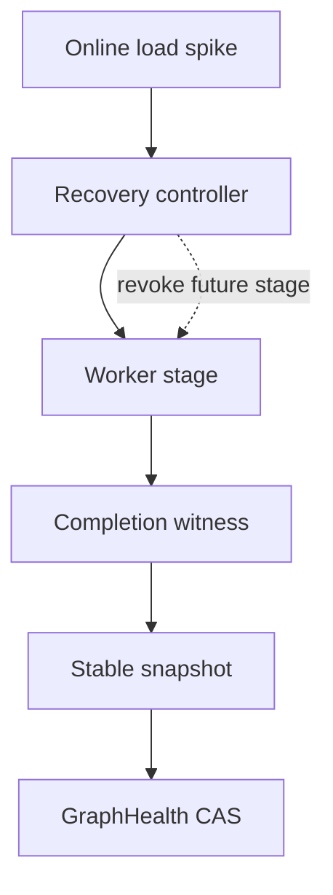
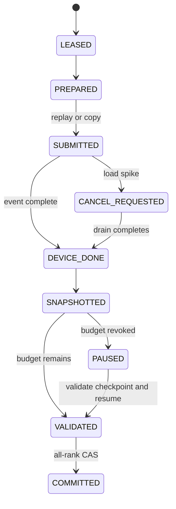

> 源码基线：vLLM [`689effee`](https://github.com/vllm-project/vllm/commit/689effee6d07bfeb0afe42d44046141657238c23)，即研究时默认分支最新提交；该提交修复 Triton MLA decode 的 `int32` overflow 与 logits workspace 计账，和本文主路径无直接关系。本文严格区分**当前代码事实**、**测试/commit 事实**与**建议协议**。`RecoveryCheckpoint`、stage lease 和 safe-resume controller 尚不是 vLLM 现有实现。

## 本篇在课程路线中的位置

上一篇把 `EAGER_ONLY` backlog 变成有 eligibility、GPU time、temporary memory、priority aging 和 deadline 的恢复调度。今天继续追问最危险的中间态：revalidation 已拿到预算并开始 replay，在线请求突然涌入，controller 能否“抢占”它并把 GPU/显存立刻还给前台？

课程位置是：`RecoveryLease → stage submit → completion fence → checkpoint → pause → validate-and-resume`。本章只讲抢占边界与恢复语义，不重新讨论谁先获得预算。

上一篇：[谁先修、修多久]()。

## 前置知识回顾

- lease 到期只撤销尚未开始的权限，不能证明已经提交的 device work 停止。
- graph generation、fingerprint、expected ranks 和隔离资源是 revalidation 的 correctness gate。
- `CUDAGraphWrapper` 要求 replay 输入地址稳定；graph output 也绑定 capture pool 中的存储。
- 在线推理和恢复共用设备。抢占的目标是缩短前台受影响窗口，而不是伪造“GPU 已空闲”。

## 本篇要回答的核心问题

1. 哪些 revalidation 阶段可以立即取消，哪些只能标记 `CANCEL_REQUESTED` 后等待 completion/drain？
2. checkpoint 最少保存什么，才能避免重复副作用，又不尝试序列化 `cudaGraphExec_t`？
3. resume 时如何证明旧输出仍有效，尤其是 persistent output、异步 D2H copy 和 TP/PP 多 rank？

## 组件在全局架构中的位置

当前 vLLM 没有 revalidation job。下面的控制器是基于已有 execution primitive 推导的建议层：它不侵入在线 `Scheduler.waiting/running`，而是在 graph-health 控制面持有短 stage lease；worker 只在安全边界检查撤销。



关键不是给每个 kernel 塞一个 cancel flag，而是把不可撤销的 device side effect 包在可观察、可结算的 stage 里。

## 完整调用链

以 FULL CUDA Graph 的一次隔离验证为例，当前代码事实链如下：

1. `GPUModelRunner` 根据 `BatchExecutionDescriptor` 准备固定 input buffer；capture 输出由 [`store_capture_output`](https://github.com/vllm-project/vllm/blob/689effee6d07bfeb0afe42d44046141657238c23/vllm/v1/worker/gpu/cudagraph_utils.py) 拷贝到 `self.hidden_states`、`aux_hidden_states` 或 `IntermediateTensors` 的 persistent buffer。
2. [`CUDAGraphWrapper.__call__`](https://github.com/vllm-project/vllm/blob/689effee6d07bfeb0afe42d44046141657238c23/vllm/compilation/cuda_graph.py) 以 `BatchDescriptor` 找 entry；replay 前 debug 模式检查 tensor `data_ptr()`，同步 offloader 的前置 copy，然后调用 `entry.cudagraph.replay()` 并返回 capture 时保存的 output 引用。
3. 如果 sampling 走 async output，`AsyncGPUModelRunnerOutput` 让 copy stream 等 default stream，把 token/logprobs 非阻塞拷到 Host，并记录 `async_copy_ready_event`；[`get_output()`](https://github.com/vllm-project/vllm/blob/689effee6d07bfeb0afe42d44046141657238c23/vllm/v1/worker/gpu_model_runner.py) 先 `synchronize()`，再释放 device tensor 引用。
4. PP 发送同样不是“发起即完成”。[`GPUWorker.execute_model`](https://github.com/vllm-project/vllm/blob/689effee6d07bfeb0afe42d44046141657238c23/vllm/v1/worker/gpu_worker.py) 保存 non-blocking send handles，并在下一轮 forward 顶部逐个 `wait()`，避免覆盖仍被通信读取的 buffer。

因此 host 函数返回、lease 过期、甚至 graph replay 已 enqueue，都不是“结果可读/存储可复用”的证据；event 或 handle completion 才是 stage fence。

## 关键类型、字段和状态生命周期

### 当前真实对象

`CUDAGraphEntry` 持有 graph、固定 input addresses 和 output weak refs；`ModelCudaGraphManager` 另外把 capture output 复制进长期 buffer。它们属于 worker 进程，worker 重启后不能靠磁盘 checkpoint 复活。

`AsyncGPUModelRunnerOutput` 则展示了一套可复用的生命周期模式：创建时持有 device tensors，copy stream 等 producer stream，event 记录完成，消费者同步 event 后才删引用。近期已合入的 [`36e0ae2d`](https://github.com/vllm-project/vllm/commit/36e0ae2df2882de8027bb484da9179c10646ccee) 也为 DBO/DeepEP 跨 stream Tensor 增加 `record_stream`，防止 allocator 在另一个 ubatch kernel 尚在读取时复用内存。

### 建议的 `RecoveryCheckpoint`

```text
RecoveryCheckpoint(
  job_id, attempt, key, graph_generation,
  code_model_backend_topology_fingerprint,
  stage, capacity_revision, expected_ranks,
  input_digest, completion_receipts,
  stable_output_digest_or_snapshot_ref,
  isolation_reservation_id
)
```

它保存**控制状态和证据引用**，不保存 graph executable。若 worker attempt/context generation 已变化，checkpoint 最多告诉新 worker“哪些 intent 曾经发生”，不能跳过 recapture。

## 逐函数源码解读

### `CUDAGraphWrapper.__call__`：replay 是一个提交点

entry 缺 graph 时进入 capture；已有 graph 时检查地址、同步 offloader、调用 `replay()`。调用之后没有 per-graph cancel handle。Host 可以停止发下一 stage，却不能把已入 stream 的 kernels 从中间拔掉。即使使用 [`BreakableCUDAGraphCapture`](https://github.com/vllm-project/vllm/blob/689effee6d07bfeb0afe42d44046141657238c23/vllm/compilation/breakable_cudagraph.py)，其 `replay()` 也只是按顺序调用 graph/eager segments；这里的 “breakable” 是 capture 分段，不是任意时刻的 job preemption。

### `store_capture_output`：output 是可变工作区，不是耐久 checkpoint

last PP rank 的 `hidden_states[:num_tokens] = hidden_states` 会写入 runner 复用的 persistent buffer。下一次同类 replay 可以覆盖同一片存储。revalidation 若想在 pause 后复用 graph 结果，必须在释放 lease 前把需要的 oracle 拷到隔离 buffer/Host，或保存经过 completion fence 后计算的 digest；只存 Python Tensor view 会读到未来一轮内容。

### `AsyncGPUModelRunnerOutput.get_output`：完成证据和所有权必须配对

event 证明 copy stream 之前的工作完成，强引用保证这期间 allocator 不能回收 producer Tensor；两者缺一不可。把这个模式移植到 recovery stage，就是：submit 后记录 event/handle、保留 reservation 和 buffer ownership；只有 event 完成且 snapshot 落定后，才允许归还预算。

### `execute_model_state`：进程内 continuation 不是恢复 checkpoint

`GPUModelRunner.execute_model` 把 logits、hidden states、scheduler output 等存入 ephemeral `execute_model_state`，`sample_tokens()` 读取后立刻置 `None`。它证明将长事务切成两个 Host 阶段是可行的，也说明该 continuation 只在同一 runner 生命周期有效；worker crash 或新的 execute 覆盖之前都必须被消费，不能直接当作 durable resume state。

## 状态机与安全抢占点



- `LEASED/PREPARED`：尚未提交 device side effect，可立即取消并释放 reservation。
- `SUBMITTED`：不可抢占。撤销只把状态改为 `CANCEL_REQUESTED`，仍需 event、communication handle 或覆盖该 scope 的 reset witness。
- `DEVICE_DONE`：设备工作完成，但 persistent output 仍可能被下一 replay 覆盖；先 snapshot/digest。
- `SNAPSHOTTED`：最合适的 pause 点。可以归还临时 buffer，但 checkpoint 引用的内容必须独立、generation-bound。
- `VALIDATED`：还未 promotion。若 capacity revision 变化，可暂停 commit；如果 graph generation/fingerprint 已变，丢弃旧 verdict。
- `COMMITTED`：通过 expected-rank CAS 更新 health；重复 attempt 只能幂等读取同一 commit，不能重复 promotion。

## 具体示例与 shape/状态演算

以下数字只用于演算，不是 vLLM benchmark。TP=2 验证 FULL K16，hidden size=4096，dtype=`bf16`。每 rank graph output 为 `16 × 4096 × 2 = 131072` bytes，即 128 KiB。

假设一次 job 分四段：prepare 6 ms/4 MiB；graph replay 32 ms；snapshot 18 ms/8 MiB；eager oracle+compare 40 ms/12 MiB。replay 开始 10 ms 后在线负载突增，controller 撤销 stage lease。

1. 两个 rank 都已 `SUBMITTED`，不能声称立刻返还 replay 所占 stream 和 persistent buffer。
2. 两 rank 继续到各自 completion event；若 rank0 完成而 rank1 尚未完成，group 仍是 `CANCEL_REQUESTED`。
3. rank1 完成后，各 rank 把 128 KiB 结果复制到隔离 snapshot，写入 rank receipt；此时可 checkpoint 为 `GRAPH_SNAPSHOTTED`。
4. online budget 仍紧张，于是暂停，不启动 40 ms eager oracle。
5. 恢复时重新验证 `job/key/generation/fingerprint/expected_ranks/capacity_revision`。若 worker attempt 与 graph generation 未变、snapshot receipts 完整，则从 eager oracle 继续；若任一 rank已重启，snapshot 或 graph handle 失效，从 capture/replay 的最早安全点重做。

这比“10 ms 时 kill worker”少破坏一个 TP replica，也比“无论负载都把 96 ms job 跑完”更保护在线 SLO；代价是 stage fence、snapshot 和 resume validation。

## 为什么这样设计及替代方案

**整项不可抢占。** 实现最简单，却让 recovery deadline 直接变成在线 tail-latency 风险；job 越大越糟。

**任意点 kill worker。** 能强制终止 device context，但 reset scope 通常从 key 放大到 worker/TP replica，还会丢失在线 in-flight work；它是最后 containment，不是常规抢占。

**把每个 CUDA Graph segment 当抢占点。** `BreakableCUDAGraph` 确实有 segment，但 eager op 可能含 KV transfer/host side effect，跨 segment 还共享静态 buffer；没有 completion、side-effect receipt 和 all-rank fence，分段本身不构成 safe checkpoint。

**stage checkpoint。** 在 Host 可观察边界暂停，保留最少证据。正确性 checkpoint（completion/ownership receipt）是必需成本；性能 snapshot 是否值得做，可用下式决策：

\[
P(\text{下个安全点前被抢占})\times C_{\text{剩余重算}}
> C_{\text{snapshot}} + C_{\text{resume-validate}}
\]

这不是固定阈值；只决定是否保存可复用结果，不能跳过 completion fence。

## 性能、并发、正确性与边界条件

- **在线容量**：load spike 只能 revoke future stage。admission 还必须把 `recovery_inflight` 计入当前 GPU/显存占用，直到 fence 闭合。
- **显存**：persistent graph output 不因 pause 自动释放；snapshot 也会增加临时峰值。预算同时计 graph reservation、snapshot 和 failure reserve。
- **TP/PP**：checkpoint 是 group-level。部分 rank pause、部分 rank 继续，会破坏 collective 顺序；resume 需要 expected-rank receipts 和同一 attempt/generation。
- **地址与 generation**：相同 `data_ptr()` 不能排除 reset 后 ABA。resume 同时验证 worker/context generation，而不是只比地址。
- **失败方式**：event/handle 丢失时 verdict 是 `UNKNOWN`；只能 drain、扩大 reset scope 或从可信边界重做，不能猜测完成。
- **维护成本**：stage 越细，checkpoint/状态组合越多。应先围绕真实 event、comm handle 和 output ownership 划 3–5 个粗边界，再用测量决定是否细分。

## 测试证据与未覆盖风险

当前 [`test_cudagraph_dispatch.py`](https://github.com/vllm-project/vllm/blob/689effee6d07bfeb0afe42d44046141657238c23/tests/v1/cudagraph/test_cudagraph_dispatch.py) 用 `BatchDescriptor(num_tokens=10)` 先 capture，再断言一次 replay，并以 `torch.testing.assert_close` 比较 eager/replay；mode mismatch 与 `NONE` 测试验证 bypass。它证明正常路径的 dispatch 与数值等价，不覆盖中途撤销。

[`test_breakable_cudagraph.py`](https://github.com/vllm-project/vllm/blob/689effee6d07bfeb0afe42d44046141657238c23/tests/v1/cudagraph/test_breakable_cudagraph.py) 在 `cap.replay()` 后显式 `torch.accelerator.synchronize()` 再断言状态，并验证 graph/eager/graph 顺序。这恰好说明测试把同步当 completion fence；但没有在 segment 间注入在线 budget revoke，也没有验证部分副作用恢复。

仍缺四组直接测试：

1. fake-clock load spike 在 `PREPARED/SUBMITTED/DEVICE_DONE/SNAPSHOTTED` 各点触发，断言只有未提交阶段立即释放；
2. 延迟 CUDA event 与 PP send handle，断言 reservation 在 completion 前不归还、buffer 不被复用；
3. TP=2 一 rank 完成、一 rank crash，断言 checkpoint 不完整且不得 resume/commit；
4. snapshot 后再 replay 覆盖 persistent buffer，断言 resume 使用独立 snapshot/digest，并拒绝旧 generation、旧 capacity revision 和重复 commit。

本章没有声称重跑 GPU 测试；上述测试行为来自当前仓库源码。

## 与前后章节的连接

第 59 章解决“谁获得 recovery 时间”，本章解决“获得后在哪里能安全让出”。两者共同约束预算：调度器不能把 lease expiry 当设备资源返还。下一章将继续收紧最后一步：暂停后可能出现迟到 event、重复 attempt 与旧 snapshot，如何用 attempt fencing、stage receipt 和 exactly-once promotion 防止旧结果覆盖新 generation。

## 本篇结论

1. GPU recovery 的抢占粒度不是任意 kernel，而是 completion/ownership 可证明的 stage。
2. 已提交 replay/copy/collective 只能请求取消并等待 drain；lease 到期不等于停止。
3. persistent output 必须在 pause 前复制或摘要，普通 Tensor view 不是 checkpoint。
4. checkpoint 保存 intent、identity、stage receipts 与 snapshot reference，不保存 graph executable。
5. safe resume 是一轮重新验证：generation、fingerprint、expected ranks、reservation 和 snapshot 任一不匹配就回退到更早安全点。

## 知识债

- 当前仓库没有 `RecoveryCheckpoint`、stage lease、load-revision revoke 或 group resume CAS。
- 缺少 graph replay、D2H copy、PP/TP collective 各自的统一 completion receipt adapter。
- snapshot 的最佳粒度、Host/device 放置、digest tolerance 与真实开销尚未基准化。
- worker reset 后从哪个 stage 重做、在线 request 与恢复任务共用 stream 时怎样做优先级，仍需实现与故障注入验证。

## 三个理解检查问题

1. 为什么 `BreakableCUDAGraphCapture.segments` 存在，仍不能推出任一 segment 结束都能安全暂停 recovery？
2. 在线负载在 replay enqueue 后突增，controller 最先能安全释放哪些资源，哪些必须等 event/handle？
3. checkpoint 写着 `GRAPH_DONE`，但一个 TP rank 换了 worker attempt，为什么不能从 eager oracle 继续？

## 下一章

**迟到结果不能复活旧任务：Attempt Fencing、Stage Receipt 与 Exactly-once Promotion。**

## 课程账本增量

- 新增当前代码证据：graph replay 的静态地址与 weak/persistent output、async copy event 的完成/所有权协议、PP send handle 的下一轮 fence、breakable graph 的 capture 分段语义。
- 新增关键不变量：lease expiry 不撤销已提交 device work；persistent output view 不是 checkpoint；group resume 必须验证所有 expected ranks 与 worker/context generation。
- 新增建议协议：`RecoveryCheckpoint`、`CANCEL_REQUESTED`、stage completion receipt、stable snapshot 与 all-rank resume/commit CAS。
- 新增测试债：stage-point cancel、delayed event/handle、partial-rank crash、output overwrite、stale generation 与 duplicate commit Golden。
