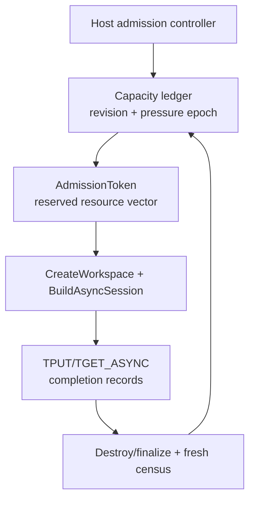
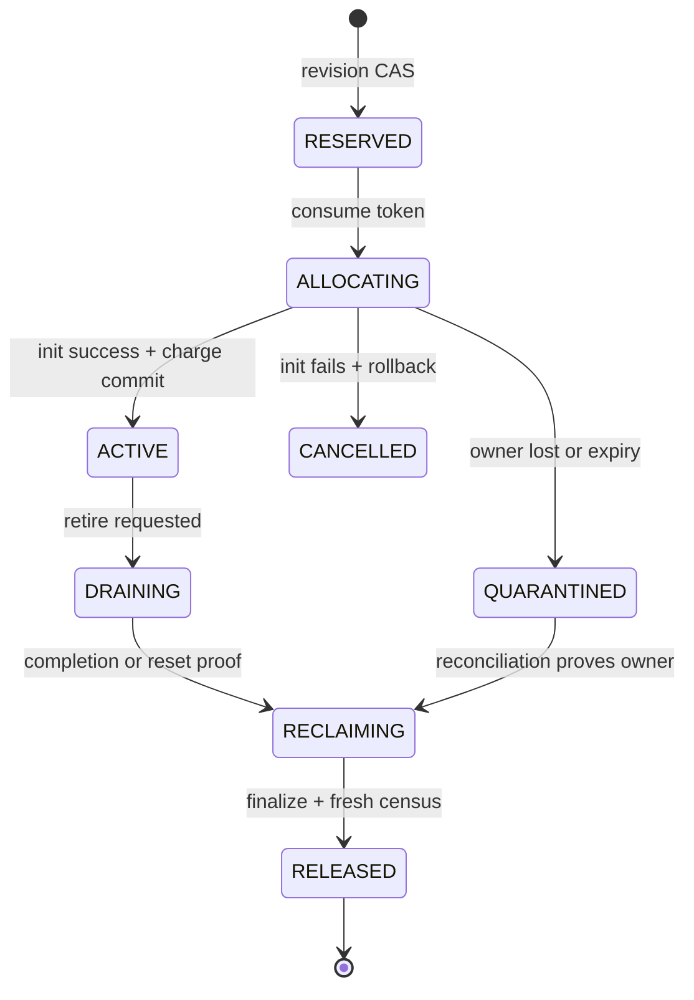

> 源码基线：pto-isa [`b1d460ee`](https://github.com/hw-native-sys/pto-isa/commit/b1d460ee8c001585ede36b68ba3678dc5a226bbf)，即研究时默认分支最新提交。该同步提交包含 ISA/IR 文档、CPU-SIM 修复，也补齐了 HNS1825 RDMA completion record 的导出；本文容量主线继续建立在统一 workspace/completion facade 提交 [`e6334fbd`](https://github.com/hw-native-sys/pto-isa/commit/e6334fbd6c5d6bfdf550201bbdb81a71831a99af) 上。仓库当前没有 admission controller、capacity census 或 reservation token；文中的事务协议是基于当前资源生命周期事实推导出的建议设计。

## 本篇在 PTO 课程路线中的位置

[上一章]()已经回答：只有 canonical prefix、reader fence、capacity receipt 与 fresh census 同时闭合，系统才可从 `RECOVERY_ONLY` 逐步恢复 admission。

但“允许接新任务”不等于“新任务已拿到资源”。第 71 章补上这条缝：读取 census、作出 admission 决策、预留容量必须有同一个线性化点，否则两个并发控制器都可能看到同一份空闲量并各自放行。

## 前置知识

- `Workspace` 是 Host 持有的 `{addr, bytes, engine, impl}`；`impl` 指向 backend manager。
- `AsyncEvent` 可导出一个或多个 `AsyncCompletionRecord`，SDMA 按 queue、URMA 按 jetty、RDMA HNS1825 按 CQE 判断完成。
- completion 只证明已提交 device work 结束；`DestroyWorkspace` 才执行 backend finalization/free。
- `AbandonWorkspace` 仅清空 Host POD，不释放 manager 资源，不能被计为 capacity return。

## 今日两个核心问题

1. 为什么 `fresh census → check free bytes → CreateWorkspace` 仍然会超卖？
2. 怎样让 admission、预留、真实分配、完成与返还形成一个可恢复、不可重复消费的事务？

## PTO 全栈中的位置



上游输入是 operation 的资源计划：engine、device/rank、workspace bytes、notify/CQ/SQ/stream 等 backend 资源和峰值临时内存。下游消费者首先是 `CreateWorkspace`，随后是 `BuildAsyncSession` 和异步通信指令；最终由 completion/reset evidence 与 backend finalization 共同驱动容量返还。

## 概念和精确语义

### `CapacityCensus`

一次 census 不是一个孤立的 `free_bytes`，而是带版本的资源向量：

```text
CapacityCensus {
  device_id, engine, pressure_epoch, revision,
  physical_free, reserved, allocated, quarantined,
  queue_slots, cq_slots, stream_slots,
  emergency_reserve, observed_at
}
```

`revision` 保护“我检查的状态仍是我提交时的状态”；`pressure_epoch` 防止旧的 NORMAL/THROTTLED 控制器在新一轮故障后继续放流。资源向量必须覆盖真正稀缺的维度，不能只看 GM bytes。

### `AdmissionToken`

token 是容量预留的唯一消费凭证：

```text
AdmissionToken {
  token_id, owner_epoch, census_revision,
  device_id, engine, rank_set,
  reserved_resources, request_digest,
  state, expires_at
}
```

前置条件是 mode 允许、epoch/generation 匹配、`revision == expected_revision`，且每个资源维度在扣除 emergency reserve 后都足够。成功后必须原子地增加 `reserved`、推进 revision，并返回唯一 token；失败不产生部分预留。

后置条件也很关键：token 只能从 `RESERVED` 消费一次。相同 `token_id + request_digest` 的重试可以幂等返回原结果；不同 digest 的复用必须拒绝。token 到期只表示控制权失效，不证明已经启动的 `aclrtMalloc`、stream 创建或连接初始化不存在。

### TOCTOU 的根因

若检查和预留分离，两个 controller 在 revision 900 都读到 56,384 B 可用，各自判断“一个 SDMA workspace 能放下”，然后同时进入分配。即使底层 allocator 最终拒绝第二个请求，系统也已经失去 admission 的确定性：失败发生得太晚，可能侵占恢复 reserve，且多 rank 初始化可能只成功一部分。

正确线性化点不是 `CreateWorkspace` 返回，而是 capacity ledger 上的 conditional reserve：

```text
reserve(plan, expected_revision=900)
  if revision != 900: STALE
  if available(resource_i) < plan_i: NO_CAPACITY
  else: reserved += plan; revision = 901; return token
```

## 真实文件、类型、API 或指令逐段解读

### 1. `CreateWorkspace` 已有“先构造、后发布”，但没有全局 reservation

[`workspace.hpp`](https://github.com/hw-native-sys/pto-isa/blob/b1d460ee8c001585ede36b68ba3678dc5a226bbf/include/pto/comm/workspace.hpp) 先用 `ValidateOutputWorkspace` 拒绝非空输出；各 backend 在临时 manager 中执行 `Init`，成功后才 `FillWorkspace(out, ...)`。失败路径 `delete manager`，因此单次调用内部不会把半初始化的 manager 发布给调用方。

这是很好的局部事务边界，但接口只有 `(engine, request, out)`：没有 `expected_revision`、reservation id 或 owner epoch，也没有跨调用者的原子容量扣减。它解决“半成品对象泄露给调用方”，没有解决“两个合法调用同时争用同一剩余预算”。

### 2. `Workspace.bytes` 不是总资源账单

[`sdma_constants.hpp`](https://github.com/hw-native-sys/pto-isa/blob/b1d460ee8c001585ede36b68ba3678dc5a226bbf/include/pto/comm/async_common/sdma_constants.hpp) 给出 SDMA 可见 workspace：

```text
16 KiB context
+ 48 groups × 64 slots × 8 B flag
+ 48 groups × 64 slots × 4 B signal
= 53,248 B = 52 KiB
```

但 [`SdmaWorkspaceManager`](https://github.com/hw-native-sys/pto-isa/blob/b1d460ee8c001585ede36b68ba3678dc5a226bbf/include/pto/comm/async/sdma/sdma_workspace_manager.hpp) 还会创建 48 个 STARS streams，分配 `streamsDevicePtr_`（48×64 B）、`opResDevicePtr_`（64 B），并可能在 AICPU query 阶段申请 `aclnnWsSize` 临时 workspace。因此已知 persistent device allocation 下界是 `53,248 + 3,072 + 64 = 56,384 B`，还没有计入 runtime stream 资源和动态 query 峰值。

同样，[`UrmaWorkspaceManager::GetWorkspaceSize`](https://github.com/hw-native-sys/pto-isa/blob/b1d460ee8c001585ede36b68ba3678dc5a226bbf/include/pto/comm/async/urma/urma_workspace_manager.hpp) 明确只返回 `UrmaInfo` 表大小，notify pool 另行 `aclrtMalloc`；[`RdmaWorkspaceManager::GetWorkspaceSize`](https://github.com/hw-native-sys/pto-isa/blob/b1d460ee8c001585ede36b68ba3678dc5a226bbf/include/pto/comm/async/rdma/rdma_workspace_manager.hpp) 也只报告 backend 发布的 workspace。

所以 reservation plan 必须来自 backend 的完整 allocation plan，不能直接使用最终 `Workspace.bytes`。

### 3. 最新源码已补齐 RDMA completion record，但它不是 free receipt

[`AsyncEvent::CompletionRecordCount/At`](https://github.com/hw-native-sys/pto-isa/blob/b1d460ee8c001585ede36b68ba3678dc5a226bbf/include/pto/comm/async_common/async_event_impl.hpp) 现在为 RDMA 返回一条 record；[`HNS1825 GetRdmaCompletionRecord`](https://github.com/hw-native-sys/pto-isa/blob/b1d460ee8c001585ede36b68ba3678dc5a226bbf/pkg_inc/pto/comm/async/rdma/backends/hns_1825/hns_1825_backend.hpp) 解析最后一个 CQE 地址和 owner parity，并标记 `RDMA_HNS1825_CQE`。这修正了第 67 章时“kind 已定义、导出未闭合”的知识债。

但 completion record 只说明 device/NIC 已到达 terminal predicate。它不证明 `Finalize` 成功，不证明 notify/CQ/SQ/stream 已释放，也不证明 fresh census 已观察到容量。因此 release token 仍需要 `completion-or-reset → DestroyWorkspace/finalize → census reconciliation` 三段证据。

## Workspace、Token 与 Capacity 的生命周期



`RESERVED` 只占账，不创建 device 对象；`ALLOCATING` 已可能产生外部副作用，不能因 TTL 到期直接退账；`ACTIVE` 的 token 已被消费，不能再次创建 workspace；`DRAINING` 等完整 record-set；`RECLAIMING` 执行 manager finalize；只有 fresh census 或 allocator receipt 确认返还后才进入 `RELEASED`。

当前 `DestroyWorkspace` 删除 backend manager 后清空 POD，最接近 `RECLAIMING`；`AbandonWorkspace` 只清空 POD，应进入 `QUARANTINED`，而不是 `RELEASED`。

## 端到端调用链或指令链

建议的最小闭环是：

```text
ResourcePlan(engine, rank_set, peak vector)
  → Read CapacityCensus(revision=R, pressure_epoch=E)
  → ReserveCapacity(plan, expected=R/E)  # 唯一线性化点
  → AdmissionToken(token_id, reserved vector)
  → CreateWorkspaceWithToken(token)
  → BuildAsyncSession(workspace)
  → TPUT_ASYNC / TGET_ASYNC
  → AsyncEvent.CompletionRecordCount/At
  → all-record completion or reset certificate
  → DestroyWorkspace/finalize
  → allocator receipt + fresh census
  → ReleaseCapacity(token, expected owner/revision)
```

多 rank 请求还要把 token 绑定 `rank_set`。若 rank0 已分配、rank1 失败，不能把 rank0 token 当作整个 group committed；要么预留所有 rank 后统一进入分配，要么保留 partial allocation journal 并补偿已成功 rank。

## 具体 shape、容量和状态演算

设恢复后的 admission pool 只剩一个 SDMA workspace 的已知持久分配下界 `56,384 B`；两个 Host controller A/B 同时收到任务，各自要建立 queue4 session。这里 `Tile` 数据仍由 kernel 的 `GlobalTensor<int32_t>` 搬运；capacity transaction 管的是 Host 创建的通信 workspace 与 backend 资源，不改变 Tile 的 shape/layout 语义。

无 token 时：

1. A、B 都读取 `revision=900, available=56,384 B`。
2. 两者本地检查都通过。
3. A 进入 `aclrtMalloc`；B 仍依据旧 census 进入初始化。
4. B 可能晚失败，也可能消耗未纳入 `Workspace.bytes` 的 stream/query 资源；admission verdict 已经失真。

有 token 时：

1. A 执行 `reserve(plan, 900)`，CAS 成功：`reserved=56,384 B, revision=901`。
2. B 仍提交 expected revision 900，得到 `STALE`；刷新后看到容量不足，不进入 allocator。
3. A 的 manager 成功后把 token 从 `ALLOCATING` 提交为 `ACTIVE`，并补记 allocator 返回的完整实际 charge。
4. 若初始化失败，A 在确认没有遗留对象后回滚；若进程失联，则进入 `QUARANTINED`，等待 owner fence/census，而不是按 TTL 自动返还。

这里 56,384 B 只是源码可证明的 SDMA persistent device allocation 下界，不是完整硬件开销。真实 plan 必须通过 manager dry-run/query 或 allocator telemetry 校准。

## 为什么这样设计及替代方案

| 方案 | 优点 | 致命边界 |
| --- | --- | --- |
| census 后直接 `CreateWorkspace` | 最简单 | check/use 分离；并发 controller 可超卖 |
| 只依赖 `aclrtMalloc` 失败 | allocator 最终安全 | fail-late，无法保护 emergency reserve，也难做 all-rank 原子 admission |
| 固定 workspace semaphore | 同构 SDMA 场景便宜 | 无法表达 URMA/RDMA、临时峰值、queue/CQ/stream 等多维资源 |
| revisioned resource-vector token | 可线性化、可恢复、可审计 | 需要 durable ledger、幂等键和 reconciliation |

最小充分设计不是把每条 Tile 指令都放进事务；token 应覆盖 workspace/session 生命周期。每个 `TPUT_ASYNC` 仍用现有 SQ/CQ capacity check 和 completion record，避免把 Host CAS 放到通信热路径。

## 访存、计算、流水、并行和硬件约束

- **访存**：reservation 是 Host metadata 操作，不增加 Tile payload 搬运；真正成本来自 ledger 持久化和 census。可按 device/engine 分片，不能以牺牲同一资源域的原子性换吞吐。
- **计算**：token 不参与 AICore 计算；它约束的是 workspace/stream/queue 的所有权。
- **流水**：completion record 允许非 AICore consumer 轮询，但 record-set 未完成前不能把资源重新 admission。SDMA 必须合取 event 中全部 queue，URMA 必须合取全部 jetty。
- **并行**：不同 device 或不相交 resource domain 可以并行 CAS；同一 emergency reserve 的两个 controller 必须串行化到一个 revision 序列。
- **图与地址**：重新 admission 不能复用仍可能被旧 writer 访问的同 VA。若采用地址复用，token 还必须绑定 allocation generation。
- **性能**：只看 `Workspace.bytes` 会低估峰值，进而把偶发 allocator failure误判为随机抖动。应分别统计 requested、reserved、actual persistent、peak temporary 与 quarantined。

## 测试证据与未覆盖风险

**当前测试事实。** [`tput_async_notify` 测试](https://github.com/hw-native-sys/pto-isa/blob/b1d460ee8c001585ede36b68ba3678dc5a226bbf/tests/npu/a2a3/comm/st/testcase/tput_async_notify/main.cpp) 覆盖 2-rank、queue4、payload consume、AtomicAdd、65-post ring reuse、non-zero channel group 与两个并发 AIV；其 [kernel](https://github.com/hw-native-sys/pto-isa/blob/b1d460ee8c001585ede36b68ba3678dc5a226bbf/tests/npu/a2a3/comm/st/testcase/tput_async_notify/tput_async_notify_kernel.cpp) 会校验 `nextPostId` 和 `event.Wait(session)`。这些测试证明 live workspace 内 queue/post 的正确性，不证明 Host admission 原子性。

**提交报告事实。** `e6334fbd` 的提交说明报告 workspace header compile、URMA 2-rank 六个 case 与 SDMA compile；最新 `b1d460ee` 的代码已接通 RDMA record export。当前默认树中没有直接验证 `CreateWorkspace` 并发预留、token 幂等、stale revision、partial-rank allocation 或 crash reconciliation 的测试，本篇也未重跑 NPU。

建议新增最小 fault matrix：

1. 两个 caller 对同 revision 竞争，仅一个 reserve 成功；
2. token replay 同 digest 幂等，不同 digest 拒绝；
3. `aclrtMalloc`、stream 创建、AICPU query 各阶段失败后账目守恒；
4. crash-after-allocate-before-commit 进入 quarantine，TTL 不直接退账；
5. partial-rank success 完整补偿后才能 release；
6. incomplete completion record、reset certificate 缺失或 `AbandonWorkspace` 均不能返还容量；
7. RDMA CQE owner wrap、错误 opcode/status 不产生 false completion。

## 与前后章节的连接

前一章给出了“何时可以重新放流”；本章把放流变成真正占有容量的原子事务，并修正了 RDMA completion export 的旧知识债。至此 recovery 控制面的闭环是：`debt closure → staged mode release → revisioned reserve → allocate → complete/reset → finalize → fresh census`。

下一章应把这套 Host-side lease 接回生成栈：研究 pypto/PTOAS 在何处表达 resource intent、怎样把 token/owner generation 降低到 runtime 调用，而不污染 Tile 指令的纯计算语义。

## 本篇结论、知识债、三个理解检查问题和下一章

结论：fresh census 只是证据快照，不能授予容量；真正的 admission 必须由与 census revision、pressure epoch 和 resource vector 绑定的 conditional reservation 完成。`CreateWorkspace` 已有局部“构造成功后发布”语义，但 `Workspace.bytes` 不是总资源账单，且接口没有跨 caller reservation。completion record 是 reclaim 的必要证据，不能替代 finalize 与 fresh census。

知识债：完整 backend allocation-plan API、durable capacity ledger、all-rank token、allocator receipt、quarantine reconciler、generation-bound address reuse、stream/CQ/SQ 计量、RDMA completion direct tests，以及 crash/partial-rank fault harness。

理解检查：

1. 为什么 `aclrtMalloc` 最终会拒绝超额请求，仍不足以替代 admission reservation？
2. 为什么 SDMA 的 `Workspace.bytes=52 KiB` 不能直接作为 token 的完整 charge？
3. 为什么 `AsyncCompletionRecord` 全部完成后仍不能立刻把容量记回 available？

下一章：**资源租约如何进入生成链——pypto/PTOAS 的 Resource Lease Lowering 边界。**

## 课程账本增量

- 新知识：admission decision 与 capacity reservation 必须共享 revision CAS；token 单次消费并绑定 owner/epoch/resource vector；`Workspace.bytes` 只描述发布 workspace，不等于 backend 总占用；RDMA completion record 已在最新默认分支闭合。
- 新不变量：token expiry 不撤销已开始的分配；all-rank admission 不拼接 partial success；release 必须经过 completion/reset、finalize 与 census reconciliation。
- 新知识债：allocation plan/receipt、durable ledger、quarantine、multi-rank compensation、resource-vector metrics 与 fault injection。
- 下一章：pypto/PTOAS 的 resource intent、lease lowering 与 runtime consumption 边界。
