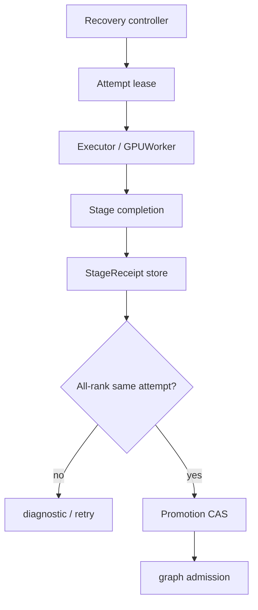
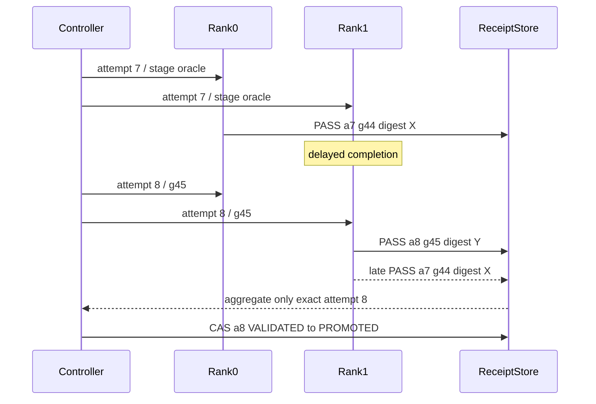

> 源码基线：vLLM [`2296c12e`](https://github.com/vllm-project/vllm/commit/2296c12e47be87d44037d14e2a74028710c29f36)，即研究时默认分支最新提交；它只修改 DeepSeek-V4.1-Flash 部署文档，与本文主路径无直接关系。本文严格区分**当前代码事实**、**已合入测试/PR 事实**与**建议协议**。`StageReceipt`、revalidation attempt 和 exactly-once promotion 尚不是 vLLM 现有实现。

## 本篇在课程路线中的位置

上一篇把 revalidation 拆成可暂停的 stage：已提交 GPU replay、copy 或 collective 不能被 lease expiry 撤销，必须等 completion fence；persistent output 也要先变成稳定 snapshot/digest，才能 checkpoint。今天继续处理暂停与重试必然带来的问题：旧 attempt 的回执晚到，能否把已经被替代的 graph 重新 promotion？

课程位置是：`stage submit → completion receipt → attempt fence → all-rank aggregate → promotion CAS`。本章只讲结果身份和提交语义，不重新讨论 recovery job 的排序与预算。

上一篇：[执行到一半能停吗]()。

## 前置知识回顾

- completion 只证明某个已提交副作用完成，不自动证明它属于当前恢复尝试。
- checkpoint 只能保存稳定证据，不能保存仍会被下一次 replay 覆盖的 Tensor view。
- TP/PP graph 是 group contract；单 rank PASS 不能发布 group-wide promotion。
- generation、fingerprint、expected ranks 与 capacity revision 变化后，旧 PASS 必须失效。

## 本篇要回答的核心问题

1. 当前 vLLM 如何把异步返回值和发起它的 scheduling step 对齐，又如何处理 preemption 后迟到的 stale output？
2. 为什么 `job_id + rank + PASS` 不足以支撑可重试 revalidation？
3. 怎样让执行允许重复、回执允许迟到，而 promotion 的外部效果仍恰好发生一次？

## 组件在全局架构中的位置



上游是上一章的 `RecoveryCheckpoint` 与新的 attempt lease；下游是 graph-health manifest、serving capacity revision 和 replay admission。这里最重要的边界是：device completion、receipt durable accept、group verdict、promotion publish 是四个不同提交点。

## 完整调用链：当前代码怎样隐式配对一次输出

当前正常推理没有独立的 revalidation receipt，但它给出了一个很好的最小对照：

1. [`EngineCore.step`](https://github.com/vllm-project/vllm/blob/2296c12e47be87d44037d14e2a74028710c29f36/vllm/v1/engine/core.py#L640-L670) 先取得 `SchedulerOutput`，再以 `non_block=True` 调 `model_executor.execute_model`。
2. [`Executor.execute_model`](https://github.com/vllm-project/vllm/blob/2296c12e47be87d44037d14e2a74028710c29f36/vllm/v1/executor/abstract.py#L232-L270) 把同一个 `SchedulerOutput` 发到 worker group，并返回 `Future`。
3. 开启 batch queue 时，[`step_with_batch_queue`](https://github.com/vllm-project/vllm/blob/2296c12e47be87d44037d14e2a74028710c29f36/vllm/v1/engine/core.py#L681-L795) 把 `(future, scheduler_output, exec_future)` 一起 `appendleft`，之后从另一端 `pop`，以 FIFO 次序取回。
4. GPU 侧若异步复制采样结果，[`AsyncGPUModelRunnerOutput`](https://github.com/vllm-project/vllm/blob/2296c12e47be87d44037d14e2a74028710c29f36/vllm/v1/worker/gpu_model_runner.py#L268-L363) 用 CUDA event 等待 D2H copy 完成，再释放 device Tensor 引用并构造 Host `ModelRunnerOutput`。
5. EngineCore 把“队列槽中保存的 `SchedulerOutput`”和“该槽 Future 返回的 `ModelRunnerOutput`”一起交给 [`Scheduler.update_from_output`](https://github.com/vllm-project/vllm/blob/2296c12e47be87d44037d14e2a74028710c29f36/vllm/v1/core/sched/scheduler.py#L2110-L2194)。

这条链的 identity 不是写在 output 里，而是由单一 owner 的内存队列保存。事实上，[`SchedulerOutput`](https://github.com/vllm-project/vllm/blob/2296c12e47be87d44037d14e2a74028710c29f36/vllm/v1/core/sched/output.py#L193-L287) 有 request/token/block 元数据，没有 step attempt；[`ModelRunnerOutput`](https://github.com/vllm-project/vllm/blob/2296c12e47be87d44037d14e2a74028710c29f36/vllm/v1/outputs.py#L264-L312) 有 `req_ids`、采样结果和 connector/graph stats，也没有 generation 或 attempt。

因此，当前链在同一 EngineCore 生命周期内很简洁；但一旦 receipt 要跨 pause、controller crash、retry 或 worker generation，就不能继续依赖“这个 Future 变量恰好仍和那个 Python 对象放在同一个 deque tuple 里”。

## 关键类型、字段和状态生命周期

### 当前事实：request 级 stale-output 计账

[`Request`](https://github.com/vllm-project/vllm/blob/2296c12e47be87d44037d14e2a74028710c29f36/vllm/v1/request.py#L130-L158) 保存：

- `num_in_flight_tokens`：已调度但输出尚未处理的 token 数；
- `num_stale_output_tokens`：preemption 时仍在途、返回后要按 stale 处理的份额；
- `drop_stale_output`：旧位置已经被重采样时，是否完全丢弃迟到输出；
- `last_sched_seq`：只用于 deferred block free fence，不是跨进程 receipt identity。

[`_preempt_request`](https://github.com/vllm-project/vllm/blob/2296c12e47be87d44037d14e2a74028710c29f36/vllm/v1/core/sched/scheduler.py#L1651-L1694) 把当前 `num_in_flight_tokens` 赋给 stale counter，并把 optimistic compute frontier 归零。输出返回时，`update_from_output` 逐 token drain stale share；若是 drop mode，就在消费计账后跳过业务更新。这里的关键是“赋值而非累加”：同一未排空 share 再次 preempt 不能重复计债。

### 建议协议：显式 `StageReceipt`

最小 receipt 应绑定以下不可混用的身份：

| 字段 | 作用 |
| --- | --- |
| `job_id, graph_key` | 定位恢复对象 |
| `attempt_id, stage_id` | 区分 retry 和 stage；同一逻辑 stage 的重复发送保持同 id |
| `graph_generation, worker_generation, context_generation` | fencing 旧 graph、旧进程与 reset 前 context |
| `rank, expected_ranks_digest` | 防止缺 rank、换 topology 或跨 attempt 拼票 |
| `input_digest, output_digest, oracle_schema` | 证明比较的是同一输入和同一 oracle 规则 |
| `completion_ref, snapshot_ref` | 指向可验证的 completion fence 与稳定输出证据 |
| `status, error_code, receipt_seq` | 表达单调终态并拒绝 conflicting duplicate |

receipt 的生命周期是 `SUBMITTED → COMPLETED_LOCAL → DURABLE_ACCEPTED → GROUP_ELIGIBLE`。`COMPLETED_LOCAL` 只说明本 rank stage 完成；只有 store 在相同 identity 下 durable accept 后，聚合器才可读取。旧 attempt 的迟到 receipt 可以保留作诊断，但不能改变 current attempt。

## 逐函数源码解读

### 1. `step_with_batch_queue`：有序队列就是当前的隐式 receipt key

队列元素同时持有 `future` 与 `scheduler_output`，`appendleft/pop` 保持 oldest-first。当前测试甚至在 fake executor 中 `deepcopy(output[0])`，因为下一个 batch 可能复用同一 output 对象。这个细节说明对象地址和“最后一次写入内容”都不能充当稳定身份；正确性来自 owner 保存的配对关系。

### 2. `AsyncGPUModelRunnerOutput.get_output`：completion 不等于 freshness

`async_copy_ready_event.synchronize()` 证明 D2H copy 已完成，并允许释放 device Tensor 引用。它不回答：这个 copy 属于哪个 recovery attempt？graph 是否已被新 generation 替代？rank 集合是否仍相同？因此 event 是 `completion_ref` 的来源之一，不是 promotion authority。

### 3. `Scheduler.update_from_output`：当前 stale fence 是数量协议

函数以 `scheduler_output.num_scheduled_tokens` 为权威逐 request 处理，先减少 `num_in_flight_tokens`，再减少 stale share。若 request 已 abort/finished，则忽略业务输出；若 `drop_stale_output`，则整帧不落入 token 序列。这个机制能解决同一 scheduler 内的 preemption race，却不能识别“同 job 的第 7 次还是第 8 次 revalidation”。

### 4. `AsyncScheduler._update_request_with_output`：旧结果不能改新 counter

[`AsyncScheduler`](https://github.com/vllm-project/vllm/blob/2296c12e47be87d44037d14e2a74028710c29f36/vllm/v1/core/sched/async_scheduler.py#L39-L82) 对 stale output 不再递减已归零的 `num_output_placeholders`，避免 underflow；只有非 stale 输出才能推进新一代 placeholder 计账。这是 attempt fencing 的局部同构：旧代回执可以被观察，但无权修改新代状态。

## 具体示例与 shape/状态演算

设 TP=2，验证 FULL graph key `K16`；每 rank 的教学输出是 `hidden_states[16,4096]: bf16`，位于 CUDA device，大小 `16×4096×2 = 131072 B = 128 KiB`。稳定 snapshot/digest 必须在 completion fence 后产生。



若 store 只按 `(job_id, rank)` 保存最新 PASS，可能瞬间得到 `{rank0:a7, rank1:a8}`，错误地拼成“两个 rank 都通过”；若只判断 `attempt_id >= expected`，旧 controller 还可能用不同 generation 的 PASS 越权。正确 predicate 必须要求：

```text
all receipts have the same
(job_id, attempt_id, stage_id, graph_generation,
 worker/context generation, input_digest,
 expected_ranks_digest, oracle_schema)
and ranks(receipts) == expected_ranks
and every completion/snapshot ref verifies
```

随后以 `CAS(job=a8, state=VALIDATED, revision=r17) → PROMOTED(r18)` 发布。CAS 响应丢失时重试同一 operation：若 payload 相同，返回 already-applied；若同 id 不同 payload，fail closed。于是 execution 可以 at-least-once，receipt delivery 可以 at-least-once，但 promotion effect 是 exactly-once。

## 为什么这样设计及替代方案

第一性原理只有三条硬约束：已提交 device work 不可撤销；异步消息可重复、迟到或丢失；group promotion 必须对所有 rank 的同一契约原子可见。从它们向上推导，最小方案就是“复合 identity + 幂等 receipt + 单次 CAS”。

替代方案一是依赖 FIFO。它在当前单 owner、固定 batch queue 生命周期里开销最低，也保留吞吐；但跨 crash/retry 没有队列对象可恢复。替代方案二是“收到第一个 PASS 就 promotion”，延迟最低，却把 partial-rank success 当 group success。替代方案三是把 raw `128 KiB/rank` snapshot 全量写进 durable store，审计最强但写放大、Host copy、网络和恢复显存成本都高。更合适的是存 32 B digest、shape/dtype/device contract 与不可变 snapshot reference；只有争议或抽检时加载 payload。

## 性能、并发、正确性与边界条件

- **延迟**：promotion 至少多一次 durable receipt accept 和一次 group CAS；可 group-commit receipts，但不能把 durable ACK 提前到写入完成之前。
- **吞吐**：receipt payload 应有界，避免把 Tensor/任意 exception repr 放入控制面。批量 digest 能减少 RPC，但 expected-rank completeness 仍逐 attempt 判断。
- **显存**：CAS 未决定前，旧 attempt 的 snapshot/graph 不能立即回收；所需 reserve 必须计入上一章的 recovery temporary-memory budget。
- **并发**：同 key 可允许一个 current attempt 和若干 fenced old attempts；不得让两个 attempt 同时拥有 promotion lease。
- **graphability**：receipt 在 replay 外部生成，不应把 Host durability I/O 放进 capture；device digest 若进入 graph，要证明 deterministic 和地址稳定。
- **失败方式**：缺 rank、digest mismatch、generation mismatch、conflicting duplicate、completion unknown、snapshot missing 均不能 promotion；timeout 只能触发新 attempt，不能把缺失视为失败票或成功票。

## 测试证据与未覆盖风险

当前最直接的已合入证据是 [PR #48245](https://github.com/vllm-project/vllm/pull/48245) / [`a0c092ee`](https://github.com/vllm-project/vllm/commit/a0c092ee72c0dcefbb3b3e74f97ac62d842e5f4b)。它修复 async scheduling + KV-pressure preemption 下 stale output 让 `num_output_placeholders` 下溢的问题，并报告 non-spec、ngram spec 和 prompt-logprobs GPU 测试通过。

当前 [`test_kv_pressure_preemption_with_inflight_output`](https://github.com/vllm-project/vllm/blob/2296c12e47be87d44037d14e2a74028710c29f36/tests/v1/core/test_async_scheduler.py#L535-L598) 用 PP=3、queue depth=4、8 个 prompt 长度8/max tokens24 的请求，并参数化 spec token 0/3；它验证所有 token 恰好一次、顺序不乱、采样 position 与交付 position 一致。`test_reset_prefix_cache_with_inflight_output_under_kv_pressure` 还覆盖 PP=1/3、连续 reset、re-preempt 时 stale share 未排空，以及最终 stale counter 归零。`test_engine_core_concurrent_batches` 则用两个并发 batch 验证 FIFO 配对与逐步输出。

这些测试证明的是当前进程内 async output 的 stale 计账，不证明 durable receipt、controller crash、跨 worker generation、all-rank attempt 一致性或 promotion CAS。本章没有重跑 GPU 测试；PR 的历史结果属于作者报告，源码与测试结构属于当前代码事实。

建议补四类 deterministic fault test：

1. a7 rank1 在 a8 开始后迟到，必须只进 diagnostic；
2. a7/rank0 与 a8/rank1 不得拼成 quorum；
3. CAS 成功但 ACK 丢失，重放同 operation 不得重复增加 capacity revision；
4. 同 receipt key 不同 digest 必须 fail closed，并阻止 snapshot 回收。

## 与前后章节的连接

上一篇解决“哪里可以停”；本篇解决“停后重试，旧结果如何被隔离”。下一章应继续处理 promotion 之后的资源回收：旧 attempt 的 graph、snapshot、receipt 和 reservation 何时可删，谁提供 no-reader/no-replay witness，以及回收如何避免再次制造 ABA。

## 本篇结论、知识债、三个理解检查问题和下一章

结论：当前 vLLM 依赖 EngineCore 本地 FIFO 把 `Future` 与 `SchedulerOutput` 隐式配对，并用 stale token counter 防止 preemption 后旧输出污染新 counter；这是可靠的进程内机制，但不是跨 pause/crash/retry 的 durable identity。可恢复 revalidation 必须把 attempt、stage、三类 generation、rank set、input/output digest 与 completion reference写入 receipt。所谓 exactly-once 不是“GPU 只执行一次”，而是“同一 promotion effect 只能由一个 current attempt 的完整同代证据 CAS 发布一次”。

知识债：真实 `StageReceipt/AttemptRecord/PromotionRecord` schema 与 store、TP/PP receipt adapter、digest/tolerance oracle、snapshot retention、capacity revision 联动、controller takeover，以及 late/duplicate/conflicting receipt fault harness。

理解检查：

1. 为什么 `async_copy_ready_event.synchronize()` 仍不足以授权 promotion？
2. 为什么 `{rank0:a7 PASS, rank1:a8 PASS}` 不能构成 TP=2 的成功 verdict？
3. execution at-least-once 与 promotion effect exactly-once 如何同时成立？

下一章：**旧 Attempt 的证据何时可删——Receipt Retention、Snapshot Reclamation 与 No-reader Fence。**

## 课程账本增量

- 课程 61：从当前 async scheduler 的 stale-output 防护出发，补齐 revalidation receipt 的显式 identity、同 attempt/all-rank 聚合和 promotion CAS。
- 新确认不变量：completion 不等于 freshness；receipt 必须绑定 attempt/stage/generation/rank set；execution 可重复，promotion effect 只能幂等提交一次。
- 新覆盖：`EngineCore.step_with_batch_queue`、`SchedulerOutput`、`ModelRunnerOutput`、`AsyncGPUModelRunnerOutput`、`Request` stale 字段、`Scheduler.update_from_output`、`AsyncScheduler._update_request_with_output`、PR #48245 与 async scheduler regression tests。
- 新知识债：durable receipt/attempt/promotion schema、store/CAS、snapshot retention、TP/PP adapter、controller crash 与 duplicate/conflict fault matrix。
- 下一章：Receipt retention、snapshot reclamation 与 no-reader fence。
