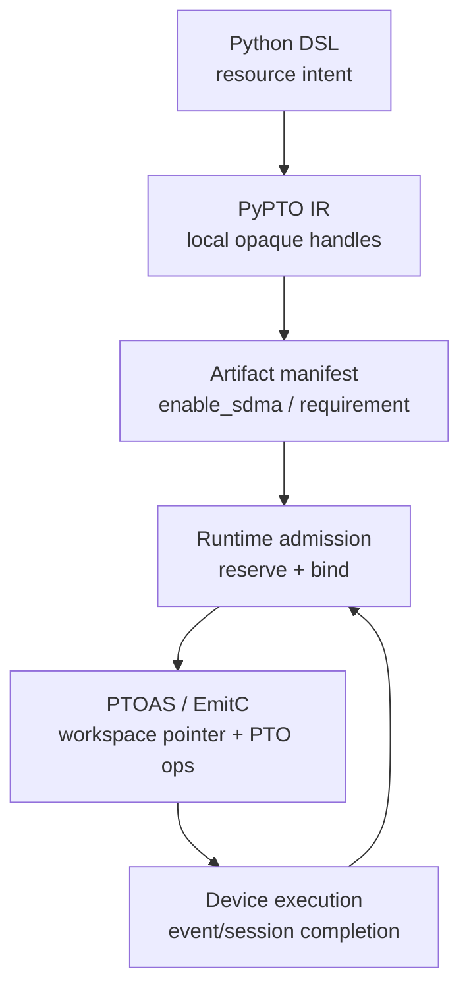
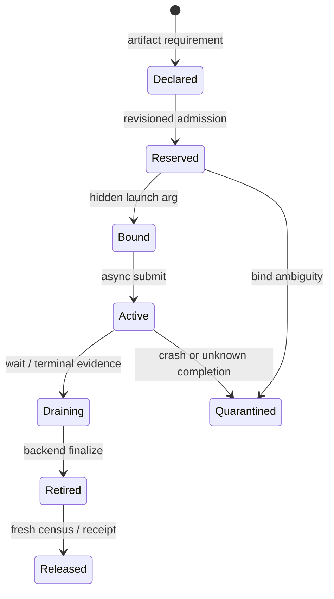

> 源码基线：PyPTO [`d7f69564`](https://github.com/hw-native-sys/pypto/commit/d7f69564aed501502e90ae5ec6bc6e8db5d200d5)，PTOAS [`739480c3`](https://github.com/hw-native-sys/PTOAS/commit/739480c309c265feee7703cdde42fe89da60b1d9)，均为研究时默认分支最新提交。PyPTO 基线合入了与本文直接相关的 [PR #3080](https://github.com/hw-native-sys/pypto/pull/3080)：只有 invocation-local 的 prefetch handle 才可参与 outlined-kernel definition 去重。本文先陈述当前实现，再把上一章的 `AdmissionToken` 接到生成链；`ResourceRequirement/LeaseBinding` 是建议设计，不是已存在 API。

## 本篇在 PTO 课程路线中的位置

[上一章]()解决了 Host 侧的 TOCTOU：fresh census 不是容量所有权，只有绑定 revision、pressure epoch 与完整 resource vector 的一次性 reservation 才能放行分配。

第 72 章回答紧接着的问题：**这个资源意图怎样穿过 PyPTO、PTOAS 与 launch ABI，却不污染可复用 kernel 的普通 Tensor 签名？** 选择 `async_prefetch`，因为它同时有逻辑数据范围、opaque handle、异步 completion 与 runtime-owned SDMA workspace，是观察分层边界的最小真实样本。

## 前置知识

- `AdmissionToken` 解决“谁有权消费容量”，不等于 workspace 指针本身。
- PyPTO `InCore` function 是可被多次 dispatch 的定义；同一结构的定义可以去重，但每次 dispatch 仍必须执行。
- PTOAS 接收已经具体化的 PTO IR，负责 verifier 与 EmitC，不拥有全局并发 census。
- `TPREFETCH_ASYNC` 是 GM→L2 cache hint，不修改 Tensor 值；它没有隐式 wait，完成必须由 event/session 显式观测。

## 今日两个核心问题

1. 为什么 SDMA workspace/lease 不能建模成普通 `Tensor` 参数，甚至不能让 opaque handle 跨 kernel invocation 逃逸？
2. `ResourceIntent → reservation → hidden binding → async completion → release` 应在哪一层发生，每层能证明什么？

## PTO 全栈中的位置



当前代码已经实现 A、B、C 的简化形态和 E、F；D 只有“worker 提供 SDMA workspace”的 runtime 约定，还没有上一章那种 revisioned lease。边界判断的第一性约束是：编译器可证明 shape、type、producer/consumer 与 use-locality；只有 runtime 知道某时刻的可用容量、并发 dispatch、rank 集合和 generation。

## 概念和精确语义

### 1. 普通 Tensor 描述数据，handle 描述一次 invocation 内的控制能力

[`prefetch_ops.py`](https://github.com/hw-native-sys/pypto/blob/d7f69564aed501502e90ae5ec6bc6e8db5d200d5/python/pypto/ir/op/prefetch_ops.py) 暴露四个操作：

```python
ctx = pl.prefetch.make_context()
evt = pl.prefetch.async_prefetch(src, ctx)
sess = pl.prefetch.session(ctx)
done = pl.prefetch.wait(evt, sess)
```

`src` 必须是 GM 中 fully-static、flat contiguous 的 logical-1D Tensor：rank 至少 1，除最后一维外都必须为 1，MX layout 被拒绝，且 operand 必须是 `Var/IterArg`。`async_prefetch` 不阻塞、不改写 `src`，返回 `AsyncEventType`；`session` 从同一个 context 投影 `AsyncSessionType`；`wait(event, session)` 返回 BOOL completion flag。

三种 handle 在 [`type.h`](https://github.com/hw-native-sys/pypto/blob/d7f69564aed501502e90ae5ec6bc6e8db5d200d5/include/pypto/ir/type.h) 中都是 opaque singleton type。尤其 `PrefetchAsyncContextType` **没有 per-instance field**；源码明确说明 backing SDMA workspace 由 runtime 注入。因此它不是带地址、shape、dtype、device 的数据对象，而是“这一 invocation 内允许哪些 async op 组成合法链”的类型化 SSA 证据。

### 2. workspace 是隐藏 ABI，不是用户 IR operand

[`prefetch.make_context`](https://github.com/hw-native-sys/pypto/blob/d7f69564aed501502e90ae5ec6bc6e8db5d200d5/src/ir/op/prefetch/prefetch_async.cpp) 无用户参数，返回 context；四个 op 被固定为 `VECTOR` affinity，因为 context 内部 scratch 位于 Vec/UB，不能在 mixed kernel 拆分时复制到 Cube lane。

PTO codegen 先扫描 function body；一旦发现 `prefetch.make_context`，就在用户参数和 dynamic dim 之后追加隐藏 `!pto.ptr<i8>`。Python wrapper 同步调用 `get_dma_workspace(args, DMA_WORKSPACE_SDMA)`，再把得到的 pointer 追加到实际 kernel call。Artifact 则写入 `"enable_sdma": True`。证据分别位于 [`pto_codegen.cpp`](https://github.com/hw-native-sys/pypto/blob/d7f69564aed501502e90ae5ec6bc6e8db5d200d5/src/codegen/pto/pto_codegen.cpp) 与 [`pto_backend.py`](https://github.com/hw-native-sys/pypto/blob/d7f69564aed501502e90ae5ec6bc6e8db5d200d5/python/pypto/backend/pto_backend.py)。不支持 SDMA provider 的 runtime 在 worker 初始化失败，不把 prefetch 静默降为 no-op。

这形成一个重要不变量：**用户函数签名表达逻辑输入输出；runtime-owned resource 通过可审计的 hidden ABI 绑定。** 但当前 `enable_sdma: bool` 还不能表达 bytes、rank set、generation、provider profile 或 reservation identity。

### 3. 四个接口的契约不能只看 Python 返回值

| 接口 | 前置条件 | 后置条件与所有权 | 失败方式 |
| --- | --- | --- | --- |
| `make_context()` | function 可由 SDMA provider 执行 | 产生 invocation-local context；物理 workspace 仍归 runtime | codegen 预扫描漏检会在 emitter 内部检查失败；provider 缺失则 worker 初始化失败 |
| `async_prefetch(src, ctx)` | `src` 为 GM、static、logical-1D、非 MX；`ctx` 类型正确 | 发起非阻塞 cache warm，产生 event；不转移 `src` 所有权，不改变 Tensor 值 | shape/layout/operand/type 在 PyPTO 构造期拒绝；PTOAS 再做第二层 verifier |
| `session(ctx)` | context 是本地 producer 的结果 | 纯投影，不提交设备工作；session 与 context 同一 ownership domain | 错误 handle type 直接拒绝 |
| `wait(evt, sess)` | 两个 handle 类型正确，语义上还必须同源 | 阻塞到 event 完成并返回 BOOL；只闭合异步操作，不自动证明 runtime allocation 已 finalize | 当前 op type system 能拒绝错类型；同源性主要由 dedup admission 审计，完整 runtime verifier 仍是缺口 |

这里有两层“相等”必须分开。`PrefetchAsyncContextType` 是 singleton，所以两个 context 的**类型相等**；但 A 的 event 与 B 的 session 并不因此具有同一**实例来源**。静态类型只说明“这是什么种类的 handle”，producer graph 才说明“它属于哪次 invocation”。同理，hidden pointer 的数值即使相同，也不能证明它仍属于同一 generation；地址重用后的旧 event 可能仍指向已失效的 ownership epoch。

### 4. 建议的 lowering contract

从根本约束出发，`ResourceRequirement` 应是可缓存、可比较的编译产物属性，而 `LeaseBinding` 应是不可跨 dispatch 搬运的运行时值：

- 编译期只声明“要什么”：资源种类、最小容量、provider/架构约束、completion 模型、是否允许共享；这些字段进入 artifact digest。
- admission 只决定“谁现在能拿”：对 census revision 做原子 reserve，生成 one-shot token；编译器没有这个全局视野。
- launch 只完成“本次如何传”：验证 token 的 artifact digest、device/rank 与 generation，再把 workspace pointer 写入固定 hidden slot。
- kernel 只执行“如何用”：把 pointer 构造成 context，发出 async op，并用本地 event/session 收口。
- retirement 只证明“何时可回收”：completion 先闭合设备 work，backend finalize 再释放 provider 状态，capacity receipt/fresh census 最后更新 ledger。

这五步不能压成一个 `Tensor`。Tensor 的 shape/dtype/layout 能回答数据解释，却回答不了 reservation revision、是否 one-shot、哪些 rank 原子成功、旧 writer 是否被 reset fence 覆盖。反过来，lease 也不该替代 Tensor：预取范围仍必须接受 static shape、logical-1D 与 GM location 的编译期验证。

由此得到四条可执行的不变量。第一，Artifact 若声明 SDMA，launch 缺少对应 hidden slot 必须在提交前失败，不能传空指针后等待设备报错。第二，binding 的 `artifact_digest/device/rank/generation` 必须与 token 完全一致；只比较地址会遭遇 ABA。第三，handle use-graph 必须封闭在一个 invocation：context 不进参数和返回，event 不写 metadata，session 不跨 context；优化 Pass 重写 producer 时还要同步重写所有 use，不能保留悬空来源。第四，definition dedup 只能合并代码对象，不能合并 caller edge、reservation 或 completion record。

相应的非法组合也可以分层诊断：`[4,1024]`、dynamic extent、MX layout 属于数据描述错误，应在 PyPTO 构造期失败；workspace 不是 `ptr<i8>` 或 `tprefetch_async` source 不能转成 GlobalTensor-like，属于 PTOAS verifier/lowering 错误；token revision 过期、rank 只部分预留、provider profile 不匹配，属于 admission/binding 错误；event 超时、进程崩溃、reset scope 不完整属于 retirement/recovery 错误。把错误推到最早拥有充分证据的一层，既缩短反馈路径，也避免下层用模糊状态猜测上层意图。

还有一个维护性收益：当 SDMA workspace 大小或 provider ABI 变化时，只需提升 requirement schema/version 和 runtime adapter；用户 kernel 的 Tensor 签名不变，PTOAS 仍处理同类 context op。若把地址、bytes、generation 全塞进显式参数，任何 backend 变化都会扩散到 Python API、结构等价比较、缓存 key、所有 caller 与模型库，正确性审计面反而更大。

最小可落地顺序也应保持克制：先把现有 `enable_sdma` 扩成只读 manifest，并让 launch 在缺失/不兼容 binding 时 fail closed；再引入 generation 与 reservation receipt；最后才做共享 workspace、graph replay 或跨 kernel lease coalescing。每一步都应有独立负向测试，不能用性能目标倒逼省略所有权证明。

验证时应同时观测编译产物、实际 launch 参数、provider 分配记录和最终 census；只看其中任一层，都不足以证明端到端租约已经闭合。

## 真实文件、类型、API 与指令逐段解读

### PyPTO：从 DSL 到 PTO IR

[`pto_ops_prefetch.cpp`](https://github.com/hw-native-sys/pypto/blob/d7f69564aed501502e90ae5ec6bc6e8db5d200d5/src/backend/common/pto_ops_prefetch.cpp) 做四个一一映射：

| PyPTO op | PTOAS op | 输入 | 输出 |
| --- | --- | --- | --- |
| `prefetch.make_context` | `pto.make_prefetch_async_context` | hidden `ptr<i8>` workspace | `prefetch_async_context` |
| `prefetch.async_prefetch` | `pto.tprefetch_async` | whole-source partition view + context | `async_event` |
| `prefetch.session` | `pto.get_prefetch_async_session` | context | `async_session` |
| `prefetch.wait` | `pto.comm.wait_async_event` | event + session | `i1` |

`src` 先被生成为覆盖整个 Tensor 的 `partition_view`，offset 全 0、size 等于完整 static shape。handle 没有 memref，因而 emitter 必须沿 assignment 预绑定的 LHS SSA 名定义并发布结果；未赋值的 bare wait 才使用临时名。这不是打印细节：如果 producer 与 consumer 使用了不同 SSA，PTO IR 会出现 use-before-definition。

### PTOAS：只消费已经绑定的 workspace

[`PTOOps.td`](https://github.com/hw-native-sys/PTOAS/blob/739480c309c265feee7703cdde42fe89da60b1d9/include/PTO/IR/PTOOps.td) 把 workspace 明确成 `PtrType` operand，并把 context/event/session 建为一等类型。EmitC lowering 在 [`TLoad.cpp`](https://github.com/hw-native-sys/PTOAS/blob/739480c309c265feee7703cdde42fe89da60b1d9/lib/PTO/Transforms/PTOToEmitC/LoadStore/TLoad.cpp) 中生成：

- `pto::PrefetchAsyncContext(workspace)`；
- `TPREFETCH_ASYNC(src, ctx)`；
- `ctx.session`；
- 最终 wait 降为 `event.Wait(session)`。

PTOAS 能验证 operand type、GM-like source 与可降性，却看不到 runtime 同时运行多少 dispatch、capacity revision 是否过期。因此“在 PTOAS 内临时分配 workspace”会把 admission 放到信息不足、时机过晚的层。

## 对象、Handle 与 Lease 生命周期

当前实现中，`ctx/event/session` 的生命周期从 SSA 定义开始，到 function body 内最后一次合法 use 结束；它们不能成为参数、返回值、metadata 或 forwarded alias。最新 [PR #3080](https://github.com/hw-native-sys/pypto/pull/3080) 把这条规则写入 outlined-kernel dedup：

- `make_context` 必须直接定义本地 context；
- event 只能由本地 context 的 `async_prefetch` 产生；
- session 只能从 context 投影；
- wait 的 event 与 session 必须来自同一个 context；
- 任一 handle 逃逸、转发或跨 context 配对，definition reuse 都 fail closed。

建议把物理资源生命周期放在 dispatch 侧，而不是扩张这些 handle：



这是建议状态机。kernel definition 只持有 `Declared` 的 resource class；每个 dispatch 拿独立 `Reserved/Bound` 实例。`ctx/event/session` 是 `Bound→Draining` 内的局部证明，不是可持久化 lease token。

## 端到端调用链或指令链

完整链路是：Python `pl.prefetch.*` → op registry type deduction → optimization/outlined-kernel dedup → `MemRefCollectorVisitor` 发现 `make_context` → PTOCodegen 追加 hidden SDMA arg → backend wrapper 从 runtime args 取 workspace → 生成四个 PTOAS op → PTOAS verifier/type conversion → EmitC 的 context/`TPREFETCH_ASYNC`/session/wait → runtime/device completion。

去重 Pass 带来一个容易混淆的分叉：两个 structurally equal kernel 可只保留一个**定义**，但 caller 中的两个 Call/Submit 必须都保留。定义复用不能被误解成 dispatch 共享同一 active lease；否则并发执行会把“代码相同”错误提升为“资源所有权相同”。

## 具体 shape、类型与状态演算

取 `x: Tensor[[1, 4096], FP32]`，逻辑区域是 4096 个元素，即 16 KiB，位于 GM；`ctx/event/session` 无 shape、dtype、memref，PTOAS workspace 是 GM `ptr<i8>`。

1. IR 构造接受 `[1,4096]`，因为除末维外唯一维度为 1；`[4,1024]` 会在 PyPTO 层拒绝。
2. codegen 生成覆盖完整 4096 元素的 partition view，随后发出 `tprefetch_async(view, ctx)`。
3. wrapper 不把 workspace 暴露给 orchestration signature，而是从 runtime args 取得 SDMA workspace。
4. `wait(evt, session(ctx))` 闭合本次 prefetch；另一个 context 的 session 即使类型相同，也不满足 PR #3080 的 ownership proof。

16 KiB 是**被预取的数据范围**，不是 resource charge。上一章从 pto-isa 得到当前 SDMA published workspace 53,248 B，连同已知 persistent table 的可证明下界为 56,384 B，且仍未计 runtime stream 与动态 workspace。于是 resource plan 至少要区分：

`{logical_bytes=16 KiB, engine=SDMA, workspace_bytes>=56,384 B, completion=event/session, provider=required}`。

不能用 `src.nbytes` 代替 reservation，也不能把 `enable_sdma=True` 当作完整 allocation receipt。

把这次 invocation 展开成状态表会更直观：

| 时刻 | 编译/运行时对象 | 可确认事实 | 尚不能确认 |
| --- | --- | --- | --- |
| T0 | Artifact `enable_sdma=True` | 产物包含 prefetch，launch 必须提供 SDMA | 当前是否有容量、实际地址 |
| T1 | `AdmissionToken(revision=R)` | 容量账本已为本次 dispatch 预留资源 | allocator 是否已完成、设备是否开始 |
| T2 | hidden `ptr<i8>` | 本次 launch 已绑定 concrete workspace | async operation 是否完成 |
| T3 | `ctx → evt/sess` | submit 属于该本地 context | provider 资源是否可回收 |
| T4 | `wait=True` | 对应 async event 已完成 | backend finalize 与账本 release 是否完成 |
| T5 | release receipt + fresh census | allocation 可从 active 集合删除 | 无 |

如果 T2 后 Host 崩溃，token 过期也不能假装“没分配过”；如果 T4 后进程再次崩溃，也不能仅凭 BOOL 把资源立刻计为空闲。前者要进入 quarantine/reconcile，后者还需 finalize receipt。这正是课程 71 的 recovery 结论在 compiler/runtime 边界上的落点。

再看两个并发 dispatch A/B。PR #3080 可以把两个等价定义从 2 个收敛为 1 个，但保留 2 个 call。正确的 runtime 语义应是：artifact requirement 相同；A/B 各自消费一个 dispatch-bound lease，或者由 provider 以明确的 shareable contract 给出安全分片。没有这种 contract 时，共用一个 ACTIVE workspace 是数据竞争，而非优化。

## 为什么这样设计及替代方案

| 方案 | 优点 | 代价/风险 |
| --- | --- | --- |
| workspace/lease 作为普通 Tensor 参数 | 完全显式，调用图易见 | 污染用户 ABI；地址可返回/转发；shape 无法表达 queue/stream/generation；定义去重被 invocation identity 干扰 |
| Artifact 声明 requirement，runtime reservation 后 hidden binding | definition 可复用；capacity owner 在 runtime；编译器仍可验证需求 | 需要 manifest schema、fingerprint、launch-time generation check 与 crash reconciliation |
| PTOAS/设备端临时分配 | frontend 简单 | 看不到全局 census/rank/并发；过晚才失败；难以 durable reserve 与回收 |

推荐第二种。Artifact 需要记录稳定的 `ResourceRequirement`，例如 `{kind, provider_profile, minimum_bytes, rank_scope, completion_kind, shareability}`；runtime 以它向课程 71 的 ledger reserve，再把 `LeaseBinding{allocation_id,generation,addr,bytes}` 放进 hidden launch slot。地址与 token 不进入 reusable function identity，但 requirement digest 必须进入 artifact/cache fingerprint，避免拿不兼容资源运行旧产物。

## 访存、计算、流水、并行与硬件约束

- prefetch 不减少逻辑读字节，只尝试把后续 GM 访问延迟与无关计算重叠；过早会延长 L2 residency，过晚则 wait 暴露全部延迟。
- 四个 op 固定 AIV lane，避免 mixed kernel 在 AIC 重复 side effect；这是代码/测试事实。具体 SDMA/L2 微架构并发上限未由公开材料给出，不作臆测。
- 每个 context 的 event/session 必须局部配对；类型正确但来源不同仍可能违反 runtime ownership。
- graph capture 若固化 hidden pointer，则 generation 变化时必须重新绑定或重新 capture；只有 runtime 能证明地址稳定且旧 writer 已 fence，才可复用。此条是由 ABI 与 lease 不变量推导的设计约束，当前没有 graph 测试。
- provider 缺失必须 fail closed。把 prefetch 降成 no-op 虽保持数值结果，却会把性能/资源 contract 悄悄改写，且隐藏配置错误。

## 测试证据与未覆盖风险

当前直接证据：

- [`test_prefetch_ops.py`](https://github.com/hw-native-sys/pypto/blob/d7f69564aed501502e90ae5ec6bc6e8db5d200d5/tests/ut/ir/operators/test_prefetch_ops.py) 用 `[4096]`、`[1,1,256]` 验证 handle type 与合法 shape，并拒绝 `[4,32]`、MX layout、非 Var source 和错误 handle type。
- [`test_prefetch_codegen.py`](https://github.com/hw-native-sys/pypto/blob/d7f69564aed501502e90ae5ec6bc6e8db5d200d5/tests/ut/codegen/test_prefetch_codegen.py) 检查 hidden `ptr<i8>`、dynamic dim/SDMA/L2 offset/SPMD 的参数顺序、AIV-only、PTOAS 四 op、SSA define-before-use，以及 Artifact `enable_sdma` 且 orchestration signature 无 workspace。
- [`test_deduplicate_outlined_kernels.py`](https://github.com/hw-native-sys/pypto/blob/d7f69564aed501502e90ae5ec6bc6e8db5d200d5/tests/ut/ir/transforms/test_deduplicate_outlined_kernels.py) 的 `discard/wait` 两种模式允许定义合并；return、metadata、alias、parameter、cross-context 六类保持两个定义，同时所有模式都断言 caller 的 2 个 call 未丢失。
- [`test_prefetch_async.py`](https://github.com/hw-native-sys/pypto/blob/d7f69564aed501502e90ae5ec6bc6e8db5d200d5/tests/st/runtime/ops/test_prefetch_async.py) 在 onboard A2/A3 对 `1×128 FP32` 做 prefetch→wait→copy，要求 bit-exact 且不挂起；明确排除 simulator 与 A5。
- PTOAS [`tprefetch_async_emitc.pto`](https://github.com/hw-native-sys/PTOAS/blob/739480c309c265feee7703cdde42fe89da60b1d9/test/lit/pto/tprefetch_async_emitc.pto) 用 `128xf32` 检查 context 构造、`TPREFETCH_ASYNC`、session 与 `Wait` 的 EmitC 形状。

PR #3080 报告 17,952 个 UT 通过、CTEST 3/3，并在 43 层 DeepSeek V4 Flash EP2/TP2 compile-only 中把 retained InCore/PTO 定义从 265 降到 250，同时保留 634 个 global call；但没有硬件数值执行。

把证据等级明确分开：上面的类型、隐藏参数顺序、`enable_sdma`、AIV affinity 和 EmitC 调用是**当前代码事实**；单测/lit 的输入输出与 A2/A3 bit-exact copy 是**测试事实**；PR 的全模型数字是作者报告的 **compile-only 实验事实**；`ResourceRequirement/LeaseBinding`、generation fence 与 crash 状态机都是**基于这些边界的建议设计**。公开材料没有给出 SDMA queue 的真实并发上限、workspace 是否可安全跨 dispatch 共享或 graph replay 的地址稳定保证，因此本文不把这些硬件细节写成事实。

未覆盖风险包括：没有 durable `AdmissionToken/ResourceLease` schema；没有两个并发 dispatch 的 workspace collision 测试；没有 stale generation hidden arg、partial-rank admission、provider crash/reset、graph capture/replay；PTOAS lit 只验证生成文本，不证明 runtime capacity；onboard ST 只覆盖 A2/A3。

## 与前后章节的连接

上一章给出 runtime reservation 的线性化点，本章确定它不能塞进普通 Tensor 或可逃逸 handle，而应分成 Artifact requirement 与 dispatch binding。下一章将继续沿实际 ABI 向下：同一 kernel definition 多次 launch 时，怎样让 `generation fence`、hidden arg 顺序、cache fingerprint 与 graph replay 共同拒绝旧 lease。

## 本篇结论、知识债、理解检查与下一章

结论：PyPTO 当前 `async_prefetch` 已经示范了正确的骨架——逻辑数据留在 Tensor，局部时序能力留在 opaque handle，物理 workspace 由 runtime 通过 hidden ABI 注入，PTOAS 只消费已绑定 pointer 并生成 ISA。缺口不在“再造一个 Tensor”，而在把 boolean `enable_sdma` 升级为可版本化 requirement，并把上一章的 reservation token 落到每个 dispatch 的 generation-bound binding。

新增知识债：Artifact requirement schema/cache fingerprint、dispatch binding slot、lease generation check、definition-dedup 与 dispatch ownership 的并发 Golden、provider reset/census、graph replay 地址稳定性、A5/simulator parity。

理解检查：

1. 为什么 `[1,4096] FP32` 的 16 KiB 不能直接作为 SDMA reservation bytes？
2. 两个 outlined kernel 定义被去重后，为什么 caller 中的两个 dispatch 仍不能默认共享一个 active lease？
3. PTOAS 可以验证 workspace pointer type，却为什么不应负责 capacity admission？

下一章：**Kernel 定义可复用，Lease 不能复用——Dispatch Binding、Generation Fence 与 Hidden-arg ABI。**

## 课程账本增量

- 课程 72，阶段从 Host admission 回接 Python IR → PTOAS → runtime/device 生成链。
- 新确认：prefetch handle 必须 invocation-local；workspace 不进入用户 IR；Artifact 以 `enable_sdma` 声明简化需求；wrapper 注入 hidden pointer；PTOAS 消费绑定后的 workspace。
- 新设计边界：compile-time `ResourceRequirement` 与 runtime `LeaseBinding` 分离；definition reuse 与 dispatch ownership 分离；PTOAS 不承担全局 admission。
- 研究基线：PyPTO `d7f69564`，PTOAS `739480c3`。
