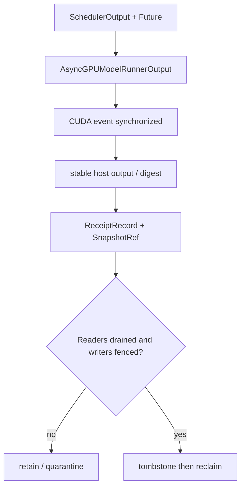
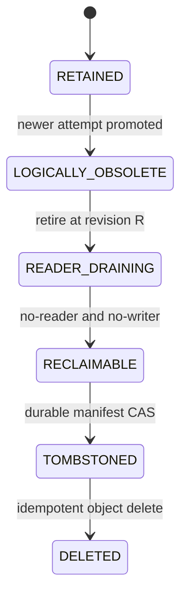

> 源码基线：vLLM [`532a7d19`](https://github.com/vllm-project/vllm/commit/532a7d19d2ae70b1fd9188d82620d26f028564fb)，即研究时默认分支最新提交；它修正 KV connector tests 的 MyPy 错误，与本文主路径无直接改动。本文严格区分**当前代码事实**、**测试/PR 事实**与**建议协议**。`ReceiptRecord`、reader epoch 和 crash-safe snapshot GC 尚不是 vLLM 现有实现。

## 本篇在课程路线中的位置

上一篇把可重试 revalidation 的身份边界钉死：旧 attempt 的 receipt 可以迟到，但不能参与 current attempt 的 all-rank verdict；promotion 的外部效果由 CAS 保证 exactly-once。今天只追问下一步：旧 receipt 已经“逻辑无效”，它引用的 256 KiB snapshot 是否可以立刻删除？

课程位置是：`promotion CAS → logical retirement → no-reader/no-writer proof → snapshot reclaim → receipt compact`。本章不重新设计 validation oracle，也不把建议的持久化 GC 说成 vLLM 已有功能。

上一篇：[迟到回执不能复活旧 Attempt]()。

## 前置知识回顾

- completion fence 证明某段已提交 device work 已可观察；generation fence 才证明结果是否仍有资格被接受。
- CUDA Graph output 可能是 persistent buffer 的 view，下一次 replay 可以覆盖它；跨 stage 保留必须先复制或保存稳定 digest。
- execution 可以 at-least-once，promotion effect 由 `expected_attempt + expected_revision` 的 CAS 做 exactly-once。
- TP/PP 结论必须来自同 attempt、同 generation、完整 expected-rank set。

## 本篇要回答的核心问题

1. 为什么“旧 attempt 已被拒绝”不等于“旧 receipt/snapshot 已无人读取”？
2. 当前 vLLM 的 batch queue、async copy 与 graph output 生命周期给出了哪些不可绕过的释放条件？
3. 怎样用 reader epoch、writer generation 和 durable manifest 推导一个可审计的删除谓词？

## 组件在全局架构中的位置

当前 vLLM 的证据是进程内对象生命周期；本文建议的持久层位于 revalidation controller 与对象存储之间：



上游输入是上一章的 accepted/stale `StageReceipt` 与 promotion revision；下游消费者包括 takeover reconciler、审计/故障诊断、重复 promotion 的幂等检查，以及真正执行 snapshot 删除的 GC。

## 完整调用链

当前进程内路径从 [`EngineCore.step_with_batch_queue`](https://github.com/vllm-project/vllm/blob/532a7d19d2ae70b1fd9188d82620d26f028564fb/vllm/v1/engine/core.py#L682-L769) 开始：

1. `Scheduler.schedule` 产生 `SchedulerOutput`；`execute_model(..., non_block=True)` 与 `sample_tokens(..., non_block=True)` 返回 future。
2. 三元组 `(future, scheduler_output, exec_future)` 被 `appendleft` 放入 deque；队满或无新工作时用 `pop` 取最老项。因此 identity 是“同一 Python 进程内、同一 deque item、FIFO 顺序”的隐式事实。
3. `future.result()` 返回后，EngineCore 先处理执行期间到达的 abort，再调用 `Scheduler.update_from_output(scheduler_output, model_output)`。
4. GPU sampling 的异步路径由 [`AsyncGPUModelRunnerOutput`](https://github.com/vllm-project/vllm/blob/532a7d19d2ae70b1fd9188d82620d26f028564fb/vllm/v1/worker/gpu_model_runner.py#L268-L360) 持有 device Tensor；copy stream 等待 default stream，发起 non-blocking D2H copy并记录 `async_copy_ready_event`。
5. `get_output()` 先 `event.synchronize()`，再删除 `_sampled_token_ids/_logprobs_tensors` 的 device 引用，最后组装 host-side `ModelRunnerOutput`。
6. [`Scheduler.update_from_output`](https://github.com/vllm-project/vllm/blob/532a7d19d2ae70b1fd9188d82620d26f028564fb/vllm/v1/core/sched/scheduler.py#L2110-L2238) 逐 request 减少 `num_in_flight_tokens`；若命中 `num_stale_output_tokens`，则排空 stale share。`drop_stale_output` 为真时整帧丢弃，否则 token 仍可交付，但旧 speculative rejection 不再修改已经回滚的 counters。

这条链给出三个不同时间点：结果**逻辑上过期**、device writer **物理完成**、最后一个 reader **停止持有稳定证据**。安全回收必须等到三者都成立。

## 关键类型、字段和状态生命周期

### 当前代码事实

`AsyncGPUModelRunnerOutput` 在 event 完成前主动保持 device Tensor 引用，说明“发起 copy”不是释放点。`CUDAGraphWrapper.__call__` 的 capture output 由 PyTorch graph pool 管理，并通过 `weak_ref_tensors` 存入 entry；replay 直接返回该 entry output。源码甚至标注了需要小心管理引用与内存。因此 Python weak reference 或 host GC 只描述某个 wrapper 的引用关系，不证明 stream、graph pool 或别的进程已经不再写/读那段数据。

[`Request`](https://github.com/vllm-project/vllm/blob/532a7d19d2ae70b1fd9188d82620d26f028564fb/vllm/v1/request.py#L161-L180) 的 `num_stale_output_tokens/drop_stale_output/num_in_flight_tokens` 则展示了另一面：即便 output 已经被判 stale，系统仍要把在途 share 排空，才能让计数回到一致状态。逻辑拒绝发生在物理完成之前是正常状态，不是异常。

### 建议协议：两类对象、五个状态

```text
ReceiptRecord {
  job_id, attempt_id, stage_id, rank_id,
  graph_generation, worker_generation, context_generation,
  promotion_revision, retirement_revision,
  writer_generation, snapshot_ref, digest, state
}

SnapshotRef {
  object_key, bytes, checksum,
  created_revision, retirement_revision,
  durable_refcount
}
```

建议状态机为：



`LOGICALLY_OBSOLETE` 只禁止它影响 verdict；`RECLAIMABLE` 才授权删除 payload。先写 durable tombstone、再幂等删除对象，使“写 tombstone 后进程崩溃”可重放，而不会把对象存在误当成仍有效。

## 逐函数源码解读

### `EngineCore.step_with_batch_queue`：FIFO 是 reader lifetime 的下界，不是 durable fence

`appendleft` 与 `pop` 确保最老 future 先提交，且 deque item 同时持有 `SchedulerOutput`。只要 item 未被 `pop` 并处理，进程内 reader 显然还存在。可是一旦进程崩溃，这个隐式身份和 reader 计数同时消失；跨进程 GC 不能用“队列里没看见”推导“世界上没有 reader”。

### `AsyncGPUModelRunnerOutput.get_output`：event 是 writer fence

event synchronize 前，copy stream 仍可能读取 source Tensor、写 host pinned buffer。删除 snapshot backing storage 会制造 use-after-free 或污染 digest。同步完成后只证明这条 writer 已结束；若 validation worker、takeover reconciler 或审计任务还在读 host snapshot，仍不能删除。

### `Scheduler.update_from_output`：stale 是语义标签，不是回收动作

当前实现会逐 token 排空 stale share；drop 模式下 `continue` 也发生在 `num_in_flight_tokens` 和 stale counter 已更新之后。这正是“先完成生命周期记账，再忽略业务结果”的具体例子。持久层也应先登记 retire revision，等待读者/写者闭合，最后物理删除。

### `CUDAGraphWrapper.__call__`：output ownership 不能从 weakref 推断

capture 时 output 来自 graph pool；entry 永久保存 weak tensor view，replay 后直接返回。下一 replay 可复用同一地址并覆盖内容。若 receipt 的 digest 尚未在 completion fence 后稳定化，保留一个 Tensor view 并不等于保留证据；反过来，host weakref 消失也不等于 graph pool 可安全返还给系统 allocator。

## 具体示例与 shape/状态演算

设 TP=2、FULL graph key `K16`，每 rank 稳定化 `bf16[16,4096]`：

\[
16 \times 4096 \times 2\ \text{bytes}=131072\ \text{bytes}=128\ \text{KiB}
\]

两 rank payload 共 256 KiB。若 8 个旧 attempt 都保留完整 snapshot，仅 payload 就是 2 MiB；receipt metadata、校验和、对象存储索引和 graph pool 占用尚未计入。

attempt 7 已被 attempt 8 取代，attempt 8 在 revision 42 promotion。reader A 在 revision 41 开始核对 rank digest，reader B 在 revision 43 才读取新 manifest。GC 在 revision 42 把 a7 标为 retired：

- `min_active_reader_revision = 41`，因此 A 仍可能读取 a7，不能删；B 的 revision 43 不构成阻塞。
- A 正常退出后，若所有活跃 reader 的最小 revision 变为 43，reader 条件才闭合。
- 即使 reader 已排空，rank1 的旧 copy event 尚未完成或 worker generation 仍允许旧 writer 落盘，也不能删。
- 等 rank0/rank1 writer completion 已记录、旧 generation 被 fence、snapshot durable refcount 为 0、promotion/checkpoint manifest 已吸收幂等所需 digest，GC 才能 CAS tombstone 并幂等删除 object。

形式化地，建议删除谓词是：

\[
\begin{aligned}
SafeDelete(x)=&\ Terminal(oldAttempt) \\
&\land currentPromotionRev > x.promotionRev \\
&\land minActiveReaderRev > x.retirementRev \\
&\land NoOldWriter(x.writerGeneration) \\
&\land x.durableRefcount=0 \\
&\land ManifestAbsorbed(x.digest)
\end{aligned}
\]

其中 timeout 只能触发调查、撤销 reader lease 或扩大 reset；它本身不是 `NoOldWriter`。reader crash 也不能靠“等够久”处理，必须让 lease 与 owner generation 绑定：新 owner 先 fence 旧 owner，再发布大于 retirement revision 的 reader epoch。

## 为什么这样设计及替代方案

| 方案 | 正确性 | 代价 | 结论 |
| --- | --- | --- | --- |
| Python refcount / GC | 仅覆盖单进程 host 引用，不覆盖 CUDA stream、graph pool、崩溃 reader | 实现最简单 | 不能作 durable delete proof |
| 固定 TTL | 慢 reader 时可能误删；TTL 过长又积压 snapshot | 运维简单 | 只能作扫描触发器，不能授权删除 |
| 全局 barrier | 能给出强 no-reader 证明 | 所有 recovery/serving reader 一起停顿 | 仅适合低频管理操作 |
| epoch/lease + writer generation + tombstone | 只等待可能看见旧对象的 reader；删除可重放 | 需要 lease、epoch、manifest CAS 与监控 | 建议主方案 |

最小充分设计不是一套复杂分布式 GC，而是三个不能合并的 proof：`logical obsolete`、`no-reader`、`no-old-writer`。若 snapshot 只用于 deterministic digest 对比，可在 manifest 吸收 digest 后删 payload；若 takeover 需要重跑 oracle，就必须继续保留 payload。是否保存整块数据是 policy，三个 proof 是 invariant。

## 性能、并发、正确性与边界条件

- **显存/内存**：retention 大致为 `单 snapshot bytes × 未闭合 attempt 数 + metadata`；上限由最老 reader age、最大在途 attempt 与对象存储预算共同决定，不能拍一个通用 TTL。
- **延迟**：reader 注册/退出应在 control plane；不要把 durable lease I/O 放进 CUDA Graph capture。hot path 可批量上报 epoch，GC 异步扫描。
- **并发**：同 key 的 current attempt 可以和多个 retired attempt 共存；只有 current attempt 可 promotion，但旧对象仍受其 retirement revision 之前的 reader 保护。
- **graphability**：若直接对 persistent output 取 digest，必须在 replay completion 后、下一 replay 覆盖前完成，或先复制到独立地址。
- **正确性**：删除要幂等；重复 tombstone/delete 返回成功。checksum 冲突、rank 缺失、reader lease 无法判死、writer generation 不明、manifest 未吸收幂等信息时一律 retain/quarantine。
- **故障域**：TP=2 中任一 rank 的 writer fence 缺失，组 snapshot 都不能宣告完整回收；不能用 rank0 的安全替代 rank1 的未知。

## 测试证据与未覆盖风险

[`test_engine_core_concurrent_batches`](https://github.com/vllm-project/vllm/blob/532a7d19d2ae70b1fd9188d82620d26f028564fb/tests/v1/engine/test_engine_core.py#L250-L382) 创建两个 prompt 长度 12、各生成 5 token 的请求，强制多个 batch 在途，并明确 `deepcopy(output[0])`，因为下一 batch 可能复用 output 对象。它验证 FIFO 配对与输出顺序，也直接证明“保存对象引用”不保证内容稳定。

[`test_kv_pressure_preemption_with_inflight_output`](https://github.com/vllm-project/vllm/blob/532a7d19d2ae70b1fd9188d82620d26f028564fb/tests/v1/core/test_async_scheduler.py#L539-L598) 使用 PP=3、queue depth=4、8 请求、prompt 8、max tokens 24，并参数化 speculative tokens 0/3；它要求确实发生“带在途输出的 preemption”，再验证 token exactly-once、顺序与 position 一致。[reset-prefix-cache 测试](https://github.com/vllm-project/vllm/blob/532a7d19d2ae70b1fd9188d82620d26f028564fb/tests/v1/core/test_async_scheduler.py#L601-L672) 进一步覆盖 PP=1/3、连续 reset 与 stale share 重复 preempt。已合入 [PR #48245](https://github.com/vllm-project/vllm/pull/48245) 解释了旧输出如何导致 `num_output_placeholders` 下溢，以及为什么常规 preemption 应 lossless drain。

这些测试证明当前进程内 stale-output 生命周期，不证明 reader lease 或持久 snapshot GC。本章没有重跑 GPU 测试；PR 的性能/通过结果属于作者报告。仍需补：slow reader、reader crash/restart、tombstone 后 late receipt、旧 CUDA event 在 delete 后完成、persistent output 被下一 replay 覆盖、TP rank 只排空一半、tombstone 后对象删除前崩溃、duplicate delete 与 manifest/checkpoint 恢复测试。

## 与前后章节的连接

第 60 章回答“哪里能暂停”，第 61 章回答“迟到结果属于谁”，本章回答“旧证据何时真正无人使用”。下一章继续补最后一个 crash window：tombstone 已提交、对象删了一半或 checkpoint 只写一半时，怎样恢复并压缩 receipt log。

## 本篇结论、知识债、三个理解检查问题和下一章

结论：旧 attempt 被 generation fence 拒绝，只完成了语义失效；物理回收还需 reader epoch 越过 retirement revision、旧 writer 的 event/handle/generation 全部失效、durable refcount 归零，以及 manifest 已吸收 replay/idempotence 所需信息。TTL、Python GC 和“没在队列里看到”都不是 proof。正确顺序是 `logical retire → drain readers → fence writers → tombstone CAS → idempotent delete`。

知识债：真实 receipt/snapshot schema 与 store、reader lease 注册和 crash revoke、GPU/collective writer receipt adapter、durable refcount/manifest CAS、对象存储 tombstone、graph pool 与 snapshot charge 分账，以及跨 rank/copy stream/crash 的 fault harness。

理解检查：

1. `async_copy_ready_event.synchronize()` 为什么只能证明 no-old-writer 的一部分，不能证明 no-reader？
2. attempt 8 已 promotion，为什么 revision 41 启动的 reader 仍能阻止 revision 42 的旧 snapshot 删除？
3. persistent graph output 的 weakref 已消失，为什么 allocator/pool 仍可能不能回收对应物理容量？

下一章：**删除到一半崩溃怎么办——Receipt Tombstone、GC Manifest 与 Crash-safe Reclamation。**

## 课程账本增量

- 课程 62：从当前 batch queue、async D2H event、stale-output drain 与 graph output 复用出发，补齐旧 receipt/snapshot 的 no-reader/no-writer 回收条件。
- 新确认不变量：logical obsolete 不等于 reclaimable；reader epoch 必须越过 retirement revision；writer completion/generation fence 与 reader drain 缺一不可；先 durable tombstone 再幂等删除。
- 新覆盖：`EngineCore.step_with_batch_queue`、`AsyncGPUModelRunnerOutput.get_output`、`Request` stale/in-flight 字段、`Scheduler.update_from_output`、`CUDAGraphWrapper.__call__`、并发 batch 与 async preemption tests、PR #48245。
- 新知识债：reader lease/epoch、writer receipt、durable refcount、manifest/tombstone CAS、snapshot/graph-pool charge 分离与 crash-safe GC fault matrix。
- 下一章：Receipt tombstone、GC manifest 与 crash-safe reclamation；并将在第 63 章末追加第 57–63 章知识图谱回顾。
