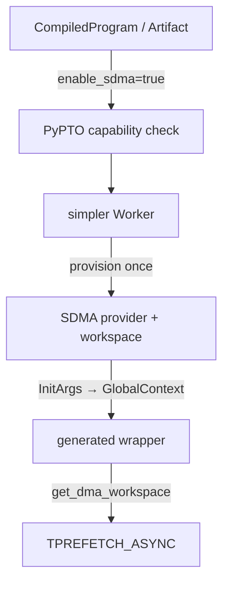
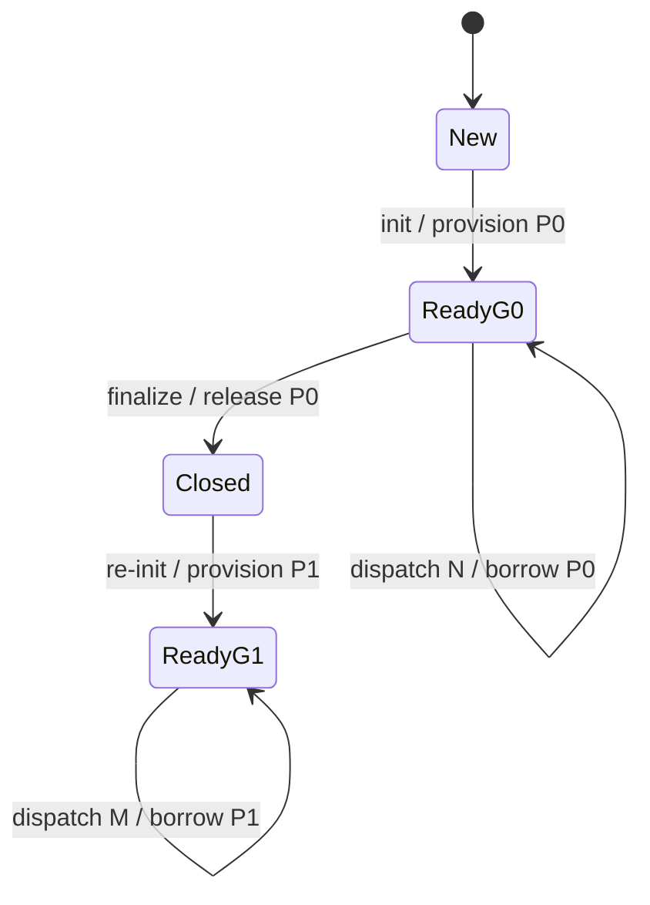

> 源码基线：PyPTO [`390a7536`](https://github.com/hw-native-sys/pypto/commit/390a75363f06dd5e538dcb749b92742a20962bde)，simpler [`7503761a`](https://github.com/hw-native-sys/simpler/commit/7503761a6c01a6d07ccd8d9c82b8060da843d1af)，均为研究时默认分支最新提交。PyPTO 的最新提交调整 pipeline slot 轮转，simpler 的最新提交把 PMU selection 收回到单次 runtime invocation；两者都没有改变本文 SDMA binding 链。本文严格区分当前实现与“若未来支持 graph replay”所需的建议协议。

## 本篇在 PTO 课程路线中的位置

[上一章]()把 `async_prefetch` 拆成三层：IR 中的 invocation-local handle、Artifact 中的 `enable_sdma` requirement，以及 runtime 注入的 hidden workspace。本章继续回答一个更窄的问题：同一份已编译 kernel 连续运行两次时，这个 hidden pointer 究竟绑定到 kernel、dispatch，还是 Worker？Worker 关闭再创建后，旧 graph 能否因“地址没变”而 replay？

课程位置是：

`Artifact requirement → Worker capability → provider provision → InitArgs/GlobalContext → hidden pointer → dispatch`。

## 前置知识

- kernel definition 是可缓存、可去重的代码对象；一次 dispatch 是具体输入、stream、runtime context 和资源状态的执行实例。
- resource requirement 说明“需要什么”，lease binding 说明“这次由谁提供、在哪一代有效”。
- 数值地址只是寻址值，不是所有权或时间身份；allocator 在不同生命周期复用同一虚拟地址并不罕见。
- simpler 的 `GlobalContext` 是每次 AICore launch 可见的运行时上下文；PyPTO 生成 wrapper 通过它取得 DMA workspace。

## 今日 1–2 个核心问题

1. 当前代码中 `enable_sdma=True` 如何从 Artifact 变成 AICore 可读的 hidden workspace？它的所有权和稳定期是什么？
2. 为什么 Worker 重建后必须视为新 generation；当前实现如何保守地处理 capture/replay，未来若开放又需要哪条 fence？

## PTO 全栈中的位置

PyPTO 决定代码需要 SDMA，但不创建设备 provider；simpler 创建并持有 provider，再把地址发布给每次 launch；PTO ISA 的 `TPREFETCH_ASYNC` 最终只消费已绑定地址。于是边界很明确：**编译器声明需求，Worker 持有能力，dispatch 消费绑定，ISA 不负责判断旧绑定是否仍有效。**



## 概念和精确语义

### Requirement 不是 binding

在 [`pto_backend.py`](https://github.com/hw-native-sys/pypto/blob/390a75363f06dd5e538dcb749b92742a20962bde/python/pypto/backend/pto_backend.py) 中，只要编译单元含 prefetch，Artifact 的 `RUNTIME_CONFIG` 就写入 `enable_sdma=True`。它表达的是布尔 requirement：执行环境必须具备 SDMA。它没有 provider ID、workspace generation、设备 rank、地址或完成域，因此不能单独成为 lease。

生成的 wrapper 会执行等价于：

```cpp
auto *ws = reinterpret_cast<__gm__ int8_t *>(
    get_dma_workspace(args, DMA_WORKSPACE_SDMA));
outlined_kernel(user_args..., deferred_args..., ws, l2_info..., spmd_info...);
```

hidden slot 不暴露给 Python 用户，也不进入 IR Tensor 参数。这避免把控制资源伪装成普通数据，但它同时要求 launcher 在每次执行前选对 Worker。

### 当前 binding 的精确范围

[`DeviceRunnerBase::ensure_dma_workspace_provisioned`](https://github.com/hw-native-sys/simpler/blob/7503761a6c01a6d07ccd8d9c82b8060da843d1af/src/common/platform/onboard/host/device_runner_base.cpp) 在 Worker 初始化路径中完成 provider provision，并明确把地址视为 Worker lifetime 内稳定。A2/A3 onboard 的 [`SdmaWorkspaceManager`](https://github.com/hw-native-sys/simpler/blob/7503761a6c01a6d07ccd8d9c82b8060da843d1af/src/a2a3/platform/onboard/host/comm_hccl.cpp) 创建 48 条 CP-process STARS stream 和 16 KiB workspace；其注释也明确：当前**没有 per-device generation gate**，SDMA-enabled Worker 在整个生命周期独占 provider，finalize 时释放。

所以当前真实语义不是“每个 dispatch 一份 workspace”，而是：

- provider/opaque handle：由一个 simpler Worker 持有；
- workspace address：Worker lifetime 内稳定；
- `GlobalContext.dma_workspace[kind]`：每次 launch 发布相同的 resident address；
- generated wrapper：本次 dispatch 借用该地址，不拥有、不释放；
- Worker finalize：健康路径释放 provider；fatal reset 路径放弃逐资源析构并清零发布地址，防止析构代码继续触碰不可信 runtime。

这也修正一个容易误读的说法：**lease 不随 kernel definition 复用，但当前物理 provider 可以在同一 Worker 的多个 dispatch 间复用。**需要逐 dispatch 保留的是执行实例、输入和完成事实；不必每次重建 48 条 stream。

## 真实文件、类型、API 或指令逐段解读

### 1. `CompiledProgram` 到 Artifact

[`CompiledProgram.__call__`](https://github.com/hw-native-sys/pypto/blob/390a75363f06dd5e538dcb749b92742a20962bde/python/pypto/ir/compiled_program.py) 进入 `_invoke_compiled`；[`runner.py`](https://github.com/hw-native-sys/pypto/blob/390a75363f06dd5e538dcb749b92742a20962bde/python/pypto/runtime/runner.py) 组装产物并读取 `runtime_config`，得到 `enable_sdma`。这是 host `bool`，无 shape/dtype/device；它约束执行能力，不描述用户 Tensor。

### 2. `device_runner` 的 fail-closed capability selection

[`_execute_on_device`](https://github.com/hw-native-sys/pypto/blob/390a75363f06dd5e538dcb749b92742a20962bde/python/pypto/runtime/device_runner.py) 先调用 `_PyptoWorker.current(..., require_sdma=enable_sdma)`。若当前作用域已有 platform/runtime 匹配但不支持 SDMA 的 Worker，代码直接报错，而不是悄悄注册；若没有活动 Worker，则创建一次性 simpler `Worker(enable_sdma=True)`，执行 register/run 后 close。

显式 [`ChipWorker`](https://github.com/hw-native-sys/pypto/blob/390a75363f06dd5e538dcb749b92742a20962bde/python/pypto/runtime/worker.py) 的 `_check_binding` 也在 register 前验证 Artifact requirement。SDMA Worker 可以运行普通 Artifact；普通 Worker 不能运行 SDMA Artifact。这是“能力集合包含需求集合”的单向兼容关系。

### 3. provider 到 AICore hidden pointer

simpler 的 [`Worker`](https://github.com/hw-native-sys/simpler/blob/7503761a6c01a6d07ccd8d9c82b8060da843d1af/python/simpler/worker.py) 把 `enable_sdma` 传入 direct-L2 初始化。`DeviceRunnerBase` provision 后通过一次 AICPU init 将地址复制到 `InitArgs`；scheduler 随后写入每核 `GlobalContext.dma_workspace[kind]`。AICore 侧 [`get_dma_workspace`](https://github.com/hw-native-sys/simpler/blob/7503761a6c01a6d07ccd8d9c82b8060da843d1af/src/a2a3/runtime/tensormap_and_ringbuffer/common/intrinsic.h) 从 runtime `args` 中定位 `GlobalContext` 并返回 GM `uint8_t*`。pointer 的 device/location 是 GM；其字节布局由 provider 约定，不是用户张量 shape。

## 对象/Tile/Buffer/IR 生命周期



`ChipWorker._run_chip` 以 `id(chip_callable)` 缓存注册后的 `cid`：同一 callable 调两次，只 register 一次，却仍执行两次 `run`。因此代码对象、注册对象和资源 binding 都可在 Worker 内稳定复用；两个 run 的输入地址、completion 和失败结果仍各自存在。

`close()` 是终止边界。随后 `init()` 会构造新的 simpler Worker。即使设备 allocator 恰好再次返回数值地址 `P0`，新的 provider 也属于下一 lifecycle。当前结构没有导出 `provider_generation`，所以不能凭 pointer equality 证明旧 graph 有效。

## 端到端调用链或指令链

完整路径如下：

1. `CompiledProgram.__call__` 提交用户参数。
2. `_compile_and_assemble` 加载 Artifact，读出 `enable_sdma=True`。
3. `_execute_on_device` 选择具备 SDMA 的 active Worker，或创建一次性 Worker。
4. `ChipWorker._check_binding` 在 register 前做 capability gate。
5. simpler 初始化 AICPU/AICore stream、二进制和 SDMA provider，发布 workspace address。
6. `ChipWorker._run_chip` register/cache `cid`，再调用 simpler `run`。
7. scheduler 为本次 launch 填 `GlobalContext`；wrapper 通过 `get_dma_workspace(args, SDMA)` 取得 hidden GM pointer。
8. outlined function 使用该 pointer 创建 prefetch context，`TPREFETCH_ASYNC` 返回 event，`WaitAsyncEvent` 以同一 session 等待。
9. 本次 run 返回；Worker 可继续服务后续 run。只有 Worker close/finalize 才释放 provider。

任一关键失败都 fail closed：Artifact 需要 SDMA 而 Worker 不具备会在 register 前失败；平台不支持但显式请求 SDMA 会在 provision 失败；provider 未发布时 getter 不应被当成可用 lease；fatal reset 后不允许沿旧上下文正常析构或复用。

## 具体 shape、Tile 和状态演算

设预编译 kernel `K` prefetch `src: [1,4096] FP32`，逻辑范围是 `4096×4 = 16,384 B`。

1. Artifact `A(K)` 只记录 `enable_sdma=True`。
2. 创建 `ChipWorker W0(enable_sdma=True)`；simpler provision provider `H0`，假设发布 workspace 地址 `P0`。A2/A3 当前 provider 还持有 48 条 STARS stream 与 16 KiB workspace；逻辑 prefetch 字节数不等于 provider 总资源成本。
3. 首次 `K(x0)`：注册得 `cid=7`，run #0 的 `GlobalContext` 写入 `P0`，wrapper 借用 `P0`。`x0` 的 GM 地址记为 `X0`。
4. 第二次 `K(x1)`：命中同一 `cid=7`，不再 register；run #1 的 user pointer 变为 `X1`，hidden workspace 仍为 `P0`。两次 dispatch 不同，但 Worker-scoped binding 相同。
5. `W0.close()`：释放 `H0`，`P0` 失效。重建 `W1` 得到 `H1/P1`。即便 `P1 == P0`，也只能说明数值地址相同，不能说明 provider、stream、完成域和 lifetime 相同。

目前最保守也最重要的代码事实是：[`run-completion-fence.md`](https://github.com/hw-native-sys/simpler/blob/7503761a6c01a6d07ccd8d9c82b8060da843d1af/docs/design/run-completion-fence.md) 规定 eager 入口拒绝 caller-stream capture/replay；borrowed-context identity 虽含 `context_generation`，但 borrowed 初始化又拒绝 SDMA。因此当前系统不是靠“自动重绑旧 graph”保证安全，而是**直接不支持这条组合路径**。

## 为什么这样设计及替代方案

| 方案 | 延迟/吞吐 | 资源与正确性 | graphability / 维护成本 |
| --- | --- | --- | --- |
| 用户显式传 workspace Tensor | 参数透明但污染调用面 | 易把资源误当数据，用户难证明 provider lifetime | graph 参数可见，但 ABI 与所有权负担最高 |
| 每 dispatch provision/free | 无跨 run ABA，语义直观 | 48 条 stream 反复创建，启动延迟和故障面大 | generation 清楚，吞吐最差 |
| **当前 Worker-scoped hidden binding** | 初始化摊销，多 run 复用 | capability gate + Worker lifetime；地址不泄露给 IR | 当前拒绝 SDMA capture，维护面较小 |
| versioned graph binding（建议） | replay 快，但首次绑定和校验有成本 | 需 generation、provider digest、completion fence | 可支持 graph，但需失效/重录协议 |

从第一性原理看，不变量只有两个：执行前需求必须被具体 provider 满足；provider lifetime 结束后任何旧执行描述都不得再引用它。当前设计用 Worker-scoped provision 降低固定成本，用“不支持 capture”守住第二条，符合现阶段最小机制。只有真实需求要求 SDMA graph replay 时，才值得引入 versioned binding，而不是提前把复杂度塞进普通 eager path。

建议的 replay key 至少是：

`(environment_identity, context_generation, provider_generation, capability_digest, workspace_addr)`。

replay 前必须原子验证这些字段仍与活动 Worker 一致；不一致时 invalidate/re-record，不能现场把旧 graph 中的 hidden pointer 静默改写。这里是建议协议，不是当前 API。

## 访存、计算、流水、并行和硬件约束

- hidden pointer 本身只增加一次 context 读取；主要成本是 provider 初始化、stream 资源和真实 prefetch 流量。
- Worker 内稳定地址有利于重复 launch，避免每次重新 provision；`cid` cache 又减少注册开销。
- 多 dispatch 共享 provider 不等于可无界并发。真实 queue/post 容量、session/event closure 与 provider 内部同步仍限制并行度。
- `enable_sdma` 是过粗的 capability 描述：它未编码 backend、workspace size/version、stream 数、rank 或 capture safety。今天的 gate 保证“有/无”，不能证明 provider profile 完全匹配未来 artifact。
- A2/A3 onboard 的硬件资源数来自当前源码；具体 stream 调度、带宽重叠和故障恢复时延仍需真机 profile，不能由 host 代码推断。

## 测试证据与未覆盖风险

**PyPTO 测试事实。** [`test_chip_worker_explicit_dispatch.py`](https://github.com/hw-native-sys/pypto/blob/390a75363f06dd5e538dcb749b92742a20962bde/tests/ut/runtime/test_chip_worker_explicit_dispatch.py) 验证同一 compiled callable 两次 run 只注册一次；普通 Worker 在 simpler register 前拒绝 SDMA Artifact；SDMA Worker 可运行普通 Artifact。[`test_worker_reuse.py`](https://github.com/hw-native-sys/pypto/blob/390a75363f06dd5e538dcb749b92742a20962bde/tests/ut/runtime/test_worker_reuse.py) 验证 `current(require_sdma=True)` 不会借用普通 active Worker、一次性路径会转发能力、close 后 init 创建新 backend。[`test_execute_artifact.py`](https://github.com/hw-native-sys/pypto/blob/390a75363f06dd5e538dcb749b92742a20962bde/tests/ut/runtime/test_execute_artifact.py) 验证混合 batch 只要有一个 SDMA Artifact 就提升共享 Worker capability，但其他 platform/runtime 的 Artifact 不会错误上提当前环境。

**simpler 测试事实。** [`test_dma_workspace_sim.py`](https://github.com/hw-native-sys/simpler/blob/7503761a6c01a6d07ccd8d9c82b8060da843d1af/tests/ut/py/test_worker/test_dma_workspace_sim.py) 在 A2/A3 simulator 中用 inert 16 KiB block 走同一发布链；两个顺序创建的 SDMA Worker 各持有自己的 runner/block。它验证 lifecycle ownership，不等于验证真实 STARS DMA。测试配置还把 SDMA 用例放到故障域末尾，因为每个实例占 48 条 stream。

**历史证据。** PyPTO [PR #2089](https://github.com/hw-native-sys/pypto/pull/2089) 引入 hidden workspace、Artifact metadata 和显式 Worker 支持；本文仍以当前合入代码为准。

**未覆盖风险。** 当前没有可供测试的 provider generation token；没有 SDMA capture/replay 正向测试，因为路径被拒绝；没有 same-VA 重用、fatal reset 后 stale `GlobalContext`、旧 graph 对新 Worker、并发 replay 的 negative Golden。A5 onboard provider parity 也未由上述 A2/A3 simulator 测试证明。本篇未在 NPU 上重跑测试。

## 与前后章节的连接

上一章确认 requirement 与 lease 不应进入同一 IR 对象；本章把真实 binding 范围钉在 Worker lifetime，并发现当前安全策略是拒绝 SDMA borrowed/captured execution，而非已有 generation-aware replay。下一章将追问 Artifact 只有一个 `enable_sdma` 布尔值是否足够：provider backend、workspace ABI、rank、capture policy 与版本变化如何进入 cache fingerprint。

## 本篇结论、知识债、三个理解检查问题和下一章

结论：

1. kernel definition、`cid` 和 SDMA provider 都可在同一 Worker 内复用；每次 run 仍是独立 dispatch。
2. hidden workspace 是 Worker-scoped borrowed GM pointer，经 `InitArgs → GlobalContext → get_dma_workspace` 注入；wrapper 不拥有它。
3. Worker close 是资源代际边界；地址相同不能跨生命周期证明同一 lease。
4. 当前没有 per-device/provider generation gate，也没有 SDMA graph replay 重绑；安全来自 capture/replay 与 borrowed-SDMA 的保守拒绝。
5. 若未来开放 replay，必须以 environment/context/provider generation 和 capability digest 验证绑定，失配就重录。

知识债：导出 provider generation；把 capability 从 bool 升级为 versioned schema；增加 same-VA、fatal reset、stale context、recreated-worker graph negative tests；补 A5 onboard 与真机并发/带宽证据。

理解检查：

1. 为什么同一 `cid` 连续 run 两次可以共用 `P0`，但 `close→init` 后即使又得到 `P0` 也不能 replay 旧 graph？
2. `enable_sdma=True` 分别在哪三处参与决策，又缺少哪些足以构成 lease identity 的字段？
3. 为什么“每 dispatch provision”更容易描述 generation，却不是当前更合理的默认方案？

下一章：**一个 `enable_sdma` 布尔值够不够——Capability Schema、Artifact Fingerprint 与 Provider Matrix。**

## 课程账本增量

- 第 73 章；源码基线 PyPTO `390a7536`、simpler `7503761a`。
- 新覆盖：`CompiledProgram.__call__ → _execute_on_device → ChipWorker.current/_check_binding/_run_chip → simpler Worker/DeviceRunnerBase → InitArgs/GlobalContext → get_dma_workspace`。
- 新确认不变量：definition/registration 可复用；provider 只在 Worker lifetime 内稳定；close 后同址不等代；当前 SDMA capture/replay 被拒绝。
- 新知识债：versioned capability/lease schema、provider generation、cache fingerprint、graph invalidation 与 same-VA/fatal-reset Golden。
- 下一章转向 capability schema 与 provider matrix，不提前进入 serving。
