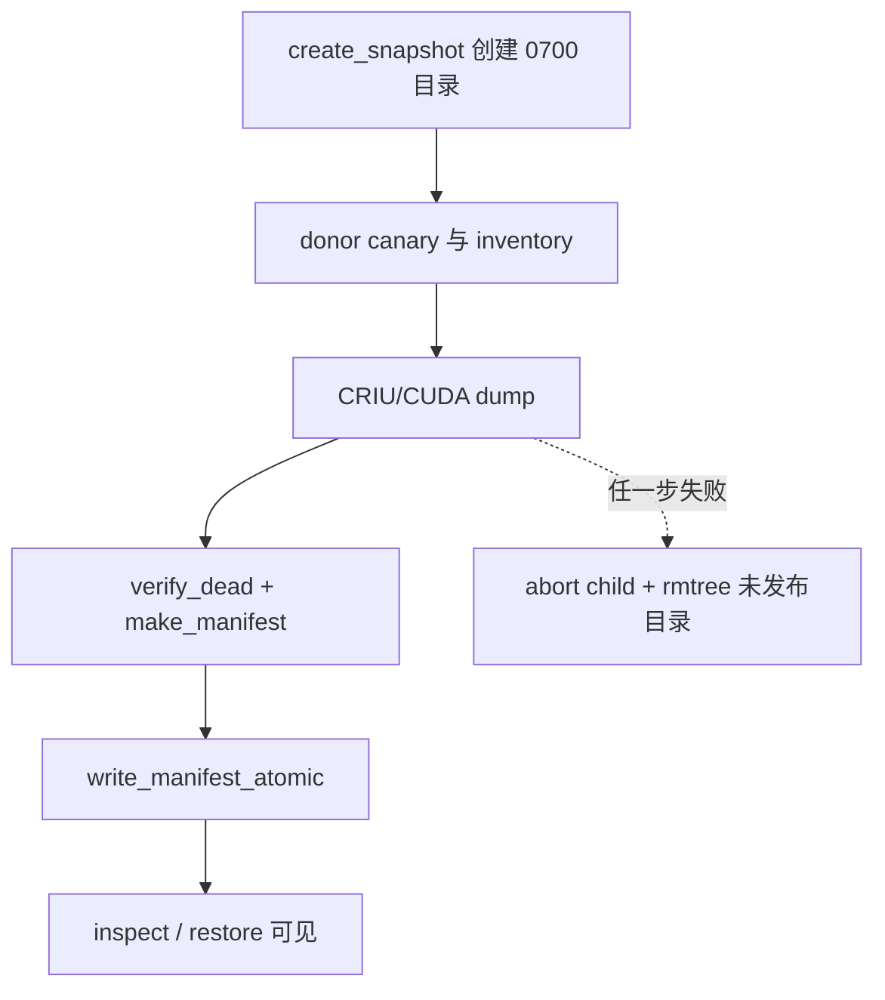
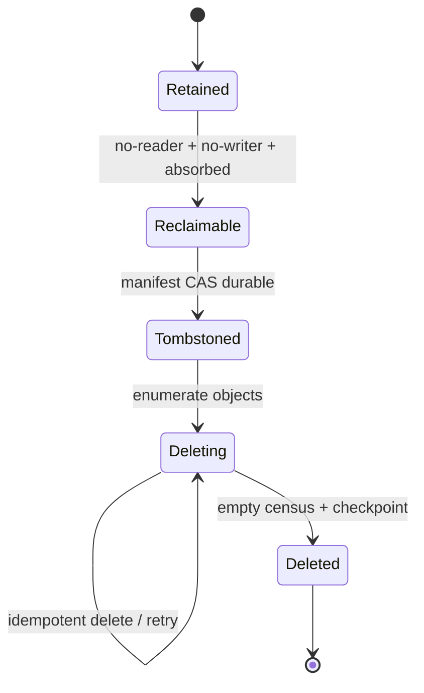

> 源码基线：vLLM [`30aded62`](https://github.com/vllm-project/vllm/commit/30aded62d46dfcf52c815925a8acec5a8bebddc6)，即研究时默认分支最新提交；它修复 CPU offload pool 在 PP/spec-decode worker 间不一致的问题，与本文 snapshot 主路径无直接改动。initialized snapshot 由 [PR #51360](https://github.com/vllm-project/vllm/pull/51360) 合入。本文严格区分三类内容：**当前代码事实**、**测试/实验事实**、以及为 revalidation receipt GC 推导的**建议协议**。

## 本篇在课程路线中的位置

这是第 63 章，仍处于“测试、性能与故障诊断”。第 61 章让旧 attempt 的迟到 receipt 失去提交权；第 62 章又证明，`logical obsolete` 不等于可删，必须先得到 no-reader、no-old-writer 与 durable manifest absorption。今天只补最后一个窄问题：这些条件已经成立后，GC 删除一半时进程崩溃，重启后怎样既不复活旧证据，也不误删仍被引用的对象？

本章借用一个真实而独立的实现作锚点：当前 `vllm/snapshot` 是用于同机恢复 initialized engine 的实验功能，不是前几章设想的 revalidation receipt store。它已经实现“payload 先生成，`manifest.json` 最后原子发布”的单机提交点；我们从这条已合入事实向上推导 crash-safe reclamation，但不声称 vLLM 已经实现 GC tombstone。

## 前置知识回顾

上一章的删除前置条件可压成四个独立证明：旧 attempt 已被 generation fence 逻辑退休；所有 reader epoch 都严格越过 retirement revision；旧 writer 的 device event、collective handle 与 generation 已完成或失效；新 manifest 已吸收恢复、去重和审计仍需的 digest。只有四者同时成立，GC 才能改变可达性。

还要补一个文件系统事实：`unlink` 或 `rm -rf` 只是在执行删除动作，它没有记录“我为什么可以删、计划删哪些、已经删到哪里”。若删除本身承担事务提交点，crash 后剩余对象无法区分“应继续删”与“仍在使用”。

## 本篇要回答的核心问题

1. 当前 initialized snapshot 为什么把 `manifest.json` 放在最后发布，它精确保证了什么，又没有保证什么？
2. 怎样把“先提交意图、后执行副作用”扩展到 receipt/snapshot 回收，使 crash-before-delete、mid-delete 与 delete-after-crash 都收敛到同一终态？

## 组件在全局架构中的位置

当前 snapshot 路径位于 serving 启动之前：controller 启动一个 donor engine，完成 canary 与 CRIU/CUDA capture，最后发布 manifest；restore 则先读 manifest、校验运行时 identity，再执行 CRIU restore 和 canary。manifest 因而是 artifact 从“工作目录”变为“可被 inspect/restore 消费的 snapshot”的可见性根。



源码入口分别是 [`controller.create_snapshot`](https://github.com/vllm-project/vllm/blob/30aded62d46dfcf52c815925a8acec5a8bebddc6/vllm/snapshot/controller.py)、[`LocalSnapshotTools.publish`](https://github.com/vllm-project/vllm/blob/30aded62d46dfcf52c815925a8acec5a8bebddc6/vllm/snapshot/runtime.py) 与 [`read_manifest`](https://github.com/vllm-project/vllm/blob/30aded62d46dfcf52c815925a8acec5a8bebddc6/vllm/snapshot/manifest.py)。

## 完整调用链

创建链是：

`vllm snapshot create → create_snapshot → launch_child → wait_ready → inventory → dump → verify_dead → make_manifest → publish → write_manifest_atomic`。

`create_snapshot` 先拒绝已存在的 target，再创建 mode `0700` 的私有目录。child 写出 one-token oracle；controller 收集 process tree、CUDA holders 与外部 generated-cache fingerprints，完成 dump 并确认 source tree 已死，才构造 `SnapshotManifest`。只有 `publish` 成功，局部变量 `published` 才置为 `True`；否则 `finally` 会 `shutil.rmtree(target)`，未发布 artifact 不留给 reader。

消费链是：

`vllm snapshot restore → restore_snapshot → read_manifest → validate_identity → LocalSnapshotTools.restore → release → wait_listener → request_oracle → complete_restore`。

这里的顺序很关键：manifest 缺失、JSON/strict schema 非法、host/GPU/driver/kernel/Python/PyTorch/vLLM identity 不同，都会在 CRIU 变更进程状态之前失败。通过 identity 仍不等于成功；恢复后还必须复现 token、text 和 sampled-token logprob，否则清理已 pin 的 process tree。

## 关键类型、字段和状态生命周期

`SnapshotManifest` 是 `frozen=True, strict=True, extra="forbid"` 的 Pydantic model。它绑定 `schema_version=1`、固定 capture `boundary`、artifact bytes、model/revision、engine argv、process tree、CUDA holders、external cache fingerprints、运行时 identity 与 one-token oracle。`cuda_holders` 必须是无重复 `process_tree` 的子集，oracle 必须恰好一个 token，logprob 必须是有限 `float`。

生命周期如下：

| 阶段 | 持有者 | 可被 restore？ | 失效/转移条件 |
| --- | --- | --- | --- |
| target/workdir 构建中 | `create_snapshot` | 否；尚无 manifest | 任意异常后 abort child 并删目录 |
| payload 已 dump | `LocalSnapshotTools` | 仍否 | `verify_dead`、构造 manifest |
| manifest 已安装 | artifact directory | 是 | identity/schema/oracle 后续校验 |
| restore transaction | runtime + pidfd handles | 正在消费 | `complete_restore` 或 `cleanup` |

这说明 manifest 是**可见性提交点**，不是 payload 本身，也不是“所有字节断电后必然存在”的证明。

## 逐函数源码解读

### `_write_json_atomic`：原子可见与目录项持久化

[`_write_json_atomic`](https://github.com/vllm-project/vllm/blob/30aded62d46dfcf52c815925a8acec5a8bebddc6/vllm/snapshot/manifest.py) 的顺序非常具体：

1. 固定临时名 `manifest.json.tmp`；非 overwrite 模式先拒绝已有 destination。
2. 以 `O_CREAT | O_EXCL | O_NOFOLLOW` 和 mode `0600` 打开临时文件，防止覆盖或追随 symlink。
3. 写入 canonical JSON，`flush()` 后 `fsync(file)`。
4. `os.replace(tmp, destination)`，使 reader 只看到旧文件或完整新文件，不看到半截 JSON。
5. `fsync(destination.parent)`，让 rename 后的目录项持久化；异常时清理 tmp。

`write_manifest_atomic` 还先调用 `validate_artifact_root`：路径链不得含 symlink，owner 必须可信，目录本身必须由当前用户持有且不得开放 group/other 权限。manifest 已存在会转成 `SnapshotSecurityError`，所以发布是 single-assignment，而不是静默改写既有 snapshot。

从接口契约看，`_write_json_atomic(path, payload, overwrite=False)` 的输入是 Host 文件系统路径和可 JSON 序列化对象，没有 Tensor、dtype 或 device；输出也不是新对象，而是“目标名字现在指向完整 JSON”的副作用。调用者持有 payload，函数只在调用期间持有临时 fd。前置条件是 parent 已存在且可写；非 overwrite 模式要求 destination 和 symlink 均不存在。正常后置条件是 tmp 消失、destination mode 为 `0600`、文件内容已 fsync、parent entry 已 fsync。可见失败包括旧 destination 已存在、旧 tmp 遗留导致 `O_EXCL`、编码/写入失败、空间耗尽、replace/fsync 失败与权限错误；异常分支尽力 unlink tmp，但不会回滚已经成功的 replace。这也是为什么恢复协议不能把“函数抛错”简单解释成“什么都没发生”，而要重新读取 durable state。

把 crash window 展开更能看清保证：写 tmp 前崩溃时 destination 不变；写 tmp 中崩溃只可能遗留不可见 tmp；tmp fsync 后、replace 前崩溃仍没有新 destination；replace 后、directory fsync 前，其他进程在当前运行期可看到完整文件，但断电后的目录项耐久性尚未闭合；directory fsync 返回后，manifest 的命名提交完成。`publish` 随后的 parent fsync 再闭合 artifact 目录本身的命名边界。这个分析只依赖 POSIX 风格本地文件系统；网络文件系统和 object store 必须用各自的 conditional put/version 语义重新证明，不能照搬 `os.replace` 的结论。

### `publish`：为什么还要 fsync 父目录

`LocalSnapshotTools.publish` 先调用 `write_manifest_atomic(workdir, manifest)`，再 `_fsync_directory(workdir.parent)`。前者持久化 artifact 目录内的 `manifest.json` entry；后者持久化 artifact 目录在其父目录中的 entry。两层 fsync 对应两个命名边界。

但是，[官方文档](https://github.com/vllm-project/vllm/blob/30aded62d46dfcf52c815925a8acec5a8bebddc6/docs/features/initialized_snapshots.md) 明确否定更强结论：publication 没有显式 flush 全部 captured payload files 和 directories，因此 artifact **不保证经受断电**，unclean host shutdown 后应重建。这是本章最重要的边界：atomic manifest 解决 torn visibility，不自动构成 multi-file power-loss transaction。

### `read_manifest`：reader 只信提交点

`read_manifest` 不扫描 images 目录猜测快照是否完整，而是要求 `manifest.json` 存在、不是 symlink、可用 `O_NOFOLLOW` 打开，并通过 strict schema。`restore_snapshot` 随后精确比较所有 compatibility identity 字段。换言之，payload 的“存在”没有提交语义；reader 只从 manifest 建立可达性。

## 具体示例与 shape/状态演算

先看当前实现的真实例子。文档 quickstart 创建 `Qwen/Qwen3-0.6B`、TP1、`float16`、`max_model_len=512` 的 initialized snapshot；canary 使用固定 prompt、temperature 0、seed 0，要求一个 token。PR #51360 的 H200 acceptance 记录 token id `12095`、文本 ` Paris` 与精确 logprob 一致；这是实验事实，不是所有模型的常量。

再把协议应用到课程主线的 revalidation snapshot。设 TP=2、key K16，每 rank 稳定复制 `bf16[16,4096]`：`16 × 4096 × 2 = 131072` bytes，即 128 KiB；两 rank payload 共 256 KiB。attempt 7 已满足上一章四个回收证明，manifest revision 42 仍引用：

```text
M42.live = {attempt8}
M42.retired = {attempt7 -> [rank0.bin, rank1.bin, receipt.json]}
```

GC 不直接删文件，而是 CAS 发布 revision 43：

```text
M43.live = {attempt8}
M43.tombstones = {attempt7: object list + retirement revision + digest}
M43.gc_cursor = attempt7
```

只有 M43 durable 后，worker 才逐个执行幂等 delete。四个 crash 点的恢复结果如下：

| 崩溃点 | durable 事实 | 重启动作 |
| --- | --- | --- |
| M43 CAS 前 | M42 仍引用 attempt7 | 不删；重新验证四个 proof |
| M43 durable、首个 delete 前 | tombstone 已提交 | 从 object list 开始删 |
| rank0.bin 已删、其余未删 | tombstone 仍列完整集合 | missing 视为成功，继续删其余对象 |
| 全删完、completion ack 前 | tombstone 仍在 | 重扫得到 empty，补写 `DELETED` checkpoint |

因此恢复判据不是“上次删到第几个”，而是“当前 manifest 是否已使对象不可达，以及 tombstone 集合还有哪些对象实际存在”。cursor 只是加速器，不是 correctness 根。



## 为什么这样设计及替代方案

第一性约束只有两个：reader 绝不能把部分 artifact 当成有效版本；crash 后恢复者必须仅凭 durable state 决定继续还是停止。由此，最小充分设计不是复杂分布式事务，而是“manifest 控制可达性 + durable tombstone 记录删除意图 + 幂等 delete”。

| 方案 | 优点 | 根本缺口 |
| --- | --- | --- |
| 直接 `rm -rf` | 最简单、无额外 metadata | crash 后没有删除意图；也没有 no-reader 证明 |
| 整目录 rename 到 `trash/` 后删除 | 同一文件系统内可快速切断路径 | 跨 filesystem/object store 不成立；仍需 reader fence 和 trash 恢复扫描 |
| append-only WAL 记录每次 delete | 审计最细 | replay/compaction 复杂；WAL 仍需 checkpoint 提交点 |
| manifest tombstone + 幂等 delete | 可达性与物理删除解耦，恢复规则短 | 多 writer 需要 revision CAS/lease；tombstone 本身还要压缩 |

当前 initialized snapshot 采用“整个 target 单次发布，失败则删未发布目录”，很适合单机离线 create。revalidation store 若有并发 reader、多个 generation 和对象存储，则必须额外带上第 62 章的 reader epoch、writer generation 与 manifest revision；仅复制 `_write_json_atomic` 不够。

## 性能、并发、正确性与边界条件

manifest 发布增加一次文件 `fsync`、artifact directory `fsync` 与 parent directory `fsync`；tombstone 协议又把删除拆成 metadata commit 和后台 sweep。代价是额外同步写与暂时的空间峰值，收益是在线路径不必等待大对象逐个删除，且 delete 可安全批量、限速、重试。

本文不预设固定阈值；批大小、限速与保留窗口都应由实测存储延迟、空间水位和 reader 最坏停留时间校准。

并发边界上，single-assignment `manifest.json` 只解决单 snapshot 发布。多个 GC owner 必须通过 `(snapshot_id, expected_revision, owner_generation)` 的 CAS 或 lease 竞争 tombstone；loser 只做只读 reconciliation。对象 delete 应按 immutable key 幂等，不能用可复用路径名，否则旧 GC 可能删掉同名新 generation。

正确性边界上，M43 durable 只授权删除 M43 tombstone 精确列出的对象；它不授权清空整个 prefix。reader 也必须 pin 某一 revision，并在离开时释放 lease。若 reader 仍能绕过 manifest 直接按路径打开 payload，那么 manifest 已不再是唯一可达性根，协议失效。

## 测试证据与未覆盖风险

[`test_launch_cli.py`](https://github.com/vllm-project/vllm/blob/30aded62d46dfcf52c815925a8acec5a8bebddc6/tests/entrypoints/launchers/test_launch_cli.py) 提供了直接证据：

- `test_snapshot_create_rolls_back_failed_dump` 让 `dump` 抛错，断言 child 被 abort 且 target 不存在，验证“未 publish 不留 artifact”。
- `test_snapshot_restore_rejects_identity_mismatch` 让 `vllm_version` 不同，断言真正 `restore` 未被调用。
- `test_snapshot_manifest_validation` 参数化 unknown field、错误 schema/boundary、重复 PID、非法 CUDA holder、两 token 与非有限/非 float logprob，验证 strict manifest fail-closed。
- `test_snapshot_private_path_and_link_remap_security` 覆盖 symlink、world-writable ancestor 与冲突 link remap。
- `test_snapshot_manifest_records_external_cache_files` 验证 cache fingerprints round-trip，并兼容缺省旧字段。
- `test_snapshot_restore_cleans_oracle_mismatch` 验证 canary 不同会 cleanup，而不会 `complete_restore`。

PR #51360 还报告 H200 上 create、inspect、同容器两次 restore 与最终 PID/GPU/listener 清理通过；其 Qwen3-32B H100 实验中，ordinary warm activation 中位数 54.7029 s、snapshot restore 20.3795 s，各 3 个样本。它们是特定 SHA/硬件的作者实验，不外推为通用性能结论。

未覆盖风险同样明确：现有测试没有在 `fsync(file)`、`os.replace`、directory fsync、parent fsync 之间注入进程/断电故障；没有验证 payload 全量 durability；也没有 tombstone、mid-delete crash、duplicate delete、GC owner takeover、reader lease 或对象 key 复用测试。本章未重跑 GPU/CRIU 测试。当前代码事实只能支持 atomic publication，不能支持“已经实现 crash-safe GC”的结论。

最小的新增 fault harness 应把存储层替换为可记录操作序列的 adapter，并在每次 `put/fsync/replace/CAS/delete/checkpoint` 之后强制终止 owner。重启 oracle 不应只检查“最终目录为空”，而要同时断言：旧 revision 的合法 reader 在 lease 存续期始终能读完整对象；tombstone 提交后没有新 reader 获得旧 revision；重复 replay 不删除新 generation；任意前缀执行后继续运行都收敛到同一 manifest 与对象集合。若 fault point 数量增加，这四条不变量仍保持不变，测试矩阵才是在验证协议，而不是枚举某次实现的控制流。

## 与前后章节的连接

第 60 章定义可暂停阶段，第 61 章给 receipt 加 attempt/generation，第 62 章给删除加 no-reader/no-writer proof。本章把最后的物理副作用变成可重放事务：先用 manifest 改变可达性，再让 tombstone 驱动幂等删除。下一章研究多个 GC worker 同时接管时，怎样用 claim lease、owner generation 与 audit checkpoint 防止旧 owner 越权删除。

## 本篇结论、知识债、三个理解检查问题和下一章

结论：`manifest.json` 的 atomic replace 只能证明 reader 不会看到半截 manifest；它不是多文件 payload 的断电耐久证明，更不是删除完成证明。Crash-safe reclamation 的正确顺序是：前置 proof 闭合 → CAS 发布 durable tombstone → 按 immutable object set 幂等删除 → empty census 后写 completion checkpoint。任何 crash 只会让系统停在可重试状态，不会改变对象是否可达的判据。

知识债：真实 revalidation receipt/manifest schema、reader lease 与 crash revoke、object-store conditional write、GC owner lease/fencing、payload checksum 与 flush policy、tombstone compaction、immutable key 规范、容量水位和 delete rate limit，以及覆盖每个 fsync/delete 边界的 deterministic fault harness。

理解检查：

1. `os.replace` 后再 fsync artifact directory，为什么仍不能证明 CRIU payload 经受断电？
2. attempt7 的一个对象已经不存在，为什么 tombstone 重放时应把 missing 当成成功，而不是事务损坏？
3. 如果 reader 可以绕过 manifest 直接打开 `rank0.bin`，哪条核心不变量被破坏？

下一章：**两个 GC Owner 都认为自己接管了怎么办——Claim Lease、Generation Fence 与 Audit Checkpoint。**

## 第 57–63 章知识图谱回顾

七章已经把“graph promotion 后如何持续可信”连成一条闭环：`promotion` 不是永久许可证，第 57 章用 sentinel 发现 drift；第 58 章把局部 graph 故障翻译为 degraded capacity；第 59 章在 recovery budget 内调度 revalidation；第 60 章只在 completion fence 后 checkpoint/pause；第 61 章用 attempt/generation 拒绝迟到 receipt；第 62 章把 logical obsolete 与 physical reclaim 分开；本章再用 manifest/tombstone 让删除可重放。

当前最稳固的知识是三类“提交点”必须分开：执行完成由 device/collective receipt 证明；路由生效由 generation-bound promotion CAS 证明；物理删除权由 no-reader/no-writer proof 加 durable tombstone 证明。当前最大空白从“删除顺序”收缩为“多 owner 并发接管与跨存储介质 durability”。

## 课程账本增量

- 课程 63：用当前 initialized snapshot 的 atomic manifest publish 作为代码锚点，补齐 tombstone 驱动的 crash-safe reclamation。
- 新确认不变量：manifest 是唯一可达性根；atomic visibility 不等于 payload power-loss durability；先 durable tombstone、后幂等 delete；GC cursor 只优化性能，不承担 correctness。
- 新覆盖：`vllm/snapshot/{controller,manifest,runtime,server}.py`、`SnapshotManifest`、`create_snapshot`、`_write_json_atomic`、`write_manifest_atomic/read_manifest`、`LocalSnapshotTools.publish`、initialized snapshot 文档、PR #51360 与 snapshot tests。
- 新知识债：多 GC owner claim/fence、reader lease、object-store CAS、payload flush/checksum、tombstone compaction、immutable key 与 crash-at-every-boundary Golden。
- 下一章：Claim lease、owner generation、幂等 delete reconciliation 与 audit checkpoint。
