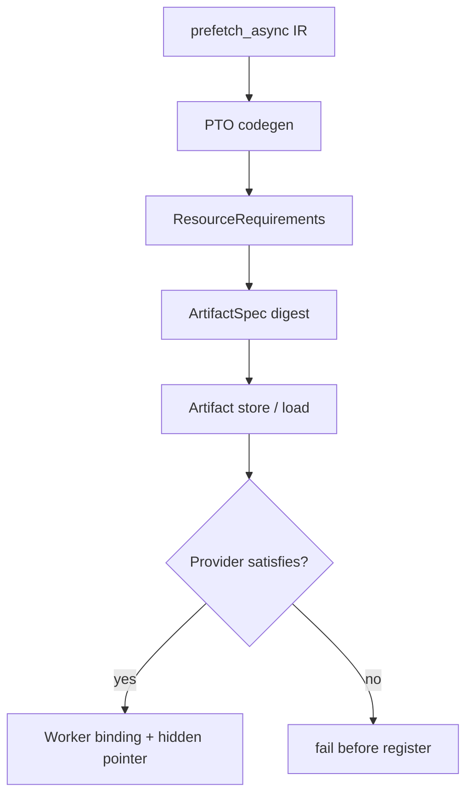
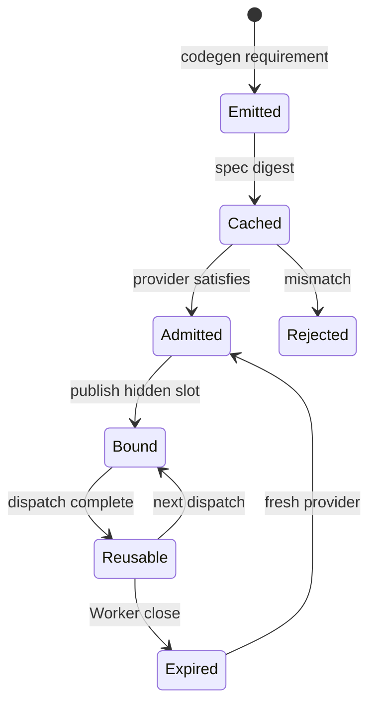

> 源码基线：PyPTO [`94b2d342`](https://github.com/hw-native-sys/pypto/commit/94b2d3424d7cc8d5666e42590c78c568498eb36d)，simpler [`fa6528f4`](https://github.com/hw-native-sys/simpler/commit/fa6528f4e45c42242e2162c2ba0192d09cbd3b88)。两仓当日最新提交分别修改 packed FP4 类型与 args-dump transport credits，均未改变本文路径。

## 本篇在 PTO 课程路线中的位置

第 72 章把 prefetch 的 opaque handle、Artifact requirement 与 hidden workspace 分层；第 73 章继续证明 kernel definition、`cid` 和 Worker-scoped provider 可以复用，但具体 dispatch/Worker generation 不能靠相同地址冒充。第 74 章向前移动一层：**编译产物到底该声明什么，才能让缓存复用与运行时 provider 选择同时正确？**

本篇位于“Python IR → codegen Artifact → JIT store → Worker/provider → hidden binding”的契约接缝。重点不是发明一个万能配置对象，而是判断现有 `enable_sdma: bool` 在哪一层足够、在哪一层信息不足。

## 前置知识

- PyPTO 的 `prefetch_async` 在用户 IR 中产生 context/event/session；workspace 不作为用户 Tensor 参数出现。
- codegen 为 wrapper 增加 hidden `!pto.ptr<i8>`，运行时从 simpler 的 `GlobalContext` 取得地址。
- `enable_sdma` 是 Artifact 的需求提示，不是 workspace 地址、provider handle 或 generation。
- 同一 Worker 内 provider 可跨 dispatch 借用；Worker 关闭后，旧 binding 失效，即使新地址恰好相同。

## 今日 1–2 个核心问题

1. `enable_sdma` 为什么对当前 Worker API 是合理的，却不足以充当长期 Artifact capability schema？
2. 哪些字段必须进入 Artifact fingerprint，哪些只能留在每次运行的 provider/binding 状态？

## PTO 全栈中的位置



上游输入是 prefetch op 所表达的语义需求；下游消费者不是单一设备，而是 Artifact store、loader 和 Worker admission 三个位置。缓存层要判断“两个产物是否具有同一资源契约”，运行时要判断“当前 provider 是否满足该契约”，dispatch 层才绑定实际地址。

## 概念和精确语义

先区分三个容易混写的对象：

| 对象 | 例子 | 是否进 Artifact digest | 生命周期 |
| --- | --- | --- | --- |
| semantic requirement | SDMA、ABI major、scope、required ops | 是 | 随编译产物 |
| provider profile | A2/A3 STARS、SIM inert、A5 comm-domain URMA | 否；用于满足关系 | 随 Worker/domain |
| binding/lease | 实际地址、handle、generation、device/rank | 否 | 随 Worker 或 dispatch |

兼容关系应写成 `provider.satisfies(requirement)`，而不是两份配置字典完全相等。Artifact 只应描述执行正确性所需的最小事实；实际地址、健康状态、当前 generation 与 channel handle 都是运行时状态。把它们写入 cache key 会令同一个正确产物在每次 Worker 重建后都失去复用价值。

基于当前代码，最小的未来 schema 可以是：

```python
ResourceRequirements(
    schema_version=1,
    dma=(
        DmaRequirement(
            kind="sdma",
            abi_major=1,
            scope="worker_device",
            required_ops=("prefetch_async", "wait_event"),
        ),
    ),
)
```

这里故意没有 `workspace_addr`、48 条 stream、16 KiB provider allocation 或 `provider_generation`。这些不是编译语义。若未来 kernel 真的读取固定 workspace layout，`abi_major` 才负责让不兼容布局触发新 Artifact；若空间仍完全 opaque，大小也不应由 Artifact 硬编码。

几个字段的判定标准如下：

| 字段 | 前置/后置条件 | 典型失败 |
| --- | --- | --- |
| `schema_version` | loader 必须认识版本并能 canonical decode | 未知版本直接拒绝，不能忽略新字段 |
| `kind` | provider 暴露同类 engine，hidden slot 的解释一致 | 用 URMA 地址填 SDMA slot |
| `abi_major` | wrapper、runtime 与 provider 对 pointer/layout/event 有共同解释 | 旧 wrapper 读取新 layout |
| `scope` | provider lifetime 至少覆盖 binding，ownership 域相同 | comm-domain provider 被当作 device-wide singleton |
| `required_ops` | 每个可能执行的 op 都有真实实现或被契约允许的模拟 | SIM 只给非零地址却把远端搬运静默变 no-op |

输入是 immutable、可规范化的逻辑 record；输出是稳定 digest 与可判定的 runtime requirement。前置条件是 codegen 已完成 op census，不能只凭“文件中出现过 prefetch”猜测；后置条件是任何会改变 kernel 正确性的 resource 差异都必须改变 digest。非法组合包括未知 ABI、重复但冲突的同-kind requirement、scope 比实际 binding 更长，以及 required op 在 provider profile 中缺失。

## 真实文件、类型、API 或指令逐段解读

### PyPTO：当前布尔值如何产生

[`pto_backend.py`](https://github.com/hw-native-sys/pypto/blob/94b2d3424d7cc8d5666e42590c78c568498eb36d/python/pypto/backend/pto_backend.py) 在任何 emitted kernel 消费 prefetch 时，把 `"enable_sdma": True` 写入生成的 `kernel_config.py`。[`test_prefetch_codegen.py`](https://github.com/hw-native-sys/pypto/blob/94b2d3424d7cc8d5666e42590c78c568498eb36d/tests/ut/codegen/test_prefetch_codegen.py) 同时检查 hidden pointer、`get_dma_workspace(...DMA_WORKSPACE_SDMA)` 与这个 runtime flag；普通 kernel 则不发出该 flag。

这条链证明了“有 prefetch 就要求 SDMA path”，但布尔值没有编码 engine ABI、scope、允许的模拟语义或 provider 版本。因此两个语义不同但都为 `True` 的产物，目前在资源契约层不可区分。

### PyPTO：仓库已有可复用的 fingerprint 模式

不要把新 schema 塞进已有 [`ExecutionCapabilities`](https://github.com/hw-native-sys/pypto/blob/94b2d3424d7cc8d5666e42590c78c568498eb36d/python/pypto/_artifact_contract.py)：它描述 Artifact 可由 `PROGRAM` 还是 `KERNEL` executor 消费，文档明确与硬件/模拟模式无关。

但 [`_artifact_manifest.py`](https://github.com/hw-native-sys/pypto/blob/94b2d3424d7cc8d5666e42590c78c568498eb36d/python/pypto/jit/_artifact_manifest.py) 提供了正确范式：`ArtifactSpec` 的规范化 record 参与 spec digest；[`_artifact_runtime.py`](https://github.com/hw-native-sys/pypto/blob/94b2d3424d7cc8d5666e42590c78c568498eb36d/python/pypto/runtime/_artifact_runtime.py) 在 load 前比较 manifest 与 compiled metadata；[`test_artifact_cache.py`](https://github.com/hw-native-sys/pypto/blob/94b2d3424d7cc8d5666e42590c78c568498eb36d/tests/ut/jit/test_artifact_cache.py) 已验证不同 execution capabilities 使用不同 slot、篡改会使 manifest 失效。资源契约应平行扩展这一机制，而不是复用它的名词。

### simpler：为什么 Worker 对外仍是 bool

[`device_runner_base.h`](https://github.com/hw-native-sys/simpler/blob/fa6528f4e45c42242e2162c2ba0192d09cbd3b88/src/common/platform/onboard/host/device_runner_base.h) 的入口仍是 `set_dma_workspace_request(bool enable_sdma, ...)`。这不是遗漏。已合入 [PR #2089](https://github.com/hw-native-sys/simpler/pull/2089) 明确把调用方传入的 engine set 收敛成一个 flag：kernel 自己从注入的地址槽选择 engine，而当前只有 SDMA 因 48 条 STARS streams 与 fault-reset 代价允许调用方拒绝；其他受支持 engine 由 provider 自动 provision。

内部仍保留精确 mask。[`dma_workspace.h`](https://github.com/hw-native-sys/simpler/blob/fa6528f4e45c42242e2162c2ba0192d09cbd3b88/src/common/platform/include/common/dma_workspace.h) 定义 SDMA/URMA slot；[`comm.h`](https://github.com/hw-native-sys/simpler/blob/fa6528f4e45c42242e2162c2ba0192d09cbd3b88/src/common/platform_comm/comm.h) 要求每个 requested bit 都返回非零地址。当前一个 opaque handle 只能拥有一个具体 provider，所以多 bit 还有 fail-closed guard。把任意 bitmask 重新暴露给 Artifact，并不会自动得到可组合的 ownership。

## 对象/Tile/Buffer/IR 生命周期

资源需求在 codegen 时创建，作为 Artifact metadata 被持久化；它不随运行变化。Artifact load 后，Worker 用 provider profile 做 admission。成功时 simpler 创建 provider，并把地址发布进 `InitArgs/GlobalContext`；wrapper 仅在调用期间借用该 slot。Worker close 后 provider handle 与 generation 终止，Artifact 本身仍可在新 Worker 中复用。



关键所有权规则是：requirement 属于 Artifact，provider 属于 Worker/domain，hidden pointer 只是 borrowed binding。三者不能因字段都叫“SDMA”而合并成一个对象。

## 端到端调用链或指令链

真实路径是：

1. PyPTO `prefetch_async` 令 codegen 检测到 prefetch consumer。
2. backend 生成 hidden workspace parameter，并写 `runtime_config["enable_sdma"]=True`。
3. Artifact store 目前按 source/specialization/toolchain/execution contract 选择 slot；资源 contract 尚未进入 spec digest。
4. Worker 读取 bool，在 register 前进行 capability gate。
5. simpler [`ensure_dma_workspace_provisioned`](https://github.com/hw-native-sys/simpler/blob/fa6528f4e45c42242e2162c2ba0192d09cbd3b88/src/common/platform/onboard/host/device_runner_base.cpp) 计算 required mask、调用 provider，并在一次性 AICPU init 前发布地址。
6. wrapper 的 `get_dma_workspace(...SDMA)` 取得 GM pointer，`TPREFETCH_ASYNC` 消费它；event/session wait 闭合本次操作。

建议扩展只改变第 2–5 步的校验信息，不改变设备指令和 hidden pointer ABI。

load/register 的最小顺序应是：

```python
manifest_req = decode_canonical(spec.resource_requirements)
binary_req = read_compiled_metadata(binary)
if manifest_req != binary_req:
    reject("artifact metadata mismatch")
profile = worker.provider_profile()
if not profile.satisfies(manifest_req):
    reject("unsupported resource requirement")
register(binary)
bind(profile.current_lease())
```

第一道相等校验防止缓存目录、manifest 或 binary 被分别替换；第二道满足关系允许同一 Artifact 在多个等价 provider 上复用。二者顺序不能颠倒：若先 register，后发现 capability 不足，注册过程可能已经缓存 callable、初始化 runtime 或发布一部分状态，fail-before-side-effect 就被破坏。

## 具体 shape、Tile 和状态演算

沿用直接测试中的 `x: [1,4096] FP32`：逻辑 prefetch 范围为 `4096×4=16,384 B`，随后 load/store 一个 `[1,128]` Tile，即 512 B。今天 Artifact 只记录 `enable_sdma=True`。

| 环境 | 当前 provider 事实 | 对这份 bool 的结果 | versioned requirement 应如何判 |
| --- | --- | --- | --- |
| A2/A3 onboard | SDMA mask；创建 48 组 STARS streams 与 16 KiB workspace | provision 后可运行 | `kind/scope/ABI/ops` 满足 |
| A2/A3 SIM | SDMA mask；分配零填充 16 KiB inert block，engine 为 no-op | 生命周期测试可运行 | 若 prefetch 是 hint 且允许 no-op，可满足；依赖真实搬运的 op 不可满足 |
| A5 onboard device-wide path | `supported_mask()==0`；拒绝 nonzero request | fail before launch | scope 不匹配；A5 的 comm-domain URMA/RDMA 不能冒充 worker-device SDMA |

A2/A3 实现见 [`comm_hccl.cpp`](https://github.com/hw-native-sys/simpler/blob/fa6528f4e45c42242e2162c2ba0192d09cbd3b88/src/a2a3/platform/onboard/host/comm_hccl.cpp)，SIM 见 [`comm_sim.cpp`](https://github.com/hw-native-sys/simpler/blob/fa6528f4e45c42242e2162c2ba0192d09cbd3b88/src/common/platform_comm/comm_sim.cpp)，A5 device-wide 路径见 [`a5/comm_hccl.cpp`](https://github.com/hw-native-sys/simpler/blob/fa6528f4e45c42242e2162c2ba0192d09cbd3b88/src/a5/platform/onboard/host/comm_hccl.cpp)。这也解释了为何 provider matrix 必须区分 engine、scope 与语义，而不能只写“平台支持 DMA”。

## 为什么这样设计及替代方案

**方案 A：bool 贯穿所有层。** 当前实现最简单，且完全符合“只有 SDMA 可拒绝”的现实；缺点是 Artifact 无法表达未来 ABI/scope/operation 差异，缓存可能复用语义不兼容产物。

**方案 B：让 Artifact 传任意 engine bitmask。** 看似通用，实际把 provider 策略暴露给编译产物；还会重新引入 PR #2089 已移除的抽象，并撞上“一只 handle 不能拥有多个 provider”的现有限制。

**方案 C：versioned requirement + provider profile + bool adapter。** Artifact 的规范化 requirement 进入 digest；loader 先核对 manifest/compiled metadata；Worker 再做满足关系；当前对 simpler 的调用仍派生为 `enable_sdma`。这是最小、可演进且不扰动设备 ABI 的方案。

推荐 C。第一性约束不是“字段越多越好”，而是：会改变代码正确性或可加载性的事实必须进契约；只描述一次具体运行的事实绝不能污染 Artifact identity。

迁移也不能把所有 legacy `enable_sdma=True` 无条件翻译成新版完整契约。旧布尔值只证明当时 toolchain 想走 SDMA path，并不证明其 ABI/scope。安全做法是把 `toolchain identity + legacy flag + 已知平台 profile` 映射成一个窄的 `legacy-v0` requirement；只有受支持的 pinned 组合可加载，其余强制重编译。这样牺牲一次 cache hit，换来不把历史缺失信息伪装成已验证事实。

## 访存、计算、流水、并行和硬件约束

schema 匹配发生在 load/register 前，成本相对编译与 48-stream provider 初始化可忽略；设备端访存量、Tile shape 与流水不变。只有语义契约变化才产生新的 cache slot，这种“碎片”是正确隔离，不是浪费。

保留 bool adapter 也保留了当前重要优化：普通 Artifact 不触发昂贵的 SDMA provision。反之，把实际 workspace address、rank、generation 或动态健康状态纳入 digest，会令每次 Worker 启动都重建缓存，既无正确性收益，也破坏并发 dedup。

并发时，多个进程可继续对同一 requirement digest 使用 Artifact store 的 build dedup；每个 Worker 独立完成 provider admission 与 binding。缓存层不持有 provider，provider 也不反向修改 immutable Artifact。若 provider 初始化中途失败，错误停在 Worker generation 内，不能把“已编译”slot 标坏；若 manifest/binary requirement 不一致，错误属于 Artifact integrity，应隔离该 slot，而不是换一个 provider 重试。

硬件映射事实仅限源码公开内容：A2/A3 provider 建 48 组 STARS streams；SIM provider 是 inert block。它们在具体芯片上的调度延迟、reset 窗口与吞吐差异，本文不作源码之外的推断。

## 测试证据与未覆盖风险

代码/测试已经证明：

- PyPTO codegen 测试验证 prefetch 才产生 hidden pointer 与 `enable_sdma=True`，并保持 mixed kernel 的 AIV affinity。
- Worker 测试验证普通 Worker 在 simpler register 前拒绝 SDMA Artifact、SDMA Worker 可运行普通 Artifact、混合 batch 以 OR 聚合需求。
- [SIM workspace 测试](https://github.com/hw-native-sys/simpler/blob/fa6528f4e45c42242e2162c2ba0192d09cbd3b88/tests/ut/py/test_worker/test_dma_workspace_sim.py) 验证 enable/ordinary init 与顺序 Worker 的独立 ownership；它不证明真实 DMA 搬运或 overlap。
- Artifact cache 测试证明现有 execution capability 会分离 slot、metadata 篡改会失效，可作为资源 schema 的实现模板。

仍未覆盖：`ResourceRequirements` 的 canonical serialization/digest、manifest 与 compiled metadata mismatch、ABI v1→v2 invalidation、scope mismatch、A2/A3 real 与 SIM inert 的 operation-level 匹配、A5 device-wide negative matrix、多 provider handle ownership，以及 old Artifact 的保守迁移规则。

另一个文档边界值得记录：[`comm-domain.md`](https://github.com/hw-native-sys/simpler/blob/fa6528f4e45c42242e2162c2ba0192d09cbd3b88/docs/comm-domain.md) 描述 A5 的 SDMA/URMA/RDMA 选项；而当前 A5 onboard device-wide callable injection 明确返回 mask 0。两者描述的是不同 scope，不应据此把 comm-domain provider 当作 hidden worker-device slot。

## 与前后章节的连接

前两章解决“资源意图在哪里、binding 活多久”；本章补上“Artifact identity 与 provider compatibility 如何闭合”。它也为课程 71 的 admission token 留出正确接口：requirement 告诉 runtime 需要什么，provider/admission 决定能否提供，generation-bound binding 决定这一次调用借到什么。

下一章将继续研究 **schema 演进与旧 Artifact 迁移**：当 `enable_sdma=True` 的 legacy 产物没有 ABI/scope 字段时，loader 应如何保守推导、何时强制重编译，以及如何用 canonical serialization 避免 Python 字典顺序或默认值造成 digest 漂移。

## 本篇结论、知识债、三个理解检查问题和下一章

结论：

1. `enable_sdma` 对当前 simpler Worker API 足够，因为只有 SDMA 是 caller-declinable；这是一项已合入的策略边界，不是临时凑合。
2. 它对持久化 Artifact 契约不够：至少缺 engine kind、ABI major、scope 与 required operations。
3. requirement 的 canonical record 应进入 `ArtifactSpec` digest，并与 compiled metadata 交叉验证；provider 通过满足关系做 admission。
4. 地址、handle、device/rank、provider generation 与健康状态属于 binding，不能进入 Artifact fingerprint。

知识债：资源 schema 与 canonical codec 尚未实现；legacy bool 的迁移策略、operation-level SIM parity、A5 scope adapter、multi-provider ownership、ABI 升级与 tamper/fault matrix 仍为空白。

理解检查：

1. 为什么直接把 `DMA_WORKSPACE_SDMA | DMA_WORKSPACE_URMA` 放进 Artifact，不等于得到了可组合的 provider ownership？
2. 为什么 `provider_generation` 必须校验，却不能放进 Artifact cache key？
3. SIM 的非零 16 KiB workspace 证明了什么，又没有证明什么？

下一章：**旧 Artifact 如何安全升级——Capability Schema Versioning、Canonical Digest 与 Legacy Migration。**

## 课程账本增量

- 第 74 章；源码基线为 PyPTO `94b2d342`、simpler `fa6528f4`。
- 新增链路：`prefetch intent → ResourceRequirements → ArtifactSpec digest → provider satisfies → hidden binding`。
- 新确认边界：当前 bool Worker API 保留；资源语义进入 Artifact fingerprint；运行时 identity 留在 binding。
- 新增 provider matrix：A2/A3 real、A2/A3 SIM inert、A5 device-wide unsupported，并区分 comm-domain scope。
- 下一章处理 schema version、canonical serialization 与 legacy Artifact 的 fail-closed 迁移。
