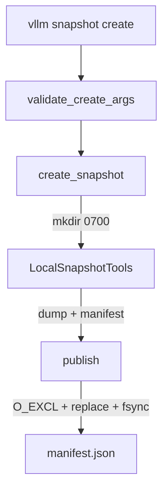
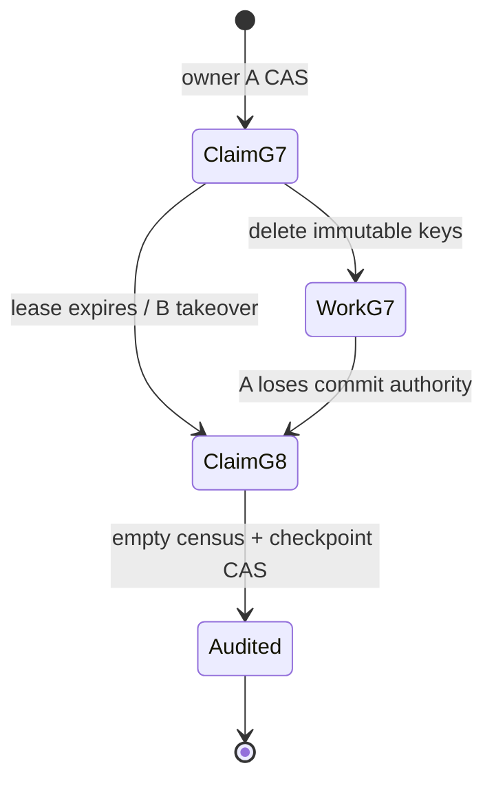

> 源码基线：vLLM [`432b1003`](https://github.com/vllm-project/vllm/commit/432b1003f8ea7c871750f27bc82815a7ad0252d5)，即研究时默认分支最新提交。该提交修复 MRV2 Triton validation 时机，与 snapshot 路径无直接关系；从上一章的 `30aded62` 到本基线共前进 91 个提交，本文涉及的 `controller.py`、`manifest.py`、`runtime.py` 与 snapshot 测试 blob 均未变化。initialized snapshot 仍来自已合入的 [PR #51360](https://github.com/vllm-project/vllm/pull/51360)。本文明确区分当前代码事实、测试事实和多 owner GC 的建议协议。

## 本篇在课程路线中的位置

[上一章]()证明，安全回收必须先让 durable tombstone 改变可达性，再按 immutable object set 幂等删除。今天只研究下一层并发问题：owner A 删除到一半失联，owner B 接管；A 随后恢复并继续工作。谁可以删除？谁可以宣布 GC 完成？

这是第 64 章，仍在“测试、性能与故障诊断”。第 38 章已经讨论过进程树 KILL authority；本章不是复述通用 takeover，而是把 fencing 精确施加到 snapshot GC 的不可逆副作用、审计记录与容量账本上。

## 前置知识回顾

上一章留下三个前提：tombstone 只能在 no-reader、no-old-writer 与 manifest absorption 全部成立后发布；对象 key 必须不可变且不能被新 generation 重用；delete missing 必须幂等地解释为“该对象已不存在”。只要任一前提不成立，多 owner 会把普通重试升级为数据破坏。

还要区分两种“所有权”：

- **执行所有权**：谁负责扫描和发 delete，可因超时转移。
- **提交所有权**：谁能改变 manifest、确认 empty census、返还容量或压缩 tombstone，必须有线性化的 generation authority。

二者不必完全相同。多个 worker 重复删除同一个已 tombstone 的 immutable key 可以是安全的；多个 worker同时发布“已经删完”则不安全。

## 本篇要回答的核心问题

1. 当前 `vllm snapshot create` 已有哪些单发布者原语，它们为什么还不构成 GC claim lease？
2. owner lease 过期但旧进程没有停止时，哪些迟到动作可以接受，哪些必须被 generation fence 拒绝？
3. Audit checkpoint 最少要绑定哪些事实，才能授权容量释放和下一轮 tombstone compaction？

## 组件在全局架构中的位置

当前 snapshot 是同机、私有本地目录上的离线 create/restore 功能，没有在线 GC controller。真实调用链如下：

[`SnapshotSubcommand.run_create`](https://github.com/vllm-project/vllm/blob/432b1003f8ea7c871750f27bc82815a7ad0252d5/vllm/entrypoints/cli/snapshot.py) 是公开入口；[`create_snapshot`](https://github.com/vllm-project/vllm/blob/432b1003f8ea7c871750f27bc82815a7ad0252d5/vllm/snapshot/controller.py) 赢得目标目录、启动 child、生成 payload；[`LocalSnapshotTools.publish`](https://github.com/vllm-project/vllm/blob/432b1003f8ea7c871750f27bc82815a7ad0252d5/vllm/snapshot/runtime.py) 最后安装 manifest。GC claim、tombstone、delete cursor 和 capacity ledger 都不在当前代码中。

## 完整调用链

当前 create 链为：

`SnapshotSubcommand.cmd → run_create → validate_create_args → create_snapshot → target.mkdir → launch_child → wait_ready → inventory → dump → verify_dead → make_manifest → publish → write_manifest_atomic → _write_json_atomic`。

接口输入是模型 revision、snapshot 路径和 serving 参数，均为 Host 字符串/路径；没有 Tensor、dtype 或 device shape。`validate_create_args` 当前要求 immutable 40 位 model revision、Linux x86-64、单 GPU/TP1/PP1/DP1，并拒绝 speculative decoding。`create_snapshot` 的副作用跨 controller 与 child process，最终所有权落在当前 UID 拥有、mode `0700` 的本地目录。

并发的第一个线性化点是 `target.mkdir(mode=0o700)`：两个 create 同时通过 `target.exists()` 的预检查，最终也只有一个能成功创建同名目录，另一个获得 `FileExistsError`。第二个线性化点是 [`write_manifest_atomic`](https://github.com/vllm-project/vllm/blob/432b1003f8ea7c871750f27bc82815a7ad0252d5/vllm/snapshot/manifest.py)：固定临时名以 `O_CREAT|O_EXCL|O_NOFOLLOW` 打开，内容 `fsync` 后 `os.replace`，再 `fsync` artifact directory；已有 `manifest.json` 会 fail closed。

这两处足以支持“一次 create 只有一个 winner”，却没有 takeover：失败 owner 不会留下可由别人续租的 claim；已发布目录也没有 manifest revision、owner generation 或 GC checkpoint。`shutil.rmtree(target)` 只用于未发布 create 的 rollback，不是公开 GC API。

## 关键类型、字段和状态生命周期

### 当前 `SnapshotManifest`

[`SnapshotManifest`](https://github.com/vllm-project/vllm/blob/432b1003f8ea7c871750f27bc82815a7ad0252d5/vllm/snapshot/manifest.py) 是 strict、frozen、extra-forbid 的 schema v1，记录 runtime identity、model/tokenizer revision、engine argv、process tree、CUDA holders、cache fingerprints、artifact bytes 和 one-token oracle。它回答“这个 artifact 能否在本机恢复”，但没有 `manifest_revision`、`tombstone`、`gc_claim` 或 object generation。

### 建议的 `GCClaim` 与 `GCCheckpoint`

最小 claim 应绑定：`snapshot_id`、`tombstone_revision/digest`、`owner_id`、单调递增的 `owner_generation`、由可信 store 判定的 lease deadline，以及取得 claim 时的 `expected_manifest_revision`。acquire/renew 必须是条件写；仅仅在内存里记录 owner 或比较本地时钟不足以防 split brain。

`GCCheckpoint` 则记录：tombstone digest、观察所依据的 manifest revision、当前 claim generation、对象状态摘要、empty-census 证据、已计入的 capacity delta 和 checkpoint revision。它是审计/记账事实，不是 delete 调用次数。

claim 的状态转换也必须精确。初次 acquire 只允许从 absent 或 store 判定的 expired 状态，以 `expected_manifest_revision` 做 CAS，并把 generation 增加而不是复用旧值；renew 只能由相同 `(owner_id, generation)` 延长，不能在读取后无条件覆盖；takeover 必须一次提交新 owner、新 deadline 和 `generation+1`。旧 owner 的 heartbeat 晚到时，只能得到 stale-generation verdict，不能把 lease “续回来”。这里的 deadline 是发现/调度机制，不是设备或 I/O completion witness。

progress cursor 也不能承担正确性。假设 A 报告已经处理前两个 key，却在第二个 delete 真正到达存储前崩溃；若 B 从 cursor 之后开始并直接宣布完成，就会漏掉对象。反过来，A 可能已经删完但在写 cursor 前崩溃，B 必须允许从头重放。因此 checkpoint 可以保存扫描位置来节省常见路径开销，最终 verdict 却必须针对 tombstone 的**完整集合**重新验证。

容量账本再增加一层约束：`released_bytes` 不是对象大小简单求和，而是一个以 `(snapshot_id, tombstone_digest)` 为幂等键的副作用。GC worker只能提交“本次证明可释放多少”的 receipt；ledger 以 expected revision 决定是否首次应用。crash-after-CAS/before-ack 时重试同一 receipt 必须返回 already-applied，而不是再加一次 free capacity。

关键点在 `WorkG7 → ClaimG8`：lease 过期只说明 A 失去**提交权**，不证明 A 已经停止执行。若 delete 集合是 immutable、精确且幂等，A 的迟到 delete 可以与 B 重复；A 的迟到 checkpoint、容量返还或 tombstone compaction必须被 generation 8 拒绝。

## 逐函数源码解读

### `create_snapshot`：目录创建是一次性 claim，不是租约

`create_snapshot` 先做路径/权限验证，再创建 target，随后才进入带 `published` 标志的 `try/finally`。任意 dump/publish 失败都会 abort child 并删除未发布目录。这个设计适合单机 create transaction：目录 winner 独占工作区，失败后整体重做。它不保存可续接进度，也无法区分“owner 慢”与“owner 死”，因此不能直接扩展成在线 GC takeover。

### `_write_json_atomic`：原子安装保护 manifest，不保护多步删除

[`_write_json_atomic`](https://github.com/vllm-project/vllm/blob/432b1003f8ea7c871750f27bc82815a7ad0252d5/vllm/snapshot/manifest.py) 保证 reader 看见完整旧 JSON 或完整新 JSON。`overwrite=False` 又让 manifest single-assignment。但 GC 需要连续发布 claim、checkpoint 与 compaction revision；简单把 `overwrite=True` 打开会先删除固定 tmp，再 replace destination，且没有 expected revision CAS，旧 owner仍可能覆盖新 owner状态。

所以建议协议不能把当前 helper 当成线性化 KV store。单机文件实现至少需要 versioned manifest、锁定目录或 rename/CAS 等价物；对象存储则需要 conditional put/etag。具体 backend 可以不同，但条件更新是硬约束。

### `publish`：两层 fsync 仍不是 owner fence

`LocalSnapshotTools.publish` 在 `write_manifest_atomic` 后再 fsync parent directory，闭合 artifact 名字的本地持久化边界。fsync 证明的是字节/目录项耐久性，不证明 writer 仍持有最新 generation。durability 与 authority 是两条独立轴。

## 具体示例与 shape/状态演算

延续上一章的 TP=2 示例。每 rank 保存 `bf16[16,4096]`：

`16 × 4096 × 2 bytes = 131072 bytes = 128 KiB`。

tombstone `T43` 精确列出三个 immutable key：`attempt7/rank0.bin` 128 KiB、`attempt7/rank1.bin` 128 KiB、`attempt7/receipt.json` 4 KiB，总计 260 KiB。假设 manifest revision 43 已 durable，且这些 key 永不承载 attempt8。

1. A 以 `expected_revision=43` 获得 claim generation 7，删除 `rank0.bin`，随后暂停。
2. claim 到期后，B 通过条件写取得 generation 8。注意：这只撤销 A 的提交权，不证明 A 的线程、网络请求或存储 delete 已停。
3. A 与 B 都删除 `rank1.bin`。第一个调用成功，第二个看到 missing；因为对象集合被冻结且 missing 幂等，两者都不伤害 attempt8。
4. A 尝试提交 `cursor=2, owner_generation=7`。store 当前 generation 为 8，CAS 失败；A 不能返还 256 KiB，也不能压缩 `T43`。
5. B 重新枚举 `T43` 的完整 object set，而不是相信 A 的 cursor。发现三者均不存在后，提交 `GCCheckpoint(T43 digest, generation=8, empty=true, released=260 KiB)`，并以 manifest revision CAS 进入 revision 44。

这个例子挑战了一个常见假设：安全并不要求“同一时刻只有一个 delete caller”；安全要求的是 delete 目标不可重用，而**完成声明**只有一个当前 generation 能提交。若 key 可复用，或一个 key 被多个 live snapshot共享，那么上述结论失效，必须使用 object version 的 conditional delete、refcount/reader fence，或物理隔离的新 key。

## 为什么这样设计及替代方案

| 方案 | 正确性 | 延迟/吞吐 | 维护代价 |
| --- | --- | --- | --- |
| 单 GC daemon + 内存 mutex | 正常运行简单 | 无并发 delete | daemon crash 后无 durable authority，不能接管 |
| lease 过期即认为旧 owner 已停 | 错误；expiry 不是 execution fence | 表面简单 | 迟到 delete/checkpoint 可越权 |
| 每个 delete 前读 lease | 仍有 check→delete TOCTOU | 多一次读，吞吐差 | 不能消除检查后停顿 |
| **immutable tombstone + 幂等 delete + fenced checkpoint** | 允许重复物理删除；提交权单写 | 可并行、可重放 | 需要不可复用 key、CAS 与完整 census |
| versioned conditional delete | 可支持可复用名字 | backend round trip 较多 | 依赖对象存储/version API |

最小充分方案因此是：tombstone CAS 决定可达性；删除只作用于冻结的 generation-scoped key；claim lease调度 worker并限制速率；`owner_generation` 只授权 checkpoint、capacity release 和 compaction；最终 empty census 从完整 tombstone 集合重建，而不是信任某个 owner 的本地 cursor。

## 性能、并发、正确性与边界条件

- delete worker 可以按对象并行，claim 不必包住每个 I/O；这样不会把一次慢 delete 变成全局临界区。
- 每对象都同步更新 durable cursor 会放大写入；cursor 可批量 checkpoint，但 crash 后必须允许重复扫描/删除。
- 完整 empty census 是容量返还前的正确性成本。Bloom filter、近似计数和本地缓存可用于发现候选，不能单独授权 `released_bytes`。
- lease deadline 必须由线性化 store 或可信时间服务解释；不同 Host 的本地时钟不能直接决定 generation ownership。
- 对本地 POSIX 文件，若 key 不可变，`unlink`/missing 可自然幂等；对象存储的 delete consistency、versioning 和 list visibility必须单独验证。
- shared payload、hard link、content-addressed dedup 会打破“一 tombstone 独占一对象”假设，必须把 refcount/reader generation 接入删除前置条件。
- Audit checkpoint 要可重复应用：相同 `(tombstone_digest, released_bytes)` 只记账一次；冲突 payload 必须 quarantine，不能 last-writer-wins。

## 测试证据与未覆盖风险

**当前测试事实。** [`test_snapshot_create_rolls_back_failed_dump`](https://github.com/vllm-project/vllm/blob/432b1003f8ea7c871750f27bc82815a7ad0252d5/tests/entrypoints/launchers/test_launch_cli.py) 让 `dump` 抛错，验证 child 被 abort 且未发布 target 被删除；它证明单 owner rollback，不证明 takeover。[`test_snapshot_manifest_validation`](https://github.com/vllm-project/vllm/blob/432b1003f8ea7c871750f27bc82815a7ad0252d5/tests/entrypoints/launchers/test_launch_cli.py) 覆盖 unknown/schema/PID/CUDA holder/oracle 的 strict validation；[`test_snapshot_private_path_and_link_remap_security`](https://github.com/vllm-project/vllm/blob/432b1003f8ea7c871750f27bc82815a7ad0252d5/tests/entrypoints/launchers/test_launch_cli.py) 覆盖 symlink 与不安全目录。PR #51360 报告 82 个 snapshot 测试及 H200 lifecycle acceptance，这是特定提交/环境的实验事实。

**当前缺口。** 测试没有让两个 create 同时争用同一路径；没有 owner lease、takeover、tombstone、duplicate/mid-delete、late checkpoint、capacity exactly-once 或 object-key reuse 用例。当前实现也没有这些生产 API。本篇未重跑 GPU/CRIU 测试。

最小 deterministic fault matrix 应覆盖：A delete 前/后崩溃；B takeover 前/后崩溃；A 在 generation 8 后迟到 checkpoint；A/B 同删一个对象；list 暂时漏项；empty census 后、capacity CAS 前崩溃；capacity CAS 后、ack 前崩溃。oracle 同时断言 live generation 对象不被删除、旧 owner无法提交、capacity 只返还一次、重放最终收敛。

## 与前后章节的连接

第 62 章给出 no-reader/no-writer proof，第 63 章让 tombstone 先于物理删除，本章再把并发执行与提交 authority 分开：重复 delete 可以是安全的，重复 capacity commit 不可以。下一章将处理长期运行后的元数据成本：什么时候可以压缩 audit tail 与 tombstone，而不让旧 reader、迟到 checkpoint 或 owner generation 重新获得解释权。

## 本篇结论、知识债、三个理解检查问题和下一章

结论：

1. 当前 vLLM snapshot 只有目录创建和 manifest single-assignment，没有 GC takeover 协议。
2. lease expiry 不是旧执行已经停止的证据；它只能撤销旧 owner 的提交 authority。
3. 对 immutable、generation-scoped、精确 tombstone key，重复 delete/missing 可以安全并发，不需要把所有 I/O 串行化。
4. manifest/checkpoint、empty-census verdict、capacity release 与 tombstone compaction 必须绑定最新 `owner_generation` 并条件提交。
5. key 可复用、共享或 list 非强一致时，必须增加 versioned conditional delete、refcount/reader fence 或物理隔离。

知识债：真实 `GCClaim/GCCheckpoint` schema 与 store；可信 lease clock；对象存储 CAS/version adapter；shared-object refcount；完整 census；exactly-once capacity ledger；并发 creator/late-owner/crash-at-every-boundary 测试。

理解检查：

1. 为什么 generation 7 的 A 在 B 接管后继续删除 `T43` 的 immutable key 可能安全，但提交 `released=260 KiB` 必须失败？
2. “每次 delete 前检查 lease”为什么仍有 TOCTOU，什么条件让它可以被删除？
3. 如果 `rank0.bin` 这个路径会被 attempt8 重用，当前最小方案需要增加哪一类物理或存储条件？

下一章：**Audit Tail 不能无限增长——Checkpoint Absorption、Tombstone Compaction 与 Reader-safe Cutoff。**

## 课程账本增量

- 第 64 章；源码基线 vLLM `432b1003`，snapshot 相关 blob 自第 63 章未变化。
- 新覆盖：`SnapshotSubcommand.run_create → create_snapshot → LocalSnapshotTools.publish → write_manifest_atomic → _write_json_atomic` 的单发布者链与并发边界。
- 新确认不变量：claim expiry 只撤销提交权；immutable tombstone delete 可重复；checkpoint/capacity/compaction 必须 generation-fenced；完整 empty census 不能由 cursor 替代。
- 当前实现事实：无 GC claim、tombstone、manifest revision、audit checkpoint 或多 owner 测试。
- 下一章：checkpoint absorption、reader cutoff 与 audit/tombstone 压缩。
