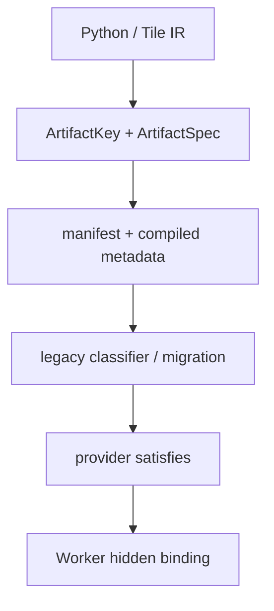
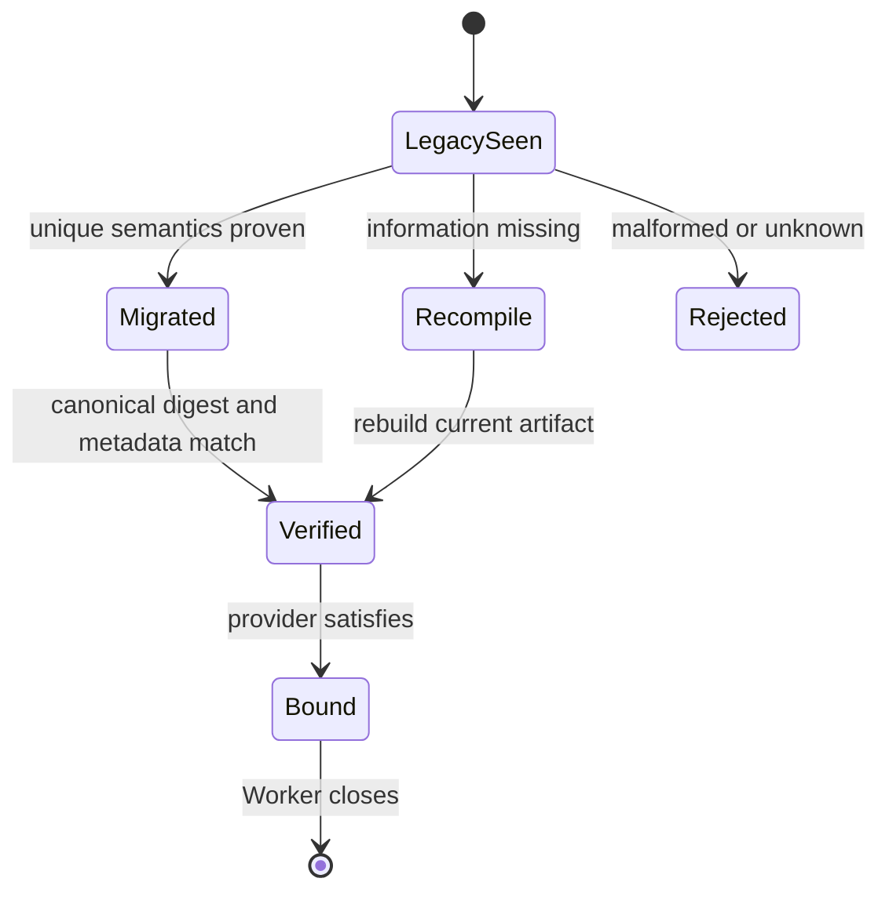

> 源码基线：PyPTO [`9f3ca535`](https://github.com/hw-native-sys/pypto/commit/9f3ca53526bc31ccf7b7ec42064f4449f9db1acf)，simpler [`0de9f72d`](https://github.com/hw-native-sys/simpler/commit/0de9f72d9f73e3b379b90a55313cbff69fc8fdac)。相对上一章分别前进 7 和 5 个提交；最新改动聚焦 parser validation 与 framework eager queue，未引入本文讨论的 ResourceRequirements schema。直接相关历史是 PyPTO [PR #2760](https://github.com/hw-native-sys/pypto/pull/2760) 与 [PR #3077](https://github.com/hw-native-sys/pypto/pull/3077)。

## 本篇在 PTO 课程路线中的位置

第 74 章确定了三层身份：Artifact 保存稳定的资源需求，provider profile 表示 Worker 能提供什么，dispatch binding 才携带地址与 generation。本章只回答下一道边界题：**一份只有 `enable_sdma=True` 的旧 Artifact，能否无损升级成包含 engine、ABI、scope 和 operation 的新资源契约？**

答案不是统一的“兼容”或“重编译”，而是按信息是否足够分类：能证明唯一语义的旧字段可以纯函数迁移；缺失的信息不能用默认值猜，必须 clean miss、重编译或隔离。

## 前置知识

- 当前 PyPTO codegen 只在至少一个 kernel 使用 SDMA 时向 `kernel_config.py` 写入 `enable_sdma=True`；
- simpler 的 Worker 据此请求 Worker-lifetime SDMA provider，并把 hidden workspace address 注入 `GlobalContext`；
- 当前 Artifact 已有独立的 key、spec、manifest 和 compiled metadata，但还没有 versioned `ResourceRequirements`；
- Artifact 可跨 Worker 复用，concrete provider address、handle 和 generation 不可进入 cache identity。

## 今日 1–2 个核心问题

1. PyPTO 当前如何处理真实的 schema 升级、canonical digest 与旧 metadata？
2. 为什么 legacy `enable_sdma` 无法自动升级为完整资源契约，最小安全迁移状态机是什么？

## PTO 全栈中的位置



上游是 PyPTO 从 kernel usage 得到的稳定需求；下游是 simpler 对 SDMA/URMA provider 的 provision 与 hidden binding。PTOAS 只消费已绑定的 workspace pointer，本章不改变 ISA 或 EmitC。

## 概念和精确语义

**Schema version** 标识记录的解释规则，而不是发布日期。未知 major version 必须拒绝，因为 reader 无法证明同名字段仍有相同语义。

**Canonical record** 是语义字段的唯一 JSON 表示：字段排序固定、集合先规范化、拒绝 duplicate/unknown/NaN/type coercion。**Canonical digest** 是该 bytes 的 SHA-256，用来隔离 cache slot；它不是兼容性判断本身。

迁移函数应满足：

`M(old_record) -> exactly_one_new_record | RECOMPILE | REJECT`

只有当旧记录的信息足以唯一确定新记录时，才允许 `exactly_one_new_record`。多个看似合理的新解释意味着信息已经丢失。

## 真实文件、类型、API 或指令逐段解读

### 1. Artifact manifest：schema 本身进入身份

当前 [`_artifact_manifest.py`](https://github.com/hw-native-sys/pypto/blob/9f3ca53526bc31ccf7b7ec42064f4449f9db1acf/python/pypto/jit/_artifact_manifest.py#L24-L128) 固定 `ARTIFACT_SCHEMA=2`。`ArtifactKey.record()` 把 schema、toolchain environment、source digest、specialization digest 和 consumer contract 一起编码，`key.digest` 对 canonical record 求 digest。

[`ArtifactStore._slot`](https://github.com/hw-native-sys/pypto/blob/9f3ca53526bc31ccf7b7ec42064f4449f9db1acf/python/pypto/jit/artifact_cache.py#L276-L304) 的目录是：

`environment.digest / key.digest / spec.digest / state`

因此 bump artifact schema 会改变 `key.digest`，新 reader走到新目录并得到 clean `MISS`；旧目录不被原地改写。`read_manifest` 又重新 inventory payload，并把实际记录与当前 `make_manifest` 的 canonical bytes 做全等比较。未知 schema、缺字段、额外字段、payload tamper 都是 `INVALID`，不是“尽量加载”。

### 2. Compiled metadata：只迁移可证明的旧语义

[`_artifact_metadata.py`](https://github.com/hw-native-sys/pypto/blob/9f3ca53526bc31ccf7b7ec42064f4449f9db1acf/python/pypto/ir/_artifact_metadata.py#L149-L224) 展示了更细的策略。当前 single-chip `compiled_meta.json` 是 schema 3，但 loader 接受 schema 1/2/3：

- schema 1 缺少 `supported_execution_modes` 时，只恢复为默认 `["program"]`；
- schema < 3 若声称 kernel capability，直接要求 recompile；
- 旧记录没有 `lowered_params` 和 `return_aliases` 时，只恢复为 `lowered=params`、`aliases=None`；
- distributed metadata 不走这条宽松分支，只接受自己的当前 schema。

这不是“兼容越多越好”，而是 program-only 的旧语义有唯一、安全解释；kernel ABI 需要新增字段，旧记录无法证明，所以 fail closed。

### 3. Load 顺序：先验身份，再碰 runtime code

[`_restore_artifact_metadata`](https://github.com/hw-native-sys/pypto/blob/9f3ca53526bc31ccf7b7ec42064f4449f9db1acf/python/pypto/runtime/_artifact_runtime.py#L54-L129) 先恢复 compiled metadata，比较其 `execution_capabilities` 与 manifest spec，再检查 consumer contract；通过后 runtime 才继续加载 callable。这个顺序应复用于资源契约：manifest requirement 与 compiled metadata 不一致时，应在 provider provision、worker init 和 device side effect 之前失败。

### 4. Legacy SDMA 只证明一个 bit

[`pto_backend.py`](https://github.com/hw-native-sys/pypto/blob/9f3ca53526bc31ccf7b7ec42064f4449f9db1acf/python/pypto/backend/pto_backend.py#L1190-L1246) 把 `enable_sdma` 定义为“至少一个 emitted kernel 使用 runtime-owned SDMA workspace”。它没有编码 ABI major、scope、required operations 或 fallback policy。

下游 simpler 的 [`DmaWorkspaceKind`](https://github.com/hw-native-sys/simpler/blob/0de9f72d9f73e3b379b90a55313cbff69fc8fdac/src/common/platform/include/common/dma_workspace.h#L18-L56) 以 enum slot 约定 SDMA/URMA 地址位置；[`dma_workspace_provision`](https://github.com/hw-native-sys/simpler/blob/0de9f72d9f73e3b379b90a55313cbff69fc8fdac/src/common/platform_comm/comm.h#L84-L127) 当前还明确限制一次最多一个 bit，因为单 opaque handle 无法安全区分多个 provider 的 release 类型。可见一个 bool 不能推出未来 multi-provider ABI。

## 对象/Tile/Buffer/IR 生命周期



生命周期中的关键对象不是 Tile，而是一个 immutable Artifact identity：

1. compiler 从 IR 建立 source/specialization identity；
2. key/spec 选择 cache slot；
3. manifest 发布 payload inventory；
4. loader 分类 schema 并恢复 compiled metadata；
5. current requirement 经 canonical digest 验证；
6. runtime 查询 provider profile，建立 Worker-local hidden binding；
7. Worker close 后 binding 失效，Artifact 本身仍可复用。

## 端到端调用链或指令链

当前事实链是：

`_uses_sdma_workspace → _generate_config_file(enable_sdma) → ArtifactSpec/cache publication → bind_artifact → CompiledArtifact.from_dir → ExecutionCapabilities check → simpler Worker(enable_sdma) → dma_workspace_provision → GlobalContext hidden slot`

建议增加的迁移链是：

`read schema → strict parse → classify legacy → migrate-or-recompile → canonical ResourceRequirements → spec digest → manifest/compiled-meta equality → provider.satisfies → bind`

迁移器不能直接把旧目录“补字段后继续用”。那会改变 immutable Artifact 的身份，也会让旧 payload 与新契约组合成从未由 compiler 证明过的状态。

## 具体 shape、Tile 和状态演算

设 kernel 对 `FP32[1,4096]` 做 `async_prefetch`，逻辑搬运量为 `1×4096×4=16,384 B`；随后处理 `FP32[1,128]` Tile，每块 512 B。旧 `kernel_config.py` 只有：

```python
RUNTIME_CONFIG = {"runtime": "tensormap_and_ringbuffer", "enable_sdma": True}
```

新设计要求：

```json
{"resources":[{"abi_major":1,"engine":"sdma","operations":["prefetch"],"scope":"worker_device"}],"schema":1}
```

canonical JSON 长 108 B，SHA-256 为 `fcac8cae…ec11e7`。即使输入字段顺序不同，排序后的 bytes 与 digest 相同；把 schema/ABI 升到 2 后 digest 变成 `a48173ef…49d588`，必须选择不同 cache slot。

但 `enable_sdma=True` 只证明需要某种 SDMA workspace。它不能证明：

- 是 `prefetch`，还是未来的 `get/put`；
- 接受哪个 workspace ABI；
- scope 是 Worker-device、comm-domain 还是 device-wide；
- provider 缺失时允许 fallback 还是必须拒绝。

所以这份旧 Artifact 不满足唯一迁移条件。安全结果是 `RECOMPILE`：用旧 source/specialization identity 重新走 compiler，生成当前 requirement、manifest 和 metadata；不是把缺失字段填成“常用默认值”。

## 为什么这样设计及替代方案

**原地升级旧 manifest。** 节省重编译，却破坏 immutable publication；crash 可能留下新 manifest + 旧 payload，reader 也失去稳定 identity。

**所有旧 bool 映射为当前默认 contract。** 运维最省事，但 default 会随平台演进而变化，A2/A3 SDMA、A5 device-wide 与未来 URMA 会被错误合并。

**一律拒绝所有旧 Artifact。** 正确但损失过大。当前 PyPTO 已证明 schema 1 program metadata 能唯一解释为 program-only，保留该兼容路径是合理的。

**字段级证明 + 新 slot 重建。** 推荐方案。只有 information-preserving migration 才直接恢复；其余 clean miss/recompile。它接受一次编译成本，换取 cache identity、provider ABI 和运行正确性不被猜测污染。

第一性约束是：cache hit 代表“同一 compiler 语义与 ABI 可安全复用”，不是“目录里有看起来能跑的二进制”。重编译成本是性能问题，错误复用是正确性问题，二者不能用同一 fallback 处理。

## 访存、计算、流水、并行和硬件约束

schema migration 不改变 Tile 的 16 KiB/512 B 数据量，也不会直接提升 MTE/SDMA 带宽；它影响的是 cold start、cache 占用和错误绑定风险。

- clean miss 会增加一次 codegen/compile，旧 slot 暂时占用额外磁盘；
- canonical digest 只处理百字节级 metadata，不是性能瓶颈；
- provider check 必须在并行 dispatch 前完成，不能每个 Tile 临时猜能力；
- runtime binding 仍按 Worker generation 建立，Artifact digest 不含地址；
- simpler 当前 one-bit/one-handle 限制意味着 schema 可先表达多资源，但 adapter 必须对尚不支持的组合 fail closed。

## 测试证据与未覆盖风险

当前测试直接证明：

- [cache capability 分槽](https://github.com/hw-native-sys/pypto/blob/9f3ca53526bc31ccf7b7ec42064f4449f9db1acf/tests/ut/jit/test_artifact_cache.py#L772-L807)：不同 capability 进入不同 slot，顺序规范化后 digest 相同；
- [manifest tamper](https://github.com/hw-native-sys/pypto/blob/9f3ca53526bc31ccf7b7ec42064f4449f9db1acf/tests/ut/jit/test_artifact_cache.py#L786-L793)：改写 capability 后 lookup 为 `INVALID`；
- [未知 compiled schema](https://github.com/hw-native-sys/pypto/blob/9f3ca53526bc31ccf7b7ec42064f4449f9db1acf/tests/ut/ir/test_compiled_program.py#L1288-L1302)：要求 recompile；
- [legacy program-only](https://github.com/hw-native-sys/pypto/blob/9f3ca53526bc31ccf7b7ec42064f4449f9db1acf/tests/ut/ir/test_compiled_program.py#L1688-L1699)：schema 1 缺 capability 时恢复为 program-only，且不伪造 return aliases。

尚未覆盖：真实 `ResourceRequirements` codec、duplicate/unknown resource field、legacy `enable_sdma` 分类器、manifest 与 compiled metadata resource mismatch、ABI 1→2、A2/A3↔A5 scope migration、multi-provider handle、old/new reader 并发与 crash-at-migration。本文未重跑 NPU。

## 与前后章节的连接

第 72 章建立 requirement/binding 分层，第 73 章建立 generation fence，第 74 章定义 Artifact/provider 字段边界；本章给出版本演进规则：

`stable requirement → canonical record → digest-isolated slot → strict metadata match → generation-bound binding`

下一章将研究 **Artifact 淘汰与缓存回收**：旧 schema slot 何时可删，如何证明没有 loader、build promotion 或 Worker 仍引用它。

## 本篇结论、知识债、三个理解检查问题和下一章

结论：

1. PyPTO 已有两种真实策略：artifact manifest 用 schema/key digest 隔离并 clean miss；compiled metadata 只对可证明安全的 program-only legacy 做受限恢复。
2. canonical digest 解决同语义同身份，不负责把未知语义变成兼容。
3. legacy `enable_sdma` 缺少 ABI、scope 和 operation，不能唯一升级为完整 requirement；应重编译。
4. migration 必须先于 runtime code load 和 provider provision，且不能原地改写 immutable Artifact。
5. resource requirement 进入 spec/metadata；concrete provider address、handle 与 generation 仍只属于 runtime binding。

知识债：versioned `ResourceRequirements`、strict canonical codec、migration registry、compiled/resource equality、provider ABI negotiation、legacy inventory tool、cache retention/GC 与跨版本 fault matrix。

理解检查：

1. 为什么 Artifact manifest schema bump 应产生新 cache slot，而不是覆盖旧目录？
2. 为什么 schema 1 program metadata 可兼容，legacy `enable_sdma=True` 却不能直接推成完整 resource contract？
3. canonical digest 相同与 `provider.satisfies(requirement)` 分别证明什么？

下一章：**旧 Cache Slot 何时可删——Artifact Reader Lease、Build Promotion Fence 与 Generation-safe GC。**

## 课程账本增量

- 第 75 章；PyPTO 基线 `9f3ca535`，simpler 基线 `0de9f72d`。
- 新增链路：`schema classify → unique migration or recompile → canonical digest → metadata equality → provider bind`。
- 新确认：legacy compatibility 必须由信息充分性证明，不能由默认值或“历史上通常如此”推断。
- 新知识债：migration registry、resource ABI negotiation 与旧 Artifact slot 的 reader-safe GC。
- 下一章研究 Artifact cache retention 与 generation-safe reclamation。
