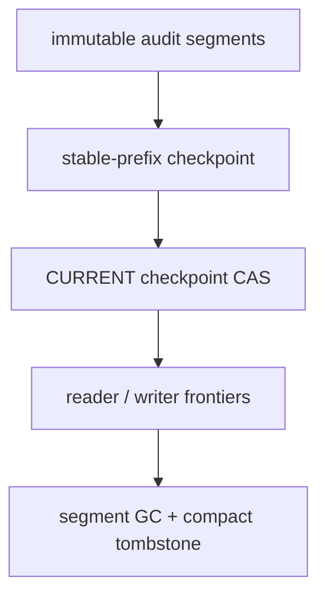
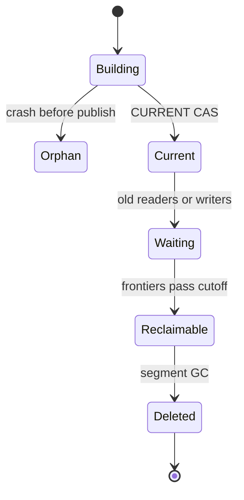

> 源码基线：vLLM [`7dc44a00`](https://github.com/vllm-project/vllm/commit/7dc44a00161ace6f8ba7be2cc008f926e5a35fe2)，即研究时默认分支最新提交。该提交修复 LoRA-wrapped MoE reload，与 snapshot 路径无直接关系；从上一章的 `432b1003` 前进 88 个提交，未改动本文涉及的 snapshot 文件。initialized snapshot 仍来自已合入的 [PR #51360](https://github.com/vllm-project/vllm/pull/51360)。本文把当前代码事实、测试事实和长期 GC 建议协议分开陈述。

## 本篇在课程路线中的位置

第 63 章确定 manifest/tombstone 是可达性的提交点，物理删除只是幂等清理；第 64 章再把多 GC owner 的执行权与提交权分开。本章回答自然出现的长期问题：如果每次 claim、delete、census、capacity release 都永久追加审计记录，系统即使正确，也会因 replay 时间和存储占用不断增长。

这是第 65 章，仍处于“测试、性能与故障诊断”。本章只研究一件事：**如何把已闭合的 audit prefix 吸收到 checkpoint，同时不删除旧 reader 仍可能读取的证据。**

## 前置知识回顾

前两章留下四条硬约束：

1. tombstone 先改变可达性，object delete 后执行；
2. claim 到期只撤销旧 owner 的提交权，不证明旧 I/O 停止；
3. capacity receipt 必须 exactly-once，不能因 checkpoint 重放而重复返还；
4. reader timeout 不是 no-reader 证明，旧 reader 可能仍持有历史 revision。

还需明确一个当前代码边界：vLLM 的 `manifest.json` 是一次性发布的 immutable artifact manifest，不是可反复覆盖的在线 GC control record。新 checkpoint 协议若实现，应使用独立的 control-store/manifest 链，不能把现有 `SnapshotManifest` 偷换成可变日志。

## 本篇要回答的核心问题

1. 当前 snapshot 的原子发布能提供哪些 checkpoint 构件，又缺少哪些 reader/writer frontier？
2. audit prefix 被 checkpoint 吸收后，为什么仍不能立刻删除原 segment？
3. tombstone 的详细 object list 何时可压缩，哪些身份与 receipt 必须继续保留？

## 组件在全局架构中的位置



当前 vLLM 只实现了右侧发布原语的局部版本：JSON 临时文件、`fsync`、`os.replace` 和目录 `fsync`。它没有 audit segment、reader lease、writer-closed watermark、checkpoint pointer 或 tombstone compactor；这些都是本文基于现有边界提出的建议对象。

## 完整调用链

当前真实 create/restore 链如下：

1. CLI 进入 [`create_snapshot`](https://github.com/vllm-project/vllm/blob/7dc44a00161ace6f8ba7be2cc008f926e5a35fe2/vllm/snapshot/controller.py#L58-L93)，创建 private target directory。
2. child 完成初始化与 canary，controller inventory process tree，执行 CRIU dump，并验证 donor 已停止。
3. [`make_manifest`](https://github.com/vllm-project/vllm/blob/7dc44a00161ace6f8ba7be2cc008f926e5a35fe2/vllm/snapshot/runtime.py#L832-L889) 汇总 runtime identity、artifact bytes、PID tree、cache fingerprints 与 oracle。
4. [`publish`](https://github.com/vllm-project/vllm/blob/7dc44a00161ace6f8ba7be2cc008f926e5a35fe2/vllm/snapshot/runtime.py#L891-L893) 调用 `write_manifest_atomic`，随后 `fsync` artifact parent。
5. restore 先 [`read_manifest`](https://github.com/vllm-project/vllm/blob/7dc44a00161ace6f8ba7be2cc008f926e5a35fe2/vllm/snapshot/manifest.py#L248-L273) 与 identity check，再进行 CRIU restore、listener release 和 oracle 比对；失败则 cleanup。

建议的 compaction 链是在当前 immutable artifact 之外增加：

`append audit → freeze stable prefix C → build immutable checkpoint → durable publish/CAS → wait reader frontier → fence writers → delete absorbed segments → compact tombstone detail`。

## 关键类型、字段和状态生命周期

建议最小对象如下；它们不是当前主干类型：

```python
AuditCheckpoint(
    schema_version=1,
    checkpoint_revision=48,
    absorbed_through=48,
    state_digest="...",
    tombstone_digest="...",
    capacity_receipt_id="snapshot-7:260KiB",
    writer_generation=8,
    previous_checkpoint_digest="...",
)

ReaderLease(
    reader_id="restore-a",
    generation=3,
    min_required_revision=44,
    deadline=...,
)
```

`AuditCheckpoint` 创建后 immutable，由 compactor 持有到发布；`CURRENT` CAS 成功后，新 reader 从 checkpoint 加载 canonical state，再重放 `absorbed_through+1` 之后的 tail。旧 reader 仍可能从旧 checkpoint/segment 继续，因此物理 segment 生命周期由 reader frontier 决定，而不是由新 checkpoint 是否可见决定。



## 逐函数源码解读

### `create_snapshot`：失败回滚，不是历史压缩

[`controller.py`](https://github.com/vllm-project/vllm/blob/7dc44a00161ace6f8ba7be2cc008f926e5a35fe2/vllm/snapshot/controller.py#L58-L93) 先以 target directory existence 选出一次 create 的 winner；若 publish 前失败，`finally` 删除整个 target。它解决的是“未发布的单次构建不能残留为可用 artifact”，没有维护跨多次 GC 的 revision、tail 或 reader cursor。

### `_write_json_atomic`：提供可见性线性化点

[`manifest.py`](https://github.com/vllm-project/vllm/blob/7dc44a00161ace6f8ba7be2cc008f926e5a35fe2/vllm/snapshot/manifest.py#L205-L246) 用 `O_EXCL` 创建临时文件，写 canonical JSON，flush+`fsync`，`os.replace` 后再 `fsync` parent directory。该序列可以复用于 immutable checkpoint：完整对象先 durable，再切换一个很小的 `CURRENT` pointer。

但当前 `write_manifest_atomic` 拒绝已存在的 `manifest.json`，这正说明现有 artifact manifest 是 single-assignment。在线 compaction 不应覆盖它；否则正在 restore 的 reader 可能先读到旧 payload、后读到新 manifest，形成不存在于任一 revision 的混合视图。

### `SnapshotManifest`：严格 identity，不是 recovery frontier

当前 [`SnapshotManifest`](https://github.com/vllm-project/vllm/blob/7dc44a00161ace6f8ba7be2cc008f926e5a35fe2/vllm/snapshot/manifest.py#L54-L71) 固定 `schema_version: Literal[1]`，记录 artifact bytes、process tree、CUDA holders、外部 cache fingerprints 和 oracle；它没有 manifest revision、tombstone、reader epoch、claim generation 或 capacity receipt。

### 文档中的 durability 上界

官方 [initialized snapshot 文档](https://github.com/vllm-project/vllm/blob/7dc44a00161ace6f8ba7be2cc008f926e5a35fe2/docs/features/initialized_snapshots.md#L135-L151) 明确指出：manifest 会 `fsync`，但所有 captured payload 并未显式 flush，非正常掉电后应重建 artifact。因此本文 checkpoint 只能承诺 control-plane metadata 的 crash-safe publication；不能把它写成现有 payload 已获得 power-loss durability。

## 具体示例与 shape/状态演算

延续上一章：TP=2、K16，每 rank 稳定输出 `bf16[16,4096]`，大小为 `16×4096×2=131,072 B=128 KiB`；加 4 KiB receipt，tombstone 覆盖 260 KiB。

设 audit revisions：

| revision | 事实 |
| ---: | --- |
| 43 | tombstone 发布，冻结 rank0/rank1/receipt 三个 key |
| 44 | owner A 获得 generation 7 claim |
| 45 | A 删除 rank0 key |
| 46 | owner B 以 generation 8 接管 |
| 47 | B 删除 rank1 与 receipt key |
| 48 | B full-set census 为空，提交唯一 260 KiB capacity receipt |

B 构造 `Checkpoint48`，其 `absorbed_through=48`，包含 tombstone digest、terminal state 和 receipt ID。它发布后，新 reader 从 48 起步，不需重放 43–48。

但 reader R0 已在 revision 44 打开旧视图，`min_required_revision=44`。此时可见 checkpoint 不等于可删除 audit43–48。安全 cutoff 是：

$$
C_{safe}=\min(C_{absorbed}, R_{min}-1, W_{closed})
$$

若 `C_absorbed=48`、`R_min=44`、writer generation 8 已证明 `W_closed=48`，则 `C_safe=43`：最多只能处理 43 以前的 segment，不能删除 R0 仍需的 44–48。R0 结束或被具有真实 revoke 证据的 lease fence 排除后，`R_min=49`，才得到 `C_safe=48`。

tombstone detail 也不能只因 checkpoint 已吸收就完全消失。至少要保留 compact retired identity：`snapshot_id + tombstone_digest + capacity_receipt_id + retired_revision`，以拒绝 late owner 的重复 release，并防止相同逻辑 key 被误认成新对象。

## 为什么这样设计及替代方案

**无限 append-only audit。** 恢复逻辑最简单，但 replay 和存储无界增长，最终把诊断证据本身变成可用性风险。

**checkpoint 一发布就删旧 tail。** 空间回收最快，但会破坏已打开旧视图的 reader；在 object store/list-lag 环境中还会把暂时不可见误判为不存在。

**反复覆盖一个 mutable manifest。** 文件数量少，却无法给 reader 提供稳定 revision；多 owner 覆盖还会丢失 claim/tombstone/capacity receipt 的因果链。

**immutable checkpoint + reader/writer frontier + segment GC。** checkpoint 吸收 canonical state，frontier 决定物理 cutoff，compact retired identity 防止重复 side effect。这是最小能同时约束恢复时间、并发 reader 与 exactly-once capacity 的设计。

第一性约束是：checkpoint 只证明“新 reader 不必重放旧记录”；segment delete 还必须证明“旧 reader 不再需要它，旧 writer也不能再补写它”。两种证明不能合并成一个时间阈值。

## 性能、并发、正确性与边界条件

checkpoint 的收益不是加速设备 forward，而是把恢复工作从“扫描全部历史”压到“加载一个 checkpoint + 有界 tail”。应分别测量 checkpoint 构建 CPU/IO、`fsync` 延迟、tail replay 时间、reader-pinned bytes 和 segment GC 吞吐，不能只报告删除后的目录大小。

构建 checkpoint 可与正常 append 并发：在 revision C 冻结 prefix，新 append 从 C+1 继续。只有 `CURRENT` CAS 是短线性化点。多个 compactor 可以构建候选 checkpoint，但只有 expected previous digest/revision 匹配者发布；失败者成为可回收 orphan。

边界条件：

- 无 active reader 时，`R_min=∞`，但仍需 writer fence；
- reader lease 过期却无法撤销其存储访问权时，必须继续保留或隔离 segment；
- checkpoint digest 或 segment continuity 不一致时 fail closed，不能扫描“最新文件”拼装状态；
- object key 若可能复用，删除必须带 version/generation 条件；
- capacity receipt 未吸收或 receipt ledger 不幂等时，禁止压缩 tombstone 的防重字段；
- power loss 后当前 payload 仍受官方限制，control checkpoint 不能升级其保证。

## 测试证据与未覆盖风险

当前直接测试证明：

- [failed dump rollback](https://github.com/vllm-project/vllm/blob/7dc44a00161ace6f8ba7be2cc008f926e5a35fe2/tests/entrypoints/launchers/test_launch_cli.py#L708-L723) 在 publish 前失败会 abort child 并删除 target；
- manifest validation 覆盖未知字段、错误 schema、重复 PID、错误 CUDA holder 与非法 oracle；
- identity mismatch 在 restore mutation 前失败；
- oracle mismatch 会 cleanup restored tree；
- PR #51360 报告 snapshot 单元测试与 H200 lifecycle acceptance。

这些测试不覆盖 audit append、checkpoint build/publish、slow reader、reader crash/revoke、late owner、segment delete、tombstone compaction、capacity receipt 防重或每个 `fsync/CAS/delete` 边界的 crash。

最小新增矩阵应包括：旧 reader 跨 checkpoint、R0 在 cutoff 前后退出、owner g7 迟到 append/checkpoint、两个 compactor 竞争 `CURRENT`、publish 后首删前 crash、mid-segment delete、delete 后 checkpoint ack 前 crash、duplicate capacity receipt、key reuse 与 list-lag。本文未重跑 GPU/CRIU 测试。

## 与前后章节的连接

第 63 章给出 tombstone-first 删除顺序，第 64 章给出 generation-fenced takeover；本章把闭合历史压成新的恢复基线，并证明压缩也需要 reader/writer 证据。三章共同形成：

`tombstone publication → fenced deletion → audit checkpoint → reader-safe segment GC → compact retired identity`。

下一章将转向 **checkpoint 自身的世代与迁移**：当 schema 或 oracle 变化时，旧 checkpoint 如何升级，多个 checkpoint 如何建立 hash chain，以及损坏/缺段时怎样选择最后一个可证明完整的恢复点。

## 本篇结论、知识债、三个理解检查问题和下一章

结论：

1. 当前 vLLM manifest 提供严格、single-assignment 的原子发布原语，但没有在线 audit/GC compaction。
2. checkpoint absorption 只缩短新 reader 的 replay；物理删除还需 reader frontier 与 writer-closed frontier。
3. 安全 cutoff 是 absorbed prefix、最慢 reader 与 writer fence 的交集，不能用固定保留天数代替。
4. tombstone detail 可在 terminal checkpoint 后压缩，但防 key reuse、late owner 与重复 capacity release 的 compact identity 必须保留。
5. 新协议应放在独立 control store，不能修改现有 immutable artifact manifest 的语义。

知识债：audit/checkpoint schema、canonical digest/hash chain、reader lease/revoke、writer closed watermark、segment manifest、object-store CAS/list consistency adapter、capacity receipt ledger、tombstone retention horizon 和 deterministic crash harness 均未实现。

理解检查：

1. 为什么 `CURRENT=Checkpoint48` 已成功发布，仍不能立即删除 revision44 的 audit segment？
2. `absorbed_through`、`min_required_revision` 与 `writer_closed_through` 分别证明什么？
3. 为什么 terminal tombstone 可删除详细 object list，却仍需保留 digest 与 capacity receipt identity？

下一章：**Checkpoint 也会过期——Schema Migration、Hash Chain 与 Last-known-good Recovery Point。**

## 课程账本增量

- 第 65 章；源码基线为 vLLM `7dc44a00`。
- 新增链路：`audit prefix → immutable checkpoint → CURRENT CAS → reader/writer frontiers → segment GC`。
- 新确认：现有 `SnapshotManifest` 是 immutable artifact identity，不能兼任 mutable GC checkpoint。
- 新增公式：`safe_cutoff=min(absorbed_through, min_reader_revision-1, writer_closed_through)`。
- 下一章研究 checkpoint schema/hash chain 与 last-known-good 选择。
