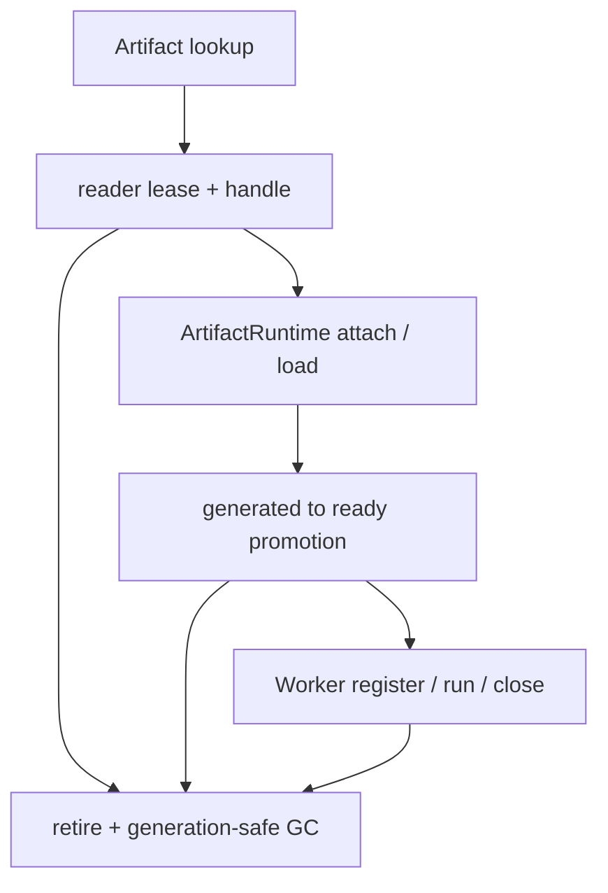
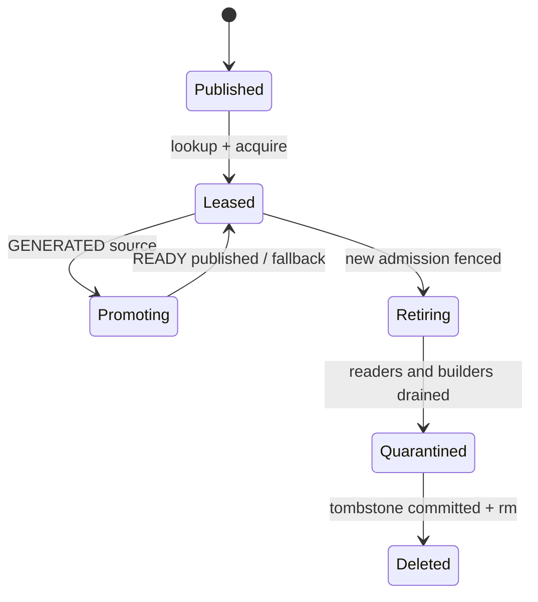

> 源码基线：PyPTO [`cc17e872`](https://github.com/hw-native-sys/pypto/commit/cc17e872c82a414cc26ae98620379bf9cb939f40)，simpler [`d78561cc`](https://github.com/hw-native-sys/simpler/commit/d78561ccafb0b60773a6b1ecf58e6722d13800a6)，均为研究时默认分支最新提交。相对第 75 章分别前进 4、6 个提交；PyPTO 最新改动是 MemoryReuse 拆分，simpler 最新改动是 maintainer workflow，均未加入 Artifact GC。与本文执行边界直接相关的是已合入的 simpler [PR #2697](https://github.com/hw-native-sys/simpler/pull/2697)：`Worker.close()` 先 drain 已接受的 L2 run，再 teardown workspace。

## 本篇在 PTO 课程路线中的位置

第 75 章确定：schema 升级会选择新 slot；legacy 记录只有能唯一解释时才迁移，否则 clean miss/recompile。新 slot 可用了，不代表旧 slot 可立即删除——另一个进程可能已拿到 `ArtifactHandle`，`ArtifactRuntime` 可能尚未第一次 `load()`，或 builder 正从旧 `generated/` promotion 到 `ready/`。

这是第 76 章，课程已从 ISA/通信资源进入 `Python/kernel 表达 → Artifact → runtime/device` 的生命周期闭环。本篇只研究一个问题：**如何证明旧 Artifact slot 已经同时摆脱 reader、promotion builder 和旧 generation，因而可以安全 GC。**

## 前置知识

- `ArtifactKey.digest` 包含 schema、toolchain environment、source、specialization 和 consumer contract；`ArtifactSpec.digest` 再区分 state、build kind、required files 与 execution capabilities。
- `generated/` 与 `ready/` 是独立 immutable stage；`ready/` 从 `generated/` 复制到 private staging 后编译，不能原地修改 source slot。
- runtime binding 的 provider address/generation 不属于 Artifact identity；同一 Artifact 可跨 Worker 重绑。
- schema bump 产生新路径，只完成**逻辑失效**。磁盘目录是否仍被读取，是另一条证明链。

## 今日 1–2 个核心问题

1. 当前 Artifact 从 lookup、attach、promotion 到 Worker 消费期间，哪些对象仍持有旧 slot 路径？
2. per-key build lock 为什么不足以授权 GC；最小的 reader lease、promotion fence 和 generation tombstone 如何组合？

## PTO 全栈中的位置

主仓是 PyPTO：它拥有 persistent slot、manifest、handle 和 promotion。simpler 只作为下游完成证据：它能证明 device run 何时 drain、workspace 何时 teardown，却不拥有 PyPTO cache 目录。也就是说，runtime completion 可以帮助释放 reader lease，但不能替 Artifact Store 决定删除。

## 概念和精确语义

**逻辑过期（obsolete）**：新请求不应再选择旧 schema/key/spec。它不代表旧 reader 已停止。

**reader lease**：绑定 `(slot_identity, slot_generation, consumer_id, process_epoch)` 的存活证明。lease 从返回 handle 前开始，直到所有可能按路径重读、materialize、加载或注册该 Artifact 的对象释放后结束。仅有 Python 引用计数不够，因为 GC 是跨进程操作。

**promotion fence**：证明没有 builder 仍以旧 `generated/` 为 source，且不会以旧 generation 迟到发布 `ready/`。它既包含当前 builder drain，也包含 future builder admission fence。

**generation-safe GC**：删除权必须绑定精确 slot identity 与 generation。即使相同 digest 路径未来被重新构建，旧 GC 或旧 builder 也不能作用于新 generation。

最小删除谓词是：

`Deletable(s,g) = Retired(s,g) ∧ Readers(s,g)=∅ ∧ BuildersFrom(s,g)=∅ ∧ SuccessorValidated ∧ CurrentGeneration(s)=g`

任何 timeout、mtime、磁盘压力或“已有新版本”都不能替代其中一项。

## 真实文件、类型、API 或指令逐段解读

### 1. 当前 Store 明确不支持并发删除

[`artifact_cache.py`](https://github.com/hw-native-sys/pypto/blob/cc17e872c82a414cc26ae98620379bf9cb939f40/python/pypto/jit/artifact_cache.py) 的类注释直接写明：`Concurrent cache mutation/deletion is unsupported`。[`ArtifactStore.lookup`](https://github.com/hw-native-sys/pypto/blob/cc17e872c82a414cc26ae98620379bf9cb939f40/python/pypto/jit/artifact_cache.py#L286-L305) 直接验证目录与 manifest，返回的 `ArtifactHandle` 只有 directory/key/spec/cache_root，没有 lease、fd pin 或 generation。

[`docs/en/dev/09-artifact-store.md`](https://github.com/hw-native-sys/pypto/blob/cc17e872c82a414cc26ae98620379bf9cb939f40/docs/en/dev/09-artifact-store.md) 更明确：trusted writer 不得修改 published entry，也不得让 deletion 与 reader race；published artifact 在 compiled object 或 Worker 引用期间必须保持存在且不变。这是当前契约，不是本文推断。

### 2. Build lock 只解决 writer winner

`get_or_build` 先无锁 lookup；非 hit 才获取 `locks/<key>.lock`，随后 recheck、private build 和 `_publish`。同一 key 的所有 state/spec 共享这把 persistent `flock`，`_rename_noreplace` 决定唯一 publication winner；不同 key 可并发 build。

这把锁对 writer 很有价值，但 readonly hit 明确不创建、也不获取 lock。因此“GC 也拿 key lock”只能证明没有在途 builder，不能证明一个无锁 reader 尚未拿到 handle。若 GC 在 `lookup → bind/load` 之间删目录，reader 会从合法 hit 变成 `ENOENT` 或部分读取。

### 3. Runtime 的 path lifetime 比一次 lookup 长

[`_artifact_runtime.py`](https://github.com/hw-native-sys/pypto/blob/cc17e872c82a414cc26ae98620379bf9cb939f40/python/pypto/runtime/_artifact_runtime.py) 的 `ArtifactRuntime` 把 `handle.directory` 保存为 `directory`，第一次 `_validate()` 才重读 manifest/metadata。`bind_artifact` 又把 compiled object's output path 绑定到 shared directory；注释要求 promotion 后仍保留 immutable source path，因为 Worker 可能已对路径做 hash。

若 source 是 `GENERATED`，`load()` 调用 `handle.materialize(private_dir)`，验证 source 在复制期间未变；之后 publication 到独立 `ready/` slot。成功后 runtime 切换 binary handle，但 generated source path 仍属于 compiled object 的身份。私有 fallback 目录也被保留整个 runtime lifetime，并且当前没有自动 cleanup。

### 4. 下游 close fence 能证明什么

simpler [PR #2697](https://github.com/hw-native-sys/simpler/pull/2697) 新增 `_accepted_run_handles` 生命周期：`Worker.close()` 会跨过每个 accepted L2 run 的 native fence 和 source-reference verdict，之后才允许 workspace teardown；timeout、context refusal 或 unknown completion 会继续保留 ownership。直接测试位于 [`test_l2_close_drain.py`](https://github.com/hw-native-sys/simpler/blob/d78561ccafb0b60773a6b1ecf58e6722d13800a6/tests/ut/py/test_worker/test_l2_close_drain.py)。

这提供了“Worker 已不再执行该 callable”的强信号，但 cache lease 仍须由 PyPTO consumer 显式释放。`run.done` 甚至不等于 fence-owned cleanup 已发布；更不能把一次 kernel 完成误当成整个 compiled object 不再引用 Artifact。

## 对象/Tile/Buffer/IR 生命周期

当前真实生命周期止于 `Published/Leased/Promoting`，且 lease 是文档约束而非实现对象。建议协议增加两段：

1. registry CAS 将 `(slot,g7)` 标记 `RETIRING`，新 lookup/build 必须刷新并拒绝 g7；
2. active reader lease 与 builder intent 清空后，在同一 key lock 下 recheck generation，将目录原子 rename 到 generation-scoped quarantine，再异步 `rmtree`。

rename 不是 reader fence。当前 runtime 可能按旧路径晚读，所以只能在 reader drain 后执行。它的作用是让“逻辑删除提交”与慢速递归删除解耦：rename 后 crash 只留下可重试 quarantine，不会留下半删的可见 slot。

## 端到端调用链或指令链

当前链是：

`JIT specialization → ArtifactKey/Spec → store.lookup/get_or_build → ArtifactHandle → bind/restore ArtifactRuntime → generated.materialize → ready publication → load_prebuilt → ChipWorker register/run/close`

建议加入的删除链是：

`mark RETIRING by CAS → deny new lease/build → wait active reader leases → acquire persistent key lock → verify no BuildIntent + same generation → verify successor → rename to quarantine → commit tombstone → idempotent delete`

顺序不能反过来。若先删再写 tombstone，crash 后 registry 仍声称 slot 可用；若只等 reader 不拿 key lock，迟到 builder 可能在检查后、删除前 publication；若只拿 lock不挡新 reader，GC 释放锁后又会出现新 handle。

## 具体 shape、Tile 和状态演算

以第 75 章的 `FP32[1,4096]` prefetch kernel 为例，逻辑搬运范围是 16,384 B。cache UT 使用更小的合成 payload：`generated` 中 `kernel/source.pto = b"generated code"`、`kernel_config.py = b"KERNELS = []\n"`；promotion 把 source 复制到不同 inode，写入 `obj.so = b"synthetic binary"`，并验证旧 source 未改变。小 payload 只验证协议，不代表真实二进制大小。

设 schema-1 generated slot 为 `S/g7`：

- 进程 P1 在 revision 40 获得 handle 与 reader lease `L1`，尚未调用 `load()`；
- P2 已从 `S/g7` 开始 promotion，登记 `BuildIntent B2(source=S/g7,target=ready/g8)`；
- schema-2 successor `S2/g8` 在 revision 41 已发布并验证；GC 希望回收 g7。

GC 先把 g7 标记 `RETIRING@42`。新 reader 转向 g8，但不能删除：`L1` 仍可能重读 manifest，`B2` 仍需 materialize。P2 发布 ready 后清除 B2；P1 完成 load、Worker 使用并由 `Worker.close()` drain accepted runs，随后释放 L1。GC 再持 key lock校验 `Readers=0、Builders=0、generation=g7、successor=g8 valid`，才把 g7 rename 到 `.trash/<slot-digest>.g7` 并提交 tombstone。

若旧 builder 在 CAS 前已进入 private compile，但没有 durable intent，单靠“没有 final slot 写入”无法被发现。这说明 BuildIntent 必须在线性化 admission 时登记，或让 GC 的 persistent key lock覆盖所有 build 生命周期；当前 `get_or_build` 确实在 lock 内 build/publish，可作为最小实现基础。

## 为什么这样设计及替代方案

从第一性原理看，删除必须证明两件事：未来不会再产生合法访问，过去获准的访问已经结束。`RETIRING`/generation fence解决前者，reader lease与builder drain解决后者；二者缺一都存在 TOCTOU。

- **按 TTL/mtime 删除**：简单，但时间不证明 reader 或 builder 已结束；cache identity 本来就拒绝用 timestamp 代替内容证据。
- **只统计 Python `ArtifactHandle` 引用**：单进程可用，跨进程、崩溃和 Worker 内部引用不可证明。
- **GC 只拿 per-key lock**：能隔离 builder，挡不住当前无锁 readonly reader。
- **每次读取都持全程 flock**：正确但会让长生命周期 Worker 阻塞同 key build/GC，且 crash/升级治理困难。
- **generation registry + process-scoped reader lease + existing key lock + quarantine rename**：增加一份小型 durable registry，却把 read admission、writer promotion 和慢删除分别线性化，是当前结构上的最小充分扩展。

## 访存、计算、流水、并行和硬件约束

本章不改变 Tile 的 GM/UB 搬运、AIV 并行或 PTO 指令序列；它控制的是 Host 持久化存储与 executable lifetime。性能收益是限制磁盘增长，代价是 lookup 多一次 lease/registry 操作，retire 时可能等待长生命周期 Worker。

应分别度量：`live_slot_bytes`、`retiring_bytes`、`reader_pinned_bytes`、`builder_pinned_bytes` 和 `quarantine_bytes`。真正可回收容量是：

`B_reclaimable = Σ size(slot) where Deletable(slot,generation)`

不能把 `obsolete_bytes` 全算成可释放。为降低热路径开销，lease 可按进程/ArtifactRuntime 聚合，而不是每个 kernel dispatch 写 durable record；但 Worker crash 后必须有 pidfd/process-epoch 或等价证据撤销，不能仅凭 wall-clock expiry。simpler 的 completion fence只在 Worker 存活路径成立，native failed-drain 仍需 quarantine。

## 测试证据与未覆盖风险

PyPTO [`test_artifact_cache.py`](https://github.com/hw-native-sys/pypto/blob/cc17e872c82a414cc26ae98620379bf9cb939f40/tests/ut/jit/test_artifact_cache.py) 已验证：

- publish 后 hit 复用精确 slot，fresh builder value/private directory 仍保留；
- generated→ready 使用不同 inode复制，两个 stage 同时保持 hit，旧 source 不变；
- readonly hit/miss 不拿 lock、不改 cache root；
- orphan `.tmp.*` 与 empty final slot 永远不命中；
- copy/fsync/rename/parent-sync 失败保留 usable private build；
- 三个 spawned process 只有一个 published、两个 hit，死进程释放 `flock` 且 lock inode 保持。

simpler PR #2697 报告 device matrix 20 cases/78 golden calls通过；CPU tests 覆盖 unwaited run、dropped handle、close/wait 并发、in-progress submission、retry 与 source reservation。它证明 close-drain 路径，不证明 PyPTO Artifact GC。

当前缺少：lookup 后暂停再删除、readonly reader lease、promotion 与 GC 竞争、old builder 在 generation bump 后迟到、reader crash/revoke、rename 后 crash、quarantine 重放、同 digest 路径重建、跨 NFS/object store 语义。应加入 deterministic interleaving test，在 lookup/acquire、materialize、publish、retire CAS、rename、tombstone 和 rmtree 每个边界注入故障。本篇未重跑 NPU/device tests。

## 与前后章节的连接

第 74 章建立 capability identity，第 75 章处理 schema migration；本章闭合旧 slot 的物理生命周期：**新身份出现只产生 retire 候选，reader/build/worker fence 才产生删除权。** 这也把 earlier PTO Host recovery 主线中的 no-reader/no-old-writer 原则落到了 PyPTO 真实 Artifact Store，而不是继续停留在抽象协议。

下一章将研究 cache 达到硬容量上限时谁先回收：不能只做 LRU，还要把 rebuild cost、reader pin、promotion dependency 和 deployment warm set 一起纳入。

## 本篇结论、知识债、三个理解检查问题和下一章

结论：当前 PyPTO 已有 immutable publication、persistent per-key writer lock、no-replace winner、readonly loading 与 generated→ready promotion，但**明确不支持并发删除**，也没有 reader lease、generation tombstone 或 GC API。安全扩展应复用 persistent key lock fence builder，新增 generation registry fence未来 admission，以 process/runtime lease证明旧 reader结束，再通过 quarantine rename + tombstone 实现 crash-safe idempotent delete。

知识债：durable slot registry、reader process epoch/pidfd、ArtifactRuntime 显式 close、Worker→lease release hook、BuildIntent schema、generation-aware lookup/publication、quota/census、quarantine sweeper、NFS/object-store adapter，以及全边界故障测试。

理解检查：

1. 为什么 `flock` 已串行化 builder，仍不能直接让 GC 删除 slot？
2. generated 已成功 promotion 为 ready 后，为什么 source slot仍可能被 compiled object引用？
3. 同 digest 路径被重新构建时，generation tombstone 如何阻止旧 GC/旧 builder 误作用于新 slot？

下一章：**Cache 满了先删谁——Rebuild Cost、Warm-set Protection 与 Dependency-aware Eviction。**

## 课程账本增量

- 第 76 章；主仓 PyPTO，simpler 只提供 Worker close/drain 的下游 fence 证据。
- 新事实：当前 Store 明确不支持 concurrent deletion；readonly reader不拿 key lock；ArtifactRuntime/compiled object可长期持有 source path；simpler close 先 drain accepted L2 run 再 teardown。
- 新不变量：逻辑过期不等于可删除；safe GC 必须合取 generation retire、reader drain、promotion builder drain、successor validation 与同代 recheck。
- 建议协议：durable generation registry、process/runtime reader lease、existing persistent key lock、BuildIntent、quarantine rename、tombstone 与幂等 sweeper。
- 待办：显式 runtime close、跨进程 crash revoke、quota/eviction policy、same-path ABA 和 deterministic fault harness。

