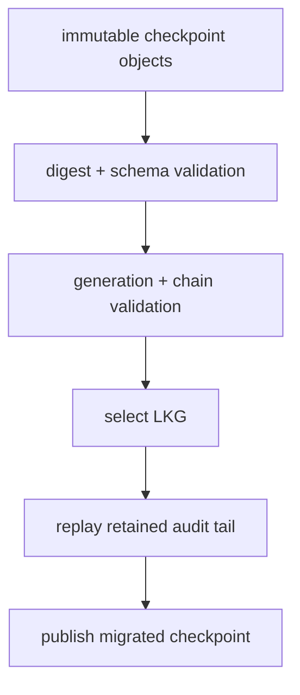

> 源码基线：vLLM [`4e591657`](https://github.com/vllm-project/vllm/commit/4e591657157a021cab997f911d67f50c0d18a71e)，即研究时默认分支最新提交。相对上一章的 `7dc44a00` 前进 25 个提交，但 [`vllm/snapshot`](https://github.com/vllm-project/vllm/tree/4e591657157a021cab997f911d67f50c0d18a71e/vllm/snapshot)、initialized-snapshot 文档和直接测试均未改变；最新提交的 structured-output backend 弃用与本文路径无关。initialized snapshot 仍来自已合入的 [PR #51360](https://github.com/vllm-project/vllm/pull/51360)。下文明确区分“当前代码事实”和“由事实推导的控制面建议协议”。

## 本篇在课程路线中的位置

第 65 章得到了 audit segment 的安全删除边界：`C_safe = min(C_absorbed, R_min - 1, W_closed)`。但它暗含了一个尚未回答的问题：如果 `CURRENT` 指向的 checkpoint 自身损坏、schema 已过期，或者来自失去所有权的旧 writer，恢复器该相信谁？

这是第 66 章，仍处于“测试、性能与故障诊断”。本章只闭合一个知识点：**如何从一组 immutable checkpoint 中选择 last-known-good（LKG）恢复点，并通过 replay 完成安全 schema migration。**

## 前置知识回顾

上一章已把两个对象拆开：

- artifact 层的 `SnapshotManifest` 描述一次 initialized engine snapshot，发布后不可修改；
- 建议中的 control checkpoint 吸收 GC audit prefix，可不断产生新版本，但每个版本仍应 immutable。

此外，checkpoint 只是 replay 加速器。它不能越过 reader/writer frontier 授权删除，也不能把 capacity receipt 再执行一次。恢复正确性最终仍来自 audit event、generation fence 和幂等 side-effect identity。

## 本篇要回答的核心问题

1. 当前 `SnapshotManifest.schema_version == 1` 的 fail-closed 行为，能否直接等同于 schema migration？
2. hash chain 能证明什么，为什么不能单独证明 checkpoint 是“最新且有权”的？
3. `CURRENT` 指向损坏对象时，怎样找到 LKG，并保证回退后仍有足够 audit tail 可重放？

## 组件在全局架构中的位置



这条链位于在线推理数据面之外：上游是第 64–65 章定义的 GC audit events、reader lease 与 writer watermark；下游消费者是 recovery controller、segment GC 和 capacity ledger。它不直接进入 model forward，也不改变 tensor shape，但恢复期间若选错 checkpoint，会把“已删除/已返还”的控制面事实复活，最终影响显存或磁盘 admission。

## 完整调用链

先看当前代码的真实链路。CLI 最终调用 [`create_snapshot`](https://github.com/vllm-project/vllm/blob/4e591657157a021cab997f911d67f50c0d18a71e/vllm/snapshot/controller.py)：创建私有 target directory，启动 child，等待 one-token oracle，收集进程树，执行 dump，确认 donor 已退出，再由 `make_manifest` 构造 `SnapshotManifest(schema_version=1)`。`LocalSnapshotTools.publish` 调用 `write_manifest_atomic`，最后 fsync artifact 的 parent directory。

恢复路径则相反：`restore_snapshot` 先 `read_manifest`，完成严格 JSON/schema 解析和 runtime identity 校验，**通过后才调用 CRIU restore**；listener 就绪后再次请求 oracle，token/text/logprob 不匹配则 cleanup，不执行 `complete_restore`。

建议中的 control checkpoint 应复用的是“不可变对象先 durable、可见指针后切换”的提交顺序，而不是复用 artifact manifest 本身：

```text
append audit events
→ materialize checkpoint candidate
→ canonical serialize + digest
→ put-if-absent(checkpoints/<digest>)
→ verify read-back
→ CAS CURRENT(old_revision, new_digest, predecessor_digest)
→ 延后回收 predecessor 与 replay tail
```

如果在写对象后、CAS 前崩溃，只留下不可达 orphan；如果在 CAS 后、旧对象回收前崩溃，只多占空间。这两种失败都比“原地覆盖唯一 checkpoint”容易恢复。

## 关键类型、字段和状态生命周期

当前 [`SnapshotManifest`](https://github.com/vllm-project/vllm/blob/4e591657157a021cab997f911d67f50c0d18a71e/vllm/snapshot/manifest.py) 使用 `ConfigDict(extra="forbid", frozen=True, strict=True)`，并把 `schema_version` 声明为 `Literal[1]`。validator 还要求值的 Python 类型恰为 `int` 且等于 1，所以 JSON `true` 虽可在宽松语义中表现为整数，也会被拒绝。这个设计提供的是 **V1 reader 的 fail-closed compatibility gate**，不是 V1→V2 migrator。

建议的 checkpoint envelope 至少需要：

| 字段 | 不变量 | 恢复用途 |
|---|---|---|
| `schema_version` | reader 明确认识，或存在确定性 migrator | 禁止猜测未知字段 |
| `checkpoint_revision` | 单调、受 CAS 保护 | 排序但不单独决定权威性 |
| `payload_digest` | 覆盖 canonical bytes | 检出对象损坏 |
| `previous_checkpoint_digest` | 精确指向前驱内容 | 验证链连续性与回退 |
| `absorbed_through` | 不超过 state 实际吸收的 event revision | 决定 replay 起点 |
| `state_digest` / `tombstone_digest` | 可由 state 或 event 重算 | 防止内容与声明分离 |
| `writer_generation` | 等于当前 fenced generation | 拒绝旧 owner 的合法 fork |
| `receipt_set_digest` | exactly-once side effect 的集合承诺 | 防 capacity 二次返还 |

生命周期是 `CANDIDATE → DURABLE → CURRENT → FALLBACK_RETAINED → RETIRED`。`CURRENT` 只是一个带 revision 的寻址提示；只有通过 schema、digest、chain、generation、state/receipt 验证的对象才是 `VALIDATED`。`RETIRE` 仍须等待 successor 验证、reader/writer frontier 和 audit-tail retention，不能因新指针写成就立即删除。

## 逐函数源码解读

[`_write_json_atomic`](https://github.com/vllm-project/vllm/blob/4e591657157a021cab997f911d67f50c0d18a71e/vllm/snapshot/manifest.py) 用 `sort_keys=True` 与紧凑 separators 生成 canonical JSON；临时文件以 `O_EXCL | O_NOFOLLOW` 创建，写入后 flush/fsync，再 `os.replace` 并 fsync parent directory。这给 digest 稳定性和 crash-safe pointer write 提供了可借鉴原语。

`write_manifest_atomic` 不允许已有 `manifest.json`，因此当前 artifact manifest 是 single-assignment。`read_manifest` 拒绝 symlink，使用 `O_NOFOLLOW` 打开，再以 `strict=True` 验证；未知字段、错误 schema、重复 PID、越界 oracle 都在设备 restore 前失败。`create_snapshot` 的 `finally` 会删除未发布 target；`restore_snapshot` 则把 identity check 放在 `toolset.restore` 之前。这些都是“先证据、后副作用”的直接代码事实。

但不要过度外推。官方 [initialized snapshot 文档](https://github.com/vllm-project/vllm/blob/4e591657157a021cab997f911d67f50c0d18a71e/docs/features/initialized_snapshots.md) 明确说明：manifest 已 fsync，不代表所有 captured payload 文件与目录都显式 flush；unclean host shutdown 后应重建 artifact。更没有现成的 audit log、hash chain、checkpoint migrator、fallback index 或 LKG selector。

## 具体示例与 shape/状态演算

延续前章：TP=2、K16，每 rank 稳定 snapshot 为 `bf16[16,4096] = 16 × 4096 × 2 = 131072 B`，两 rank 共 256 KiB，再加 4 KiB receipt，tombstone 集合为 260 KiB。

V1 checkpoint `C48` 吸收 revision 48，记录 tombstone digest 和 `capacity_released_bytes=266240`。V2 新增必填 `receipt_set_digest`，目的是证明这 260 KiB 只返还一次。此字段不能用空串或“默认全部成功”补齐：V1 的聚合字节数无法唯一恢复到底包含哪组 receipt。正确迁移必须读取仍保留的 revision 43–48 audit events，重建 receipt set，得到 `C48v2`。

随后 revision 49–52 被吸收为 `C52v2`，其 `previous_checkpoint_digest = digest(C48v2)`。发布顺序是先持久化 `C52v2`，读回验 digest，再 CAS `CURRENT`。现在模拟 `CURRENT` 已指向 `C52v2`，但对象 bit rot：

1. `payload_digest` 失败，`C52v2` 不可用；
2. recovery index 或 `CURRENT.previous_digest` 提供 `C48v2` 地址；
3. `C48v2` 的 schema、digest、generation、state 与 receipt set 均通过，故 LKG=48；
4. 从保留的 event 49 开始 replay，而不是把 49–52 当作已提交；
5. 生成新的 `C52'v2`，使用新 digest 和当前 writer generation 发布。

若 49–52 的 segment 已因“曾经见过 C52”而删除，则无法证明或重建这段状态，恢复必须停止。这正是为什么 segment GC 要等 successor 验证且 predecessor+tail 的 fallback window 闭合。

## 为什么这样设计及替代方案

从第一性原理看，恢复器必须同时回答三个不同问题：bytes 是否完整、历史是否连续、作者是否仍有提交权。hash 只能回答第一个；`previous_digest` 再加链遍历回答第二个；generation/CAS 才回答第三个。把三者混成“hash 正确即可信”会接受旧 owner 产生的、内容完好但已失权的 fork。

替代方案比较：

- **原地升级唯一 checkpoint**：省一个对象，却把 crash window 变成无旧版可退，且无法审计迁移输入。
- **只信 `CURRENT`**：读取快，但 pointer 或对象成为单点故障。
- **按最大 revision 或 mtime 扫描**：能找到 orphan/stale fork；mtime 不是业务顺序，最大 revision 也不证明 generation authority。
- **immutable content-addressed checkpoints + bounded fallback index + replay migration**：多保留一个或少量 generation，换来确定性回退和可验证迁移，是当前约束下最小充分设计。

一个细节很关键：若 `CURRENT` 只保存当前 digest，而当前对象完全不可读，就无法从对象内部取得 `previous_digest`。因此 pointer 应同时携带 predecessor digest，或维护 `CURRENT/PREVIOUS` generation ring；这不是为了替代链，而是给损坏入口提供可发现的第一跳。

## 性能、并发、正确性与边界条件

正常启动成本近似为“读取一个 pointer + 一个 checkpoint + 少量 digest”；故障路径才遍历 fallback 并 replay tail。令候选深度为 `d`、checkpoint bytes 为 `B_c`、待 replay events 为 `n`，恢复时间可写成：

`T_recovery ≈ d × (T_get + T_hash(B_c)) + n × T_apply_event`

因此要用 bounded ring 和 checkpoint interval 同时约束 `d`、`n`，而不是牺牲验证。这里的数据是 metadata 规模，通常不会成为 GPU kernel 瓶颈；它影响的是 activation/recovery latency 和 control-plane goodput。额外保留 predecessor 与 replay tail 增加磁盘/对象存储占用，却避免错误 capacity release、历史复活与人工修复。

并发边界包括：两个 writer 可各自写出合法 immutable candidate，但只有匹配 expected revision/generation 的 CAS winner 成为 `CURRENT`；loser 是 orphan。hash-valid 的旧 fork仍须被 generation fence 拒绝。unknown schema、链断裂、digest 不符、receipt 无法重建、tail 缺口都应 fail closed。恢复期间不应启动会消费该状态的 GC 或 capacity admission，直到 LKG verdict durable。

## 测试证据与未覆盖风险

直接测试位于 [`tests/entrypoints/launchers/test_launch_cli.py`](https://github.com/vllm-project/vllm/blob/4e591657157a021cab997f911d67f50c0d18a71e/tests/entrypoints/launchers/test_launch_cli.py)：

- failed dump 令 `tools.dump` 抛错，断言 `abort_create(100)` 被调用且 target directory 消失；
- identity mismatch 改写 `vllm_version`，断言 `restore` 未调用；
- oracle mismatch 断言 cleanup 调用、`complete_restore` 未调用；
- manifest 参数化覆盖 unknown field、`schema_version=True`、错误 boundary、重复 PID、非法 CUDA holder、两个 oracle token、非 float/NaN logprob；
- private-path test 覆盖 symlink 和 group/world-writable ancestor。

这些测试证明当前 artifact path 是严格、前置、fail-closed 的，但没有证明建议协议。需要新增 deterministic fault matrix：unknown-but-migratable schema、不可迁移字段、migration 写对象后/CAS 前崩溃、`CURRENT` 指向 missing/corrupt object、合法旧 fork、断链、predecessor 可用、tail 被误删、capacity receipt 重放，以及 successor 未验证时 segment GC 必须被阻止。本章只做源码静态研究，未声称重跑 GPU/CRIU 测试。

## 与前后章节的连接

本章把第 65 章的“checkpoint 吸收”补成了可恢复机制：checkpoint 不再只是一个压缩文件，而是 schema、content digest、history link、generation authority 和 receipt commitment 的联合证据。它也回答了 tombstone 何时真正能压缩：只有至少一个 LKG predecessor 与所需 replay tail 仍可用，新 checkpoint 才能进入稳定 fallback window。

下一章将继续处理恢复器启动后的并发问题：LKG 选出后，旧 worker 可能仍带着 pre-crash side effect 返回。我们将研究 **Recovery Replay 如何与迟到 writer 汇合——Redo/Undo Boundary、Compensation 与 Side-effect Reconciliation**。

## 本篇结论、知识债、三个理解检查问题和下一章

结论：当前 vLLM `SnapshotManifest` 已有严格 V1 schema、canonical JSON、atomic replace/fsync、single-assignment 和 restore 前校验；它没有 checkpoint migration 或 LKG recovery。对长期 audit control plane，最小充分协议是 immutable content-addressed checkpoint、带 predecessor 的 hash chain、generation-fenced `CURRENT` CAS、bounded fallback index，以及不能猜字段时的 audit replay migration。

知识债：真实 checkpoint/store API、canonical encoding 跨语言约束、migrator registry、fallback depth 与 retention budget、object-store read-after-write/CAS 语义、writer-generation authority、receipt-set 重算成本，以及 crash-at-every-boundary harness。

理解检查：

1. 为什么 digest 正确的最高 revision checkpoint 仍可能不是 LKG？
2. V2 新增 `receipt_set_digest` 时，为什么不能给 V1 checkpoint 填默认值？
3. 若 `CURRENT` 只含当前 digest，而对象已损坏，恢复器还缺少什么可发现性信息？

下一章：**Recovery Replay 如何与迟到 writer 汇合——Redo/Undo Boundary、Compensation 与 Side-effect Reconciliation。**

## 课程账本增量

- 第 66 章；阶段：测试、性能与故障诊断。
- 新事实：`SnapshotManifest` 的 `Literal[1]` 是严格 compatibility gate，不是 migrator；`CURRENT` 不应被当作无需验证的真相。
- 新不变量：LKG 必须同时通过 schema、payload digest、chain、generation、state/receipt 验证；不可唯一迁移的字段必须靠 retained audit replay 重建；successor 未验证前不得删除 predecessor 所需 tail。
- 建议协议：content-addressed checkpoint、`previous_checkpoint_digest`、generation-fenced CAS、`CURRENT/PREVIOUS` ring、pure migration/replay 与 receipt-set commitment。
- 待办：落地 schema/store、对象存储语义、恢复延迟/存储预算和故障注入测试。

