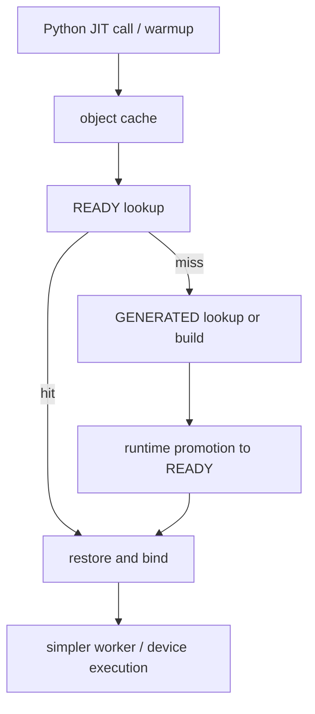
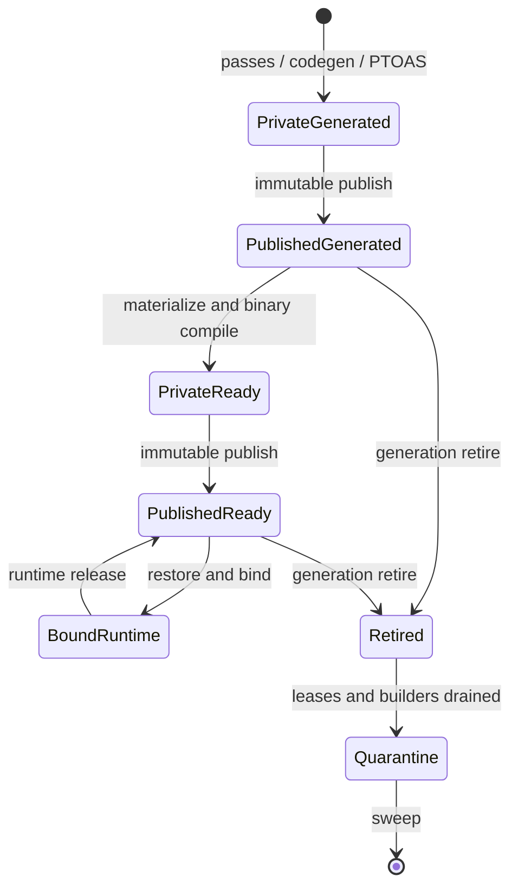

> 源码基线：PyPTO [`c5d03257`](https://github.com/hw-native-sys/pypto/commit/c5d032575aac5f20a77dd3ddb8e54dde94704daa)，即研究时默认分支最新提交。相对上一章的 `cc17e872` 前进 4 个提交，内容是 FP4、dynamic extent、immutable sync resource catalog 与 orchestration codegen 拆分，未改变 Artifact Store。本文只选择 PyPTO：eviction 的身份、阶段依赖、统计与生命周期都在该仓闭合，不需要为了“覆盖更多仓”引入 simpler。

## 本篇在 PTO 课程路线中的位置

第 76 章解决了“旧 Cache Slot 何时**允许**删”：generation retire 阻止新 reader/build，lease 与 build fence 排空旧访问，最后 quarantine + tombstone 才能物理回收。

但允许删除不等于应该删除。容量只有 300 MiB 时，三个都安全可删的 slot 可能分别代表：可直接从 READY 恢复的热门 kernel、仍能从 GENERATED 快速 promote 的冷门 binary、或已被新 toolchain identity 淘汰的整套旧产物。只看最近访问时间或目录大小，都会把不同的重建代价抹平。

这是第 77 章，主问题是：**在已满足安全删除证明后，怎样用 rebuild cost、warm-set 与 stage dependency 决定 eviction 顺序？**

## 前置知识

PyPTO persistent cache 有两个相互独立发布的 stage：

- `GENERATED`：生成代码、配置和 compiled metadata；
- `BINARY_READY`：完整 binary、binary manifest 与 loader 所需 metadata。

两者都用 immutable directory + strict manifest 发布。slot 地址包含 `environment digest / ArtifactKey.digest / ArtifactSpec.digest / state`。`ArtifactSpec.digest` 又覆盖 state、build kind、required files 和 execution capabilities，因此“同一个 kernel”可能有多个不可互换的 stage/spec。

上一章还确认：readonly reader 不拿 persistent key lock，`ArtifactRuntime` 可能长期保留 path；所以 eviction policy 只能在 lease/fence 判定为 eligible 后排序，绝不能拿“分数低”绕过安全条件。

## 今日 1–2 个核心问题

1. 为什么 LRU 或“先删最大目录”不足以代表一次 cache miss 的真实成本？
2. `GENERATED → BINARY_READY` 是怎样的依赖；READY 已存在时删 GENERATED 与删 READY，后果为何不同？

## PTO 全栈中的位置



eviction 位于 Host persistent Artifact Store，不删除 Tensor/Tile，也不直接改变 GM、UB 或 L1 的 runtime memory。它影响的是下次请求要不要重新做 source/toolchain identity、PyPTO passes/codegen、PTOAS、host/device binary compile 与 runtime restore。上游输入是 JIT source、specialization、toolchain identity 和 cache telemetry；下游消费者是 `ArtifactRuntime`、Worker 注册与最终 device execution。

## 概念和精确语义

### 1. 安全资格与经济排序必须分层

建议把候选判定写成两个阶段：

```text
Eligible(s) = Retired(s,g)
           ∧ Readers(s,g) = ∅
           ∧ BuildersFrom(s,g) = ∅
           ∧ CurrentGeneration(s) = g
           ∧ not ExplicitlyPinned(s)
```

只有 `Eligible=true` 的 slot 才进入经济排序。排序不是正确性证明；即使磁盘爆满，也不能删除仍被 live `ArtifactRuntime` 引用的 path。

对候选 `s`，真正需要估算的是**边际重建损失**：

```text
Loss(s | survivors) = expected_requests(s)
                    × extra_rebuild_time(s | survivors)

ValueDensity(s) = Loss(s | survivors) / reclaimable_bytes(s)
```

`extra_rebuild_time` 必须以其他 stage 是否保留为条件。它不是一个写死在 Artifact 类型上的常量，也不能由文件大小推导。

### 2. warm-set 不是“最后访问的 N 个目录”

warm-set 是容量预算内、预计能避免最多 miss cost 的 slot 集合。近期访问只是预测信号之一；还要考虑命中频率、promotion/build cost、环境是否仍可复现、部署是否即将切换，以及一个 slot 被删后仍有哪些可用 ancestor/descendant。

当前 [`CacheStats`](https://github.com/hw-native-sys/pypto/blob/c5d032575aac5f20a77dd3ddb8e54dde94704daa/python/pypto/_cache_config.py) 只有 process-local 聚合计数：`ready_hits`、`generated_hits`、`misses`、`generation_builds`、`binary_builds`、`lookup_ns`、`build_ns` 等。它不扫描 storage，也没有 per-slot hit/last-access/bytes，因此不能直接驱动跨进程 eviction。

### 3. dependency-aware 的精确含义

当前路径先 lookup READY，再 lookup GENERATED。READY miss 而 GENERATED hit 时，只需 binary promotion；两者都 miss 才要重新生成。测试甚至证明 READY 可在 GENERATED 被删除或损坏后独立 readonly restore。因此依赖不是“删父必删子”的文件系统外键，而是**重建成本图**：

- 保留 READY：下一次可以直接 restore；GENERATED 的即时运行价值较低；
- 保留 GENERATED、删除 READY：下一次仍可 promote，但要重新 binary compile/assemble；
- 两者都删：下一次要从 source/toolchain identity 进入完整 generation，再 promotion；
- READY 与 GENERATED 都不应靠目录邻接猜关系；多个 READY spec 可能共存，ambiguous candidate 会 fail closed。

## 真实文件、类型、API 或指令逐段解读

### `ArtifactKey`、`ArtifactSpec` 与 manifest

[`_artifact_manifest.py`](https://github.com/hw-native-sys/pypto/blob/c5d032575aac5f20a77dd3ddb8e54dde94704daa/python/pypto/jit/_artifact_manifest.py) 定义 `ArtifactKey` 和 `ArtifactSpec`。key 覆盖 toolchain environment、source digest、specialization digest 与 compile contract；spec 覆盖 stage、`BuildKind`、required files 与 execution capabilities。manifest 记录完整文件 inventory：path、size、SHA-256 和 owner executable flag。

这给 eviction 两类可靠输入：slot identity 与精确 payload bytes。但当前 manifest 没有 `last_access`、hit count、build duration、`derived_from` 或 reader generation。不能把 immutable manifest 原地改成热度表；热度应进入独立、可丢失但可重建的 telemetry/index。

### `ArtifactStore.lookup/get_or_build/_publish`

[`artifact_cache.py`](https://github.com/hw-native-sys/pypto/blob/c5d032575aac5f20a77dd3ddb8e54dde94704daa/python/pypto/jit/artifact_cache.py) 的 `lookup()` 校验完整 manifest 与 payload，不创建目录或 lock；`get_or_build()` 先做进程内 flight coalescing，再在 persistent key lock 下 recheck；`_publish()` 从 cache 外 private directory 复制到同目录 staging，以 `RENAME_NOREPLACE` 发布。

类注释明确写着 concurrent mutation/deletion unsupported。文档也更直接：**没有 online GC、global cache statistics、automatic stage preference，cleanup 必须在所有 consumer 停止后离线执行。** 对应 RFC [#2653](https://github.com/hw-native-sys/pypto/issues/2653) 还明确排除了初始 surface 的 `clear_cache()`、eviction、`max_entries/max_bytes` 与 cleanup CLI；后续 cleanup 必须单独评审 lifetime/lease protocol。

因此本文的 eviction controller 是建议设计，不是当前隐藏 API。

### `resolve_persistent`：真实的命中阶梯

[`_persistent.py`](https://github.com/hw-native-sys/pypto/blob/c5d032575aac5f20a77dd3ddb8e54dde94704daa/python/pypto/jit/_persistent.py) 的 `resolve_persistent()` 顺序是：

1. 捕获 toolchain、extra sources、specialization 与 semantic environment；
2. 查进程内 `owner._artifact_objects`；
3. `JITArtifactStore.lookup_ready()`，命中则 `restore_artifact()`；
4. READY miss 后 lookup GENERATED；若同 key 的 READY 能由 generated metadata 定位，优先 READY，否则恢复 GENERATED；
5. 全 miss 才 `get_or_build()` 生成，随后由 runtime 懒 promotion。

这个阶梯正是 cost model 的来源。PR [#2988](https://github.com/hw-native-sys/pypto/pull/2988) 让 fresh process 可以不先 inventory 全编译栈就命中 READY；其报告 5/5 fresh-process READY hit 的 host preparation 中位数为 131.13 ms，其中 identity 116.20 ms、restore/warmup 14.94 ms。该数字是特定环境的 reuse check，不是通用加速比。PR [#2723](https://github.com/hw-native-sys/pypto/pull/2723) 则报告当时 cold installation inventory 约 12 s，说明同为“cache miss”，重走 identity/generation 与直接 READY restore 的量级可能完全不同。

## 对象/Tile/Buffer/IR 生命周期

以一个带 `FP32[1,4096]` prefetch intent 的 kernel 为例：运行时逻辑数据范围是 16,384 B，但 persistent cache 保存的是代码与 binary，不保存这 16 KiB Tensor 内容。

对象生命周期是：



`ArtifactRuntime.load()` 首次从 GENERATED promote 时创建新的 READY slot，但保留 generated path 与 live callable 所需 path；它不拥有 online eviction。`ArtifactBuild` 即使成功 publish 也保留 private directory/value，只有 adapter 知道何时安全清理。这意味着 eviction 不能只扫描 canonical `artifacts/`：private fallback 是另一类 owner-scoped 空间，需要由 owner lifecycle 单独回收。

## 端到端调用链或指令链

从公开入口看，`jit_fn.compile()` 或 `jit_fn.warmup()` 捕获 `CacheConfig`，进入 `resolve_persistent()`；READY hit 走 `restore_artifact()`，GENERATED hit 绑定 `ArtifactRuntime`，miss 则执行原始 build 并通过 `ArtifactStore.get_or_build()` 发布。后续 `ArtifactRuntime.load()` 计算 `ready_spec`，materialize GENERATED，在 private directory 编译 binary，再发布 READY。最后 reconstructed callable 被 Worker 消费。

建议的 eviction controller 不插进这条调用链中间，而应旁路消费三类事实：

1. immutable slot census：manifest 中的 identity、stage 与 bytes；
2. durable safety registry：generation、reader lease、build intent、quarantine；
3. soft telemetry：per-slot hit、最近使用、observed build/restore cost。

只有第 2 类决定“能不能删”；第 3 类只决定“先删谁”。readonly consumer 不应为了打热度而写 artifact root，可把抽样 access event 发送到外部 controller；丢少量热度事件会影响效率，但不能破坏正确性。

## 具体 shape、Tile 和状态演算

假设 cache quota 为 300 MiB，当前有以下**教学样例**；容量和 cost 用于演算，不是仓库 benchmark：

| slot | stage | bytes | 过去一小时命中 | 若单独删除的下一次额外代价 | 状态 |
| --- | --- | ---: | ---: | ---: | --- |
| A-R | READY | 120 MiB | 20 | 2.0 s（从 A-G promote） | eligible |
| A-G | GENERATED | 30 MiB | 0 direct / A-R 的 parent | 8.0 s（若 A-R 也不在） | eligible |
| B-R | READY | 90 MiB | 1 | 5.0 s | eligible |
| C-G | GENERATED | 40 MiB | 0 | 12.0 s，但旧 environment 已 retire | eligible |
| D-R | READY | 80 MiB | 30 | 6.0 s | **有 reader，不 eligible** |

总量 360 MiB，要释放至少 60 MiB。

- size-first 会先删 A-R 120 MiB，却摧毁最热 READY；
- LRU 若只看目录 atime，manifest validation、备份扫描或 `noatime` 都可能污染/抹去信号；
- safety-first 先排除 D-R；dependency-aware 识别 C-G 属于 retired environment，未来请求会生成不同 environment digest，它的有效命中概率近似 0，于是先删 C-G 40 MiB；再删冷门 B-R 90 MiB，即可满足 quota；
- 如果只需 20 MiB，删除 A-G 30 MiB 不影响现存 A-R readonly restore，直接测试证明这一点。但这会抬高 A-R 将来失效后的完整重建成本，controller 应把它记录为“降低恢复冗余”，而不是零损失。

这里 `FP32[1,4096]` 的 16 KiB 只决定 kernel 语义与 specialization；120 MiB 等数字是 host artifact bytes。两者不能混为 UB/GM 容量。

## 为什么这样设计及替代方案

### 方案一：纯 LRU

实现最简单，但需要可信 per-slot access clock。当前只有 aggregate `CacheStats`，artifact root 又允许 readonly 消费，直接依赖 filesystem atime 不可靠。LRU 还把一次 15 ms restore 与一次数秒 toolchain/generation rebuild 当成同价 miss。

### 方案二：largest-first

最快释放字节，适合 emergency watermark；但容易反复删除大而热的 READY，造成 compile storm。它可作为 hard-pressure 的最后兜底，不能作为常态策略。

### 方案三：warm-set + marginal rebuild cost

先按近期频率/recency 保护一个小 warm set，再在 eligible 冷集内按 `ValueDensity` 从低到高删除。stage graph 让 cost 以 survivors 为条件：删 READY、删 GENERATED、删两者是三个不同动作。为了防止新 kernel 被历史热门永远压制，可采用 probationary segment 或 TinyLFU 式 admission；这些都是建议，不是当前实现。

我的选择是方案三，并保留两条硬约束：

- 高水位触发策略不能跨过 reader/build fence；空间不足时宁可拒绝新 publication 或 private fallback，也不能 unsafe delete；
- score 输入可近似，identity/lease 输入必须精确。错误热度最多带来性能回退，错误 lease 会产生 use-after-delete。

## 访存、计算、流水、并行和硬件约束

- **Host I/O**：每次 lookup 会 inventory/hash payload。频繁全盘 census 会争用磁盘与 CPU；建议 quota controller 增量维护 manifest bytes，并周期性校准，而不是每次请求扫描。
- **计算代价**：READY hit 跳过 passes、codegen、PTOAS 与 binary compile；GENERATED hit 仍需 binary promotion。cost estimator 应分别记录 generation/build/restore，不用一个平均 `build_ns` 覆盖所有 stage。
- **并行**：相同 key 的 builder 有进程内 flight 与 persistent `flock`，不同 key 可并行。eviction 若拿全局锁会把并行 build 串行化；应先 generation retire，再按 key 做短复查与 quarantine。
- **流水**：eviction 不应位于请求 critical path。高水位可异步 sweep；达到 hard limit 时 publication 应 fail/private fallback，避免在持有 compiler/worker 资源时同步递归删目录。
- **硬件**：artifact eviction 本身不触发 NPU kernel，也不改变 Tile layout；但 cache miss 会重新进入 host/device compiler。不同 backend/toolchain 已由 environment digest 隔离，不能用 A2/A3 的 cost 直接给 A5 排序。

## 测试证据与未覆盖风险

当前测试给了很关键的 stage 关系证据：

- [`test_generated_to_ready_copies_without_mutating_shared_source`](https://github.com/hw-native-sys/pypto/blob/c5d032575aac5f20a77dd3ddb8e54dde94704daa/tests/ut/jit/test_artifact_cache.py) 验证 promotion 使用独立 copy，不修改 GENERATED；
- [`test_readonly_ready_hit_survives_generated_slot_loss`](https://github.com/hw-native-sys/pypto/blob/c5d032575aac5f20a77dd3ddb8e54dde94704daa/tests/ut/runtime/test_prebuilt_artifact.py) 删除或损坏 GENERATED 后，READY 仍能 readonly hit，且不调用 compiler；
- `test_ready_relocation_does_not_need_original_sources` 删除整个 store 后，relocated READY 仍可 load，说明 READY 的 runtime closure 自包含；
- `test_orphan_ready_warmup_is_a_readonly_hit` 验证 GENERATED 缺失时 READY hit 不增加 miss、bypass、generation build 或 binary build；
- `test_cache_statistics_distinguish_disabled_forced_and_unavailable` 验证现有统计分类，但它仍是 process-local aggregate；
- `test_spawned_processes_deduplicate_and_dead_process_releases_lock` 验证三进程同 key 只发布一次以及死进程释放 lock，未验证 eviction race。

PR #2692 报告 artifact-store 定向测试 114 passed、全 UT 11,937 passed/10 skipped/1 xfailed；PR #2723 报告全 UT 12,181 passed、两项 managed NPU acceptance 通过；PR #2988 报告 JIT/runtime 2,027 passed/3 skipped与 4 个 device cases。以上是 PR 报告，本章未重跑 NPU。

未覆盖风险包括：per-slot telemetry 丢失/重复、quota 并发超调、READY/GENERATED 联合 eviction、promotion 与 victim selection 竞争、eviction 后 build storm、跨 backend cost 漂移、readonly fleet 的 access aggregation、emergency admission，以及 crash-at-quarantine/sweep 的容量对账。

## 与前后章节的连接

第 76 章的 lease/fence/quarantine 给本章提供安全候选集；本章只在候选集中优化“单位字节保留价值”。这也是为什么 eviction policy 不能代替 GC protocol。

下一章将进一步处理容量控制的反馈环：多个进程同时看到 90% watermark 时，若都开始 build 或 eviction，会发生 quota oversubscription 与 herd。我们将研究 **Admission Reservation、Quota Ledger 与 Thundering-herd Control**。

## 第 71–77 章知识图谱回顾

这七章把“资源够不够”一路收束到“可复用产物该留谁”：

| 章节 | 新增的证明 | 向下一层交付 |
| --- | --- | --- |
| 71 | fresh census + revisioned reservation | admission token，不再凭陈旧 free bytes 入场 |
| 72 | resource intent 与 invocation-local handle 分离 | Artifact 只记录稳定 requirement |
| 73 | hidden binding 绑定 Worker/provider generation | 同址不等代，旧 binding 不跨 lifecycle |
| 74 | capability schema 与 provider matrix | cache identity 与 runtime satisfaction 分层 |
| 75 | schema migration 按信息充分性分类 | 无法唯一解释就 clean miss/recompile |
| 76 | reader/build fence + generation-safe quarantine | 得到可安全删除的 eligible set |
| 77 | warm-set + marginal rebuild cost | 在 eligible set 内选择低损失 victim |

核心连接是：**identity 决定能否复用，lease/fence 决定能否删除，cost policy 决定是否值得保留。** 三者任何一个都不能替代另一个。后续课程将把第 71 章的 reservation 重新接到 Artifact quota，使多个 builder/evictor 共享同一容量账本。

## 本篇结论、知识债、三个理解检查问题和下一章

结论：

1. 当前 PyPTO 没有在线 eviction/`max_bytes`/cleanup API；现有 cleanup 前提仍是所有 consumer 停止。
2. READY 与 GENERATED 是独立 immutable stage。READY 可在 GENERATED 丢失后运行；删除 READY 但保留 GENERATED 只需 promotion，删除两者才回到完整 generation。
3. 安全条件与价值排序必须分层：lease/fence 决定 eligible，warm-set 与边际重建成本决定 victim。
4. immutable manifest 不应承载可变热度；per-slot telemetry/index 应独立，允许近似和丢失，但不能成为删除 authority。

知识债：per-slot hit/cost/bytes index、promotion provenance、跨进程 telemetry、quota reservation、stage-aware estimator、emergency fallback、build-storm guard、eviction Golden 与 crash-safe capacity ledger。

理解检查：

1. 为什么 `READY` 的 GENERATED parent 被删后仍可运行，但这不代表删除 parent 永远是零成本？
2. 为什么 aggregate `CacheStats.ready_hits` 无法回答“该删哪个 slot”？
3. 当 hard quota 已满但最冷 slot 仍有 reader lease 时，正确动作为什么应是拒绝/私有构建，而不是越过 fence 强删？

下一章：**多个进程都开始腾空间怎么办——Admission Reservation、Quota Ledger 与 Thundering-herd Control。**

## 课程账本增量

- 源码基线：PyPTO `c5d032575aac5f20a77dd3ddb8e54dde94704daa`。
- 新覆盖：`_cache_config.CacheStats`、`_persistent.resolve_persistent/JITArtifactStore.lookup_ready`、`ArtifactKey/ArtifactSpec`、`ArtifactStore.lookup/get_or_build/_publish`、`ArtifactRuntime.load` 与 READY 独立恢复测试。
- 新确认不变量：eviction eligibility 与 economic score 分层；READY/GENERATED 是独立 stage；重建成本以 survivors 为条件；readonly access telemetry 不应修改 immutable artifact。
- 当前实现边界：无 online GC、per-slot stats、quota、eviction、dependency index 或 cleanup CLI。
- 下一章：Admission reservation、quota ledger 与 herd control。
