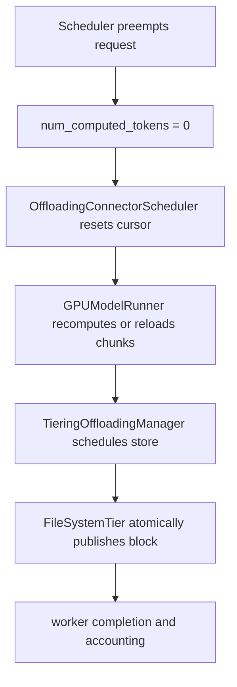
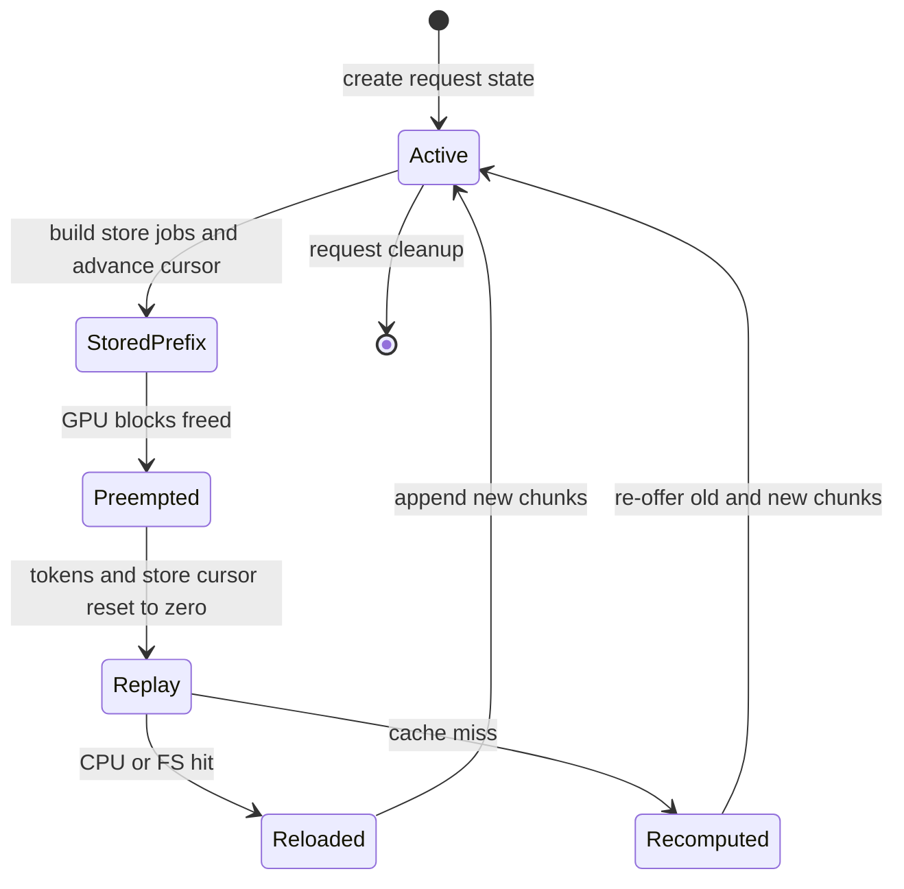

> 源码基线：vLLM [`a7407ab4`](https://github.com/vllm-project/vllm/commit/a7407ab44557802ca32a0ba2c2707362d7d21563)，即研究时默认分支最新提交。相对上一章的 `4e591657` 前进 34 个提交；最新 head 的 pipeline-parallel benchmark 与本文无直接关系，但期间合入的 [PR #63010](https://github.com/vllm-project/vllm/pull/63010)、[PR #61390](https://github.com/vllm-project/vllm/pull/61390) 和 [PR #63126](https://github.com/vllm-project/vllm/pull/63126) 正好给出了 recovery replay 的三块真实证据。下文严格区分“已合入代码事实”“测试/PR 报告事实”和“建议协议”。

## 本篇在课程路线中的位置

第 66 章讨论了如何从 immutable checkpoint 中选择 last-known-good，再重放保留的 audit tail。但“可以 replay”还不是一个可执行协议：旧 attempt 可能仍在写；新 attempt 可能从 token 0 重算；某个文件其实已被另一 writer 发布；数据写入成功后，计账或 ack 又可能丢失。

这是第 67 章，仍处于“测试、性能与故障诊断”。本章只回答一个问题：**当请求被抢占并从头恢复时，什么应该 redo，什么绝不能 undo，以及如何让迟到 writer 与新 attempt 在同一副作用边界汇合？**

## 前置知识回顾

前几章已建立三个约束：

- checkpoint 是 replay 加速器，不是事实来源；
- writer generation 决定谁有权提交控制状态，但撤销 authority 不等于取消已经发出的 I/O；
- immutable、content-addressed 对象适合 at-least-once 重做，因为相同 key 应代表相同内容。

本章把这些抽象约束落到 vLLM 已有的 KV Offload 路径。这里没有通用 recovery log；真实锚点是 request-local store cursor、GPU/CPU/FS 分层存储，以及异步 transfer completion。

## 本篇要回答的核心问题

1. `PREEMPTED` 请求把 `num_computed_tokens` 归零后，为什么还必须把 `next_stored_chunk_idx` 归零？
2. 两个异步 writer 同时发布同一个 FS block 时，为什么 final-path `EEXIST` 可以算成功，而删除 winner 反而是错误的 compensation？
3. 数据对象已经幂等，为什么 `transfer_bytes`、完成事件和 backpressure 仍可能重复或失真？

## 组件在全局架构中的位置

上游是 [`Scheduler.schedule`](https://github.com/vllm-project/vllm/blob/a7407ab44557802ca32a0ba2c2707362d7d21563/vllm/v1/core/sched/scheduler.py) 的抢占与重新 admission；中间是 [`OffloadingConnectorScheduler`](https://github.com/vllm-project/vllm/blob/a7407ab44557802ca32a0ba2c2707362d7d21563/vllm/distributed/kv_transfer/kv_connector/v1/offloading/scheduler.py) 和 [`OffloadingConnectorWorker`](https://github.com/vllm-project/vllm/blob/a7407ab44557802ca32a0ba2c2707362d7d21563/vllm/distributed/kv_transfer/kv_connector/v1/offloading/worker.py)；下游是 CPU primary tier、FS secondary tier及其完成/计账事件。

它位于 model forward 的外侧：不会改变 Q/K/V tensor 的 shape，也不直接进入 CUDA Graph；但 store/load 是否被正确枚举会决定请求能否命中缓存、是否重复 I/O，以及 scheduler 看到的 offload 压力。

## 完整调用链

一次正常 step 从 [`EngineCore.step`](https://github.com/vllm-project/vllm/blob/a7407ab44557802ca32a0ba2c2707362d7d21563/vllm/v1/engine/core.py) 开始：

1. `scheduler.schedule()` 形成 `SchedulerOutput`。若 GPU block 不足，`_preempt_request` 释放 block，把请求设为 `PREEMPTED`，将 `num_computed_tokens` 设为 `0` 并放回 waiting 队首。
2. 请求再次从 waiting 被考虑时，prefix lookup 只在 `num_computed_tokens == 0` 执行。connector 的 `get_num_new_matched_tokens()` 此时清空各 group 的 `block_ids`，并把 `next_stored_chunk_idx` 归零；这正是 [commit `6f514338`](https://github.com/vllm-project/vllm/commit/6f51433838b858a9cd0478b2ffee4d2c610a1712) 修复的边界。
3. scheduler 把 load/store metadata 填入 `SchedulerOutput`。[`KVConnectorModelRunnerMixin`](https://github.com/vllm-project/vllm/blob/a7407ab44557802ca32a0ba2c2707362d7d21563/vllm/v1/worker/kv_connector_model_runner_mixin.py) 在 forward 前后启动 load、等待必要同步并收集结果；preemption 还会先交给 GPUModelRunner 的 connector hook 处理。
4. `_build_store_jobs()` 从 `next_stored_chunk_idx` 开始枚举完整 chunk，调用 manager 的 `prepare_store()` 过滤真正需要存储的 key，再生成带 `np.int32 block_ids` 的 `GPULoadStoreSpec`。cursor 随后推进到当前 `num_chunks`。
5. worker 先把 store job 延迟进队列，下一个 transfer step 再提交。CPU tier 完成后，[`TieringOffloadingManager.complete_store`](https://github.com/vllm-project/vllm/blob/a7407ab44557802ca32a0ba2c2707362d7d21563/vllm/v1/kv_offload/tiering/manager.py) 让 chunk 可从 primary tier 加载，并为 secondary FS tier 创建异步 store。
6. [`FileSystemTierManager`](https://github.com/vllm-project/vllm/blob/a7407ab44557802ca32a0ba2c2707362d7d21563/vllm/v1/kv_offload/tiering/fs/manager.py) 把 `OffloadKey` 映射为路径；[`_store_block`](https://github.com/vllm-project/vllm/blob/a7407ab44557802ca32a0ba2c2707362d7d21563/vllm/v1/kv_offload/tiering/fs/io.py) 先写 exclusive temp file，再 `os.replace` 到 final path。若 publish 时发现另一 writer 已发布相同 content-addressed block，清理自己的 temp 并返回成功；C++ 路径 [`csrc/fs_io.cpp`](https://github.com/vllm-project/vllm/blob/a7407ab44557802ca32a0ba2c2707362d7d21563/csrc/fs_io.cpp) 同样把这一类 `EEXIST` 视为成功。这来自 [commit `1757f672`](https://github.com/vllm-project/vllm/commit/1757f6720c3c1cc130a834b41f264ac22a782289)。
7. 异步完成由 worker 轮询并按 worker 数聚合。当前 store failure 在 connector worker 路径仍以断言拒绝，说明“持久 recovery/重试队列”并不是现有接口承诺。

lookup 自身也是异步边界。[commit `503e4e16`](https://github.com/vllm-project/vllm/commit/503e4e16ad8d4c4b7b1290c9f2792af0ca622c47) 把 `batch_lookup()` iterator 的物化放入 `try` 中；若 iterator 中途抛错，失败 group 退化为 miss，健康 group 与后续 batch 仍能前进。这是 fail-local，而非把半消费 iterator 当作成功 checkpoint。

## 关键类型、字段和状态生命周期

`RequestGroupState` 是本章的关键对象：

- `offload_keys`：每个完整 chunk 的 key；当前 key 是 block hash 再拼 group index；
- `block_ids`：本轮 scheduler 关联的 GPU blocks；
- `next_stored_chunk_idx`：下次从哪个 chunk 开始构建 store job；
- `num_hit_chunks`、`lookup_hit_end_chunk_idx`：lookup 命中的边界。

外层 `RequestOffloadState` 还持有 request、`ReqContext` 和 transfer job 集合。生命周期如下：

最重要的不变量是：**cursor 只表示某个内存态曾经枚举到哪里，不能证明副作用仍然存在。** GPU/CPU cache 被 reset、请求被抢占或 engine 崩溃后，旧 cursor 都不能成为 skip 的 durable evidence。把 cursor 归零会多做 lookup/过滤，但 `prepare_store()` 与 content-addressed sink 才是决定“是否真的需要重写”的正确位置。

## 逐函数源码解读

### 1. `_preempt_request`：建立新的计算 attempt

[`scheduler.py`](https://github.com/vllm-project/vllm/blob/a7407ab44557802ca32a0ba2c2707362d7d21563/vllm/v1/core/sched/scheduler.py) 释放请求持有的 KV blocks，并令 `num_computed_tokens = 0`。这不是“从 cursor 继续”的暂停，而是创建了一个从 token 0 重新证明 prefix 的 attempt。若 connector 仍保留旧 `next_stored_chunk_idx`，计算状态与副作用枚举状态便属于不同 attempt。

### 2. `get_num_new_matched_tokens`：把枚举边界重新对齐

当前实现对每个 KV cache group 执行 `block_ids.clear()` 与 `next_stored_chunk_idx = 0`，然后再进行 offload lookup。它没有删除 FS 中已有块，也没有强制重写；只是恢复“所有候选 chunk 必须重新被看见”的前置条件。

这就是 redo boundary：从可重建输入——request tokens、block hashes、group index——重新枚举，而不是从不可验证的过程 cursor 继续。

### 3. `_build_store_jobs`：先列举，再由存储层去重

该函数只处理完整 chunk。`prepare_store(new_offload_keys, req_context)` 返回哪些 key 需要写；没有 key 时仍推进 cursor，避免同一活跃 attempt 每 step 重复扫描。存在 key 时，job 记录 host 侧 `np.int32` block id、group size 和 block index，实际 KV bytes 仍由 canonical cache view 与 transfer worker消费。

这里的分工很精确：scheduler cursor 负责增量效率，manager/sink 负责存在性与所有权。把存在性缓存回 cursor 会更快，却会在 eviction、reset 或多 writer 下失真。

### 4. `_store_block`：迟到 writer 的汇合点

FS block 采用 temp-write + atomic publish。两个 writer 竞争同一 final key时，winner 的内容留在 final path；loser 只清理自己的 temp。只有“final path 已被发布”这一特定冲突可转成成功，其他 I/O error 仍失败。

这个成功判定依赖一个强前提：key 是内容寻址且 namespace/config 映射正确。如果同 key 可能代表不同 bytes，或路径可被复用，`EEXIST` 便不能无条件等价于成功。当前测试特意给 loser 不同 source bytes，验证 winner 已发布 bytes 不被覆盖；它证明的是 immutable publish 语义，而不是 hash collision 或磁盘腐坏检测。

## 具体示例与 shape/状态演算

沿用直接测试 [`test_scheduler.py`](https://github.com/vllm-project/vllm/blob/a7407ab44557802ca32a0ba2c2707362d7d21563/tests/v1/kv_connector/unit/offloading_connector/test_scheduler.py) 的规模：`block_size = 4 tokens`，`blocks_per_chunk = 3`，所以每个 offload chunk 覆盖 `12 tokens`。

初始 request 有 24 tokens：

| 时刻 | 逻辑 token/chunk | GPU block | `next_stored_chunk_idx` | 动作 |
| --- | --- | --- | --- | --- |
| S0 | chunk 0: token 0–11 | 0,1,2 | 1 | store chunk 0 |
| S1 | chunk 1: token 12–23 | 3,4,5 | 2 | store chunk 1 |
| S2 | decode 新增完整 chunk 2 | 6,7,8 | 3 | store chunk 2 |
| S3 | GPU space 归零 | blocks freed | 旧值 3 无效 | preempt，tokens 归零 |
| S4 | replay lookup | 重新关联 | **reset 为 0** | 从 chunk 0 重新证明 |

随后有两条合法路径：

- CPU hit：加载旧 chunk 0–2（GPU blocks 0–8），继续计算并只需存新 chunk 3（blocks 9–11）；
- CPU miss：重算 chunk 0–2，重新把它们交给 `prepare_store`，sink 对已存在 key 去重，再存 chunk 3。

如果 cursor 错误地保留为 3，miss 路径会直接跳过 0–2；此时“旧 attempt 曾经 store”被误当成“当前 cache 层仍可读取”。反过来，归零并不会必然产生三次 FS 覆写：content-addressed lookup/publish 将 redo 收敛为 no-op 或一个合法 winner。

文件并发例更小：W1 与 W2 都要发布 key `K`。W1 完成 final publish；W2 的 temp 已写完，publish 遇到 final `K`。正确 compensation 是删除 W2 temp 并把数据 effect 视为满足，而不是 undo W1 的 final object。若 W2 在 ack 前崩溃，恢复器可再次提交 `K`；存在性会再次把它收敛为成功。

## 为什么这样设计及替代方案

从第一性约束看，恢复方案必须同时满足：不漏掉需要重建的 chunk、不覆盖正确 winner、不因重复执行产生第二份逻辑 effect，并能区分数据 effect 与控制面 effect。

| 方案 | 正确性 | 代价 | 适用边界 |
| --- | --- | --- | --- |
| 保留旧 cursor，从中点继续 | eviction/restart 后可能漏写，不能证明 | 扫描最少 | 仅限同一未中断 attempt |
| attempt-scoped 唯一对象，失败后 rollback | 隔离强，但需可靠列举与删除；late delete 也要 fencing | 更多容量、清理延迟和元数据 | key 可变、effect 可逆时 |
| content-addressed immutable publish + at-least-once redo | 数据层自然去重；迟到 writer 可汇合 | 可能重复 lookup/temp write；计账需另行对账 | 相同 key 唯一映射相同 bytes |

vLLM 当前方向属于第三种。它也解释了为什么这里的“undo”非常少：immutable winner 不应被旧 attempt 删除；loser 只补偿自己尚未发布的 temp。真正需要撤销的通常是 attempt-private reservation 或 pin/refcount，而不是共享的 content-addressed 数据。

若把这一机制扩展为通用 crash recovery，建议的接收条件应至少是：`key/content digest` 匹配、namespace/config 匹配、当前 generation 允许提交控制状态，并且“由我发布”或“已验证存在”。这是课程建议，不是当前 vLLM API；源码中没有 durable attempt generation、redo log、compensation log 或跨重启 receipt store。

## 性能、并发、正确性与边界条件

- **扫描与 I/O**：cursor 归零会重新枚举旧 chunk，最坏增加 O(chunks) lookup；好处是把 correctness 与易失 cursor 解耦。已存在块可在 `prepare_store` 或 FS existence/publish 阶段收敛，但并发 writer 仍可能各写一份 temp，瞬时放大磁盘带宽。
- **并发与进程**：scheduler 侧状态属于当前 engine 进程；FS I/O 在线程池异步执行，共享 root 时可能出现跨 engine writer。worker completion 要按 worker 数汇总，但这不是 durable cross-crash receipt。
- **正确性**：只有 final-path publish race 的 `EEXIST` 可视作成功；temp name 冲突、权限、空间和其他 errno 仍应失败。公开代码没有证明 power-loss 后的 fsync durability，本章不把 atomic rename 等同于断电持久化。
- **graphability**：这些操作发生在 host 调度与 KV transfer 层，不改变 captured tensor 地址/shape；但 load/store stall 与错误 backpressure 会改变可调度工作量和吞吐。
- **失败传播**：lookup iterator failure 已被局部降级为 miss；store failure 路径仍有断言，说明持久重试、dead-letter 与恢复诊断仍是知识债。

尤其要警惕“数据 effect 成功”与“计账 effect 正确”混为一谈。当前 FS completion 以 job 中 block 数计算 `transfer_bytes`；如果 block 早已存在，数据层可以 no-op 成功，但仍可能按完整 job 计入吞吐/压力。开放中的 [PR #63524](https://github.com/vllm-project/vllm/pull/63524) 正在尝试只报告实际写入块数。它尚未合入，因此只能作为问题证据和计划，不能写成当前行为已经修复。

## 测试证据与未覆盖风险

已合入的直接证据有三组：

1. [`test_scheduler.py`](https://github.com/vllm-project/vllm/blob/a7407ab44557802ca32a0ba2c2707362d7d21563/tests/v1/kv_connector/unit/offloading_connector/test_scheduler.py) 参数化 `async_scheduling=True/False` 与 `cpu_hit=True/False`。它验证 preempt 后 hit 路径加载 blocks 0–8、继续存 9–11；miss 路径重算并重新 store 0–8，再存 9–11。PR #63010 报告相关套件 609 passed、2 skipped；这是 PR 报告，本章未重跑 GPU 套件。
2. [`test_fs_tier.py`](https://github.com/vllm-project/vllm/blob/a7407ab44557802ca32a0ba2c2707362d7d21563/tests/v1/kv_offload/tiering/test_fs_tier.py) 注入 publish race，让 loser 持有不同 source bytes；预期 job 成功、目标只有一个文件、winner bytes 不被覆盖。它验证 atomic winner 与 loser cleanup，不覆盖 crash 后 temp GC、磁盘腐坏、hash collision 或断电 durability。
3. [`test_async_lookup.py`](https://github.com/vllm-project/vllm/blob/a7407ab44557802ca32a0ba2c2707362d7d21563/tests/v1/kv_offload/tiering/test_async_lookup.py) 在 iterator `fail_after=0/1` 时验证失败 group 变成 miss，健康 group 与后续 batch 继续。PR #63126 报告该测试文件 22 passed；它没有覆盖 engine crash 与跨进程 receipt。

仍未覆盖的关键风险是：crash-after-publish/before-ack、旧 worker 在新 attempt 后迟到完成、重复 completion event、实际写入 bytes 与逻辑 job bytes 分离、跨 engine generation fencing、temp orphan 回收、FS corruption，以及每个故障边界的 deterministic restart test。

## 与前后章节的连接

上一章的 LKG checkpoint 解决“从哪里恢复”；本章给出“恢复后从哪里重新枚举”和“如何让重复数据写入收敛”。两者共同说明：checkpoint/cursor 只能缩短工作，不能替代 side effect 的可验证身份。

下一章将继续沿真实缺口前进：即使 content-addressed 文件已经幂等，completion、`transfer_bytes`、事件与 backpressure 仍需独立 receipt。我们将研究 **Transfer Receipt、Actual Bytes 与 Backpressure Reconciliation**，并判断开放 PR #63524 合入前后的事实差异。

## 本篇结论、知识债、三个理解检查问题和下一章

结论只有三句：

1. preemption 把计算推进点归零时，store enumeration cursor 也必须归零；cursor 是优化，不是 durable proof。
2. 对 immutable content-addressed block，安全恢复优先采用 at-least-once redo；迟到 writer 在 final publish 处汇合，loser 只清理私有 temp，不删除 winner。
3. 数据幂等不自动推出控制面 exactly-once；completion、bytes、event、capacity/backpressure 都需要自己的 receipt 与 reconciliation。

知识债包括：durable attempt/generation、store receipt schema、crash-safe temp GC、publish durability、corruption verification、store failure recovery、actual-bytes accounting，以及 crash-at-every-boundary 测试。

理解检查：

1. 为什么 `next_stored_chunk_idx = 3` 不能证明 chunk 0–2 在 preemption 后仍可加载？
2. 为什么 final-path `EEXIST` 在 content-addressed namespace 中可以是成功，但 temp-path `EEXIST` 或可复用 key 不能直接类推？
3. 若数据块已存在却仍按完整 job 计 `transfer_bytes`，它会如何误导 tiering backpressure？

下一章：**数据 effect 幂等了，计账为什么还会错——Transfer Receipt、Actual Bytes 与 Backpressure Reconciliation。**

## 课程账本增量

- 源码基线：`a7407ab44557802ca32a0ba2c2707362d7d21563`。
- 新覆盖：`Scheduler._preempt_request`、`RequestGroupState.next_stored_chunk_idx`、`OffloadingConnectorScheduler.get_num_new_matched_tokens/_build_store_jobs`、`OffloadingConnectorWorker`、`TieringOffloadingManager.complete_store`、FS `_store_block`，以及三组直接测试。
- 新确认不变量：replay 必须从可重建输入重新枚举；content-addressed sink 承担去重；late writer 只能补偿私有未发布状态；数据完成与计账完成是两个 effect。
- 当前实现边界：没有 durable redo/undo log、attempt generation 或 receipt store；store failure 仍不是完整恢复协议；PR #63524 尚未合入。
- 下一章：Transfer Receipt、actual written bytes 与 backpressure 对账。
