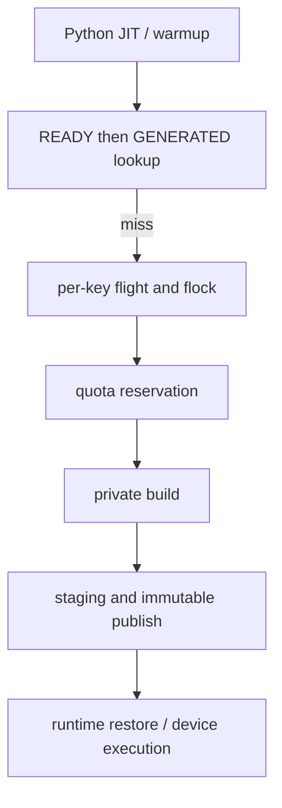
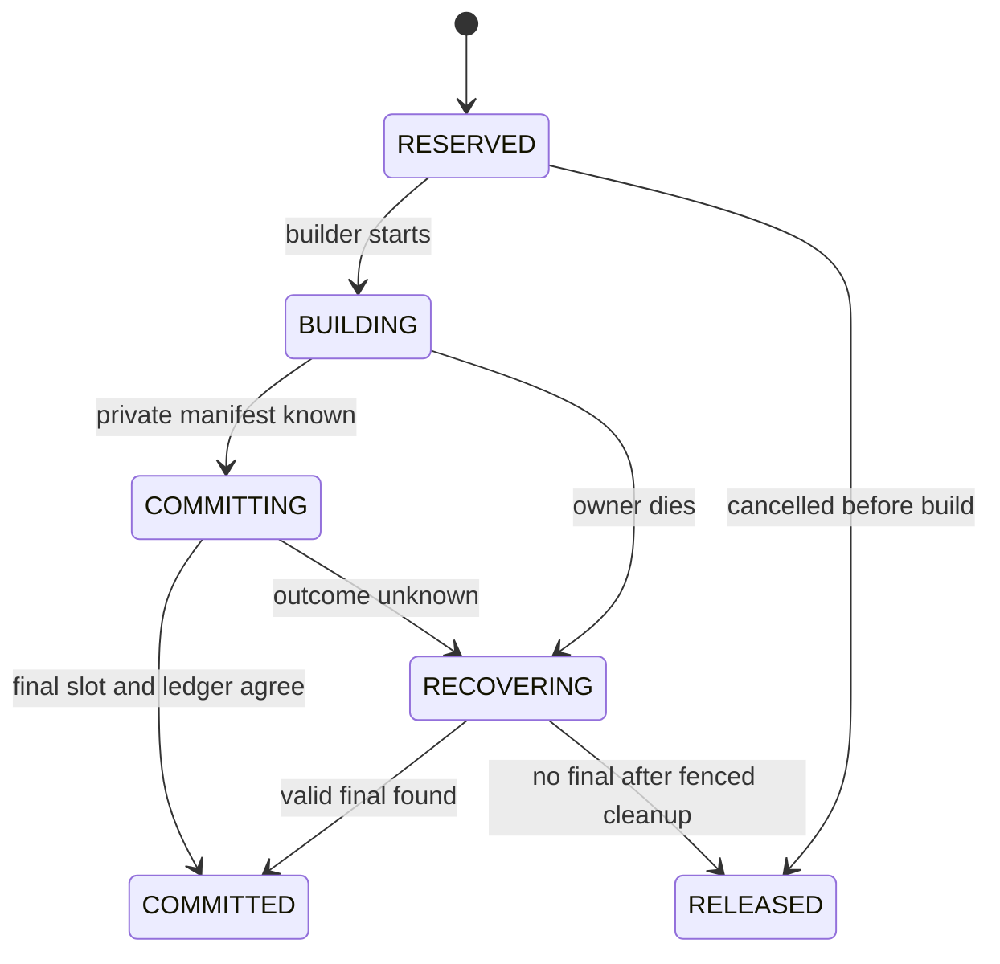

> 源码基线：PyPTO [`570c18ec`](https://github.com/hw-native-sys/pypto/commit/570c18ec42a53438e083176919f01e16fbdfecc0)，即研究时默认分支最新提交。相对上一章的 `c5d03257` 前进 17 个提交；[比较结果](https://github.com/hw-native-sys/pypto/compare/c5d032575aac5f20a77dd3ddb8e54dde94704daa...570c18ec42a53438e083176919f01e16fbdfecc0)没有改动本文涉及的 Artifact Store、persistent JIT、runtime promotion 或 cache policy 文件。本文只选择 PyPTO：容量竞争发生在同一个 Host Artifact Store 内，引入第二个仓库不会增加解释力。

## 本篇在 PTO 课程路线中的位置

第 76 章先证明“何时可以删”，第 77 章再决定“应该先删谁”。两章仍遗漏一个并发窗口：多个进程可能同时观察到同一份空闲量，各自都认为自己能构建；等它们一起 publish，quota 已被透支。

这是第 78 章，位置是：

`eligible eviction → admission reservation → private build → immutable publish → quota commit/reconcile`。

核心不是再发明一个 eviction score，而是把“看到容量”和“拥有容量”分开：**directory scan/free-space census 只是证据快照；只有原子 reservation 才是构建并发布的授权。**

## 前置知识

PyPTO persistent cache 有 `GENERATED` 与 `BINARY_READY` 两类独立 immutable slot。当前 [`ArtifactStore.get_or_build`](https://github.com/hw-native-sys/pypto/blob/570c18ec42a53438e083176919f01e16fbdfecc0/python/pypto/jit/artifact_cache.py#L307-L354)先 lookup；同进程用 `_BuildFlights` 合并完全相同的 request，跨进程则取 `locks/<key>.lock` 并在锁内 recheck。锁以 `key.digest` 命名，所以同一 key 的不同 stage/spec 也串行；不同 key 则有意并发。

构建发生在 cache root 之外的 private directory。随后 [`_publish`](https://github.com/hw-native-sys/pypto/blob/570c18ec42a53438e083176919f01e16fbdfecc0/python/pypto/jit/artifact_cache.py#L377-L410)把 payload 复制到 final slot 旁的 `.tmp.*`，复算 manifest，逐文件 `fsync`，最后写 completion marker，再以 `renameat2(RENAME_NOREPLACE)` 发布。`ArtifactBuild` 即使 publish 成功也保留 private directory 与 builder value，因为只有 adapter 知道活对象何时不再引用旧路径。

这些机制解决 identity 和 publication 原子性，却没有容量所有权。[RFC #2653](https://github.com/hw-native-sys/pypto/issues/2653)明确把 online GC、`max_bytes`、cleanup 排除在初始范围；当前 [`CacheConfig`](https://github.com/hw-native-sys/pypto/blob/570c18ec42a53438e083176919f01e16fbdfecc0/python/pypto/_cache_config.py#L20-L43)也只有 enabled/root/readonly/extra-source policy。

## 今日 1–2 个核心问题

1. 为什么现有 per-key `flock` 能消除同 key 重复 publish，却不能阻止不同 key 共同透支 quota？
2. reservation 应在何时创建、如何在 publish/crash 后结算，才能既不 oversubscribe，又不把容量永久泄漏给死进程？

## PTO 全栈中的位置

这仍是 Host storage policy。Tensor 的 shape/dtype 决定 specialization identity，PTOAS/device toolchain 产生 Artifact bytes；quota ledger 不参与 GM/UB/L1 地址分配，也不改变 Tile 计算语义。它只决定一次可复用构建能否进入 shared cache。

## 概念和精确语义

先把三种量分开：

- `committed_bytes`：已经存在、manifest 验证通过且计入 quota 的 canonical slot；
- `reserved_bytes`：已授权但尚未转成 canonical slot 的预算；
- `reclaiming_bytes`：已进入 generation-safe quarantine、尚未完成物理删除的字节。

对逻辑 cache quota，最小安全不变量是：

`committed_bytes + reserved_bytes <= quota_bytes`。

`reclaiming_bytes` 不能在 `rmtree` 和 fresh census 前提前当作空闲；若 quota 是底层文件系统容量而非逻辑 cache 大小，它仍占物理空间。当前 publish 的 staging 在 rename 后变成 final，并非 cache root 内再复制一份；但 private build 位于 root 外，可能与 root 同一文件系统。因此完整实现至少要区分“canonical cache quota”和“backing filesystem peak headroom”，不能用一个数字假装覆盖两者。

一个 reservation 至少应绑定：`reservation_id`、`owner process epoch`、`ArtifactKey/spec/stage`、`ledger revision`、`estimated bytes` 与状态。状态可以是：

这里的 `COMMITTED` 是账本事实，不是设备执行完成；`RECOVERING` 也不是“等 TTL 到期就删”。reconciler 必须先取得相同 key lock、确认原 writer 已死亡或失去 owner epoch，再检查 final slot、staging 与 manifest。否则在 rename 已成功、ledger commit 尚未落盘的窗口里直接释放 reservation，会让另一构建复用同一容量。

## 真实文件、类型、API 或指令逐段解读

[`_BuildFlights.run`](https://github.com/hw-native-sys/pypto/blob/570c18ec42a53438e083176919f01e16fbdfecc0/python/pypto/jit/artifact_cache.py#L142-L188)的 key 是 `(root, private_root, readonly, key.digest, spec.digest)`。同进程 follower 等 `Future`；leader 无论返回 shared handle 还是 private fallback，都会唤醒 follower，完成后删除 flight。这是 process-local duplicate suppression，不是 capacity ledger。

`_get_or_build` 的跨进程顺序是 `lookup → key flock → recheck → private build → publish`。锁覆盖整个 builder，所以三个进程请求同一 key 时，首个成功 publish 后，后两者在 recheck 处变成 hit。问题在于 [`test_different_keys_build_concurrently`](https://github.com/hw-native-sys/pypto/blob/570c18ec42a53438e083176919f01e16fbdfecc0/tests/ut/jit/test_artifact_cache.py#L704-L715)明确证明不同 key 可以同时进入 builder；每个 key 有自己的 lock，它们没有共同的容量线性化点。

建议把 reservation 插在“成为跨进程 key leader且 recheck 仍 miss”之后、“调用 builder”之前。账本更新只持有短暂的 ledger lock/CAS；不得在账本锁内编译、复制文件或做 eviction。容量不足时，进程释放 key lock，记录所观察的 ledger revision，再等待 revision 变化后从 lookup 重试；不能轮询目录并让所有 waiter 同时抢跑。

同 key 的 herd 还需要一个 durable `BuildIntent`：一个 key 只有 leader 拿 reservation，followers 订阅 intent/ledger revision，不各自预留容量。当前 `flock` 已提供成功路径的串行化；`BuildIntent` 主要覆盖“leader 因容量不足释放 key lock等待”这段空窗。不同 key 则靠 quota transaction 原子判定，允许剩余预算内的真实并行。

## 对象/Tile/Buffer/IR 生命周期

追踪一个 `ArtifactBuild`：JIT 先构造 `ArtifactKey/ArtifactSpec`；miss 后 `_build_private` 创建 `pypto-build-*`，builder 生成 PTO/配置或 binary，`make_manifest` 固化当前 payload；`_publish` 再创建 `.tmp.*` 并复制。rename 成功后，shared `ArtifactHandle` 指向 final slot，但 fresh compiled object 仍可引用 private path，所以 `ArtifactBuild.private_directory/value` 被保留；hit 则只有 handle。

加入 reservation 后，容量 token 的生命周期必须包住“可能新增 canonical bytes”的区间，却不能拥有 compiled object：reserve 在 builder 前产生；private manifest 完成后以实际大小做 top-up 或缩额；rename 与 ledger commit 共同决定 canonical ownership；runtime 继续由 `ArtifactHandle/ArtifactRuntime` 持有 reader lifetime。token 既不是 Tensor、Tile，也不是 runtime execution lease。

## 端到端调用链或指令链

[`resolve_persistent`](https://github.com/hw-native-sys/pypto/blob/570c18ec42a53438e083176919f01e16fbdfecc0/python/pypto/jit/_persistent.py#L220-L356)先捕获 toolchain/source/specialization identity，再查 READY、GENERATED，最后调用 `store.get_or_build(generate)`。生成命中或 publish 后，`bind_artifact/restore_artifact` 把 handle 交给 [`ArtifactRuntime`](https://github.com/hw-native-sys/pypto/blob/570c18ec42a53438e083176919f01e16fbdfecc0/python/pypto/runtime/_artifact_runtime.py#L21-L91)；后续 GENERATED→READY promotion 又走同一 `get_or_build`。

所以 quota 必须覆盖两个 stage 的**边际新增量**：已有 20 MiB GENERATED 时，准备 80 MiB READY 不是把 100 MiB 再预留一次，而是为新的 READY slot 预留 80 MiB；删除 GENERATED 也不能自动推断 READY 无效。stage identity 与 survivor dependency 来自前两章，reservation 只把即将新增的那一份容量变成独占授权。

## 具体 shape、Tile 和状态演算

用一个示例 kernel `K(x: FP32[1,4096]) -> FP32[1,4096]`，每次处理 `[1,128]` Vec Tile；shape/dtype/location 属于 GM→Tile→GM 的编译语义。假设其 GENERATED 为 20 MiB、READY 为 80 MiB。以下字节数是协议演算，不是仓库 benchmark。

cache quota 为 300 MiB，已有 validated canonical slots 共 180 MiB，三个进程 P1/P2/P3 分别要为不同 key 发布 80 MiB READY：

- 无 ledger：三者都 scan 到 `300-180=120 MiB`，都通过；最终可能到 420 MiB。per-key lock 完全合法，因为 key 不同。
- 有 ledger：P1 在 revision 41 原子写入 `R1=80`，可用量变为 40；P2/P3 读到 revision 42，只能 WAIT 或 private fallback。此时 `180+80<=300` 始终成立。
- P1 完成 private build，manifest 实测 72 MiB：账本把 72 MiB 转为 committed、释放 8 MiB reservation，可用量变为 48 MiB。
- eviction 随后真正删除并以 fresh census 确认 40 MiB，revision 前进，可用量变为 88 MiB；等待者中只有一个能用 CAS 成功 reserve 80 MiB。

若实测为 96 MiB，P1 必须在 publish 前原子 top-up 16 MiB。top-up 失败时，最安全的现有兼容行为是保留 usable private build、放弃 shared publish，而不是越过 quota。PyPTO 本来就把 storage/publication failure 表达为 `BuildDisposition.PRIVATE`，这个 fallback 不需要伪造 cache success。

## 为什么这样设计及替代方案

只用全局 mutex 最容易证明正确，但会把完全不同 key 的 hashing、PTOAS、device compilation 和文件复制全部串行，吞吐和尾延迟都很差。只用 per-key locks 保留并行，却没有共享容量的线性化点。只检查 `statvfs` 或目录总量则是经典 TOCTOU：读值不授予所有权。

reservation ledger 把临界区缩到一个小事务：检查 `committed+reserved+request<=quota`，递增 revision 并返回 token。昂贵构建仍可并行；并行度由真实剩余容量而非锁粒度决定。代价是要处理估算误差、owner crash 与 ledger durability，这些复杂度不是“多余机制”，而是跨进程容量所有权的最低成本。

需要明确的失败策略：估算不可得时，可以使用保守 per-stage 上界，或允许 private build但禁止 shared publish；不能把未知当零。ledger 不可用时沿用 private fallback。若连续 top-up 失败或 waiters 激增，应触发 admission backpressure，而不是同时启动更多 builder制造 CPU、内存和磁盘写放大。

## 访存、计算、流水、并行和硬件约束

设备侧 Tile 大小不会直接转化为 Artifact bytes；同一个 `[1,128]` Tile kernel 的 binary 大小受 target、toolchain、specialization 和编译产物影响。reservation estimator 应使用 stage/spec、历史 upper bound 或 dry-run plan，不能拿 tensor `nbytes` 代替磁盘 charge。

Host 流水是 identity/lookup、admission、compile、staging copy、fsync/rename、runtime restore。reservation 不应覆盖 READY hit；也不应把 ledger lock持有到 compile 结束。硬件约束通过 Artifact identity 区分 target/toolchain，但 quota controller本身不假设 NPU queue、stream 或 workspace 容量。这样 storage backpressure 不会与 device admission 混成一套不可验证的 token。

## 测试证据与未覆盖风险

当前直接测试事实：

- `test_same_key_threads_build_once`：4 线程只有一次 builder、1 个 PUBLISHED、3 个 HIT；
- `test_spawned_processes_deduplicate_and_dead_process_releases_lock`：3 个 spawned process 同 key 只有 1 publish/2 hit，异常退出后内核释放 `flock`；
- `test_different_keys_build_concurrently`：两个不同 key 通过 barrier 同时在 builder 内；
- `test_copy_corruption_never_publishes`：staging copy 被篡改时 final 仍是 MISS，private value 可用。

[PR #2692](https://github.com/hw-native-sys/pypto/pull/2692)报告 artifact-cache/worker-memory 114 tests 通过，并建立当前 immutable store；[PR #2723](https://github.com/hw-native-sys/pypto/pull/2723)报告 12,181 UT 及两项 NPU persistent-cache case。这些是 PR 报告，不是本文重跑结果。

覆盖缺口正是今天的主题：没有 quota/reservation 类型，没有多进程不同 key 的容量上界断言，没有 reserve 后 crash、rename 后 ledger 未提交、estimate top-up、eviction 与 waiter revision、READY promotion 边际 charge 等测试。未来最小 fault matrix 应在 `reserve / builder start / private manifest / staging complete / rename / ledger commit` 六个边界逐点杀进程，并验证恢复后 `committed+reserved<=quota`、valid final 不丢账、无 final 的 reservation 最终释放。

## 与前后章节的连接

第 76 章的 generation/reader/build fence 决定 victim 能否物理释放；第 77 章的 rebuild cost 决定选谁；本章的 ledger 只有在删除完成并得到新 revision 后才把字节重新授予 builder。三者分别回答 safety、economics 与 concurrency，不能互相替代。

下一章要继续补全“等多久”：研究 reservation fairness、priority class、cancellation 与 starvation-free wakeup。否则一个持续涌入的小 READY build 流，可能让大模型 Artifact 永远拿不到连续预算。

## 本篇结论、知识债、三个理解检查问题和下一章

结论：当前 PyPTO 对同 key 的跨进程 publish 已有可靠串行化，但不同 key 被明确允许并发，且没有 quota。目录 scan 是 observation，不是 ownership；要保持 `committed+reserved<=quota`，必须在 builder 前原子 reserve，在 actual manifest 后 reconcile，并对 crash-after-rename 做 fenced recovery。同 key 的 `BuildIntent` 抑制容量不足时的 herd，不同 key 的 ledger CAS 控制总并行。

知识债：durable ledger schema、owner process epoch、stage-aware size estimator、top-up policy、logical quota/physical headroom 双预算、BuildIntent、revision-based notification、generation-safe eviction receipt、crash reconciler、NFS/remote backend 语义与六边界故障注入。

理解检查：

1. 为什么三个不同 key 即使都正确持有各自 `flock`，仍可能把 300 MiB quota 写到 420 MiB？
2. 为什么 reservation TTL 到期不能直接释放，尤其是 writer 可能已 rename final 但尚未提交 ledger 时？
3. GENERATED 已存在、READY 正在 promotion 时，reservation 应按两者总大小还是 READY 的边际新增量计费？

下一章：**谁先拿到下一份容量——Reservation Fairness、Cancellation 与 Starvation-free Wakeup。**

## 课程账本增量

- 课程 78：建立 `per-key identity serialization != shared capacity serialization` 的边界。
- 新增不变量：`committed_bytes + reserved_bytes <= quota_bytes`；reclaiming bytes 未经物理完成与 fresh census 不可复用。
- 新增建议对象：`AdmissionReservation`、durable `BuildIntent`、revisioned `QuotaLedger` 与 fenced reconciler，均明确标为设计建议而非当前实现。
- 新增测试债：三进程不同 key oversubscription、同 key 单 reservation、estimate top-up、六 publication 边界 crash、READY promotion 边际计费。
