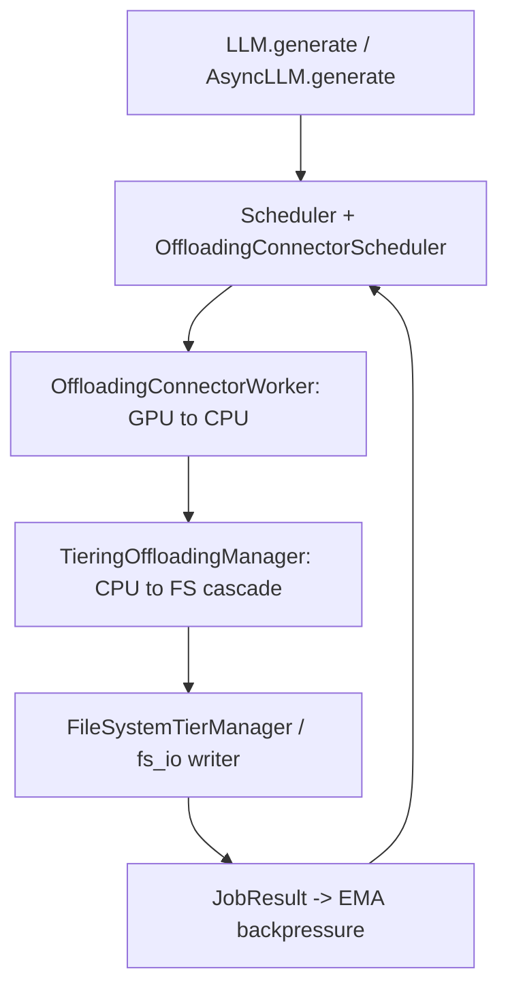
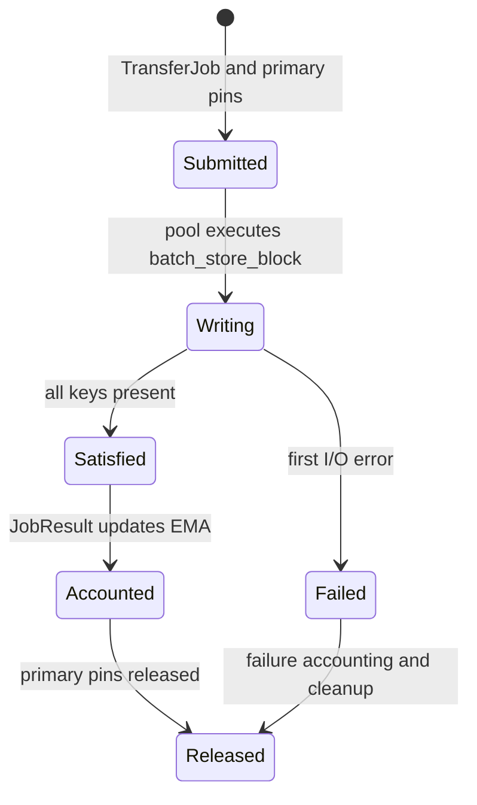

> 源码基线：vLLM [`ed1a7307`](https://github.com/vllm-project/vllm/commit/ed1a7307950ab5e6593d25123579ed7ca998b350)，即 2026-10-27 研究时默认分支最新提交。本文涉及的修复 [PR #63524](https://github.com/vllm-project/vllm/pull/63524) 截至同日仍为 **open、未合入**；所以“当前代码事实”和“PR 计划/测试报告”会分开书写。

## 本篇在课程路线中的位置

这是第 68 章，仍位于“测试、性能与故障诊断”。第 67 章证明了 content-addressed FS block 能让重复 store 收敛：目标已存在或另一个 writer 赢得 publish race，都可以成为数据层的成功。本章只追问紧邻的一件事：**数据 effect 已经幂等，为什么 backpressure 仍可能被错误样本欺骗？**

边界很窄：只研究 secondary FS tier 的 `JobResult.transfer_bytes` 如何进入 `EMABackpressureDetector`。GPU→CPU connector 的 `TransferResult.transfer_size`、FS KV event 和 Prometheus `WRITE_BYTES` 会被辨认出来，但不展开成三个独立主题。

## 前置知识回顾

上一章确认了四点：

- `OffloadKey` 映射到 content-addressed 文件名；相同 key 应代表相同 KV bytes；
- `_store_block` 先写 private temp，再原子发布；final path 已存在时不覆盖 winner；
- store job 的“成功”表示所有请求 key 已可由该层满足，不等于每个 key 都发生了新物理写入；
- completion、bytes、event、pin/refcount 释放是不同控制 effect，不能从“文件存在”自动推出。

今天把最后一点落到真实公式上。

## 本篇要回答的核心问题

1. 一个 store job 请求 3 个 block、实际只写 1 个时，`success`、`transfer_bytes` 与 logical key count 各表示什么？
2. 当前 `main` 为什么会把零写入的快速 no-op 当成高吞吐样本，并把 backpressure 往“健康”方向拉？
3. PR #63524 修了哪一层，为什么它仍不是 durable、exactly-once 的通用 Transfer Receipt？

## 组件在全局架构中的位置

公开入口产生请求，经 scheduler/model runner 完成 GPU→CPU store；worker completion 回到 [`OffloadingConnectorScheduler._update_connector_output`](https://github.com/vllm-project/vllm/blob/ed1a7307950ab5e6593d25123579ed7ca998b350/vllm/distributed/kv_transfer/kv_connector/v1/offloading/scheduler.py#L2273-L2342)，后者调用 `manager.complete_store()`，再由 [`TieringOffloadingManager`](https://github.com/vllm-project/vllm/blob/ed1a7307950ab5e6593d25123579ed7ca998b350/vllm/v1/kv_offload/tiering/manager.py) 把 CPU primary 中的 chunk 异步 cascade 到 FS secondary tier。

这条链处于 model forward 和 CUDA Graph 之外，不改变 tensor shape、dtype 或 captured address；但它的反馈会决定后续 store 是允许、按比例丢弃，还是继续占用 CPU primary pin，因此间接影响缓存命中、TTFT、吞吐和并发。

## 完整调用链

1. `LLM.generate`/`AsyncLLM.generate` 驱动 engine step；scheduler 构造 offload metadata。`prepare_store()` 的输入是 `OffloadKey` 集合和 request context，输出包含要存储的 key 与 primary slot 所需信息。
2. [`OffloadingConnectorWorker.prepare_store_kv`](https://github.com/vllm-project/vllm/blob/ed1a7307950ab5e6593d25123579ed7ca998b350/vllm/distributed/kv_transfer/kv_connector/v1/offloading/worker.py#L272-L284) 延迟 store；下一 step 的 `start_kv_transfers()` 提交 GPU→CPU job。`get_finished()` 收到 worker `TransferResult` 后记录这一段的 `transfer_size/transfer_time`，并只把 `job_id` completion count 送回 scheduler。
3. scheduler 按 worker 数递减 `pending_count`；归零后调用 `TieringOffloadingManager.complete_store()`。primary tier 中的数据变为 loadable，同时创建 CPU→FS 的 `TransferJob`。`TransferJob.keys` 是逻辑对象集合，`chunk_ids` 指向 primary memoryview 的 slot，`submit_time` 是 backpressure 的计时起点。
4. [`FileSystemTierManager.submit_store`](https://github.com/vllm-project/vllm/blob/ed1a7307950ab5e6593d25123579ed7ca998b350/vllm/v1/kv_offload/tiering/fs/manager.py#L223-L238) 把每个 key 映射到路径，把 `chunk_id * block_size` 映射为 byte offset，并把 `batch_store_block` 放入 thread pool。
5. [`batch_store_block`](https://github.com/vllm-project/vllm/blob/ed1a7307950ab5e6593d25123579ed7ca998b350/vllm/v1/kv_offload/tiering/fs/io.py#L174-L198) 在 Python 或 C++ 路径逐块发布。当前 `_store_block` 发现 final path 已存在便直接返回；publish race 的 `EEXIST` 也清理 loser temp 后成功。
6. `FileSystemTierManager.get_finished_jobs()` 轮询 pool，构造 `JobResult`。**当前 `main` 用提交时保存的 `block_count * block_size` 填 `transfer_bytes`，并不知道 writer 实际写了几块。**
7. [`TieringOffloadingManager._process_finished_jobs`](https://github.com/vllm-project/vllm/blob/ed1a7307950ab5e6593d25123579ed7ca998b350/vllm/v1/kv_offload/tiering/manager.py#L501-L557) 先释放 primary read pin，再调用 `_update_backpressure()`。成功 job 优先使用 `completed_job.transfer_bytes`；缺失时才回退到 `len(keys) * block_size_bytes`。
8. [`BackpressureDetector.update`](https://github.com/vllm-project/vllm/blob/ed1a7307950ab5e6593d25123579ed7ca998b350/vllm/v1/kv_offload/tiering/backpressure.py#L148-L160) 忽略 `num_bytes <= 0`，否则计算 elapsed；[`EMABackpressureDetector.on_store_completed`](https://github.com/vllm-project/vllm/blob/ed1a7307950ab5e6593d25123579ed7ca998b350/vllm/v1/kv_offload/tiering/backpressure.py#L341-L366) 的样本是 `elapsed_s / (num_bytes / MiB)`。EMA 超过 high watermark 才进入 pressure，policy 才会 drop/throttle 新 store。

## 关键类型、字段和状态生命周期

[`JobResult`](https://github.com/vllm-project/vllm/blob/ed1a7307950ab5e6593d25123579ed7ca998b350/vllm/v1/kv_offload/tiering/base.py#L83-L96) 只有 `job_id`、`success`、可选 `successful_keys`、`transfer_time` 和 `transfer_bytes`。它没有 `requested_blocks`、`written_blocks`、`already_present`、attempt/generation 或 receipt sequence。

对 store job 而言，三个量必须分开：

| 量 | 精确语义 | 当前 owner/消费者 |
| --- | --- | --- |
| logical requested/satisfied | 本 job 要求哪些 key 最终可读取 | `TransferJob.keys`、completion/event |
| physical written | 本 attempt 真正向 FS 发布了多少 bytes | 当前 `main` 未保留；backpressure 却需要它 |
| GPU↔CPU moved | connector worker 实际搬了多少 bytes | worker `TransferResult.transfer_size` 与 connector metrics |

生命周期如下：

数据层的 `Satisfied` 可以由“我写成”“此前已存在”“并发 writer 先发布”三种路径达到；物理计账只能把第一种计为 bytes written。当前状态机在 `Satisfied → Accounted` 处丢掉了这一区别。

## 逐函数源码解读

### 1. `submit_store`：保存的是请求规模，不是执行结果

当前 FS manager 把 `len(keys)` 写入 `_job_block_counts`，再提交一个返回 `None` 的 `batch_store_block`。这个字段在 I/O 前就确定，所以它描述的是计划工作量。用它释放 pin、发“这些 key 可用”的 event 没问题；把它命名/解释成实际写入量就越过了证据边界。

### 2. `_store_block`：幂等数据路径故意吞掉重复写

目标文件已存在时函数无写入返回；并发 publish 的 loser 同样成功。这里的正确性来自 content-addressed key，而不是“我们知道写了相同 bytes”这一运行时校验。它保证 logical satisfaction，却没有向上层返回 `written=False`，于是信息在最接近物理事实的层被丢弃。

### 3. `get_finished_jobs`：把 logical bytes 填进 physical 字段

当前实现对 load/store 共用 `_job_block_counts`，因此成功 store 即使全部 no-op，也会得到完整 batch 的 `transfer_bytes`。`success=True` 是对的，bytes 却不是 backpressure 想测的物理分母。

### 4. `_update_backpressure` 与 EMA：错误方向可以由公式直接推出

令真实写入耗时为 `t`、逻辑 bytes 为 `B_l`、实际 bytes 为 `B_p`，且重复块使 `B_l > B_p`。当前样本为：

$$s_{reported}=\frac{t}{B_l/2^{20}} < \frac{t}{B_p/2^{20}}=s_{physical}$$

数值越小代表越快，所以过大的分母会低估 s/MiB。更极端地，`B_p=0` 的 no-op 通常只做 existence check，却用完整 `B_l` 参与 warmup/EMA；这不是轻微噪声，而是给控制器喂入了错误单位的样本。结果是 pressure 更难触发、healthy fast-path 更容易维持，慢 FS 仍可能继续接收新 store。

### 5. PR #63524：把“是否写入”从 writer 带回 manager

该 PR 让 Python `_store_block` 返回 `bool`，C++ `_store_block` 用内部 sentinel 区分 already-present，批量函数返回 `num_written`；FS manager 以 `_store_progress[job_id]` 接收计数，最终 `transfer_bytes = num_written * block_size`。全部已存在时是 `0`，而 `BackpressureDetector.update()` 已会忽略零 bytes。

这是最小充分修复：不扩展公共 `JobResult` schema，也不携带 key 列表。但截至基线它仍是开放 PR，不能当成当前行为。

## 具体示例与 shape/状态演算

假设 primary memoryview 中每个 KV chunk 占 `128 KiB`，一个 FS store job 请求 `K0、K1、K2` 三个 content-addressed block；`K0、K1` 已在磁盘，只有 `K2` 新写。shape/dtype 已被 canonical KV layout 展平成 byte view，FS 层只看三个相同 `block_size` 的 slice：

| key | primary offset | final path 初态 | 数据后置条件 | 物理写入 |
| --- | ---: | --- | --- | ---: |
| `K0` | `chunk_id0 × 128 KiB` | 已存在 | 可读取 | 0 |
| `K1` | `chunk_id1 × 128 KiB` | 已存在 | 可读取 | 0 |
| `K2` | `chunk_id2 × 128 KiB` | 不存在 | 可读取 | 128 KiB |

逻辑请求与满足量都是 `3 blocks = 384 KiB`；实际写入是 `1 block = 128 KiB`。若 job 从 submit 到完成用 `6 ms`：

- 当前 `main` 样本：`0.006 / 0.375 = 0.016 s/MiB`；
- actual-bytes 样本：`0.006 / 0.125 = 0.048 s/MiB`。

两者相差 3 倍。数值只用于演算，不是仓库 benchmark；真正不变量是 backpressure 的分母必须与耗时所代表的物理工作一致。若三块都已存在，正确做法不是除以零，而是“不产生带宽/延迟样本”，同时 job 仍 `success=True`、event 仍可表示 key 已满足、pin 仍必须释放。

## 为什么这样设计及替代方案

从第一性约束出发，系统同时需要：数据可用性正确、资源最终释放、控制反馈使用同一物理单位、额外元数据不压垮热路径。

| 方案 | 延迟/吞吐 | 内存与并发 | 正确性与维护成本 |
| --- | --- | --- | --- |
| job success + logical full bytes（当前） | 零额外返回值，最快最简单；重复块制造虚假快样本 | 元数据最少 | 数据正确、反馈错误；长期调优难解释 |
| 返回 `num_written`（PR #63524） | writer 原地计数，几乎不增加 I/O；修正 EMA | 每 job 一个整数；并发 race 由最终 writer 判定 | 最小改动，但不能指出哪些 key 写入，也不能跨 crash 去重 completion |
| per-key durable receipt | 可精确审计、重放和 partial retry | 元数据、序列化、保留与锁竞争最高 | 最强恢复语义；需要 generation、dedupe 和 GC，维护成本大 |

当前 FS backpressure 只需一个 job-local count，因此第二种更合适。若目标升级为 crash recovery，receipt 至少应包含 `(tier, job_id, attempt_generation, requested_count, satisfied_count, written_count, bytes_written, status)`，接收端还要按 identity exactly-once apply。否则 publish 后 ack 丢失、重试看到 existing 并回 `written=0` 时，累计计账仍可能漏算首次物理写入或重复应用 completion。

## 性能、并发、正确性与边界条件

- **延迟/吞吐**：修正不会消除 existence check 或竞争者的 temp write，只是让反馈使用 winner 的实际数量。更准确的 pressure 可能增加 store drop，牺牲部分 FS cache coverage，换取 primary/compute 路径不被慢存储拖累。
- **显存/主存**：FS bytes 不直接改变 GPU KV shape；但 completion 之前 primary chunk 被 pin。无论写入数为 0 还是 N，logical completion 都必须释放这些 pin，不能把“零物理 bytes”误当成“没有 job”。
- **并发**：预过滤只能减少明显重复；另一个 writer 可在过滤后发布，所以实际计数必须由最终 publish 操作返回，而不是由提交线程猜测。PR 同时修改 Python 与 C++ 路径正是为了保持一致。
- **graphability**：逻辑位于 host I/O/control plane；不会破坏 CUDA Graph capture，但错误 drop/allow 决策会改变未来 batch 的 cache hit 和可用并发。
- **可观测性**：当前 [`TieringMetricsTracker._observe_finished_job_stats`](https://github.com/vllm-project/vllm/blob/ed1a7307950ab5e6593d25123579ed7ca998b350/vllm/v1/kv_offload/tiering/metrics.py#L205-L240) 的 Prometheus `WRITE_BYTES` 仍用 `len(keys) * primary_chunk_size`。PR #63524 明确不改它。因此即使 PR 合入，backpressure 分母与 exported `WRITE_BYTES` 仍分别代表 physical 与 logical bytes；若指标名不标语义，运维仍会误读。
- **失败**：store failure 没有 written-prefix receipt；`batch_store_block` 首错即抛，`_store_progress` 也可能不存在。当前 connector worker 对 transfer failure 仍断言，离 durable partial reconciliation 尚远。

## 测试证据与未覆盖风险

**已合入测试事实：** [`test_store_accepts_block_published_by_another_writer`](https://github.com/vllm-project/vllm/blob/ed1a7307950ab5e6593d25123579ed7ca998b350/tests/v1/kv_offload/tiering/test_fs_tier.py#L234-L276) 隐藏已发布文件并令 loser 的 `os.replace` 抛 `EEXIST`；输入故意使用不同 source bytes，验证 job 成功、目录只保留 final、winner bytes 不被覆盖。它证明数据幂等，但当前没有断言 `transfer_bytes`，所以不能发现计账错误。

[`test_ema_updates_on_store_completion`](https://github.com/vllm-project/vllm/blob/ed1a7307950ab5e6593d25123579ed7ca998b350/tests/v1/kv_offload/tiering/test_backpressure.py#L333-L367) 用 16-byte fake block 和人为回拨的 submit time，验证 warmup 后 EMA 等于 s/MiB 样本并按 alpha 更新。它证明消费者公式，却没有把 FS duplicate/no-op 接进端到端链。

**PR #63524 的测试/实验事实：** PR 新增参数化测试，依次 store `[1,2]`、`[2,3]`、`[1,2]`，预期 bytes 为 2、1、0 blocks，并覆盖 Python/C++ 两条路径；另测“预过滤之后才被并发 writer 发布”的 block 不计数，以及零 bytes 不增加 detector completions。PR 作者报告 `tests/v1/kv_offload/tiering` 为 588 passed、1 skipped；这是 PR 报告，本篇未在 GPU/FS 环境重跑。

仍未覆盖：publish 成功但 completion 丢失、重复 completion apply、进程崩溃后的 actual-bytes 恢复、失败前写入 prefix 的计数、metrics/backpressure 语义一致性、hash collision/corruption、power-loss durability，以及不同 writer generation 的 receipt fencing。

## 与前后章节的连接

第 67 章把 replay 落到 immutable data effect；本章证明幂等 sink 后面仍需要单位正确的控制回执。二者共同形成一条原则：**数据层可以 at-least-once，控制层必须按 effect identity 对账。**

下一章继续追这个缺口：多个 worker/rank 都可能上报同一 job，reset 后旧 completion 还可能迟到；需要研究 **Duplicate Completion、Attempt Fence 与 Exactly-once Backpressure Apply**，判断现有 `pending_count`/`stale_job_threshold` 能证明什么、不能证明什么。

## 本篇结论、知识债、三个理解检查问题和下一章

结论：

1. `success=True` 证明请求 key 已满足，不证明发生了同等规模的物理写入。
2. 当前 `main` 把 logical job bytes 当作 EMA 分母；重复/竞争写会制造偏小的 s/MiB，让慢 tier 看起来更健康。
3. PR #63524 的 writer count 是适合当前 backpressure 的最小修复，但还不是 durable receipt，也没有统一 Prometheus `WRITE_BYTES` 的语义。

知识债：partial-failure written prefix、receipt identity/generation、duplicate completion 去重、crash-after-publish 对账、logical/physical metrics 命名、跨进程持久化与故障边界测试。

理解检查：

1. 为什么全部已存在的 store 应当 `success=True`，却不能向 EMA 提交完整 bytes？
2. 为什么提交前的 existence filter 不能决定 actual bytes，必须由最终 writer 返回？
3. 若 PR 合入后 backpressure 使用 physical bytes、Prometheus `WRITE_BYTES` 仍使用 logical bytes，两个指标各能回答什么问题？

下一章：**一个 completion 到底只能算几次——Duplicate Completion、Attempt Fence 与 Exactly-once Backpressure Apply。**

## 课程账本增量

- 源码基线：`ed1a7307950ab5e6593d25123579ed7ca998b350`。
- 新覆盖：`JobResult.transfer_bytes`、`FileSystemTierManager.submit_store/get_finished_jobs`、Python/C++ `batch_store_block`、`TieringOffloadingManager._process_finished_jobs/_update_backpressure`、`BackpressureDetector.update`、`EMABackpressureDetector.on_store_completed`、`TieringMetricsTracker._observe_finished_job_stats`。
- 新确认不变量：logical satisfaction、physical bytes、GPU↔CPU bytes 必须分账；actual count 必须在最终 publish 点产生；零 bytes success 释放资源但不形成 EMA 样本。
- 当前实现边界：`main` 尚未修正 FS actual bytes；PR #63524 未合入；exported `WRITE_BYTES` 仍是 logical bytes；没有 durable receipt/dedup。
- 下一章：duplicate completion、attempt/reset fence 与 exactly-once backpressure apply。
