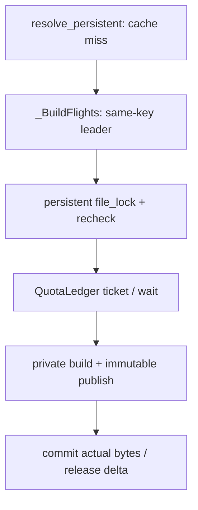
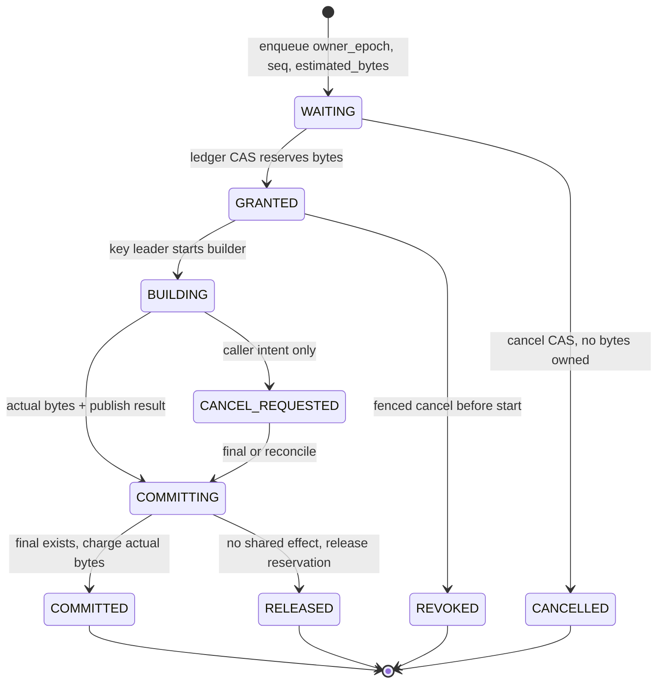

> 源码基线：PyPTO [`6307a2e2`](https://github.com/hw-native-sys/pypto/commit/6307a2e2c9e53d61141ce1bd9c9d29e6b7418482)，即 2026-10-28 研究时默认分支最新提交。相对第 78 章的 `570c18ec` 前进 5 个提交；[比较结果](https://github.com/hw-native-sys/pypto/compare/570c18ec42a53438e083176919f01e16fbdfecc0...6307a2e2c9e53d61141ce1bd9c9d29e6b7418482)没有改动 Artifact Store、persistent JIT 或 cache policy。最新 head 的 PR #3188 修复 nested host-control yield owner，与本文链路无直接关系。

## 本篇在 PTO 课程路线中的位置

这是课程第 79 章，仍在“Python IR → PTOAS → runtime/device”生成链的 Artifact lifecycle 支线。第 78 章先建立安全底线：不同 key 的 builder 不能各自把目录空闲量当成自己的额度，必须由共享 ledger 原子保持：

[
	ext{committed_bytes} + 	ext{reserved_bytes} le 	ext{quota_bytes}
]

但这个不等式只回答“能不能给”，不回答“该给谁”。本篇只研究一个边界清晰的问题：**多个不同 key 等同一份容量时，如何兼顾吞吐、公平、取消与不丢唤醒？**

## 前置知识

- `ArtifactKey + ArtifactSpec` 决定 immutable slot identity；同 key/spec 的重复 builder 可以合并。
- per-key flight/`flock` 只串行化同一个 slot；不同 key 当前有意并发构建。
- shared capacity reservation 是第 78 章从代码约束推导出的建议协议，PyPTO 当前尚未实现 online quota/eviction。
- cancellation、timeout、process death 是三件事：取消是调用方意图，timeout 是时钟事件，进程死亡才可能提供 kernel-released `flock` 等终态证据。

## 今日 1–2 个核心问题

1. strict FIFO、fit-first 与 bounded bypass 各自怎样影响吞吐、head-of-line blocking 和大 Artifact 饥饿？
2. waiter 取消或 leader 崩溃时，哪一刻才能把 reservation 真正返还，并用什么 revision 协议避免 lost wakeup？

## PTO 全栈中的位置

上游是 `resolve_persistent` 得到的稳定 Artifact identity 与 stage requirement；下游消费者是 private builder、immutable publisher 和最终 `ArtifactRuntime`。公平队列应插在“同 key leader 已确定、shared build 尚未开始”之间：太早排队会让同 key 的三个进程重复占三份额度，太晚排队则 builder 已经制造了无法纳入 hard quota 的空间峰值。

## 概念和精确语义

### 公平不是安全不变量

容量安全是任何时刻都必须成立的 invariant；公平是带前提的 liveness：

> 对任一仍有效、请求量不超过 quota 的 ticket，只要系统最终产生足够可提交容量，且其 owner 没有取消或失权，该 ticket 最终获得 grant。

没有“容量最终会释放”这个前提，任何算法都无法承诺 grant。反过来，目录里刚出现空闲 bytes 也不自动授权 waiter；只有 ledger revision 上的原子 grant 才产生 ownership。

### 三种排序策略

| 策略 | 优点 | 失败方式 |
| --- | --- | --- |
| strict FIFO | 顺序清楚，大请求不会被后来者永久越过 | 队首 100 MiB 暂时放不下时，后面 5 MiB 也停住，产生 head-of-line blocking |
| greedy fit-first | 尽量填满空闲量，短期吞吐高 | 小请求持续到来时，大请求可能永远等不到完整额度 |
| bounded bypass + headroom holdback | 允许有限小请求绕过；到预算后为最老 eligible ticket 累积容量 | 多了 ticket、bypass debt 与恢复状态；参数需由负载校准 |

本篇建议第三种，但不拍固定 bypass 次数。协议只要求 `bypass_budget` 有界，并在耗尽后把后续 release/reclaim 形成的 bytes 保护给最老 eligible ticket。具体 budget 应由 build latency、Artifact size 分布与 cache hit 损失实测决定。

## 真实文件、类型、API 或指令逐段解读

### 1. `resolve_persistent`：真实公开生成链

[`resolve_persistent`](https://github.com/hw-native-sys/pypto/blob/6307a2e2c9e53d61141ce1bd9c9d29e6b7418482/python/pypto/jit/_persistent.py#L217-L356) 先捕获 toolchain、source、specialization 与 semantic environment，查 object/READY/GENERATED；全部 miss 后定义 `generate(directory)`，再调用 `store.get_or_build(key, spec, generate)`。成功 publication 后绑定 Artifact，hit 则 restore。

这条链说明 admission 的单位不是任意编译请求，而是稳定的 `key/spec/stage`。同一 identity 的等待者应共享 BuildIntent，而不是各自进入容量队列。

### 2. `_BuildFlights.run`：当前同进程 fan-in

[`_BuildFlights`](https://github.com/hw-native-sys/pypto/blob/6307a2e2c9e53d61141ce1bd9c9d29e6b7418482/python/pypto/jit/artifact_cache.py#L143-L185) 用 request→`Future` 选出 leader。follower 直接阻塞在 `flight.result.result()`；leader 成功设置 result，抛出包括 cancellation 在内的 `BaseException` 时设置同一个 exception，最后删除 pending entry。

它已有两个正确性质：同 cohort 只有一个 builder；leader 失败会唤醒全部 follower。但它没有单 waiter cancel token、deadline、排队序号或公平策略。一个 follower 不想等了，当前 API 也没有从阻塞的 `get_or_build` 中独立退出的协议。

### 3. `file_lock`：跨进程同 key 串行化

[`file_lock`](https://github.com/hw-native-sys/pypto/blob/6307a2e2c9e53d61141ce1bd9c9d29e6b7418482/python/pypto/_fslock.py#L17-L38) 对 persistent inode 执行 blocking `flock(LOCK_EX)`；进程退出时由 kernel 释放。[`ArtifactStore._get_or_build`](https://github.com/hw-native-sys/pypto/blob/6307a2e2c9e53d61141ce1bd9c9d29e6b7418482/python/pypto/jit/artifact_cache.py#L326-L351) 拿锁后重查 hit，miss 才 private build 并 publish。

`flock` 是互斥 primitive，不是 quota scheduler：源码没有 timeout、cancel、ticket revision，也没有声明 OS waiter 的公平顺序。更重要的是，不同 key 使用不同 lock，测试明确要求它们可并发，因此不能用一个全局文件锁粗暴替代 quota admission。

### 4. private build 与 publish：取消后仍可能有 effect

[`_build_private/_publish`](https://github.com/hw-native-sys/pypto/blob/6307a2e2c9e53d61141ce1bd9c9d29e6b7418482/python/pypto/jit/artifact_cache.py#L353-L409) 先在 private root 构建、生成 manifest，再 copy 到 shared staging，以 `RENAME_NOREPLACE` 发布并 sync parent。builder 返回的 live value 还可能引用 private files。

所以 `BUILDING` 状态收到 cancel 不能立即释放 reservation：compiler 或 copy/publish 可能已经产生 bytes。取消必须先变成 `CANCEL_REQUESTED`，等 cooperative abort、builder final 或 key-fenced reconcile 给出终态，再决定 release、commit 或转入 GC。

## 对象/Tile/Buffer/IR 生命周期

建议的最小 `ReservationTicket` 生命周期如下；这是由当前代码边界推导的设计，**不是已合入类型**。

字段至少包括 `ticket_id=(ledger_epoch, sequence)`、`build_intent=(key_digest,spec_digest,stage)`、`owner=(process_epoch,attempt)`、estimated/actual bytes、state、bypass count 和 observed revision。notification 不是字段的替代品。

## 端到端调用链或指令链

建议链路是在真实调用链上增加一个窄控制层：

1. `resolve_persistent` 完成 identity 捕获并确认 object/READY/GENERATED miss。
2. `_BuildFlights` 选本进程 leader；follower 不重复排容量。
3. persistent per-key lock 选跨进程 leader并再次 lookup；若另一个进程已发布，直接 hit。
4. leader以 `key/spec/stage + owner_epoch` 创建或附着 durable BuildIntent，并获取 ticket sequence。
5. ledger 在同一 revision CAS 中决定 grant：更新 ticket state、`reserved_bytes` 和 revision。
6. private build完成后得到 actual size；不足则缩额，多出则 top-up。top-up 失败保留 private result，不得 shared publish。
7. publish 与 ledger reconcile 在同 key fence 下确认 final：有效 final转 `reserved→committed`，无 shared effect 才 release。
8. revision 变化后只定向唤醒可能 eligible 的 ticket；被唤醒者必须重读 ledger并重新 CAS，不能把 notify 当 grant。

## 具体 shape、Tile 和状态演算

设 shared quota 300 MiB，当前 `committed=220 MiB`、`reserved=0`，可授予 80 MiB：

- A：最早到达，估算 100 MiB；
- B：随后到达，估算 40 MiB；
- C：再随后到达，估算 30 MiB。

strict FIFO 会让 B/C 都等待 A 尚缺的 20 MiB；greedy fit-first 会先给 B、C 共 70 MiB，但若 30–40 MiB 请求持续到来，A 可能永远凑不齐 100 MiB。

bounded bypass 允许 B 在预算内绕过一次：ledger 变为 `committed=220, reserved=40`。此后 A 进入 protected-head 状态，C 即使暂时 fit 也不再消费为 A 累积的 headroom。B 完成并实际只占 32 MiB：若发布成功，`reserved 40→0`、`committed 220→252`；随后 eviction 经物理删除与 fresh census 确认释放 60 MiB，available 变为 108 MiB，A 获 grant。A actual=96 MiB，commit 后还给 4 MiB；C 再竞争余量。

若 A 在 WAITING 时取消，只需原子写 `CANCELLED, revision+1`，没有 capacity effect，C 可重新评估。若 A 已 GRANTED/BUILDING，cancel 只写 intent；在 owner fence证明 builder 未开始，或 build/publish final完成并 reconcile 前，那 100 MiB 不能返还。

这里的 MiB 数字用于协议演算，不是 PyPTO benchmark；Artifact payload 仍是目录文件，不涉及 Tile shape/dtype/device。

## 为什么这样设计及替代方案

第一性原理约束有三个：

1. **安全**：任何排序都不能突破 `committed+reserved<=quota`。
2. **并行**：不同 key 当前可并发；容量充足时不应退化成全局串行编译。
3. **条件无饥饿**：允许有限绕过，但最老 eligible ticket最终获得容量累积权。

strict FIFO满足 1/3，却牺牲 2；纯 fit-first满足 1/2，却可能破坏 3；按 bytes 做 DRR/WFQ 可以更精细，但需要 class/weight 与长期虚拟时间，首版维护成本偏高。bounded bypass + headroom holdback 只新增一个有界 debt 和 oldest-ticket保护，足以表达当前单资源 bytes quota；未来若 admission扩展为 inode、physical headroom、compiler slot 多资源向量，再评估 DRF 类策略。

## 访存、计算、流水、并行和硬件约束

- 这是 Host 控制面，不改变 PTO ISA、Tile layout 或 NPU kernel graph；成本体现在 compiler admission 和文件系统。
- ticket grant不能持有会阻塞 eviction/reconcile 的 ledger lock等待编译，否则 progress path 自锁；CAS 后立即释放控制锁。
- per-key lock必须先消除同 key 重复 reservation；capacity grant后仍持 key ownership到 publish/reconcile，避免 crash-after-rename 被另一个 attempt错误认领。
- notification 应合并 revision，不应 broadcast 唤醒所有 builder形成 thundering herd。等待者流程必须是“记录 observed revision → 注册/订阅 → 再读 revision → 相同才睡”。
- backing filesystem 的真实 peak还包含 private/staging copy；logical quota与 physical headroom是两本账。fairness 不能授权跨过 ENOSPC emergency reserve。
- 大 Artifact holdback会降低瞬时利用率，这是避免 starvation 的显式成本；应观测 wait age、bypass count、grant latency、unused headroom 和 private fallback率。

## 测试证据与未覆盖风险

**当前测试事实：**

- [`test_coalesced_compiler_errors_wake_waiters_and_allow_retry`](https://github.com/hw-native-sys/pypto/blob/6307a2e2c9e53d61141ce1bd9c9d29e6b7418482/tests/ut/jit/test_artifact_cache.py#L607-L631) 用 4 个线程证明 leader 抛 `OSError` 或自定义 cancellation 后，所有 waiter收到同一异常，flight 清空且下一次可重试。
- [`test_different_keys_build_concurrently`](https://github.com/hw-native-sys/pypto/blob/6307a2e2c9e53d61141ce1bd9c9d29e6b7418482/tests/ut/jit/test_artifact_cache.py#L705-L714) 用 barrier 证明不同 key builder可同时进入。
- [`test_spawned_processes_deduplicate_and_dead_process_releases_lock`](https://github.com/hw-native-sys/pypto/blob/6307a2e2c9e53d61141ce1bd9c9d29e6b7418482/tests/ut/jit/test_artifact_cache.py#L717-L765) 证明 3 个 spawned process 同 key为 1 publish/2 hit，并证明进程退出后 kernel释放 persistent lock。
- [PR #2692](https://github.com/hw-native-sys/pypto/pull/2692) 作者报告 Artifact/worker-memory focused suite 114 passed、完整 UT 11,937 passed/10 skipped/1 xfailed；这是 PR 报告，不是本章重跑结果。

**仍未覆盖：**当前没有 quota、ticket order、bounded bypass、wait age、individual waiter cancellation、grant后取消、lost wakeup、dead-owner reservation reconcile、different-key oversubscription或 starvation测试。[RFC #2653](https://github.com/hw-native-sys/pypto/issues/2653) 还明确初始 surface 没有 online eviction、`max_bytes` 或 cleanup API。

## 与前后章节的连接

第 76 章回答“旧 slot 何时可删”，第 77 章回答“合格候选中先删谁”，第 78 章回答“释放出来的容量如何不被多个 builder 重复花”，本章再回答“真实等待者中先给谁”。四层分别是 deletion authority、economic ranking、capacity ownership 与 liveness scheduling，不能由一个 LRU 或全局 lock代替。

下一章转向调用方策略：容量迟迟不可用时，PyPTO 应继续等待、降级 private build，还是向 serving 返回 retryable backpressure？这需要把 admission等待预算与编译/请求 SLO 对齐。

## 本篇结论、知识债、三个理解检查问题和下一章

结论：当前 PyPTO 的 `_BuildFlights + flock + immutable publish` 已正确解决同 key 的 leader、异常广播与 process-exit lock release，但它有意允许不同 key 并行，也没有 shared quota queue。因此公平协议不能伪装成现有事实。建议在跨进程 leader确认后引入 revisioned ticket：有限 fit bypass 保持吞吐，budget耗尽后为最老 eligible ticket holdback；WAITING cancel可立即终止，GRANTED/BUILDING cancel必须等待 owner fence或publish reconcile；notify永远只触发 recheck。

知识债：durable ticket/BuildIntent schema、process epoch、定向 revision notification、bypass参数校准、multi-resource fairness、cancel-after-grant fence、crash-after-publish reconcile、logical/physical双预算与完整故障注入。

理解检查：

1. 为什么 capacity ticket必须在跨进程 per-key leader确定后创建，而不是 cache miss 时立即创建？
2. fit-first 为什么即使始终满足 quota安全，也可能让 100 MiB Artifact永久饥饿？
3. 为什么 `BUILDING` 收到 cancel后不能立即减 `reserved_bytes`？

下一章：**等不到容量时该阻塞还是私有构建——Admission Backpressure、Private Fallback 与 SLO Budget。**

## 课程账本增量

- PyPTO 基线：`6307a2e2c9e53d61141ce1bd9c9d29e6b7418482`。
- 新覆盖：`resolve_persistent`、`_BuildFlights.run`、`file_lock`、`ArtifactStore._get_or_build/_build_private/_publish`，以及 cancellation、different-key concurrency、process-exit lock测试。
- 新不变量：fairness是条件 liveness而非容量安全；同 key leader先于shared reservation；bounded bypass后必须为最老 eligible ticket保留 headroom；WAITING取消无容量 effect，GRANTED/BUILDING取消需要终态 fence；revision notify只授权重查。
- 新知识债：ticket ledger、individual cancellation、lost-wakeup与starvation Golden、跨进程 owner epoch/reconcile。
- 下一章：Admission Backpressure、Private Fallback 与 SLO Budget。
