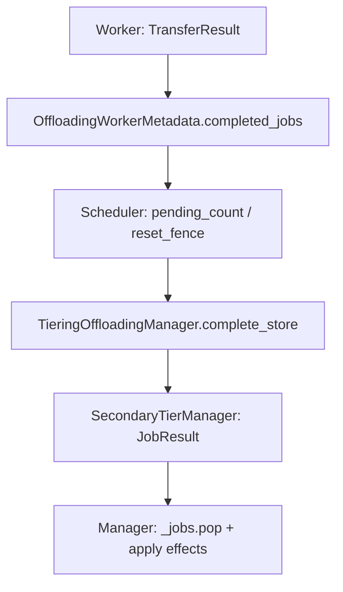
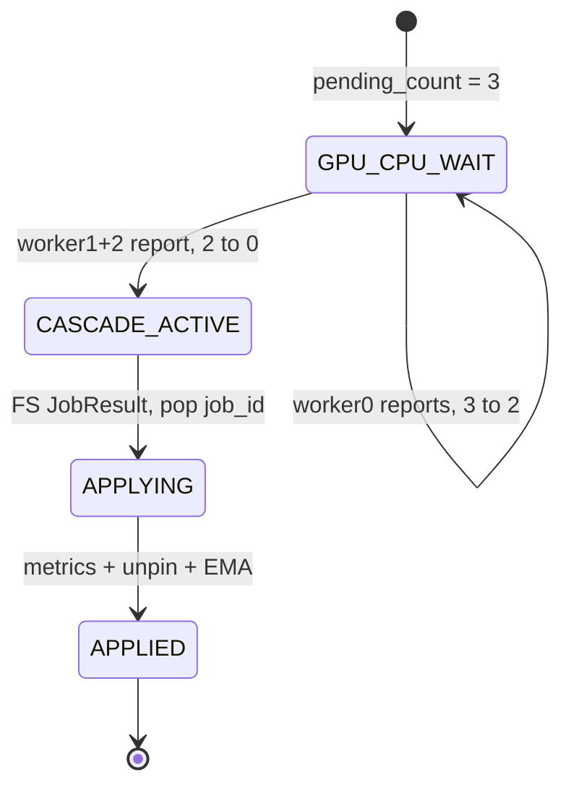

> 源码基线：vLLM [`ebaa8124`](https://github.com/vllm-project/vllm/commit/ebaa8124755b10b956dc0b69082d9a94c12285d6)，即 2026-10-28 研究时默认分支最新提交。第 68 章涉及的 [PR #63524](https://github.com/vllm-project/vllm/pull/63524) 截至本次研究仍为 **open、未合入**；近期合入的 [PR #63889](https://github.com/vllm-project/vllm/pull/63889) 优化 KVCR completion 路径的 Python 开销与失败报告，但没有改变本文讨论的 completion identity 和 apply fence。

## 本篇在课程路线中的位置

这是第 69 章，仍位于“测试、性能与故障诊断”。第 67 章证明 content-addressed FS publish 能让重复数据写入收敛；第 68 章又证明数据幂等不等于物理字节计账正确。本章只追问再下一层：**同一个 completion 如果被看见两次，pin、metrics 与 backpressure EMA 会不会应用两次？**

课程位置是：

`GPU→CPU transfer → worker completion → scheduler pending_count/reset fence → complete_store → CPU→secondary transfer → JobResult → manager apply`

## 前置知识回顾

- primary CPU tier 在向 secondary tier cascade 时持有 block 的 `ref_cnt`；secondary completion 后才能 `complete_read` 释放。
- `JobResult.success` 表示 job 的满足结果，`transfer_bytes` 是控制反馈输入；它们不是同一个事实。
- 一个正确的完成处理至少包含三类 effect：释放资源、更新观测指标、更新 admission/backpressure 状态。数据文件已存在，不能自动证明这三项只发生一次。

## 本篇要回答的核心问题

1. vLLM 中实际上有哪两条 completion 链？它们怎样识别“一次完成”？
2. `pending_count`、`_stale_job_threshold/_reset_fence` 与 `_jobs.pop` 分别挡住什么？
3. 为什么当前正常路径接近 exactly-once apply，却仍不是 crash-safe、可重放事务？

## 组件在全局架构中的位置



上半段回答“所有 worker 是否都完成 GPU↔CPU 搬运”；下半段回答“CPU→FS/OBJ/P2P 的 secondary job 是否完成”。两段都叫 completion，但 ID 的所有者、聚合规则和 reset 语义不同，不能混成一个 ACK。

## 完整调用链

公开入口仍从一次 generation step 开始。scheduler 创建 connector job 并把 `job_id` 下发给各 worker；worker 的 [`get_finished`](https://github.com/vllm-project/vllm/blob/ebaa8124755b10b956dc0b69082d9a94c12285d6/vllm/distributed/kv_transfer/kv_connector/v1/offloading/worker.py#L286-L321) 消费 `TransferResult`，记录可选的 bytes/time，然后调用 `OffloadingWorkerMetadata.mark_completed(job_id)`。

[`OffloadingWorkerMetadata`](https://github.com/vllm-project/vllm/blob/ebaa8124755b10b956dc0b69082d9a94c12285d6/vllm/distributed/kv_transfer/kv_connector/v1/offloading/common.py#L77-L107) 在单个 worker 内写 `{job_id: 1}`，跨 worker `aggregate()` 时才相加。scheduler 的 [`_update_connector_output`](https://github.com/vllm-project/vllm/blob/ebaa8124755b10b956dc0b69082d9a94c12285d6/vllm/distributed/kv_transfer/kv_connector/v1/offloading/scheduler.py#L2284-L2354) 将计数从 `pending_count` 中扣除；恰好归零后，store 调用 `manager.complete_store`，load 调用 `manager.complete_load`，最后删除 scheduler job。

`complete_store` 把 primary 中已完成的 chunks cascade 到 secondary tier。secondary 完成后，由 [`TieringOffloadingManager._process_finished_jobs`](https://github.com/vllm-project/vllm/blob/ebaa8124755b10b956dc0b69082d9a94c12285d6/vllm/v1/kv_offload/tiering/manager.py#L501-L551) 轮询 `JobResult`：

```python
job_metadata = self._pop_job(job_id)       # 先消费 identity
assert job_metadata is not None
self._metrics.on_job_finished(...)
primary.complete_read(keys, req_context)   # 释放 cascade pin
self._update_backpressure(...)             # 最后更新 EMA / failure
```

FS tier 的 [`get_finished_jobs`](https://github.com/vllm-project/vllm/blob/ebaa8124755b10b956dc0b69082d9a94c12285d6/vllm/v1/kv_offload/tiering/fs/manager.py#L279-L325) 又从 thread pool 的 finished deque 中 destructive-drain，并把结果转成 `JobResult`。因此当前正常路径是“生产者一次出队 + manager 一次 pop”的两道易失 fence。

## 关键类型、字段和状态生命周期

| 对象/字段 | 创建与所有者 | 变化 | 消费/失效 |
| --- | --- | --- | --- |
| scheduler `job_id` | `OffloadingConnectorScheduler` 单调分配 | 各 worker 回报同一 ID | `pending_count == 0` 后从 scheduler `_jobs` 删除 |
| `completed_jobs[job_id]` | worker metadata，值在单 worker 为 1 | 多 worker aggregate 求和 | scheduler 每个 output 消费 |
| `_stale_job_threshold` | cache reset 时取当前 `_job_counter` | reset 后旧 ID 都小于阈值 | 旧回报只用于收敛 `_reset_fence`，不再触发 store/load effect |
| secondary `TransferJob.job_id` | `TieringOffloadingManager._next_job_id()` | 注册到 manager `_jobs`，绑定唯一 `tier_idx` | 首个 `JobResult` 到达即 `_pop_job` |
| primary `ref_cnt` | cascade 提交前 pin | job 运行期间阻止复用 | store completion 的 `complete_read` 递减 |
| backpressure sample | successful store completion | `elapsed / transfer_bytes` 更新 EMA | detector 的后续 `should_store` 决策使用 |

这里的所有状态都是进程内状态。`_job_id_counter` 在同一 manager 的 `reset_cache()` 中不归零；而进程重启会新建 manager，同时旧进程的队列与 EMA 也消失。当前没有 durable completion receipt。

## 逐函数源码解读

### 1. `pending_count` 是 quorum，不是通用 dedup set

一个 job 在 TP=3 时初始 `pending_count=3`。三个 worker 的 metadata 可分两步到达：先 `{job: 1}`，再聚合成 `{job: 2}`。scheduler 做减法，只有从 3 精确走到 0 才提交后续 effect。若当前 job 收到超额计数，代码会因负数触发 `assert pending_count == 0`；未知的新 job ID 则在 `_jobs[job_id]` 取值时失败。也就是说，它用 fail-fast 暴露协议破坏，而不是静默把重复报告当成功。

### 2. reset fence 将“旧世代完成”降级为 flush ACK

cache reset 不能假装 worker 上旧 DMA 已消失。scheduler 的 [`_reset_cache`](https://github.com/vllm-project/vllm/blob/ebaa8124755b10b956dc0b69082d9a94c12285d6/vllm/distributed/kv_transfer/kv_connector/v1/offloading/scheduler.py#L2165-L2228) 先把现有 jobs 放进 `jobs_to_flush`，再记录 `_stale_job_threshold = _job_counter` 和每个 job 剩余 worker 数到 `_reset_fence`，随后清空活动 `_jobs`。旧回报到来时只递减 fence；全部归零后调用 `manager.on_reset_flushed()`，才重新允许 promotion。

这不是“忽略所有旧消息”，而是把旧消息的语义从“提交数据 effect”改成“证明旧 worker 工作已排空”。这正是 attempt/generation fence 的最小形态。

### 3. `_jobs.pop` 是一次性消费点，但不是事务提交点

manager 为 secondary job 单调分配 ID，在 [`_register_job/_pop_job`](https://github.com/vllm-project/vllm/blob/ebaa8124755b10b956dc0b69082d9a94c12285d6/vllm/v1/kv_offload/tiering/manager.py#L434-L446) 中维护活动表。相同 `JobResult` 第二次到达时，metadata 已不存在，assert 会在第二次 metrics、pin 释放和 EMA 更新之前终止。因此在“不抛异常、生产者至多报告一次”的前提下，它确实挡住了 double apply。

但顺序是 `pop → metrics → pin release/promotion finalize → backpressure`。假设 metrics 已递减 active count，随后 `complete_read` 抛异常：job identity 已被移除，原结果也已从 tier queue 出队；重试会被当成 unknown completion。系统得到的是**半应用且不可重放**，而不是原子 apply。

### 4. lock 解决并发 applier，不解决崩溃原子性

manager 的 tier-poll thread 与 scheduler thread共享 [`manager.lock`](https://github.com/vllm-project/vllm/blob/ebaa8124755b10b956dc0b69082d9a94c12285d6/vllm/v1/kv_offload/tiering/manager.py#L305-L424)，所以同一时刻只有一个 applier 操作 `_jobs`。`_processed_jobs_this_step` 还避免普通 step 重复 poll。但 lock 只给出 mutual exclusion；它不会在进程退出后恢复 `_jobs`，也不会回滚已经发生的 metrics/refcount effect。

## 具体示例与 shape/状态演算

设 TP=3，一个请求的 3 个 KV blocks（每块 128 KiB）从 GPU 存入 CPU，再 cascade 到 FS。



1. worker0 回报 `{17:1}`，`pending_count: 3→2`，没有 cascade。
2. worker1/2 聚合回报 `{17:2}`，`2→0`，scheduler 只调用一次 `complete_store`，并删除 job 17。
3. manager 为 FS cascade 分配 job 42；3 个 primary chunks 各因该 tier 持有一个 read pin。
4. FS thread pool 只在所有 block task 完成后把 `(42, success, time)` 放入 finished queue；manager 收到后先 pop 42，再做 metrics、三个 pin 释放和一个 EMA 样本。
5. 若 FS 错误地再次报告 42，第二次在 `_pop_job` 后得到 `None`，assert 发生在任何第二次 side effect 前。

reset 发生在第 1 步之后时，job 17 进入 `_reset_fence={17:2}`。后续两个 worker 报告只把 fence 变为 0，不会启动 FS cascade。这个例子演算的是控制状态，不是性能 benchmark。

## 为什么这样设计及替代方案

当前设计的优势是热路径极轻：整数 ID、一个 dict pop、无需 durable log，正常完成延迟与维护成本都低。对进程内 FS thread pool 来说，finished deque 本身按 job 只入队一次；manager effect（refcount、EMA、内存 metrics）也都在进程内，进程重启后一起丢失。因此**仅为当前本地语义增加持久化 exactly-once ledger，收益有限、写放大和恢复复杂度却真实存在**。

替代方案可分三层：

| 方案 | 能解决 | 代价/缺口 |
| --- | --- | --- |
| 当前 `pop + assert` | 正常路径 double apply；协议破坏 fail-fast | 不能恢复 pop 后异常；不能跨进程识别 attempt |
| 内存 `ACTIVE→APPLYING→APPLIED` | 可检测 partial apply、重复回报并提供诊断 | 进程崩溃仍丢失；各 effect 还需幂等化 |
| durable receipt `(epoch,tier,job,attempt)` | 允许远端 redelivery 与跨重启 reconciliation | 持久化延迟、GC、恢复和一致性协议成本最高 |

第一性原理上的触发条件不是“exactly-once 听起来更安全”，而是：**completion 是否可能在 manager replacement 后重新出现？** 当前本地队列不会；若未来 OBJ/P2P transport 引入 reconnect redelivery、持久 completion queue 或跨进程重试，才需要显式 `manager_epoch + attempt` 和 durable applied receipt。单独增加 `completed_ids` 集合只挡住全量 apply 后的重复，仍解决不了中途异常。

## 性能、并发、正确性与边界条件

- **延迟/吞吐**：dict pop 与整数聚合是 O(1)；durable receipt 会把控制面写 I/O 放到每个 job 的完成路径，必须批量或异步化。
- **显存/CPU 内存**：当前 fence 只保留 in-flight job；永久 dedup set 会无界增长，必须绑定 epoch 与回收 frontier。
- **并发**：manager lock 串行化 scheduler 与 tier-poll applier，避免两个线程同时消费同一 `_jobs`；producer 自身仍必须遵守一次完成契约。
- **graphability**：这些是 CPU 控制面状态，不进入 CUDA Graph；影响主要是 step 尾部控制延迟，而非 graph capture。
- **失败方式**：worker transfer failure 当前直接 assert“不支持”；scheduler 对未知/超额 completion fail-fast；secondary manager 对 unknown ID 或错误 tier fail-fast；pop 后 effect 抛异常则可能半应用。
- **reset**：manager [`reset_cache`](https://github.com/vllm-project/vllm/blob/ebaa8124755b10b956dc0b69082d9a94c12285d6/vllm/v1/kv_offload/tiering/manager.py#L1141-L1176) 先 `drain_jobs()`、再消费所有 completion、断言 `_jobs` 为空，之后才复用 primary slots；scheduler 还要等 worker reset fence 清零才解除 promotion hold。

## 测试证据与未覆盖风险

**已合入测试事实：**

- [`test_complete_store_waits_for_all_worker_acks`](https://github.com/vllm-project/vllm/blob/ebaa8124755b10b956dc0b69082d9a94c12285d6/tests/v1/kv_connector/unit/offloading_connector/test_scheduler.py#L3470-L3512) 用 3 workers 验证 `3→2→0`，且只在归零时调用一次 `complete_store`。
- [`test_cache_reset_fence_ignores_reports_of_other_jobs`](https://github.com/vllm-project/vllm/blob/ebaa8124755b10b956dc0b69082d9a94c12285d6/tests/v1/kv_connector/unit/offloading_connector/test_scheduler.py#L1448-L1466) 注入 reset 前已完成 job 的 late duplicate，证明它不能错误清掉另一个仍待 flush 的 fence。
- [`test_ref_cnt_protection_during_cascade`](https://github.com/vllm-project/vllm/blob/ebaa8124755b10b956dc0b69082d9a94c12285d6/tests/v1/kv_offload/tiering/test_tiering_offloading.py#L470-L517) 验证两个 secondary jobs 完成前 `ref_cnt=2`，下一 step 消费 completions 后归零。
- [`test_reset_cache_drains_all_tiers`](https://github.com/vllm-project/vllm/blob/ebaa8124755b10b956dc0b69082d9a94c12285d6/tests/v1/kv_offload/tiering/test_tiering_offloading.py#L1507-L1530) 验证 reset 先 drain 每层，再把 `_jobs` 清空。

**未覆盖风险：**没有直接测试把同一个 secondary `JobResult` 连续返回两次；没有在 `pop` 之后、metrics/pin/EMA 各边界注入异常并检查恢复；没有跨进程 epoch/attempt redelivery 测试；worker failure 仍是 assert 路径。本章只做源码与测试静态核对，未重跑 GPU/FS 套件。

## 与前后章节的连接

第 67–69 章形成了三个不同问题：数据 publish 是否幂等、物理 bytes 是否真实、completion effect 是否只应用一次。它们必须分别证明，不能用 content-addressed 文件名一把包办。

下一章将做第 70 章知识图谱回顾，把 KV Offload 的 admission、primary slot、cascade、publish、receipt、reset fence 与 backpressure 串成一张故障边界图，再据此排下一阶段的 crash-at-every-boundary 测试路线。

## 本篇结论、知识债、三个理解检查问题和下一章

结论：当前 vLLM 在既定进程内契约下，用 `pending_count` 完成 worker quorum，用 stale/reset fence 隔离 reset 前 attempt，用 secondary `_jobs.pop` 阻止第二次 apply；这比“没有去重”更准确。但 `_jobs.pop` 是消费点，不是事务提交点：多项副作用之间发生异常时，没有 redo/rollback，也没有跨进程 epoch receipt。

知识债：secondary duplicate/unknown completion 负向测试；pop 后各边界故障注入；effect 幂等或 `APPLYING/APPLIED` 状态；远端 redelivery 的 manager epoch/attempt 设计；worker transfer failure 的恢复协议；与 PR #63524 actual-byte receipt 的联合测试。

理解检查：

1. 为什么 `pending_count` 能等待 TP workers，却不能替代 secondary job 的 dedup identity？
2. reset 后的旧 completion 为什么仍要递减 `_reset_fence`，而不能简单丢弃？
3. 为什么把 job ID 放进 `completed_ids`，仍不能修复 `pop` 后、EMA 前抛异常的半应用？

下一章：**第 70 章知识图谱回顾——从 KV Admission 到 Publish、Receipt、Reset Fence 与 Backpressure。**

## 课程账本增量

- 源码基线：`ebaa8124755b10b956dc0b69082d9a94c12285d6`。
- 新覆盖：connector `OffloadingWorkerMetadata`、worker `get_finished`、scheduler `_update_connector_output/_reset_cache`；tiering manager `_next_job_id/_register_job/_pop_job/_process_finished_jobs/reset_cache`；FS finished queue；reset 与 multi-worker completion 测试。
- 新不变量：worker completion 是 quorum count；reset 前 job 只能成为 flush ACK；secondary ID 在 manager lifetime 内单调且一次 pop；manager lock 只保证串行 apply；进程内 pop 不等于 crash-safe commit。
- 新知识债：partial-apply fault injection、duplicate secondary completion、epoch/attempt identity、可重放 receipt 与 actual-byte patch 联测。
- 下一章：第 70 章课程知识图谱回顾。
