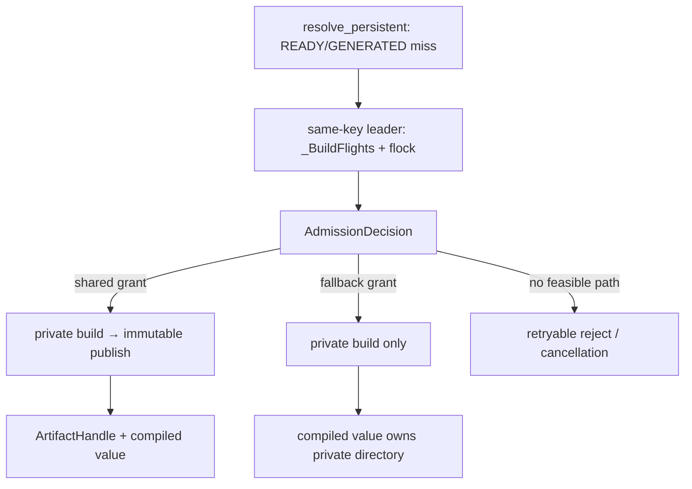
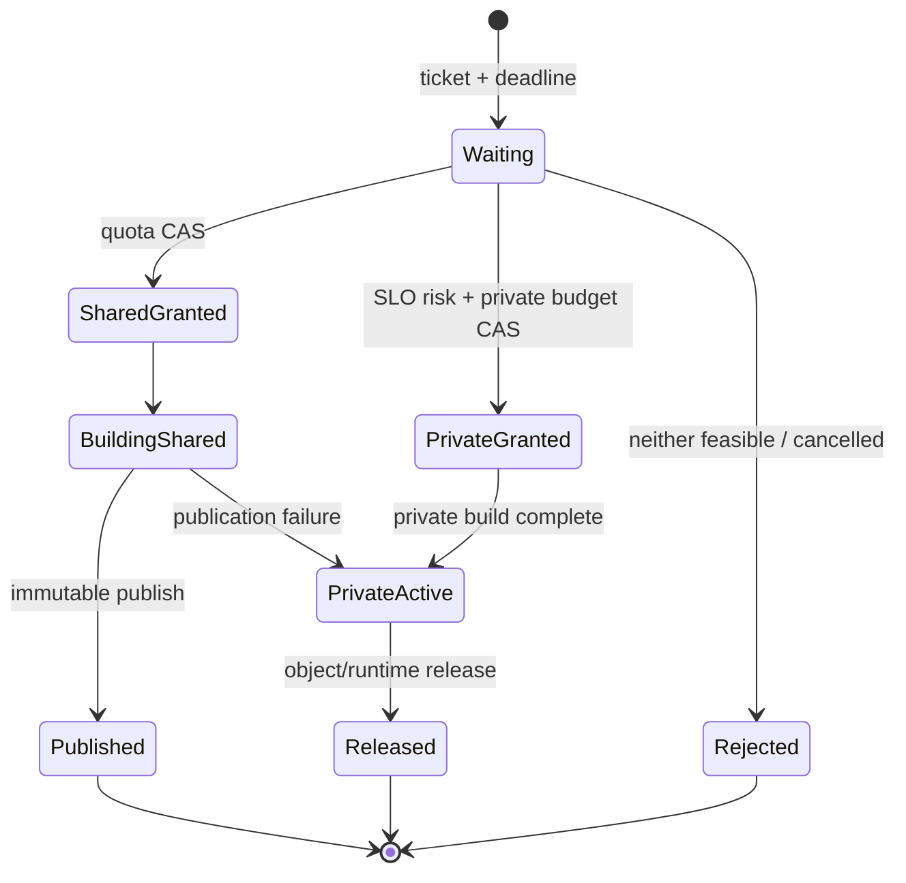

> 源码基线：PyPTO [`26d17faf`](https://github.com/hw-native-sys/pypto/commit/26d17faf45daef39f2f909c84b07a0d57061880f)，即 2026-10-29 研究时默认分支最新提交。它比第 79 章基线前进 6 个提交；[比较结果](https://github.com/hw-native-sys/pypto/compare/6307a2e2c9e53d61141ce1bd9c9d29e6b7418482...26d17faf45daef39f2f909c84b07a0d57061880f)没有改动 Artifact Store、persistent JIT 或 cache policy。最新 head 的 PR #3126 修复 gather/split partition，与本文无直接关系。

## 本篇在 PTO 课程路线中的位置

这是课程第 80 章，承接第 78 章的 quota reservation 与第 79 章的公平等待。前两章回答“容量不能超卖”和“多个 waiter 谁先获得下一份容量”；本篇只研究一个边界清晰的问题：**等待本身已经威胁本次请求的 latency SLO 时，系统应继续阻塞、转成 private build，还是拒绝？**

这里的 `private` 是共享 Artifact cache 之外的私有文件目录，不是 ISA 的 Local/UB memory。它仍会消耗磁盘、编译 CPU 和对象生命周期，只是不生成可供其他进程复用的 shared slot。

## 前置知识

- `ArtifactKey + ArtifactSpec` 定义 immutable shared slot；同 key 的 builder 由进程内 `_BuildFlights` 与跨进程 `flock` 合并。
- 第 78 章建议的 shared ledger 保持 `committed_bytes + reserved_bytes <= quota_bytes`；它不是当前 PyPTO 已实现功能。
- 第 79 章的 ticket、bounded bypass 与 revision wakeup也是建议协议。notify 只提示重查，不直接授予容量。
- 当前 PyPTO 已实现 private fallback，但触发条件是 readonly、invalid/storage、lock 或 publication failure，不是等待超时。

## 今日 1–2 个核心问题

1. 当前 `BuildDisposition.PRIVATE` 到底保证什么，又没有保证什么？
2. 若未来增加 shared quota queue，怎样用 end-to-end deadline 决定 `WAIT / PRIVATE / REJECT`，又不让 fallback 绕过容量安全？

## PTO 全栈中的位置

上游输入是 `resolve_persistent` 已冻结的 toolchain/source/specialization identity、请求 deadline 与 stage size estimate；下游消费者是 builder、publisher、`ArtifactRuntime` 和 object cache。admission 必须位于跨进程 same-key leader 确认之后、builder 开始之前：太早会让同一 Artifact 的多个进程重复占额；太晚则已经产生无法安全撤销的编译副作用。

## 概念和精确语义

### 当前事实：private 是可用结果，不是失败对象

[`BuildDisposition`](https://github.com/hw-native-sys/pypto/blob/26d17faf45daef39f2f909c84b07a0d57061880f/python/pypto/jit/artifact_cache.py#L61-L75) 区分 `HIT`、`PUBLISHED` 与 `PRIVATE`。[`ArtifactBuild`](https://github.com/hw-native-sys/pypto/blob/26d17faf45daef39f2f909c84b07a0d57061880f/python/pypto/jit/artifact_cache.py#L115-L129) 即使 publish 成功也保留 builder value 与 private directory，因为只有 adapter 知道 live object 何时不再引用原路径；代码明确说明目前没有自动 cleanup。

因此 `PRIVATE` 的精确后置条件是：builder 已完成、manifest 可在该私有树上形成、返回的 value 可继续使用，但没有 reusable shared `ArtifactHandle`。它并不意味着 compiler 失败，也不意味着这份目录可以立刻删除。

### 建议协议：三个 verdict，而不是一个 timeout

令请求的绝对 deadline 为 `D`，当前时刻为 `now`，剩余预算为：

$$B_{remain}=D-now$$

用观测分布而不是拍脑袋常量估计：

$$L_{shared}=W_{admit}+T_{build}+T_{publish}+T_{bind}$$

$$L_{private}=T_{build}+T_{bind}$$

最小决策是：

| 条件 | verdict | 含义 |
| --- | --- | --- |
| shared grant 已可用，或 `L_shared` 仍在预算内 | `WAIT_SHARED` | 等待或构建并发布，可被未来进程复用 |
| shared 会超预算，但 `L_private` 可满足，并获得独立 private headroom/compile-slot grant | `FALLBACK_PRIVATE` | 只服务当前 cohort，不提交 shared quota |
| 两条路径都无法满足，或 private budget 不可用 | `REJECT_RETRYABLE` | 快速返回 backpressure，不偷偷超卖磁盘/CPU |

这不是“deadline 到了就 fallback”。deadline 只是选择输入；**private budget 的原子 grant** 才授予构建权。已有 shared builder 已经开始时，也不能仅因 caller timeout 就释放 reservation 并再起 private builder；除非编译器提供可信 cancellation terminal，否则原 builder 仍可能继续写目录、占 CPU 与完成 publish。

## 真实文件、类型、API 或指令逐段解读

### 1. `resolve_persistent`：真实入口与对象 ownership

[`resolve_persistent`](https://github.com/hw-native-sys/pypto/blob/26d17faf45daef39f2f909c84b07a0d57061880f/python/pypto/jit/_persistent.py#L217-L356) 依次捕获 toolchain、extra sources、specialization 和 semantic environment，然后检查 process object cache、READY、GENERATED，最后才定义 `generate(directory)` 并调用 `store.get_or_build`。

若结果没有 handle，第 343–349 行直接取 `result.value`；有 handle且是新 build，则把 compiled value 绑定到 shared artifact；纯 hit 则 restore。无论哪条路径，最终 compiled object 放入 `owner._artifact_objects`。所以 private tree 的生命周期至少延伸到 compiled object 不再引用它为止，不能在 `get_or_build` 返回后按函数栈清理。

### 2. `_BuildFlights.run`：进程内等待没有 deadline

[`_BuildFlights.run`](https://github.com/hw-native-sys/pypto/blob/26d17faf45daef39f2f909c84b07a0d57061880f/python/pypto/jit/artifact_cache.py#L149-L185) 以 `(root, private_root, readonly, key.digest, spec.digest)` 选 leader；follower 调用无 timeout 的 `Future.result()`。leader 的任何 `BaseException` 会唤醒整个 cohort，随后清理 pending entry。

这证明当前协调是“同请求 fan-in”，不是 deadline-aware admission。单个 follower 也没有独立退出协议；如果未来直接把 caller deadline 塞进 `Future.result(timeout=...)`，只能让该 follower 停等，不能取消 leader，也不能证明其 reservation 可返还。

### 3. `ArtifactStore._get_or_build`：真实 fallback 分支

[`_get_or_build`](https://github.com/hw-native-sys/pypto/blob/26d17faf45daef39f2f909c84b07a0d57061880f/python/pypto/jit/artifact_cache.py#L326-L351) 的顺序是：lookup；readonly 时 private build；否则取得 per-key lock并重查；lock/invalid/storage failure 时 private build；MISS 时 private build后尝试 publish。

[`_build_private`](https://github.com/hw-native-sys/pypto/blob/26d17faf45daef39f2f909c84b07a0d57061880f/python/pypto/jit/artifact_cache.py#L353-L375) 强制 `private_root` 位于 cache root 之外，通过 `mkdtemp` 创建不可预测目录，运行 builder并制作 manifest。它没有 size reservation、deadline、disk-free check 或 cleanup hook。

[`_publish`](https://github.com/hw-native-sys/pypto/blob/26d17faf45daef39f2f909c84b07a0d57061880f/python/pypto/jit/artifact_cache.py#L377-L409) copy到 shared staging、复验 manifest、完成 staging、`RENAME_NOREPLACE`、sync parent。任一步 storage/publication error 都返回可用 private value。

### 4. `CacheConfig/CacheStats`：观测不足以驱动 SLO policy

[`CacheConfig`](https://github.com/hw-native-sys/pypto/blob/26d17faf45daef39f2f909c84b07a0d57061880f/python/pypto/_cache_config.py#L21-L48) 当前只有 enabled/root/readonly/extra identity；[`CacheStats`](https://github.com/hw-native-sys/pypto/blob/26d17faf45daef39f2f909c84b07a0d57061880f/python/pypto/_cache_config.py#L53-L71) 是 process-local aggregate，只统计 hit/miss/bypass/storage error与累计 `lookup_ns/build_ns`。它没有 per-stage size、queue wait、deadline miss、fallback bytes 或编译槽占用。

文档中的 [`PYPTO_COMPILER_TIMEOUT`](https://github.com/hw-native-sys/pypto/blob/26d17faf45daef39f2f909c84b07a0d57061880f/docs/en/dev/10-jit-cache.md#L89-L97) 默认约束单个 compiler/linker invocation 的失败上限；它不是请求 SLO，也不能替代 admission deadline。

## 对象/Artifact/Reservation 生命周期

安全关键点有三个：

1. `Waiting` 不持 capacity，因此可直接取消。
2. `SharedGranted/PrivateGranted` 已产生资源 ownership；超时只能记录 cancel intent，必须等待 builder终态或 owner-fenced reconcile。
3. `PrivateActive` 不能只靠时间删除；当前 `ArtifactBuild.value`、`ArtifactRuntime` 或 object cache仍可能引用目录。未来需要显式 release/lease 与 private sweeper。

## 端到端调用链或指令链

真实当前链是：

`JIT request → resolve_persistent → READY/GENERATED lookup → ArtifactStore.get_or_build → _BuildFlights leader → per-key flock → _build_private → _publish 或 PRIVATE → bind/restore → owner._artifact_objects`

建议仅在 `flock + recheck` 后、`_build_private` 前增加 `AdmissionDecision`。它不改变 Artifact identity、manifest 或 runtime/device ABI；上层 Tensor/Tile IR 与下游 PTOAS/设备执行仍消费同一个 compiled program。改变的是“何时允许制造新文件与编译负载”。

## 具体 shape、Tile 和状态演算

考虑一个 kernel 输入 `X: FP32[1,4096]`，位于 GM，逻辑输入为 `4096×4 = 16,384 B`；kernel每次处理 `FP32[1,128]` Tile，即512 B。**Tensor/Tile 字节数不等于 Artifact 文件大小**：后者还包含 generated source、metadata与可能的 device binaries。

下面是协议演算，不是仓库 benchmark：shared quota 300 MiB，已 committed 260 MiB；新 READY stage估计80 MiB，因此不能立即 grant。请求剩余 SLO budget 为1.20 s；根据近期同类 stage观测，`W_admit=0.80 s`、`T_build=0.70 s`、`T_publish=0.10 s`、`T_bind=0.05 s`。

- shared路径：1.65 s，超过剩余预算；
- private路径：0.75 s，在预算内；
- 若独立 private budget与compile slot可原子grant，则转为 `PrivateGranted`；
- build后实际私有树为72 MiB，只记入private in-flight/retained账本，不增加shared committed；
- compiled object释放前72 MiB不可回收。若没有private grant，就应 `REJECT_RETRYABLE`，不能因为目录在cache root之外就视作“免费”。

## 为什么这样设计及替代方案

| 方案 | 延迟/吞吐 | 空间与编译负载 | 正确性与维护成本 |
| --- | --- | --- | --- |
| 永远阻塞 | 最大化shared复用；拥塞时尾延迟无界 | 少重复build | 简单，但无法满足有deadline请求 |
| 一等不到就private | 当前请求快 | 跨进程重复编译、私有目录堆积，可把磁盘和CPU压垮 | 把backpressure搬到另一个资源池 |
| 直接失败 | 保护系统最快 | 调用方重试可能形成retry storm | 需结构化retry hint与抖动控制 |
| `WAIT/PRIVATE/REJECT` tri-state | 在SLO与复用间选择 | 需要双预算、estimator与release ownership | 复杂度最高，但每个分支都有明确授权证据 |

第一性原理下，shared cache quota只限制可复用publication，不能保护cache root之外的private树，也不能保护compiler slots。最小充分设计因此不是一个“fallback=True”开关，而是：shared bytes、private retained bytes、compile concurrency三类独立资源的原子授权，再由deadline选择可行路径。

## 访存、计算、流水、并行和硬件约束

本章不改变 Tile/GM/UB 数据搬运，也不新增ISA指令。硬件侧同一 kernel仍处理 `FP32[1,128]` Tile；变化发生在Host编译/装载阶段。

- shared wait可减少未来编译和磁盘写，改善长期吞吐，但增加本请求排队时间。
- private fallback省掉shared copy/fsync等待，却可能让多个进程重复运行PTOAS、device compiler/linker，抢占Host CPU、I/O与编译许可证/槽位。
- private与shared若落在同一物理文件系统，即使逻辑分账，physical free space仍共享；需要底层 peak headroom，不能只看两个logical ledger。
- deadline estimator失准只应改变效率；不能突破quota/private/compile-slot hard invariant。

## 测试证据与未覆盖风险

**当前测试事实：**

- [`test_publication_failures_retain_private_build`](https://github.com/hw-native-sys/pypto/blob/26d17faf45daef39f2f909c84b07a0d57061880f/tests/ut/jit/test_artifact_cache.py#L383-L396) 对copy、staging、rename、sync逐项注入 `OSError`，期望 `PRIVATE`、value仍可读、shared lookup仍MISS且无残留staging。
- [`test_private_builds_coalesce_across_store_instances`](https://github.com/hw-native-sys/pypto/blob/26d17faf45daef39f2f909c84b07a0d57061880f/tests/ut/jit/test_artifact_cache.py#L547-L604) 用4线程覆盖 invalid/storage/readonly/lock/publication，验证一次builder、所有waiter共享同一private result；下一次请求重新build，证明它不是无界private object cache。
- [`test_coalesced_compiler_errors_wake_waiters_and_allow_retry`](https://github.com/hw-native-sys/pypto/blob/26d17faf45daef39f2f909c84b07a0d57061880f/tests/ut/jit/test_artifact_cache.py#L607-L631) 证明 compiler error/cancellation必须传播，不能被误写成cache fallback。
- [`test_forked_child_does_not_wait_for_parent_build`](https://github.com/hw-native-sys/pypto/blob/26d17faf45daef39f2f909c84b07a0d57061880f/tests/ut/jit/test_artifact_cache.py#L665-L702) 证明fork child不会继承parent flight；[`test_different_keys_build_concurrently`](https://github.com/hw-native-sys/pypto/blob/26d17faf45daef39f2f909c84b07a0d57061880f/tests/ut/jit/test_artifact_cache.py#L705-L714) 证明不同key当前可并行build。

[PR #2692](https://github.com/hw-native-sys/pypto/pull/2692) 作者报告focused 114 passed、完整UT 11,937 passed/10 skipped/1 xfailed；[PR #2723](https://github.com/hw-native-sys/pypto/pull/2723) 接入persistent JIT后报告12,181 passed，并明确private fallback不跨进程dedupe、没有cleanup/eviction API。这些是PR报告，本篇没有重跑NPU。

**仍未覆盖：** quota wait触发deadline、fallback grant原子性、same-key多进程只允许一个private leader、deadline发生在grant/build/publish各边界、private ENOSPC、object release cleanup、retry storm、estimator偏差与shared/private同盘峰值。当前也没有直接相关的已合入quota/fallback PR；本文的tri-state policy属于基于现有不变量的建议设计。

## 与前后章节的连接

向前，第78章提供capacity reservation，第79章提供公平ticket与取消语义；本章把deadline与独立private budget接到同一leader边界。向后，即使选择private，也必须回答目录何时释放、不同进程如何限制fallback并发，以及观测如何反向校准queue ETA。

## 本篇结论、知识债、三个理解检查问题和下一章

结论：PyPTO当前的private fallback是storage可靠性机制，不是capacity backpressure policy。未来增加quota时，正确决策不是“超时就private”，而是先证明shared/private/compile-slot哪条路径仍有资源授权，再用end-to-end SLO budget选择 `WAIT_SHARED / FALLBACK_PRIVATE / REJECT_RETRYABLE`。timeout只改变选择，不授予资源，也不证明旧builder停止。

知识债：durable dual ledger、per-stage size/build/wait estimator、跨进程BuildIntent、private retained lease与cleanup、compile-slot admission、individual follower deadline、granted/building cancellation、same-filesystem peak headroom、retry hints与fault-at-every-boundary tests。

理解检查：

1. 为什么cache root之外的private directory仍必须计入独立budget？
2. follower的 `Future.result(timeout=...)` 返回为什么不能证明leader reservation可以释放？
3. 若shared与private两条路径都能满足deadline，为什么通常应优先shared，而不是无条件private？

下一章：**Private Build 何时真正结束——ArtifactRuntime Lease、Retained Bytes 与 Cleanup Handoff。**

## 课程账本增量

- 新确认：`BuildDisposition.PRIVATE` 是可用但不可共享的completed build；compiler exception不属于fallback。
- 新确认：当前private目录由live compiled object/adapter持有，没有automatic cleanup；process-local stats不足以驱动deadline policy。
- 新推导：SLO只选择已有授权路径；shared bytes、private retained bytes与compile slots必须独立grant。
- 新推导：已grant或已building请求不能因deadline直接返还资源，必须由terminal/reconcile证据闭合。
- ISA地图：无新增指令或Tile语义；补齐Host persistent compilation的backpressure与lifecycle边界。

