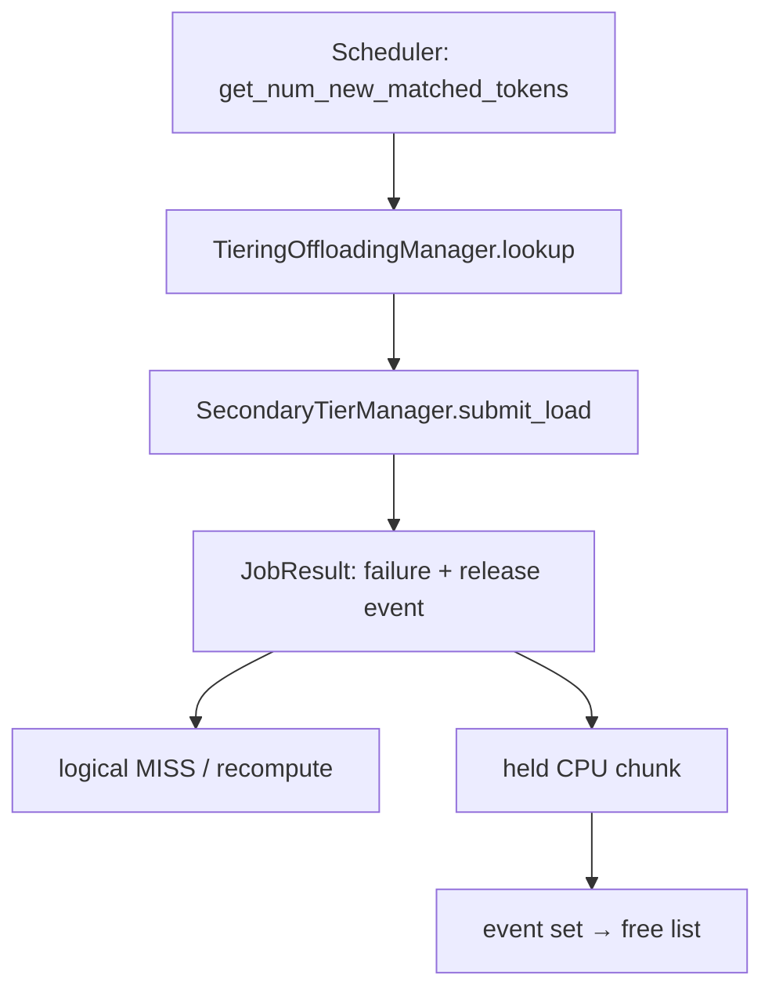
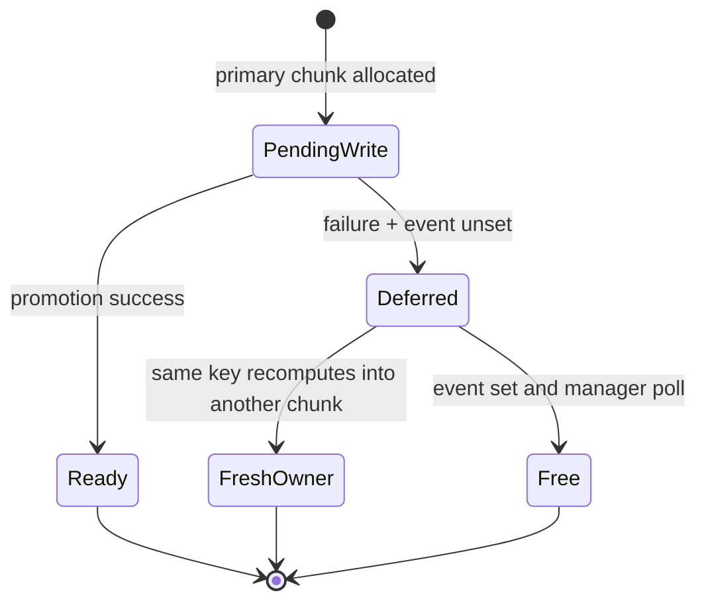

> 源码基线：vLLM [`36d4ef65`](https://github.com/vllm-project/vllm/commit/36d4ef654a83e227216b0c0b55cf4041d96b1675)，即 2026-10-29 研究时默认分支最新提交。该 head 是 CI cache 修改，与本文无直接关系；本文机制由 [PR #63779](https://github.com/vllm-project/vllm/pull/63779) 合入，merge commit 为 [`0beab6c2`](https://github.com/vllm-project/vllm/commit/0beab6c251e8046c0c6cf2fef114cd23b58cda74)。

## 本篇在课程路线中的位置

这是第 70 章，仍位于“测试、性能与故障诊断”。第 69 章解释了 secondary `JobResult` 如何经 `_jobs.pop` 避免正常路径 double apply；本章只研究一个更窄的边界：**promotion 已经判定失败，为什么对应 CPU chunk 仍不能立即进入 free list？**

课程位置是：

`Scheduler lookup → secondary promotion → failed JobResult → logical miss → deferred physical release → fresh recompute/store`

本章末尾按七章节奏回顾第 64–70 章。

## 前置知识回顾

- promotion 是 secondary tier 向 CPU primary tier 写入 KV chunk；写入尚未完成时，primary policy 中的 chunk 是 pending write。
- `JobResult.success=False` 只说明这次 promotion 不应成为 cache hit，不自动证明网络、RDMA 或其他异步 I/O 已停止触碰目标地址。
- primary chunk 一旦进入 free list，就可能立刻分配给另一 key；此时任何迟到 WRITE 都会破坏新 owner 的 KV。

## 本篇要回答的核心问题

1. vLLM 如何把“请求现在失败”与“内存现在可复用”拆成两个时刻？
2. key、chunk 与 `threading.Event` 的生命周期如何变化？
3. 为什么选择单个 `JobResult` 携带 release handle，而不是第二个 completion 或固定 grace timer？

先把证据级别钉住。**当前代码事实**是 core API、allocator 隔离、metrics 与 reset contract 已合入；**测试事实**是 example tier 通过 monkeypatch 生成带 event 的失败结果并验证状态；**PR 规划**是未来由 P2P load timeout 创建 event、AbortAck/TransferDone 或断连设置 event。第三项尚未出现在默认分支的真实 producer 中。后文所有关于 RDMA、AbortAck 的说明都是该接口要解决的硬件/I/O 场景与后续计划，不是“当前 P2P 已经这样执行”。

## 组件在全局架构中的位置

[`OffloadingConnectorScheduler.get_num_new_matched_tokens`](https://github.com/vllm-project/vllm/blob/36d4ef654a83e227216b0c0b55cf4041d96b1675/vllm/distributed/kv_transfer/kv_connector/v1/offloading/scheduler.py#L1254-L1313) 通过 `_lookup` 进入 manager。`HIT_PENDING` 会让 scheduler 暂缓使用该前缀；失败结果处理后 key 变成 `MISS`，请求即可走重算，而旧物理 chunk 继续隔离。

## 完整调用链

1. scheduler 为 request 构造 `ReqContext`，对 offload key 调用 `manager.lookup`。
2. secondary 命中时，manager 在 primary 分配 pending chunk，随后调用 `submit_load(TransferJob)`。
3. tier 报告 [`JobResult`](https://github.com/vllm-project/vllm/blob/36d4ef654a83e227216b0c0b55cf4041d96b1675/vllm/v1/kv_offload/tiering/base.py#L86-L105)。若 promotion 已失败但 I/O 仍可能写目标地址，则返回 `success=False, deferred_release=event`。
4. [`_process_finished_jobs`](https://github.com/vllm-project/vllm/blob/36d4ef654a83e227216b0c0b55cf4041d96b1675/vllm/v1/kv_offload/tiering/manager.py#L573-L626) 从 `_jobs` 取走 job，校验 reporting tier，再进入 `_complete_promotion`。
5. `_complete_promotion` 将 `successful_keys` 正常完成；失败 keys 调用 `primary_tier.defer_write_release`，并把 `job_id → event/tier_idx/chunk_ids/deferred_at` 存入 `_deferred_releases`。
6. tier 可以从网络或 I/O 线程设置 event，但不直接操作 allocator。下一轮 manager poll 在自身锁域内调用 `_complete_deferred_releases`，把 chunk 放回 free list并记录 hold duration。

重要的是：**outcome 只有一个 completion，release 没有第二次 outcome。** 因此 release 不会再次成功/失败请求，也不会重复应用 promotion metrics。

## 关键类型、字段和状态生命周期

[`JobResult.deferred_release`](https://github.com/vllm-project/vllm/blob/36d4ef654a83e227216b0c0b55cf4041d96b1675/vllm/v1/kv_offload/tiering/base.py#L99-L105) 是可选 `threading.Event`，只适用于存在失败 key 的 promotion。cascade job 使用它会触发断言。

[`defer_write_release`](https://github.com/vllm-project/vllm/blob/36d4ef654a83e227216b0c0b55cf4041d96b1675/vllm/v1/kv_offload/tiering/manager.py#L170-L205) 做三件容易混淆的事：

- 从 cache policy 移除 key，所以后续 lookup 是 `MISS`；
- 把原 chunk ID 放入 `_deferred_release_chunk_ids`；
- **不**减少 `_num_write_pending_chunks`，也**不**放回 free list。

这保证同一 key 可以重新计算并写到 fresh chunk，而迟到 writer 只能触碰已隔离的旧 chunk。等 event set 后，`release_deferred_write` 才减少 pending count并归还容量。

把一个失败 key 的四个状态量并排看会更清楚：

| 阶段 | policy 中有 key | `write_pending` | free list 中有 chunk | scheduler 观察 |
| --- | --- | --- | --- | --- |
| promotion 进行中 | 是，尚未 ready | 是 | 否 | `HIT_PENDING` |
| 普通失败已完成 | 否 | 否 | 是 | `MISS` |
| deferred failure | 否 | 是 | 否 | `MISS` |
| event 已消费 | 否 | 否 | 是 | `MISS`，可重新分配 |

`deferred failure` 正是新增的第三种状态：在命名空间里已经失败，在物理地址所有权上仍未完成。它不是 cache hit，也不是 allocator leak；只要 release 证据最终到达，它就是有界 quarantine。

## 逐函数源码解读

### `_complete_promotion`：按 key 拆 outcome

[`_complete_promotion`](https://github.com/vllm-project/vllm/blob/36d4ef654a83e227216b0c0b55cf4041d96b1675/vllm/v1/kv_offload/tiering/manager.py#L521-L570) 支持全成功、全失败和 partial success。`successful_keys` 必须是原始 job keys 的子集；成功部分调用 `complete_write(..., True)`，失败部分才允许 deferred release。若所有 key 成功却携带 event，代码明确断言。

### `_complete_deferred_releases`：通知不是 allocator mutation

[`_complete_deferred_releases`](https://github.com/vllm-project/vllm/blob/36d4ef654a83e227216b0c0b55cf4041d96b1675/vllm/v1/kv_offload/tiering/manager.py#L628-L640) 只扫描当前 tier 的 held jobs。event 已 set 才 pop `_deferred_releases` 并归还 chunk。event 可以由其他线程设置，但 allocator mutation 始终留在 manager polling path；这避免把 primary policy/free list 的所有权扩散到各 tier。

若 event 在 `JobResult` 被消费前已经 set，因为 sweep 位于该 tier completion 处理之后，同一 poll round 就能释放，没有额外一轮延迟。

### `reset_cache`：drain 是强契约

[`reset_cache`](https://github.com/vllm-project/vllm/blob/36d4ef654a83e227216b0c0b55cf4041d96b1675/vllm/v1/kv_offload/tiering/manager.py#L1234-L1294) 先调用每个 secondary tier 的 `drain_jobs()`，再消费 completion，并断言 `_jobs`、`_deferred_releases` 均为空；primary 自身也拒绝在 deferred chunks 尚存时 reset。换言之，tier 必须在 drain 返回前让 release event 可观察，否则 reset 不能安全复用整块 primary memory。

### 精确契约：前置条件、后置条件与非法组合

前置条件是 failed key 仍映射到一个 `is_ready=False` 的 pending chunk。若 key 已 ready 或已经从 policy 消失，`defer_write_release` 会断言；否则 manager 无法证明“仍可能被旧 writer 触碰”的到底是哪一个地址。

处理失败结果后的后置条件分两层：

1. **逻辑后置条件**：失败 key 从 policy 消失，load source 记录被移除，后续 lookup 不得把它当命中。
2. **物理后置条件**：旧 chunk 位于 deferred set，pending 计数仍包含它；在 event 被 manager 消费前，它不得进入 free list。

非法组合包括：全成功结果携带 event、cascade 结果携带 event、`successful_keys` 不是原 job key 子集，以及 `drain_jobs` 返回后仍留有 deferred release。前三者由当前断言直接防御；最后一项通过 reset 后的空表/idle 断言暴露。这里的断言是 fail-fast 证据，并不能在生产进程崩溃后自动恢复容量。

这里也不能用普通 cache refcount 替代 release fence。refcount 主要回答“是否仍有合法 reader/transfer 正在引用内容”；deferred release 回答的是“一个已被判失败、因而不再合法的 writer 是否仍可能触碰地址”。把 key 从 policy 删除或把 reader refcount 降到零，都不会取消已经提交给设备、网卡或远端 peer 的 WRITE。只有 writer completion、明确 abort acknowledgement、连接代际失效后能证明旧 WRITE 不可能到达，或者更强的设备 reset witness，才具备归还地址的资格。

因此该机制保护的并非数值正确性校验，而是 memory location 的所有权。dtype、shape 与 key digest 即使完全匹配，旧 writer 写入 fresh owner 的地址仍是错误；反过来，即使本次 promotion 的数据最终其实正确，只要它已经以 failure outcome 退出，旧 chunk 也不能重新晋升为当前 hit，以免迟到成功反转已提交的调度决定。

## 具体示例与 shape/状态演算

用一个教学配置演算：promotion 包含 `K0/K1/K2` 三个 chunk，每个逻辑 shape 为 `bf16[16, 4096]`，大小 `16 × 4096 × 2 = 128 KiB`；primary 分配 chunk IDs `12/13/14`。

1. secondary 返回 `success=False, successful_keys=[K0], deferred_release=E`。
2. `K0@12` 进入 `Ready`；`K1@13`、`K2@14` 从 policy 移除，但仍是 write-pending。
3. scheduler 再查 `K1/K2` 得到 `MISS`，不必等待 E，可以重算。此时隔离容量为 `2 × 128 KiB = 256 KiB`。
4. 重算后的 `K1` 写入 fresh chunk 15；即使旧 DMA 随后写 chunk 13，也不会污染新值。
5. 收到 AbortAck、TransferDone 或能证明 I/O 已停止的其他证据后，tier 设置 E；manager 把 13/14 归还 free list，隔离容量回到 0。

这里的 shape 与时间线用于说明容量关系，不是仓库性能 benchmark。

注意 partial success 的地址关系：`K0@12` 的 bytes 已成为有效 cache 内容；13/14 则只保留“旧 writer 的合法目标地址”这一作用。若重算后的 `K1@15` 已完成，而 E 仍未到达，系统同时持有有效的 15 和隔离的 13。这是用临时容量换低恢复延迟，不是重复 cache entry。只有 13 被释放，capacity accounting 才能把这 128 KiB 重新交给 admission。

## 为什么这样设计及替代方案

最小正确性条件是：

`允许复用(chunk) ⇒ 所有可能写该 chunk 的旧 I/O 已停止`

因此几个看似简单的替代方案都不够：

- **失败即 free**：请求恢复最快，但迟到 WRITE 可能静默破坏另一个 key，违反所有权不变量。
- **等确认后才返回失败**：安全且简单，却把 I/O 终止等待直接加入请求恢复延迟。
- **固定 grace timer**：时间流逝不是 DMA 停止的证明；拥塞或连接异常会使经验超时失效。
- **同一 job 再发一个 `memory_safe=True` completion**：要求 `_jobs.pop` 后仍接受同 ID，并区分第二次消息不能重复 outcome，扩大 dedup/reset 状态机。

当前选择让单一 result 同时携带一个只表达“何时可释放”的 handle：失败低延迟可见，物理复用保持安全，代价是 hold 期间容量下降以及 tier 必须履行 event/drain 契约。

第一性原理下，event 不是因为线程同步方便才存在，而是因为系统需要一种**单调证据**：unset 代表仍不能证明安全；set 代表 tier 承诺旧 I/O 不再写目标地址。这个证据不携带 cache outcome，不可逆，也不需要排序第二个业务 completion。若未来底层能提供 CUDA event、RDMA completion、session generation close witness，它们都可以被适配为同一“不可再写”语义；不能提供该证明的后端就只能继续隔离或 fail-stop，不能凭超时猜测安全。

## 性能、并发、正确性与边界条件

- **延迟**：失败请求可以立即转向重算，不再把 AbortAck 等待放进 critical path。
- **容量**：held chunks 不可复用；若 event 长时间不 set，primary 有效容量持续减少。代码新增 `deferred_release_chunks` gauge 与 hold-time histogram，但没有自动 SLO 恢复策略。
- **并发**：任意线程只负责 `event.set()`；manager 在自己的锁域内改 allocator，避免 cross-thread policy/free-list mutation。
- **复杂度**：每轮按 tier 扫描 held jobs，PR 将其描述为 `O(held jobs)`；设计假设这种失败隔离是稀有路径。
- **边界**：当前只支持 promotion 目标侧隔离；cascade 的 source-side retention 仍不支持。
- **实现状态**：截至基线，在默认分支搜索到的 `deferred_release=` 生产者只有测试。PR 明确把 P2P 的 AbortAck/断连接入列为 follow-up，因此不能声称真实 P2P 已启用该能力。

容量压力可以写成一个简单约束：

\[
M_{usable} \ge M_{ready}+M_{pending}+M_{deferred}+M_{new\ owner}
\]

deferred release 把请求的等待时间从关键路径移走，却没有消灭成本，只是把成本转成 `M_deferred`。若失败率或 hold duration 上升，promotion allocation 会更早失败并退回重算，吞吐和命中率都可能下降。因此 gauge 回答“当前隔离了多少”，histogram 回答“释放证据通常多久到达”；两者必须联合看。只监控平均 hold 时间会漏掉少数永不释放的 chunk，只监控 count 又无法区分短暂突发和持续容量侵蚀。

## 测试证据与未覆盖风险

直接测试位于 [`test_tiering_offloading.py`](https://github.com/vllm-project/vllm/blob/36d4ef654a83e227216b0c0b55cf4041d96b1675/tests/v1/kv_offload/tiering/test_tiering_offloading.py#L661-L807)：

- 失败 key 立即 miss，但 free chunk 数直到 event set 才恢复；
- 同 key 重新 store 必须获得不同 chunk；
- partial success 只 hold 失败 chunks；
- 预先 set 的 event 在同一 poll round 释放；
- 对 ready 或 missing key 调 `defer_write_release` 必须断言；
- `drain_jobs` set event 后，`reset_cache` 能完成且 deferred count 归零。

PR 作者报告 tiering suite `594 passed, 12 skipped`，CPU manager/region 测试 `120 passed`；这是 PR 报告事实，本篇没有重跑 GPU/P2P 端到端测试。

仍未覆盖：真实 P2P producer、event 永不 set、进程退出丢失 event、AbortAck 与断连竞争、多 tier 同时 hold、manager 在登记 deferred state 前异常，以及 cascade source-side 延迟释放。

最关键的覆盖缺口不是更多 happy-path shape，而是下面三个故障边界：

- tier 已返回失败，但 manager 在登记 `_deferred_releases` 前异常：job 已从 `_jobs` pop，旧 chunk 的恢复依据是否仍在；
- event 已 set，但 manager 在 free-list mutation 或 metrics 更新之间异常：再次进入时如何判断 chunk 是否已归还；
- producer 进程永久消失且无人能 set event：容量是永久 quarantine，还是能由 session generation/设备 reset witness 安全接管。

现有测试是 deterministic unit test，足以证明状态转换的进程内语义，但尚不能证明跨进程、真实异步 WRITE 和崩溃恢复。下一章正是要补这个 liveness 边界。

## 与前后章节的连接

第 69 章把“completion outcome 只应用一次”讲清；本章进一步说明一次 outcome 里也存在两个不同提交点：**逻辑失败提交点**让请求重算，**memory-safe 提交点**才允许地址复用。下一章将处理最危险的 liveness 反例：event 永远不 set 时，怎样用 bounded quarantine、session generation 与 capacity recovery 在安全与可用性之间做选择。

### 第 64–70 章知识图谱回顾

- 64–66 章：从 GC owner generation、audit compaction 到 checkpoint LKG，建立“提交权、历史证据和物理删除”三层边界。
- 67 章：content-addressed publish 允许数据 effect at-least-once redo。
- 68 章：数据已满足不等于物理写入字节正确，backpressure 必须使用相符的 effect 计量。
- 69 章：completion identity 与 reset fence 防止正常路径 double apply，但进程内 pop 不是 crash-safe transaction。
- 70 章：失败 outcome 与地址可复用证明再次拆开；正确恢复既要快，也不能让迟到 writer 获得新 owner 的地址。

主线由此收敛为：`identity → data effect → actual accounting → completion apply → address reuse fence`。

## 本篇结论、知识债、三个理解检查问题和下一章

结论：`success=False` 只能终止 promotion 的逻辑候选资格，不能证明旧 I/O 已停止。`deferred_release` 用一次 outcome 加一个 release handle，把请求恢复延迟与内存安全等待解耦，并保持 allocator 单 owner。

知识债：真实 P2P 接入、bounded hold policy、session/process generation、lost-event recovery、shutdown takeover、cascade retention、capacity admission 与 fault-at-every-boundary 测试。

理解检查：

1. 为什么从 policy 删除 key 后，旧 chunk 仍必须保留为 write-pending？
2. 为什么第二个同 job ID completion 比 `threading.Event` 更容易造成 double apply？
3. `drain_jobs()` 返回前若 event 未 set，`reset_cache` 复用 primary memory 会发生什么？

下一章：**Event 永远不 set 怎么办——Bounded Quarantine、Session Generation 与 Capacity Recovery。**

## 课程账本增量

- 第 70 章补齐 promotion failure 的 logical outcome 与 physical reuse fence。
- 新覆盖 `JobResult.deferred_release`、`defer_write_release/release_deferred_write`、`_deferred_releases`、deferred metrics 与 reset drain contract。
- 确认当前能力已合入 core/test，但尚无真实 in-tree tier 生产该 event。
- 完成第 64–70 章知识图谱回顾；下一阶段继续研究无界 quarantine 的 liveness 与容量恢复。
