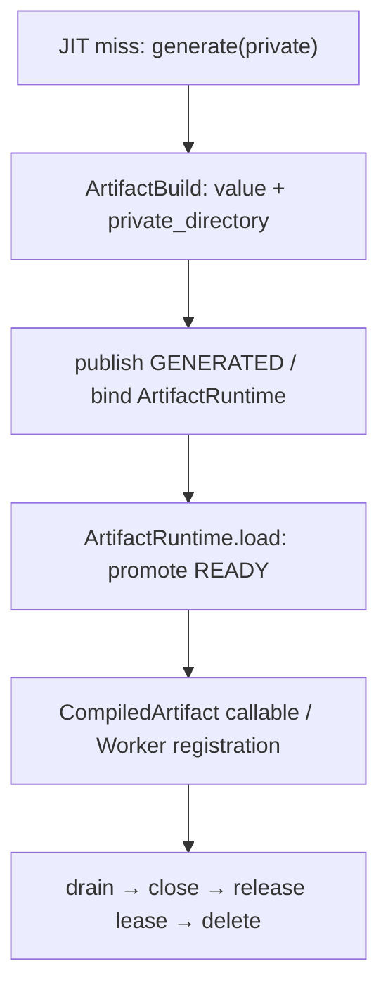
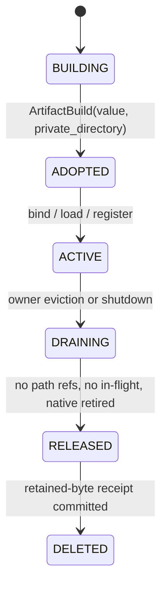

> 源码基线：PyPTO [`8dceaa5f`](https://github.com/hw-native-sys/pypto/commit/8dceaa5f4035dc16e3e34961c51de597cfbbd01b)，即 2026-10-30 研究时默认分支最新提交。它比上一章的 `26d17faf` 前进 5 个提交；[比较结果](https://github.com/hw-native-sys/pypto/compare/26d17faf45daef39f2f909c84b07a0d57061880f...8dceaa5f4035dc16e3e34961c51de597cfbbd01b)没有改动 Artifact Store、persistent JIT 或 `ArtifactRuntime`。最新提交对应 PR #3201 的 JIT specializer 拆分，与本文生命周期结论无直接关系。

## 本篇在 PTO 课程路线中的位置

这是课程第 81 章，承接第 80 章的 `WAIT_SHARED / FALLBACK_PRIVATE / REJECT_RETRYABLE`。上一章把 private bytes 纳入独立预算，却留下最重要的释放条件：**private build 返回成功、shared publish 成功，甚至 binary 已加载，都不自动等于 private directory 可以删除。**

本篇只解决两个紧密相连的问题：PyPTO 当前有哪些对象仍可能持有 private path；如果以后实现 retained-byte quota，谁有资格交出 cleanup receipt。

## 前置知识

- `ArtifactBuild` 的 `HIT / PUBLISHED / PRIVATE` 描述复用与发布结果；`PRIVATE` 仍是可用 build。
- GENERATED 保存可迁移的生成源码与 metadata；BINARY_READY 保存已编译/组装、可直接加载的产物。两者是独立 immutable stage。
- `owner._artifact_objects` 是 JIT wrapper 持有的 process-local 对象缓存；它与 shared filesystem slot 不是同一层缓存。
- 本章的 private directory 是 Host 文件树，不是 PTO ISA 的 Local/UB memory。

## 今日 1–2 个核心问题

1. fresh JIT build 与 GENERATED→READY promotion 分别由谁接管 private tree？
2. 安全清理至少要证明哪些不变量，才能同时释放磁盘 retained bytes、Python 对象和 native registration？

## PTO 全栈中的位置



上游是冻结后的 toolchain/source/specialization identity 与 `ArtifactStore` build 结果；下游是 `CompiledArtifact`、lazy callable loader、JIT object cache，以及可选的 kernel `Worker` registration。这里有三个 ownership 域：filesystem tree、Python object、native runtime。任何一个域仍可能再次按路径加载或执行时，删除都不是合法优化。

## 概念和精确语义

### 当前代码事实：`ArtifactBuild` 明确不负责清理

[`ArtifactBuild`](https://github.com/hw-native-sys/pypto/blob/8dceaa5f4035dc16e3e34961c51de597cfbbd01b/python/pypto/jit/artifact_cache.py#L111-L128) 的注释非常直接：fresh build 即使成功 publication，也同时返回 builder value 与 `private_directory`；只有 adapter 知道何时完成路径重绑定，**没有 automatic cleanup**。`_build_private` 用 `tempfile.mkdtemp(prefix="pypto-build-")` 创建普通目录，不是退出 context 就回收的 `TemporaryDirectory`。

因此 precise postcondition 是：

| disposition | shared handle | builder value | private tree | 当前谁能判定可删 |
| --- | --- | --- | --- | --- |
| `HIT` | 有 | 无 | 无 | 无需处理 |
| `PUBLISHED` | 有 | 有 | 仍保留 | adapter；store 不判定 |
| `PRIVATE` | 无 | 有 | 唯一可用产物 | live value/runtime 的 owner |

`_publish` 只在 `finally` 删除 shared slot 内的临时 staging；它不删除 builder 的 private directory。这一差异是设计契约，不是漏写一行 `rmtree` 就能修好。

### 第一性原理：安全删除需要三个零引用证明

把一棵 private tree `P` 删除的必要条件写成：

$$SafeDelete(P)=PathRefs(P)=0 \land InFlight(P)=0 \land NativeUse(P)=0$$

- `PathRefs=0`：所有 live Python object 已完成 rebind，未来不会再从 `P` 读取 config、metadata、source 或 binary。
- `InFlight=0`：没有 builder、publication、promotion 或 concurrent waiter 正在消费 `P`。
- `NativeUse=0`：已注册 callable 的生命周期已经退休，或者 runtime adapter 给出“后续绝不再访问文件”的明确证书。

前三项是协议条件。公开代码没有给出“binary 一经 `dlopen` 就永不回读路径”的可移植保证；因此把 native registration 是否仍需文件视为实现细节，只能由对应 runtime owner 证明，不能由 cache GC 推测。

还要区分“路径已经重绑定”和“旧目录已经无引用”。`_attach` 会改写最外层 `CompiledArtifact.output_dir`，但 builder 返回值可能包含子对象、生成模块或 compiler adapter 保存的绝对路径；store 看不到这些内部引用。反过来，某个对象当前没有打开文件描述符，也不能推出以后不会按保存的路径延迟加载。正确的 handoff 必须由了解对象结构的 adapter 主动声明完成，而不是让 store 扫描 Python object graph。

当前事实与建议协议的边界如下：

| 层 | 当前持有物 | 当前终止事件 | 能否单独授权删除 |
| --- | --- | --- | --- |
| `ArtifactStore` | private/shared path、manifest、in-flight future | build/publish 返回 | 不能；不知道 value 内部引用 |
| `resolve_persistent` owner | `_artifact_objects[compatible]` | wrapper 销毁或人工 clear | 不能；不知道 native registration |
| `ArtifactRuntime` | handle、`directory`、`_chips` | 当前没有 `close()` | 不能；没有 terminal API |
| kernel process state | registration、pending run、Worker | drain/close | 只能证明该 Worker 退休，不能证明没有其他 owner |
| 建议 lease registry | owner epoch、refcount、retained bytes | 全部 receipt + generation fence | 可以提交 exactly-once release |

## 真实文件、类型、API 或指令逐段解读

### 1. `_build_private` 与 `_publish`：目录所有权没有转移

[`ArtifactStore._build_private`](https://github.com/hw-native-sys/pypto/blob/8dceaa5f4035dc16e3e34961c51de597cfbbd01b/python/pypto/jit/artifact_cache.py#L294-L319) 先创建目录，再调用 `builder(directory)`，最后构造 manifest 并把 `Path` 与返回值一起放入 `ArtifactBuild`。compiler exception 直接传播；代码刻意不捕获异常后删除目录，因为失败对象也可能已建立外部 ownership。

[`_publish`](https://github.com/hw-native-sys/pypto/blob/8dceaa5f4035dc16e3e34961c51de597cfbbd01b/python/pypto/jit/artifact_cache.py#L321-L361) 将 payload 复制到 shared staging、fsync、no-replace rename，然后返回 `PUBLISHED(handle, private_directory, value)`。shared destination 获得 immutable bytes，但 `value` 是否仍嵌入旧绝对路径，store 无法知道。

### 2. `resolve_persistent`：对象缓存延长 lifetime

[`resolve_persistent`](https://github.com/hw-native-sys/pypto/blob/8dceaa5f4035dc16e3e34961c51de597cfbbd01b/python/pypto/jit/_persistent.py#L206-L355) 的 fresh-result 分支有三种动作：

```python
if result.handle is None:
    compiled = result.value                 # private-only
elif result.value is not None:
    compiled = result.value
    bind_artifact(compiled, store, result.handle, run_dir)
else:
    compiled = restore_artifact(store, result.handle, run_dir)
owner._artifact_objects[compatible] = compiled
```

private-only 时，compiled 的 `output_dir` 就是私有路径；published fresh build 会通过 [`bind_artifact`](https://github.com/hw-native-sys/pypto/blob/8dceaa5f4035dc16e3e34961c51de597cfbbd01b/python/pypto/runtime/_artifact_runtime.py#L89-L115) 把外层产物重绑定到 shared handle。两条路径最终都进入 decorator 的 `_artifact_objects`。该 dict 在 [`JITFunction.__init__`](https://github.com/hw-native-sys/pypto/blob/8dceaa5f4035dc16e3e34961c51de597cfbbd01b/python/pypto/jit/decorator.py) 创建；当前没有 eviction callback、`close()` 或 lease release hook。清空 dict 只减少 Python 引用，不产生 native quiescence 证明。

### 3. `ArtifactRuntime.load`：第二棵 private tree

[`ArtifactRuntime`](https://github.com/hw-native-sys/pypto/blob/8dceaa5f4035dc16e3e34961c51de597cfbbd01b/python/pypto/runtime/_artifact_runtime.py#L22-L77) 负责 GENERATED→BINARY_READY 的 lazy promotion。它在锁内调用 `store.get_or_build`：

- READY publish/hit 成功：更新 `self.handle`、`self.directory` 与 manifest，再 `load_prebuilt`；
- storage/readonly 导致没有 handle：把 `self.directory` 指向 `result.private_directory`，从该目录加载 callable；
- 成功后 `_chips` 缓存 callable dict，后续 `load()` 直接复用。

所以这条链又产生一棵 READY private tree。publish 成功时 tree 仍由 `ArtifactBuild` 返回但当前 adapter 没有删除；publish 失败时它成为 `ArtifactRuntime.directory` 的唯一来源，更不能删。类注释也明确写着 private build results 在 runtime 整个 lifetime 内保持可用。

### 4. `CompiledArtifact` 与 Worker：加载不等于执行结束

[`CompiledArtifact.load`](https://github.com/hw-native-sys/pypto/blob/8dceaa5f4035dc16e3e34961c51de597cfbbd01b/python/pypto/ir/compiled_artifact.py#L38-L64) 只在 `_load_lock` 下取得 callable、runtime name/config，并缓存 `_chip_callable`。`ArtifactRuntime` 的 docstring 明确说它“不拥有 device execution”。kernel 路径随后可能由 process kernel state 注册 callable；直接相关测试证明 registration 会一直保留 artifact 到 `state.close()`。

这形成关键边界：Artifact cache 的 cleanup owner 不能越权关闭 Worker；Worker owner 也不知道哪些 shared/private directories 仍由其他 JIT object 使用。需要一个显式 handoff，而不是跨层猜测。

## 对象/Tile/Buffer/IR 生命周期



当前代码实现了 `BUILDING→ADOPTED→ACTIVE`，但没有统一的 `DRAINING→RELEASED→DELETED`。建议的最小对象不是“后台扫目录”，而是 `PrivateArtifactLease(path, generation, retained_bytes)`：

1. `ArtifactBuild` 创建 lease，而不是裸 `Path`；
2. `bind_artifact` 或 `ArtifactRuntime` 显式 adopt；
3. JIT object cache eviction 发起 close，但不直接删除；
4. runtime/Worker drain 返回 terminal receipt；
5. lease 原子扣减 retained-byte ledger，再删除或把失败目录放入 quarantine。

这段是基于当前 ownership gap 的建议设计，不是已合入 API。

一个最小接口可以是：

```python
lease = PrivateArtifactLease.create(path, bytes, owner_epoch)
runtime.adopt(lease)             # 所有权从 build result 交给 runtime
ticket = runtime.begin_close()   # 冻结新 load/register
ticket.drain_inflight()
receipt = worker.close_and_receipt()
lease.release(receipt)           # refcount--；最后一个 owner 才进入 delete
lease.commit_deleted()           # rmtree 成功后才返还 retained bytes
```

`begin_close` 必须先冻结新的 `load/register`，否则检查“当前没有 in-flight”与真正删除之间存在 TOCTOU。多个对象共享同一目录时，refcount 只能统计经过 registry 登记的 owner；临时 Python 引用计数不够，因为跨进程 consumer、fork child 和 native Worker 都不在同一个 GC 域。owner crash 后也不能直接 `refcount--`：reaper 需要用 process epoch、PID liveness、Worker/reset evidence和目录 generation共同确认旧 owner不可能继续写或重新注册。

## 端到端调用链或指令链

真实链条为：

`JITFunction.__call__ → resolve_persistent → ArtifactStore.get_or_build → generate(output_dir) → _publish → bind_artifact → CompiledArtifact.load → ArtifactRuntime.load → load_prebuilt → 可选 Worker.prepare/register → execute → Worker.close`。

路径 A 在 `generate` 产生 GENERATED private tree；路径 B 在 `ArtifactRuntime.load` 产生 BINARY_READY private tree。shared publication 是 byte ownership 的复制，不会自动结束两棵私有树的 object ownership。

## 具体 shape、Tile 和状态演算

采用直接测试中的单芯片 Add 签名：`a,b: FP32[16,16]`，逻辑 Tensor 位于调用边界的 GM，每个 Tensor 为 `16×16×4 = 1,024 B`。若把整个矩阵作为一个逻辑 Tile，则 Tile 为 `16×16 FP32 = 1 KiB`；实际 lowering 是否进一步分 Tile 取决于编译 pipeline，本章不据 runtime 测试臆测具体 UB/L0 layout。

为说明 Host retained bytes，设 GENERATED private tree `P_g=4 MiB`，READY promotion tree `P_r=24 MiB`，数字仅用于协议演算，不是仓库 benchmark：

1. `t0`：`generate(P_g)` 完成，private ledger `+4 MiB`；compiled object 的 `output_dir=P_g`。
2. `t1`：GENERATED publish 成功并 `bind_artifact` 到 shared `G`。`P_g` 仍不能由 store 自行删；只有 adapter 能证明所有内部路径都已 rebound。
3. `t2`：首次 `compiled.load()` 从 `G` promotion，在 `P_r` 产出 binaries，ledger `+24 MiB`。
4. `t3a`：READY publish 成功，runtime 切到 shared `R`；当前实现仍没有释放 `P_r` 的 hook。
5. `t3b`：若 publish 失败，runtime.directory=`P_r`，`_chips` 已从 `P_r` 加载；删除会破坏重试、注册或其他延迟读取。
6. `t4`：object cache eviction 只能移除一个 Python root。若 Worker registration仍 live，不能把它当 cleanup receipt。
7. `t5`：所有调用完成、Worker close、runtime path refs归零，lease 才能提交 `-28 MiB`；若 `rmtree` 失败，bytes继续记为 quarantine，不得先释放预算。

若同一个 READY private tree 被三个 runtime owner 采用，ledger仍只计24 MiB physical bytes，但lease refcount为3。关闭第一个owner只把3减到2，不改变容量；第二个关闭后减到1；最后一个owner的terminal receipt到达后才尝试删除。若删除失败，refcount虽为0，状态也只能进入`QUARANTINED_DELETE_FAILED`，retained仍为24 MiB。这样逻辑引用数与物理容量账本不会混成一个数字。

## 为什么这样设计及替代方案

| 方案 | 延迟/吞吐 | 磁盘/并发 | 正确性 | 维护成本 |
| --- | --- | --- | --- | --- |
| build 返回即删 | 最快释放 | 最省空间 | value/runtime 仍引用路径时直接破坏 | 低，但错误 |
| 全留到进程退出 | 无额外热路径同步 | retained bytes 无界，长期服务会耗尽 | 通常保守 | 低，但不可运营 |
| publish 后强制重建/重载到 shared | 增加 copy/load 延迟与峰值 IO | 可较早释放 private | 需证明所有对象完成 rebind | 中高 |
| explicit lease + close receipt | close 路径有同步成本 | 可计量、可限额、支持并发 owner | ownership 最清楚；失败可 quarantine | 高，但边界可测试 |

选择 lease 的根本原因不是“RAII 更优雅”，而是 retained-byte quota 需要 exactly-once release 的线性化点。Python finalizer 可作为泄漏告警或 best-effort fallback，却不能承担正确性：GC 时机不确定、解释器 shutdown 顺序复杂，native close 还可能失败。

## 访存、计算、流水、并行和硬件约束

- 这是 Host 文件 IO 与对象生命周期问题，不改变 Add kernel 的 GM/UB 搬运量、PTO 指令或 Tile 并行度。
- promotion 期间同时存在 GENERATED、READY private 与 shared staging，峰值磁盘通常高于最终 shared bytes；quota 若只记 manifest 完成后的大小会低估峰值。
- 对一个stage，保守峰值应至少按 `private_build + publication_staging + committed_shared + run_outputs` 计费；跨GENERATED/READY promotion时还要叠加两个stage。能证明old stage已不再需要后才可扣除，而不是把copy视为move。
- `ArtifactRuntime._lock` 只串行化同一个 runtime 的 load；`_BuildFlights` 合并同进程 same-key build，跨进程再靠 file lock。不同 key 仍可并行，占用的 private bytes必须分别授权。
- Worker registration/close 的具体 device slot、binary lifetime 与析构时序由 Simpler 实现。公开 PyPTO 证据只支持“close 是下游 terminal boundary”，不支持推断某代 NPU 会在何时停止访问文件。
- maintenance 上，lease 需要处理 fork PID/epoch、owner crash、close failure、double release 与 directory ABA；仅靠 path 字符串不足以区分同名重建。

流水角度也存在两个不可混淆的完成点：compiler/publisher完成意味着bytes稳定，device/runtime完成意味着consumer退休。前者可以唤醒cache waiter，后者才能唤醒cleanup waiter。若复用同一个condition variable又不携带revision与stable reason，cleanup线程可能被“publish完成”误唤醒并错误删除；因此receipt至少需要artifact generation、owner epoch、terminal reason和expected ledger revision。

## 测试证据与未覆盖风险

**测试事实：**

- [`test_publish_then_hit_preserves_private_value_and_records`](https://github.com/hw-native-sys/pypto/blob/8dceaa5f4035dc16e3e34961c51de597cfbbd01b/tests/ut/jit/test_artifact_cache.py#L69-L87) 验证 fresh `PUBLISHED` 结果的 value 仍位于 private directory，而后续 `HIT` 没有 value/private path。这直接证明两种结果的 ownership 不同。
- [`test_storage_failure_retains_usable_private_output`](https://github.com/hw-native-sys/pypto/blob/8dceaa5f4035dc16e3e34961c51de597cfbbd01b/tests/ut/runtime/test_prebuilt_artifact.py#L323-L336) 在 readonly/publication failure 下确认 `ArtifactRuntime.directory` 落在 fallback private root，且第二次 `load()` 复用同一结果、compiler只运行一次。
- `test_concurrent_runtime_loads_compile_once` 验证四个 runtime 并发 promotion 时，same-key build被合并；`test_binding_retains_ir_and_path_hash_during_promotion` 验证 promotion 后 live IR 与对象 hash保持不变。
- [`test_prepared_specializations_retain_registration_until_close`](https://github.com/hw-native-sys/pypto/blob/8dceaa5f4035dc16e3e34961c51de597cfbbd01b/tests/ut/runtime/test_kernel_context.py#L519-L538) 证明 specialization/registration 保留 artifact 到 `state.close()`；close 后 index 清空。
- 合入 [PR #2723](https://github.com/hw-native-sys/pypto/pull/2723) 报告 12,181 passed、10 skipped、1 xfailed及两项独立 NPU cache acceptance；同时明确 private fallback 不跨进程 dedupe，并且未增加 cleanup/eviction API。本章没有重跑这些测试或 NPU。

**未覆盖风险：**当前没有测试证明 object-cache eviction 会 close runtime、READY publish后 private tree被删除、close failure维持retained-byte charge、进程崩溃可重建lease ledger，或多个对象共享同一private tree时按最后一个引用删除。也没有 fault-at-every-boundary 测试覆盖 `publish→bind→load→register→close→rmtree`。这些缺口正是不能声称“现有实现已安全清理”的原因。

建议新增四组最小Golden。第一组在fresh publish前后把builder value中的嵌套绝对路径做poison，证明过早删除必然失败、完整rebind后可以删除。第二组让三个runtime并发adopt同一lease，随机close顺序并验证只有最后一个terminal receipt触发一次`rmtree`。第三组在`freeze/register/drain/close/delete/ledger commit`每个边界杀进程，重启reaper后必须得到同一最终状态。第四组注入`EBUSY/EIO/partial delete`，验证quota不会提前返还、同generation不会被重新授权覆盖。设备测试还应让一个pending run跨越cleanup请求，确认run退休前目录与registration均保持live。

## 与前后章节的连接

向前，第 78–80 章定义 shared/private预算、fair queue 与SLO verdict；本章给 private budget 找到真实 release gate。向后，下一章要处理一个更难的并发问题：多个 `CompiledProgram/ArtifactRuntime` 可能共享相同 artifact identity，单个 owner close 不足以删除目录，需要 refcount/epoch、crash reaper 与 ABA-safe tombstone。

## 本篇结论、知识债、三个理解检查问题和下一章

结论只有一句：**private build 的结束不是 compiler 返回，也不是 publish 成功，而是最后一个 path consumer完成 handoff、所有 in-flight operation终止、native registration退休，并由 lease提交 retained-byte release receipt。** 当前 PyPTO 保存了保守的可用性，却没有实现这条 release 链。

知识债：`PrivateArtifactLease` schema、object-cache eviction callback、`ArtifactRuntime.close()`、Worker terminal receipt、fork/crash owner epoch、shared-owner refcount、quarantine、failed-rmtree accounting与fault matrix均未落地。

理解检查：

1. 为什么 `BuildDisposition.PUBLISHED` 仍带 `private_directory`，而 `HIT` 不带？
2. `owner._artifact_objects.clear()` 为什么不能单独证明 private tree 可删除？
3. READY promotion publication失败后，哪一个字段把 runtime 与 private tree绑定在一起？

下一章：**多个 Runtime 共享一棵 Private Artifact 怎么办——Lease Refcount、Owner Epoch 与 Crash-safe Reaper。**

## 课程账本增量

- 新确认两条 retention path：fresh JIT build 的 `ArtifactBuild.value/private_directory`，以及 READY promotion fallback 的 `ArtifactRuntime.directory/_chips`。
- 新确认 `ArtifactRuntime` 只负责 stage promotion与callable loading，不拥有 device execution；Worker registration是独立下游生命周期。
- 将 safe cleanup 分解为 `PathRefs=0 ∧ InFlight=0 ∧ NativeUse=0`，并以 explicit lease/terminal receipt 作为 retained-byte release线性化点。
- ISA知识地图无新增指令或Tile语义；补齐 Python/JIT→Artifact Store→runtime/Worker 的Host artifact生命周期。
- PyPTO基线 `8dceaa5f`；所选仓库仅 `hw-native-sys/pypto`。
