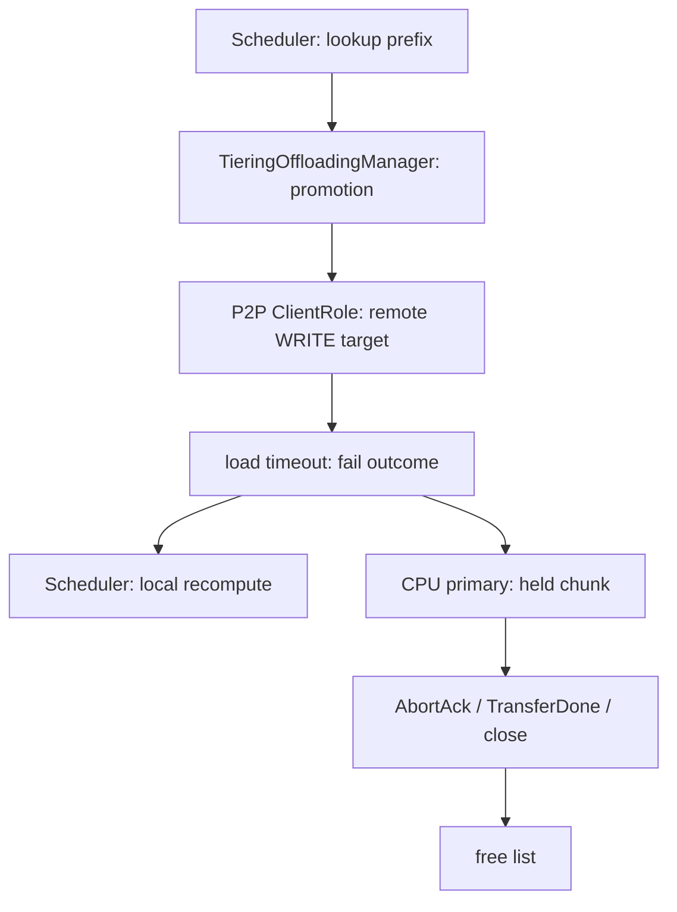
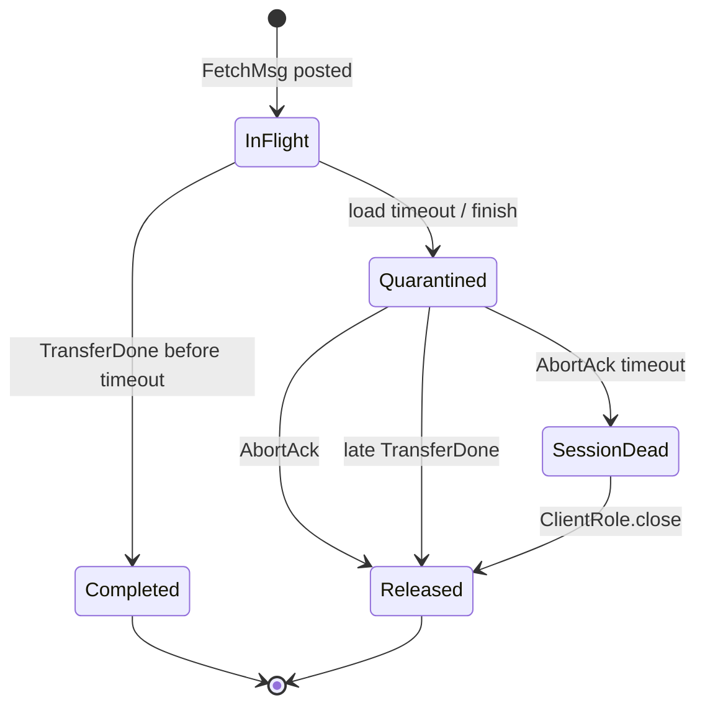

> 源码基线：vLLM [`83bae492`](https://github.com/vllm-project/vllm/commit/83bae4923f65a7508ba600fbfcecb8022577df1b)，即研究时默认分支最新提交。该 head 是 mypy CI 修复，与本文无直接关系；核心变更由 2026-10-29 合入的 [PR #64256](https://github.com/vllm-project/vllm/pull/64256) / [`16777da3`](https://github.com/vllm-project/vllm/commit/16777da3475084eda04813c98cfef4365d5dcb58) 提供，source-side stall 检测由 [PR #64251](https://github.com/vllm-project/vllm/pull/64251) / [`491067f4`](https://github.com/vllm-project/vllm/commit/491067f445306bcb974984cce7cdf6c111364465) 提供。

## 本篇在课程路线中的位置

这是第 71 章，仍位于“测试、性能与故障诊断”。第 70 章只确认了通用 `JobResult.deferred_release` API，当时默认分支还没有真实 producer；一天后 P2P consumer 已接入。因此本章不是重复讲 event，而是追踪它第一次进入真实网络故障链：

`Scheduler lookup → P2P promotion → load timeout → logical failure → chunk quarantine → AbortAck / session close → physical release`

## 前置知识回顾

上一章建立了唯一安全前提：

$$\text{reuse(chunk)} \Rightarrow \text{旧 I/O 已不可能再写该地址}$$

`success=False` 只允许请求放弃 cache hit；它不是 DMA/RDMA 已停的证明。primary tier 必须先让 key 变成 `MISS`，却继续把旧 chunk 留在 write-pending 计数内、free list 外的 deferred quarantine。

## 本篇要回答的核心问题

1. P2P load 超时后，vLLM 如何在 10/30 秒处立即失败，而不是再等 5 秒 `AbortAck` deadline？
2. `threading.Event` 由谁创建、跨哪些对象传递、又由哪些终态设置？
3. `AbortAck` 也丢失时，为什么代码选择断开整个 session，而不是直接 `event.set()`？

证据分级如下：代码事实以 `main` 为准；测试事实来自 CPU fake transport 和真实 tier manager 组合测试；PR 报告的 408/426 passed 没有在本文环境重跑；NIXL teardown 能否对已停滞 WRITE 提供硬件级 fence，仍是 [Issue #63602](https://github.com/vllm-project/vllm/issues/63602) 中明确未完成的 GPU 验证，不能当成已证事实。

## 组件在全局架构中的位置



公开入口仍是 [`OffloadingConnectorScheduler.get_num_new_matched_tokens`](https://github.com/vllm-project/vllm/blob/83bae4923f65a7508ba600fbfcecb8022577df1b/vllm/distributed/kv_transfer/kv_connector/v1/offloading/scheduler.py#L1305-L1372)。它调用 manager lookup；secondary hit 会在 primary 预留目标 chunk，随后在 step 末批量提交 promotion。本文关注的 P2P 代码运行在同一 engine 进程的 tier polling 路径；`threading.Event` 是进程内 release handle，不跨 wire 序列化。

## 完整调用链

1. [`TieringOffloadingManager.lookup`](https://github.com/vllm-project/vllm/blob/83bae4923f65a7508ba600fbfcecb8022577df1b/vllm/v1/kv_offload/tiering/manager.py#L699-L784) 发现 P2P secondary hit，`_initiate_promotion` 调用 primary `prepare_write`，立即占住目标 chunk；step 末 `_flush_pending_promotions` 构造 `TransferJob` 并调用 tier `submit_load`。
2. [`P2PSecondaryTierManager.submit_load`](https://github.com/vllm-project/vllm/blob/83bae4923f65a7508ba600fbfcecb8022577df1b/vllm/v1/kv_offload/tiering/p2p/manager.py#L594-L650) 从 `ReqContext` 取得 peer 与 `kv_request_id`，把 `job_id/keys/chunk_ids` 交给 `P2PSession.request_blocks`；client 发送 `FetchMsg`，其中 `BLOCK_INDEXES` 是 peer 要写入的本地目标块号。
3. [`ClientRole.collect_results`](https://github.com/vllm-project/vllm/blob/83bae4923f65a7508ba600fbfcecb8022577df1b/vllm/v1/kv_offload/tiering/p2p/session/client.py#L510-L550) 发现 elapsed 超过 symmetric P2P 的 10 秒或 PD 的 30 秒，进入 `_abort_load`。
4. [`_abort_load`](https://github.com/vllm-project/vllm/blob/83bae4923f65a7508ba600fbfcecb8022577df1b/vllm/v1/kv_offload/tiering/p2p/session/client.py#L194-L215) 只发送一次 `AbortFetchMsg`，写入 `aborted_at`，创建 unset `threading.Event`，并立刻产出 `LoadResult(success=False, deferred_release=event)`。load 仍留在 `_requests/_active_loads`，因为物理终态未到。
5. [`P2PSecondaryTierManager._poll_once`](https://github.com/vllm-project/vllm/blob/83bae4923f65a7508ba600fbfcecb8022577df1b/vllm/v1/kv_offload/tiering/p2p/manager.py#L1109-L1177) 原样把 event 搬进 `JobResult`。`TieringOffloadingManager._complete_promotion` 把 key 从可命中状态移除，调用 `defer_write_release`，把 `job_id → event/chunk_ids/deferred_at` 存入 `_deferred_releases`。
6. peer 若回 `AbortAck`，[`on_abort_ack`](https://github.com/vllm-project/vllm/blob/83bae4923f65a7508ba600fbfcecb8022577df1b/vllm/v1/kv_offload/tiering/p2p/session/client.py#L367-L376) 设置 event；若取消前 WRITE 已自然结束，late `TransferDone` 也在 [`on_transfer_done`](https://github.com/vllm-project/vllm/blob/83bae4923f65a7508ba600fbfcecb8022577df1b/vllm/v1/kv_offload/tiering/p2p/session/client.py#L333-L351) 设置同一 event，且不会再报告第二个 outcome。
7. manager 下一次 poll 在 [`_complete_deferred_releases`](https://github.com/vllm-project/vllm/blob/83bae4923f65a7508ba600fbfcecb8022577df1b/vllm/v1/kv_offload/tiering/manager.py#L646-L656) 看见 event 已 set，才把 chunk 归还 free pool并记录 hold duration。

## 关键类型、字段和状态生命周期

[`_InboundLoadState`](https://github.com/vllm-project/vllm/blob/83bae4923f65a7508ba600fbfcecb8022577df1b/vllm/v1/kv_offload/tiering/p2p/session/client.py#L46-L63) 是 client owner：`submitted_at/timeout_s` 管逻辑 deadline，`aborted_at` 管 ack deadline，`release` 管地址复用。三者不可合并，因为 deadline 到期本身不能证明远端 WRITE 已停。



关键 ownership 是：client 持有 load state 和 event；P2P manager 只转发 event；tiering manager 持有 `chunk_ids` 与 allocator mutation 权。网络 poll 线程可以 `event.set()`，但它不直接碰 free list，避免跨线程破坏 primary policy。

`LoadResult/JobResult` 都不携带 tensor；数据平面已经拿到目标 `block_ids`。shape、dtype、device 由握手中的 `block_len/config_fingerprint` 与本地 CPU primary region 约束，control message 只传 key、index 和 request identity。失败方式包括无 session、load timeout、missed ack、protocol error 和 data-plane fault。

## 逐函数源码解读

### 1. `_abort_load`：提交逻辑失败，不提交内存释放

伪代码只有四步：

```python
send(AbortFetch(round_seq, kv_request_id))
load.aborted_at = now
load.release = Event()                 # unset
results.append(LoadResult(False, load.release))
```

它把 request latency 与 memory safety 分开：scheduler 立刻获得 `MISS` 并可重算；旧 chunk 的容量损失继续显式存在。

### 2. `_escalate_abort_ack_timeout`：ack timeout 触发 scope escalation

[`P2PSession._escalate_abort_ack_timeout`](https://github.com/vllm-project/vllm/blob/83bae4923f65a7508ba600fbfcecb8022577df1b/vllm/v1/kv_offload/tiering/p2p/session/session.py#L506-L526) 不设置 event，而是把 `data_plane_fault` 记为 `abort ack timed out` 并 `_disconnect`。原因是“没收到证明”不等于“证明为真”；能做的安全升级，是停止再信任该 peer generation，并把所有同 session 请求收敛到 teardown。

manager 在 [`_reap_dead_sessions`](https://github.com/vllm-project/vllm/blob/83bae4923f65a7508ba600fbfcecb8022577df1b/vllm/v1/kv_offload/tiering/p2p/manager.py#L865-L918) 调用 `session.close()`；[`ClientRole.close`](https://github.com/vllm-project/vllm/blob/83bae4923f65a7508ba600fbfcecb8022577df1b/vllm/v1/kv_offload/tiering/p2p/session/client.py#L552-L579) 对已报告失败的 load 只 set event，对尚未报告的 load 则返回 failed job。这样每个 outcome 仍只出现一次。

### 3. `drain_jobs`：reset 等 release，但没有静默强制复用

[`P2PSecondaryTierManager.drain_jobs`](https://github.com/vllm-project/vllm/blob/83bae4923f65a7508ba600fbfcecb8022577df1b/vllm/v1/kv_offload/tiering/p2p/manager.py#L675-L706) 持续 `_poll_once`，直到 session 与 retained transfer 都无 pending work；5 秒只报警，不会擅自 free。正常 missed-ack 路径会在 5 秒 ack deadline 后 disconnect、reap、close，满足 base tier 要求的“返回前所有 deferred event 已 set”。若 polling 本身失活，reset 仍可能长时间阻塞，这是尚未消除的 liveness 风险。

## 具体示例与 shape/状态演算

设一个请求从 peer 拉两个 KV block，每块 16 token；教学 shape 取单层 `bf16[2, 16, 8, 128]`，分别表示 K/V、token、KV head、head size，单块 64 KiB、两块 128 KiB。真实 `block_len` 由模型层数、packing 与配置决定，此处只演算状态，不冒充仓库固定布局。

- `t=0`：primary 分配 chunk 13/14，`FetchMsg.BLOCK_INDEXES=[13,14]`；两块均 write-pending，free count 减 2。
- `t=10.1s`：symmetric-P2P timeout。job 7 立即 `success=False`，两个 key 变 `MISS`，`deferred_release_chunks=2`；free count仍不变。scheduler 可本地重算，fresh chunk 15/16 接收新 owner。
- `t=10.7s`：若 `AbortAck` 到达，event set；下一 poll 归还 13/14。迟到 WRITE 不能污染 15/16，因为它们是不同地址。
- `t=15.1s`：若 ack 一直不来，ack deadline 到期，session 断开；reap 调用 close，event set，再归还 13/14。此时同 session 上未完成 job 也失败，避免继续向不可信 peer 提交新 WRITE。

峰值临时占用是旧 2 块 quarantine + 新 2 块 recompute，共 4 块。可用容量近似为：

$$C_{usable}=C_{total}-C_{pending}-C_{deferred}-C_{pinned}$$

所以 fail-fast 改善请求延迟，却可能短时降低 cache admission 容量；这正是 `vllm:kv_offload_tiering_deferred_release_chunks` 与 hold histogram 应共同观察的原因。

## 为什么这样设计及替代方案

| 方案 | 延迟 | 内存安全 | 吞吐/显存 | 维护成本 |
| --- | --- | --- | --- | --- |
| timeout 后立即失败并 free | 最低 | 错：old WRITE 可污染新 owner | 表面容量最高 | 简单但不正确 |
| 等 AbortAck 后才报告失败 | 多等最多 5 秒 | 安全边界清楚 | chunk 与请求都阻塞 | outcome 与 release 耦合 |
| 当前：立即失败，release 延后 | 请求早 5 秒回退 | ack/late terminal 路径安全 | quarantine 暂占容量 | 需 event、metrics、drain contract |
| ack timeout 直接 set event | 有界 | 错：timeout 不是终态证明 | 容量恢复快 | 把未知伪装成安全 |
| missed ack 后断整个 session | 有界且隔离故障 peer | 依赖 teardown fence 假设 | 牺牲该 peer 并发 | scope 更大但状态收敛 |

从第一性原理看，当前最小正确拆分是“一个 outcome + 一个单调 release witness”。第二个 `JobResult(memory_safe=True)` 会引入重复 job identity 与并行 quarantine table；固定 grace timer则无法证明任何事。session disconnect 是从 request scope 升级到 peer scope，但不是免费的：健康的同 session 请求会一起失败，重连也有 backoff。

## 性能、并发、正确性与边界条件

- symmetric P2P 与 PD 的 load deadline 分别是 10/30 秒，missed `AbortAck` 再给 5 秒；PR #64256 的直接收益是失败 outcome 不再额外等待这 5 秒。
- event 是 level-triggered、幂等、单调对象；`AbortAck` 与 late `TransferDone` 竞争时，load state pop 保证不产生第二个 completion。
- `ROUND_SEQ` 只隔离同一 `kv_request_id` 的多轮 lookup/fetch；[`protocol.py`](https://github.com/vllm-project/vllm/blob/83bae4923f65a7508ba600fbfcecb8022577df1b/vllm/v1/kv_offload/tiering/p2p/session/protocol.py#L178-L339) 没有显式 connection/session generation 字段。session object teardown 会清内存状态，但“旧连接迟到消息与新连接如何在 wire 上完全区分”仍是知识债。
- source-side stall 另有 20 秒 detector：PR #64251 会 fault peer，却保留仍未终止的 source transfer 与 pins。它解决“继续喂 wedged peer”，不等价于证明 consumer 地址可复用。
- 最重要的边界：PR #64256 明确写明“是否 NIXL teardown fences stalled WRITE”仍在 #63602 开放验证。因此代码把 `close()` 当 release boundary 是当前实现事实；它是不是硬件上充分的 no-more-write witness，仍是待验证推断。

## 测试证据与未覆盖风险

直接测试不是一句“有覆盖”：

1. [`test_timed_out_load_holds_chunks_until_abort_ack`](https://github.com/vllm-project/vllm/blob/83bae4923f65a7508ba600fbfcecb8022577df1b/tests/v1/kv_offload/tiering/p2p/test_manager.py#L645-L715) 组装真实 `TieringOffloadingManager + CPUPrimaryTier + P2PSession`。把时间推进过 PD timeout 后，断言 job 已移除、lookup 为 `MISS`、deferred count 为 1、free count不变；注入 `AbortAck` 后 count 归零、free count加 1。
2. [`test_load_abort_ack_timeout_surfaces_failure`](https://github.com/vllm-project/vllm/blob/83bae4923f65a7508ba600fbfcecb8022577df1b/tests/v1/kv_offload/tiering/p2p/test_sessions.py#L837-L869) 验证 timeout 只产生一次失败、event 未 set；ack deadline 到期仍无第二结果，直到 `close()` 才 set。
3. [`test_load_abort_ack_timeout_disconnects_peer`](https://github.com/vllm-project/vllm/blob/83bae4923f65a7508ba600fbfcecb8022577df1b/tests/v1/kv_offload/tiering/p2p/test_sessions.py#L871-L905) 同时放入 job 7/8，证明 job 7 的 missed ack 会让 session death reason 成为 `abort ack timed out`；close 后 job 8 失败，job 7 的 release 才完成。
4. PR #64256 作者报告 P2P + tiering CPU suites 408 passed，且明确标注 GPU fault injection pending；PR #64251 报告 P2P 426 passed，并承认默认 20 秒 stall threshold 尚未用 GPU 负载测量。

仍未覆盖：真实 NIXL/RDMA 迟到 WRITE 与 teardown fence；disconnect/reconnect 后旧 control message；poll thread 卡死时 reset 的上界；大量并发 quarantine 的 admission backpressure；进程崩溃时 event 是易失对象；protocol 顶部 Abort Flow 文档仍写“AbortAck 后报告失败”，已落后于当前 fail-at-timeout 代码。

## 与前后章节的连接

第 70 章定义了通用 release fence；本章把 producer、consumer 与 teardown 终态接通。下一章将聚焦 wire identity：`ROUND_SEQ` 能隔离 fetch round，但不等于 connection epoch。我们要判断重连后怎样拒绝旧 `AbortAck/TransferDone`，以及 generation 应由 control plane、data transport 还是 manager 持有。

## 本篇结论、知识债、三个理解检查问题和下一章

结论只有一句：**load timeout 可以提交“不要这次结果”，但只有 terminal ack 或实现选定的 session teardown boundary 才提交“可以复用这块地址”。** missed ack 触发 disconnect，是因为未知不能被 deadline 洗成安全。

知识债：NIXL teardown 的硬件 fence 证据、显式 connection generation、late message test、poll-stall/reset deadline、quarantine capacity admission、process-crash recovery、GPU fault injection，以及 protocol 文档更新。

理解检查：

1. 为什么 `_abort_load` 必须保留 `_InboundLoadState`，即使失败结果已经交给 tiering manager？
2. 若 ack timeout 到期时直接 `event.set()`，具体会破坏哪个地址所有权不变量？
3. `ROUND_SEQ` 为什么不足以充当跨重连的 session generation？

下一章：**重连后怎样拒绝旧消息——P2P Round Sequence、Connection Epoch 与 Late Control Message Fence。**

## 课程账本增量

- 第 71 章；源码基线 `83bae492`。
- 新覆盖 `ClientRole._abort_load/collect_results/on_abort_ack/on_transfer_done/close`、`P2PSession._escalate_abort_ack_timeout`、P2P manager `_poll_once/_reap_dead_sessions/drain_jobs`。
- 新确认不变量：逻辑 deadline 只提交 failure；release witness 单调且不产生第二 outcome；missed ack 必须升级故障 scope，不能直接授权地址复用。
- 测试证据补齐真实 P2P producer 到 CPU primary free-list 的端到端状态；GPU/NIXL fence 仍未证实。
- 下一章进入 connection generation 与迟到 control message。
