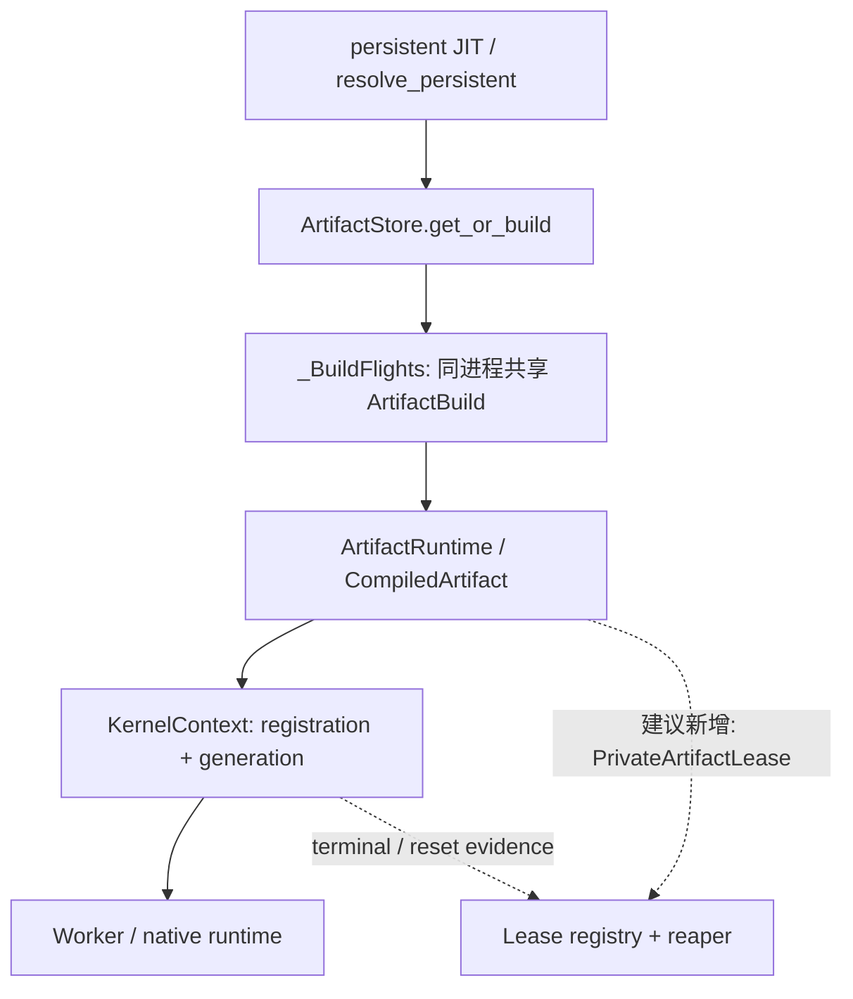
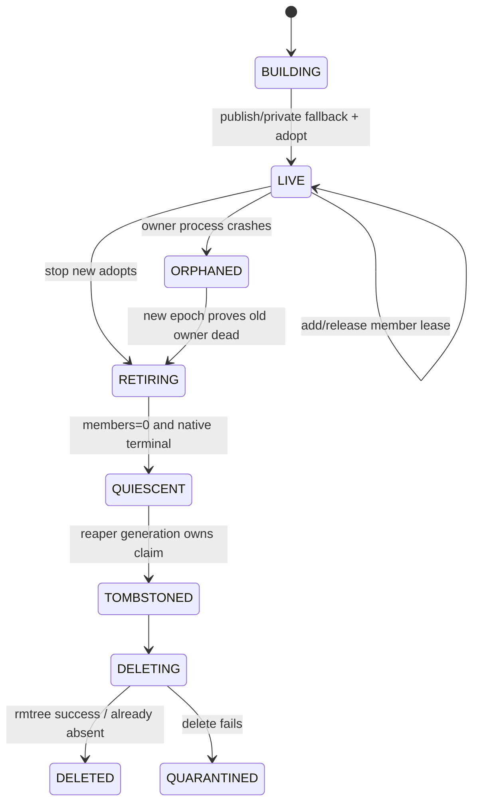

## 本篇在 PTO 课程路线中的位置

这是 PTO 全栈课程第 82 篇，仍位于 **Python/JIT → Artifact Store → runtime/device** 的 Host 生命周期段。上一章确认：fresh build 的 `ArtifactBuild.value/private_directory`、`ArtifactRuntime.directory/_chips`、decorator 对象缓存与可选的 Worker registration，都可能让 private tree 在 publish 之后继续存活；当前代码没有 online cleanup/eviction API。

本篇只推进一个问题：**多个 `ArtifactRuntime` 或调用者共享同一棵 private tree 时，怎样证明最后一个使用者已经离开，并让 crash 后的另一个进程安全接管回收？** 源码基线是 PyPTO 默认分支提交 [`f32ecf3f`](https://github.com/hw-native-sys/pypto/commit/f32ecf3f05d23a83a52283ad7998ca59cd8d291d)。它比上一章的 `8dceaa5f` 前进两个提交，但[比较结果](https://github.com/hw-native-sys/pypto/compare/8dceaa5f4035dc16e3e34961c51de597cfbbd01b...f32ecf3f05d23a83a52283ad7998ca59cd8d291d)未改动本文涉及的 Artifact Store、persistent JIT、`ArtifactRuntime` 与 kernel runtime 文件。

## 前置知识

- `ArtifactStore.get_or_build` 先在 private 目录生成完整产物，再尝试发布 immutable shared artifact。
- `PUBLISHED` 只说明 shared bytes 已就绪；返回的 builder value 仍可能引用原 private 路径。
- `ArtifactRuntime.load` 负责 GENERATED→READY promotion 和 callable 缓存，不拥有 device execution 的终止事实。
- `KernelContext`/Worker 才知道 registration、submission 与 native cleanup 何时真正结束。

## 今日 1–2 个核心问题

1. 为什么普通 Python refcount、一个共享原子计数器或 TTL，都不足以证明 private tree 可删除？
2. 一个 crash-safe 协议至少需要哪些 identity、lease、epoch 与 reaper 状态，才能同时避免 use-after-delete、永久泄漏和重复扣账？

先给结论：**“谁还在用”与“谁有权删除”是两个不同的不变量。** 前者需要可核验的 live-member/native-use census；后者需要带 generation 的唯一回收权。只做 refcount，解决不了持有者 crash；只做 owner lock，又不知道 native 侧是否仍在读。

## PTO 全栈中的位置



实线是当前调用与所有权链；虚线是本文建议的回收协议，不是已合入实现。上游输入是 JIT identity 与 private build；下游消费者是 `CompiledArtifact` callable、kernel registration 和 native submission。reaper 不能绕过任何一层直接把“Python 对象看不见了”解释成“设备不再使用”。

## 概念和精确语义

### 1. Lease 证明“我正在使用”，不是“我拥有目录”

建议的 `PrivateArtifactLease` 至少绑定：

| 字段 | 语义 | 防止的问题 |
| --- | --- | --- |
| `artifact_id` | 内容 key + private instance nonce，而非仅路径 | 同一路径被重建后的 ABA |
| `owner_epoch` | `process incarnation + monotonic epoch` | PID 复用、fork 后继承旧身份 |
| `member_id` | 每次 adopt 的唯一成员 | 同一进程内多个 Runtime 被误合并 |
| `path_digest` | 规范化路径与 manifest/instance identity 的摘要 | 删除错误目录 |
| `retained_bytes` | 该实例实际占用；按 artifact 计一次 | 四个 lease 被计成四份容量 |
| `state` | ACTIVE / RELEASING / RELEASED | close 重试与幂等 |

`adopt` 的后置条件是 durable ACTIVE 记录已建立，随后 Runtime 才能暴露 private-backed callable；`close` 只撤销自己的 member lease，不能直接 `rmtree`。如果 admission 已进入 RETIRING，新成员必须失败或转向 shared HIT，不能偷偷复活旧目录。

### 2. Owner epoch 证明“这一代回收者有权决策”

一个 plain PID 不够：进程退出后 PID 会复用，fork 子进程也会复制内存状态。建议 identity 使用 `boot/session nonce + pid + monotonic epoch`。reaper 抢占时写入新的 `reaper_generation`；之后每个 tombstone、delete receipt 与容量扣减都必须匹配这一代。旧 reaper 即使从长暂停中恢复，也只能看到自己已被 fence，不能继续删。

### 3. 安全删除条件

把前两章的边界收敛成一个谓词：

```text
DeleteAllowed(instance, generation) :=
    no ACTIVE member lease
  ∧ no build/publish flight
  ∧ native generation is CLOSED or reset-fenced
  ∧ caller owns current reaper_generation
  ∧ path_digest still matches the same private instance
```

这是 safety 条件，不是性能策略。TTL 只能触发“重新核验”，不能单独使谓词为真。空间账本也只能在删除成功或核验目录已不存在后扣减；`rmtree` 失败必须保留 retained charge 并进入 quarantine。

## 真实文件、类型、API 或指令逐段解读

### `ArtifactBuild` 与 `_BuildFlights`：共享已经发生，但没有 lease

[`artifact_cache.py`](https://github.com/hw-native-sys/pypto/blob/f32ecf3f05d23a83a52283ad7998ca59cd8d291d/python/pypto/jit/artifact_cache.py) 的 frozen `ArtifactBuild` 同时携带 `handle`、`private_directory` 与 `value`。文档明确说明 fresh build 即使发布成功也保留 value/private path，因为只有适配层知道路径何时已重绑。

同文件的 `_BuildFlights` 以 `(root, private_root, key.digest, spec.digest, ...)` 为 request key，在进程内用 `Future` 合并重叠构建。四个调用者不仅共享路径，测试还要求它们拿到**同一个 `ArtifactBuild` 对象**。flight 完成后条目立刻删除；后来的调用不会命中一个持久对象缓存。

因此当前事实是：

- build cohort 内存在多引用共享；
- cohort 外没有“该 private instance 仍被哪些 Runtime adopt”的 durable census；
- fork 会重置 flight 状态，文件锁只串行化 build/publish，不代表 runtime lease。

把 `_BuildFlights` 的 waiter 数当作 refcount 会过早归零：`Future` 完成只表示构建返回，不表示 `CompiledArtifact` 或 Worker 已退休。

### `resolve_persistent` 与 `ArtifactRuntime`：对象缓存延长生命，但没有 close

[`_persistent.py`](https://github.com/hw-native-sys/pypto/blob/f32ecf3f05d23a83a52283ad7998ca59cd8d291d/python/pypto/jit/_persistent.py) 的 `resolve_persistent` 会把 compiled object 放进 `owner._artifact_objects[compatible]`。fresh result 有 `value` 时，它直接保留该 compiled object；READY/GENERATED HIT 则从 manifest 恢复对象。

[`_artifact_runtime.py`](https://github.com/hw-native-sys/pypto/blob/f32ecf3f05d23a83a52283ad7998ca59cd8d291d/python/pypto/runtime/_artifact_runtime.py) 的 `load()` 在 lock 内完成 promotion，必要时把 `self.directory` 切到 `result.private_directory`，再缓存 `_chips`。它线程安全且可复用，但当前没有 `close()`、lease adopt/release 或 cleanup callback。[`CompiledArtifact`](https://github.com/hw-native-sys/pypto/blob/f32ecf3f05d23a83a52283ad7998ca59cd8d291d/python/pypto/ir/compiled_artifact.py) 也只做 lazy load。

所以 Python GC 最多告诉我们某个 root 可能消失；它无法告诉我们：

- 其他 Runtime 是否共享同一 private instance；
- `KernelContext` 是否保留 registration；
- native submission 是否已 drain；
- finalizer 是否在解释器退出、循环引用或 fork 后按预期运行。

### Kernel registration：现成的 generation/identity 模式

[`runtime/kernel/callable.py`](https://github.com/hw-native-sys/pypto/blob/f32ecf3f05d23a83a52283ad7998ca59cd8d291d/python/pypto/runtime/kernel/callable.py) 的 `artifact_identity` 对 shared artifact 使用稳定 `ArtifactKey`；对 private artifact 使用 Python **对象身份**，而不是路径。直接测试还故意让两个 artifact 复用相同 `output_dir`，验证旧 registration 不会被返回。

[`runtime/kernel/context.py`](https://github.com/hw-native-sys/pypto/blob/f32ecf3f05d23a83a52283ad7998ca59cd8d291d/python/pypto/runtime/kernel/context.py) 的 `_ProcessKernelState` 记录 `pid`、递增 `generation` 与 registrations；`require_registration` 同时检查 owner、PID、generation 和当前 map identity。`close()` 先停止 admission、等待 preparing/submission，再关闭 Worker，最后才清空注册。关闭失败时保留状态以便重试。

[`worker.py`](https://github.com/hw-native-sys/pypto/blob/f32ecf3f05d23a83a52283ad7998ca59cd8d291d/python/pypto/runtime/worker.py) 更直接展示了 alias-safe cleanup：多个 `RegistrationHandle` 可指向同一个 native cid，单个 handle 的 `unregister()` 只关闭 wrapper；真正的 native unregister 统一发生在 `Worker.close()`，避免“最后一个是谁”判断错误。

这不是 filesystem lease 的现成实现，但给出可复用的不变量：**身份不能只用路径；单个 wrapper 析构不能代表共享底层资源退休；generation 必须参与 stale-handle 拒绝。**

## 对象/Tile/Buffer/IR 生命周期

本文追踪的是 private artifact tree，不新增 ISA 指令或 Tile 语义：



当前代码实现了 BUILDING、private fallback、对象/registration retention 的部分事实；RETIRING 之后的状态是建议设计。关键顺序是先 fence 新 adopt，再证明 native terminal，之后 tombstone，最后删除并扣账。若先扣账再删，失败会让 admission 误以为容量已释放；若先删再 fence native，则可能出现 use-after-delete。

## 端到端调用链或指令链

当前真实链：

`resolve_persistent → ArtifactStore.get_or_build → _BuildFlights.run → _build_private/_publish → CompiledArtifact + ArtifactRuntime → ArtifactRuntime.load → load_prebuilt → KernelContext.ensure_callable → Worker.register/submit → KernelContext.close → Worker.close`

建议插入的 ownership chain：

1. build leader 为 private instance 创建 identity 与 retained-byte record；
2. 每个拿到 `ArtifactBuild.value` 或 private fallback 的 Runtime 在暴露 callable 前 `adopt(member_id)`；
3. `KernelContext.ensure_callable` 将 lease identity 绑定到 registration generation；
4. Runtime `close` 撤销 member，但 native terminal receipt 由 KernelContext/Worker 提供；
5. 最后一个 member 只能把实例推进到 RETIRING；
6. 当 build/publish flight 为零且 Worker generation CLOSED/reset-fenced，当前 reaper generation 写 tombstone；
7. 幂等删除成功后才释放 retained bytes。

失败方式也必须显式：adopt durable 写失败就不能返回 private-backed object；close 失败保持 RELEASING 并可重试；双 reaper 由 CAS/transaction 只允许一代获权；路径摘要不匹配立即 quarantine，不可“尽力删”。

## 具体 shape、Tile 和状态演算

仍用与现有 runtime 测试同型的 `FP32[16,16]` Add：每个 Tensor 是 `16×16×4 = 1,024 B`，逻辑上是一块 1 KiB Tile。假设 READY private tree 含二进制与元数据共 24 MiB——这是协议演算，不是仓库 benchmark。

1. P1 的 incarnation 是 `boot=B7, epoch=41`。四个线程同时请求相同 key；`_BuildFlights` 只 build 一次，R1–R4 得到同一个 private path `P`。
2. registry 为同一个 `artifact_id=A` 建立四个 member lease：L1…L4。retained-byte ledger 只计 **24 MiB 一次**，不是 96 MiB。
3. R1、R2 close，ACTIVE members 从 4 变 2；目录仍不可删。
4. R3 已进入 `KernelContext generation=9`，且有一个 pending ticket；R4 随 P1 crash。仅看内存 refcount，L3/L4 都可能永远不 decrement。
5. 新进程 P2（`boot=B8`）以 `reaper_generation=12` 抢占。它不能因 TTL 到期立刻删除：先证明 B7/41 已死亡，再取得 generation 9 的 CLOSED receipt，或通过可信 device reset 建立 `NoOldNativeReader` fence。
6. reaper 将 A 推进到 TOMBSTONED，记录 `path_digest`；`rmtree(P)` 成功后写 delete receipt，并将 retained bytes 从 24 MiB 减到 0。
7. 若另一个 build 恰好复用了文本路径 P，新的 instance nonce/digest 不匹配；旧 generation 12 无权删除新树，消除了 path ABA。

可见“shared refcount=0”只是必要条件之一；crash 后必须把不可撤销的旧 lease 转化为“owner incarnation 已死 + native generation 已 fence”的证据。

## 为什么这样设计及替代方案

| 方案 | 正常路径成本 | crash/暂停 | native alias | 正确性与维护成本 |
| --- | --- | --- | --- | --- |
| Python refcount/finalizer | 最低 | finalizer 不确定，crash 无回调 | 看不到 | 实现简单，但不能承担删除正确性 |
| 单个共享原子 refcount | 低 | crash 会永久漏计；强行清零有误删风险 | 需额外协议 | 健康进程可用，恢复与 ABA 薄弱 |
| TTL/mtime reaper | 扫描成本低 | 长暂停被误判，短 TTL 危险 | 看不到 ticket | 只适合触发核验，不可作为证据 |
| member lease + owner epoch + native receipt | durable I/O 较高 | 可证明旧 incarnation 死亡并接管 | generation 关联 | 协议复杂，但 safety、恢复和精确扣账可闭合 |

还有一个更简单的替代设计：完全禁止 private instance 共享，每个 Runtime 独占复制一份。这会简化回收，却把磁盘、构建延迟与内存映射放大 N 倍，也违背 `_BuildFlights` 当前明确提供的同进程 build coalescing。更合理的工程折中是：shared HIT 继续用 immutable key；private path 使用显式 member lease，durable 写批量化或由本地 owner process 代理，但不能牺牲 epoch 与 native terminal 证据。

## 访存、计算、流水、并行和硬件约束

本章不改变 Tile 访存或计算量；性能成本落在 Host：

- adopt/release 的 durable metadata 写会增加 JIT miss 与 teardown 延迟，可合并日志或 group commit；
- lease registry 按 artifact identity 分片，避免全局锁把不同 key 的并行 build 串行化；
- reaper 扫描应有预算，不能与编译发布争用同一 I/O 队列；
- 24 MiB retained bytes 按物理实例计一次，member 数只影响 liveness，不影响空间账；
- `KernelContext.close` 的 drain 是正确性 fence，不能为降低尾延迟而跳过；超时只能转 quarantine/reset 流程；
- device reset 是否足以建立 `NoOldNativeReader` 是 backend contract。公开代码没有给出跨进程 NPU reset 证明，因此这里明确标为设计所需证据，而非现有硬件事实。

graphability 不受 forward graph 直接影响；但若 cleanup 隐式挂在 Python finalizer 或任意 callable wrapper 上，异步执行与 captured/native 生命周期会变得不可推理。显式 generation/receipt 让执行图外的资源协议更稳定。

## 测试证据与未覆盖风险

当前直接测试分别证明了“共享”和“跨代拒绝”，尚未证明完整回收协议：

- [`test_artifact_cache.py`](https://github.com/hw-native-sys/pypto/blob/f32ecf3f05d23a83a52283ad7998ca59cd8d291d/tests/ut/jit/test_artifact_cache.py) 的 publish-then-hit 用例验证 fresh `PUBLISHED` 仍带 private value/path，而后续 `HIT` 不带；四线程/多 Store 用例验证 cohort 共享同一个 `ArtifactBuild` 和 private directory，cohort 结束后的新调用得到另一目录。
- 同文件的 fork 测试验证 child 不等待 parent 的 in-memory flight；spawn 多进程测试验证 exactly one publish，且死亡进程会释放**构建文件锁**。这不等于 runtime lease 会自动回收。
- [`test_kernel_context.py`](https://github.com/hw-native-sys/pypto/blob/f32ecf3f05d23a83a52283ad7998ca59cd8d291d/tests/ut/runtime/test_kernel_context.py) 验证 32 个并发 prepare 共享一个 registration；prepared specialization 在 state close 前保留 registration；篡改 generation 会被拒绝；复用相同 private directory 的不同对象不会命中旧 registration。
- close-failure 测试验证 cleanup 失败时保留 owner/registration 供重试，这与“删除失败不先释放 retained charge”同构。

仍缺的故障矩阵：

1. 四 member 并发 close，只有一次 RETIRING/TOMBSTONED 转移；
2. owner 在 durable adopt 前后、native submit 前后分别 crash；
3. 两个 reaper 竞争，仅一代可写 tombstone/delete receipt；
4. Worker generation 未 terminal 时 refcount=0 仍拒绝删除；
5. `rmtree` 部分失败、重启后幂等续删且容量只扣一次；
6. 同路径重建的 ABA 测试；
7. fork/PID reuse/长暂停后旧 reaper 恢复的 fencing；
8. 真机 NPU pending work + reset fence 的端到端验证。

本篇没有重跑 NPU 测试；以上“测试事实”来自当前仓库测试内容。PR [#2723](https://github.com/hw-native-sys/pypto/pull/2723) 的 merged 设计明确把 cleanup/eviction 留在范围外；PR [#2811](https://github.com/hw-native-sys/pypto/pull/2811) 合入了更完整的 kernel identity/registration ownership。本文的 lease/reaper 协议是基于这些已合入事实的设计推导，不是当前代码能力。

## 与前后章节的连接

上一章回答“单个 private artifact 何时仍被对象或 native runtime 持有”；本章把它扩展为共享 ownership，并用现有 registration generation 反推 filesystem lease 所需的不变量。下一章将继续收紧最后一步：**reaper 在删除中途崩溃时，如何用 tombstone、幂等 delete receipt 与 retained-byte reconcile 保证目录和容量账最终一致。**

## 本篇结论、知识债、三个理解检查问题和下一章

结论：

1. `_BuildFlights` 已让 private result 发生真实共享，但 flight waiter 不是 runtime lease。
2. Python object identity、`pid + generation` 与 Worker-close-only unregister 展示了正确的 alias/epoch 思路；文件目录仍缺 durable adopt/release。
3. 安全回收必须同时证明 live members 为零、build/publish 已结束、native generation terminal/reset-fenced、当前 reaper 有权且 path identity 未变。
4. retained bytes 按物理 instance 计一次，并且只能在删除成功或已不存在被核验后释放。

知识债：lease schema 与事务边界、owner incarnation 的可靠死亡检测、KernelContext terminal receipt、backend reset fence、tombstone 持久化、部分删除恢复、精确容量 reconcile，以及上述 fault-at-every-boundary 测试。

理解检查：

1. 为什么四个调用者共享同一个 `ArtifactBuild`，不能把 `_BuildFlights` 的 waiter 数直接当成目录 refcount？
2. 当 ACTIVE member 已为零但 Worker generation 仍有 pending ticket 时，哪个删除条件尚未满足？
3. 为什么 path + PID 仍会有 ABA，而 instance nonce/path digest + owner/reaper generation 能拒绝旧证据？

下一章：**Reaper 删到一半自己崩了怎么办——Tombstone、Idempotent Delete 与 Retained-byte Exactly-once Reconcile。**

## 课程账本增量

- 章节：82
- 仓库：仅 `hw-native-sys/pypto`
- 源码基线：[`f32ecf3f`](https://github.com/hw-native-sys/pypto/commit/f32ecf3f05d23a83a52283ad7998ca59cd8d291d)
- 新覆盖：`_BuildFlights` 的共享结果语义；private `artifact_identity`；`KernelRegistration(pid, generation, owner)`；Worker alias-safe unregister/close。
- 新确认不变量：liveness census 与 reclaim authority 必须分离；TTL 只能触发核验；path identity、native terminal 与 current reaper generation 缺一不可；空间按 instance 计量并在物理删除后扣账。
- ISA 知识地图：无新增 ISA、Tile、layout 或 memory-location 语义；补齐 Host artifact 从共享构建到 crash recovery 的 ownership 边界。
- 下一章：tombstone、幂等删除与 retained-byte exactly-once reconcile。
