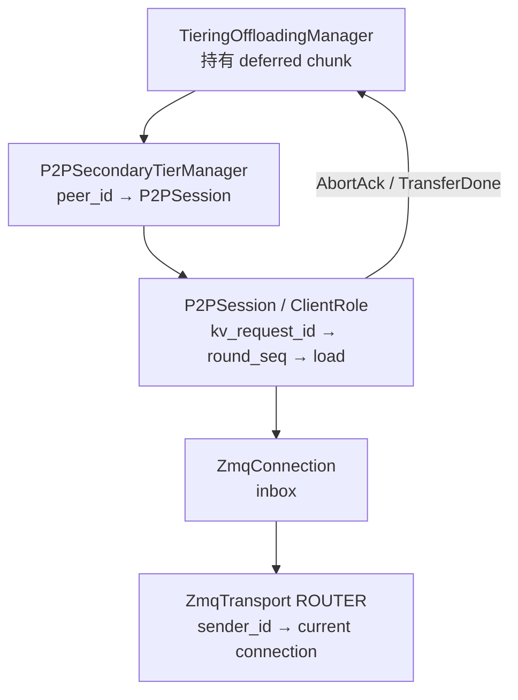
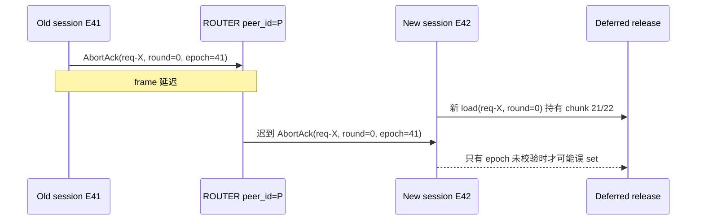

> 源码基线：vLLM [`17550580`](https://github.com/vllm-project/vllm/commit/17550580e932f15e772185847382d3ae4211f5ec)，即研究时默认分支最新提交。相对第 71 章前进 97 个提交，但本文涉及的 P2P protocol/client/session/manager、ZMQ transport 与直接测试均未变化；本篇因此是在同一实现上继续闭合“重连后的迟到消息”知识债。故障背景可参见 [Issue #63602](https://github.com/vllm-project/vllm/issues/63602)，其中把“只有 terminal WRITE 或经验证的 peer generation fence 才能回收目标内存”列为目标性质。

## 本篇在课程路线中的位置

这是第 72 章，仍位于“测试、性能与故障诊断”。第 71 章已经证明：load timeout 只提交失败 outcome，`AbortAck`、late `TransferDone` 或 session close 才能设置 deferred-release event。今天只回答下一层问题：**如果旧连接的 control message 在重连后才到，它凭什么释放新连接的状态？**

课程链路推进为：

`deferred release → session close → transport reconnect → late-message identity → connection epoch fence`

## 前置知识回顾

`ClientRole` 把一次 load 存进 `_ClientRequestState.loads[round_seq]`。timeout 后它立即产生失败 `LoadResult`，但把 `threading.Event` 留在 `_InboundLoadState.release`；收到匹配的 `AbortAck`/`TransferDone` 才 `set()`。missed ack 会断开 session，随后 `close()` 设置剩余 event。

上一章最后留下一个关键结论：`ROUND_SEQ` 是**请求内的 fetch round identity**，不是 connection identity。它从 `_ClientRequestState.round_seq = 0` 开始，每次 `request_blocks()` 取值后加一；新的 `P2PSession` 会重新创建 `ClientRole`，自然也重新从 0 开始。

## 本篇要回答的核心问题

1. 当前代码怎样隔离同一 session 内的多轮 `FetchMsg`？
2. ZMQ 重连时，旧 frame 为什么仍不能仅靠 `peer_id + round_seq` 被证明为“属于当前 session”？
3. 最小的 connection epoch 协议应该 fence 哪些状态和释放动作？

## 组件在全局架构中的位置



上层关心的是 chunk 能否回到 free list；`P2PSession` 负责协议语义；`ZmqTransport` 只按 peer identity 路由 bytes。问题恰好落在两层接缝：transport 认为“来自同一个 `host:port`”已经足够，release 逻辑却需要证明“来自创建这次 WRITE 的那一代连接”。

## 完整调用链

当前成功链如下：

1. [`P2PSecondaryTierManager._get_or_create_session`](https://github.com/vllm-project/vllm/blob/17550580e932f15e772185847382d3ae4211f5ec/vllm/v1/kv_offload/tiering/p2p/manager.py#L744-L797) 调用 `ZmqTransport.connect(peer_id)`，创建 `P2PSession`。
2. [`P2PSession.attach_connection`](https://github.com/vllm-project/vllm/blob/17550580e932f15e772185847382d3ae4211f5ec/vllm/v1/kv_offload/tiering/p2p/session/session.py#L238-L283) 发送 `ConnectMsg`；`ConnectAckMsg` 后 session ready。
3. [`ClientRole.request_blocks`](https://github.com/vllm-project/vllm/blob/17550580e932f15e772185847382d3ae4211f5ec/vllm/v1/kv_offload/tiering/p2p/session/client.py#L239-L292) 取当前 `round_seq`，把 `_InboundLoadState` 放入 `loads[round_seq]`，发送 `FetchMsg`。
4. peer 完成 RDMA WRITE 后发 `TransferDoneMsg(kv_request_id, success, round_seq)`；abort 路径则最终发 `AbortAckMsg(kv_request_id, round_seq)`。
5. [`P2PSession._dispatch`](https://github.com/vllm-project/vllm/blob/17550580e932f15e772185847382d3ae4211f5ec/vllm/v1/kv_offload/tiering/p2p/session/session.py#L546-L612) 校验字段后调用 `ClientRole.on_transfer_done/on_abort_ack`。
6. 两个 handler 都执行 `st.loads.pop(round_seq, None)`；命中且 load 已失败时，设置它的 release event。

连接死亡后，[`_reap_dead_sessions`](https://github.com/vllm-project/vllm/blob/17550580e932f15e772185847382d3ae4211f5ec/vllm/v1/kv_offload/tiering/p2p/manager.py#L865-L917) 先从 `_sessions[peer_id]` 移除旧 session，再 `session.close()`、移除 remote peer；后续请求才能创建替代 session。这是当前最重要的重连 fence，但它是**对象生命周期 fence**，不是 wire message generation fence。

## 关键类型、字段和状态生命周期

| 对象/字段 | 创建与所有者 | 变化与消费 | 当前身份范围 |
| --- | --- | --- | --- |
| `_ClientRequestState.round_seq` | `ClientRole` 按 `kv_request_id` 创建 | 每次 fetch 后 `+1`；completion 用它索引 `loads` | 单个 `P2PSession` 内、单 request |
| `_InboundLoadState.release` | timeout/finish 时创建，交给上层 deferred release | ack/done/session close 单调 `set()` | load 对象生命周期 |
| `ZmqTransport._connections` | transport 持有 | `peer_id → ZmqConnection`；dead entry 被替换 | 进程内当前 peer |
| DEALER `identity` | `_open_connection()` 设置 | 固定为 `self._local_id.encode()` | 跨重连稳定 |
| `_monitor_seq` | transport 单调增加 | 只让 inproc monitor endpoint 唯一 | **不是 wire epoch** |

[`ConnectMsg`](https://github.com/vllm-project/vllm/blob/17550580e932f15e772185847382d3ae4211f5ec/vllm/v1/kv_offload/tiering/p2p/session/protocol.py#L115-L150) 有 `peer_id`、RDMA metadata、base/size、config fingerprint、hash seed；[`ConnectAckMsg`](https://github.com/vllm-project/vllm/blob/17550580e932f15e772185847382d3ae4211f5ec/vllm/v1/kv_offload/tiering/p2p/session/protocol.py#L153-L166) 只回 `peer_id`。`TransferDoneMsg` 与 `AbortAckMsg` 也只有 `kv_request_id + round_seq`，没有 session nonce/epoch。

## 逐函数源码解读

### 1. `request_blocks`：round 能解决什么

核心逻辑可压缩成：

```python
round_seq = st.round_seq
st.round_seq += 1
st.loads[round_seq] = load
send(FetchMsg(kv_request_id, block_indexes, round_seq))
```

这允许同一 `kv_request_id` 有多个增量 load 同时在途，completion 不会只凭 request id 误结束另一轮。它解决的是 session 内的并发相关性。

### 2. `on_abort_ack/on_transfer_done`：释放 authority 在哪里

两个 handler 都先以 `(kv_request_id, round_seq)` 找并 `pop` 当前 load。若该 load 已经 timeout，`TransferDone` 或 `AbortAck` 都只设置 release event，不生成第二次 job outcome；找不到时只 warning。这使同 session 的 duplicate/late terminal 幂等化。

但 `pop` 之前没有检查 connection generation。于是安全性隐含依赖更强的外部前提：旧连接 frame 必须永远不可能进入替代 `P2PSession` 的 inbox，或新 session 永不重用相同 `(kv_request_id, round_seq)`。

### 3. `ZmqTransport.poll`：现有重连修复的精确边界

[`poll()`](https://github.com/vllm-project/vllm/blob/17550580e932f15e772185847382d3ae4211f5ec/vllm/v1/kv_offload/tiering/p2p/control/zmq.py#L213-L252) 在 `_recv_router()` 前 sweep dead connections，避免“session 已标死、transport 还登记旧对象”的窗口吞掉重连首条消息。随后 [`_recv_router()`](https://github.com/vllm-project/vllm/blob/17550580e932f15e772185847382d3ae4211f5ec/vllm/v1/kv_offload/tiering/p2p/control/zmq.py#L326-L370) 从 ROUTER frame 解出稳定 `sender_id`，查 `_connections[sender_id]`，直接 enqueue 到当前 connection。

源码注释同时明确：peer 在 `poll()` 运行中死亡，或静默死亡尚未被 heartbeat 发现时，message 仍可能进入 doomed connection，属于现有修复范围之外。更根本地，frame 本身没有 generation，替换后 transport 无法从 payload 证明它来自哪次连接。

## 具体示例与 shape/状态演算

沿用上一章的两块 KV：每块 16 token，教学 shape 为单层 `bf16[2,16,8,128]`，每块 `2×16×8×128×2 = 65,536 B = 64 KiB`。



假设旧 session `E41` 的 round 0 timeout，旧 chunk 13/14 正在隔离；随后重连建立 `E42`。如果请求 ID 在 process restart、显式外部 ID 或测试场景中重用，`E42` 的第一轮同样是 round 0，并持有 fresh chunk 21/22。仅比较 `(req-X, 0)`，迟到 ack 的形状完全合法。它若命中新 load，便把“旧 WRITE 已停”的证据错误应用到新地址。

这不是说仓库测试已经复现了内存破坏；它是从当前字段集合与路由键推出的可证伪风险。安全协议不能把“ID 通常不碰撞”当作 no-more-write 证明。

## 为什么这样设计及替代方案

当前设计很容易理解：`round_seq` 是小整数、字典查找便宜，session teardown 清空所有易失状态，重连前还等待旧 TCP identities 断开。正常网络下，它比为每条消息维护全局 ID 简单。

从第一性原理看，release authority 必须同时满足：

$$
ReleaseAllowed = SameConnectionEpoch \land SameRequest \land SameRound \land CurrentOwner
$$

最小补强是：连接发起方生成 128-bit 随机 `connection_epoch`；`ConnectMsg` 携带，`ConnectAckMsg` 原样回显；握手后的每条 control message 都携带它。`P2PSession` 在 dispatch **之前**比较 epoch：旧 epoch 只计数并丢弃，绝不触碰 request/load/release 状态；缺失或未来 epoch 视为协议错误。load、server outbound round、pending abort 与 deferred-release token 的调试身份统一为 `(peer_id, epoch, kv_request_id, round_seq)`。

| 方案 | 正确性覆盖 | 延迟/吞吐/显存 | 维护成本 |
| --- | --- | --- | --- |
| 等旧 TCP monitor 全断再重连（当前测试路径） | 缩小窗口；依赖 heartbeat/transport drain | 重连延迟较高；无 GPU 显存开销 | 最低，但难证明所有 late frame 已排空 |
| 每个 fetch 使用全局 UUID `transfer_id` | 精确 fence completion/abort | 每消息多约 16 B 与 hash lookup；不影响 graph | 不能单独 fence stale `ConnectAck/LookupResp` |
| `connection_epoch + round_seq` | 覆盖整条 control plane；round 仍紧凑 | 一次 nonce 生成、每消息一次比较；CPU 控制面开销，graphability 不变 | 需要 wire version、兼容升级和 stale 指标 |

本地递增整数不够：进程重启后会归零。随机 session nonce，或 `(boot_uuid, local_counter)`，才能跨 process generation 保持不复用。

## 性能、并发、正确性与边界条件

- **并发**：`P2PSecondaryTierManager` 的公共方法在 tiering manager lock 下串行；epoch 校验应在任何 role state mutation 前完成，避免错误消息先 `pop` 再发现失配。
- **延迟与吞吐**：16-byte epoch 相对 msgpack 控制消息和 RDMA payload 很小；代价主要是序列化与比较，不进入 GPU kernel、CUDA Graph 或 KV tensor。
- **显存/CPU 内存**：不增加 KV block；每个 session/round 多一个固定 identity。retired epoch 可用有界 LRU/计数器观测，无需保留完整旧 session。
- **握手**：ack 必须 echo 发起方 nonce；否则旧 `ConnectAck` 也可能把新 session 错误标 ready。握手未完成前不得接受带业务副作用的消息。
- **双连接/乱序**：同 peer 的 duplicate live connection 仍应拒绝；stale epoch message 只能 drop，不应把健康的新 session 断开，否则旧流量可造成可用性攻击。
- **失败方式**：未知字段/类型继续 fail closed；epoch mismatch 是“合法但过期”的消息，不等同于 malformed protocol。两者应分开打 metric。

## 测试证据与未覆盖风险

当前直接测试证据：

- [`test_transfer_done_success`](https://github.com/vllm-project/vllm/blob/17550580e932f15e772185847382d3ae4211f5ec/tests/v1/kv_offload/tiering/p2p/test_sessions.py#L626-L641) 验证 round 0 completion 命中正确 load。
- [`test_finish_abort_ack_emits_one_failure`](https://github.com/vllm-project/vllm/blob/17550580e932f15e772185847382d3ae4211f5ec/tests/v1/kv_offload/tiering/p2p/test_sessions.py#L691-L714) 验证失败先提交、ack 后释放。
- [`test_late_transfer_done_after_abort_ack_is_ignored`](https://github.com/vllm-project/vllm/blob/17550580e932f15e772185847382d3ae4211f5ec/tests/v1/kv_offload/tiering/p2p/test_sessions.py#L736-L764) 验证**同 session**已 pop round 后的 duplicate terminal 不产生第二结果。
- [`test_lookup_expiry_allows_zmq_reconnect`](https://github.com/vllm-project/vllm/blob/17550580e932f15e772185847382d3ae4211f5ec/tests/v1/kv_offload/tiering/p2p/test_manager.py#L1562-L1628) 明确等待旧 TCP monitor `EVENT_DISCONNECTED` 后才重连，并验证替代 session 是新对象。
- [`test_inbound_message_survives_dead_registration`](https://github.com/vllm-project/vllm/blob/17550580e932f15e772185847382d3ae4211f5ec/tests/v1/kv_offload/tiering/p2p/test_zmq_transport.py#L325-L357) 验证 sweep 后重连首消息不丢；测试注释明确 poll 中死亡/heartbeat 未发现的情况未覆盖。

因此，测试事实支持“同 session round 隔离”和“干净 teardown 后可重连”，不支持“跨重连 late control message 一定被拒绝”。缺口包括：旧 `AbortAck/TransferDone/ConnectAck/LookupResp` 注入新 connection、相同 request+round 重用、process restart nonce、epoch rollout 兼容、stale-message flood，以及真实 ZMQ/NIXL 组合故障。

## 与前后章节的连接

第 71 章回答“什么时候 release event 可以 set”；本章补上“谁发来的 terminal 才有资格 set”。下一章还要处理更难的边界：如果整个进程崩溃，内存里的 epoch、deferred event 和 retired-session 证据都消失，重启后的 owner 如何以 boot nonce 和资源 census 证明旧 RDMA generation 已失权。

## 本篇结论、知识债、三个理解检查问题和下一章

结论只有三句：

1. `ROUND_SEQ` 正确隔离同一 session 的多轮 fetch，但新 session 会重新从 0 开始。
2. 当前重连先 reap 旧 session、sweep dead connection，并在测试中等待 TCP disconnect；这是有效窗口收缩，不是 payload 自证 generation。
3. 释放动作需要 `connection_epoch + request + round + current owner` 四重匹配；epoch 必须跨进程不复用并在 dispatch 前校验。

知识债：wire version/兼容升级、boot nonce、所有 control message 的 epoch 覆盖、retired epoch observability、late-message fault injection、真实 ZMQ heartbeat 窗口与 NIXL peer-generation fence。

理解检查：

1. 为什么 `_monitor_seq` 递增不能替代 wire `connection_epoch`？
2. 为什么全局 `transfer_id` 能保护 `TransferDone`，却仍不足以保护迟到 `ConnectAck`？
3. epoch mismatch 为什么应 drop+metric，而 malformed/future epoch 才更适合断开新 session？

下一章：**进程重启后谁证明旧 RDMA 已失权——Boot Nonce、Peer-generation Fence 与 Deferred-resource Census。**

## 课程账本增量

- 新覆盖：`ZmqTransport.connect/poll/_recv_router/_open_connection`、`ZmqConnection` identity/inbox、`P2PSecondaryTierManager._get_or_create_session/_accept_new_peers/_reap_dead_sessions`、`ConnectMsg/ConnectAckMsg` 与 terminal message 的身份字段。
- 新不变量：release authority 必须同时绑定 connection generation、request round 与当前 owner；transport registry replacement 不能替代 wire identity。
- 事实边界：当前 main 没有 `connection_epoch` 字段或跨重连 late-terminal 测试；本文 epoch 协议是从现有缺口推导的建议，不是已合入 API。
- 下一步：把易失 session generation 延伸到 process restart 与真实 RDMA peer invalidation。
