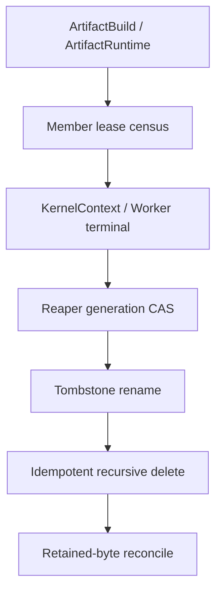
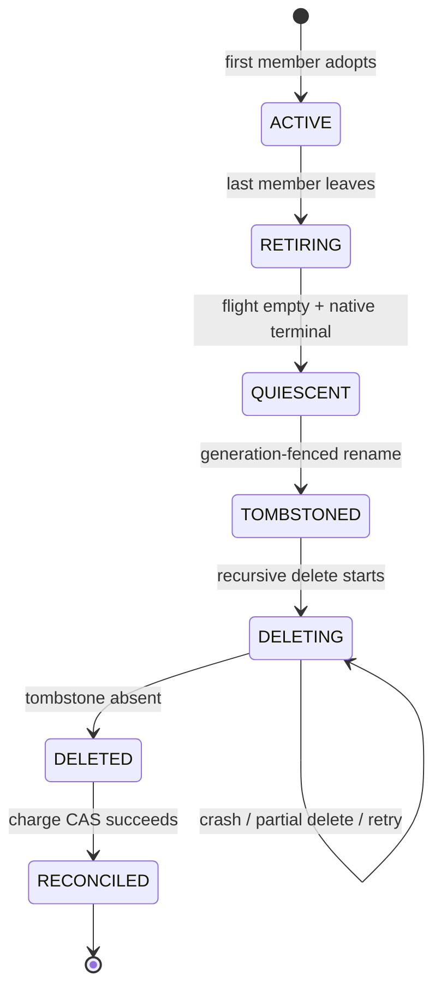

## 本篇在 PTO 课程路线中的位置

这是 PTO 全栈课程第 83 篇，仍位于 **Python/JIT → Artifact Store → runtime/device** 的 Host 生命周期段。第 81 篇确认 private tree 的删除权不能早于 `PathRefs=0 ∧ InFlight=0 ∧ NativeUse=0`；第 82 篇进一步把“谁仍在使用”和“谁有权回收”拆开，提出 member lease、owner/reaper epoch 与 native terminal receipt。

本篇只推进下一处故障边界：**删除动作已经开始，reaper 却在 `rename`、部分 `rmtree` 或容量扣账之间崩溃，系统怎样恢复而不误删新实例、不重复归还容量，也不把已删空间永久计费？**

源码基线是 PyPTO 默认分支提交 [`125788cf`](https://github.com/hw-native-sys/pypto/commit/125788cf85fa1c184700de4aa5ee3e8c59c46477)。它相对第 82 篇基线前进 4 个提交；[比较结果](https://github.com/hw-native-sys/pypto/compare/f32ecf3f05d23a83a52283ad7998ca59cd8d291d...125788cf85fa1c184700de4aa5ee3e8c59c46477)没有改动 `artifact_cache.py`、`_persistent.py`、`_artifact_runtime.py` 或 kernel context。最新 [PR #3168](https://github.com/hw-native-sys/pypto/pull/3168) 增加 paired matmul accumulator phase，与本文 private-artifact 回收边界无直接关系。

## 前置知识

- `ArtifactStore.get_or_build` 在 cache root 外创建 `pypto-build-*`，builder 返回的 value 可能继续引用其中的文件。
- `PUBLISHED` 只说明 immutable shared slot 已发布；fresh `ArtifactBuild` 仍保留 `value/private_directory`。
- `ArtifactRuntime.load` 会缓存 callable；`KernelContext`/Worker 才掌握 registration、submission 与 native close 的终止事实。
- 第 82 篇建议以 instance nonce 区分同 logical key 的不同 private tree，并用 reaper generation 防止旧回收者恢复后继续操作。

## 今日 1–2 个核心问题

1. 为什么把目录改名为 tombstone 还不能立即返还容量？
2. 文件系统删除与 durable ledger 无法组成一个原子事务时，怎样选择 crash 顺序，使恢复只会暂时多计费，而不会少计费或重复扣账？

先给结论：**安全方案应把 namespace 隔离、物理删除和容量对账做成三个单调步骤。** 同文件系统 `rename` 只把旧实例移出可发现命名空间；递归删除必须可重复；retained-byte release 最后以带 `charge_id + reaper_generation` 的 CAS 提交。崩溃后允许“目录已经没了、账本仍计费”，不允许“账本已释放、旧字节或旧使用者仍存在”。

## PTO 全栈中的位置

当前代码覆盖 A 与 C 的部分事实：private path 被 Python/runtime 对象保留，Worker close 负责 native cleanup。B、D、E、F、G 是本文从现有不变量推导的建议协议，**不是 PyPTO 当前 API**。上游输入是已满足删除前提的 private instance；下游消费者是 admission/quota ledger，它只能消费 durable release receipt。

## 概念和精确语义

### Tombstone 是 namespace fence，不是 free receipt

建议 reaper 在确认没有 lease、没有 flight 且 native generation terminal 后，把：

`private_root/pypto-build-a17`

原子改名为：

`private_root/.pypto-trash/a17.g12`

其中 `a17` 是 private instance nonce，`g12` 是当前 reaper generation。改名后的直接收益是：

- 新 caller 不再能通过原路径 adopt 旧实例；
- reaper 后续只在受控 trash root 内工作；
- logical key 即使重新 build，也得到新 instance nonce，不与旧 tombstone 混淆。

但 rename 不会释放 inode/data blocks，也不证明 parent directory entry 已 durable，更不证明没有旧 native reader。因此 tombstone 状态仍必须完整计入 `private_retained_bytes`。

### 幂等删除的后置条件

`DeleteTombstone(instance)` 的后置条件应是“受认证 tombstone 路径不存在”，而不是“本次调用删除了 N 个文件”。恢复时遇到 `ENOENT` 可以视为已经完成，前提是：

1. durable record 仍指向同一 `artifact_id/path_digest/reaper_generation`；
2. 路径位于规范化后的固定 trash root；
3. 逐项操作使用 `lstat`/不跟随 symlink 的删除规则；
4. 没有把 logical key 或可复用 basename 当成实例身份。

部分 `rmtree` 后目录只剩 15 MiB，与从未开始删除一样，都处于 `DELETING`：重跑删除即可。若出现 `EIO`、权限错误或跨文件系统 `EXDEV`，保留 charge 并进入 quarantine，不能用 copy-then-delete 模拟原子 tombstone。

### Exactly-once 指账本 effect，不是函数只执行一次

文件删除可以 at-least-once；容量 release 必须 effect exactly-once。建议每个物理实例拥有稳定 `charge_id`，账本只接受：

`CAS(charge_id, CHARGED, RECONCILED, expected_reaper_generation=g12)`

成功的 actor 才从 `private_retained_bytes` 中减去该实例的 `retained_bytes`。重试者读到 `RECONCILED` 直接返回；旧 g11 reaper 即使恢复，也因 generation 不匹配而无权扣账。

核心容量不变量是：

`admitted_bytes = committed_bytes + reserved_bytes + private_retained_bytes <= quota_bytes`

其中 `private_retained_bytes` 必须覆盖 ACTIVE、RETIRING、TOMBSTONED、DELETING 和“物理已删但尚未 reconcile”的实例。这个顺序故意偏向 over-accounting：crash 可能暂时损失可用容量，但不会让同一物理空间被重复授权。

## 真实文件、类型、API 或指令逐段解读

### `ArtifactBuild`：当前事实是保留，不是清理

[`artifact_cache.py`](https://github.com/hw-native-sys/pypto/blob/125788cf85fa1c184700de4aa5ee3e8c59c46477/python/pypto/jit/artifact_cache.py) 的 frozen `ArtifactBuild` 同时携带 `handle`、`private_directory` 与 `value`。类型文档明确：fresh build 即使发布成功也保留 value 和 private path，只有 adapter 知道何时可重绑；当前没有 automatic cleanup。

`_build_private` 使用 `mkdtemp(prefix="pypto-build-")`，builder 完成后写 manifest 并返回 `PRIVATE`。`_publish` 把 payload 复制到 cache-root 内的 `.tmp.*`，完成验证、sync 和 `RENAME_NOREPLACE` 后返回 `PUBLISHED`，但仍把原 private directory/value 带回 caller。finally 只 best-effort 清理 publication staging，不清理 builder 的 private tree。

这给本篇两个硬约束：reaper 的对象是 cache root 外的 private instance；现有 `_publish` 成功不能成为删除 receipt。

### `_BuildFlights` 与 persistent JIT：完成构建不等于完成使用

同文件的 `_BuildFlights` 用 `Future` 合并同进程、同 request 的构建，operation 完成后立即删除 pending entry。它没有持久 member list，也没有 crash recovery。

[`_persistent.py`](https://github.com/hw-native-sys/pypto/blob/125788cf85fa1c184700de4aa5ee3e8c59c46477/python/pypto/jit/_persistent.py) 又把 compiled object 放入 `owner._artifact_objects[compatible]`；`_fallback_private_root` 的注释也明确 private root 由 build/runtime 对象保留，当前没有 online cleanup。因此 flight 已结束只能证明没有 builder 正在共享那个 `Future`，不能证明对象缓存、Runtime 或 Worker 不再引用文件。

### `ArtifactRuntime` 与 Worker：谁能提供 terminal 证据

[`_artifact_runtime.py`](https://github.com/hw-native-sys/pypto/blob/125788cf85fa1c184700de4aa5ee3e8c59c46477/python/pypto/runtime/_artifact_runtime.py) 的 `load()` 在 lock 内完成 GENERATED→READY promotion，并缓存 `_chips`。若 publication/storage 不可用，`self.directory` 会切换到新的 private directory；当前没有 `close()` 或 cleanup callback。

[`runtime/kernel/context.py`](https://github.com/hw-native-sys/pypto/blob/125788cf85fa1c184700de4aa5ee3e8c59c46477/python/pypto/runtime/kernel/context.py) 则以 `pid/generation/owner` 校验 registration。`close()` 先停止 admission、等待 preparation 和 submission，再调用 Worker close；若 close 失败，它保留 worker、registration 与 failure，允许之后重试。成功后才清空 registration 并进入 `CLOSED`。

所以 filesystem reaper 需要消费 KernelContext/Worker 的 terminal receipt，而不能反过来从“目录已 tombstone”推断 native 已停止。

### 文档/RFC 对当前能力的明确边界

[Artifact Store 文档](https://github.com/hw-native-sys/pypto/blob/125788cf85fa1c184700de4aa5ee3e8c59c46477/docs/en/dev/09-artifact-store.md) 明确要求 writer 不得与 reader deletion 竞态；进程 crash 可留下 private 或 `.tmp.*` 目录，它们都不是 cache hit。

[RFC #2653](https://github.com/hw-native-sys/pypto/issues/2653) 更直接地把 online clear、eviction、容量限制和 cleanup CLI 排除在初始范围外，并指出未来 cleanup 必须单独评审 lifetime/lease protocol。本文协议正是对这项知识债的推导，不应写成已合入功能。

## 对象/Tile/Buffer/IR 生命周期

建议 private instance 的 durable 状态机如下：

关键单调性：

- `RETIRING` 之后禁止新 member adopt；新请求只能命中 shared slot或创建新 instance。
- `TOMBSTONED` 之前必须已经取得 current reaper generation；旧 reaper 所有写入都带 expected generation。
- `DELETING` 可执行任意次；每次只减少或保持旧实例的物理内容。
- `RECONCILED` 只能从 `DELETED` 进入一次，且不会因迟到日志或重试退回 `CHARGED`。

Tile/IR 本身在这里不变化。private tree 可能包含 GENERATED source、READY binary、metadata 和 callable 加载所需路径；删除协议保护的是这些 Host artifact 对象，而不是 PTO ISA Tile 的 local-memory lifetime。

## 端到端调用链或指令链

当前真实链：

1. `resolve_persistent` 构造 `ArtifactKey/ArtifactSpec`；
2. `ArtifactStore.get_or_build` 通过 `_BuildFlights` 和 per-key `flock` 协调 build；
3. `_build_private` 创建 private tree，`_publish` 尝试 immutable publication；
4. fresh value 被存入 `owner._artifact_objects`，`ArtifactRuntime.load` 取得 callable；
5. `KernelContext.ensure_callable` 让 Worker prepare registration，submission 持有 native ticket；
6. `KernelContext.close` 等待 ticket 并完成 Worker cleanup；失败则保留 owner/registration。

建议追加的回收链：

7. Runtime/member close 撤销 lease，最后一个 member 把实例转成 `RETIRING`；
8. coordinator 等 build flight 结束与 native terminal receipt；
9. reaper 以 CAS 取得 generation g，核对 `artifact_id/path_digest`；
10. 同文件系统 rename 到受控 tombstone root并 sync parent；
11. 对 tombstone 执行可重入的 no-follow recursive delete；
12. 证实 tombstone 不存在后，按 `charge_id+generation` CAS 为 `RECONCILED`，最后唤醒 capacity waiter。

## 具体 shape、Tile 和状态演算

沿用上一章的小例子：四个 Runtime 曾共享一棵 24 MiB 的 READY private tree，逻辑 kernel 输入为 `FP32[16,16]`，单 Tensor 1,024 B、单 Tile 1 KiB。这里 shape 只帮助确认 artifact 对应的真实 kernel；回收量是目录的 24 MiB，不是 Tensor 的 1 KiB。

假设 instance 为 `a17`，`charge_id=C17`，当前 owner/reaper generation 为 12：

1. 四个 member lease 已归零，build flight 已结束，Worker generation 9 给出 terminal receipt。ledger 仍计 `private_retained_bytes += 24 MiB`。
2. g12 将状态 CAS 为 `QUIESCENT→TOMBSTONED`，把 `pypto-build-a17` 改名为 `.pypto-trash/a17.g12` 并 sync。此时可发现原路径已消失，但 charge 仍是 24 MiB。
3. reaper 删除 9 MiB 后进程崩溃。重启后的 g13 取得回收权，扫描 tombstone；它看到 ledger 状态仍为 `DELETING`，继续删除剩余 15 MiB，而不是新扣 15 MiB。
4. g13 删除最后一个 entry 后再次崩溃，尚未更新 ledger。下一次恢复核对 C17 与 tombstone identity，确认路径不存在，CAS `CHARGED→RECONCILED`，一次性减 24 MiB。
5. 任意再次重放只读到 `RECONCILED`；g12 若从长暂停恢复，因 expected generation 不匹配，既不能删新实例，也不能重复减账。

最坏结果是步骤 4 期间容量暂时少 24 MiB；不会出现“目录仍占空间但 quota 已返还 24 MiB”的 under-accounting。

## 为什么这样设计及替代方案

| 方案 | crash 后可恢复性 | 安全性与代价 |
| --- | --- | --- |
| 原路径直接 `rmtree`，结束后减账 | 无法区分旧实例与同名重建；部分删除难审计 | 实现最短，但 ABA 和误删风险最高 |
| rename tombstone + 幂等 delete + charge CAS | 每个边界都有单调状态；允许重放 | 推荐；需要 durable state、trash root 与 reaper generation |
| 每删除一个文件就 journal/减账 | 可精细释放大目录容量 | 写放大和恢复复杂；除非目录巨大且增量返还是硬需求，否则不值得 |
| 周期扫描磁盘并重算总量 | 可发现 orphan | scan 与活跃创建有竞态，无法证明 native terminal；适合作为审计，不是 authoritative ledger |
| 所有消费者停机后离线删除 | 符合当前官方边界 | 最安全的现状方案，但无法满足在线 quota recovery |

最小充分方案不需要给每个文件 exactly-once identity。文件删除天然适合 at-least-once；真正需要 exactly-once 的只有物理实例级 capacity effect。把粒度定在 `charge_id`，既保持 crash safety，也避免把 GC 变成文件级分布式事务。

## 访存、计算、流水、并行和硬件约束

- 这条路径不改变 kernel 的 Tile shape、layout、GM/L1/L0 搬运或 graph capture；成本落在 Host filesystem metadata、sync、ledger I/O 与后台删除带宽。
- tombstone rename 应与原 private tree 位于同一 filesystem；`EXDEV` 必须 fail closed。NFS/分布式文件系统只有在原子 rename、目录 durability 与 lock 语义经过验证后才能使用。
- 删除与前台 compile 争用 IOPS、inode lock 和 page cache。reaper 应限速并为 admission 保留安全 headroom，但限速策略无权提前释放 charge。
- tombstone 可快速移出可发现 namespace，却不会降低磁盘 blocks；capacity waiter 只能在 `RECONCILED` 后被唤醒。
- 大目录若需要增量回收，可在后续引入分段 charge；在当前证据下，实例级 charge 更简单、更易验证。
- physical bytes 可用 `st_blocks×512` 估计实际占用，manifest logical size用于内容校验；二者用途不同。当前 PyPTO 没有 per-instance retained-byte telemetry，数字仍属于建议协议。

## 测试证据与未覆盖风险

当前测试提供了删除协议的前置证据：

- [`test_publish_then_hit_preserves_private_value_and_records`](https://github.com/hw-native-sys/pypto/blob/125788cf85fa1c184700de4aa5ee3e8c59c46477/tests/ut/jit/test_artifact_cache.py) 验证 fresh `PUBLISHED` 仍持有 private value/path，而后续 `HIT` 没有 private directory。
- 同文件的 `test_publication_failures_retain_private_build` 验证 publication 注入失败时，usable private tree 保留，`.tmp.*` staging 被 best-effort 清理，shared lookup 仍为 MISS。
- `test_same_key_threads_build_once` 验证四线程只 build 一次；`test_forked_child_does_not_wait_for_parent_build` 验证 fork child 不继承 parent flight，两个进程创建不同 private directory。
- [`test_storage_failure_retains_usable_private_output`](https://github.com/hw-native-sys/pypto/blob/125788cf85fa1c184700de4aa5ee3e8c59c46477/tests/ut/runtime/test_prebuilt_artifact.py) 验证 READY publication/storage failure 后 Runtime 继续复用 private binary。
- [`test_close_failure_retains_owner_and_registrations_for_retry`](https://github.com/hw-native-sys/pypto/blob/125788cf85fa1c184700de4aa5ee3e8c59c46477/tests/ut/runtime/test_kernel_context.py) 验证 Worker close 失败不会伪装成 cleanup 完成；owner/registration 保留到重试成功。
- 同文件的 `test_reusing_private_directory_does_not_return_old_registration` 验证相同 private path 的不同 artifact object 不能复用旧 registration，支持 instance identity 不能只看路径的结论。

[PR #2723](https://github.com/hw-native-sys/pypto/pull/2723) 合入 persistent JIT integration；它建立的是 immutable publication/private fallback，不含 online cleanup。当前没有任何测试覆盖 tombstone、dual reaper、partial `rmtree` 或 retained-byte ledger，这正是本篇建议协议的未实现边界。

后续故障注入至少要覆盖：rename 前/后 crash、parent fsync 前 crash、删除第 N 个文件时 `EIO`、symlink/special file、`ENOENT` 重放、`EXDEV`、双 reaper CAS、旧 generation 恢复、logical key 重建产生新 nonce、删除完成但 ledger 未提交、ledger 已提交后的重复 replay，以及 Worker close failure 时禁止 tombstone。

## 与前后章节的连接

第 82 篇回答“何时允许开始删除、谁有删除权”；本篇回答“删除开始后怎样跨 crash 完成，并且只释放一次容量”。两篇合起来形成：

`member lease zero → native terminal/reset fence → reaper generation → tombstone → idempotent delete → charge reconcile`。

下一篇将处理 liveness：如果 tombstone 因权限、介质故障或远端文件系统语义长期删不掉，怎样做 quarantine backoff、dead-letter garbage、容量告警与 admission pressure，而不靠无限重试拖垮 compiler。

## 本篇结论、知识债、三个理解检查问题和下一章

结论：

1. 当前 PyPTO 没有 online cleanup/reaper；private tree 被 build/runtime 对象有意保留。
2. tombstone rename 只提供 namespace/instance fence，不证明 bytes 已释放。
3. recursive delete 应设计为 at-least-once 幂等操作；partial delete 与 `ENOENT` 都由恢复流程收敛。
4. retained-byte release 必须按 `charge_id + reaper_generation` CAS exactly-once；删除在前、扣账在后，使 crash 只会 over-account。
5. logical key、路径、PID、TTL 和 Python finalizer 都不能替代 private instance nonce、native terminal receipt 与当前 reaper generation。

知识债：durable lease/charge schema、transaction/WAL、trash-root 权限、directory fsync contract、cross-filesystem policy、per-instance physical-byte census、dual-reaper takeover、partial-delete harness、quarantine/dead-letter policy及真机 NPU close/crash 注入。

理解检查：

1. 为什么 `rename` 到 tombstone 后仍不能把 24 MiB 从 quota 中减掉？
2. 为什么删除可以 at-least-once，而 capacity ledger effect 必须 exactly-once？
3. 新 reaper 看到 tombstone 已不存在时，还要验证哪些 identity 才能把 `ENOENT` 当作成功？

下一章：**Tombstone 一直删不掉怎么办——Quarantine Backoff、Dead-letter Garbage 与 Capacity Admission。**

## 课程账本增量

- 第 83 章，源码基线 PyPTO `125788cf`。
- 新覆盖：`ArtifactBuild/_build_private/_publish`、`_BuildFlights`、`resolve_persistent`、`ArtifactRuntime.load`、`KernelContext.close` 与 Artifact Store/RFC cleanup 边界。
- 新确认不变量：namespace fence、physical delete 与 capacity release 是三个线性化点；删除后对账优于对账后删除；实例级 `charge_id` 足以提供 exactly-once effect。
- 当前测试只证明 private retention、flight/fork 隔离与 Worker cleanup retry；tombstone/reaper/ledger 仍是建议协议。
- ISA 知识地图无新增指令、Tile、layout 或 memory-location 语义；补齐的是 Host artifact crash recovery。
- 下一章：quarantine backoff、dead-letter garbage 与 admission pressure。
