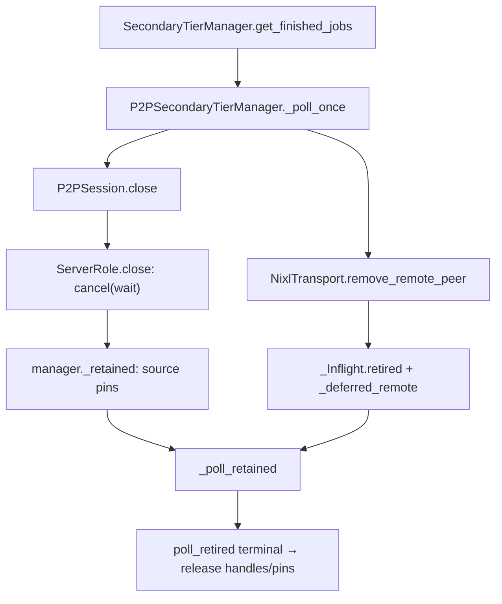

> 源码基线：vLLM [`3a90cc6f`](https://github.com/vllm-project/vllm/commit/3a90cc6fd0504b52bf47d58e8d70cff4b03f2c19)，即研究时默认分支最新提交。相对第 72 章基线前进 40 个提交，但[比较结果](https://github.com/vllm-project/vllm/compare/17550580e932f15e772185847382d3ae4211f5ec...3a90cc6fd0504b52bf47d58e8d70cff4b03f2c19)未改动本文的 P2P tiering 文件；本文是在同一实现上继续闭合 process-restart 知识债。

## 本篇在课程路线中的位置

这是课程第 73 章，仍在阶段 9「测试、性能与故障诊断」。第 71 章把 load timeout 与“旧 WRITE 已停止”分开；第 72 章说明 `ROUND_SEQ` 只隔离一个 `P2PSession` 内的 fetch round，稳定 `peer_id` 不能识别重连代数。

本章再向数据面推进一步：当前 `NixlTransport` 已经有 **peer registration generation**，manager 也已维护 **retired transfer census**。它们能防住同一进程内的异步注册竞态和 session teardown 后的迟到 WRITE；但 owner 进程直接 crash 时，两张表都会消失。问题因此不是“要不要再加一个计数器”，而是：**新进程凭什么确认旧 RDMA writer 已经失权，进而允许地址、source pin 或 destination slot 被复用？**

## 前置知识回顾

- `peer_id` 是 `host:port`，用于 ZMQ 路由与 manager/session 索引；重启后通常不变。
- `_nixl_agent_name` 是每个 manager 启动时生成的 `uuid4`，封装进 NIXL metadata，不是当前控制消息的显式 connection epoch。
- 释放 transfer handle 不等于取消已经 post 的 RDMA WRITE；`PROC/PEND` 可能继续落数据。
- failure result 与 memory-release authority 是两个提交点：请求可以先 fallback，本地/远端内存必须等物理 terminal 证据。

## 本篇要回答的核心问题

1. 当前 `_peer_gen`、`_retained` 与 `_deferred_remote` 分别保护哪一种竞态？
2. 为什么这些内存态 generation/census 不能直接跨 process restart？
3. 最小的 crash-safe 方案，是持久化每个 transfer，还是建立一次 generation-level teardown fence？

先给结论：**当前实现对“活进程内的 session 重建”保护得相当完整；对“owner 进程死亡后的地址复用”没有持久证据。** 最小充分方案不是盲目 journal 每个 transfer，而是让 handshake 携带 boot identity，并要求 backend 给出旧 generation 已被 fence 的 receipt；只有 backend 无法提供该证据时，才需要 durable per-transfer census 或隔离旧内存代。

## 组件在全局架构中的位置



这是当前真实链，不是建议设计。`get_finished_jobs()` 是上层轮询入口；`_poll_once()` 既驱动 control/data progress，也统一 reap dead session。source-side job pin 和 NIXL remote registration 在 teardown 后继续存活，直到同一个 transfer 被证明 terminal。

## 完整调用链

正常 WRITE 从 `ServerRole` 的供需匹配开始，最终调用：

`NixlTransport.write_blocks(peer_id, local_idxs, remote_idxs) → make_prepped_xfer("WRITE") → transfer(handle) → _inflight[transfer_id]`。

故障/重连链则是：

1. 上层调用 `get_finished_jobs()`，进入 `_poll_once()`；
2. session 发现 control disconnect、lookup timeout 或 data-plane fault，`_reap_dead_sessions()` 将其从 `_sessions` 移除；
3. `P2PSession.close() → ServerRole.close()` 对所有 inflight transfer 调用 `cancel(mode="wait")`；
4. NIXL 若仍返回 `PROC/PEND`，`ServerRole.close()` 返回 `retained: transfer_id → store job_ids`，这些 job 不能 unpin；
5. manager 写入 `_retained[tid] = (peer_id, job_ids, retained_at)`；
6. `remove_remote_peer(peer_id)` 递增 `_peer_gen`，移除当前 dlist/agent，并把该 peer 尚未终止的 `_Inflight` 标为 `retired=True`；
7. old dlist/agent 进入 `_deferred_remote`；同 peer 的新 inbound/outbound session 暂时被 `_retained_peer` 拒绝；
8. 后续 `_poll_retained() → poll_retired()` 查询 NIXL state。终止后释放 transfer handle、旧 dlist/agent；只有不再被其他 retained transfer 引用的 store job 才返回失败并解除 source pin。

注意两条所有权链在不同对象中：manager 知道 job/pin，transport 知道 native handle/dlist。任一方提前清账，都可能形成旧 writer 读取已复用 source block，或旧 dlist 清理误伤新 registration。

## 关键类型、字段和状态生命周期

### `_peer_gen`：异步 registration 的进程内 epoch

[`nixl.py`](https://github.com/vllm-project/vllm/blob/3a90cc6fd0504b52bf47d58e8d70cff4b03f2c19/vllm/v1/kv_offload/tiering/p2p/data/nixl.py) 的 `add_remote_peer_async` 先在 lock 下为 `peer_id` 取得新 generation，然后把昂贵的 `add_remote_agent + prep_xfer_dlist` 交给单 worker executor。worker 完成后，`_publish_peer` 在同一个 lock 下比较 generation 并发布。

若 session 在构建期间被 reap，`remove_remote_peer` 会先递增 generation。迟到 worker 的 `gen` 失配，只能释放自己刚建出的 handle，不能把一个已经没有 session 的 peer 重新发布。这里 generation 的作用域非常精确：**一个活着的 `NixlTransport` 实例内，对异步注册 publish 的 CAS fence。**

它不是 boot epoch：进程退出后 dict 消失，新进程从空表重新开始。好消息是旧 registration worker 也随旧进程消失，所以这个 in-process 任务本来就不需要 durable counter；坏消息是已经 post 到 NIC/UCX 的 WRITE 是否同时停止，是另一个物理问题。

### `_Inflight.retired` 与 `_deferred_remote`：native resource census

`_Inflight(peer_id, handle, struck, retired)` 持有 native transfer handle。peer 被移除时，相关 entry 改为 `retired=True`，普通 `poll(peer_id)` 和全局 `poll()` 都跳过它，避免同名新 session 消费旧 completion。

`_DeferredRemote = (peer_id, dlist, nixl_name, retired_tids)` 则把旧 remote descriptor list 与 remote agent 的生命周期绑定到所有 retired transfer。只有其 `tids` 全部离开 `_inflight`，`_release_deferred_remote` 才释放旧 registration。

### `_retained`：source job/pin census

[`manager.py`](https://github.com/vllm-project/vllm/blob/3a90cc6fd0504b52bf47d58e8d70cff4b03f2c19/vllm/v1/kv_offload/tiering/p2p/manager.py) 的 `_retained` 记录 `tid → (peer_id, job_ids, retained_at)`。一个 job 可被多个 transfer 读取，因此 `_poll_retained` 只有在该 job 不再出现在任何 retained entry 中时才生成失败 `JobResult`。这正是 refcount 的语义，但实现为反向集合 census，避免一个 transfer terminal 就过早 unpin shared job。

### 当前 terminal 判据

`poll_retired()` 认为以下情况可释放：

- `check_xfer_state` 返回非 `PROC/PEND`；
- 或抛出明确的 `NIXL_ERR_REMOTE_DISCONNECT`。

`NIXL_ERR_NOT_FOUND` **不算 terminal**：当前代码注释指出 handle lookup 失败时，WRITE 仍可能 inflight。这个区分非常关键——“我查不到 handle”不是“NoOldWriter”证明。

## 逐函数源码解读

### `DataTransport` 的接口契约

[`data/base.py`](https://github.com/vllm-project/vllm/blob/3a90cc6fd0504b52bf47d58e8d70cff4b03f2c19/vllm/v1/kv_offload/tiering/p2p/data/base.py) 把 local region 定义为二维 `memoryview[num_blocks, block_len]`，底层地址由 `ctypes.from_buffer` 取得。`write_blocks` 输入等长的 `local_idxs/remote_idxs: list[int]`，实现转成 NumPy `int32` 数组交给 NIXL；它是异步接口，返回 transport lifetime 内唯一的 opaque `transfer_id`，失败返回 `None`，不应抛给 caller。

前置条件：remote peer 已注册、两端 `block_len` 相同、config fingerprint 兼容、调用由 tiering-manager lock 串行化。后置条件不是“数据已到达”，而只是 transfer 已提交并进入 `_inflight`。`poll`/`cancel(wait)` 才推进 terminal 判定。

### `ServerRole.close`：失败结果与物理 drain 分离

[`server.py`](https://github.com/vllm-project/vllm/blob/3a90cc6fd0504b52bf47d58e8d70cff4b03f2c19/vllm/v1/kv_offload/tiering/p2p/session/server.py) 的 `close` 用 `cancel(wait)`。已经停止的 transfer 立即释放；仍运行的 transfer 被返回到 `retained`，对应 job 不进入 `failed_stores`。所以 session 的逻辑生命周期已经结束，source block 的物理生命周期仍继续。

### `remove_remote_peer`：先 retire，再延迟释放 registration

`remove_remote_peer` 在 `_peer_lock` 下递增 generation 并摘掉当前 dlist/agent，随后扫描 `_inflight`。若存在运行 transfer，它只标记 retired 并把 registration 放入 `_deferred_remote`；无 inflight 才立即释放。这样 old registration 和 new registration 即使拥有同一个稳定 `peer_id`，也不会共享 completion 流。

### `_poll_retained`：正确路径与有意的不安全上界

`_poll_retained` 每轮先收集 terminal tids，再检查 `_RETAINED_HOLD_CAP_S = 30s`。到期仍未停止的 transfer 会调用 `force_release_retired`，日志明确写“releasing handles and source pins anyway”。这是 availability policy，不是 safety proof；[`DataTransport.force_release_retired`](https://github.com/vllm-project/vllm/blob/3a90cc6fd0504b52bf47d58e8d70cff4b03f2c19/vllm/v1/kv_offload/tiering/p2p/data/base.py) 的文档也直接标注“Unsafe while one may still be writing”。

同样，shutdown 只等待 3 秒，之后 `cancel(immediate)`。进程要退出时避免永久挂死是合理运维选择，但不能反向证明地址在另一个新进程中已安全复用。

## 具体示例与 shape/状态演算

设 source A 的 local region 是 `memoryview[1024, 64 KiB]`，target B 注册同样的 `block_len=65536`。store job 41 持有 local blocks 3、7；一次调用：

`write_blocks("B:9000", local_idxs=[3,7], remote_idxs=[11,12])`

会生成两个 `int32[2]` 索引数组并返回 `tid=9`。此时 NIXL WRITE 可能仍在读 A 的两个 64 KiB block。

1. B 断连，A 的 session close；`check_xfer_state(handle9) == "PROC"`。
2. `ServerRole.close` 返回 `retained={9:{41}}`；job 41 不得 unpin。
3. manager 写 `_retained[9]=(B,{41},t0)`。transport 将 tid 9 标为 retired，并把 B 的 old dlist/agent 加入 `_deferred_remote`；`_peer_gen[B]` 从 5 变 6。
4. B 立即重连。无论 inbound 还是 outbound，`_retained_peer(B)` 都阻止创建 session，因为同名 agent 的旧 endpoint/registration 仍被 tid 9 引用。
5. 40 ms 后 `poll_retired` 看见 `DONE`：释放 handle9；old dlist/agent 的 retired set 变空并释放；manager 移除 tid 9，确认 job 41 不再被任何 retained tid 引用，才返回失败并允许 blocks 3、7 复用。

到这里当前实现闭环。

```mermaid
stateDiagram-v2
    [*] --> Active: WRITE tid=9 submitted
    Active --> Retired: session close; state PROC
    Retired --> Deferred: remove peer; keep pin and dlist
    Deferred --> Released: NIXL terminal
    Deferred --> UnsafeRelease: 30s cap or immediate shutdown
    Retired --> EvidenceLost: owner process crashes
    EvidenceLost --> Quarantined: no backend fence receipt
    EvidenceLost --> Reusable: old generation fenced
```



`Released` 是当前正常闭环；`UnsafeRelease` 是有意的可用性逃生口；`EvidenceLost` 才是本章新增的 crash-restart 分叉。新进程只有拿到 backend generation fence，或把旧 backing 保持在 `Quarantined`，才能进入 `Reusable`。

现在把 A 直接 `SIGKILL` 在第 3 步：`_retained`、`_inflight`、`_deferred_remote` 与 `_peer_gen` 全部消失。A2 重启后生成新的 `_nixl_agent_name=uuid4`，但 control identity 仍可能是 `A:9000`；代码没有恢复旧 tid 9 的 census，也没有一个 API 在复用新 region 前验证“旧 A generation 的 NIC/UCX writer/reader 已全部被 fence”。旧进程退出通常会触发 OS/NIXL teardown，但**当前源码和 unit test 没有把它变成可消费的 release receipt**。

## 为什么这样设计及替代方案

从根本约束看，真正需要的不是“保存所有 Python dict”，而是：

```text
ReuseAllowed(region, new_boot) :=
    no live transfer owned by current process
  ∧ old process generation is dead
  ∧ backend proves old RDMA access is fenced
  ∧ control message belongs to new boot/connection generation
```

| 方案 | 正常路径成本 | crash 恢复 | 正确性/维护成本 |
| --- | --- | --- | --- |
| timeout 后直接复用 | 最低 | 固定时间后继续 | 没有物理证明；长尾 WRITE 可越过 timeout |
| durable per-transfer journal | 每次 submit/terminal 持久化 | 可恢复精细 census | I/O、去重、日志截断与 exactly-once 复杂 |
| boot nonce + backend generation fence | handshake 增加 identity；重启做一次 fence | 以 generation 为单位丢弃旧 writer | 最小充分方案，但依赖 NIXL/UCX 提供可验证 teardown contract |
| 新进程永不复用旧 backing/地址 | 内存/容量成本高 | 物理隔离最直观 | 适合作为 backend 无 fence 时的保守 fallback |

推荐顺序是：复用当前 per-process `_peer_gen` 处理注册竞态；把现有 per-process `uuid4` 提升为显式 `boot_id`，让 control handshake、session identity 与 data registration 同代；进程重启时先取得 `OldGenerationFenced(old_boot)`，再使新 region 可 admission。只有 backend 无法提供此证据且 backing store 必须复用时，才引入 durable transfer journal 或把旧 region quarantine 到人工/节点级 reset。

## 性能、并发、正确性与边界条件

- registration 是 `O(num_blocks)`，因此当前放到单 worker executor；`_peer_lock` 只包 generation CAS 和 publish，避免把昂贵 NIXL work放进 scheduler 临界区。
- retained transfer 不进入普通 peer poll，避免旧 completion 污染新 session；代价是同 peer 最长 30 秒无法重连，并持续占用 source blocks。
- 这条路径处理的是 Host control/data-plane lifetime，不改变 attention tensor shape、dtype 或 forward graph；graphability 不受直接影响。
- 容量风险是真实的：许多 retained job 会缩小可用 secondary-tier region。当前 30 秒 cap 选择 availability，最坏情况下牺牲 memory safety；文章不把这个策略包装成“安全超时”。
- `_nixl_agent_name=uuid4` 已提供随机 native identity，但其 opaque metadata 不能代替 wire-level boot/connection epoch；`peer_id`、request id、round、boot id 与 native generation 各有不同作用域。
- 进程 crash 后是否仍可能有 DMA 访问，取决于 NIXL/UCX/NIC teardown。公开代码没有给出硬件级证明，所以“需要 generation fence”是基于安全不变量的设计推断，不是对具体设备行为的断言。

## 测试证据与未覆盖风险

当前直接测试验证了进程内闭环：

- [`test_registration_landing_after_remove_is_discarded`](https://github.com/vllm-project/vllm/blob/3a90cc6fd0504b52bf47d58e8d70cff4b03f2c19/tests/v1/kv_offload/tiering/p2p/test_data_transport.py) 用 event 阻塞 descriptor build，中途 remove peer；同步/异步两种入口都必须得到 superseded error，registration 集为空，迟到 handle 被释放。
- 同文件的 retired tests 验证：`PROC/PEND` 保留 handle；`NIXL_ERR_NOT_FOUND` 不算 terminal；只有 `NIXL_ERR_REMOTE_DISCONNECT` 或 terminal state 才释放；旧 registration 释放后，同 `peer_id` 的新 registration 仍在。
- [`test_manager.py`](https://github.com/vllm-project/vllm/blob/3a90cc6fd0504b52bf47d58e8d70cff4b03f2c19/tests/v1/kv_offload/tiering/p2p/test_manager.py) 验证 source pin 等最后一个 retained transfer、同 peer 重连被拒、其他 peer 不受阻、`drain_jobs` 等待 retained，以及 30 秒 cap 的 force-release 计数。
- [`test_sessions.py`](https://github.com/vllm-project/vllm/blob/3a90cc6fd0504b52bf47d58e8d70cff4b03f2c19/tests/v1/kv_offload/tiering/p2p/test_sessions.py) 验证 close 使用 `cancel(wait)`：运行 transfer 被返回到 retained，未被任何 transfer 读取的 sibling job 才立即失败。

[PR #64250](https://github.com/vllm-project/vllm/pull/64250) 已合入该 source-retention 设计；PR 记录的验证是 CPU/mock NIXL，明确没有真正 wedge RDMA WRITE 的 GPU E2E。[Issue #63602](https://github.com/vllm-project/vllm/issues/63602) 仍把“terminal 或 verified generation fence”列为目标。

以下是计划/实验，而非当前 main 能力：

- [PR #61667](https://github.com/vllm-project/vllm/pull/61667) 提议在 consumer 侧 quarantine destination slots，截至研究时仍为 open。
- [PR #64819](https://github.com/vllm-project/vllm/pull/64819) 的描述包含 H200/NIXL 1.5.0 下 kill/restart 与 replacement 实验，但 PR 尚未合入，且它修复的是 registration-failure disconnect，不是 durable boot fence。

仍缺的关键测试：旧进程在 WRITE 为 `PROC` 时 `SIGKILL`，新进程复用同 host:port；virtual address 恰好复用；旧 control 消息跨 boot 到达；backend teardown receipt 延迟/丢失；节点级 reset；以及 retained census 在 crash 后的恢复或保守 quarantine。

## 与前后章节的连接

第 72 章解决 control-plane late message 的连接身份；本章解决 data-plane handle、registration 与 source pin 的代际所有权。二者必须共同满足：control epoch 阻止旧消息改变新状态，backend fence 阻止旧 writer 触碰新地址。

下一章将检查另一个不可忽略的边界：source pin 已保护，但 consumer destination slot 怎样在 timeout、disconnect 与 process restart 后保持 quarantine，并与当前尚未合入的 PR #61667 对照。

## 本篇结论、知识债、三个理解检查问题和下一章

结论：

1. `_peer_gen` 是活进程内 registration publish fence，不是跨重启 epoch。
2. `_retained + _Inflight.retired + _deferred_remote` 已把 source job、transfer handle 与旧 registration 的生命周期闭合到 NIXL terminal。
3. `NIXL_ERR_NOT_FOUND` 不能证明 WRITE 停止；`REMOTE_DISCONNECT` 被当前代码视为 terminal。
4. 30 秒 retained cap 与 3 秒 shutdown drain 是 availability policy，后续 immediate release 不是安全 receipt。
5. crash-safe 最小方案是显式 boot identity + backend generation fence；没有 fence 时必须 journal 或隔离旧 region，不能只等 TTL。

知识债：wire-level boot id、NIXL/UCX teardown contract、跨重启 retired census、destination-slot quarantine、same-VA fault injection、节点 reset receipt、stale-control-message 计量，以及强制释放后的风险可观测性。

理解检查：

1. 为什么 `_peer_gen` 能阻止迟到 registration worker，却不能证明旧进程 post 的 RDMA WRITE 已停止？
2. 为什么一个 job 被两个 retired transfer 读取时，第一个 terminal 不能触发 unpin？
3. `NIXL_ERR_NOT_FOUND` 与 `NIXL_ERR_REMOTE_DISCONNECT` 在当前 terminal 判据中有何不同？

下一章：**写入目标端的块何时能重用——Consumer Slot Quarantine、Late Terminal 与 Restart-safe Destination Ownership。**

## 课程账本增量

- 第 73 章，源码基线 `3a90cc6f`。
- 新覆盖：`DataTransport` memory model；`NixlTransport._peer_gen/_inflight/_deferred_remote`；`ServerRole.close`；manager `_retained/_poll_retained/_retained_peer`。
- 新确认不变量：registration publish freshness、source pin lifetime 与 native terminal 必须分别持有证据；process restart 会丢失 in-memory census；timeout 不能替代 generation fence。
- 测试边界：当前 unit tests 覆盖进程内 generation/retention；未覆盖真实 RDMA WRITE 跨 owner crash/restart。
- 下一章：consumer destination slot quarantine 与 restart-safe ownership。
