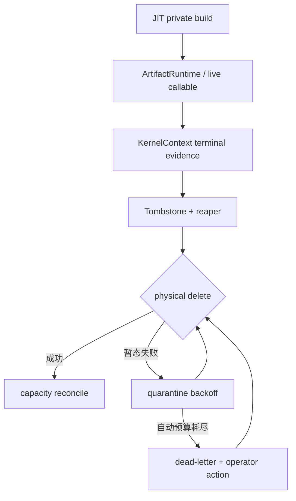
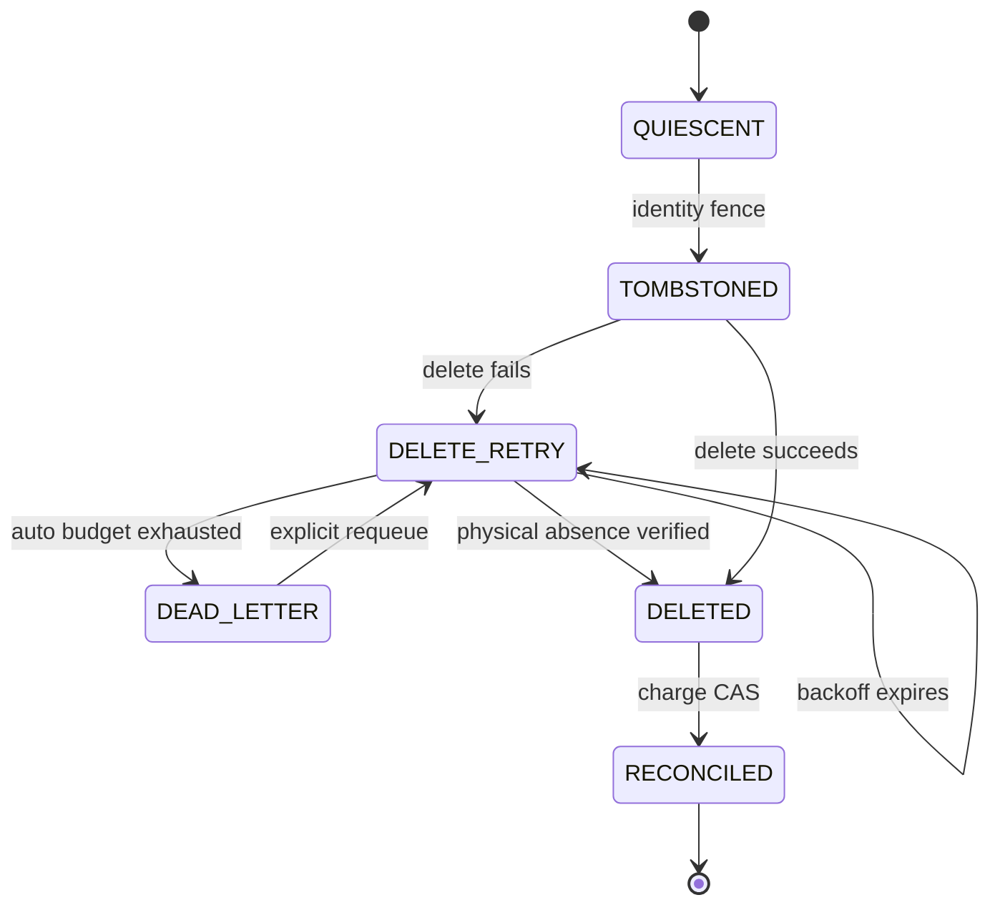

## 本篇在 PTO 课程路线中的位置

这是 PTO 全栈课程第 84 篇，仍在 **Python/JIT → Artifact Store → runtime/device** 的 Host 生命周期段。第 82 篇回答“谁有权开始回收”，第 83 篇把 tombstone、幂等物理删除和 retained-byte 对账拆成三个线性化点。本篇只追最后一个 liveness 问题：**若 tombstone 因 `EBUSY`、`EACCES`、`EIO` 或远端文件系统异常长期删不掉，系统怎样避免重试风暴，又不把未释放的空间误当成可用容量？**

源码基线是 PyPTO 默认分支提交 [`be23606f`](https://github.com/hw-native-sys/pypto/commit/be23606f791fa2251d7fccabdb91c75582268fad)。它比第 83 篇前进 1 个提交；[比较结果](https://github.com/hw-native-sys/pypto/compare/125788cf85fa1c184700de4aa5ee3e8c59c46477...be23606f791fa2251d7fccabdb91c75582268fad)只引入 opt-in local software pipeline 等变化，没有修改本文涉及的 Artifact Store、persistent JIT、`ArtifactRuntime` 或 `KernelContext`。对应 [PR #3227](https://github.com/hw-native-sys/pypto/pull/3227) 与本章回收协议无直接关系。

先给结论：**dead-letter 是“自动重试已耗尽”的操作状态，不是“垃圾已删除”的容量状态。** tombstone 进入 dead-letter 后仍必须按实际占用计费；admission 只能在包含 live、quarantine、dead-letter、in-flight reservation 与 filesystem headroom 的物理预算上做原子预留。安全系统可以暂时拒绝新构建，不能靠少记坏账制造虚假容量。

## 前置知识

- `ArtifactBuild` 的 fresh result 即使成功 `PUBLISHED`，仍保留 `value/private_directory`，因为对象可能引用 private files。
- `resolve_persistent` 把 compiled object 放入 `owner._artifact_objects`；`ArtifactRuntime.load` 再缓存 callable。
- `KernelContext.close` 先等待 native ticket、关闭 Worker，成功后才清 registrations；失败时保留资源供重试。
- 第 83 篇约定：rename 只完成 namespace fence；递归删除可 at-least-once；只有物理删除验证完成后，`charge_id + reaper_generation` 才能以 CAS 释放一次 retained bytes。

## 今日 1–2 个核心问题

1. 可恢复错误、需要人工介入的永久错误和“状态未知”应怎样分流，避免一个坏目录形成高频 retry storm？
2. dead-letter 仍占磁盘时，容量准入怎样同时保证 safety、前台延迟与最终可恢复性？

本篇不发明固定的“重试 5 次”或“磁盘 80%”阈值。重试期限、backoff 上限和 headroom 都应由真实删除延迟、失败分布、构建 burst、磁盘写入速率及 SLO 校准；代码与公开文档没有给出这些数据。

## PTO 全栈中的位置

上游输入是 JIT miss/publication failure 产生的 private tree，以及 runtime/Worker 提供的最后使用证据；本层消费者是 Artifact Store 的后续构建与 admission。它不改变 Tile、layout 或设备 kernel，却决定新 kernel 是否还有安全的 Host 存储空间。

关键点是 `G/H` 都仍连在 capacity charge 上；只有 `F` 能唤醒因容量不足而等待的构建。

## 概念和精确语义

先分清三类状态：

| 状态 | 精确定义 | 允许动作 | 容量语义 |
| --- | --- | --- | --- |
| `DELETE_RETRY` | 本 generation 的删除失败，但 identity 仍可验证，错误被策略判为可重试 | 记录 attempt/error，计算下次时间，释放 worker | 继续全额计费 |
| `DEAD_LETTER` | 自动重试时间/次数/错误策略已耗尽，需修权限、介质、挂载或人工确认 | 告警、诊断、显式 requeue；禁止静默遗忘 | 继续全额计费 |
| `RECONCILED` | tombstone 的物理不存在已由当前 identity/generation 验证，charge CAS 已提交 | 释放 quota、推进 capacity revision | 才能减账 |

建议的 durable record 至少保存 `artifact_id`、`path_digest`、`charge_id`、`retained_bytes`、`reaper_generation`、`attempt`、`last_errno`、`next_attempt_at` 和状态。`next_attempt_at` 是调度提示，不是安全证据；进程时钟漂移最多影响何时重试，不能授权删除或返还容量。

backoff 的最小充分策略是：同一 tombstone 每次只允许一个 generation 执行；失败后以有界指数退避并加入 jitter，避免多目录同时整点唤醒；错误分类可以提前进入 dead-letter，但任何分类都不能越过 identity 校验。`ENOENT` 也不是无条件成功：必须确认 tombstone 对应当前 `artifact_id/path_digest/charge_id`，排除同名新实例与旧 reaper。

容量准入的物理不变量是：

$$
M_{live}+M_{quarantine}+M_{dead}+M_{reserved}+M_{headroom}\le M_{budget}
$$

其中 `M_reserved` 是已获准但尚未落盘的构建峰值预留；`M_headroom` 留给 manifest/staging、文件系统元数据和恢复动作。策略可以区分 shared/private quota，但两者最终必须映射到同一个 physical census。若无法可靠测量物理占用，应保守使用已记 charge，而不是假定 dead-letter 已释放。

## 真实文件、类型、API 或指令逐段解读

当前代码事实与建议设计必须分开：

1. [`artifact_cache.py`](https://github.com/hw-native-sys/pypto/blob/be23606f791fa2251d7fccabdb91c75582268fad/python/pypto/jit/artifact_cache.py) 的 `ArtifactBuild` 文档明确说 fresh build 即使 publication 成功也保留 private directory，且 “There is no automatic cleanup”。`_build_private` 在 cache root 外创建 `pypto-build-*`，builder 返回后不删除它；`_publish` 只对 publication staging 做 `shutil.rmtree(..., ignore_errors=True)`。
2. [`_persistent.py`](https://github.com/hw-native-sys/pypto/blob/be23606f791fa2251d7fccabdb91c75582268fad/python/pypto/jit/_persistent.py) 的 `_fallback_private_root` 明说 build/runtime objects 拥有路径且没有 online cleanup；`resolve_persistent` 用 `owner._artifact_objects[compatible]` 保留 compiled object。
3. [`_artifact_runtime.py`](https://github.com/hw-native-sys/pypto/blob/be23606f791fa2251d7fccabdb91c75582268fad/python/pypto/runtime/_artifact_runtime.py) 的 `ArtifactRuntime` 把 private result 保留整个对象 lifetime，`load()` 以 `_chips` 缓存 callable；promotion 失败时 `directory` 可切到 `result.private_directory`。
4. [`context.py`](https://github.com/hw-native-sys/pypto/blob/be23606f791fa2251d7fccabdb91c75582268fad/python/pypto/runtime/kernel/context.py) 的 `ensure_callable` 把 artifact 放进 `KernelRegistration`；`close` 等待所有 `_submissions` 并调用 `worker.close()`，失败进入 `FAILED` 且不清 registration，成功后才清空。它提供“native 使用已结束”的进程内证据，但没有 durable artifact lease。
5. [`09-artifact-store.md`](https://github.com/hw-native-sys/pypto/blob/be23606f791fa2251d7fccabdb91c75582268fad/docs/en/dev/09-artifact-store.md) 明确：writer 不能与 reader deletion 竞态、invalid slot 只做 offline cleanup、当前没有 online GC/global statistics，private directory 也不会自动删除。[PR #2723](https://github.com/hw-native-sys/pypto/pull/2723) 合入 persistent JIT 时也明确声明“adds no cleanup or eviction API”。

因此 `DELETE_RETRY/DEAD_LETTER`、capacity ledger 与 admission token 都是由当前缺口推导的建议协议，不是 PyPTO 已有类型或 API。

## 对象/Tile/Buffer/IR 生命周期

追踪一个 private artifact `a17`：

1. `JITArtifactStore._build_private` 创建目录，`ArtifactBuild.value` 引用其中文件；
2. `resolve_persistent` 把 compiled object 留在 `_artifact_objects`；
3. `ArtifactRuntime.load` 生成/恢复 READY callable，必要时仍使用 private binary；
4. `KernelContext.ensure_callable` 创建带 PID/generation/owner 的 registration，submission ticket 表示 native 使用；
5. runtime member lease 归零、build flight 结束且 `KernelContext.close` 成功后，建议 reaper 才能 tombstone；
6. 删除失败时，record 在 `DELETE_RETRY ↔ DEAD_LETTER` 间演进，但 `charge_id=C17` 始终保持 `CHARGED`；
7. 修复后重试成功，验证 physical absence，再 CAS `C17: CHARGED→RECONCILED`。此后记录可压缩，容量才可复用。

dead-letter 不是生命周期终点；它是“需要不同执行主体/权限”的持久中间态。

## 端到端调用链或指令链

当前真实链为：

`resolve_persistent → JITArtifactStore.get_or_build → _build_private/_publish → bind/restore → owner._artifact_objects → ArtifactRuntime.load → KernelContext.ensure_callable/submit/close`。

建议在 terminal evidence 之后增加如下状态机：

每条 delete edge 都要携带 current reaper generation；每条 reconcile edge 都要携带 `charge_id`。若进程在删除后、CAS 前崩溃，恢复仍会 over-account；这是刻意选择的安全方向。

## 具体 shape、Tile 和状态演算

用一个可核对的教学例子，不把数值冒充 PyPTO 默认配置。假设物理预算 `M_budget=1,024 MiB`，运维测得必须保留 `M_headroom=128 MiB`；当前 live shared/private 共 `540 MiB`，quarantine 中有 `a17=180 MiB`，dead-letter 中有 `a23=96 MiB`，另有已授权未落盘 reservation `40 MiB`。

当前压力为 `540+180+96+40+128=984 MiB`，只剩 `40 MiB`。新 kernel 的输入可以是 `FP16[128,128]`，Tile 为 `32×32`，但 admission 关心的是 builder 的峰值 artifact estimate，而非 Tensor 的 32 KiB。若新 build 请求 `R=72 MiB`：

1. 不能因为 `a23` 已标为 dead-letter 就减去 96 MiB；它仍占 blocks。
2. 原子检查 `984+72 > 1,024`，返回 structured verdict `WAIT/PHYSICAL_CAPACITY` 或在 deadline 不允许等待时走受配额约束的 private fallback/reject。
3. 运维修复 `a17` 权限，显式 requeue；删除 180 MiB 后先验证目录不存在，再把 C17 对账为 `RECONCILED`。
4. capacity revision 前进，压力变为 `804 MiB`；同一请求重新检查 `804+72≤1,024`，原子写入 72 MiB reservation 后才开工。
5. 若 estimate 低于真实峰值，builder 必须申请增量 reservation 或安全失败，不能越界写满文件系统。

这说明 backoff 解决控制面负载，dead-letter 解决可观测性/责任转移，admission 才守住物理安全；三者不能互相替代。

## 为什么这样设计及替代方案

| 方案 | 前台延迟/吞吐 | 容量正确性 | 运维与维护成本 |
| --- | --- | --- | --- |
| 每次请求同步重试所有 tombstone | 易形成 head-of-line blocking、抬高编译 P99 | 若不提前减账可安全 | 简单但故障放大最严重 |
| 后台无界高频重试 | 前台较少阻塞，却争抢 IOPS/inode lock | 可安全 | 日志风暴、CPU/IO 浪费，无责任终点 |
| dead-letter 后从 ledger 移除 | 短期看似提高吞吐 | **不安全**：制造 under-accounting/ENOSPC | 最不可取 |
| backoff + jitter + charged dead-letter + atomic admission | 删除与构建解耦，可按压力调度 | 推荐；物理字节释放前始终 fail closed | 需要 durable record、metrics、告警与显式 requeue |
| 停机离线清理 | 在线不可用 | 符合当前官方边界且最安全 | 适合现状，不满足在线 liveness |

最小方案不需要让 dead-letter 自动“过期”。TTL 无法证明文件消失；它只能触发升级告警。也不应把 build admission 与 reaper retry 放进同一个全局锁：前者需要短原子 reservation，后者可能卡在慢文件系统。二者通过 durable charge 和 capacity revision 协调即可。

## 访存、计算、流水、并行和硬件约束

- 本章不改变 ISA 指令、Tile layout、GM/L1/L0 搬运或 NPU graph；瓶颈在 Host metadata IOPS、unlink/rmdir 吞吐、目录锁、page cache 和 ledger fsync。
- reaper 并发度应受 deletion service rate 与前台构建 P99 约束；没有测量就不能指定固定 worker 数。高压力可提高回收优先级，但不得跳过 generation/identity fence。
- backoff jitter 防止多个进程同相唤醒；跨进程仍需要 owner/reaper CAS，jitter 不能替代互斥。
- capacity 使用 physical census 与 durable charges 的保守组合。`st_blocks×512` 可估算本地文件系统 blocks，logical file size 用于内容/manifest；网络文件系统的原子 rename、durability 与计费语义必须单独验证。
- 应为 cleanup metadata/WAL 与 emergency recovery 保留 headroom；否则磁盘满时连“记录失败、移动 tombstone、修复 ledger”都无法执行。
- 私有 fallback 不是无限逃生舱：它也消耗相同物理介质时，必须纳入预算；只有落在独立且有独立 quota 的介质上，才能作为另一 capacity domain。

## 测试证据与未覆盖风险

直接测试事实仍只覆盖协议前置条件：

- [`test_artifact_cache.py`](https://github.com/hw-native-sys/pypto/blob/be23606f791fa2251d7fccabdb91c75582268fad/tests/ut/jit/test_artifact_cache.py) 的 `test_publish_then_hit_preserves_private_value_and_records` 证明 fresh publication 仍保留 private value/path；publication failure 测试证明 usable private output 不会被误删；same-key 与 fork 测试分别覆盖进程内一次 build 和子进程独立 flight/private directory。
- [`test_prebuilt_artifact.py`](https://github.com/hw-native-sys/pypto/blob/be23606f791fa2251d7fccabdb91c75582268fad/tests/ut/runtime/test_prebuilt_artifact.py) 覆盖 storage failure 后继续使用 private READY output。
- [`test_kernel_context.py`](https://github.com/hw-native-sys/pypto/blob/be23606f791fa2251d7fccabdb91c75582268fad/tests/ut/runtime/test_kernel_context.py) 的 close-failure 测试证明失败时保留 owner/registration 供重试；same-path 不复用旧 registration，支持 identity 不能只看路径。
- head [PR #3227](https://github.com/hw-native-sys/pypto/pull/3227) 报告 software-pipeline 全量/聚焦/真机验证，但未增加 Artifact Store cleanup 测试；不能把它当作本协议证据。

当前仓库没有 tombstone、backoff、dead-letter、capacity ledger 或 admission token 测试。因此下面是必须新增的验证计划，而非已通过事实：

1. 对 `EBUSY/EACCES/EIO/ESTALE` 注入，验证 attempt 单调、jitter 范围、不会 tight loop；
2. auto budget 耗尽后转 `DEAD_LETTER`，仍保持 charge，重启后不丢记录；
3. explicit requeue 只能由新 generation 接管，旧 reaper 恢复后 CAS 失败；
4. dead-letter 占满预算时，新 reservation 必须 WAIT/REJECT，不得因逻辑状态减账；
5. 删除成功但 reconcile 前 crash，恢复后只减一次；部分删除后 physical census 与 charge 取保守上界；
6. 32/64 个 tombstone 同时到期时验证 jitter、worker bound、前台 compile P99 与无 lost wake；
7. ENOSPC、只读 remount、NFS/ESTALE、目录权限修复、operator requeue 与进程重启组合；
8. NPU Worker close 失败时禁止进入 tombstone，成功 terminal receipt 后才允许回收。

## 与前后章节的连接

第 83 篇建立 safety：删除与返还容量不能颠倒。本篇补上 liveness：失败删除从有界自动重试转入可见的 dead-letter，但物理坏账不消失。第 78–84 章由此形成一条完整 Host 容量链：

`admission reservation → fairness/cancel → SLO/private fallback → runtime retention → lease/reaper fence → tombstone/reconcile → quarantine/dead-letter admission pressure`。

下一篇将继续解决多进程竞态：capacity revision 前进与新 build 预留之间，怎样用 reservation token + census revision CAS 避免最后一份容量被双花。

## 本篇结论、知识债、三个理解检查问题和下一章

结论：

1. 当前 PyPTO 仍没有 online cleanup；最新提交没有改变这一事实。
2. backoff 只降低故障重试负载；dead-letter 只声明自动处理已停止，两者都不证明 bytes 已释放。
3. dead-letter 必须继续计入 retained bytes，并保留 identity、generation、last error 与显式 requeue 路径。
4. admission 必须在 physical budget 上原子预留，计入 live、quarantine、dead-letter、in-flight reservation 与 recovery headroom。
5. 安全降级是 over-account 后 WAIT/REJECT；把未删垃圾从 ledger 移除属于 under-accounting，最终可能 ENOSPC。

知识债：durable quarantine/dead-letter schema、错误分类与 operator ACL、可校准的 retry/SLO metrics、physical census、atomic reservation、capacity revision/no-lost-wake、independent capacity domain、ENOSPC reserve、NFS/object-store adapter、multi-reaper/多进程 fault harness 与 NPU close/crash 真机注入。

理解检查：

1. 为什么 dead-letter 与 `RECONCILED` 是两个正交状态，前者不能释放 quota？
2. 例子中 `a23=96 MiB` 若从预算中移除，哪种具体竞态会把“逻辑空闲”变成物理 ENOSPC？
3. 为什么 jitter 只能缓解 retry storm，却不能替代 reaper generation CAS？

下一章：**最后一份容量会不会被双花——Reservation Token、Physical Census Revision 与 Admission CAS。**

## 第十二次七章知识图谱回顾（课程 78–84）

这七篇从“cache 满了怎么办”推进到“删除永久失败怎么办”：

- 78–79：admission reservation 把多进程腾挪变成显式 quota；ticket/revision 让公平、取消与无饥饿唤醒可验证。
- 80：SLO budget 决定 WAIT、private fallback 或 reject；private 不是免费路径，仍受物理预算约束。
- 81–82：`ArtifactRuntime`/Worker 的路径持有转换为 member lease、native terminal receipt 与 reaper generation，解决“何时可删、谁能删”。
- 83：namespace tombstone、at-least-once 物理删除与 exactly-once capacity effect 分离，crash 只允许 over-account。
- 84：删除失败进入 backoff/dead-letter；liveness 状态不篡改物理事实，admission 继续 fail closed。

贯穿不变量是：**identity 决定对象是谁，lease/terminal evidence 决定能否开始删，physical absence 决定能否返还容量，reservation 决定谁能使用返还后的容量。** 下一组章节将把这四类证据收束成跨进程 transaction/census，并回接实际 build admission。

## 课程账本增量

- 第 84 章，源码基线 PyPTO `be23606f`。
- 新覆盖：private artifact 长期删除失败的 `DELETE_RETRY/DEAD_LETTER/RECONCILED` 正交语义；物理容量不变量与 reservation admission。
- 当前实现事实：源码仍无 online GC、tombstone、dead-letter、capacity ledger 或 admission token；本文协议为建议设计。
- 新确认不变量：dead-letter 仍全额计费；backoff/jitter 不替代 generation CAS；只有 physical absence + charge CAS 能推进 capacity revision。
- ISA 知识地图无新增指令、Tile、layout 或 memory-location 语义；补齐 Host artifact liveness 与 capacity-pressure 边界。
- 下一章：reservation token、physical census revision 与 admission CAS。
