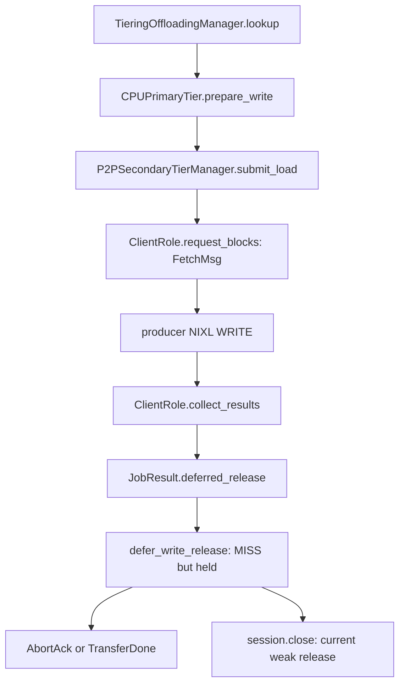
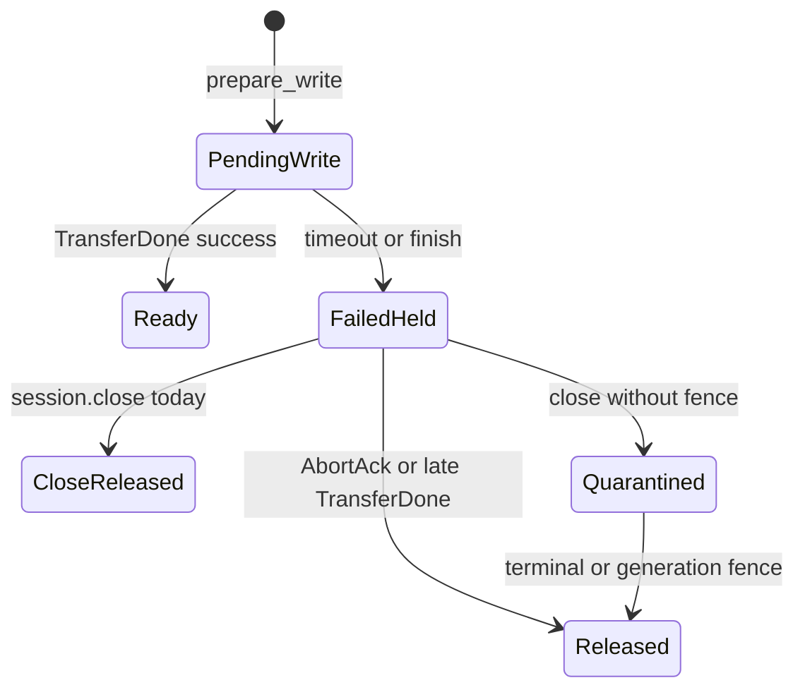

> 源码基线：vLLM [`ea836290`](https://github.com/vllm-project/vllm/commit/ea836290a7166f7d5b8efb1ae6ef1e2b2faa8b56)，即研究时默认分支最新提交。相对第 73 章基线前进 [11 个提交](https://github.com/vllm-project/vllm/compare/3a90cc6fd0504b52bf47d58e8d70cff4b03f2c19...ea836290a7166f7d5b8efb1ae6ef1e2b2faa8b56)；P2P client/session/manager 未变化，本文研究的 consumer lifecycle 仍来自已合入的 [PR #63779](https://github.com/vllm-project/vllm/pull/63779) 与 [PR #64256](https://github.com/vllm-project/vllm/pull/64256)。

## 本篇在课程路线中的位置

这是课程第 74 章，仍位于阶段 9「测试、性能与故障诊断」。第 70 章已经建立通用 `deferred_release`；第 71 章跟过 timeout → `AbortAck`；第 72、73 章分别补上 control epoch 与 source-side retired WRITE。

本篇不再重复 API，而是检查一条更尖锐的不变量：**producer 侧允许一个 WRITE 在 session teardown 后继续存活时，consumer 侧能否仅因 `session.close()` 就复用 destination slot？** 当前答案是“代码会复用，但物理证明不足”。

## 前置知识回顾

- promotion 把远端 KV 写入 consumer 的 CPU primary tier；目标地址来自 `SharedOffloadRegion` 的二维 `memoryview[num_chunks, row_stride_bytes]`。
- load timeout 只说明请求不能再等。它可以触发 local recompute，不能证明远端 WRITE 已停止。
- `AbortAck` 的 producer 语义是：这个 round 的 WRITE 已 terminal；late `TransferDone` 也能提供同样的 no-more-write 证据。
- 第 73 章确认 source 侧 `ServerRole.close()` 会保留仍为 `PROC/PEND` 的 transfer、source pin 与旧 registration。因此“control session 已关”与“RDMA writer 已死”不是同一事实。

## 本篇要回答的核心问题

1. 一个 destination chunk 从分配、timeout、隔离到复用，分别由谁持有？
2. `JobResult.deferred_release` 为什么能让失败立即可见，又不让旧地址立即回池？
3. `ClientRole.close()` 为什么是当前闭环中的弱证明；跨 process restart 又缺什么？

先给判据：

```text
ReuseAllowed(chunk) :=
    logical_owner_removed
  ∧ (matching TransferDone/AbortAck
     ∨ verified backend generation fence)
```

`timeout`、socket 断开、Python 对象销毁都不单独满足第二项。

## 组件在全局架构中的位置



控制面与 allocator 之间没有共享可变 chunk 表。P2P tier 只能返回一个单调 `threading.Event`；真正移除 key、维护 free list 的仍是 `TieringOffloadingManager` 和 `CPUPrimaryTierOffloadingManager`。

## 完整调用链

公开调度入口从 `TieringOffloadingManager.lookup()` 开始。命中 P2P secondary 后，`_initiate_promotion()` 调用 primary 的 `prepare_write()` 预留目标 chunk；`on_schedule_end() → _flush_pending_promotions()` 注册 `TransferJob` 并调用 [`P2PSecondaryTierManager.submit_load()`](https://github.com/vllm-project/vllm/blob/ea836290a7166f7d5b8efb1ae6ef1e2b2faa8b56/vllm/v1/kv_offload/tiering/p2p/manager.py)。

`submit_load()` 从 `CPULoadStoreSpec.chunk_ids` 取得 `np.int32[N]`，再进入 `P2PSession.request_blocks() → ClientRole.request_blocks()`。后者按 `(kv_request_id, round_seq)` 建立 `_InboundLoadState`，发送 `FetchMsg`，其中 `BLOCK_INDEXES` 是 Python `int` 列表。producer 将这些 index 当作 NIXL WRITE 的 remote block index。

consumer 每轮 `get_finished_jobs() → _poll_once() → session.poll() → ClientRole.collect_results()`。超过 10 秒（symmetric P2P）或 30 秒（PD）时：

1. `_abort_load()` 发送 `AbortFetchMsg`；
2. 创建 `threading.Event`，立即返回 `LoadResult(success=False, deferred_release=event)`；
3. P2P manager 转成同字段的 `JobResult`；
4. `TieringOffloadingManager._complete_promotion()` 将 key 逻辑失败，但调用 `defer_write_release()` 而不是普通 `complete_write(False)`；
5. `_DeferredRelease(event, tier_idx, chunk_ids, deferred_at)` 接管物理释放；
6. matching `AbortAck` 或 late `TransferDone` 调用 `event.set()`；下一次 `_complete_deferred_releases()` 才把 chunk id 放回 `_free_list`。

若 5 秒内没有 `AbortAck`，session 被标死并由 manager reap；当前 `ClientRole.close()` 会对所有已有 `release` 的 load 直接 `set()`。问题就在最后一步。

## 关键类型、字段和状态生命周期

| 对象/字段 | 表示什么 | 所有者 | 失效/复用条件 |
| --- | --- | --- | --- |
| `CPULoadStoreSpec.chunk_ids` | CPU cache slot index，`np.int32[N]` | primary allocator → transfer job | job 注册后仍由 allocator 决定是否回池 |
| `_InboundLoadState.release` | no-more-write 的单调承诺 | `ClientRole` | `AbortAck`、late `TransferDone`，当前还包括 `close()` |
| `JobResult.deferred_release` | 把逻辑 outcome 与物理 release 拆开 | secondary → tiering manager | outcome 只消费一次；event 不携带第二次成功/失败 |
| `_DeferredRelease.chunk_ids` | 已 MISS 但不能复用的 slot 集 | `TieringOffloadingManager` | event 被观察为 set 后移除 |
| `_deferred_release_chunk_ids` | allocator 隔离集合 | CPU primary tier | `release_deferred_write()` 后进入 free list |

`defer_write_release()` 做了两个必须同时成立的动作：从 cache policy 删除 key，使 lookup 立即 `MISS`；但不减少 `_num_write_pending_chunks`、不加入 `_free_list`。所以逻辑命名空间已经允许重算，同一物理地址仍拒绝新 owner。



`CloseReleased` 是当前代码事实；`Quarantined` 是满足 no-more-write 不变量所需、但尚未完整合入的方向。

## 逐函数源码解读

### `SharedOffloadRegion.create_kv_memoryview`

[`shared_offload_region.py`](https://github.com/vllm-project/vllm/blob/ea836290a7166f7d5b8efb1ae6ef1e2b2faa8b56/vllm/v1/kv_offload/cpu/shared_offload_region.py) 把 mmap backing 视为 `torch.int8`，再零拷贝导出二维 NumPy/memoryview。shape 是 `[num_chunks, row_stride_bytes]`，dtype 是 byte，device 是 CPU；P2P 以 slot index 定位整行。地址属于 consumer process/共享区，远端只有经 registration 获得的写权限。

### `ClientRole._abort_load/on_transfer_done/on_abort_ack`

[`client.py`](https://github.com/vllm-project/vllm/blob/ea836290a7166f7d5b8efb1ae6ef1e2b2faa8b56/vllm/v1/kv_offload/tiering/p2p/session/client.py) 在 timeout 当下创建 event 并上报一次 failure。之后 terminal message 不再反转 outcome，只 `set()` event；这避免 late success 把已经 fallback 的请求“复活”。message 必须先匹配 request 与 round，再 pop load state。

### `_complete_promotion/_complete_deferred_releases`

[`tiering/manager.py`](https://github.com/vllm-project/vllm/blob/ea836290a7166f7d5b8efb1ae6ef1e2b2faa8b56/vllm/v1/kv_offload/tiering/manager.py) 只允许 failed promotion 携带 deferred release。event 可以由网络线程 set，但 allocator mutation只在 manager 的 polling/lock 域执行。reset 先让每个 tier `drain_jobs()`，再消费 results；契约要求 drain 返回前所有 deferred event 已 set。

### `ClientRole.close`

当前实现把 session end 当成所有已上报失败 load 的 release point，直接 set event。这给 liveness 一个有限上界，却与 [`ServerRole.close`](https://github.com/vllm-project/vllm/blob/ea836290a7166f7d5b8efb1ae6ef1e2b2faa8b56/vllm/v1/kv_offload/tiering/p2p/session/server.py) 的新语义不对称：source 侧会让非 terminal WRITE 跨 close 存活并继续持有 pin。除非 backend teardown 已证明旧 writer 被 fence，consumer close 不能凭自身观察推出 no-more-write。

## 具体示例与 shape/状态演算

设 primary region 为 `memoryview[32, 65536]`，即 32 个 64 KiB slot。请求 R 的两个 KV chunk K0/K1 分到 id 13/14；`chunk_ids=np.array([13,14], dtype=int32)`，Fetch 发送 `[13,14]`。

1. t=0：producer post 两个 WRITE；13/14 均为 pending，free pool 不含它们。
2. t=30.001s（PD）：consumer timeout，立即报告失败并 local recompute。K0/K1 从 policy 删除，但 13/14 进入 deferred 集；隔离量为 128 KiB。
3. recompute 重存同样 keys 时必须获得 fresh id 15/16。此时旧 writer 最多只能污染 13/14，不能碰新 owner；旧 held + fresh 合计占 256 KiB。
4. 路径 A：t=30.040s 收到 `AbortAck`。event set，下一轮归还 13/14，正确闭环。
5. 路径 B：t=35.002s missed ack，session disconnect/reap；当前 `close()` 也归还 13/14。可是 source 侧若仍把 transfer 记为 `PROC`，其 `_retained` 正在告诉我们“WRITE 可能还活着”。此时复用与证据矛盾。

进程重启更严格：consumer crash 会同时丢失 `_deferred_releases` 与 allocator 隔离集合。新进程若重映射相同 backing 或复用可达地址，当前 wire protocol 没有 boot id，backend 也没有向 allocator交付 `OldGenerationFenced` receipt。是否仍会发生 DMA 取决于 NIXL/UCX/NIC teardown；公开 main 没把该硬件行为编码成可验证契约，因此这里只能标为风险，不能断言一定损坏。

## 为什么这样设计及替代方案

| 方案 | 延迟/吞吐 | 容量 | 正确性与维护成本 |
| --- | --- | --- | --- |
| 当前 event + close release | timeout 立即 fallback，正常 ack 后快速回池 | hold 有 5 秒左右的 session 上界 | 简洁；close 是否 fence 未获物理证明 |
| close 后继续 quarantine | 请求仍立即失败 | peer 永不终止时可能永久缩容 | 最保守；需 reset/shutdown 拒绝或运维恢复 |
| [PR #61667](https://github.com/vllm-project/vllm/pull/61667) 的 `memory_safe` 二次结果 | outcome 与安全确认分开 | 可持续隔离 | 需重复 job identity、quarantine table、reset retry；截至研究时仍 open，不是 main 事实 |
| boot id + backend generation fence | 重启时多一次 fence/握手 | fence 后可整代回收 | 最小 crash-safe 证明，但依赖 NIXL/UCX 暴露可验证 teardown |
| 固定 grace timer | 实现最省事 | 容量可预测 | timer 不能证明 stalled WRITE 已停，不满足正确性 |

从第一性原理看，`deferred_release` 这个抽象是对的：它最小化了 outcome path 的延迟，并保持 allocator 单一所有权。需要修正的是 event 的 set authority，而不是把请求失败再次拖到 I/O terminal。对于无法提供 generation fence 的 backend，宁可让容量显式不可用，也不能静默把未知 writer 的地址分给新请求。

## 性能、并发、正确性与边界条件

- held memory 为 `H × row_stride_bytes`；重算同时存在时，相关 keys 的瞬时物理占用可接近两倍。高故障率下必须把 deferred gauge 纳入 admission/backpressure，而不是只看 cache hit rate。
- `_complete_deferred_releases()` 扫描当前 held jobs，复杂度为 `O(H_jobs)`；正常路径 rarity 使它比为每个 terminal 再走一套 job apply 更简单。
- event 的 set 是跨线程信号；free-list mutation仍在 manager lock 下，避免 network thread 与 scheduler allocator 并发写。
- 这条路径处理 CPU byte region，不改变 attention tensor 的逻辑 shape/dtype，也不进入 CUDA Graph；代价体现为 host capacity、fallback compute 与尾延迟。
- late `TransferDone(success=True)` 只能释放旧 slot，不能提交 success；否则 request 已经执行的 recompute 与输出顺序会被反转。
- queued、尚未真正发出的 Fetch 理论上不需要 quarantine；当前 main 没显式记录“消息是否越过 transport handoff”，open PR #61667 正在处理这一区分。

## 测试证据与未覆盖风险

当前 main 的直接测试证明了**实现行为**：

- [`test_timed_out_load_holds_chunks_until_abort_ack`](https://github.com/vllm-project/vllm/blob/ea836290a7166f7d5b8efb1ae6ef1e2b2faa8b56/tests/v1/kv_offload/tiering/p2p/test_manager.py) 使用真实 `TieringOffloadingManager + CPUPrimaryTier + P2PSession`：timeout 后 job 被消费、lookup 为 MISS、deferred count 为 1、free count 不变；注入 ack 后才 free+1。
- [`test_deferred_release_restore_gets_a_fresh_chunk`](https://github.com/vllm-project/vllm/blob/ea836290a7166f7d5b8efb1ae6ef1e2b2faa8b56/tests/v1/kv_offload/tiering/test_tiering_offloading.py) 验证同 key 在 old slot 隔离期间获得不同 fresh id。
- [`test_load_abort_ack_timeout_surfaces_failure`](https://github.com/vllm-project/vllm/blob/ea836290a7166f7d5b8efb1ae6ef1e2b2faa8b56/tests/v1/kv_offload/tiering/p2p/test_sessions.py) 则明确验证 missed ack 后 event 仍未 set，调用 `close()` 才 set。它证明当前 policy，不证明 close 的硬件安全性。
- producer 侧测试已证明 close 对 `PROC/PEND` 使用 wait/retention，而不是假定 session close 等于 terminal；这正是本篇发现的对称冲突。

测试事实与 PR 事实要分开：PR #64256 作者报告相关 CPU suite 408 passed，但 GPU/NIXL E2E 当时仍待补；[Issue #61532](https://github.com/vllm-project/vllm/issues/61532) 的 UCX/TCP probe 观察过 WRITE 在 cancel/remove 之后继续落数据；[PR #61667](https://github.com/vllm-project/vllm/pull/61667) 报告了更强的真实 1 GiB NIXL fault probe，但它仍为 open，验证结果不能冒充 main 能力。

仍缺：真实 RDMA/IB 的 close→late WRITE→slot reuse E2E；buffered terminal 与 disconnect 同批到达；Fetch send 抛错但可能已暴露 remote ids；consumer `SIGKILL` 后 same-backing/same-VA reuse；backend generation fence receipt；永久 quarantine 下 reset、shutdown 与容量 admission。

## 与前后章节的连接

第 73 章从 source 看见“session 结束后 writer 仍可能活”；本章从 consumer 看见“session 结束后 slot 却会被释放”。二者拼在一起才暴露真正的所有权缺口：source retention 保护读取端 pin，不会自动保护 destination allocator。

下一章将把 correctness 债转成资源预算：当正确隔离导致大量 slot 长时间不可用时，admission、backpressure、metrics 与 reset policy 如何避免一边安全、一边把服务饿死。

## 本篇结论、知识债、三个理解检查问题和下一章

结论：

1. `deferred_release` 已正确拆开 request outcome 与 address reuse；timeout 后立即 fallback 不等于立即回池。
2. key 从 policy 删除、旧 chunk 离开 free list、fresh restore 获得新 id，构成 consumer slot quarantine 的核心闭环。
3. matching `AbortAck/TransferDone` 是当前最强的 transfer-level terminal 证据。
4. 当前 `ClientRole.close()` 仍会 set event；而 source 侧可保留跨 close 的 `PROC/PEND` WRITE，因此 close 不是自足的 release receipt。
5. restart-safe 复用需要 boot/connection identity 加 backend generation fence；没有 fence 时只能保守隔离旧 backing。

知识债：close 后持久 quarantine、never-sent Fetch handoff identity、buffered terminal drain、boot id、backend fence receipt、crash 后 census/region recovery、quarantine capacity admission、reset/shutdown rejection 与真实 RDMA same-address fault injection。

理解检查：

1. 为什么 timeout 后 key 可以立刻 MISS，而它原来的 chunk id 仍不能进入 free list？
2. 为什么 source-side retained WRITE 使 consumer 的 `session.close() → event.set()` 失去充分性？
3. late `TransferDone(success=True)` 为什么只能释放旧 slot，不能把已失败的 job 改回成功？

下一章：**隔离块把缓存吃满时怎么办——Quarantine Capacity Budget、Admission Backpressure 与可观测恢复。**

## 课程账本增量

- 第 74 章，源码基线 `ea836290`。
- 新覆盖：`SharedOffloadRegion.create_kv_memoryview`、`CPULoadStoreSpec.chunk_ids`、`ClientRole.release/close`、`JobResult.deferred_release`、`_DeferredRelease` 与 primary free-list 生命周期。
- 新确认不变量：logical failure 与 address reuse 是两个提交点；no-more-write 才是 release authority；session close 本身不能从 source retention 推导出 terminal。
- 测试边界：main 已覆盖 timeout→held→ack release 与 fresh-id restore；未覆盖真实 RDMA close/restart 后的同地址复用。
- 下一章：quarantine 容量预算、admission/backpressure 与恢复观测。
