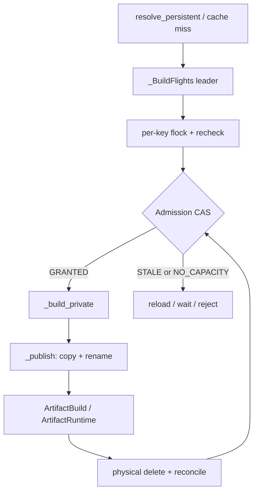
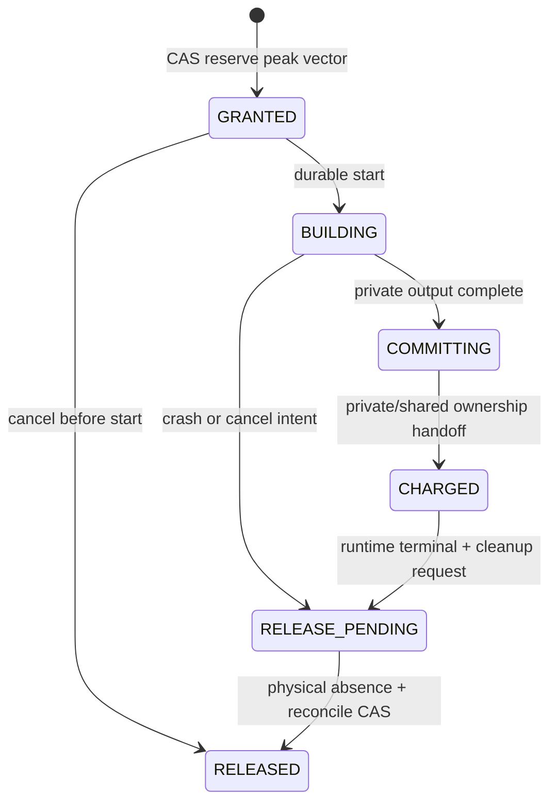

## 本篇在 PTO 课程路线中的位置

这是 PTO 全栈课程第 85 篇，仍在 **Python/JIT → Artifact Store → runtime/device** 的 Host 生命周期段。第 84 篇已经得到容量守恒式，却留下一个并发漏洞：两个不同 key 的 builder 若同时看到“还剩最后 156 MiB”，可能各自认为能占 96 MiB。本篇只回答一个问题：**怎样让这份容量只能被授予一次？**

源码基线是 PyPTO 默认分支提交 [`950a30ec`](https://github.com/hw-native-sys/pypto/commit/950a30ec9a0f81b4f9d42fde778ac2ca9e2c82bc)。相对第 84 篇的 [`be23606f`](https://github.com/hw-native-sys/pypto/commit/be23606f791fa2251d7fccabdb91c75582268fad)，[三个后续提交](https://github.com/hw-native-sys/pypto/compare/be23606f791fa2251d7fccabdb91c75582268fad...950a30ec9a0f81b4f9d42fde778ac2ca9e2c82bc)没有改动 Artifact Store、persistent JIT、`ArtifactRuntime` 或相关测试。下文以已合入代码为事实；reservation/census/CAS 是建议协议，不是现有 API。

这不是课程 71 的重复。课程 71 讨论设备 workspace 的 runtime admission；本篇处理 Host filesystem 上多个 JIT 进程、两个物理根目录和 publication 暂存副本的容量线性化。

## 前置知识

- `ArtifactStore.get_or_build` 先查 hit；miss 后进入同进程 `_BuildFlights`，再持有 per-key `flock` 并复查。
- `_build_private` 在 cache root 外创建 `pypto-build-*`；`_publish` 把 payload 复制到 cache root 下的 `.tmp.*`，验证、fsync 后 no-replace rename。
- fresh `PUBLISHED` 同时返回 shared `ArtifactHandle`、builder value 与 `private_directory`；只有 `HIT` 没有 private owner。
- 第 84 篇的安全预算是：未物理删除的 live、quarantine、dead-letter、private 与 in-flight reservation 全部计费，并保留 recovery headroom。

## 今日 1–2 个核心问题

1. per-key flight/flock 已能去重同一 Artifact，为什么仍挡不住不同 key 双花全局容量？
2. reservation 应绑定哪些 revision、字节与生命周期，才能在 build、publish、cancel、crash 和 delete/reconcile 间不提前返还？

## PTO 全栈中的位置

上游是 `resolve_persistent` 生成的完整 Artifact key/spec 和 cache miss；本层决定 builder 是否获准创建 private/staging bytes；下游是 `ArtifactRuntime` 的 GENERATED→BINARY_READY promotion、compiled object/callable retention，以及最终 cleanup/reaper。



## 概念和精确语义

### 当前代码事实

[`ArtifactStore`](https://github.com/hw-native-sys/pypto/blob/950a30ec9a0f81b4f9d42fde778ac2ca9e2c82bc/python/pypto/jit/artifact_cache.py) 的锁文件名只含 `key.digest`。同 key 会串行化；不同 key 有不同锁，且测试明确要求它们并发。类注释还写明 concurrent cache mutation/deletion 不受支持。代码中没有 `quota_bytes`、physical census、reservation token 或 capacity revision。

[`_fallback_private_root`](https://github.com/hw-native-sys/pypto/blob/950a30ec9a0f81b4f9d42fde778ac2ca9e2c82bc/python/pypto/jit/_persistent.py) 明确说 build/runtime object 拥有 private path 且没有 online cleanup；[`ArtifactRuntime`](https://github.com/hw-native-sys/pypto/blob/950a30ec9a0f81b4f9d42fde778ac2ca9e2c82bc/python/pypto/runtime/_artifact_runtime.py) 又把 private result 与 callable 保持到整个对象生命周期。因此“publish 成功”不是释放 private charge 的后置条件。

RFC [#2653](https://github.com/hw-native-sys/pypto/issues/2653) 明确初始接口没有 online clear、eviction、`max_entries/max_bytes` 或 cleanup CLI；后续 cleanup 需要单独审查 lifetime/lease 协议。实现 PR [#2723](https://github.com/hw-native-sys/pypto/pull/2723) 也声明 private fallback 不跨进程去重，且没有 cleanup/eviction API。

### 建议协议

令一份可 CAS 的 ledger state 至少包含：

```text
CapacityState(
  ledger_revision,
  census_revisions[filesystem_id],
  live, active_private, quarantine, dead_letter, reserved,
  recovery_headroom
)

ReservationToken(
  reservation_id, artifact_key, owner_epoch,
  expected_ledger_revision,
  expected_census_revisions,
  peak_bytes_by_filesystem,
  phase = GRANTED | BUILDING | COMMITTING | CHARGED | RELEASE_PENDING | RELEASED
)
```

对每个 filesystem，准入必须同时满足：

```text
live + active_private + quarantine + dead_letter
+ reserved + request_peak + recovery_headroom <= effective_budget
```

`effective_budget` 是配置上限与最新可用 physical census 的保守交集。关键是它不是一次 `statvfs` 读数：若 volume 上还有未纳入账本的外部 writer，free bytes 会在检查后变化。要让 census 成为 hard authority，必须隔离 volume/project quota，或把所有 writer 纳入同一 ledger；否则 census 只能是带时间戳的 guardrail，并额外保留 unknown/external headroom。

另一个容易漏掉的事实是 `private_root` 必须位于 cache root 外，但未承诺二者在同一 filesystem。故 token 应持有 `peak_bytes_by_filesystem` 资源向量：private volume 预留 compiler output/scratch，cache volume 预留 `.tmp.*` 与最终 published slot；两者恰好同盘时再合并。单一总字节既可能在一块盘上超卖，也可能无谓拒绝另一块盘仍可承载的请求。

## 真实文件、类型、API 或指令逐段解读

1. [`_BuildFlights.run`](https://github.com/hw-native-sys/pypto/blob/950a30ec9a0f81b4f9d42fde778ac2ca9e2c82bc/python/pypto/jit/artifact_cache.py) 的 request 包含 root、private root、readonly、key digest 与 spec digest。同进程同请求只有 leader 执行；waiter 共享结果或异常，flight 结束即删除，fork child 重置 pending。
2. `_get_or_build` 先无锁 lookup，再取得 `locks/{key.digest}.lock` 并复查。这个第二次 lookup 关闭同 key 的 publication race，却没有读取或修改全局容量。
3. `_build_private` 先 `mkdtemp` 再调用 builder，异常直接传播；成功后返回 private-owned `ArtifactBuild`。
4. `_publish` 在 destination parent 下创建 staging，复制全部 payload，再验证 manifest、fsync、no-replace rename。成功后原 private tree 仍存在；失败时 staging best-effort 清理，但 usable private result 被保留。
5. `ArtifactRuntime.load` 对 GENERATED handle 还会再次调用 `store.get_or_build` 生成 BINARY_READY；private fallback 时 `directory` 指向 private result，`_chips` 之后长期复用。

所以正确插入点非常窄：**per-key leader 已确定、锁内 recheck 仍是 miss 之后，builder 开始之前。** 放在 leader 之前会让同 key waiter 重复占额；放在 builder 之后已经可能 ENOSPC；publish 后才计费则完全遗漏 private/staging 峰值。

## 对象/Tile/Buffer/IR 生命周期



这里追踪的关键对象是建议的 `ReservationToken`。它由 admission ledger 创建，由唯一 per-key leader 持有；build 开始前可安全取消。进入 `BUILDING` 后，deadline、进程 lease 过期或 caller cancellation 只能记录 cancel intent，不能直接减 `reserved`，因为 bytes 可能已经写出。publish 完成时也不是简单“释放 reservation”，而是把峰值预留原子转换为 shared live charge 与仍被 builder/runtime 持有的 private charge。只有 terminal evidence、物理删除/absence 和 reconcile CAS 全部完成后才进入 `RELEASED`。

## 端到端调用链或指令链

当前链路是：

`resolve_persistent → owner._artifact_objects lookup → ArtifactStore.get_or_build → _BuildFlights.run → _get_or_build → per-key flock/recheck → _build_private → _publish → ArtifactBuild → bind/restore ArtifactRuntime → load_prebuilt`。

建议链路只增加一个全局线性化点：

`per-key recheck miss → reserve_peak(expected ledger revision, expected census revisions, resource vector) → builder → publish → convert_reservation_to_charges → runtime terminal → delete/reconcile → release_charge`。

同 key 的其他进程先等 `flock`；leader 若发布成功，它们复查为 HIT，不申请 token。不同 key 可并发编译，但只有 CAS 胜者消费最后一份容量。

## 具体 shape、Tile 和状态演算

用两个不同 specialization 的 `FP32[16,16]` Add kernel：每个输入/输出 Tile 的语义 payload 是 `16×16×4 = 1,024 B`。Artifact 大小并不由这 1 KiB 直接决定；以下 48 MiB 是教学用峰值估计，不是仓库 benchmark：每个 build 的 private output 为 48 MiB，publication 同时保留 private tree 并在 cache staging/final 再写 48 MiB，因此同盘 `request_peak=96 MiB`。

设 `B=1,024 MiB`、recovery headroom `H=128 MiB`，当前 live 500、quarantine 160、dead-letter 80 MiB，总 charge 为 740 MiB，可授予空间为 `1,024-128-740=156 MiB`。

没有 CAS 时，A、B 都读到 revision 41 和“156 MiB 可用”，分别通过检查并开始写 96 MiB；最终 `740+96+96+128=1,060 MiB`，超预算 36 MiB。

有 CAS 时：

1. A 以 `(ledger=41, census=17)` 原子插入 96 MiB token，ledger 变 42。
2. B 仍以 expected 41 提交，CAS 失败；reload 后发现再加 96 会到 1,060 MiB，进入 WAIT/REJECT。
3. A publish 后把 reservation 转为 `shared=48 + active_private=48`，总 charge 不突然下降。
4. A 的 runtime terminal，private tree 物理删除并对账后只剩 shared 48 MiB；新 revision 下可用空间变成 108 MiB，B 才能获得 96 MiB token。

## 为什么这样设计及替代方案

- **一个全局文件锁包住整个 build**：容易理解，但把分钟级编译完全串行化；进程崩溃会自动释放锁，却不会自动删除已写 bytes，仍需 durable ledger/census。它可以保护短事务，不能替代 reservation。
- **先 build，ENOSPC 再回退**：吞吐看似最好，却把 admission 失败推迟到最昂贵、最难恢复的位置，还可能耗尽 manifest/fsync/recovery 所需 headroom。
- **只依赖 filesystem/project quota**：适合作为最后一道物理硬限制，但它不知道 Artifact key、fairness、private owner 与 publication phase；无法决定谁等待、谁重试以及哪一笔 charge 可返还。
- **短 CAS + 长并行 build**：ledger 只在线性化 grant/phase/charge，编译仍按不同 key 并行。它增加持久状态和恢复复杂度，却同时保住吞吐与容量 safety。

## 访存、计算、流水、并行和硬件约束

本章不改变设备 Tile shape、dtype、layout 或 NPU graphability；它控制的是 Host 写放大与并发度。publication 至少会在 private 和 cache 之间复制一次，若 compiler 还有中间文件，真实 peak 必须通过实测或保守 manifest 估计加入 token。低估会导致 under-admission，过高估会降低并行度。

CAS 冲突只发生在短 admission 事务，成本相对 PTOAS/设备编译很小。waiter 的通知只能表示 revision 可能变化：正确顺序是“读 revision → 注册 watch → 再读 → 未变才睡”，醒来必须重算完整资源向量，不能把 notify 当作 grant。

crash 的安全方向始终是 over-account：CAS 后未 build 的 orphan token 可在证明 `phase=GRANTED` 且从未开始后回收；一旦 `BUILDING`，lease 超时不足以释放。crash-after-write、crash-after-rename 或 census/ledger 不一致都进入 unknown/quarantine，直到扫描、manifest identity 与 physical absence/reconcile 闭合。

## 测试证据与未覆盖风险

直接测试来自 [`tests/ut/jit/test_artifact_cache.py`](https://github.com/hw-native-sys/pypto/blob/950a30ec9a0f81b4f9d42fde778ac2ca9e2c82bc/tests/ut/jit/test_artifact_cache.py)：

- `test_same_key_threads_build_once`：4 线程同 key 只调用 builder 一次，结果为 1 个 PUBLISHED、3 个 HIT，验证 in-process leader。
- `test_spawned_processes_deduplicate_and_dead_process_releases_lock`：3 个 spawn 进程同 key 得到 1 PUBLISHED、2 HIT；持锁进程 `os._exit(7)` 后 kernel 释放 flock，验证 key lock 的 crash 边界。
- `test_different_keys_build_concurrently`：两个 key 在 builder 内用 barrier 会合，证明实现有意保留跨 key 并行；这正是全局容量 TOCTOU 的入口。
- `test_publish_then_hit_preserves_private_value_and_records`：fresh PUBLISHED 的 value 位于 private directory；后续 HIT 才没有 value/private path。
- `test_publication_failures_retain_private_build`：注入 copy/rename/fsync 类 storage failure 后仍返回 usable PRIVATE，shared lookup 保持 MISS。

PR #2723 报告 unit suite 12,181 passed、10 skipped、1 xfailed，并在独立 NPU 进程验证 persistent cache/warmup；这是 PR 作者的验证记录，本章没有重跑 NPU。当前测试没有 quota exhaustion、两个不同 key 争最后容量、双进程 CAS loser、跨 filesystem 资源向量、orphan token、crash-at-every-phase、census stale/external writer 或 no-lost-wake 覆盖。

## 与前后章节的连接

第 84 篇说明 dead-letter 仍是坏账；本篇说明坏账与新 reservation 必须在一个 revisioned ledger 上原子相加。它还把第 78 篇“quota reservation”的抽象进一步落到当前 `_BuildFlights → per-key flock → _build_private → _publish` 的精确插入点，并补上两个 filesystem 与 publication 写放大。

下一章继续处理 CAS 成功后的 crash 窗口：token 已 GRANTED、builder 是否真正开始、private bytes 写到哪一步，谁能证明并恢复？

## 本篇结论、知识债、三个理解检查问题和下一章

结论：per-key flight/flock 解决的是同 identity 重复构建，不是不同 identity 的共享容量序列化。正确协议在 per-key recheck miss 后、builder 前用 `ledger_revision + census_revisions + peak_bytes_by_filesystem` 做 admission CAS；reservation 只有在转成真实 charge，或经物理删除/absence 对账后，才可退出预算。

知识债：当前 PyPTO 没有 durable capacity ledger、census、token、watch 或 online reaper；还缺 peak estimator、private/cache 多盘配额、外部 writer 隔离、owner epoch、phase journal、orphan reconcile、fairness 与 crash fault matrix。

理解检查：

1. 为什么把 reservation 放在 `_BuildFlights` leader 之前会对同 key 重复计费？
2. fresh PUBLISHED 已有 shared handle，为什么 96 MiB reservation 不能立即只保留 48 MiB shared charge？
3. 为什么一次最新 `statvfs` 读数仍不能让不同进程安全地“先检查、后写入”？

下一章：**Reservation 已授予但进程崩了怎么办——Owner Lease、Build Phase Journal 与 Orphan Reconcile。**

## 课程账本增量

- 新覆盖：`ArtifactStore.get_or_build/_get_or_build/_build_private/_publish`、`_BuildFlights`、`resolve_persistent`、`ArtifactRuntime.load` 及并发/retention 测试。
- 新不变量：per-key serialization 不等于 capacity serialization；token 在 builder 前按 filesystem resource vector 原子 grant；BUILDING 后超时不能释放；PUBLISHED reservation 必须转成 shared + private charge。
- 新测试证据：同 key thread/process 去重、不同 key 真并发、fresh PUBLISHED/private retention、publication failure/private fallback。
- 待补：ledger/census/token 实现、两个 key 争最后容量的 deterministic test、跨盘资源向量、orphan token 与 crash-at-every-phase reconcile。
