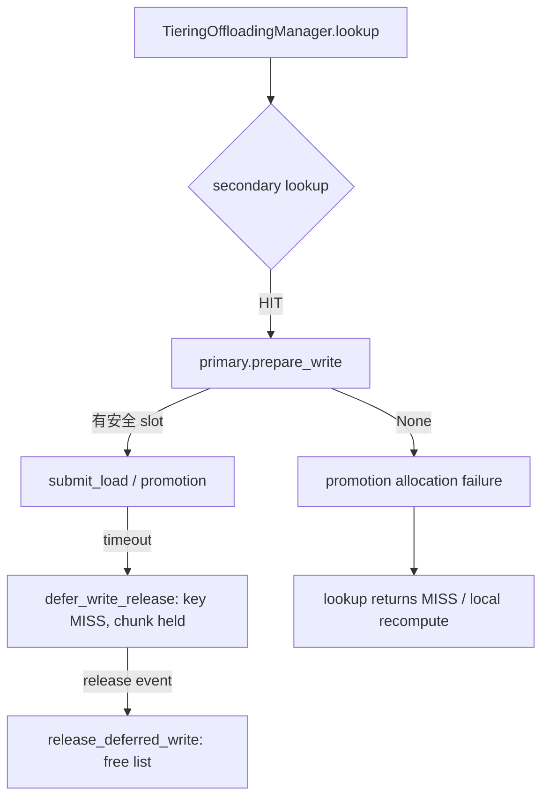
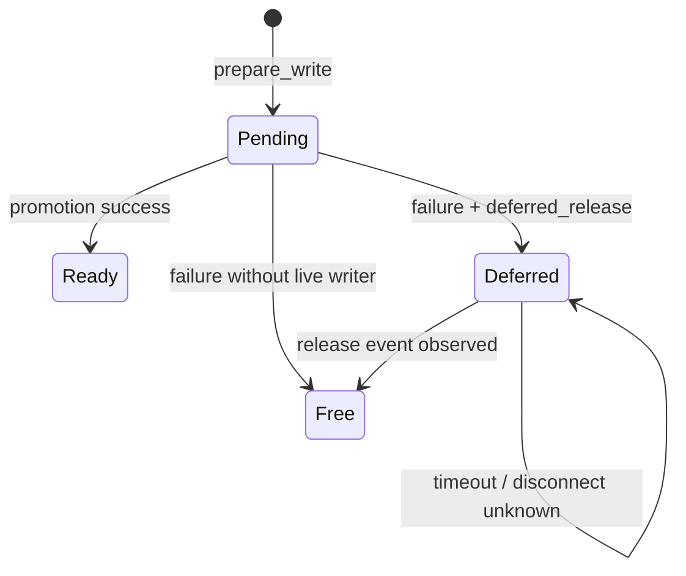

> 源码基线：vLLM [`8cf12773`](https://github.com/vllm-project/vllm/commit/8cf1277362aef963a71cf6860c28387acf6ecb90)，即研究时默认分支最新提交。相对第 74 章基线前进 [93 个提交](https://github.com/vllm-project/vllm/compare/ea836290a7166f7d5b8efb1ae6ef1e2b2faa8b56...8cf1277362aef963a71cf6860c28387acf6ecb90)；本文涉及的 allocator、tiering manager 与 P2P client 实现未变，直接测试则增加了 P2P lifecycle E2E。已合入语义来自 [PR #63779](https://github.com/vllm-project/vllm/pull/63779) 与 [PR #64256](https://github.com/vllm-project/vllm/pull/64256)。

## 本篇在课程路线中的位置

这是课程第 75 章，仍处于阶段 9「测试、性能与故障诊断」。[第 74 章]({{ '/articles/vllm-p2p-session-close-consumer-slot-quarantine/' | relative_url }})证明 timeout 后必须把旧 destination slot 隔离，不能把逻辑失败误当成物理复用凭证。本篇只追一个后果：**若 no-more-write witness 迟迟不到，隔离块怎样进入容量账；缓存被吃满时，新请求究竟等待、失败还是重算？**

当前 main 的答案不是显式配额，而是一条 fail-closed 链：quarantine 真实占住 chunk；allocator 无安全空间时，secondary hit 被降级为 `MISS`，上层走本地重算。它保护正确性，但原因粒度、预算策略与长期恢复仍不完整。

## 前置知识回顾

- promotion 是 secondary → CPU primary 的写入；目标 `chunk_id` 在提交 I/O 前由 primary 预留。
- timeout 立即提交失败 outcome；`deferred_release` 只延后旧物理地址回池。
- `defer_write_release()` 删除 key，所以后续 lookup 为 `MISS`；但它不递减 `_num_write_pending_chunks`，也不把 chunk 加入 `_free_list`。
- 只有 matching `AbortAck`、late `TransferDone`，或被验证的 backend generation fence，才应成为安全释放证明。当前 main 仍把 session close 当作 release boundary；这是上一章留下的硬件充分性缺口。

## 本篇要回答的核心问题

1. primary 的“现在可分配容量”到底由哪些集合构成，quarantine 为什么不能被 eviction 看见？
2. 隔离块耗尽容量后，`lookup()` 怎样从 remote `HIT` 变成最终 `MISS`？
3. 现有 metrics 能区分 active write、deferred hold 与 allocation failure 到什么程度？
4. 若增加显式 budget，怎样限流而不靠超时强行复用不安全地址？

## 组件在全局架构中的位置



这里有两类 backpressure，不能混称。`BackpressureDetector` 面向 primary → secondary 的 cascade store 延迟，可丢弃 secondary store；本篇的 promotion admission 则发生在 secondary → primary，当前只有 allocator 的 `None → MISS`。前者保吞吐，后者守 destination memory safety。

## 完整调用链

公开入口是 [`TieringOffloadingManager.lookup()`](https://github.com/vllm-project/vllm/blob/8cf1277362aef963a71cf6860c28387acf6ecb90/vllm/v1/kv_offload/tiering/manager.py)。primary 未命中而 secondary 命中后，`_initiate_promotion()` 立刻调用 `primary_tier.prepare_write([key], req_context)`。这个“先占地址、后批量提交”保证同一步里第二次 lookup 看见 pending，而不会为同一 key 重复 promotion。

`prepare_write` 是 [`CPUOffloadingManager.prepare_store()`](https://github.com/vllm-project/vllm/blob/8cf1277362aef963a71cf6860c28387acf6ecb90/vllm/v1/kv_offload/cpu/manager.py) 的别名。它先计算：

```text
N_free_now = len(_free_list) + (N_total - _num_allocated_chunks)
N_need_evict = N_keys_to_store - N_free_now
```

若 `N_need_evict > _num_evictable_cache_chunks`，立即返回 `None`；即使计数足够，cache policy 仍可能因本次输入的 protected keys 找不到完整候选而返回 `None`。分配是原子的，不会只拿到一半 chunk。

`_initiate_promotion()` 收到 `None` 后增加 `vllm:kv_offload_tiering_promotion_allocation_failures`，返回 `False`；调用者把本来命中 secondary 的 key 返回为 `LookupResult.MISS`，明确避免无限 `RETRY`。因此容量压力最终转换为重算成本，而不是错误复用或队首永久等待。

promotion 若已提交后 timeout，`_complete_promotion()` 调用 `defer_write_release()`。旧 key 从 policy 消失，chunk id 进入 `_deferred_release_chunk_ids`，但仍计入 write-pending。P2P session 以后只设置 event；`_complete_deferred_releases()` 在 manager 的 polling/lock 域内观察 event，再调用 `release_deferred_write()` 做 `pending--` 和 free-list append。

## 关键类型、字段和状态生命周期

| 状态/字段 | 是否可 lookup | 是否可 eviction | 是否可新写复用 | 容量归属 |
| --- | --- | --- | --- | --- |
| 未分配 chunk | 否 | 不需要 | 是 | `N_total - _num_allocated_chunks` |
| `_free_list` | 否 | 不需要 | 是 | 已分配但空闲 |
| ready、`ref_cnt=0` | `HIT` | 是 | eviction 后可用 | policy resident |
| ready、`ref_cnt>0` | `HIT` | 否 | 否 | pinned resident |
| normal write-pending | `HIT_PENDING` | 否 | 否 | policy resident + write usage |
| deferred release | `MISS` | 否 | 否 | policy 外 + write usage + quarantine |

对 manager 可观察的稳定状态，可写出不重复计数的守恒式：

```text
N_total = N_unallocated + N_free_list + N_policy_resident + N_deferred
N_write_pending = N_normal_pending + N_deferred
```

第二式正是安全关键：deferred 虽已从命名空间删除，仍必须留在物理占用中。若在 timeout 时先 `pending--`，write-usage 会撒谎；若加入 free list，迟到 WRITE 会污染新 owner。



## 逐函数源码解读

[`CPUPrimaryTierOffloadingManager.defer_write_release()`](https://github.com/vllm-project/vllm/blob/8cf1277362aef963a71cf6860c28387acf6ecb90/vllm/v1/kv_offload/tiering/manager.py) 先断言每个 key 仍是 pending，再从 policy 移除并登记 chunk id。这个断言防止把 ready 或已被替换的 owner 错认成旧 writer。`release_deferred_write()` 才递减 pending 并归还 free list；`reset_cache()` 对未清空 quarantine 直接断言失败。

[`CPUOffloadingManager.prepare_store()`](https://github.com/vllm-project/vllm/blob/8cf1277362aef963a71cf6860c28387acf6ecb90/vllm/v1/kv_offload/cpu/manager.py) 的 admission 只接受三类资源：尚未分配、free-list、以及 policy 能完整驱逐的 idle chunk。deferred 已不在 policy，也不在 free list，所以自然不可能被 LRU/ARC “救回”。这不是额外 if，而是所有权数据结构本身形成的安全边界。

[`TieringMetricsTracker`](https://github.com/vllm-project/vllm/blob/8cf1277362aef963a71cf6860c28387acf6ecb90/vllm/v1/kv_offload/tiering/metrics.py) 分别暴露 deferred chunk gauge、deferred hold histogram 和 promotion allocation-failure counter。要注意：tiering 的 `PRIMARY_WRITE_USAGE_PERC` 统计 active promotion job，job 报失败后会下降；CPU manager 的 cache write usage来自 `_num_write_pending_chunks`，会继续包含 deferred。诊断时必须联合看两组指标，否则会出现“active write 已归零，但空间仍满”的假矛盾。

## 具体示例与 shape/状态演算

设 primary region 为 `memoryview[8, 65536]`，每块 64 KiB，总容量 512 KiB。每块对应教学用单层 `bf16[2,16,8,128]` 的 K/V：`2×16×8×128×2 B = 64 KiB`。

某时刻：3 个 ready chunk 正被 GPU load pin 住，2 个 normal promotion 尚未完成，2 个 timeout chunk 已 deferred，只有 1 个 free。于是 deferred 占 128 KiB（25%）；`_num_write_pending_chunks=4`，CPU write usage 为 50%，但安全可立即分配只有 1 块，evictable 为 0。

请求 R 依次查询 remote keys G、H：

1. G 在 secondary `HIT`；`prepare_write([G])` 消耗最后 1 个 free chunk，返回 `HIT_PENDING`。
2. H 也在 secondary `HIT`；此时 `N_free_now=0`、`N_need_evict=1`、`_num_evictable_cache_chunks=0`，`prepare_write([H]) → None`。
3. manager 记录一次 promotion allocation failure，并把 H 返回为 `MISS`；scheduler/connector 的 recompute policy 用本地计算恢复 H，而不是等待两个 deferred slot。
4. matching `AbortAck` 让其中一个 release event set；下一次 poll 执行 `pending--`、free+1。之后新的 promotion 才重新获得一块地址。

关键结论：**backpressure 不是“quarantine 达到某百分比”触发，而是物理 allocator 已无法满足一次原子分配时触发。** 当前代码没有高/低水位，也没有为 online request 保留的显式 headroom。

## 为什么这样设计及替代方案

| 方案 | 延迟/吞吐 | 内存安全 | 代价 |
| --- | --- | --- | --- |
| timeout 后强行回池 | 短期容量最好 | 不安全；late WRITE 可破坏新 owner | 不能采用 |
| 一直返回 `RETRY` 等 witness | 可能保住 remote hit | 安全 | 队首阻塞、尾延迟无界 |
| 当前 `None → MISS → recompute` | 保持前进，损失重算 FLOPs | 安全 | 原因粗、可能放大算力压力 |
| 显式 quarantine budget + admission reason | 可为不同流量预留 headroom | 安全，前提是绝不强释 | 需策略、指标、配置与测试 |

第一性约束是“未知 writer 的地址不能复用”，不是“quarantine 必须在 T 秒内清零”。因此显式 budget 能控制的是**新 admission**：例如按 `free + evictable - reserve` 判断是否继续 remote promotion，或在隔离增长时更早选择 recompute；它不能在达到阈值后释放旧 chunk。具体水位不能从源码凭空给数，应由 chunk 大小、promotion 到达率、hold-time 分布、重算成本和在线 SLO 联合标定。

## 性能、并发、正确性与边界条件

- 延迟：`MISS` 避免等待未知 terminal，但把网络等待转成 model recompute；若 GPU 已饱和，容量问题可能迁移成算力排队。
- 吞吐：quarantine 降低 primary 可用工作集，增加 cache miss 和重复传输/计算；release poll 越慢，hold histogram 尾部越长。
- 并发：network 线程只 set event，free-list mutation 留在 manager lock 域，避免 allocator 跨线程竞争；代价是 event 已 set 到真正回池之间至少隔一个 poll。
- 正确性：batch allocation 要么完整成功，要么 `None`；不能让一个 multi-key 请求误以为所有 remote blocks 都已获得 destination。
- 失败边界：process crash 会丢失内存态 deferred census；session close 是否能证明 NIXL WRITE terminal 仍未被 main 的真机证据闭合。开放的 [PR #61667](https://github.com/vllm-project/vllm/pull/61667) 提议在无法确认时跨 close 保持 quarantine，这是规划/实验事实，不是当前 main。

## 测试证据与未覆盖风险

[`test_timed_out_load_holds_chunks_until_abort_ack`](https://github.com/vllm-project/vllm/blob/8cf1277362aef963a71cf6860c28387acf6ecb90/tests/v1/kv_offload/tiering/p2p/test_manager.py) 使用 4-chunk primary：timeout 后 job 被移除、key 为 `MISS`、deferred count=1、free count不变；注入 `AbortAck` 后 deferred=0、free+1。它直接验证 quarantine 会吃真实容量。

[CPU manager tests](https://github.com/vllm-project/vllm/blob/8cf1277362aef963a71cf6860c28387acf6ecb90/tests/v1/kv_offload/cpu/test_manager.py) 覆盖无空间或 chunk 被 load pin 时 `prepare_store() is None`，释放 pin 后才可驱逐；[metrics test](https://github.com/vllm-project/vllm/blob/8cf1277362aef963a71cf6860c28387acf6ecb90/tests/v1/kv_offload/tiering/test_metrics.py) 验证 allocation-failure counter。[新增 lifecycle E2E](https://github.com/vllm-project/vllm/blob/8cf1277362aef963a71cf6860c28387acf6ecb90/tests/v1/kv_offload/tiering/test_p2p_lifecycle_e2e.py) 用 SmolLM2、真实 engine step、取消与相同 `kv_request_id` 复用，验证迟到失败不会毒化新请求。

仍缺一条集成测试：制造多个 permanently deferred chunks，真正耗尽 primary，然后同时断言 remote `HIT → MISS`、本地重算正确、allocation-failure 增长、CPU write usage 与 deferred gauge 守恒，以及 release 后容量恢复。也缺 process restart 后的 durable census、真实 RDMA same-address canary 和显式 budget 的高低水位/公平性测试。开放 PR #61667 报告的 1 GiB NIXL/UCX stall 属 PR 作者实验，不能当作 main CI 已覆盖。

## 与前后章节的连接

第 74 章回答“旧块何时不能复用”；本章回答“不能复用会怎样反映到容量与请求”。两章合起来把 safety 与 liveness 分开：quarantine 保 safety，`MISS`/recompute 保 liveness，metrics 提供诊断证据。

下一章继续沿 reset/shutdown 边界：当 release event 永远不到时，`drain_jobs()`、`reset_cache()` 与 backing retention 谁能给出足够强的恢复证明？重点不是“清空 Python set”，而是 reset 是否覆盖旧 writer 的真实作用域。

## 本篇结论、知识债、三个理解检查问题和下一章

结论：当前 main 已把 quarantine 计入真实物理占用；它不需要额外配额代码也能阻止 eviction/复用。容量不足时，promotion admission 原子失败并降级为 `MISS`，不会无限等待。可观测面已有 deferred count、hold time、CPU write usage 和 allocation failure，但缺少结构化失败原因、显式 reserve/watermark、跨 crash census 与真机 no-more-write fence。

知识债：区分 `full_due_to_pinned`、`full_due_to_quarantine` 与 policy protection；建立 workload-driven headroom；补齐“quarantine 耗尽 → recompute → release 恢复”的跨层测试；解决 close/restart 后的 release authority。

理解检查：

1. deferred key 已经 lookup `MISS`，为什么它仍必须留在 `_num_write_pending_chunks`？
2. 为什么 primary full 时返回 `MISS` 比返回永久 `RETRY` 更有 liveness，但可能把压力转移到 GPU？
3. 为什么 quarantine budget 达到上限只能拒绝新 promotion，不能授权释放最老的 deferred chunk？

下一章：**Reset 不能消灭旧 WRITE：Drain Contract、Rejected Reset 与 Backing Retention。**

## 课程账本增量

- 新覆盖：`CPUOffloadingManager._get_num_free_chunks/_allocate_chunks/prepare_store`、`CPUPrimaryTierOffloadingManager.defer_write_release/release_deferred_write`、`TieringOffloadingManager.lookup/_initiate_promotion/_complete_deferred_releases`、`TieringMetricsTracker` 的 deferred/allocation metrics。
- 新不变量：`deferred ⊂ write_pending`；deferred 不属于 policy 或 free list；promotion 无法原子分配时必须 fail closed，当前 main 以 `MISS` 触发重算。
- 新测试证据：timeout hold/free-count、pinned/full allocator、allocation-failure metric，以及 request-id reuse lifecycle E2E。
- 待补：显式 quarantine admission reason/headroom、耗尽恢复集成测试、restart-safe census 与 backend fence receipt。

