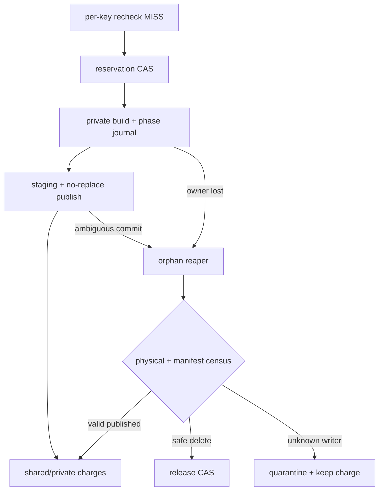
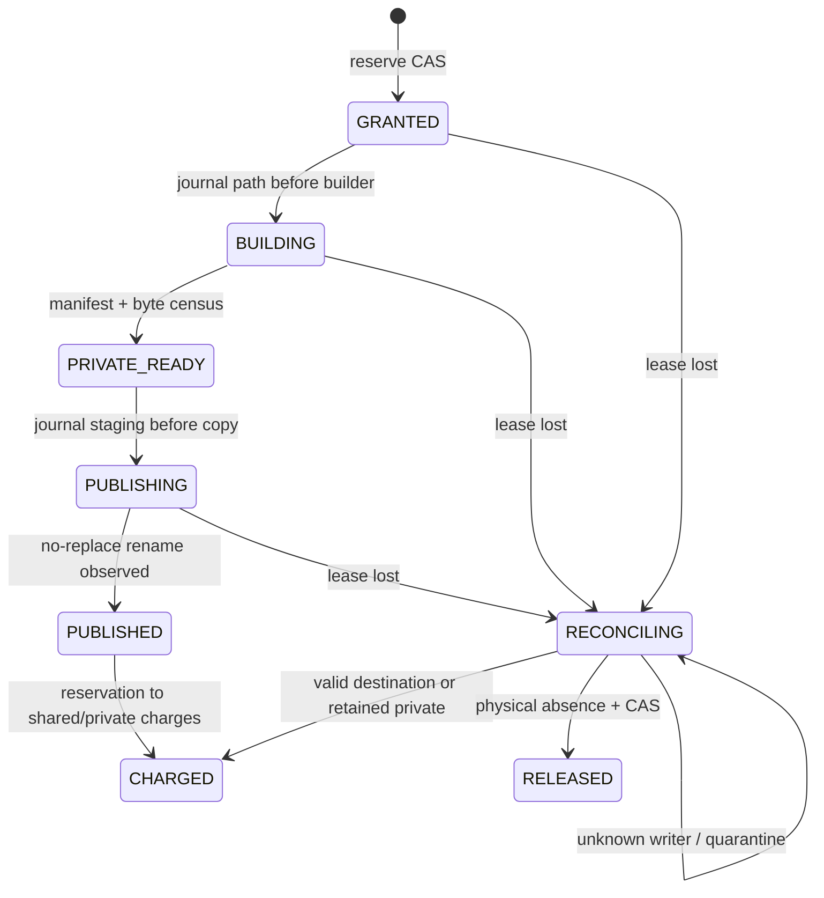

## 本篇在 PTO 课程路线中的位置

这是 PTO 全栈课程第 86 篇，继续位于 **Python/JIT → Artifact Store → runtime/device** 的 Host 生命周期段。第 85 篇把不同 key 争抢容量收束为一次 admission CAS：在 per-key lock 内复查 miss 后、builder 开始前，原子授予按 filesystem 划分的 peak reservation。本篇只追问下一步：**CAS 已经成功，但 owner 在 build 或 publish 中途崩溃，谁有权接管 reservation，又凭什么返还容量？**

源码基线是 PyPTO 默认分支提交 [`39474d24`](https://github.com/hw-native-sys/pypto/commit/39474d24d15383d0ba251dbeed8dc15ee49947f6)。相对上一章的 [`950a30ec`](https://github.com/hw-native-sys/pypto/commit/950a30ec9a0f81b4f9d42fde778ac2ca9e2c82bc)，[前进 3 个提交](https://github.com/hw-native-sys/pypto/compare/950a30ec9a0f81b4f9d42fde778ac2ca9e2c82bc...39474d24d15383d0ba251dbeed8dc15ee49947f6)，但没有改动 `artifact_cache.py`、`_persistent.py`、`_artifact_runtime.py` 或直接测试。文中 owner lease、phase journal 与 reaper 是基于当前边界推导的建议协议，不是已合入 API。

## 前置知识

- `_BuildFlights` 只在一个 Python 进程内合并相同 request；per-key `flock` 才负责跨进程串行化同一 Artifact key。
- `_build_private` 先创建 `pypto-build-*` 私有目录，再调用 builder；`_publish` 复制到 `.tmp.*`，验证后以 no-replace rename 发布。
- fresh `PUBLISHED` 仍同时保留 shared handle、builder value 与 private directory，因为 live Python/runtime object 可能引用私有文件。
- reservation 的安全方向是 over-account：不确定 bytes 是否仍存在或 writer 是否已停止时，容量不能先返还。

## 今日 1–2 个核心问题

1. 为什么“进程死了、`flock` 已释放”仍不足以释放 reservation？
2. 最小的 lease + journal + reconcile 协议，怎样处理 crash-before-build、partial private output、rename 已成功但 journal 未提交等窗口？

## PTO 全栈中的位置

上游是 `resolve_persistent` 形成完整 key/spec，并由第 85 章的 admission CAS 授予 reservation；本层记录构建物理副作用、隔离失联 owner，并把 orphan 收敛成可继续、可删除或继续计费的确定状态；下游才是 `ArtifactRuntime` 的 GENERATED→BINARY_READY promotion、callable retention 与最终 cleanup。



## 概念和精确语义

### 当前代码事实

[`_BuildFlights.run`](https://github.com/hw-native-sys/pypto/blob/39474d24d15383d0ba251dbeed8dc15ee49947f6/python/pypto/jit/artifact_cache.py) 的 `pending` 是进程内 dict；leader 正常返回或抛出后都会删除 entry，fork child 也会整体 reset。它解决 waiter 唤醒，不是持久 ownership。

[`ArtifactStore._get_or_build`](https://github.com/hw-native-sys/pypto/blob/39474d24d15383d0ba251dbeed8dc15ee49947f6/python/pypto/jit/artifact_cache.py) 持有 `locks/{key}.lock` 完成 recheck、private build 与 publish。内核会在 owner 退出后释放 `flock`，但不会删除 owner 已创建的目录，也不会替它完成容量记账。

`_build_private` 在 builder 前执行 `mkdtemp`，并明确不捕获 compiler failure、也不删除 returned object 可能拥有的路径。若进程在 builder 内崩溃，目录可能为空、部分写入或含完整 payload。`_publish` 的 `finally` 只在当前 Python 栈还能执行时清理 staging；SIGKILL、主机掉电或进程崩溃可留下 `.tmp.*`。项目文档与 [RFC #2653](https://github.com/hw-native-sys/pypto/issues/2653) 均把 cleanup 限定为 offline、所有 consumer 停止后进行；实现 [PR #2723](https://github.com/hw-native-sys/pypto/pull/2723) 也明确没有 cleanup/eviction API。

### 三个不能混淆的事实

1. **lock release**：新进程现在能取得 per-key `flock`。
2. **owner fencing**：旧 owner 之后的 ledger/journal mutation 会因 epoch 过期而失败。
3. **physical closure**：旧进程、编译子进程和残留路径不会再增加或改变 bytes，现存 bytes 已完成 census。

前两个都不能推出第三个。lease expiry 只是“owner 没按时续租”，不是 no-more-write receipt；暂停的旧进程可能恢复，脱离父进程的 compiler/linker child 也可能继续写。故 reaper 不能在 lease 到期时直接 `reserved -= peak`。

### 建议的最小持久记录

```text
BuildRecord(
  reservation_id, artifact_key,
  owner = (boot_id, process_id, owner_epoch),
  lease_deadline, heartbeat_seq,
  phase,
  private_path_id, staging_path_id, destination,
  manifest_digest, charged_bytes_by_filesystem,
  revision
)

phase = GRANTED | BUILDING | PRIVATE_READY | PUBLISHING
      | PUBLISHED | CHARGED | RECONCILING | RELEASED
```

每次 transition 都用 `(reservation_id, owner_epoch, expected_revision)` CAS。reaper 先以更高 `reaper_epoch` claim；旧 owner 即使恢复也不能再改 ledger。与此同时，private/staging path 必须含不可复用的 reservation identity，shared destination 继续使用 no-replace rename，才能把失去 lease 的旧 writer 限制在旧 namespace，而不是让它覆盖新 generation。

## 真实文件、类型、API 或指令逐段解读

1. [`ArtifactBuild`](https://github.com/hw-native-sys/pypto/blob/39474d24d15383d0ba251dbeed8dc15ee49947f6/python/pypto/jit/artifact_cache.py) 同时保留 `handle`、`private_directory` 与 `value`。`PUBLISHED` 不是“private bytes 可删”的 receipt。
2. `_BuildFlights.run` 用 `Future` 把 leader 的结果或原异常传播给 waiter；完成后不保留 entry。owner crash 会让所有这些内存事实消失。
3. `_get_or_build` 的 lock 内第二次 lookup 关闭同 key publication race；下一步建议在这里执行 reservation grant，并在调用 `_build_private` 前持久化 `BUILDING + private_path_id`。
4. `_build_private` 完成 manifest 后，才能把 `BUILDING` 推进为 `PRIVATE_READY(manifest_digest, measured_bytes)`。仅凭目录存在不能区分空目录、半个 ELF 与完整 Artifact。
5. `_publish` 在 destination 所在 filesystem 创建 staging、复制、完成 marker、rename、sync parent。应在复制前写 `PUBLISHING(staging_path_id)`；rename 后再以 destination manifest 为事实，把状态推进到 `PUBLISHED`。
6. [`resolve_persistent`](https://github.com/hw-native-sys/pypto/blob/39474d24d15383d0ba251dbeed8dc15ee49947f6/python/pypto/jit/_persistent.py) 把结果放入 `owner._artifact_objects`；[`ArtifactRuntime`](https://github.com/hw-native-sys/pypto/blob/39474d24d15383d0ba251dbeed8dc15ee49947f6/python/pypto/runtime/_artifact_runtime.py) 又长期持有 generated path、ready handle、private fallback 和 `_chips`。因此 build record 转为 `CHARGED` 后，后续释放还要等 runtime/member lease，而不是由 build reaper代替。

## 对象/Tile/Buffer/IR 生命周期



这里追踪的真实对象仍是 `ArtifactBuild` 与它的目录；建议的 `BuildRecord` 只是把当前隐含在 Python 栈、lock 和目录结构中的事实持久化。只有 `RELEASED` 能减少 capacity ledger；`RECONCILING` 必须继续计入 reservation 或按实测 bytes 转为 quarantine charge。

## 端到端调用链或指令链

当前调用链是：

`resolve_persistent → ArtifactStore.get_or_build → _BuildFlights.run → _get_or_build → per-key flock/recheck → _build_private → _publish → ArtifactBuild → bind_artifact/restore_artifact → ArtifactRuntime.load`。

建议只在副作用边界增加短事务：

`recheck miss → grant reservation → journal BUILDING → builder → journal PRIVATE_READY → journal PUBLISHING → copy/rename/fsync → observe PUBLISHED → convert to charges`。

recovery 链则是：

`lease overdue → verify owner incarnation → claim reaper_epoch → freeze old mutations → scan journal paths/destination/process group → classify → charge, quarantine or physical delete → revision CAS`。

新进程重新取得 `flock` 后仍要先查看同 key 的 unfinished record。若旧 record 处于 `BUILDING/PUBLISHING`，它不能直接再获得一份完整 peak reservation；应先把旧 debt 纳入预算，或等待 reaper 收敛。

## 具体 shape、Tile 和状态演算

继续使用两个 specialization 的 `FP32[16,16]` Add kernel，语义 Tile payload 为 `16×16×4 = 1,024 B`。Artifact 大小由生成代码和二进制决定；教学例仍设 private 48 MiB、cache staging/final 48 MiB，reservation `R77=96 MiB`。owner 为 `(boot-A, pid=5301, epoch=12)`，ledger revision 42。

1. CAS 写入 `GRANTED(R77, 96 MiB)`，ledger 变 43；此时 owner 崩溃且没有 `BUILDING` record。reaper 验证 boot/pid incarnation 已终止、已知 path 不存在后，可用 revision CAS 直接 `RELEASED`。
2. 若先写 `BUILDING(private=pypto-build-R77)`，builder 已写 31 MiB 后崩溃，lease 到期不能释放 96 MiB。reaper claim epoch 13，停止旧 owner ledger mutation；若无法证明 compiler process group 已终止，就保留全部 reservation。证明 writer terminal 后，扫描 31 MiB，把它转为 quarantine charge，再幂等删除；确认 physical absence 后才返还。
3. 若 private 48 MiB 已完整、复制 staging 48 MiB 后崩溃在 rename 前，census 看到 96 MiB。reaper验证 private manifest，删除无完成 marker 的 staging或重新执行 publication；两种动作都必须保留峰值 charge。
4. 最难的窗口是 rename 已成功、`PUBLISHED` journal 尚未写入。destination 的完成 marker、key/spec/full digest 是权威事实。reaper不得再次覆盖，而应把 R77 转为 `shared=48 + retained_private=48`；待 runtime/private lease 终止和物理删除后再返还后 48 MiB。

这说明 journal 不要求“恰好一次执行每个文件操作”；它要求副作用 **at-least-once 可观察、状态转换以 revision/epoch exactly-once 计账**。

## 为什么这样设计及替代方案

- **只依赖 `flock`**：死进程会自动释放，简单且适合 per-key mutual exclusion；但 lock 不记录 phase、bytes、path 或 charge，无法恢复 side effect。
- **lease 到期立即删除并释放**：恢复快，但暂停 owner 或孤儿 compiler child 可在删除后继续写，甚至把新 generation 的目录重新填充。TTL 是怀疑信号，不是 correctness proof。
- **全局 supervisor 杀整个 process group**：能增强 writer terminal evidence，仍要处理掉电、远端 filesystem、rename 已提交但 ledger 未提交；它是 evidence adapter，不是 journal 的替代品。
- **owner-fenced journal + unique paths + reaper reconcile**：元数据与实现最复杂，却把长时间编译保持并行，只在 grant/phase/charge 时做短 CAS，并能将每个 crash 窗口收敛到可审计状态。

最小充分方案不是保存每个 `write(2)`，而是记录会改变恢复决策的边界：writer 可能开始、private payload 已完整、shared copy 可能开始、destination 已被观察为有效、reservation 已转换为长期 charge。

## 访存、计算、流水、并行和硬件约束

本章不改变 PTO ISA 指令、Tile shape/dtype/layout、NPU pipeline 或 graphability；它约束 Host 编译文件、ELF 与 manifest 的生命周期。journal 的 fsync 次数会增加冷编译延迟，但冷编译本身通常远长于小记录写入。可以批量 heartbeat，不能合并掉“副作用前”的关键 phase record，否则 crash 后无法判断 writer 是否曾启动。

并发仍按不同 key 保留。全局 ledger CAS 只序列化 reservation/charge mutation；reaper 扫描与删除不应持有长事务。扫描复杂度应由 active-record index 限定，而不是每次遍历整个 cache/private volume。

硬件侧的未知也要保守：如果 READY build 启动的 compiler、runtime helper 或设备工具可能脱离父进程，owner death 不能证明它们终止。平台 adapter 应提供 process-group/container completion receipt；没有 receipt 的 record 进入 quarantine，并持续占用 admission budget。

## 测试证据与未覆盖风险

直接证据来自 [`tests/ut/jit/test_artifact_cache.py`](https://github.com/hw-native-sys/pypto/blob/39474d24d15383d0ba251dbeed8dc15ee49947f6/tests/ut/jit/test_artifact_cache.py)：

- `test_spawned_processes_deduplicate_and_dead_process_releases_lock` 让持锁进程 `os._exit(7)`，随后新 builder 成功，且 lock inode 不变。它证明 kernel lock handoff，不证明 orphan path/bytes 被回收。
- `test_coalesced_compiler_errors_wake_waiters_and_allow_retry` 验证普通异常与 `BaseException` 都会唤醒 waiter、清空 `_BuildFlights.pending` 并允许重试；没有覆盖 SIGKILL 后的目录与容量状态。
- `test_orphan_staging_and_empty_final_slot_never_hit` 验证 `.tmp.abandoned` 不会成为 hit、空 final slot 会迫使 private fallback；它证明 fail-closed lookup，不负责清理 orphan。
- `test_failed_parent_sync_after_rename_keeps_both_valid_outputs` 覆盖 rename 成功但 parent sync 抛错：private 与 shared 输出同时有效。这正是 recovery 必须以 destination manifest reconcile、不能只相信当前调用返回值的窗口。
- `test_publication_failures_retain_private_build` 验证 copy/rename/sync 类错误保留可用 private build；`test_forked_child_does_not_wait_for_parent_build` 验证 fork child 重置内存 flight 并取得独立 private directory。

PR #2723 报告当时 unit suite 12,181 passed，并有独立 NPU persistent-cache/warmup 验证；这是合入记录，不是本章重跑。当前没有 durable reservation/journal、lease expiry、stale owner mutation、crash-at-every-phase、orphan compiler child、double reaper、rename-after-crash、physical census/ledger repair 或真实 NPU process-kill 覆盖。

## 与前后章节的连接

第 84 篇说明删除失败的 dead-letter 仍要计费；第 85 篇说明不同 key 必须以 CAS 争抢容量；本篇把“CAS 获胜后”展开成 phase journal，并证明 lock handoff 不等于 capacity handoff。它也复用第 82–83 篇的 owner epoch、tombstone 与 exactly-once reconcile，但落到了 PyPTO 当前 `_build_private → _publish → ArtifactRuntime` 的具体边界。

下一章将进入 journal 自身的存储可靠性：若 phase record 只写了一半、CURRENT 指向旧 revision，或 reaper 与 owner 同时恢复，怎样用 checksum、双槽 manifest 与 replay rule 得到唯一结果？

## 本篇结论、知识债、三个理解检查问题和下一章

结论：`flock` 的自动释放只证明新进程可以进入 critical section，不证明旧 reservation 已经没有物理副作用。安全恢复需要三层证据：owner lease/epoch 阻止 stale ledger mutation；phase journal 与唯一 path 暴露 crash 窗口；reaper 依据 manifest、writer terminal 与 physical census，把 orphan 幂等转换成长期 charge、quarantine 或 `RELEASED`。只有 physical absence 加 revision CAS 才能返还容量。

知识债：当前 PyPTO 仍没有 durable capacity ledger、reservation token、owner incarnation、phase journal、process-group completion receipt、online reaper、runtime member lease、physical census 或 crash fault matrix。还需定义 heartbeat 周期、journal fsync 边界、共享/私有多盘恢复、stale owner 文件写隔离与 reaper 公平性。

理解检查：

1. `os._exit()` 后另一个进程能拿到同一 lock，为什么仍不能执行 `reserved -= 96 MiB`？
2. rename 已成功但 `PUBLISHED` journal 未写入时，reaper 应相信哪组事实，怎样避免再次发布与重复计费？
3. owner epoch 能拒绝旧进程的 ledger CAS，为什么还必须使用 reservation-scoped private/staging path 和 writer terminal receipt？

下一章：**Build Phase Journal 自己损坏怎么办——Torn Record、双槽 Manifest 与 Deterministic Replay。**

## 课程账本增量

- 新覆盖：`_BuildFlights.run/reset`、`ArtifactStore._get_or_build/_build_private/_publish`、`resolve_persistent`、`ArtifactRuntime.load` 及 crash/lock/orphan-staging 测试。
- 新不变量：lock release、owner fencing、physical closure 是三个独立事实；lease expiry 不释放 BUILDING/PUBLISHING reservation；rename 后以完整 destination manifest 为恢复事实；容量 effect 只由 revision CAS exactly-once 应用。
- 新测试证据：dead process 自动释放 flock、compiler exception 唤醒 waiter、orphan staging 不命中、rename 后 sync 失败保留双份有效输出、fork child 重置 flight。
- ISA 知识地图：无新增指令、Tile、layout 或 memory-location 语义；补齐 Host Artifact admission 之后的 crash ownership 与 orphan recovery。
- 待补：durable record/lease/reaper 实现、stale-owner fence、process-group receipt、双 reaper 与 crash-at-every-phase deterministic test。
