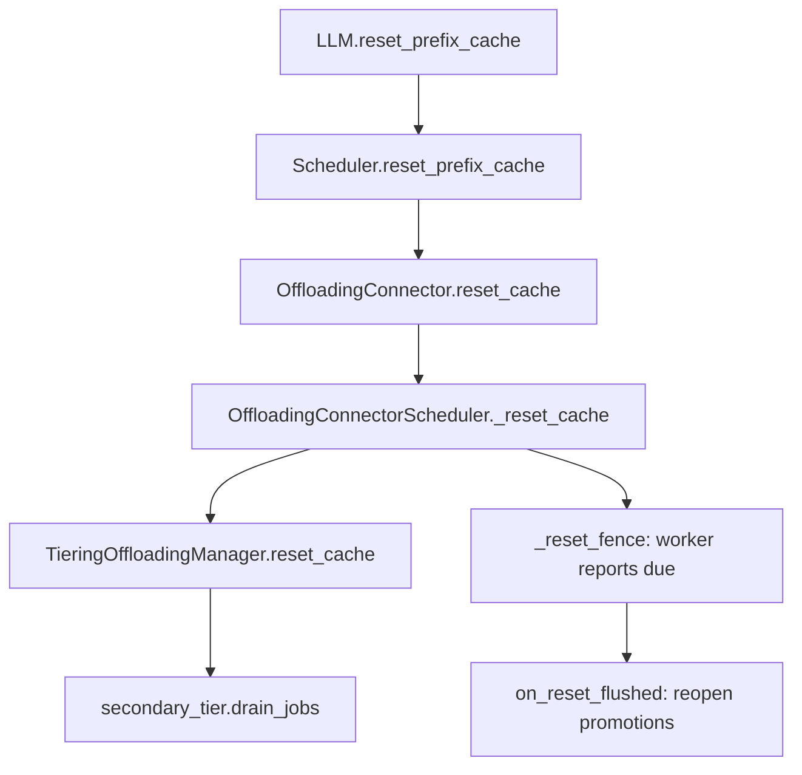
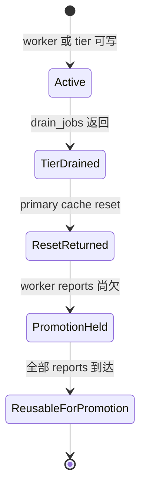

> 源码基线：vLLM [`d3fb7166`](https://github.com/vllm-project/vllm/commit/d3fb7166e0ac9db82158129face12ae28209757a)，即研究时默认分支最新提交。相对第 75 章基线前进 [121 个提交](https://github.com/vllm-project/vllm/compare/8cf1277362aef963a71cf6860c28387acf6ecb90...d3fb7166e0ac9db82158129face12ae28209757a)。本篇重点语义来自已合入的 [commit `14aefcd4`](https://github.com/vllm-project/vllm/commit/14aefcd4f907ff91cb29b9e80bd9c6a5568944bb)（[PR #62929](https://github.com/vllm-project/vllm/pull/62929)）。

## 本篇在课程路线中的位置

这是课程第 76 章，仍处于阶段 9「测试、性能与故障诊断」。[第 75 章]({{ '/articles/vllm-quarantine-capacity-admission-backpressure/' | relative_url }})解释了 unknown remote WRITE 如何通过 quarantine 吃掉 primary 容量；本篇只回答一个恢复问题：**调用 `reset_prefix_cache(reset_connector=True)` 后，哪些旧 writer 仍可能触碰刚被 reset 的 CPU primary backing，当前 main 用什么证据阻止地址被错误复用？**

结论先说：当前实现不是“一次 reset 消灭全部旧 I/O”，而是两道不同的 fence。secondary tier 的传输由 `drain_jobs()` 同步排空；worker 的 GPU↔CPU job 则被转入 `_reset_fence`，reset 可以先返回，但 secondary promotion 在所有 worker 报告前被封锁。shutdown 又是第三套策略：若 tier shutdown 抛错，保留 primary mmap；P2P 内部则以 3 秒 best-effort drain 后 immediate cancel 换取进程退出。

## 前置知识回顾

- CPU primary 的 backing 是 `SharedOffloadRegion` 创建的二维 byte `memoryview[num_chunks, row_stride_bytes]`；`chunk_id` 是行号。
- promotion 是 secondary → primary 的写入；GPU store 是 worker → primary 的写入。两者可能写到 reset 后重新分配的同一行。
- 逻辑 outcome、allocator free、物理 writer terminal 是三个不同提交点。timeout 或 `close()` 能结束 request，不自动产生 no-more-write 证明。
- deferred release 把 key 移出 policy、把 chunk 留在 write-pending；只有 release event 被 manager 的 polling path 消费后才回 free list。

## 本篇要回答的核心问题

1. 公开 reset 入口怎样到达 `TieringOffloadingManager.reset_cache()`？
2. 为什么 secondary tier drain 完成后，仍要单独等待 worker report？
3. `_reset_fence` 为什么不阻塞 reset，而只阻塞 promotion？
4. reset、rejected reset、shutdown backing retention 三种策略各自证明了什么，没证明什么？

## 组件在全局架构中的位置



这里有两个 writer 域。`F` 管 engine-core 进程内由 secondary tier 发起的 P2P/FS/对象存储传输；`G` 管 executor worker 上已经拿到 metadata 的 GPU↔CPU copy。只做其中一个，都不能覆盖 reset 前全部写者。

## 完整调用链

公开入口 [`LLM.reset_prefix_cache()`](https://github.com/vllm-project/vllm/blob/d3fb7166e0ac9db82158129face12ae28209757a/vllm/entrypoints/llm.py) 依次进入 `LLMEngine.reset_prefix_cache()`、`EngineCore.reset_prefix_cache()`，最后到 [`Scheduler.reset_prefix_cache()`](https://github.com/vllm-project/vllm/blob/d3fb7166e0ac9db82158129face12ae28209757a/vllm/v1/core/sched/scheduler.py)。只有 `reset_connector=True` 时，scheduler 才调用 connector 的 reset。

[`OffloadingConnector.reset_cache()`](https://github.com/vllm-project/vllm/blob/d3fb7166e0ac9db82158129face12ae28209757a/vllm/distributed/kv_transfer/kv_connector/v1/offloading_connector.py) 返回 `True`，但内部并非已经等待所有 worker。它先进入 [`OffloadingConnectorScheduler._reset_cache()`](https://github.com/vllm-project/vllm/blob/d3fb7166e0ac9db82158129face12ae28209757a/vllm/distributed/kv_transfer/kv_connector/v1/offloading/scheduler.py)：

```text
jobs_to_flush += current jobs
manager.reset_cache()                 # drain secondary tiers, reset primary
stale_job_threshold = job_counter
reset_fence[job_id] = pending_count  # 尚欠多少 worker report
jobs.clear()
```

manager reset 的核心顺序见 [`tiering/manager.py`](https://github.com/vllm-project/vllm/blob/d3fb7166e0ac9db82158129face12ae28209757a/vllm/v1/kv_offload/tiering/manager.py)：每个 secondary tier 先 `drain_jobs()`；再 `_process_finished_jobs()`，断言 `_jobs` 与 `_deferred_releases` 都为空；最后才 `primary_tier.reset_cache()`。P2P 的 [`drain_jobs()`](https://github.com/vllm-project/vllm/blob/d3fb7166e0ac9db82158129face12ae28209757a/vllm/v1/kv_offload/tiering/p2p/manager.py) 会失败未绑定 store、持续 poll live session 与 retained transfer，直到 manager 认为没有 pending work。

reset 返回后，下一次即使是空 step，也会把 `jobs_to_flush` 发给 workers。worker report 回到 `_update_connector_output()`；旧 `job_id < _stale_job_threshold` 不再修改已清空的 cache bookkeeping，但会精确递减 `_reset_fence[job_id]`。最后一份 report 到达时调用 `manager.on_reset_flushed()`。

## 关键类型、字段和状态生命周期

| 状态 | 所有者 | reset 时动作 | 允许 secondary promotion？ |
| --- | --- | --- | --- |
| `_jobs[job_id]` | connector scheduler | job id 加入 `jobs_to_flush`，随后清表 | 尚未决定 |
| secondary tier job | tier manager/P2P | `drain_jobs()` 同步等完成或失败 | drain 完成后才 reset primary |
| `_reset_fence[job_id]=pending_count` | connector scheduler | 保留每个 worker 尚欠的 report 数 | 否 |
| `_promotions_held` | tiering manager | 有 secondary tier 时设为 `True` | `lookup()` 对 secondary-only key 返回 `MISS` |
| primary mmap | primary tier | cache state reset；shutdown 成功后 cleanup | reset 期间仍存在 |

生命周期可压成一个两阶段提交：



`ResetReturned` 不是 `ReusableForPromotion`。这是本章最重要的不变量。

## 逐函数源码解读

### 1. `TieringOffloadingManager.reset_cache()`：先 drain，再清 allocator

函数注释明确把 stuck tier 的阻塞视为可接受：宁可 reset 卡住，也不在 transfer mid-copy 时复用 primary slot。完成 drain 后仍有 `_deferred_releases` 会直接 assert；这说明 release event 是 drain contract 的组成部分，而非可忽略的清理通知。

随后 `_promotions_held = bool(secondary_tiers)`。`lookup()` 仍先查 primary；primary hit 可继续服务，但 primary miss 不再查询 secondary，而是直接 `MISS`。这避免 secondary promotion 写入 reset 刚释放、仍可能被 worker late DMA 覆盖的 chunk。

### 2. `_reset_fence`：按 job、按 worker 计数

每个 `TransferJobStatus.pending_count` 初始化为 worker 数。reset 把当前剩余计数复制到 `_reset_fence`，而不是用一个全局 boolean；因此 reset 前已经报告的 rank 不会被重复等待，reset 前旧 job 的重复 report 也不能误解锁另一个 job。`has_pending_push_work()` 在 `_jobs` 已清空后仍因 `_reset_fence` 返回 `True`，迫使 idle engine 继续产生空 step，让 flush 真正抵达 worker。

### 3. `on_reset_flushed()`：只解除 promotion gate

最后一份 report 到达后只做 `_promotions_held = False`。它不复活旧 job，也不把 stale outcome 应用第二次。secondary-only key 此前走 `MISS`/本地重算，之后才重新允许 `HIT → _initiate_promotion()`。

### 4. shutdown：错误时保 backing，超时时强制退出

[`TieringOffloadingManager.shutdown()`](https://github.com/vllm-project/vllm/blob/d3fb7166e0ac9db82158129face12ae28209757a/vllm/v1/kv_offload/tiering/manager.py) 先停 tier-poll thread，再逐个 `tier.shutdown()`；任何 tier 抛错都会阻止 `primary_tier.shutdown()`，所以 mmap 被保留。这是明确的 backing retention。

但 [`P2PSecondaryTierManager._drain_inflight_for_shutdown()`](https://github.com/vllm-project/vllm/blob/d3fb7166e0ac9db82158129face12ae28209757a/vllm/v1/kv_offload/tiering/p2p/manager.py) 只等 3 秒，之后 `cancel(mode="immediate")`。这是 availability policy；除非 backend 把 immediate cancel 定义为 generation fence，否则仅从 Python API 名称不能推出 remote WRITE 已物理终止。

## 具体示例与 shape/状态演算

设 primary backing 为 `memoryview[4, 65536]`，每个 chunk 64 KiB。worker 0、1 正在执行旧 store `job_id=41`，目标为 chunk 2；secondary tier 另有 key `K` 可 promotion。

1. reset 前：`_jobs[41].pending_count=2`，chunk 2 为 write-pending。
2. tier drain 完成，primary reset 将 0..3 的 cache metadata 清空。`_reset_fence={41:2}`，`_promotions_held=True`；公开 reset 可以返回 `True`。
3. 立刻 lookup `K`：primary miss；因为 hold，函数不查询 secondary，返回 `MISS`。本次请求重算，不能把 K promotion 到 chunk 2。
4. 空 step 发送 `jobs_to_flush={41}`。worker 0 报告后 fence 变 `{41:1}`；一个 reset 前别的旧 job 的重复报告不改变它。
5. worker 1 报告后 fence 为空，调用 `on_reset_flushed()`。下一次 lookup `K` 才能启动 promotion。

若没有这道 gate，步骤 3 可能让 K 写入 chunk 2，随后 job 41 的 late DMA 再覆盖 chunk 2；policy 仍标记 K ready，但字节属于旧 key。这不是 cache miss，而是 silent wrong-KV。

## 为什么这样设计及替代方案

当前设计把 reset latency 与请求 liveness 解耦：secondary tier I/O 必须同步 drain，因为它由 manager 直接驱动；worker flush 要跨 executor 边界，允许 reset 先返回，以 `MISS` 重算保持服务。代价是 fence 期间失去 secondary hit，额外消耗算力。

替代方案一是 **rejected reset**：只要存在 unknown writer 就返回 `False`，由调用者重试。它最容易解释，且开放的 [PR #61667](https://github.com/vllm-project/vllm/pull/61667) 正在为 unresolved P2P quarantine 走这条路线；代价是 sleep/weight-update/RL loop 需要保留全部 scheduler 状态并正确重入，reset 可能长期不可用。

替代方案二是 **新 backing + 旧 backing retention**：reset 后立即切换 generation，旧 mmap 直到 backend fence receipt 才销毁。它能继续 promotion，也能覆盖 process restart；代价是峰值内存接近双份，注册/页锁定成本更高。

替代方案三是固定 grace timer。它最便宜，也最危险：时间经过只能说明“等过了”，不能证明 stalled RDMA WRITE 已停止。当前 3 秒 shutdown drain、30 秒 retained cap 都应被理解为有界退出策略，而不是普适的 memory-safety witness。

## 性能、并发、正确性与边界条件

- **延迟/吞吐**：正常 fence 通常只跨一两个 step；期间 secondary hit 变 `MISS`，TTFT 与算力开销上升，但不队首阻塞。
- **并发**：manager lock 覆盖整个 manager reset，tier-poll thread 暂时让出；worker reports 通过 scheduler output 串行消费，避免重复完成。
- **正确性**：`pending_count` 是多 worker AND fence；任一 worker 未报告，promotion gate 不开。
- **graphability**：控制逻辑在 scheduler/manager 侧，不改变模型 graph；代价是可能多一次本地计算而非图形状变化。
- **失败方式**：worker 永不报告会让 promotion 永久 held，60 秒后仅告警；没有自动强制解锁。
- **跨重启边界**：`_reset_fence`、deferred event 与 retained census 都在内存中。进程崩溃会丢失它们；当前 main 没有 boot id、持久 census 或 backend generation fence receipt。

还要区分“代码声称”和“硬件充分性”。P2P [`ClientRole.close()`](https://github.com/vllm-project/vllm/blob/d3fb7166e0ac9db82158129face12ae28209757a/vllm/v1/kv_offload/tiering/p2p/session/client.py) 当前会 set 所有已报告失败 load 的 release event；manager 因而可以结束 drain。代码事实成立，但 session close 是否足以证明 NIC 不再写旧 destination，是公开材料尚未证明的硬件问题。

## 测试证据与未覆盖风险

直接测试不是一句“有覆盖”，而是验证了三层不变量：

1. [`test_cache_reset_holds_promotions_until_flushed_jobs_report`](https://github.com/vllm-project/vllm/blob/d3fb7166e0ac9db82158129face12ae28209757a/tests/v1/kv_connector/unit/offloading_connector/test_scheduler.py) 创建真实 scheduler + tiering manager：reset 后 `has_requests()` 保持 true，secondary-only key 为 `MISS`，下一空 step携带精确 `jobs_to_flush`，报告齐全后才恢复 promotion。
2. 同文件的 `test_cache_reset_fence_ignores_reports_of_other_jobs` 验证 reset 前已完成 job 的重复报告不能解除当前 fence；`test_cache_reset_twice_before_a_step_still_flushes` 验证连续两次 reset 仍保留 flush 集合。
3. [`test_drain_jobs_waits_for_retained_transfers`](https://github.com/vllm-project/vllm/blob/d3fb7166e0ac9db82158129face12ae28209757a/tests/v1/kv_offload/tiering/p2p/test_manager.py) 让 `poll_retired()` 第三次才返回 terminal，确认 drain 不会提前结束；tiering 单测确认 deferred event 在 drain 中 set 后 reset 才成功。

合入 PR 还报告一个经 `LLM` 的 GPU 回归：OPT-125m、FS secondary、idle engine，人工扣住 worker reports，确认 hold 启动、放行后恢复 promotion。但 PR 明确承认没有在真实硬件上强制复现“late DMA 覆盖刚 promotion 的同一 chunk”。现有 mock/unit test 证明状态机，不证明 RDMA teardown、process crash/restart、same-address reuse 或 immediate cancel 的物理充分性。

## 与前后章节的连接

前两章从 destination quarantine 与容量 admission 看“单个不安全 slot”；本章把视角抬到全局 reset：必须先枚举 writer 域，再为每个域给出独立 fence。下一章将继续研究 worker 跨节点直接写 head CPU region 的场景：region mirror 引入第二种远端 writer 后，`pending_count`、mirror timeout 与 backing generation 怎样组合，哪些结论仍只是开放 PR 的设计而非 main 保证。

## 本篇结论、知识债、三个理解检查问题和下一章

结论：当前 main 已修复 reset 后 worker late DMA 与 secondary promotion 的同址竞争。关键不是让 reset 等到世界静止，而是 `drain secondary → reset primary → hold promotions → count worker reports → reopen`。它在单进程生命周期内给出可审计的两阶段恢复；但 session close、force release、process crash 与 backend generation 仍没有统一的物理 no-more-write receipt。

知识债：P2P close 后持续 quarantine、reset 的结构化 `REJECTED_BUSY`、跨进程 boot id、持久 writer census、backend teardown receipt、shutdown immediate-cancel 语义、same-address RDMA fault injection，以及 backing-generation metrics。

理解检查：

1. 为什么 `drain_jobs()` 返回后仍不能立刻允许 secondary promotion？
2. `_reset_fence[job_id]=pending_count` 为什么比一个 `reset_in_progress` boolean 更强？
3. `shutdown()` 保留 mmap 的条件是什么；为什么 3 秒后 immediate cancel 仍不能仅凭名称当作 no-more-write 证明？

下一章：**跨节点 Worker 直接写 Head Region：Region Mirror 的 Job Fence、Timeout 与 Generation Ownership。**

## 课程账本增量

- 新覆盖：公开 reset 入口、`Scheduler.reset_connector_cache`、`OffloadingConnectorScheduler._reset_cache/_update_connector_output/has_pending_push_work`、`TieringOffloadingManager.reset_cache/on_reset_flushed/shutdown`、P2P `drain_jobs/shutdown`。
- 新不变量：secondary drain 与 worker reset fence 是两个 writer 域；reset 返回不等于 promotion 已解锁；最后一个精确 worker report 才解除 gate；tier shutdown 失败时 primary backing 不 cleanup。
- 证据边界：unit/LLM 测试验证状态机与 idle progress；未验证真实 late-DMA 同址覆盖、RDMA close/immediate-cancel、owner crash/restart。
- 后续：进入 multi-node region mirror，追踪 head backing 的跨节点 writer generation。
