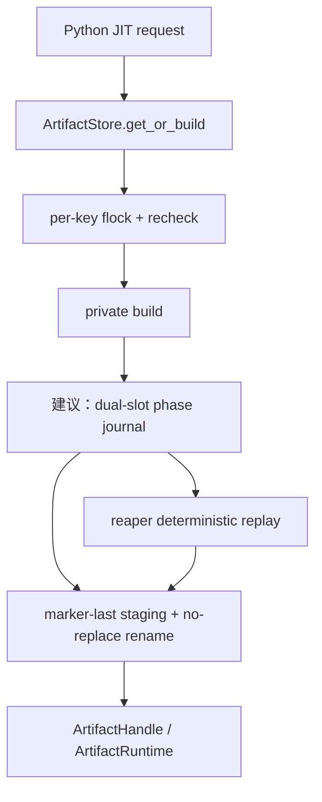
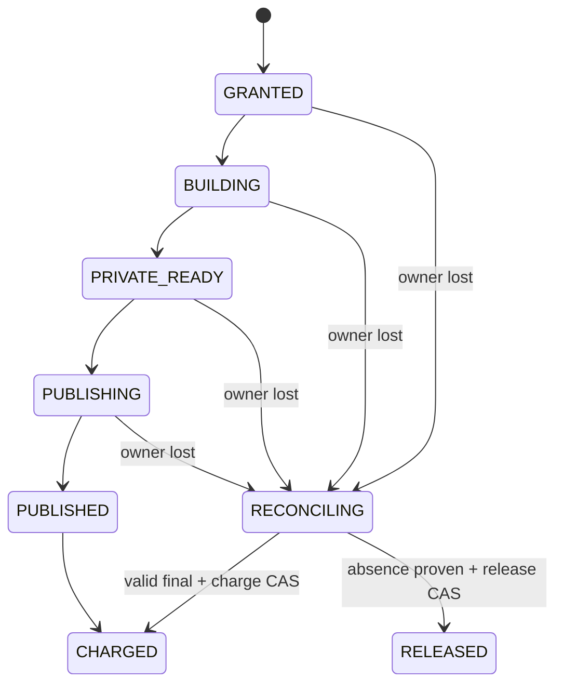

> 源码基线：`hw-native-sys/pypto` 默认分支 [`396e1b6b`](https://github.com/hw-native-sys/pypto/commit/396e1b6b447bc57802fb1ee573b6daae01b3f280)。相对上一章的 [`39474d24`](https://github.com/hw-native-sys/pypto/commit/39474d24d15383d0ba251dbeed8dc15ee49947f6)，默认分支前进了 13 个提交；[比较结果](https://github.com/hw-native-sys/pypto/compare/39474d24d15383d0ba251dbeed8dc15ee49947f6...396e1b6b447bc57802fb1ee573b6daae01b3f280)中，PR [#3270](https://github.com/hw-native-sys/pypto/pull/3270)改变了 private build root 的解析与回退，但没有加入 durable reservation ledger、build journal 或 online reaper。本文的“双槽 journal”是基于现有不变量推导出的建议协议，不是当前代码事实。

## 本篇在 PTO 课程路线中的位置

上一章把进程崩溃后的责任链收束为：`reservation → owner epoch → phase journal → orphan reconcile → charge/release CAS`。但如果 journal 自己在掉电时只写了一半，reaper 读取到的“恢复事实”也可能是假的。

本篇只回答一个问题：**如何让一个 build phase record 在任意单点 crash 后仍有至少一份可验证历史，并让重放结果不依赖 mtime、目录遍历顺序或“最后一个进程的猜测”？**

这仍处于 Host Artifact durability 层，不新增 PTO ISA、Tile、layout 或 device pipeline 语义；它为以后跨进程 cache admission、runtime lease 和 serving 预热提供可信恢复基座。

## 前置知识

需要记住三个已经确认的边界：

1. `flock` 释放只表示下一位 writer 能进入 critical section，不表示旧 writer 留下的 private/staging bytes 已闭合。
2. final artifact 以不可变目录发布；完整 `artifact_manifest.json` 是 cache hit 的必要条件。
3. reservation 的账本效应与文件系统副作用不是同一个事务。rename 已成功、journal 尚未来得及更新时，不能再次 charge，也不能误 release。

## 今日核心问题

一个可恢复 journal 至少要抵抗三类失败：

- **torn record**：JSON 只有前半段、UTF-8 被截断，或数据写完但未持久化；
- **stale pointer**：新 record 已经落盘，但 `CURRENT` 仍指向旧槽；反过来，`CURRENT` 已更新而新槽未完整持久化；
- **ambiguous side effect**：`renameat2(RENAME_NOREPLACE)` 成功后进程崩溃，journal 仍停在 `PUBLISHING`。

关键结论先给出：**不能把一个可变 JSON 或一个 `CURRENT` 指针当作唯一真相。最小可行方案是两个交替写入的不可变 record 槽；恢复时独立验证两槽，选择最高合法 revision，再用 final artifact 的完整 manifest 校正滞后的 phase。**

## PTO 全栈中的位置



上游输入是完整 `ArtifactKey`、`ArtifactSpec`、reservation identity 和 owner epoch；下游消费者是 publisher、capacity ledger、orphan reaper，以及最终用 `ArtifactHandle` 装载产物的 runtime。

## 概念和精确语义

### 当前代码事实：artifact manifest 已经是一个可靠的完成标记

[`_artifact_manifest.py`](https://github.com/hw-native-sys/pypto/blob/396e1b6b447bc57802fb1ee573b6daae01b3f280/python/pypto/jit/_artifact_manifest.py) 的 `make_manifest` 对 payload 建立完整 inventory，记录 path、size、mode/execute 属性和 SHA-256；`encode_manifest` 使用排序 key、紧凑分隔符并拒绝 NaN，得到确定性字节序列。`read_manifest` 还拒绝重复 JSON field，然后根据当前目录重新计算 expected manifest，要求 canonical bytes 完全相等。

[`artifact_cache.py`](https://github.com/hw-native-sys/pypto/blob/396e1b6b447bc57802fb1ee573b6daae01b3f280/python/pypto/jit/artifact_cache.py) 的 `_complete_staging` 按以下顺序完成 publication：

1. `fsync` 每个 payload file；
2. 从深到浅 `fsync` nested directory；
3. 以 `xb` 独占创建 `artifact_manifest.json`，写入 canonical bytes 并 `fsync`；
4. `fsync` staging directory；
5. `_rename_noreplace` 原子迁移到 final slot，再 `fsync` destination parent。

因此 manifest 的语义是：**只有 payload 已完成且与 key/spec 一致时，完成标记才可能存在。** 这比“目录存在”强得多。

### 当前代码事实：manifest 不是 build journal

`ArtifactStore._publish` 只记录最终 payload，不记录 reservation、owner incarnation、`BUILDING/PRIVATE_READY/PUBLISHING` 或 ledger effect。`_BuildFlights` 也只是进程内 Future 表：fork 后会 reset，完成项立即删除。`ArtifactBuild` 则故意保留 `private_directory` 和 adapter value，且没有自动 cleanup。

所以 final manifest 能回答“这个 immutable artifact 是否完整”，却不能回答“谁拥有尚未完成的 private build、容量是否已 charge、某个 reaper 是否已经 release”。这正是 phase journal 必须补齐的对象边界。

### 建议协议：双槽不是两份随便复制的 JSON

对每个 `reservation_id` 建议维护 `record.A` 与 `record.B`。新 revision 永远写入非当前槽，绝不原地覆盖有效槽。一个 record 至少包含：

| 字段 | 作用 | 必须验证的不变量 |
| --- | --- | --- |
| `schema` | 协议版本 | 未知 schema fail closed |
| `reservation_id`、`artifact_key` | 逻辑身份 | 与目录和请求一致 |
| `owner` | `boot_id + pid + epoch` | 旧 epoch 无权追加 |
| `revision`、`previous_digest` | 单调历史链 | `rev=n+1` 且链接上一有效 record |
| `phase` | build 状态 | 只能走合法 transition |
| `private/staging/destination` identity | 物理对象 | 不接受 path reuse 或 symlink 改写 |
| `manifest_digest` | final 证据绑定 | 必须对应验证通过的 artifact manifest |
| `effect_id`、resource vector | ledger 幂等键 | charge/release CAS 至多一次 |
| `record_digest` | torn/corruption 检测 | 对 canonical record（不含自身）做 SHA-256 |

`CURRENT` 可以帮助快速定位，但只能是 hint。恢复者必须能忽略它，分别验证 A/B；否则“新槽已 durable，指针仍旧”会错误回退，而“指针已新，新槽 torn”会把最后一份好记录藏起来。

## 真实文件、类型与函数逐段解读

### `ArtifactStore._get_or_build`：journal 应插在哪里

当前调用链是：首次 `lookup` → per-key `file_lock` → 锁内再次 `lookup` → `_build_private` → `_publish`。锁内 recheck 阻止重复编译同一 key，但锁与进程同寿命，不能承载 crash 后的长期事实。

建议的持久化点不是每行代码，而是每个**外部可见副作用之前**：

```text
GRANTED
  write BUILDING record, fsync
  create reservation-scoped private directory
  write PRIVATE_READY record, fsync
  create/copy staging
  write PUBLISHING record, fsync
  rename_noreplace(staging, destination)
  validate destination manifest
  write PUBLISHED record, fsync
  ledger CAS(effect_id)
  write CHARGED record, fsync
```

如果 record 写失败，不能继续执行对应副作用；如果副作用成功而后继 record 失败，恢复者必须靠物理证据向前重放，而不是回滚已经发生的 rename。

### `_complete_staging`：journal 可以复用的原语

现有代码已经给出一套正确的 durability 顺序：内容先于完成标记，file fsync 先于 directory fsync，final rename 后再同步 parent。双槽 record 应复用同样原则：

1. 在 inactive slot 的临时文件写 canonical record；
2. `flush + fsync(file)`；
3. no-replace/atomic rename 为 `record.A` 或 `record.B`；
4. `fsync(record_dir)`；
5. 可选地更新 `CURRENT`，再 `fsync` pointer 与 parent。

注意：如果 A/B 文件名固定，下一轮需要替换两轮前的旧槽。安全做法是先生成带 revision 的临时文件，再对 inactive 槽做受控 replace，并保证另一槽始终是完整 fallback；更简单但目录会增长的方案是 `record.<revision>` append-only。双槽节省空间，却要求严格的交替与 revision 校验。

### `lookup`：为什么恢复必须 fail closed

当前 `lookup` 将缺文件、畸形 JSON、重复 field、payload 变化归为 `INVALID`，将 unreadable I/O 归为 `STORAGE_ERROR`，都不会在线修复或覆盖 final slot。这条边界应延续到 journal：

- 一槽坏、一槽好：使用好槽；
- 两槽都坏：quarantine，不能猜 phase；
- 相同最高 revision 却内容不同：split-brain，quarantine；
- revision 高但 `previous_digest` 断链：不能仅凭“数字更大”获胜；
- record 与物理 manifest 冲突：只有经过现有 `read_manifest` 完整验证的 final artifact 才能作为 forward evidence。

### Deterministic replay 的八步算法

为了让“确定性”可测试，而不是一句口号，恢复过程可以固定成八步；任何实现都不得跳过中间的身份核验：

1. **安全打开目录。** 先确认 reservation root 及其祖先均为真实目录，不跟随 symlink；这与当前 `_mkdir/check_directory` 的防护目标一致。
2. **限制输入。** 分别读取 A/B 到固定上限，拒绝超长文件、特殊文件、非法 UTF-8、重复字段、NaN 与未知顶层字段，避免解析器宽容度变成协议分歧。
3. **重算 record digest。** 对移除 `record_digest` 后的 canonical encoding 求 SHA-256；digest 不匹配的槽等价于不存在，不能因为 JSON 可解析就接受。
4. **核对静态身份。** `reservation_id`、`artifact_key`、resource vector 和所有 path identity 必须与 record 所在命名空间一致。record 中的 path 只是声明，不能被直接拼接后盲目打开。
5. **核对历史链。** 若两槽都是候选，较高 revision 必须恰为较低 revision 加一，并且 `previous_digest` 指向后者。revision 跳跃或同 revision 双值都进入 quarantine。
6. **核对 writer 权限。** record 的 owner/reaper epoch 必须等于 ledger 中已 claim 的 epoch；PID 存活只能作为诊断信息，不能覆盖 epoch 结论。
7. **做 physical census。** 按 record phase 检查 private、staging 与 destination；final 只有通过现有 `read_manifest(key, spec)` 才算 `PUBLISHED`，空目录、orphan staging 和 malformed marker 都不是成功。
8. **执行一个幂等动作。** 用 expected revision 写下一 record，再以稳定 `effect_id` 做账本 CAS；若竞争失败，从第一步重新读取，不在旧 snapshot 上继续删除或 charge。

这套顺序刻意把“解析正确”“身份正确”“历史正确”“物理事实正确”拆成四份证明。一个 record 可以同时是合法 JSON、digest 正确，却属于旧 reservation；也可以历史链合法，却声称的 final payload 已被破坏。只做其中一两项会把格式校验误当成恢复正确性。

record digest 的目标是检测 torn/corrupt bytes 和建立前向链，不是抵御拥有同一 cache 写权限的恶意进程。若威胁模型包含 hostile writer，需要密钥签名、权限隔离或可信服务；仅把 SHA-256 换成 CRC 不会改变权限边界。相反，在当前 trusted-owner 模型里，SHA-256 与 artifact manifest 已使用的摘要体系一致，便于生成稳定 Golden。

## BuildRecord 生命周期



`BuildRecord` 在 reservation grant 后创建；owner 每次取得新 epoch 才能追加 revision。正常路径由 builder/publisher 消费，异常路径由 reaper claim 后消费。它不能在“进程退出”时失效，而要等到文件系统物理状态与 ledger effect 都闭合：final 可验证则 `CHARGED`，确证没有可保留 bytes 才 `RELEASED`。随后可以压缩为 tombstone，但 tombstone 仍须保留 reservation identity 与最终 effect id，避免 ABA。

每个 transition 也有明确前置/后置条件。`BUILDING → PRIVATE_READY` 的前置是 builder 正常返回且 `make_manifest(private)` 通过，后置是 private identity 与实际 size 已固定；`PRIVATE_READY → PUBLISHING` 的前置是 staging identity 已分配，后置是 reaper 即使接管也知道应继续复制还是清理；`PUBLISHING → PUBLISHED` 的后置不是“rename 返回过”，而是 destination 经 `read_manifest` 重新验证。`PUBLISHED → CHARGED` 则要求 ledger 以 `effect_id` 接受或确认同值重放。任何 phase 跳过这些条件都属于非法组合。

尤其不能允许 `PUBLISHING → RELEASED` 只凭 staging 不存在：staging 可能已经被 rename 为 destination。也不能允许 `PRIVATE_READY → CHARGED` 只凭私有 payload 完整，因为 shared artifact 尚未产生且 private 的 retained lifetime 仍由 adapter/runtime 引用决定。这两个反例分别说明目录缺失不等于字节消失、payload 完整也不等于 ownership 已转移。

## 端到端调用链与恢复链

正常链仍是当前真实入口：`resolve_persistent` 选择 store/private root → `ArtifactStore.get_or_build` 合并进程内请求 → per-key `file_lock` 跨进程串行 → `_build_private` 产生 adapter value → `_publish` 完成 marker-last/no-replace publication → `ArtifactHandle` 被后续 runtime 使用。[`_persistent.py`](https://github.com/hw-native-sys/pypto/blob/396e1b6b447bc57802fb1ee573b6daae01b3f280/python/pypto/jit/_persistent.py) 当前能解析新的 `PYPTO_PROG_BUILD_DIR`，但 private root 的位置变化不改变 crash 协议。

建议恢复链是：扫描 reservation record dir → 独立验证 A/B → 选择最高合法链头 → 验证 private/staging/final identity → reaper 以更高 epoch claim → 执行幂等 publish/cleanup 或 ledger CAS → 写入下一 revision。所有决策只依赖已验证 bytes、身份和单调 revision；mtime、PID 是否存在、目录枚举顺序都不能参与 tie-break。

## 具体状态演算：一次 crash-after-rename

设 `R77` 对应一个 `GENERATED` artifact，payload 为 12 MiB，账本先 reservation 16 MiB；owner 为 `(boot-9, pid=420, epoch=12)`。

| 时刻 | `record.A` | `record.B` | `CURRENT` | final slot | 确定性结果 |
| --- | --- | --- | --- | --- | --- |
| t0 | rev42 `PRIVATE_READY`，有效 | 旧 rev41 | A | 不存在 | 从 rev42 继续 |
| t1 | rev42 有效 | rev43 只写半个 JSON | A | 不存在 | B 无效，仍选 A |
| t2 | rev42 有效 | rev43 `PUBLISHING` 已 fsync | A（陈旧） | 不存在 | 扫两槽，选 B |
| t3 | rev42 有效 | rev43 有效 | B | manifest 完整，rename 已完成 | final 是 forward evidence |
| t4 | rev44 `PUBLISHED` | rev43 | A | 完整 | `effect_id=R77:charge` CAS |
| t5 | rev44 | rev45 `CHARGED(actual=12 MiB)` | B | 完整 | 重放结束 |

t3 正是危险窗口：owner 在 rename 后、写 `PUBLISHED` 前崩溃。reaper 不能因为 journal 仍为 `PUBLISHING` 就再 rename，也不能释放 16 MiB。它调用现有 `read_manifest` 验证 final slot；若 key/spec/payload 全匹配，就把事实单调推进为 `PUBLISHED`，再用 `effect_id` 做一次 charge/reconcile CAS。即使两个 reaper 都执行，只有赢得 epoch/revision claim 且 CAS 成功者能产生账本效应。

这里“deterministic”不是“总能自动修好”，而是：**同一组有效 record、physical census 和 ledger revision，在任何进程上都得到同一结果；证据不足时统一 quarantine。**

这也意味着恢复程序升级后仍要保留旧 schema 的明确解释器或拒绝路径，不能让同一份磁盘状态因进程版本不同而一边释放、一边计费。跨版本行为必须纳入 Golden，并把无法唯一迁移的记录留在隔离区等待人工处置。

## 为什么这样设计，以及替代方案

| 方案 | 优点 | 根本缺口/代价 |
| --- | --- | --- |
| 单 JSON + atomic rename | 最少文件和代码 | parent 未同步、pointer/record 不一致时没有第二份好历史 |
| 双槽 immutable record | 有界空间；任一槽 torn 时仍可恢复；适合单 build 的短状态机 | 需 revision、hash chain、epoch 和冲突检测，不能只看 `CURRENT` |
| append-only WAL | 历史完整，天然保留多 revision | partial tail、segment rotation、compaction 与容量治理更复杂 |
| SQLite WAL | 事务、校验与并发机制成熟 | 新依赖、schema migration、锁与 network filesystem 语义都要重新证明 |

从第一性约束看，journal 需要的不是通用数据库，而是“任意单次写坏时保留一份好记录、side effect 可幂等重放、历史身份不可 ABA”。在单机本地 filesystem 与每个 reservation 只有一条短链的前提下，双槽是最小充分方案；当需要跨多记录原子事务、查询或高频 event history 时，再升级 WAL/SQLite 才有收益。

## 访存、计算、并行和硬件约束

journal 增加的是 Host 冷路径的小 record 写入与 `fsync`，不改变 NPU kernel 的 shape/dtype/device，也不进入 PTO ISA 热循环。它会拉长首次编译/publication 的尾延迟，但 hot cache hit 只读 final manifest，无需推进 journal。

不能为了少一次 `fsync` 把 `PUBLISHING` 与 rename 合并为“先做后记”：这会重新打开无证据副作用窗口。可以合并纯内存 heartbeat，不能合并决定 ownership、物理删除、rename 或 capacity effect 的 durable boundary。现有 `ArtifactStore` 仅声明 Linux `renameat2(RENAME_NOREPLACE)`、POSIX `flock` 及支持这些语义的 filesystem；[Artifact Store 文档](https://github.com/hw-native-sys/pypto/blob/396e1b6b447bc57802fb1ee573b6daae01b3f280/docs/en/dev/09-artifact-store.md)也没有为 network filesystem 承诺同等一致性，因此 journal 不应扩大支持范围。

## 测试证据与未覆盖风险

[`test_artifact_cache.py`](https://github.com/hw-native-sys/pypto/blob/396e1b6b447bc57802fb1ee573b6daae01b3f280/tests/ut/jit/test_artifact_cache.py) 给出四组直接证据：

1. `test_payload_and_completion_marker_are_verified` 注入 missing/changed/extra/mode/symlink/FIFO/marker/duplicate-field 损坏，预期全部 `INVALID`；它证明完整性由重算 manifest 决定，不由目录存在决定。
2. `test_malformed_marker_is_invalid` 注入截断 JSON、非法 UTF-8、`null`、数组和 NaN，验证 parser fail closed；这正是 journal slot validator 应复用的测试形状。
3. `test_orphan_staging_and_empty_final_slot_never_hit` 构造 `.tmp.abandoned` 与空 final slot；前者是 MISS、后者是 INVALID，且 build 不覆盖它们，证明 orphan/占位目录不能冒充完成事实。
4. `test_failed_parent_sync_after_rename_keeps_both_valid_outputs` 在 rename 后的 parent fsync 注入失败，调用返回 PRIVATE，但重新 lookup 已是 HIT；它直接展示“API 结果滞后于物理 publication”，也是恢复必须检查 final manifest 的原因。

另有 `test_invalid_manifest_is_not_repaired` 固定 online path 不修复、`test_no_replace_preserves_even_an_empty_destination_created_during_build` 固定不覆盖并发创建的槽，以及 `test_copy_corruption_never_publishes` 固定复制后重算 inventory。

但这些测试只覆盖 artifact completion marker，不覆盖本文建议的 phase journal。仍缺：每个 record byte offset 的 torn-write fault injection、A/B/CURRENT 全排列、同 revision 冲突、断裂 `previous_digest`、crash-after-rename-before-record、charge CAS 重放、stale owner epoch、双 reaper claim、目录 fsync 失败，以及真机 power-loss/文件系统矩阵。PR [#2723](https://github.com/hw-native-sys/pypto/pull/2723)合入了当前 immutable publication；RFC [#2653](https://github.com/hw-native-sys/pypto/issues/2653)记录了早期设计范围，但当前仍明确没有 cleanup/eviction API。

建议把新增测试分成三层。第一层是纯 record codec/property test：任意截断点、bit flip、重复字段、revision overflow 和 canonical round-trip。第二层是 filesystem fault test：在每个 `write/fsync/rename/fsync-parent` 后模拟进程死亡，重启后反复 replay 两次，要求第二次不再改变 ledger 或文件。第三层才是多进程/NPU 集成：builder 被 `SIGKILL`、两个 reaper 同时 claim、runtime 仍持有 private path，以及 final artifact 已装载但 owner 消失。通过前两层只能证明协议机，不足以证明 native handle 与 device work 已 terminal。

## 与前后章节的连接

上一章定义了 owner-loss 后“谁有权恢复”；本章定义“恢复者可以相信哪些 bytes”。两者缺一不可：只有 epoch 没有双槽记录，合法 reaper 仍可能读到 torn state；只有双槽没有 epoch，两个 reaper 或复活的旧 owner仍可并发追加。

下一章将继续沿恢复链向后：journal 已恢复、reaper 已 claim 后，怎样把等待中的 builder/runtime 唤醒，同时保证 recovery queue 不 lost wake、不因大 orphan 饥饿小任务，也不让新 admission 抢走 recovery headroom。

## 本篇结论、知识债与理解检查

结论：PyPTO 已有的 `artifact_manifest.json` 是可靠的 artifact completion marker，但不是 build phase journal。建议的最小 durable journal 是双槽不可变 record：inactive-slot write + file fsync + directory fsync，`CURRENT` 仅作 hint；恢复独立验证两槽，以 revision/hash chain/epoch 选择唯一链头，并让经过完整验证的 final manifest 作为 crash-after-rename 的 forward evidence。ledger side effect 还必须以 `effect_id` CAS 幂等闭合。

新增知识债包括：record schema 与 canonical encoder、slot replace 的精确 fsync 协议、reaper claim CAS、physical identity/no-symlink verifier、ledger effect API、故障注入矩阵、network filesystem 明确拒绝或证明，以及 tombstone/compaction 策略。

三个理解检查问题：

1. 为什么 `CURRENT=B` 不能证明 B 是可用的最新 record？
2. journal 仍是 `PUBLISHING`，但 final manifest 完整有效时，为什么恢复必须向前推进而不是重新发布或释放 reservation？
3. 双槽已经抵抗 torn write，为什么仍然需要 owner/reaper epoch 与 `effect_id` CAS？

下一章：**Journal 恢复后谁唤醒等待者——Recovery Queue、No-lost-wake 与 Reaper Fairness。**

## 课程账本增量

- 章节：课程 87。
- 所选仓库：仅 `hw-native-sys/pypto`。
- 新覆盖：`_artifact_manifest.make_manifest/read_manifest/encode_manifest`、`artifact_cache._complete_staging/_rename_noreplace/lookup/_publish`，以及 malformed marker、orphan staging、rename 后 parent-sync failure 测试。
- 新确认：completion marker 与 phase journal 是两个不同抽象；`CURRENT` 不是真相；最高 revision 还必须满足 schema、digest chain、epoch 与合法 transition；完整 final manifest 能把滞后 journal 单调推进；账本 effect 必须另以 CAS 幂等化。
- ISA 知识地图：无新增指令语义；补齐 Host Artifact durability 与 recovery evidence。
- 待实现：双槽 record、fault matrix、reaper/ledger 接口与 runtime 唤醒链。
